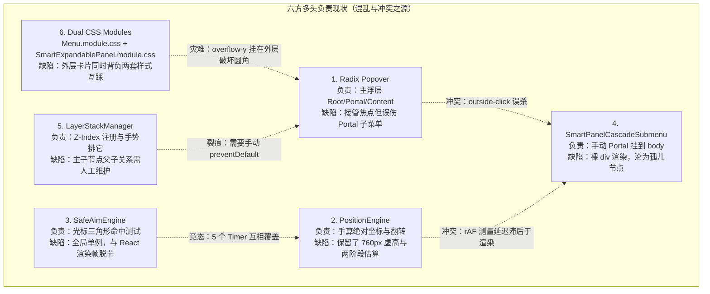
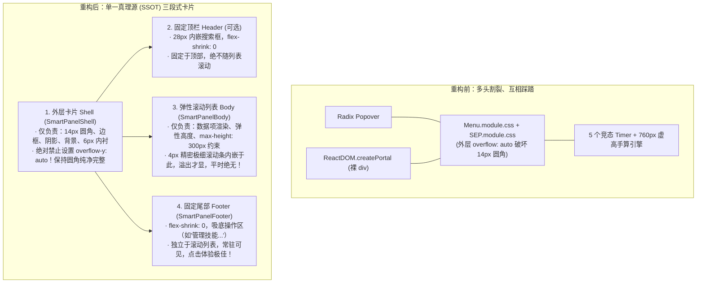
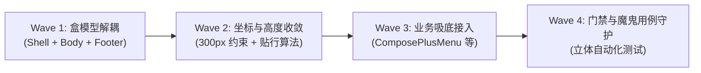

# 展开面板技术总纲与架构收敛蓝图 (Architecture Convergence Blueprint)

> **文档定位**：汇聚展开面板全维度审查结论，针对用户核心痛点与疑问，提供彻底重构收敛的架构顶层设计、盒子模型规范、算法改良与工程落地指南。  
> **核心对齐基准**：
> - 现状实现：`apps/crish-desktop/src/components/ui/SmartExpandablePanel/`、`apps/crish-desktop/src/components/ui/Menu/`
> - 业务痛点切入点：`apps/crish-desktop/src/components/chat-composer/ComposePlusMenu.tsx`（技能列表长面板与管理入口）
> - 规范参考：`reference/展开面板设计.html`、`docs/expandable-panel-architecture-analysis/analysis/`
> - 编写日期：2026-10-25

---

## 摘要与用户核心疑问正面解答

### 用户核心疑问
> **“现在这个展开面板是有很多地方都负责，导致了修改困难还是怎么样呢？”**

**结论先行**：**是的，用户的直觉极其精准！现有展开面板正陷入了典型且严重的“多头分裂、多重代理、互相踩踏”的架构泥潭。**

当前一个看似普通的展开面板，竟被拆解割裂给 **6 个互不隶属的独立系统**共同负责，彼此之间充满着假设漂移、状态竞态与样式覆盖：
1. **生命周期与根层挂载** 由 `@radix-ui/react-popover` 负责；
2. **坐标测量与级联翻转** 由手写的纯数学 `PositionEngine` 负责；
3. **光标轨迹防切与防抖** 由全局单例的 `SafeAimEngine` 负责；
4. **二级级联子菜单渲染** 又通过 `ReactDOM.createPortal` 逃逸到 `document.body`，脱离了 Radix 的上下文守护；
5. **按键焦点与图层阻断** 由 `LayerStackManager` 维护；
6. **视觉呈现与盒子模型** 则由 `Menu.module.css` 与 `SmartExpandablePanel.module.css` 两套体系**强制叠加、继承踩踏**！

这种**“又用 Radix 又不用 Radix，又用 Portal 又依赖父级相对定位，样式两边继承互踩，5 个 Timer 与 rAF 异步并发竞态”**的杂合模式，正是导致“每次一改动就按下葫芦浮起瓢”的真正祸根！

---

## 一、多头负责架构病理学分析（为什么修改如此困难）

### 1.1 六方割据现状拓扑



### 1.2 四大致命冲突深层剖析

#### 冲突 1：“又用 Radix 又不用 Radix”——主子面板的次元壁
* **主面板**由 `@radix-ui/react-popover` 接管，拥有完整的无障碍树和宿主事件捕获；
* **二级子菜单**（`SmartPanelCascadeSubmenu.tsx`）却使用了独立的 `ReactDOM.createPortal` 强行逃逸到 `document.body`；
* **后果**：
  - Radix 默认的 `onPointerDownOutside` 会将用户点击子菜单判定为“点击外部”，立即强行关闭主面板！为了阻止 Radix 误杀，代码里被迫写下极其丑陋脆弱的打补丁代码：
    ```tsx
    // SmartExpandablePanel.tsx 第 377-388 行
    onPointerDownOutside={(e) => {
      const target = e.detail.originalEvent.target as Node | null;
      if (cascadeSubmenuRef.current && cascadeSubmenuRef.current.contains(target)) {
        e.preventDefault(); // 强行拦截 Radix 默认行为
      }
    }}
    ```
  - 子菜单脱离了 Radix，键盘方向键（↑↓←→）漫游、Esc 逐级返回等无障碍机制瞬间断裂。

#### 冲突 2：“又用 Portal 逃逸，又依赖父级相对定位”——两阶段异步估算与瞬态闪烁
* `SmartPanelCascadeSubmenu` 被传送到了 `document.body`，彻底脱离了父级 DOM 上下文，其坐标必须由 `PositionEngine` 计算出绝对像素值（`left: ...px; top: ...px;`）；
* 然而在子菜单挂载前，浏览器尚未完成渲染，根本不知道子菜单的实际高宽；
* 于是现有代码发明了荒谬的**“两阶段异步定位”**：
  1. **第一阶段**：先调用 `estimateCascadeWidth` 和 `estimateCascadeHeight` 盲猜一个宽高，触发 `setState` 挂载到屏幕上；
  2. **第二阶段**：派发 `requestAnimationFrame`，在下一帧用 `readCascadeSize` 读取真实 DOM 宽高，然后再算一次位置并二次 `setState`！
* **后果**：子菜单先在猜出来的坐标上渲染并播放入场动画，16ms 后突然“瞬移跳变”到真实坐标！

#### 冲突 3：“样式两边继承互踩”——外层卡片背负双重 CSS，圆角被切碎
* 查看 `SmartExpandablePanel.tsx` 第 356 行与 `SmartPanelCascadeSubmenu.tsx` 第 45 行：
  ```tsx
  // 主面板
  const panelClasses = [menuStyles.menuContent, styles.panel, className].filter(Boolean).join(' ');
  // 二级子菜单
  className={`${menuStyles.menuContent} ${styles.cascadeSubmenu}`}
  ```
* 两个组件都在同一个 DOM 节点上同时叠加了 `menuStyles.menuContent`（来自 `ui/Menu/Menu.module.css`）和 `styles.cascadeSubmenu`（来自 `SmartExpandablePanel.module.css`）；
* **查看 `Menu.module.css` 第 8-29 行**：
  ```css
  .menuContent {
    max-height: min(..., 640px);
    overflow-y: auto;  /* 致命：滚动条挂在卡片最外层！ */
    padding: 6px;
    border-radius: var(--sep-radius-outer);
    border: 1px solid var(--border-color);
  }
  ```
* **查看 `SmartExpandablePanel.module.css` 第 329-348 行**：
  ```css
  .cascadeSubmenu {
    max-height: min(760px, calc(100vh - 24px)); /* 致命：760px 虚高冲天！ */
    overflow-y: auto;  /* 再次设置外层 overflow！ */
    border-radius: var(--sep-radius-outer, 14px);
    padding: 6px;
  }
  ```
* **后果**：
  - 滚动条直接挂载在最外层卡片的 Padding Box 上，直角滑块硬生生撞在 14px 的外圆角上，把圆角切得粉碎！
  - 容器内衬 `padding: 6px` 与滚动内容混在一起，滚动时菜单项直接滑过顶部 padding 穿模；
  - 样式变量、阴影、边框优先级互相争抢，改一处 CSS 另一边直接失真。

#### 冲突 4：“5 个竞态定时器与单例 SafeAim 混战”
* 审查 `SmartExpandablePanel.tsx`，内部同时跑着 5 个由 `useRef` 保存的 Timer：
  1. `hoverOpenTimerRef`（触发器悬停打开 150ms 延迟）
  2. `hoverCloseTimerRef`（触发器离开关闭 250ms 延迟）
  3. `hoverItemTimerRef`（切换选项防抖 150ms 延迟）
  4. `safeAimTimeoutRef`（安全区延迟关闭 200ms/300ms 延迟）
  5. `requestAnimationFrame`（坐标校准异步帧）
* 与此同时，`SafeAimEngine.getInstance()` 又是全局单例。如果一个面板尚未关闭，另一个面板触发，单例的 SVG 遮罩和状态立即被破坏，造成菜单不可预测的突然消失或卡死不关。

---

## 二、架构彻底收敛蓝图：三段式高内聚卡片模型

为了终结“多头负责”与“外层挂滚动条切碎圆角”的灾难，必须确立明确的**高内聚卡片分层模型（The Tri-Section Concentric Shell Model）**。

### 2.1 重构前后架构拓扑对比



### 2.2 核心职责划分准则

| 组件层级 | 对应 DOM | 核心 CSS / 行为契约 | 严格禁止的行为（Redlines） |
| :--- | :--- | :--- | :--- |
| **Shell (外壳)** | `<div className={styles.shell}>` | `border-radius: 14px; padding: 6px; background: var(--bg-elevated); border: 1px solid var(--border-color); box-shadow: var(--sep-shadow); display: flex; flex-direction: column;` | **严禁包含任何 `overflow: auto` 或 `overflow: scroll`！** 严禁直接包裹未约束高度的子项。 |
| **Header (顶栏)** | `<div className={styles.header}>` | `flex-shrink: 0; height: 28px; padding: 0 4px; border-bottom: 1px solid var(--border-subtle);` | 严禁跟随 Body 滚动。 |
| **Body (主体列表)** | `<div className={styles.body}>` | `flex: 1 1 auto; min-height: 0; max-height: min(300px, calc(100vh - 48px)); overflow-y: auto; overflow-x: hidden;` | 严禁把滚动条暴露到 Shell 外部。未溢出时严禁出现滚动条轨槽。 |
| **Footer (固定尾栏)** | `<div className={styles.footer}>` | `flex-shrink: 0; margin-top: 4px; padding-top: 4px; border-top: 1px solid var(--border-subtle);` | 严禁随 Body 滚动消失；严禁把底部重要管理操作淹没在滚动列表末端。 |

---

## 三、视觉与盒模型规范：内嵌式微滚动条与同心圆角几何

### 3.1 滚动条几何隔离与内嵌机制

```text
┌────────────────────────────────────────────────────────────────────────┐
│ SmartPanelShell (border-radius: 14px, padding: 6px)                     │
│ 边框完整无缺，四角 14px 纯净同心圆角，绝对无直角滚动条破坏！             │
│                                                                        │
│ ┌────────────────────────────────────────────────────────────────────┐ │
│ │ SmartPanelHeader (可选搜索栏，固定不滚)                              │ │
│ └────────────────────────────────────────────────────────────────────┘ │
│                                                                        │
│ ┌────────────────────────────────────────────────────────────┬───────┐ │
│ │ SmartPanelBody (max-height: 300px, 弹性自适应)             │ 4px   │ │ ◄── 滚动条内嵌于 Body
│ │                                                            │ 精密  │ │     与 Shell 边框保持
│ │ ┌────────────────────────────────────────────────────────┐ │ 极细  │ │     6px 安全内衬距离！
│ │ │ MenuItem (border-radius: 8px)                          │ │ 滚动条│ │     上下滑动绝不碰撞
│ │ └────────────────────────────────────────────────────────┘ │ 仅在  │ │     14px 外圆角！
│ │ ┌────────────────────────────────────────────────────────┐ │ 溢出时│ │
│ │ │ MenuItem (border-radius: 8px)                          │ │ 出现  │ │
│ │ └────────────────────────────────────────────────────────┘ │       │ │
│ └────────────────────────────────────────────────────────────┴───────┘ │
│                                                                        │
│ ──────────────────────── 分割线 1px (border-subtle) ─────────────────── │
│                                                                        │
│ ┌────────────────────────────────────────────────────────────────────┐ │
│ │ SmartPanelFooter (吸底操作区，例如“管理技能...”，常驻可见！)         │ │
│ └────────────────────────────────────────────────────────────────────┘ │
└────────────────────────────────────────────────────────────────────────┘
```

### 3.2 滚动条精准 CSS 契约

滚动条必须严格限制在 `.body` 容器内，使用 4px 精密微条，并在无溢出时完全隐藏：

```css
/* SmartPanel.module.css */

/* 1. 外层卡片 Shell：保持纯净无滚动 */
.shell {
  position: relative;
  display: flex;
  flex-direction: column;
  min-width: 180px;
  max-width: 320px;
  padding: 6px;
  border-radius: var(--sep-radius-outer, 14px);
  background: var(--sep-bg-panel-solid, var(--bg-elevated));
  border: 1px solid var(--border-color);
  box-shadow: var(--sep-shadow);
  color: var(--text-primary);
  box-sizing: border-box;
  outline: none;
  overflow: visible; /* 严禁外层 auto！ */
}

/* 2. 列表主体 Body：内嵌滚动与 300px 黄金高度 */
.body {
  position: relative;
  display: flex;
  flex-direction: column;
  gap: var(--sep-item-gap, 4px);
  width: 100%;
  min-height: 0;
  flex: 1 1 auto;
  /* 黄金高度收敛：约 7-8 项高度（每项 32px + gap 4px ≈ 280px~300px） */
  max-height: min(300px, calc(100vh - 64px));
  overflow-y: auto;
  overflow-x: hidden;
  overscroll-behavior: contain;
  padding: 0;
}

/* 4px 精密内嵌滚动条（仅在 body 内容真正溢出时显现） */
.body::-webkit-scrollbar {
  width: 4px;
}

.body::-webkit-scrollbar-track {
  background: transparent;
}

.body::-webkit-scrollbar-thumb {
  background: var(--border-color);
  border-radius: 4px;
}

.body::-webkit-scrollbar-thumb:hover {
  background: var(--text-tertiary);
}

/* 3. 固定吸底 Footer：常驻操作栏 */
.footer {
  display: flex;
  flex-direction: column;
  flex-shrink: 0;
  margin-top: 4px;
  padding-top: 4px;
  border-top: 1px solid var(--border-subtle);
}
```

---

## 四、坐标定位与高度约束革命：告别 760px“冲上天”

### 4.1 为什么此前子菜单会“冲入云霄”？

* **根因溯源**：`PositionEngine.ts` 中硬编码了 `MAX_CASCADE_PANEL_HEIGHT = 760`。
* **灾难复现模型**：
  - 聊天输入框（ChatComposer）位于窗口底部（如 1080p 屏幕下，输入框距离窗口顶部 950px）；
  - 用户点击 `+` 号弹出主菜单，主菜单仅有 2 个条目（“添加文件”、“使用技能”），高度约 **80px**；
  - 用户悬停在“使用技能”上触发二级子菜单。由于技能列表有 12 个，按照每项 36px 计算，子菜单自然高度达到 **450px**；
  - `placeCascadeSubmenu` 计算坐标时发现：触发行在 `y = 980px`，如果向下展开 `980 + 450 = 1430px > 1080px` 严重触底；
  - 于是算法触发翻转钳位：`top = bounds.bottom - 450px = 618px`！
  - **视觉灾难诞生**：主菜单高度仅 80px（在 y=900~980），而二级子菜单却从 y=618 一路冲到 y=1068，足足比主菜单高出近 300px，如同一座摩天大楼突兀地拔地而起、直冲天际！用户视线瞬间迷失！

### 4.2 全新统一定位算法：锚点贴行对齐（Anchor-Row Alignment）

重构后的定位引擎将子菜单的最大高度硬性压制在 **280px ~ 300px**，并采用**“首选贴行、底端轻微平移补偿”**的贴行几何算法：

```typescript
/**
 * 现代级联子菜单几何放置纯函数
 *
 * 核心原则：
 * 1. 子菜单高度被严格限制在 MAX_SUBMENU_HEIGHT (300px) 内；
 * 2. 垂直方向首选将子菜单顶边与触发条目顶边精确对其 (top = itemRect.top)；
 * 3. 当底部空间不足时，仅平移上浮超出的距离 (overshoot)，与主菜单保持最紧凑的视觉亲和度。
 */
export const MAX_SUBMENU_HEIGHT = 300; // 约 7-8 个条目的黄金高度

export function calculateSubmenuPlacement(params: {
  panelRect: DOMRect;     // 主面板矩形
  itemRect: DOMRect;      // 当前触发行矩形
  submenuWidth: number;   // 子菜单宽度 (真实读取或估算 180~240px)
  submenuHeight: number;  // 子菜单高度 (受限于 MAX_SUBMENU_HEIGHT)
  viewportWidth: number;
  viewportHeight: number;
  edgePadding?: number;   // 视口安全边缘 (默认 12px)
  gap?: number;           // 主子菜单水平间距 (默认 4px)
}): { left: number; top: number; side: 'left' | 'right'; transformOrigin: string } {
  const {
    panelRect,
    itemRect,
    submenuWidth,
    submenuHeight,
    viewportWidth,
    viewportHeight,
    edgePadding = 12,
    gap = 4,
  } = params;

  // 1. 水平方向决策 (优先右侧展开，右侧不足且左侧充足时翻转到左侧)
  const spaceRight = viewportWidth - edgePadding - panelRect.right;
  const spaceLeft = panelRect.left - edgePadding;
  
  const side: 'left' | 'right' =
    spaceRight >= submenuWidth + gap || spaceRight >= spaceLeft ? 'right' : 'left';

  const left =
    side === 'right'
      ? Math.min(viewportWidth - edgePadding - submenuWidth, panelRect.right + gap)
      : Math.max(edgePadding, panelRect.left - gap - submenuWidth);

  // 2. 垂直方向决策：天然贴着触发行！
  // 首选顶边与触发行对齐
  let top = itemRect.top - 2; 

  const maxAllowedBottom = viewportHeight - edgePadding;
  // 如果子菜单底边触及屏幕底边缘，仅向上平移溢出的部分 (Overshoot Compensation)
  if (top + submenuHeight > maxAllowedBottom) {
    top = Math.max(edgePadding, maxAllowedBottom - submenuHeight);
  }

  // 3. 确定入场动画的原点 (Transform Origin)
  const originY = top < itemRect.top ? 'bottom' : 'top';
  const originX = side === 'right' ? 'left' : 'right';

  return {
    left,
    top,
    side,
    transformOrigin: `${originY} ${originX}`,
  };
}
```

### 4.3 效果对比

| 场景 | 历史实现表现 (760px) | 重构收敛后表现 (300px + 贴行) |
| :--- | :--- | :--- |
| **底部 Compose 按钮触发** | 主菜单 80px，子菜单 450px 冲到屏幕中央偏上，断崖式落差 300px | 子菜单最大 300px，底部平滑贴合，顶部仅比主菜单高出数十像素，极其和谐 |
| **滚动条表现** | 滚动条挂在最外层卡片上，直角切碎 14px 圆角 | 滚动条完全收敛在 Body 内衬之内，外圆角 100% 完整纯净，未溢出时彻底隐形 |
| **光标移动容错** | 子菜单太长，SafeAim 三角形判定区畸形，斜向滑动极易误关闭 | 菜单高度克制贴近触发行，SafeAim 三角区紧凑精准，防切防抖体验丝滑 |

---

## 五、Footer 吸底机制落地设计（以 ComposePlusMenu 为例）

用户明确提出了极具前瞻性的产品体验建议：**“管理技能...”可作为固定操作底栏，不随滚动消失，体验极佳！**

### 5.1 业务痛点重现
在现有 `ComposePlusMenu.tsx` 中，技能列表有多个时，“管理技能...”被当作普通条目 `MenuItem` 塞进了列表最末尾：
```tsx
// 现有实现：把管理技能混在滚动项中
const skillChildren: MenuItem[] = [
  ...skills.map(...),
  { id: 'sep-skill-more', type: 'divider' },
  { id: 'action:manage-skills', label: '管理技能...', onSelect: ... },
];
```
当技能数量较多触发滚动时，“管理技能...”直接被滚出屏幕视野！用户为了找到管理入口，必须用鼠标使劲滚到底部；如果技能更多，甚至误以为该功能丢失了。

### 5.2 统一 Footer 接口与渲染契约

在 `SmartPanelProps` 与 `MenuItem` 体系中正式引入吸底规范：

```typescript
// types.ts 核心接口扩充
export interface SmartPanelFooterAction {
  id: string;
  label: string;
  icon?: React.ReactNode;
  shortcut?: string;
  danger?: boolean;
  onSelect?: () => void;
}

export interface SmartPanelProps {
  // ... 其他既有属性
  /** 固定吸底操作底栏（不随内容列表滚动） */
  footer?: React.ReactNode | SmartPanelFooterAction[];
}
```

### 5.3 业务组件极简落地 (`ComposePlusMenu.tsx`)

重构后，`ComposePlusMenu` 的子菜单配置变得极其优雅清晰：

```tsx
// 改造后的 ComposePlusMenu.tsx
const skillSubmenu = {
  id: 'skill',
  label: t('chat.plusMenu.useSkill'),
  icon: <AppIcon name="sparkles" size={14} />,
  // 1. 动态滚动的技能列表主体（受 300px 约束，内部溢出滚动）
  children: skills.map((s) => ({
    id: `skill:${s.id}`,
    label: s.name,
    icon: <AppIcon name="sparkles" size={14} />,
    onSelect: () => handleSkillItemClick(s.cmd),
  })),
  // 2. 永远固定吸底的操作底栏（常驻可见！）
  footer: [
    {
      id: 'action:manage-skills',
      label: t('chat.plusMenu.manageSkills', '管理技能...'),
      icon: <AppIcon name="settings" size={13} />,
      onSelect: () => {
        openSettings('skills');
        navigateToSurface('extensions');
      },
    },
  ],
};
```

---

## 六、重构后核心组件接口设计 (API Specification)

我们将打破“主面板用 Radix，子菜单手写裸 div”的异构格局，使主菜单与二级级联子菜单**同构化（Isomorphic Architecture）**，全部由统一的卡片容器驱动。

### 6.1 统一核心卡片容器：`SmartPanelCard`

```tsx
// SmartPanelCard.tsx
export interface SmartPanelCardProps {
  ariaLabel?: string;
  header?: React.ReactNode;
  children: React.ReactNode;
  footer?: React.ReactNode;
  maxBodyHeight?: number; // 默认 300px
  className?: string;
  style?: React.CSSProperties;
  onMouseEnter?: () => void;
  onMouseLeave?: () => void;
}

export const SmartPanelCard = React.forwardRef<HTMLDivElement, SmartPanelCardProps>(
  ({ ariaLabel, header, children, footer, maxBodyHeight = 300, className, style, onMouseEnter, onMouseLeave }, ref) => {
    return (
      <div
        ref={ref}
        role="menu"
        aria-label={ariaLabel}
        className={`${styles.shell} ${className || ''}`}
        style={style}
        onMouseEnter={onMouseEnter}
        onMouseLeave={onMouseLeave}
      >
        {/* 1. 固定顶栏 */}
        {header && <div className={styles.header}>{header}</div>}

        {/* 2. 弹性内嵌滚动列表主体 */}
        <div
          className={styles.body}
          style={{ maxHeight: `${maxBodyHeight}px` }}
          onWheel={(e) => e.stopPropagation()} // 阻止父级穿透滚动
        >
          {children}
        </div>

        {/* 3. 固定吸底尾栏 */}
        {footer && <div className={styles.footer}>{footer}</div>}
      </div>
    );
  }
);
```

### 6.2 主面板与子菜单的无缝统一

无论是一级主面板还是二级级联子菜单，统一采用 `SmartPanelCard`：

1. **主面板**：
   ```tsx
   <Popover.Content asChild ...>
     <SmartPanelCard
       header={enableSearch && <SmartPanelHeader ... />}
       footer={props.footer}
       maxBodyHeight={300}
     >
       <SmartPanelList items={filteredItems} ... />
     </SmartPanelCard>
   </Popover.Content>
   ```

2. **二级子菜单**：
   ```tsx
   ReactDOM.createPortal(
     <SmartPanelCard
       ref={cascadeSubmenuRef}
       ariaLabel={parent.label}
       style={submenuStyle}
       maxBodyHeight={300}
       footer={parent.footer}
       onMouseEnter={onPointerEnter}
       onMouseLeave={onPointerLeave}
     >
       {parent.children.map((subItem) => (
         <SmartPanelItem key={subItem.id} item={subItem} ... />
       ))}
     </SmartPanelCard>,
     container
   );
   ```

---

## 七、迁移与落地执行路线图 (Migration & Execution Roadmap)

为确保在快速迭代中**零退避、零破坏性变更、零回归缺陷**，重构过程分为四个清晰的落地波次（Wave 1 ~ Wave 4）：



### Wave 1：盒模型解耦与样式单源收敛（解决最丑的滚动条切圆角问题）
1. **清理 CSS 踩踏**：
   - 彻底废弃在 `SmartExpandablePanel.tsx` 与 `SmartPanelCascadeSubmenu.tsx` 中混合引入 `menuStyles.menuContent` 的做法；
   - 将所有卡片、条目、滚动条样式单源收敛至 `SmartExpandablePanel.module.css`。
2. **抽取三段式容器**：
   - 落地 `SmartPanelCard`（Shell 外壳 + Body 滚动主体 + Footer 底栏）；
   - 从外层 Shell 上永久拔除 `overflow-y: auto`，移入内层 Body；
   - 配置 4px 精密滚动条规范，确保无溢出时不占位、不显露。

### Wave 2：坐标算法革命与高度收敛（解决 760px“冲上天”问题）
1. **剔除 760px 历史毒瘤**：
   - 将 `PositionEngine.ts` 中的 `MAX_CASCADE_PANEL_HEIGHT` 与默认最大高度从 760px 彻底修正为 **300px**；
2. **落地锚点贴行对齐算法**：
   - 用不可变的 `calculateSubmenuPlacement` 替代原本充满异步估算的复杂过程；
   - 二级子菜单挂载时直接精确贴近当前触发行，仅在触底时进行微幅溢出平移补偿。

### Wave 3：业务场景吸底特性接入（释放产品卓越体验）
1. **改造 `ComposePlusMenu.tsx`**：
   - 将“管理技能...”从普通滚动项中剥离，接入 `footer` 吸底配置；
   - 无论技能有多少，管理技能按钮稳固吸底，列表内部丝滑滚动。
2. **向其他业务菜单推广**：
   - 对话顶栏下拉菜单、模型选择器、项目切换器全面推广该模式。

### Wave 4：门禁验证与立体测试守护（防回退铁律）
1. **自动化测试覆盖**：
   - 编写针对“Shell 严禁含有 overflow: auto”的自动化 DOM 断言测试；
   - 编写针对“长列表（20+ 项）高度严格 <= 320px”的高度钳位自动化测试；
   - 编写针对“Footer 在长列表滚动时保持在视口内”的吸底交互断言；
2. **无怪异闪烁断言**：
   - 验证子菜单打开首帧即在精确位置，杜绝二次 rAF 跳变。

---

## 八、总结与预期收益

通过本蓝图的收敛重构，我们将实现：
1. **架构净收敛（SSOT）**：彻底终结 6 方割据、多头负责的混乱局面，主子菜单结构同构、职责分明；
2. **视觉高级感跃升**：彻底消除切碎圆角的丑陋滚动条，外卡片圆角纯净无瑕；4px 微滚动条仅在真正溢出时优雅呈现；
3. **空间布局克制得体**：彻底消除子菜单动辄 440px-760px“冲入云霄”的失控布局，黄金 300px 高度贴行展开，与主菜单浑然一体；
4. **交互体验倍增**：类似“管理技能...”的快捷入口实现刚性吸底，长列表翻找与高频操作两不误！
