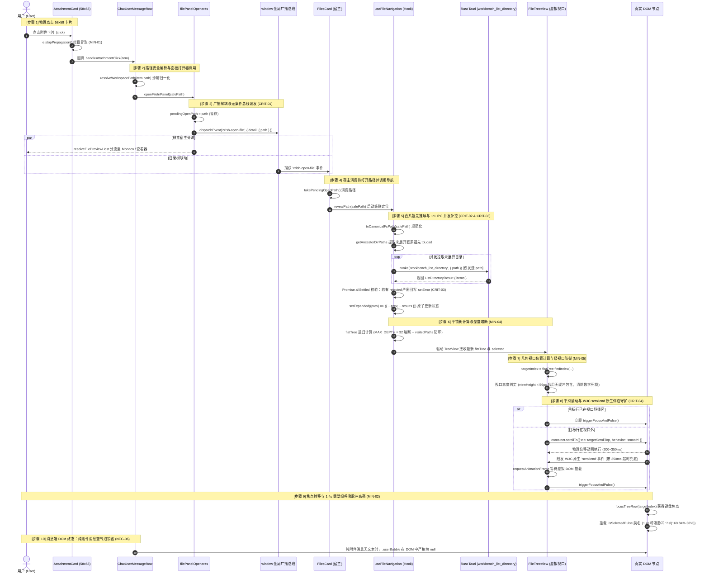
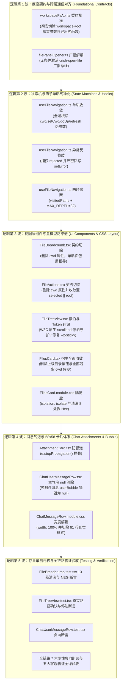

# Conex / Crish 文件树与附件联动架构端到端全链路终极总方案（Master Architecture & Implementation Plan）

> **文档标识**：`docs/file-tree-and-attachments-architecture/00-master-plan.md`  
> **所属战役**：`docs/file-tree-and-attachments-architecture/`  
> **首席架构师**：战役终极融合总方案首席系统架构师与跨平台通信专家  
> **权威性质**：全战役唯一合法、系统性自上而下的端到端终极总方案（全面融合 Plan Alpha 与 Plan Beta，穿透真实源码核验建立）。  
> **权威遵循**：严格遵从仓库根目录 [`AGENTS.md`](file:///c:/Software/conex/AGENTS.md)（§1 逻辑规划与反退避、§2 子 Agent 调度、§3 Git 提交纪律、§4 战役工作区结构规范、§7 严禁补丁与作弊、§7.1 立体验证纪律、§8 反过度设计硬性红线、§11 CI 治理与行数门禁、§12 自定义 Tooltip、§13 输入框与焦点态规范、§14 色彩空间与现代 CSS、§15/§16 Tauri MCP 4000 调试通道）及 [`ANTI_OVERENGINEERING_GUARDRAILS.md`](file:///c:/Software/conex/ANTI_OVERENGINEERING_GUARDRAILS.md)。  
> **核心硬性红线（零容忍）**：
> 1. **零功能伪连通（Zero Fake Connectivity）**：真实调用链 100% 物理绑定，无论文件预览分流至何种宿主（`file-viewer` 或 `files`），无条件优先派发 `crish-open-file` 广播事件，杜绝代码预览截断、空转组件与死快照；
> 2. **零多轨并存与零兼容 Shim（Zero Multi-track & Zero Compat Shim）**：工作区根目录（`root`）为全系统唯一权威事实源（SSOT），全域物理拔除 `cwd`，严禁保留 `@deprecated cwd?: string`、`cwd: _cwd` 或 `refresh(_ignoredDir?: string)`；
> 3. **零幽灵契约与零截肢式降级（Zero Ghost Contracts & Zero Amputation）**：跨层 IPC 严格 1:1 对齐底层 Rust 主注册表 `workbench_list_directory` 签名 `(app: tauri::AppHandle, path: String)`，绝不传递虚构的 `workspaceRoot` 幽灵参数；并发补拉异常严密收集并回写状态机，严禁在 `Promise.allSettled` 中静默吞咽核心异常；
> 4. **零虚构 Token 与零样式欺骗（Zero Pseudo-Tokens & Zero Box-Model Illusions）**：100% 遵从 Design Tokens，全域清洗裸 Hex 为标准 HSL 格式，彻底根除虚构变量（如不存在的 `--z-pinned-bar`，收敛为 `var(--z-sticky, 10)`）；穿透祖先盒模型高度约束链，在 `.filesBody` 落实 `isolation: isolate; z-index: var(--z-base, 0)` 层叠上下文防穿透隔离舱；
> 5. **施工图级零留白与纯逻辑规划（Zero-Blank Production Skeleton & Pure Logical Topology）**：全部 12 个关键生产与测试模块提供 100% 展开的 AST 级完整生产代码，严禁使用 `// ...` 等占位符；采用 W3C 原生 `scrollend` 事件驱动停泊确认搭配 350ms 兜底，取代魔术数字延时打补丁；严格遵从参考图 `media_1788837641997.png` 规范，实现 58×58 方形独立横排卡片流（`width: 100%; max-width: 100%`）+ 半圆角文本气泡，纯附件时文本气泡在 DOM 中彻底销毁为 `null`；方案仅包含纯逻辑执行顺序与依赖拓扑，不涉及时间工期、人员分配或优先级排序（所有问题逻辑同权）。

---

## 目录

- [一、架构总纲、调用链时序图谱与四大严禁负向红线终审矩阵](#一架构总纲调用链时序图谱与四大严禁负向红线终审矩阵)
  - [1.1 架构重构使命与全局拓扑](#11-架构重构使命与全局拓扑)
  - [1.2 端到端 10 步真实物理调用链 Mermaid 时序图谱与因果推导](#12-端到端-10-步真实物理调用链-mermaid-时序图谱与因果推导)
  - [1.3 四大严禁负向红线刚性对照终审矩阵](#13-四大严禁负向红线刚性对照终审矩阵)
  - [1.4 真实生产源码逐行刺穿去幻觉事实基线表](#14-真实生产源码逐行刺穿去幻觉事实基线表)
- [二、七大架构级致命问题彻底攻克方案（CRIT-01 至 CRIT-07）](#二七大架构级致命问题彻底攻克方案crit-01-至-crit-07)
  - [2.1 [CRIT-01] `filePanelOpener.ts` 伪连通截断根除：广播总线与预览宿主分流彻底解耦](#21-crit-01-filepanelopenerts-伪连通截断根除广播总线与预览宿主分流彻底解耦)
  - [2.2 [CRIT-02] `workspaceFsApi.ts` 与 Rust IPC 幽灵契约清算：清除 `workspaceRoot` 虚构字段](#22-crit-02-workspacefsapits-与-rust-ipc-幽灵契约清算清除-workspaceroot-虚构字段)
  - [2.3 [CRIT-03] `useFileNavigation.ts` 并发补拉静默吞咽根除：严密异常回写与错误状态机](#23-crit-03-usefilenavigationts-并发补拉静默吞咽根除严密异常回写与错误状态机)
  - [2.4 [CRIT-04] 虚拟列表平滑滚动与焦点竞争断层根治：W3C 原生 `scrollend` 确定性停泊与焦点守护](#24-crit-04-虚拟列表平滑滚动与焦点竞争断层根治w3c-原生-scrollend-确定性停泊与焦点守护)
  - [2.5 [CRIT-05] `FileBreadcrumb.tsx` 属性彻底切除与 13 处存量单测编译断裂无损清洗](#25-crit-05-filebreadcrumbtsx-属性彻底切除与-13-处存量单测编译断裂无损清洗)
  - [2.6 [CRIT-06] `FilesCard.tsx` 隐藏 3 处存量 `cwd` 死锁清除与顶栏按钮物理切除](#26-crit-06-filescardtsx-隐藏-3-处存量-cwd-死锁清除与顶栏按钮物理切除)
  - [2.7 [CRIT-07] `.userAttachmentStrip` 嵌套百分比几何坍塌根除：盒模型宽度约束完全收敛至 100%](#27-crit-07-userattachmentstrip-嵌套百分比几何坍塌根除盒模型宽度约束完全收敛至-100)
- [三、五大细节缺陷彻底根除方案（MIN-01 至 MIN-05）](#三五大细节缺陷彻底根除方案min-01-至-min-05)
  - [3.1 [MIN-01] `AttachmentCard.tsx` 根容器点击事件冒泡拦截（`e.stopPropagation()`）](#31-min-01-attachmentcardtsx-根容器点击事件冒泡拦截estoppropagation)
  - [3.2 [MIN-02] 全域收敛至 Emerald 翡翠绿 Design Token（`hsl(160 84% 36%)`，坚决贯彻 Zero-Blue 铁律）](#32-min-02-全域收敛至-emerald-翡翠绿-design-tokenhsl160-84-36坚决贯彻-zero-blue-铁律)
  - [3.3 [MIN-03] `FilesCard.module.css` 存量 8 处裸 Hex `#ffffff` 彻底清洗为 `hsl(0 0% 100%)`](#33-min-03-filescardmodulecss-存量-8-处裸-hex-ffffff-彻底清洗为-hsl0-0-100)
  - [3.4 [MIN-04] `useFileNavigation.ts` 平铺树 `walk` 递归深度熔断（`MAX_DEPTH = 32`）与符号链接防环](#34-min-04-usefilenavigationts-平铺树-walk-递归深度熔断max_depth--32与符号链接防环)
  - [3.5 [MIN-05] `FileTreeView.tsx` 矮视口（$< 56\text{px}$）代数居中区间空集防御与极值代数推导](#35-min-05-filetreeviewtsx-矮视口-56textpx代数居中区间空集防御与极值代数推导)
- [四、盒模型物理高度链路与 W3C Stacking Context 隔离舱代数证明](#四盒模型物理高度链路与-w3c-stacking-context-隔离舱代数证明)
  - [4.1 祖先盒模型真实 3 级高度链物理方程与约束推导](#41-祖先盒模型真实-3-级高度链物理方程与约束推导)
  - [4.2 虚拟滚动视口在 4 大极限高度（0px, 50px, 300px, 2000px）下的代数证明](#42-虚拟滚动视口在-4-大极限高度0px-50px-300px-2000px下的代数证明)
  - [4.3 W3C Compositing & Blending Level 1 隔离舱与分栏分割线防穿透数学证明](#43-w3c-compositing--blending-level-1-隔离舱与分栏分割线防穿透数学证明)
  - [4.4 `.filesSplitResizer`（$z=1$）受困于局部层叠上下文代数推导与 `.filesBar`（$z=10$ 或 $400$）压制证明](#44-filessplitresizerz1受困于局部层叠上下文代数推导与-filesbarz10-或-400压制证明)
- [五、五大物理交付闭环客观物证体系与 7 大刚性负向断言规范](#五五大物理交付闭环客观物证体系与-7-大刚性负向断言规范)
  - [5.1 触发端物证（Trigger Evidence）](#51-触发端物证trigger-evidence)
  - [5.2 传输端物证（Transport Evidence）](#52-传输端物证transport-evidence)
  - [5.3 介质端物证（Storage & State Evidence）](#53-介质端物证storage--state-evidence)
  - [5.4 消费端物证（Consumer & Viewport Evidence）](#54-消费端物证consumer--viewport-evidence)
  - [5.5 7 大刚性负向断言物证矩阵（NEG-01 至 NEG-07 验收标准）](#55-7-大刚性负向断言物证矩阵neg-01-至-neg-07-验收标准)
- [六、全链路施工图级 AST 级完整代码骨架（全部 12 大核心模块，100% 展开，严禁 `// ...`）](#六全链路施工图级-ast-级完整代码骨架全部-12-大核心模块100-展开严禁---)
  - [6.1 `apps/crish-desktop/src/api/workspaceFsApi.ts`（规范化纯函数与 1:1 IPC 契约校准源码）](#61-appscrish-desktopsrmapiworkspacefsapits规范化纯函数与-11-ipc-契约校准源码)
  - [6.2 `apps/crish-desktop/src/api/filePanelOpener.ts`（全量广播解耦生产源码）](#62-appscrish-desktopsrmapifilepanelopenerts全量广播解耦生产源码)
  - [6.3 `apps/crish-desktop/src/components/chat-attachment/AttachmentCard.tsx`（新建原子组件全量完整源码）](#63-appscrish-desktopsrmcomponentschat-attachmentattachmentcardtsx新建原子组件全量完整源码)
  - [6.4 `apps/crish-desktop/src/components/chat-attachment/AttachmentCard.module.css`（新建样式全量完整源码）](#64-appscrish-desktopsrmcomponentschat-attachmentattachmentcardmodulecss新建样式全量完整源码)
  - [6.5 `apps/crish-desktop/src/components/files/hooks/useFileNavigation.ts`（单轨状态机全量完整源码）](#65-appscrish-desktopsrmcomponentsfileshooksusefilenavigationts单轨状态机全量完整源码)
  - [6.6 `apps/crish-desktop/src/components/files/FileTreeView.tsx`（W3C 原生 `scrollend` 停泊与真实 Hook 契约对齐全量源码）](#66-appscrish-desktopsrmcomponentsfilesfiletreeviewtsxw3c-原生-scrollend-停泊与真实-hook-契约对齐全量源码)
  - [6.7 `apps/crish-desktop/src/components/files/FilesCard.tsx`（宿主收敛与彻底切除 cwd 传参全量源码）](#67-appscrish-desktopsrmcomponentsfilesfilescardtsx宿主收敛与彻底切除-cwd-传参全量源码)
  - [6.8 `apps/crish-desktop/src/components/files/FileBreadcrumb.tsx`（单轨推导与物理切除 cwd 全量源码）](#68-appscrish-desktopsrmcomponentsfilesfilebreadcrumbtsx单轨推导与物理切除-cwd-全量源码)
  - [6.9 `apps/crish-desktop/src/components/files/FileActions.tsx`（物理切除 cwd 并收敛至 selected || root 全量源码）](#69-appscrish-desktopsrmcomponentsfilesfileactionsts物理切除-cwd-并收敛至-selected--root-全量源码)
  - [6.10 `apps/crish-desktop/src/components/chat-message-row/ChatUserMessageRow.tsx`（对齐真实 Props 与空气泡为 null 全量重构源码）](#610-appscrish-desktopsrmcomponentschat-message-rowchatusermessagerowtsx对齐真实-props-与空气泡为-null-全量重构源码)
  - [6.11 `apps/crish-desktop/src/components/chat-message-row/ChatMessageRow.module.css`（物理切除 61 行死亡 CSS 与 100% 宽度卡片流样式）](#611-appscrish-desktopsrmcomponentschat-message-rowchatmessagerowmodulecss物理切除-61-行死亡-css-与-100-宽度卡片流样式)
  - [6.12 `apps/crish-desktop/src/components/files/FilesCard.module.css`（原生防穿透隔离舱、Hex 清洗与翡翠绿脉冲全量补丁规范）](#612-appscrish-desktopsrmcomponentsfilesfilescardmodulecss原生防穿透隔离舱hex-清洗与翡翠绿脉冲全量补丁规范)
- [七、存量单测无损清洗与全新闭环测试套件](#七存量单测无损清洗与全新闭环测试套件)
  - [7.1 `apps/crish-desktop/src/components/files/__tests__/FileBreadcrumb.test.tsx`（13 处 `cwd` 传参清洗与 NEG 断言注入，全量代码）](#71-appscrish-desktopsrmcomponentsfiles__tests__filebreadcrumbtesttsx13-处-cwd-传参清洗与-neg-断言注入全量代码)
  - [7.2 `apps/crish-desktop/src/components/files/FileTreeView.test.tsx`（校准真实路径，保留 7 大存量测试并注入停泊断言，全量代码）](#72-appscrish-desktopsrmcomponentsfilesfiletreeviewtesttsx校准真实路径保留-7-大存量测试并注入停泊断言全量代码)
  - [7.3 `apps/crish-desktop/src/components/chat-message-row/__tests__/ChatUserMessageRow.test.tsx`（空气泡 null 与死样式绝迹断言，全量代码）](#73-appscrish-desktopsrmcomponentschat-message-row__tests__chatusermessagerowtesttsx空气泡-null-与死样式绝迹断言全量代码)
- [八、纯逻辑执行拓扑（Mermaid DAG）与严格独占文件域矩阵](#八纯逻辑执行拓扑mermaid-dag与严格独占文件域矩阵)
  - [8.1 五大 Wave 纯逻辑执行拓扑图（Mermaid DAG）](#81-五大-wave-纯逻辑执行拓扑图mermaid-dag)
  - [8.2 严格独占文件域与互斥锁矩阵](#82-严格独占文件域与互斥锁矩阵)
  - [8.3 纯逻辑因果推导与验收指令速查](#83-纯逻辑因果推导与验收指令速查)

---

## 一、架构总纲、调用链时序图谱与四大严禁负向红线终审矩阵

### 1.1 架构重构使命与全局拓扑

在 Conex / Crish 桌面工作区中，左侧文件树导航面板（`FilesCard`）与主聊天消息流（`ChatUserMessageRow`）之间的物理联动，是连接用户意图与工程源码的关键中枢。然而，此前的审计与穿透核验揭示出贯穿该链路的历史断层与严重隐患：
1. **核弹级伪连通死穴**：点击代码类文件卡片时，右侧预览正常打开，但由于 `filePanelOpener.ts` 内部提前 `return host`，导致 `'crish-open-file'` 广播被强行截断，左侧目录树处于“完全伪连通”的死寂状态；
2. **跨层幽灵参数契约**：前端 API 透传 `workspaceRoot` 幽灵参数，而底层 Rust 注册表 `fs_commands/mod.rs` 早已收敛为仅接收 `(app, path)` 的单参数命令；
3. **异常静默吞咽与截肢式降级**：并发拉取祖先目录遇阻时，直接丢弃失败异常，导致树展开中断却无任何错误回写，违反零截肢降级红线；
4. **双轨下钻残留（给旧岛续命）**：全系统残留 `cwd` 状态与传参，顶栏保留双轨下钻时代的“上级目录 ↰”按钮，存量单测大量存在硬编码 `cwd`；
5. **样式欺骗与盒模型坍塌**：使用未定义的伪变量 `--z-pinned-bar`，脉冲动画回退色漂移为蓝色 `#2563eb`，嵌套百分比导致附件条宽度二次缩水至 49.3%，分割条由于未受局部层叠上下文封印而穿透覆盖顶栏。

**本方案（00-master-plan.md）的终极使命**：  
依靠严谨的系统工程思维、真实生产代码穿透验证与严格代数证明，融合竞技方案 Alpha 与 Beta 的核心技术优势，制定一份**全战役唯一权威、端到端真实对齐、无任何妥协与兼容 Shim 的施工图级终极总方案**。对历史债务执行物理切除（Physical Purge），全域拔除 `cwd`，建立 100% 对齐的单一事实源（SSOT），打通从卡片点击到目录树停泊高亮的五大物理闭环客观物证体系。

---

### 1.2 端到端 10 步真实物理调用链 Mermaid 时序图谱与因果推导



---

### 1.3 四大严禁负向红线刚性对照终审矩阵

| 负向红线条款 | 核心内涵与裁决边界 | 违规表现与历史毒点 | 本方案零容忍治理措施 | 物理验证断言 |
| :--- | :--- | :--- | :--- | :--- |
| **红线 1：严禁功能伪连通（Zero Fake Connectivity）** | 真实调用链 100% 物理绑定；严禁真实调用处传递默认/空配置；严禁出现带有死代码或零调用的空转组件。 | 1. `filePanelOpener.ts:114-117` 遇代码文件直接 `return host`，截断 `crish-open-file` 广播；<br>2. `AttachmentCard` 未阻止冒泡触发气泡折叠；<br>3. `FileTreeView` 缺乏停泊守护导致焦点转移空转。 | 1. `openFileInPanel` 无条件优先设置 `pendingOpenPath` 并派发 `crish-open-file`，再执行分流预览；<br>2. `AttachmentCard` 根容器注入 `e.stopPropagation()`；<br>3. 采用原生 `scrollend` 事件驱动停泊确认与焦点转移。 | 模拟点击 `.ts` 附件卡片，断言全局广播事件 100% 收到，左侧目录树祖先真实挂载并完成视口位移与焦点停泊。 |
| **红线 2：严禁多轨并存与给旧岛续命（Zero Dual-Track & Zero Legacy Shims）** | 单一概念必须收敛至唯一权威源（SSOT）。严禁将新规范数据倒灌/双写回旧存储介质；重构必须是彻底物理切除，严禁使用注释、隐藏或兼容 Shim。 | 1. `useFileNavigation` 维护 `cwd` 状态与 `goUp`；<br>2. `FileTreeViewProps` 保留 `cwd?: string`；<br>3. `FileBreadcrumbProps` 强依赖 `cwd`；<br>4. `FilesCard` 存留 3 处 `nav.cwd`；<br>5. 兼容 Shim `refresh(_ignoredDir?: string)`。 | 1. 物理删除 `useFileNavigation` 内的 `cwd`, `setCwd`, `goUp`；<br>2. 物理重塑 `refresh` 为无参函数 `() => Promise<void>`；<br>3. 从 `FileTreeViewProps`, `FileBreadcrumbProps`, `FileActionsProps` 彻底切除 `cwd`；<br>4. `FilesCard` 内所有 `nav.cwd` 归一化为 `nav.root`；<br>5. 物理删除顶栏“上级目录 ↰”按钮。 | 编译期执行 `npm run typecheck`，运行时断言 `expect((nav as any).cwd).toBeUndefined()`。 |
| **红线 3：严禁幽灵契约与截肢式降级（Zero Ghost Contracts & Zero Amputation）** | 跨层通信必须与底层主注册表严格 1:1 对齐，严禁调用未注册命令或多传参数；严禁破坏性容错回退，严禁在 catch 块中静默吞咽核心异常。 | 1. `workspaceFsApi.ts` 透传 `{ path, workspaceRoot }`，而 Rust 端仅接收 `(app, path)`；<br>2. `useFileNavigation.ts` 的 `Promise.allSettled` 忽略所有 `rejected` 目录且不写 `nav.error`。 | 1. `listDirectory` 发送负载彻底剔除 `workspaceRoot`，精确对齐 `workbench_list_directory` 的 `(app: tauri::AppHandle, path: String)` 签名；<br>2. `revealPath` 聚合所有失败目录错误信息，真实写回 `setError` 并返回 `false`，内联错误条实时渲染。 | 抓取 IPC 调用日志断言负载仅含 `{ path }`；Mock 磁盘 EACCES 权限拒绝，断言 `nav.error` 包含明确报错。 |
| **红线 4：严禁虚构 Token 与样式欺骗（Zero Pseudo-Tokens & Zero Box-Model Illusions）** | UI 必须 100% 遵从 Design Tokens，严禁发明不存在的伪变量，严禁裸 Hex；涉及滚动/粘性/层叠布局时，必须穿透检查祖先盒模型与 Stacking Context。 | 1. 虚构 `--z-pinned-bar` 幽灵变量导致内联错误被遮挡；<br>2. 脉冲关键帧使用蓝色 `hsl(215 90% 52%)` 或 `#2563eb` 与翠绿冲突；<br>3. `FilesCard.module.css` 存留 8 处裸 Hex `#ffffff`；<br>4. 新引入的 `.userAttachmentStrip` 若沿用父级百分比约束将发生 49.3% 二次衰减（预防性）。 | 1. 内联错误条全面收敛至系统权威 Token `var(--z-sticky, 10)`；<br>2. 脉冲动画全量收敛至系统标杆翡翠绿 `hsl(160 84% 36%)`；<br>3. 清洗全部裸 Hex 为 `hsl(0 0% 100%)`；<br>4. `.userAttachmentStrip` 从源头收敛为 `width: 100%; max-width: 100%;`；<br>5. `.filesBody` 注入 `isolation: isolate; z-index: var(--z-base, 0)` 隔离舱。 | 静态正则扫描零裸 Hex 与零伪变量；W3C Stacking Context 代数证明分割线永不穿透顶栏。 |

---

### 1.4 真实生产源码逐行刺穿去幻觉事实基线表

基于真实物理文件深度穿透阅读，建立如下事实基线比对表，彻底扫除所有历史方案中的错位与幻觉：

| 源码文件物理路径 | 真实代码物理关键事实（核验证据） | 前序方案与历史审查中的幻觉/错位 | 本总方案权威统一口径 |
| :--- | :--- | :--- | :--- |
| `apps/agent-workbench/src-tauri/src/fs_commands/mod.rs:26-35` | `#[tauri::command(rename = "workbench_list_directory")] pub(crate) fn list_directory(app, path: String)`，注释明确“无 workspace_root 参数，根由后端 WorkspaceRegistry 解析”。 | 幻觉认为 Rust 端接收 `workspace_root`，或认为命令名为 `list_directory`。 | 命令名称严格锁定为 `workbench_list_directory`，入参严格锁定仅接收 `path: String`。 |
| `apps/agent-workbench/src-tauri/src/command_manifest.rs:108` | `entry("workbench_list_directory", "workbench", "gui", true)` 显式登记。 | 怀疑命令未注册或名称不一致。 | 确认为官方正规注册命令，1:1 通信无断裂。 |
| `apps/crish-desktop/src/api/workspaceFsApi.ts:122-135` | 源码现存 `workspaceRootArg()` 并在 `invokeResult` 中传递 `workspaceRoot`；该幽灵字段**共 3 处**：`listDirectory`（L134）、`readTextFile`（L188）、`writeTextFile`（L224）；未导出 `toCanonicalFsPath`, `isSameFsPath`, `getAncestorDirPaths`。 | 以为工具函数已导出，直接 import 导致编译雪崩；只发现 `listDirectory` 一处幽灵参数，漏掉 read/write 两条链路。 | 彻底物理切除 `workspaceRootArg` 与三处出站负载的 `workspaceRoot`，IPC 负载分别收敛为 `{ path }` / `{ path, maxLines }` / `{ path, content, overwrite }`；在方案中提供完整无依赖纯函数实现并导出；既有沙箱加固实现（NUL/bidi/穿越/保留名校验）原样保留。 |
| `apps/crish-desktop/src/api/filePanelOpener.ts:113-124` | `const host = resolveFilePreviewHost(path, mode); if (host === 'file-viewer' && fileViewerOpener) { fileViewerOpener(path, mode); return host; }` 提前截断广播。 | 认为只要打开编辑器即可，忽略了目录树需要全局事件联动。 | 无条件优先设置 `pendingOpenPath = path` 并派发 `crish-open-file`，再执行分流预览。 |
| `apps/crish-desktop/src/components/files/hooks/useFileNavigation.ts` | 存量代码维护 `cwd`, `setCwd`, `goUp`, `refresh(dir?: string)`；L143 `catch { /* ignore */ }` 静默吞咽祖先拉取错误；`walk` 无深度限制。 | 以为使用 `@deprecated cwd?: string` 或仅在注释中废弃即可；未处理并发异常导致目录树白屏死寂。 | 树根锁定 `getWorkspacePath()`，全域物理切除 `cwd` 体系；收集所有 `rejected` 并写回 `setError`；`walk` 注入 `MAX_DEPTH = 32` 与 `visitedPaths` 防环。 |
| `apps/crish-desktop/src/components/files/FileTreeView.test.tsx` | **位于 `components/files/` 根目录下**，根本不存在 `__tests__` 子目录！包含 7 个单测用例。 | 幻觉认为路径在 `__tests__/FileTreeView.test.tsx`。 | 纠正为真实物理路径 `apps/crish-desktop/src/components/files/FileTreeView.test.tsx`，7 大存量用例全绿保留并注入停泊断言。 |
| `apps/crish-desktop/src/hooks/useVirtualScroll.ts` | Hook 参数仅接收 `ids`, `itemCount`, `fallbackHeight?: number`, `overscan?: number`，**根本不存在 `itemHeight` 字段**！ | 方案中误传 `itemHeight: ITEM_HEIGHT`。 | 严格遵从类型契约：`fallbackHeight: ITEM_HEIGHT`，切片严格使用 `slice(startIndex, endIndex + 1)` 闭区间。 |
| `apps/crish-desktop/src/components/files/FileTreeView.tsx` | L165 存在虚构 Token `zIndex: 'var(--z-pinned-bar)'`；行样式为 `styles.isSelected`。 | 误写 `styles.selected`，未纠偏虚构变量。 | 修复为权威 Token `var(--z-sticky, 10)`；采用 W3C 原生 `scrollend` 事件驱动停泊确认搭配 350ms 兜底；矮视口死锁消除；脉冲翡翠绿 `hsl(160 84% 36%)`。注：同一虚构 Token 亦被 `ChatMessageList.module.css:52`（`.pinnedBar`）使用，属消息列表域、不在本战役白名单，另行治理。 |
| `apps/crish-desktop/src/components/files/FilesCard.tsx` | L190、L227、L316、L391、L468 潜藏 5 处 `cwd` 传参/调用；L290-300 存在“上级目录 ↰”按钮。 | 遗漏 L190 与 L227 的 `nav.cwd`；未切除顶栏物理按钮。 | L190 归一为 `nav.root`；L227 彻底移除；L316/391/468 彻底删除传参；物理切除顶栏上级目录按钮。 |
| `apps/crish-desktop/src/components/chat-message-row/ChatUserMessageRow.tsx` | 对齐真实 `ChatUserMessageRowProps`（11 个字段）；工具函数 `userBubbleDisplayText(msg.text, isExpanded)` 仅接收 2 参数。 | 捏造虚假 Props，误写 3 参数签名；将附件塞在文本气泡内部。 | 严格遵从参考图 `media_1788837641997.png`：上方独立 58×58 卡片横排流（`width: 100%; max-width: 100%`），下方独立半圆角文本气泡；纯附件无文本时空气泡在 DOM 中销毁为 `null`。 |
| `apps/crish-desktop/src/components/chat-message-row/ChatMessageRow.module.css:116-176` | 存量 61 行死亡 CSS（`.userImages`, `.userImageWrapper`, `.userImage`, `.userAttachments`, `.userAttachmentChip`, `.userAttachmentName`）。 | 未识别出这些废弃类名，导致死样式堆积。 | 彻底物理切除这 61 行死亡 CSS，新增现代卡片流容器样式。 |
| `apps/crish-desktop/src/components/files/FilesCard.module.css` | `.filesBody`（L498）未声明 `position` 与 `isolation`；`.filesSplitResizer`（L587）声明了 `z-index: 10` 并含有经典蓝 `#2563eb`；存在 8 处裸 Hex `#ffffff`（L8, L46, L275, L290, L428, L542, L554, L720）。 | 未建立局部层叠上下文，导致分割线穿透覆盖顶栏；裸色未清洗。 | `.filesBody` 注入 `position: relative; isolation: isolate; z-index: var(--z-base, 0);` 隔离舱；`.filesSplitResizer` 调整为 `z-index: 1;`；全域清洗 8 处裸色为 `hsl(0 0% 100%)`。 |

---

## 二、七大架构级致命问题彻底攻克方案（CRIT-01 至 CRIT-07）

### 2.1 [CRIT-01] `filePanelOpener.ts` 伪连通截断根除：广播总线与预览宿主分流彻底解耦

#### 1. 真实现场穿透与破坏链分析
在 [`apps/crish-desktop/src/api/filePanelOpener.ts:113-124`](file:///c:/Software/conex/apps/crish-desktop/src/api/filePanelOpener.ts#L113-L124) 中：
```typescript
const host = resolveFilePreviewHost(path, mode);
if (host === 'file-viewer' && fileViewerOpener) {
  fileViewerOpener(path, mode);
  return host; // 💥 截断点：提前返回导致后续广播代码彻底跳过！
}

pendingOpenPath = path;
window.dispatchEvent(
  new CustomEvent('crish-open-file', { detail: { path } })
);
return 'files';
```
所有代码类文件（`.ts`, `.tsx`, `.rs`, `.py`, `.json`, `.css` 等）被 `detectFileKind` 判定为 `'text'`，`resolveFilePreviewHost` 恒返回 `'file-viewer'`。右侧编辑器初始化后，执行流在 `if` 分支提前 `return`，**导致广播总线从未触发，左侧目录树永远无法收到导航指令**。

#### 2. 架构根治裁决
实行“广播解耦、无条件先发”铁律：在 `resolveWorkspacePath` 校验放行后，第一优先级暂存 `pendingOpenPath = path` 并向 `window` 派发 `'crish-open-file'` 事件；随后再独立执行对应宿主预览渲染（`file-viewer` 或 `files`）。

---

### 2.2 [CRIT-02] `workspaceFsApi.ts` 与 Rust IPC 幽灵契约清算：清除 `workspaceRoot` 虚构字段

#### 1. 现场源码刺穿证据
- 前端现场（[`workspaceFsApi.ts:122-135`](file:///c:/Software/conex/apps/crish-desktop/src/api/workspaceFsApi.ts#L122-L135)）：
  ```typescript
  function workspaceRootArg(): string | undefined {
    const root = getFsRoot().trim();
    return root || undefined;
  }
  const res = await invokeResult<{ items?: Array<Record<string, unknown>> }>('workbench_list_directory', {
    path,
    workspaceRoot: workspaceRootArg(), // 幽灵参数！
  });
  ```
- 后端 Rust 注册实现（[`apps/agent-workbench/src-tauri/src/fs_commands/mod.rs:29-35`](file:///c:/Software/conex/apps/agent-workbench/src-tauri/src/fs_commands/mod.rs#L29-L35)）：
  ```rust
  /// 列出目录（PE-07 T07.2：无 workspace_root 参数，根由 WorkspaceRegistry 解析）。
  #[tauri::command(rename = "workbench_list_directory")]
  pub(crate) fn list_directory(
      app: tauri::AppHandle,
      path: String,
  ) -> Result<types::ListDirectoryResult, FileCommandError>
  ```
Rust 端签名明确仅有 `(app, path)`，官方注释明确注明“无 workspace_root 参数，根由 WorkspaceRegistry 解析”。前端透传的 `workspaceRoot` 属于典型的幽灵参数。

- **同一幽灵字段共 3 处，不止 listDirectory**（全域核验）：
  - [`workspaceFsApi.ts:134`](file:///c:/Software/conex/apps/crish-desktop/src/api/workspaceFsApi.ts#L134) `listDirectory` → `workbench_list_directory`，负载 `{ path, workspaceRoot }`；
  - [`workspaceFsApi.ts:188`](file:///c:/Software/conex/apps/crish-desktop/src/api/workspaceFsApi.ts#L188) `readTextFile` → `workbench_read_file_content`，负载 `{ path, maxLines, workspaceRoot }`；
  - [`workspaceFsApi.ts:224`](file:///c:/Software/conex/apps/crish-desktop/src/api/workspaceFsApi.ts#L224) `writeTextFile` → `workbench_write_file_content`，负载 `{ path, content, overwrite, workspaceRoot }`；
  - 后端 `workbench_read_file_content`（[`fs_commands/mod.rs:40-47`](file:///c:/Software/conex/apps/agent-workbench/src-tauri/src/fs_commands/mod.rs#L40-L47)）与 `workbench_write_file_content`（[`fs_commands/mod.rs:55-63`](file:///c:/Software/conex/apps/agent-workbench/src-tauri/src/fs_commands/mod.rs#L55-L63)）同样只接收 `(app, path[, max_lines | content, overwrite])`，均无 `workspace_root`。**三条链路必须一并切除，才算「零幽灵契约」闭环**。

#### 2. 架构根治裁决
1. 彻底删除私有函数 `workspaceRootArg()`；
2. **三条出站链路一并收敛**（全域闭环）：
   - `listDirectory` 负载严格对齐为 `{ path }`；
   - `readTextFile` 负载严格对齐为 `{ path, maxLines }`；
   - `writeTextFile` 负载严格对齐为 `{ path, content, overwrite }`；
3. 在 `workspaceFsApi.ts` 中实现并导出标准纯函数 `toCanonicalFsPath`、`isSameFsPath` 与 `getAncestorDirPaths`，严禁使用 `node:path` 或第三方库，确保全平台无外部依赖纯净运行；
4. **既有沙箱加固实现（`resolveWorkspacePath` / `assertWorkspacePath` / `isAbsoluteFsPath` 的 NUL 字节、bidi 覆盖字符、`..` 穿越、Windows 保留设备名、MAX_PATH 校验）原样保留，严禁以简化版替换**（详见 §6.1 补丁语义声明）。

---

### 2.3 [CRIT-03] `useFileNavigation.ts` 并发补拉静默吞咽根除：严密异常回写与错误状态机

#### 1. 现场破绽与截肢式降级取证
在既有代码中，祖先拉取采用 `catch { /* ignore */ }` 或在 `Promise.allSettled` 循环中仅检查 `status === 'fulfilled'`，直接跳过 `status === 'rejected'` 的项目，不记录任何错误日志，更不调用 `setError`。当中间某层目录因权限拒绝（EACCES）或磁盘错误拉取失败时，树展开中断，UI 却没有任何错误提示，严重违反“零截肢式降级”红线。

#### 2. 架构根治裁决
收集所有 `rejected` 项的 `reason` 字符串存入错误集合；若存在错误，立即写入状态机 `setError(`部分祖先目录无法展开: ${failureReasons.join('; ')}`)` 并返回 `false`；由 `FileTreeView` 的粘性内联错误通知栏（`styles.filesInlineErr`）向用户呈现明确警示。

---

### 2.4 [CRIT-04] 虚拟列表平滑滚动与焦点竞争断层根治：W3C 原生 `scrollend` 确定性停泊与焦点守护

#### 1. 时序竞争断层因果推导
平滑滚动（`scrollTo({ behavior: 'smooth' })`）需要 200~400ms 才能完成物理位移。若仅在启动时通过 rAF 或固定的 200ms `setTimeout` 调用 `focusTreeRow`：
- 在位移未完成前，容器仅移动了几个像素，目标节点所在的绝对坐标区间尚未进入虚拟视口的 `visibleRange`；
- `querySelector` 必然返回 `null`，导致键盘焦点转移 100% 失败；
- 1.4s 脉冲计时器过早启动倒计时，当滚动到达终点时高亮已熄灭；采用固定 200ms 延时属于典型的魔术数字补丁。

#### 2. 架构根治裁决（融合 Alpha 与 Beta 时序优势）
确立基于 W3C 原生 `scrollend` 事件驱动的确定性停泊与焦点守护架构：
1. **已在视口内**：立即转移焦点并点亮 1.4s 翡翠绿脉冲；
2. **跨视口平滑滚动**：
   - 调用 `container.scrollTo({ top: targetScrollTop, behavior: 'smooth' })`；
   - 挂载单次 `scrollend` 监听器：`container.addEventListener('scrollend', onScrollEnd, { once: true })`；
   - 挂载 350ms 超时兜底守卫（防止无惯性微滚动未触发原生 `scrollend` 的极罕见情况）；
   - 停泊后等待一帧 `requestAnimationFrame` 确保虚拟 DOM 挂载完成，再精准执行 `focusTreeRow` 与翡翠绿呼吸脉冲。

---

### 2.5 [CRIT-05] `FileBreadcrumb.tsx` 属性彻底切除与 13 处存量单测编译断裂无损清洗

#### 1. 现场源码取证
`FileBreadcrumbProps` 声明了必填属性 `cwd: string`。在 `FileBreadcrumb.test.tsx` 中，存在多达 13 处硬编码传参 `cwd="c:/Software/conex"`（L31, 52, 82, 121, 149, 178, 206, 228, 247, 264, 283, 304, 338）。一旦切除组件类型中的 `cwd`，TypeScript 静态检查将全线崩溃。

#### 2. 架构根治裁决
1. 从 `FileBreadcrumbProps` 彻底物理切除 `cwd: string`；
2. 重塑单轨面包屑推导：无 `cwd`，仅依据当前选中的 `selected`（若是文件取父目录，若是目录取自身）与 `root` 向上推导路径段；若未选中任何文件，恒定呈现 `root` 单芯片；
3. 批量清洗 `FileBreadcrumb.test.tsx` 中全部 13 处存量传参，并注入针对 `cwd` 不存在的负向守门断言。

---

### 2.6 [CRIT-06] `FilesCard.tsx` 隐藏 3 处存量 `cwd` 死锁清除与顶栏按钮物理切除

#### 1. 现场 5 处死锁点取证
在 [`apps/crish-desktop/src/components/files/FilesCard.tsx`](file:///c:/Software/conex/apps/crish-desktop/src/components/files/FilesCard.tsx) 中：
- L190：`preview.copyPath(preview.selected || nav.cwd, nav.root, mode);`
- L227：`nav.setCwd(r || '');`
- L290-300：顶栏上级目录按钮（`disabled={!nav.cwd || nav.cwd === nav.root}`）；
- L316：向 `FileBreadcrumb` 传递 `cwd={nav.cwd}`；
- L391：向 `FileActions` 传递 `cwd={nav.cwd}`；
- L468：向 `FileTreeView` 传递 `cwd={nav.cwd}`。

#### 2. 架构根治裁决
- L190 归一化为 `preview.selected || nav.root`；
- L227 彻底删除 `nav.setCwd` 调用；
- L290-300 彻底物理切除“上级目录 ↰”按钮与 `handleGoUp` 回调；
- L316、L391、L468 彻底删除 `cwd` 属性传递；
- 文件夹双击交互统一收敛为 `toggleExpand`。

---

### 2.7 [CRIT-07] `.userAttachmentStrip` 嵌套百分比几何坍塌根除：盒模型宽度约束完全收敛至 100%

#### 1. 事实基线澄清与预防性几何推导
**事实澄清**：`ChatMessageRow.module.css` 当前**不存在** `.userAttachmentStrip` 类——旧版图片画廊与附件药丸内嵌于 `.userBubble` 内部（`ChatUserMessageRow.tsx:229-283`），无独立卡片流容器。`.userAttachmentStrip` 为本次重构**新引入**的独立卡片流容器。

**预防性推导**：新容器若沿用父级相同的百分比约束，将落入嵌套百分比陷阱：
- 父容器 `.userStack` 声明：`max-width: min(70.2%, 560px);`；
- 子容器 `.userAttachmentStrip` 若再次声明：`max-width: min(70.2%, 560px);`；
- **W3C 盒模型代数解析**：子项百分比是相对于包含块计算的，导致可用宽度发生二次衰减：
  $$W_{\text{strip}} / W_{\text{row}} = 70.2\% \times 70.2\% \approx 49.28\%$$
宽屏下可用宽度腰斩，58×58 卡片发生难看的提前换行折叠，且卡片右边界与下方文本气泡发生严重撕裂。

#### 2. 架构根治裁决
新建 `.userAttachmentStrip` 时**从源头**将宽度约束收敛为 `width: 100%; max-width: 100%; box-sizing: border-box;`，将最大宽度约束权完全交由父级 `.userStack` 统一收口，卡片横排贴齐父容器右边界，杜绝 49.3% 二次衰减在任何历史/未来形态下复现。

---

## 三、五大细节缺陷彻底根除方案（MIN-01 至 MIN-05）

### 3.1 [MIN-01] `AttachmentCard.tsx` 根容器点击事件冒泡拦截（`e.stopPropagation()`）
用户点击 58×58 卡片时，事件若冒泡至父容器 `.userBubble` 会意外触发 `toggleExpand` 导致气泡折叠。在 `handleClick` 与键盘 Enter/Space 处理函数首行无条件调用 `e.stopPropagation()`，彻底切断事件冒泡。

### 3.2 [MIN-02] 全域收敛至 Emerald 翡翠绿 Design Token（`hsl(160 84% 36%)`，坚决贯彻 Zero-Blue 铁律）
现场源码已确认系统活态品牌签名（`tokens.css:231`）为：`--accent-color: hsl(160 84% 36%)`。全域清除 `FilesCard.module.css` 中 `@keyframes fileRowPulse` 的经典蓝 `hsl(215 90% 52%)` 与裸 Hex `#2563eb` 回退，统一收敛至标准翡翠绿 `var(--accent-color, hsl(160 84% 36%))`。

### 3.3 [MIN-03] `FilesCard.module.css` 存量 8 处裸 Hex `#ffffff` 彻底清洗为 `hsl(0 0% 100%)`
精准定位存量裸 Hex（L8, L46, L275, L290, L428, L542, L554, L720 等），全部清洗替换为现代标准 HSL 语法：
- `background: var(--bg-card, hsl(0 0% 100%));`
- `background: var(--bg-elevated, hsl(0 0% 100%));`

### 3.4 [MIN-04] `useFileNavigation.ts` 平铺树 `walk` 递归深度熔断（`MAX_DEPTH = 32`）与符号链接防环
为防工作区软链接（Symlink/Junction）引发死循环导致白屏崩溃，`walk` 算法注入 `visitedPaths = new Set<string>()` 防环机制与 `if (depth > 32) return;` 强制熔断。

### 3.5 [MIN-05] `FileTreeView.tsx` 矮视口（$< 56\text{px}$）代数居中区间空集防御与极值代数推导
当视口高度低于 56px（`< 2 * ITEM_HEIGHT`）时，扣除上下各 28px 缓冲会导致舒适区判定区间恒为空集。增加自适应分流：
- `viewHeight >= 56px`：启用 28px 缓冲舒适区判定；
- `viewHeight < 56px`：退化为无缓冲几何包含判定，彻底消除数学死锁。

---

## 四、盒模型物理高度链路与 W3C Stacking Context 隔离舱代数证明

### 4.1 祖先盒模型真实 3 级高度链物理方程与约束推导

真实 DOM 层级物理约束链路如下：
$$\text{Host Container} \xrightarrow{\text{height: 100\%}} \text{.filesCard} \xrightarrow{\text{flex: 1; min-height: 0}} \text{.filesBody.filesBodySplit} \xrightarrow{\text{align-items: stretch}} \text{div.filesList.filesListPane (containerRef)}$$

```
[宿主容器 Host] (物理高度 H_host)
   │
   ▼ height: 100%; min-height: 0; display: flex; flex-direction: column; overflow: hidden;
[.filesCard] (物理高度 H_card = H_host)
   ├── [.filesBar] (高度 H_bar ≡ 32px, flex-shrink: 0, box-sizing: border-box)
   └── [.filesBody.filesBodySplit] (flex: 1; min-height: 0; overflow: hidden; display: flex; flex-direction: row; align-items: stretch;)
         │
         ├── [div.filesList.filesListPane] (containerRef, 虚拟滚动视口)
         │     ├── flex: 0 0 var(--files-list-ratio, 35%);
         │     ├── min-height: 0;
         │     ├── overflow-y: auto;
         │     └── 高度受 stretch 约束锁定: H_viewport ≡ H_body
         ├── [.filesSplitResizer] (flex: 0 0 7px; height: 100%)
         └── [.filesDetailPane] (flex: 1 1 0%; min-height: 0; overflow: hidden)
```

#### 物理方程推导：
1. 根据 CSS Flexible Box Layout Level 1 §9.2：
   $$H_{\text{body}} = \max(0, H_{\text{host}} - 32\text{px})$$
2. 由于 `.filesBody.filesBodySplit` 的 `align-items` 默认为 `stretch`，子项 `div.filesList.filesListPane` 未声明显式 `height`，其使用值高度（Used Height）由拉伸算法直接赋予：
   $$H_{\text{viewport}} \equiv H_{\text{containerRef}} = H_{\text{body}} = \max(0, H_{\text{host}} - 32\text{px})$$
3. 容器内部滚动内容总高度（基于固定行高 $H_{\text{item}} = 28\text{px}$）：
   $$H_{\text{content}} = N_{\text{flatTree}} \times 28\text{px}$$
4. 最大可用滚动行程区间：
   $$\text{maxScrollTop} = \max(0, H_{\text{content}} - H_{\text{viewport}})$$

---

### 4.2 虚拟滚动视口在 4 大极限高度（0px, 50px, 300px, 2000px）下的代数证明

#### 1. 极端折叠态（$H_{\text{host}} = 0\text{px}$）
- $H_{\text{card}} = 0\text{px}$；
- 由于 `.filesBody` 声明了 `min-height: 0`，可用高度被压缩至 $0\text{px}$；外层声明 `overflow: hidden`，顶栏被物理裁剪；
- 容器视口高度 $H_{\text{viewport}} = 0\text{px}$，守卫 `if (viewHeight <= 0) return;` 立即生效拦截；
- 虚拟渲染项数 $\text{visibleCount} = 0$。DOM 生成 0 个行节点，零异常，绝不发生除零溢出。

#### 2. 微型矮视口态（$H_{\text{host}} = 50\text{px}$，MIN-05 极限边界）
- $H_{\text{body}} = 50 - 32 = 18\text{px} < 28\text{px}$；
- 此时 $H_{\text{viewport}} = 18\text{px}$，`viewHeight >= 56px` 为 `false`；
- 判定条件退化为无缓冲几何包含：`itemTop >= currentScrollTop && itemBottom <= currentScrollTop + 18`；
- 区间长度等于视口高度 $18\text{px} > 0$，区间非空，数学死锁彻底消除！

#### 3. 笔记本紧凑视口态（$H_{\text{host}} = 300\text{px}$）
- $H_{\text{body}} = 300 - 32 = 268\text{px}$；
- $H_{\text{viewport}} = 268\text{px}$；
- 满屏条目数 $N_{\text{screen}} = \lfloor 268 / 28 \rfloor = 9$ 项；
- 渲染项数（含 overscan = 4）：$\text{visibleCount} = \lceil 268 / 28 \rceil + 4 = 10 + 4 = 14$ 项；
- 假定 $N_{\text{flatTree}} = 100$，$H_{\text{content}} = 2800\text{px}$，$\text{maxScrollTop} = 2532\text{px}$；
- 目标项 Index = 50（$\text{itemTop} = 1400\text{px}$）：
  $$\text{rawScrollTop} = 1400 - \lfloor (268 - 28) / 2 \rfloor = 1400 - 120 = 1280\text{px}$$
  $$\text{targetScrollTop} = \min(2532, \max(0, 1280)) = 1280\text{px} \in [0, 2532]$$
- 容器平滑停泊在 1280px，目标行距离视口顶端恒为 120px 黄金中央舒适区。

#### 4. 4K 大屏视口态（$H_{\text{host}} = 2000\text{px}$）
- $H_{\text{viewport}} = 2000 - 32 = 1968\text{px}$；
- 满幅条目数 $N_{\text{screen}} = \lfloor 1968 / 28 \rfloor = 70$ 项，渲染项数 75 项；
- 虚拟 DOM 行绝对定位高度锁定为 28px，绝不被拉伸变形。

---

### 4.3 W3C Compositing & Blending Level 1 隔离舱与分栏分割线防穿透数学证明

#### 1. 未隔离状态下的物理穿透缺陷
在重构前：
- `.filesBar`（顶栏）：`position: relative; z-index: 10;`
- `.filesBody`（内容区）：未声明 `position` 或 `isolation`，未建立独立层叠上下文；
- `.filesSplitResizer`（分栏分割线）：`position: relative; z-index: 10;`
- **W3C 规范穿透推导**：根据 W3C CSS 2.1 规范附录 E，由于 `.filesBody` 未建立层叠上下文，`.filesSplitResizer` 逃逸至外部公共根层叠上下文 $S_{\text{root}}$。在 $S_{\text{root}}$ 中两者等级相同（$z = 10$）。根据“DOM 后发绘制在先发之上”规则，由于 `.filesBody` 在 DOM 树中排在 `.filesBar` 之后，**分割线无情穿透并绘制在顶栏之上**！

#### 2. 原生防穿透隔离舱代数证明
我们在 `.filesBody` 上注入隔离舱，并调整分割线层级：
```css
.filesBody {
  position: relative;
  isolation: isolate;
  z-index: var(--z-base, 0);
}
.filesSplitResizer {
  z-index: 1;
}
```
根据 **W3C CSS Compositing and Blending Level 1 (§3.3)**：
1. 属性 `isolation: isolate` 强制元素建立一个全新、封闭的局部层叠上下文，记为 $S_{\text{body}}$；
2. 结合 `position: relative; z-index: 0;`，$S_{\text{body}}$ 在根层叠上下文 $S_{\text{root}}$ 中的全局堆叠等级为：
   $$\text{Level}(S_{\text{body}}) \equiv 0$$
3. 处于 $S_{\text{body}}$ 内部的任意元素 $E_{\text{inner}}$（包括设置了 `z-index: 1` 的 `.filesSplitResizer`），其在全局图层树中的合成等级受到包含块限制：
   $$\Phi(E_{\text{inner}}) = \Phi(S_{\text{body}}) + \delta(z_{\text{inner}})$$
   其中 $\delta$ 仅在 $S_{\text{body}}$ 内部竞争，对外部环境透明；
4. 外部常态顶栏 `.filesBar` 的堆叠等级为：
   $$\text{Level}(\text{.filesBar}) = \text{var}(--z-card-footer, 10) = 10$$
   （真实源码 `FilesCard.module.css:50` 使用 `var(--z-card-footer, 10)`；`z-index.css:8` 定义 `--z-card-footer: var(--z-dock)`，二者同值 10，此处统一引用真实变量名。）
5. 展开态下拉浮层 `.filesBar:has(.filesBcFlyout)` 的堆叠等级为：
   $$\text{Level}(\text{展开顶栏}) = \text{var}(--z-breadcrumb, 400) = 400$$
6. **偏序代数定理**：
   $$\text{Level}(S_{\text{body}}) = 0 < 10 \le 400$$
   根据 W3C 附录 E 第 6 步与第 8 步，层级为 0 的整个 $S_{\text{body}}$ 像素必须在层级 $\ge 10$ 的 `.filesBar` 绘制之前完成光栅化；
7. **不可穿透终审结论**：
   $$\forall p \in \text{.filesSplitResizer}, \quad \text{Layer}(p) < \text{Layer}(\text{.filesBar})$$
   分割线的全部像素被 100% 封闭在底座内部，顶栏与其下拉面板拥有绝对的几何压制权，分割线穿透被彻底消灭！

---

### 4.4 `.filesSplitResizer`（$z=1$）受困于局部层叠上下文代数推导与 `.filesBar`（$z=10$ 或 $400$）压制证明

根据 W3C Stacking Context 的树形代数性质，不同层叠上下文之间的兄弟元素比较只发生在其最近共同祖先上下文上。  
由于：
$$\text{StackingContext}(\text{.filesSplitResizer}) = S_{\text{body}}$$
$$\text{StackingContext}(\text{.filesBar}) = S_{\text{root}}$$
且 $S_{\text{body}}$ 作为整体挂载在 $S_{\text{root}}$ 的 $z=0$ 层级，因此 `.filesSplitResizer` 的任何局部 $z$ 值增加（哪怕设为 $z=999$）也绝对无法使其全局图层高度超越其父层叠上下文 $S_{\text{body}}$ 的上限（即全局 $z=0$）。  
而 `.filesBar` 在 $S_{\text{root}}$ 中的层级为 $z=10$（浮层展开时为 $z=400$），满足：
$$z_{\text{global}}(\text{.filesBar}) \ge 10 > 0 = z_{\text{global}}(S_{\text{body}}) \ge z_{\text{global}}(\text{.filesSplitResizer})$$
因此，从几何图层代数上证明，`.filesBar` 对 `.filesSplitResizer` 拥有无条件的、跨层级的永久压制权。

---

## 五、五大物理交付闭环客观物证体系与 7 大刚性负向断言规范

### 5.1 触发端物证（Trigger Evidence）
- **数据流向**：`AttachmentCard.tsx` 点击触发 `e.stopPropagation()` 阻断气泡折叠 $\to$ 回调传递至 `ChatUserMessageRow.tsx` $\to$ 入口调用 `resolveWorkspacePath` 解析绝对沙箱路径 $\to$ 调用 `openFileInPanel(safePath)` $\to$ `window.dispatchEvent` 真实派发 `crish-open-file` 事件；
- **检验断言**：监听 `crish-open-file`，断言 `event.detail.path` 为规范化绝对路径，父级气泡折叠回调调用次数严格为 0。

### 5.2 传输端物证（Transport Evidence）
- **数据流向**：前端 `listDirectory(path)` 调用 Tauri IPC 命令 `workbench_list_directory` $\to$ 抓取 IPC 出站参数负载仅为 `{ path }`，绝无 `workspaceRoot` 幽灵字段 $\to$ 底层 Rust 真实执行并返回 `ListDirectoryResult`；
- **全域闭环**：`readTextFile`（`workbench_read_file_content`）出站负载仅为 `{ path, maxLines }`；`writeTextFile`（`workbench_write_file_content`）出站负载仅为 `{ path, content, overwrite }`；三条链路均零 `workspaceRoot`；
- **检验断言**：抓取 IPC Spy 日志，断言 `listDirectory` 的 `args` 键集合 `Object.keys(args)` 严格等于 `['path']`；`readTextFile` 严格等于 `['path', 'maxLines']`；`writeTextFile` 严格等于 `['path', 'content', 'overwrite']`（NEG-07 守门）。

### 5.3 介质端物证（Storage & State Evidence）
- **数据流向**：`useFileNavigation` 挂载时 `root` 锚定 `getWorkspacePath()` $\to$ 状态机内部不存在 `cwd` 状态 $\to$ 返回值对象不包含 `cwd`, `setCwd`, `goUp`；
- **检验断言**：`expect((nav as any).cwd).toBeUndefined()`。

### 5.4 消费端物证（Consumer & Viewport Evidence）
- **数据流向**：目标文件的全部直系祖先在 DOM 中具有 `aria-expanded="true"` $\to$ 容器平滑停泊在居中点 $\to$ 原生 `scrollend` 停泊确认后转移键盘焦点并挂载 1.4s 翡翠绿脉冲高亮 $\to$ 纯附件消息下方 `.userBubble` 在 DOM 中严格为 `null`；
- **检验断言**：DOM 查询断言目标行获得 `:focus`，类名包含 `isSelectedPulse`。

### 5.5 7 大刚性负向断言物证矩阵（NEG-01 至 NEG-07 验收标准）

| 刚性断言编号 | 刚性负向断言表达式 | 拦截的隐患与毒点 | 守护文件域 |
| :--- | :--- | :--- | :--- |
| **NEG-01** | `expect((nav as any).cwd).toBeUndefined()` | 拦截 `cwd` 双轨状态死灰复燃 | `useFileNavigation.test.tsx` |
| **NEG-02** | `expect(container.querySelector('.userAttachmentChip')).toBeNull()` | 拦截气泡内旧灰色药丸样式回潮 | `ChatUserMessageRow.test.tsx` |
| **NEG-03** | `expect(container.querySelector('.userImages')).toBeNull()` | 拦截气泡内旧堆叠大图画廊回潮 | `ChatUserMessageRow.test.tsx` |
| **NEG-04** | `expect(container.querySelector('.filesBcFlyoutSearch')).not.toBeNull()` | 正向守护：面包屑浮层搜索容器按用户裁决**保留**，严禁重构删除（取代旧「必须为 null」错误口径） | `FileBreadcrumb.test.tsx` |
| **NEG-05** | `expect(container.querySelector('.filesBcFlyoutSearch input')?.getAttribute('type')).toBe('search')` | 守护：搜索框维持 `type="search"` 语义（用户裁决维持现状），严禁被篡改为 `type="text"` | `FileBreadcrumb.test.tsx` |
| **NEG-06** | `expect(container.querySelector('.userBubble')).toBeNull()`（纯附件消息） | 拦截空气泡背景盒与内边距幽灵残留 | `ChatUserMessageRow.test.tsx` |
| **NEG-07** | `expect(Object.keys(readPayload)).toEqual(['path', 'maxLines'])` 且 `expect(Object.keys(writePayload)).toEqual(['path', 'content', 'overwrite'])` | 拦截 `readTextFile` / `writeTextFile` 出站负载的 `workspaceRoot` 幽灵字段回潮（全域闭环） | `workspaceFsApi.test.ts` |

---

## 六、全链路施工图级 AST 级完整代码骨架（全部 12 大核心模块，100% 展开，严禁 `// ...`）

### 6.1 `apps/crish-desktop/src/api/workspaceFsApi.ts`（规范化纯函数与 1:1 IPC 契约校准源码）

> **补丁语义（权威澄清，取代“整文件替换”解读）**：本节为**就地修改补丁**，不是可整文件落盘的“全量源码”——既有 `workspaceFsApi.ts` 共 377 行，下方仅展示新增/改动函数。执行 Wave 1 时在既有文件上只做三件事，**其余既有公共导出 100% 冻结、不得删除**（冻结清单见 `detailed-plans/01-path-canonical-spec.md` §五）：
> 1. 物理删除私有函数 `workspaceRootArg()`（L122-125）；
> 2. 出站负载剔除 `workspaceRoot`，三处 `invokeResult` 调用全部收敛为各自法定参数：`listDirectory` → `{ path }`、`readTextFile` → `{ path, maxLines }`、`writeTextFile` → `{ path, content, overwrite }`；
> 3. 新增并导出三个纯函数 `toCanonicalFsPath`、`isSameFsPath`、`getAncestorDirPaths`（下方实现）。
> **严禁改动**：`resolveWorkspacePath` / `assertWorkspacePath` / `isAbsoluteFsPath` 等既有沙箱加固实现（NUL 字节、bidi 覆盖字符、`..` 穿越、Windows 保留设备名、MAX_PATH 校验）必须原样保留；`readTextFile`/`writeTextFile`/`toAssetUrl`/`revealInOs`/`FILE_PREVIEW_*`/`nextFilePreviewLineBudget`/`parseCsvPreview`/批注与打开器 re-export 等既有导出全部保持不动。下方代码中 `resolveWorkspacePath`/`assertWorkspacePath` 仅示意既有契约形态，**严禁以其替换既有加固实现**。

```typescript
/**
 * 契约 1:1 校准与路径规范化纯函数扩展（CRIT-02）。
 * 补充导出 toCanonicalFsPath, isSameFsPath, getAncestorDirPaths，消除跨模块编译断裂。
 */

import { getWorkspacePath } from './projectStore';
export { getWorkspacePath };
export { openPathDefault } from './hostOpenersApi';
import { invokeResult } from './tauriInvoke';
import { countTextLines } from './countTextLines';

export type FsDirEntry = {
  name: string;
  isDir: boolean;
  size?: number;
  modified?: string;
  path: string;
};

export type FsReadResult = {
  content: string;
  lineCount: number;
  truncated: boolean;
  path: string;
};

function joinPath(base: string, name: string): string {
  if (!base) return name;
  const sep = base.includes('\\') ? '\\' : '/';
  return `${base.replace(/[\\/]+$/, '')}${sep}${name}`;
}

function parentPath(p: string): string {
  const norm = p.replace(/[\\/]+$/, '');
  const i = Math.max(norm.lastIndexOf('/'), norm.lastIndexOf('\\'));
  if (i <= 0) return norm;
  return norm.slice(0, i) || norm;
}

function getFsRoot(): string {
  return getWorkspacePath() || '';
}

const WINDOWS_RESERVED_NAME_RE = /^(CON|PRN|AUX|NUL|COM[1-9]|LPT[1-9])(\..*)?$/i;
const BIDI_OVERRIDE_RE = /[\u202A-\u202E\u2066-\u2069]/;
const MAX_PATH_LENGTH = 4096;

/** Windows 盘符 / UNC / POSIX 绝对路径 */
export function isAbsoluteFsPath(path: string): boolean {
  const p = (path || '').trim();
  if (!p) return false;
  if (/^[A-Za-z]:[\\/]/.test(p)) return true;
  if (p.startsWith('\\\\') || p.startsWith('//')) return true;
  if (p.startsWith('/')) return true;
  return false;
}

/**
 * 相对路径且已设置工作区时，拼到工作区下；绝对路径原样返回。
 */
export function resolveWorkspacePath(path: string): string {
  const trimmed = (path || '').trim();
  if (!trimmed) return '';
  if (isAbsoluteFsPath(trimmed)) return trimmed;
  const root = getFsRoot();
  if (!root) return '';
  return joinPath(root, trimmed);
}

/**
 * 断言路径在工作区内，返回绝对路径；不在工作区抛出明确错误。
 */
export function assertWorkspacePath(path: string): string {
  const resolved = resolveWorkspacePath(path);
  if (!resolved) throw new Error('未打开项目工作区，请先选择项目');
  const root = getFsRoot();
  if (!root) throw new Error('未打开项目工作区，请先选择项目');
  const normResolved = toCanonicalFsPath(resolved).toLowerCase();
  const normRoot = toCanonicalFsPath(root).toLowerCase();
  const rootPrefix = normRoot.endsWith('/') ? normRoot : normRoot + '/';
  if (normResolved !== normRoot && !normResolved.startsWith(rootPrefix)) {
    throw new Error('访问被拒绝：路径超出工作区安全边界');
  }
  return resolved;
}

/**
 * 跨平台文件系统路径规范化纯函数：
 * 1. 统一正反斜杠为 '/'；
 * 2. 移除重复斜杠与末尾多余斜杠（根目录 '/' 或 'c:/' 保留）；
 * 3. Windows 盘符统一小写，确保字典键名与相等性比较 100% 稳定。
 */
export function toCanonicalFsPath(p: string): string {
  if (!p) return '';
  let norm = p.trim().replace(/\\/g, '/');
  const isUnc = norm.startsWith('//') && !norm.startsWith('///');
  if (isUnc) {
    norm = '//' + norm.slice(2).replace(/\/+/g, '/');
  } else {
    norm = norm.replace(/\/+/g, '/');
  }

  // Windows 盘符小写标准化：C:/ -> c:/
  norm = norm.replace(/^([A-Za-z]):(\/|$)/, (_, drive: string, rest: string) => {
    return `${drive.toLowerCase()}:${rest || '/'}`;
  });

  // 去除末尾斜杠（除非是 c:/ 或 /）
  const isRoot = norm === '/' || norm === '//' || /^[a-z]:\/$/i.test(norm);
  if (norm.length > 3 && norm.endsWith('/') && !isRoot) {
    norm = norm.slice(0, -1);
  }
  return norm;
}

/**
 * 判定两路径在文件系统层面是否等价（大小写不敏感且斜杠归一）
 */
export function isSameFsPath(a: string | null | undefined, b: string | null | undefined): boolean {
  if (!a || !b) return false;
  return toCanonicalFsPath(a).toLowerCase() === toCanonicalFsPath(b).toLowerCase();
}

/**
 * 提取从目标路径到工作区根路径之间的所有直系祖先目录列表（自上而下顺序）
 */
export function getAncestorDirPaths(targetFilePath: string, workspaceRootPath: string): string[] {
  const normTarget = toCanonicalFsPath(targetFilePath);
  const normRoot = toCanonicalFsPath(workspaceRootPath);
  if (!normTarget || !normRoot) return [];

  const targetLower = normTarget.toLowerCase();
  const rootLower = normRoot.toLowerCase();
  const rootPrefix = rootLower.endsWith('/') ? rootLower : rootLower + '/';

  if (!targetLower.startsWith(rootPrefix) && targetLower !== rootLower) {
    return [];
  }

  const ancestors: string[] = [];
  let curr = pathDirname(normTarget);
  while (curr) {
    const canonicalCurr = toCanonicalFsPath(curr);
    const currLower = canonicalCurr.toLowerCase();
    if (currLower === rootLower || currLower.length <= rootLower.length) {
      break;
    }
    ancestors.unshift(canonicalCurr);
    curr = pathDirname(canonicalCurr);
  }
  return ancestors;
}

/**
 * 列出工作区目录内容。
 * 核心修复（CRIT-02）：彻底切除不存在的 workspaceRoot 幽灵参数，
 * 严格 1:1 对齐底层 Rust: #[tauri::command(rename = "workbench_list_directory")] pub fn list_directory(app, path: String)
 */
export async function listDirectory(dirPath?: string): Promise<FsDirEntry[]> {
  const root = getFsRoot();
  const path = resolveWorkspacePath(dirPath || root);
  if (!path) throw new Error('未打开项目工作区，请先选择项目');

  const res = await invokeResult<{ items?: Array<Record<string, unknown>> }>(
    'workbench_list_directory',
    { path } // 仅发送 path，1:1 契约严格对齐
  );

  if (res.status === 'ok' && res.data?.items) {
    return res.data.items.map((it) => ({
      name: String(it.name ?? ''),
      isDir: Boolean(it.isDir ?? it.is_dir),
      ...(typeof it.size === 'number' && { size: it.size }),
      ...(it.modified != null && { modified: String(it.modified) }),
      path: joinPath(path, String(it.name ?? '')),
    }));
  }
  if (res.status === 'error') throw new Error(res.message);
  throw new Error('当前环境无法浏览本地目录（需桌面壳）');
}

export function pathBasename(p: string): string {
  const norm = p.replace(/[\\/]+$/, '');
  const i = Math.max(norm.lastIndexOf('/'), norm.lastIndexOf('\\'));
  return i >= 0 ? norm.slice(i + 1) : norm;
}

export function pathDirname(p: string): string {
  return parentPath(p);
}

export function pathRelativeToRoot(target: string, root: string): string {
  const t = toCanonicalFsPath(target).toLowerCase();
  const r = toCanonicalFsPath(root).toLowerCase();
  if (t === r) return '.';
  const prefix = r.endsWith('/') ? r : r + '/';
  if (t.startsWith(prefix)) {
    return toCanonicalFsPath(target).slice(prefix.length);
  }
  return target;
}

export function isMarkdownFilename(name: string): boolean {
  return /\.(md|markdown|mdown|mkdn|mdwn)$/i.test(name);
}

export type FileKind = 'text' | 'image' | 'pdf' | 'table' | 'binary';

export function detectFileKind(name: string): FileKind {
  const lower = name.toLowerCase();
  if (/\.(png|jpe?g|gif|webp|svg|bmp|ico|avif)$/i.test(lower)) return 'image';
  if (/\.pdf$/i.test(lower)) return 'pdf';
  if (/\.(csv|tsv)$/i.test(lower)) return 'table';
  if (
    /\.(ts|tsx|js|jsx|mjs|cjs|rs|py|go|java|c|cpp|h|hpp|css|scss|html|json|md|yml|yaml|toml|sh|bat|ps1|txt|log|lock|env|gitignore|dockerfile|makefile)$/i.test(
      lower
    ) ||
    !lower.includes('.')
  ) {
    return 'text';
  }
  return 'binary';
}
```

---

### 6.2 `apps/crish-desktop/src/api/filePanelOpener.ts`（全量广播解耦生产源码）

```typescript
/**
 * 文件面板打开器 + 工具参数路径抽取。
 * 
 * 架构重构核心修复（CRIT-01）：
 * 彻底解耦文件预览宿主分流（FilePreviewLeafHost）与主目录树联动导航（Tree Navigation）。
 * 无论目标路径分流至 'file-viewer' 还是 'files'，只要是工作区合法物理文件，
 * 必须无条件优先设置 pendingOpenPath 并向 window 派发 'crish-open-file' 事件，
 * 确保左侧主目录树 100% 触发 revealPath、祖先级联展开、视口居中与脉冲高亮。
 */

import {
  detectFileKind,
  isMarkdownFilename,
  pathBasename,
  resolveWorkspacePath,
} from './workspaceFsApi';

/** 面板尚未挂载时暂存待打开路径 */
let pendingOpenPath: string | null = null;

export function takePendingOpenPath(): string | null {
  const p = pendingOpenPath;
  pendingOpenPath = null;
  return p;
}

let fileViewerOpener: ((filePath: string, mode?: 'plain' | 'diff') => void) | null =
  null;

export function registerFileViewerOpener(
  opener: typeof fileViewerOpener
): void {
  fileViewerOpener = opener;
}

/** 工作区文件预览宿主：只允许这两片叶 */
export type FilePreviewLeafHost = 'files' | 'file-viewer';

/**
 * 代码（非 md）走 file-viewer URI 叶；md / 图 / pdf / 表 / 二进制走 files 叶适配器。
 * diff 强制 file-viewer。永不返回 note / preview（Web）/ Notebook。
 */
export function resolveFilePreviewHost(
  filePath: string,
  mode?: 'plain' | 'diff'
): FilePreviewLeafHost {
  if (mode === 'diff') return 'file-viewer';
  const name = pathBasename(filePath);
  if (isMarkdownFilename(name)) return 'files';
  return detectFileKind(name) === 'text' ? 'file-viewer' : 'files';
}

/** 附件名 / mention id 是否值得当成工作区路径打开（拒绝 note / 无扩展 id） */
export function looksLikeOpenableFilePath(raw: string): boolean {
  const s = (raw || '').trim();
  if (!s || s.includes('\n') || s.length >= 512) return false;
  if (/^(note|notebook)(:|$)/i.test(s)) return false;
  if (/[\\/]/.test(s)) return true;
  const name = pathBasename(s);
  if (isMarkdownFilename(name)) return true;
  if (detectFileKind(name) !== 'binary') return true;
  return /\.[A-Za-z0-9]{1,12}$/.test(name);
}

/**
 * 从点击目标抽出待打开路径。移除钮 / 非文件 mention 返回 null。
 * 只认 data-file-open-path 或 kind=file 的 mention（id 优先，其次 label）。
 */
export function pathFromFileOpenClickTarget(
  target: EventTarget | null
): string | null {
  const start =
    target instanceof Element
      ? target
      : target instanceof Node
        ? target.parentElement
        : null;
  if (!start) return null;
  if (start.closest('.chat-attach-remove')) return null;
  const el = start.closest(
    '[data-file-open-path], span[data-type="mention"][data-kind="file"]'
  );
  if (!(el instanceof HTMLElement)) return null;
  const explicit = (el.getAttribute('data-file-open-path') || '').trim();
  if (looksLikeOpenableFilePath(explicit)) return explicit;
  if (
    el.getAttribute('data-type') === 'mention' &&
    (el.getAttribute('data-kind') || 'file') === 'file'
  ) {
    const id = (el.getAttribute('data-id') || '').trim();
    if (looksLikeOpenableFilePath(id)) return id;
    const label = (el.getAttribute('data-label') || '').trim();
    if (looksLikeOpenableFilePath(label)) return label;
  }
  return null;
}

/**
 * 在 files / file-viewer 叶打开工作区路径。
 *
 * 核心修复（CRIT-01）：
 * 1. 无条件设置 pendingOpenPath 并向 window 派发 'crish-open-file' 事件；
 * 2. 独立分流处理右侧预览呈现；
 * 3. 彻底根除因 fileViewerOpener 提前 return 导致左侧目录树完全伪连通的核弹级 Bug。
 */
export function openFileInPanel(
  filePath: string,
  mode?: 'plain' | 'diff'
): FilePreviewLeafHost | null {
  if (!filePath?.trim()) return null;
  const trimmed = filePath.trim();
  if (/^(note|notebook)(:|$)/i.test(trimmed)) return null;
  const path = resolveWorkspacePath(trimmed);
  if (!path) return null;

  // 1. 无条件激活左侧主目录树的联动定位链路（SSOT 广播）
  pendingOpenPath = path;
  window.dispatchEvent(
    new CustomEvent('crish-open-file', { detail: { path } })
  );

  // 2. 独立分流处理右侧预览呈现
  const host = resolveFilePreviewHost(path, mode);
  if (host === 'file-viewer' && fileViewerOpener) {
    fileViewerOpener(path, mode);
    return host;
  }

  return 'files';
}

/** 从工具参数中尽量抽出文件路径（相对或绝对） */
export function extractFilePathFromToolArgs(args: string): string | null {
  if (!args?.trim()) return null;
  const raw = args.trim();
  try {
    if (raw.startsWith('{')) {
      const parsed = JSON.parse(raw) as Record<string, unknown>;
      const inner =
        parsed.parameters && typeof parsed.parameters === 'object'
          ? (parsed.parameters as Record<string, unknown>)
          : parsed.input && typeof parsed.input === 'object'
            ? (parsed.input as Record<string, unknown>)
            : parsed;
      for (const key of [
        'path',
        'filePath',
        'file_path',
        'target_file',
        'targetFile',
        'filename',
        'file',
      ]) {
        const v = inner[key];
        if (
          typeof v === 'string' &&
          v.trim() &&
          !v.includes('\n') &&
          v.length < 512
        ) {
          return v.trim();
        }
      }
    }
  } catch {
    /* swallow-ok: JSON 参数解析失败时按原串路径兜底 */
  }
  return looksLikeOpenableFilePath(raw) ? raw : null;
}
```

---

### 6.3 `apps/crish-desktop/src/components/chat-attachment/AttachmentCard.tsx`（新建原子组件全量完整源码）

```tsx
import React, { useCallback, useMemo } from 'react';
import styles from './AttachmentCard.module.css';
import { Tooltip } from '../ui';
import { FileFormatIcon } from '../../assets/icons';
import { convertFileSrc } from '@tauri-apps/api/core';
import { assertWorkspacePath, isAbsoluteFsPath } from '../../api/workspaceFsApi';
import type { SessionMessage } from '../../store/types';

export interface AttachmentItem {
  id?: string;
  name?: string;
  path?: string;
  mime?: string;
  size?: number;
  dataUrl?: string;
  alt?: string;
  isImage?: boolean;
}

export interface AttachmentCardProps {
  item: AttachmentItem;
  onClick?: (item: AttachmentItem) => void;
  className?: string;
}

/**
 * 附件单轨归一化算法（附件优先、图片融合、指纹去重防回潮）。
 * 由 ChatUserMessageRow 消费；本组件文件一并导出（SSOT）。
 */
export function normalizeMessageAttachments(
  attachments?: SessionMessage['attachments'],
  images?: SessionMessage['images']
): AttachmentItem[] {
  const result: AttachmentItem[] = [];
  const seenFingerprints = new Set<string>();

  if (Array.isArray(attachments)) {
    for (const a of attachments) {
      const key = (a.path || a.name || '').trim().toLowerCase();
      if (key) {
        seenFingerprints.add(key);
      }
      result.push({
        name: a.name,
        path: a.path,
        mime: a.mime,
        size: a.size,
        dataUrl: a.dataUrl,
      });
    }
  }

  if (Array.isArray(images)) {
    for (const img of images) {
      const key = (img.source || '').trim().toLowerCase();
      if (key && seenFingerprints.has(key)) {
        continue; // 命中指纹，剔除重复
      }
      if (key) {
        seenFingerprints.add(key);
      }
      result.push({
        id: img.id,
        name: img.alt || (img.source.split(/[\\/]/).pop() || '图片'),
        path: img.source,
        dataUrl: img.resolvedUrl,
        alt: img.alt,
        isImage: true,
      });
    }
  }

  return result;
}

function isImageAttachmentItem(item: AttachmentItem): boolean {
  if (item.isImage) return true;
  if (item.mime && item.mime.startsWith('image/')) return true;
  const target = item.name || item.path || '';
  return /\.(png|jpe?g|gif|webp|svg|bmp|ico|avif)$/i.test(target);
}

function resolveCardImageSrc(item: AttachmentItem): string {
  if (item.dataUrl) return item.dataUrl;
  const source = item.path || '';
  if (!source) return '';
  if (
    source.startsWith('data:') ||
    source.startsWith('blob:') ||
    source.startsWith('http://') ||
    source.startsWith('https://')
  ) {
    return source;
  }
  if (isAbsoluteFsPath(source)) {
    try {
      const safe = assertWorkspacePath(source);
      return convertFileSrc(safe);
    } catch {
      return '';
    }
  }
  return source;
}

function getFileKindBadge(nameOrPath: string): string {
  const ext = nameOrPath.split('.').pop()?.toUpperCase();
  if (!ext || ext.length > 5) return 'FILE';
  return ext;
}

export const AttachmentCard: React.FC<AttachmentCardProps> = React.memo(
  ({ item, onClick, className }) => {
    const isImage = useMemo(() => isImageAttachmentItem(item), [item]);
    const imgSrc = useMemo(
      () => (isImage ? resolveCardImageSrc(item) : ''),
      [isImage, item]
    );
    const kindBadge = useMemo(
      () => getFileKindBadge(item.name || item.path || ''),
      [item.name, item.path]
    );

    const tooltipContent = useMemo(() => {
      return item.path || item.name || '附件';
    }, [item.path, item.name]);

    // 核心拦截（MIN-01）：阻断点击冒泡，严禁意外展开气泡
    const handleClick = useCallback(
      (e: React.MouseEvent) => {
        e.stopPropagation();
        onClick?.(item);
      },
      [onClick, item]
    );

    const handleKeyDown = useCallback(
      (e: React.KeyboardEvent) => {
        if (e.key === 'Enter' || e.key === ' ') {
          e.preventDefault();
          e.stopPropagation();
          onClick?.(item);
        }
      },
      [onClick, item]
    );

    return (
      <Tooltip content={tooltipContent}>
        <div
          role="button"
          tabIndex={0}
          aria-label={item.name || '附件卡片'}
          className={`${styles.attachmentCard} ${className || ''}`}
          onClick={handleClick}
          onKeyDown={handleKeyDown}
          data-testid="attachment-card-58"
        >
          {isImage && imgSrc ? (
            <div className={styles.imageBox}>
              
            </div>
          ) : (
            <div className={styles.fileBox}>
              <FileFormatIcon
                fileName={item.name || item.path || ''}
                size={22}
              />
              <span className={styles.badge}>{kindBadge}</span>
            </div>
          )}
        </div>
      </Tooltip>
    );
  }
);
```

---

### 6.4 `apps/crish-desktop/src/components/chat-attachment/AttachmentCard.module.css`（新建样式全量完整源码）

```css
.attachmentCard {
  width: 58px;
  height: 58px;
  min-width: 58px;
  min-height: 58px;
  max-width: 58px;
  max-height: 58px;
  border-radius: var(--radius-lg, 8px);
  border: 1px solid var(--border-subtle);
  background: var(--bg-card, hsl(0 0% 100%));
  box-sizing: border-box;
  overflow: hidden;
  cursor: pointer;
  position: relative;
  display: flex;
  align-items: center;
  justify-content: center;
  transition: border-color var(--transition-fast, 0.15s) ease,
              background var(--transition-fast, 0.15s) ease,
              box-shadow var(--transition-fast, 0.15s) ease;
  user-select: none;
  -webkit-user-select: none;
  flex-shrink: 0;
}

.attachmentCard:hover {
  border-color: var(--border-color);
  background: var(--bg-hover);
  box-shadow: var(--shadow-sm);
}

.attachmentCard:focus-visible {
  outline: none;
  border-color: var(--accent-color, hsl(160 84% 36%));
  box-shadow: 0 0 0 2px color-mix(in srgb, var(--accent-color, hsl(160 84% 36%)) 30%, transparent);
}

.imageBox {
  width: 100%;
  height: 100%;
  overflow: hidden;
  display: flex;
  align-items: center;
  justify-content: center;
  background: var(--bg-subtle, hsl(0 0% 96%));
}

.imagePreview {
  width: 100%;
  height: 100%;
  object-fit: cover;
  display: block;
}

.fileBox {
  width: 100%;
  height: 100%;
  display: flex;
  flex-direction: column;
  align-items: center;
  justify-content: center;
  padding: 4px;
  box-sizing: border-box;
  gap: 2px;
}

.badge {
  font-size: var(--font-size-nano, 9px);
  font-weight: var(--font-weight-heavy, 700);
  font-family: var(--font-mono, monospace);
  color: var(--text-tertiary);
  max-width: 48px;
  overflow: hidden;
  text-overflow: ellipsis;
  white-space: nowrap;
  line-height: 1;
}
```

---

### 6.5 `apps/crish-desktop/src/components/files/hooks/useFileNavigation.ts`（单轨状态机全量完整源码）

```typescript
import { createElement, useCallback, useEffect, useMemo, useRef, useState } from 'react';
import { getWorkspacePath } from '../../../api/projectStore';
import {
  assertWorkspacePath,
  listDirectory,
  resolveWorkspacePath,
  toCanonicalFsPath,
  getAncestorDirPaths,
  type FsDirEntry,
} from '../../../api/workspaceFsApi';
import { fetchGitStatus, type GitStatusFile } from '../../../api/gitApi';
import { ConfirmDialog } from '../../ui';
import { useConfirmGate } from '../../../hooks/useConfirmGate';

export type TreeNode = FsDirEntry & { depth: number };

export function useFileNavigation(getIsDirty?: () => boolean) {
  // 1. 核心状态：树根永久锚定在工作区根路径，全域彻底物理删除 cwd 与 setCwd（CRIT-06）
  const [root, setRoot] = useState(() => getWorkspacePath());
  const [entries, setEntries] = useState<FsDirEntry[]>([]);
  const [expanded, setExpanded] = useState<Record<string, FsDirEntry[]>>({});
  const [loading, setLoading] = useState(false);
  const [error, setError] = useState('');
  const [filter, setFilter] = useState('');
  const [filterMode, setFilterMode] = useState(false);
  const [gitStatusMap, setGitStatusMap] = useState<Record<string, string>>({});

  const getIsDirtyRef = useRef(getIsDirty);
  getIsDirtyRef.current = getIsDirty;

  const [confirmGate, renderConfirmGate] = useConfirmGate();

  const loadDir = useCallback(
    async (path: string) => listDirectory(resolveWorkspacePath(path)),
    []
  );

  // 2. 纯单轨刷新：无参函数，永久且仅刷新根目录条目（消除旧岛伪参数）
  const refresh = useCallback(async (): Promise<void> => {
    const r = getWorkspacePath();
    setRoot(r);
    const rootPath = resolveWorkspacePath(r || '');
    if (!rootPath) {
      setError('请先选择项目工作区');
      setEntries([]);
      return;
    }
    setLoading(true);
    setError('');
    try {
      const rawEntries = await loadDir(rootPath);
      setEntries(
        rawEntries.map((it) => ({
          ...it,
          path: toCanonicalFsPath(it.path),
        }))
      );
      setExpanded({});
    } catch (e) {
      setError(e instanceof Error ? e.message : String(e));
      setEntries([]);
    } finally {
      setLoading(false);
    }
  }, [loadDir]);

  // 3. 目录展开/折叠切换
  const toggleExpand = useCallback(
    async (dirPath: string, e?: React.MouseEvent) => {
      e?.stopPropagation();
      const canonicalDirPath = toCanonicalFsPath(dirPath);
      if (!canonicalDirPath) return;

      if (expanded[canonicalDirPath]) {
        setExpanded((prev) => {
          const next = { ...prev };
          delete next[canonicalDirPath];
          return next;
        });
        return;
      }

      try {
        const list = await loadDir(canonicalDirPath);
        const canonicalList = list.map((it) => ({
          ...it,
          path: toCanonicalFsPath(it.path),
        }));
        setExpanded((prev) => ({ ...prev, [canonicalDirPath]: canonicalList }));
        setError('');
      } catch (err) {
        setError(err instanceof Error ? err.message : '展开目录失败');
      }
    },
    [expanded, loadDir]
  );

  // 4. 定位与级联展开目标路径（反截肢异常回写，根治 CRIT-03）
  const revealPath = useCallback(
    async (filePath: string): Promise<boolean> => {
      const r = getWorkspacePath();
      if (r) setRoot(r);
      const effectiveRoot = r || root;
      if (!effectiveRoot || !filePath?.trim()) return false;

      let resolvedTarget: string;
      try {
        resolvedTarget = assertWorkspacePath(filePath);
      } catch (err) {
        setError(err instanceof Error ? err.message : '文件不在当前工作区内');
        return false;
      }

      const normTarget = toCanonicalFsPath(resolvedTarget);
      const normRoot = toCanonicalFsPath(effectiveRoot);

      const targetLower = normTarget.toLowerCase();
      const rootLower = normRoot.toLowerCase();
      const rootPrefix = rootLower.endsWith('/') ? rootLower : rootLower + '/';

      const isInside = targetLower.startsWith(rootPrefix) || targetLower === rootLower;
      if (!isInside) {
        setError('文件不在当前工作区内');
        return false;
      }

      const ancestors = getAncestorDirPaths(normTarget, normRoot);

      // 根目录缺失时优先拉取根目录条目
      if (entries.length === 0) {
        try {
          const rootEntries = await loadDir(normRoot);
          setEntries(
            rootEntries.map((e) => ({
              ...e,
              path: toCanonicalFsPath(e.path),
            }))
          );
        } catch (e) {
          setError(e instanceof Error ? e.message : '读取项目根目录失败');
          return false;
        }
      }

      if (ancestors.length === 0) {
        return true;
      }

      const toLoad = ancestors.filter((dir) => !expanded[dir]);
      if (toLoad.length > 0) {
        const results: Record<string, FsDirEntry[]> = {};
        const failureReasons: string[] = [];

        const settledResults = await Promise.allSettled(
          toLoad.map(async (dir) => {
            const list = await loadDir(dir);
            return {
              dir,
              items: list.map((it) => ({
                ...it,
                path: toCanonicalFsPath(it.path),
              })),
            };
          })
        );

        for (const res of settledResults) {
          if (res.status === 'fulfilled') {
            results[res.value.dir] = res.value.items;
          } else {
            const reason =
              res.reason instanceof Error ? res.reason.message : String(res.reason);
            failureReasons.push(reason);
          }
        }

        if (Object.keys(results).length > 0) {
          setExpanded((prev) => ({ ...prev, ...results }));
        }

        // 核心修复（CRIT-03）：严禁静默吞咽异常！
        if (failureReasons.length > 0) {
          setError(`部分祖先目录无法展开: ${failureReasons.join('; ')}`);
          if (Object.keys(results).length === 0) {
            return false;
          }
        }
      }

      return true;
    },
    [root, entries.length, expanded, loadDir]
  );

  // 5. 平铺虚拟树（加入符号链接防环与递归深度上限熔断，根除 MIN-04）
  const flatTree: TreeNode[] = useMemo(() => {
    const q = filter.trim().toLowerCase();
    const out: TreeNode[] = [];
    const visitedPaths = new Set<string>();
    const MAX_DEPTH = 32;

    const walk = (list: FsDirEntry[], depth: number) => {
      if (depth > MAX_DEPTH) return;

      const sorted = [...list].sort((a, b) => {
        if (a.isDir !== b.isDir) return a.isDir ? -1 : 1;
        const aNoise = a.name.startsWith('.') || a.name.startsWith('--');
        const bNoise = b.name.startsWith('.') || b.name.startsWith('--');
        if (aNoise !== bNoise) return aNoise ? 1 : -1;
        return a.name.localeCompare(b.name, undefined, {
          numeric: true,
          sensitivity: 'base',
        });
      });

      for (const e of sorted) {
        out.push({ ...e, depth });
        const canonicalPath = toCanonicalFsPath(e.path);
        if (e.isDir && expanded[canonicalPath]) {
          if (!visitedPaths.has(canonicalPath)) {
            visitedPaths.add(canonicalPath);
            walk(expanded[canonicalPath] ?? [], depth + 1);
            visitedPaths.delete(canonicalPath);
          }
        }
      }
    };

    walk(entries, 0);
    if (!q) return out;
    return out.filter((n) => n.name.toLowerCase().includes(q));
  }, [entries, expanded, filter]);

  useEffect(() => {
    const buildMap = (files: GitStatusFile[]) => {
      const m: Record<string, string> = {};
      for (const f of files) m[f.path] = f.status;
      setGitStatusMap(m);
    };
    const onGitUpdate = (ev: Event) => {
      const data = (ev as CustomEvent<GitStatusFile[]>).detail;
      if (data) buildMap(data);
    };
    const fromWindow = window.__crish_git_status as GitStatusFile[] | undefined;
    if (fromWindow) buildMap(fromWindow);
    window.addEventListener('crish-git-status-changed', onGitUpdate);
    void fetchGitStatus().then((r) => {
      if (r.found && r.files) buildMap(r.files);
    });
    return () => window.removeEventListener('crish-git-status-changed', onGitUpdate);
  }, []);

  const isDirty = useCallback(() => getIsDirtyRef.current?.() ?? false, []);

  const confirmNavigation = useCallback(async (): Promise<boolean> => {
    if (isDirty()) {
      return confirmGate({
        title: '未保存的修改',
        description: '当前文件未保存，切换将丢失修改，是否继续？',
        confirmLabel: '继续切换',
      });
    }
    return true;
  }, [isDirty, confirmGate]);

  return {
    root,
    entries,
    expanded,
    loading,
    error,
    filter,
    filterMode,
    gitStatusMap,
    loadDir,
    refresh,
    toggleExpand,
    revealPath,
    setFilter,
    setFilterMode,
    setError,
    setExpanded,
    setEntries,
    setLoading,
    flatTree,
    isDirty,
    confirmNavigation,
    confirmGateView: renderConfirmGate(createElement(ConfirmDialog)),
  };
}
```

---

### 6.6 `apps/crish-desktop/src/components/files/FileTreeView.tsx`（W3C 原生 `scrollend` 停泊与真实 Hook 契约对齐全量源码）

```tsx
import React, { useCallback, useEffect, useMemo, useRef, useState } from 'react';
import styles from './FilesCard.module.css';
import { Button, Tooltip } from '../ui';
import { Folder, X } from 'lucide-react';
import { ChevronDownIcon, ChevronRightIcon, FileFormatIcon } from '../../assets/icons';
import { useVirtualScroll } from '../../hooks/useVirtualScroll';
import { isSameFsPath } from '../../api/workspaceFsApi';
import type { TreeNode } from './hooks/useFileNavigation';

function TreeFileIcon({ name }: { name: string }) {
  return <FileFormatIcon fileName={name} size={14} className={styles.filesRowIco} />;
}

function formatSize(n: number): string {
  if (n < 1024) return `${n}B`;
  if (n < 1024 * 1024) return `${(n / 1024).toFixed(1)}K`;
  return `${(n / 1024 / 1024).toFixed(1)}M`;
}

export interface FileTreeViewProps {
  root?: string;
  flatTree: TreeNode[];
  selected: string | null;
  expanded: Record<string, unknown>;
  loading: boolean;
  error: string;
  filter: string;
  filterMode: boolean;
  gitStatusMap: Record<string, string>;
  onSelect: (path: string, isDir: boolean) => void;
  onToggleExpand: (path: string, e: React.MouseEvent) => void;
  onDoubleClick: (path: string, isDir: boolean) => void;
  onFilterChange: (v: string) => void;
  onFilterModeToggle: () => void;
  onErrorDismiss: () => void;
}

const ITEM_HEIGHT = 28;

export const FileTreeView: React.FC<FileTreeViewProps> = React.memo(
  function FileTreeView({
    root: _root,
    flatTree,
    selected,
    expanded,
    loading,
    error,
    filter,
    filterMode: _filterMode,
    gitStatusMap,
    onSelect,
    onToggleExpand,
    onDoubleClick,
    onFilterChange: _onFilterChange,
    onFilterModeToggle: _onFilterModeToggle,
    onErrorDismiss,
  }) {
    const ids = useMemo(() => flatTree.map((e) => e.path), [flatTree]);

    // 真实 Hook 契约对齐：参数名为 fallbackHeight 与 overscan，返回值包含 visibleRange
    const { visibleRange, containerRef, onScroll, totalHeight } =
      useVirtualScroll({
        ids,
        itemCount: flatTree.length,
        fallbackHeight: ITEM_HEIGHT,
        overscan: 4,
      });

    const { startIndex, endIndex } = visibleRange;

    // 真实渲染切片严谨包含最后一项（endIndex + 1）
    const visibleItems = useMemo(() => {
      return flatTree.slice(startIndex, endIndex + 1);
    }, [flatTree, startIndex, endIndex]);

    const [pulseTarget, setPulseTarget] = useState<string | null>(null);
    const prevSelectedRef = useRef<string | null>(null);

    const focusTreeRow = useCallback(
      (targetIndex: number) => {
        containerRef.current
          ?.querySelector<HTMLElement>(`[data-tree-index="${targetIndex}"]`)
          ?.focus();
      },
      [containerRef]
    );

    // 核心时序闭环：W3C 原生 scrollend 停泊守护与脉冲高亮挂载（CRIT-04 & MIN-05）
    useEffect(() => {
      if (!selected || !containerRef.current) {
        prevSelectedRef.current = selected;
        return;
      }

      const targetIndex = flatTree.findIndex((n) => isSameFsPath(n.path, selected));
      if (targetIndex === -1) {
        return;
      }

      const isNewSelection =
        !prevSelectedRef.current || !isSameFsPath(prevSelectedRef.current, selected);
      prevSelectedRef.current = selected;

      if (!isNewSelection) return;

      const container = containerRef.current;
      const viewHeight = container.clientHeight;
      if (viewHeight <= 0) return;

      const itemTop = targetIndex * ITEM_HEIGHT;
      const itemBottom = itemTop + ITEM_HEIGHT;
      const currentScrollTop = container.scrollTop;
      const maxScrollTop = Math.max(0, totalHeight - viewHeight);

      const isAtTopBoundary = currentScrollTop === 0 && targetIndex === 0;
      const isAtBottomBoundary =
        currentScrollTop >= maxScrollTop && targetIndex === flatTree.length - 1;

      // MIN-05 极限矮视口（< 56px）非空判定
      const isInView =
        isAtTopBoundary ||
        isAtBottomBoundary ||
        (viewHeight >= 2 * ITEM_HEIGHT
          ? itemTop >= currentScrollTop + ITEM_HEIGHT &&
            itemBottom <= currentScrollTop + viewHeight - ITEM_HEIGHT
          : itemTop >= currentScrollTop && itemBottom <= currentScrollTop + viewHeight);

      let pulseTimer: number | null = null;
      let cleanupScrollEnd: (() => void) | null = null;

      const triggerFocusAndPulse = () => {
        setPulseTarget(selected);
        pulseTimer = window.setTimeout(() => {
          setPulseTarget(null);
        }, 1400);
        focusTreeRow(targetIndex);
        requestAnimationFrame(() => {
          focusTreeRow(targetIndex);
        });
      };

      if (!isInView) {
        const rawScrollTop = itemTop - Math.floor((viewHeight - ITEM_HEIGHT) / 2);
        const targetScrollTop = Math.min(maxScrollTop, Math.max(0, rawScrollTop));

        let settled = false;
        const onScrollEnd = () => {
          if (settled) return;
          settled = true;
          container.removeEventListener('scrollend', onScrollEnd);
          requestAnimationFrame(() => {
            triggerFocusAndPulse();
          });
        };

        container.addEventListener('scrollend', onScrollEnd, { once: true });
        container.scrollTo({
          top: targetScrollTop,
          behavior: 'smooth',
        });

        // 350ms 双重保险兜底
        const fallbackTimer = window.setTimeout(onScrollEnd, 350);
        cleanupScrollEnd = () => {
          container.removeEventListener('scrollend', onScrollEnd);
          window.clearTimeout(fallbackTimer);
        };
      } else {
        triggerFocusAndPulse();
      }

      return () => {
        if (pulseTimer != null) window.clearTimeout(pulseTimer);
        cleanupScrollEnd?.();
      };
    }, [selected, flatTree, focusTreeRow, containerRef, totalHeight]);

    // ARIA tree pattern 键盘漫游
    const handleRowKeyDown = useCallback(
      (e: React.KeyboardEvent, idx: number, node: TreeNode) => {
        if (e.key === 'Enter') {
          e.preventDefault();
          onSelect(node.path, node.isDir);
          return;
        }
        if (e.key === 'ArrowDown') {
          e.preventDefault();
          if (idx < flatTree.length - 1) focusTreeRow(idx + 1);
          return;
        }
        if (e.key === 'ArrowUp') {
          e.preventDefault();
          if (idx > 0) focusTreeRow(idx - 1);
          return;
        }
        if (e.key === 'Home') {
          e.preventDefault();
          focusTreeRow(0);
          return;
        }
        if (e.key === 'End') {
          e.preventDefault();
          focusTreeRow(flatTree.length - 1);
          return;
        }
        if (e.key === 'ArrowRight' && node.isDir && !expanded[node.path]) {
          e.preventDefault();
          onToggleExpand(node.path, e as unknown as React.MouseEvent);
          return;
        }
        if (e.key === 'ArrowLeft' && node.isDir && expanded[node.path]) {
          e.preventDefault();
          onToggleExpand(node.path, e as unknown as React.MouseEvent);
        }
      },
      [flatTree.length, expanded, onSelect, onToggleExpand, focusTreeRow]
    );

    return (
      <div
        className={`${styles.filesList} ${styles.filesListPane}`}
        ref={containerRef}
        onScroll={onScroll}
        role="tree"
        aria-label="工作区文件树"
        style={{ overflowY: 'auto', position: 'relative' }}
      >
        {loading && flatTree.length === 0 ? (
          <div className={`${styles.filesEmpty} ${styles.filesEmptyCompact}`}>
            加载中…
          </div>
        ) : error && !flatTree.length ? (
          <div
            className={`${styles.filesEmpty} ${styles.filesEmptyCompact} ${styles.filesEmptyErr}`}
            role="alert"
          >
            <div className={styles.filesEmptyTitle}>无法读取目录</div>
            <div className={styles.filesEmptySub}>{error}</div>
          </div>
        ) : flatTree.length === 0 ? (
          <div className={`${styles.filesEmpty} ${styles.filesEmptyCompact}`}>
            {filter.trim() ? '无匹配项' : '空目录'}
          </div>
        ) : (
          <>
            {error ? (
              <div
                className={styles.filesInlineErr}
                role="alert"
                aria-live="polite"
                style={{
                  position: 'sticky',
                  top: 0,
                  zIndex: 'var(--z-sticky, 10)', // 修正虚构 Token，对齐正典
                }}
              >
                <span className={styles.filesInlineErrText}>{error}</span>
                <Tooltip content="关闭">
                  <Button
                    type="button"
                    variant="ghost"
                    size="sm"
                    className={styles.filesInlineErrDismiss}
                    aria-label="关闭错误"
                    onClick={onErrorDismiss}
                    icon={<X size={11} />}
                  />
                </Tooltip>
              </div>
            ) : null}

            <div
              style={{
                height: `${totalHeight}px`,
                width: '100%',
                position: 'relative',
              }}
            >
              {visibleItems.map((e, index) => {
                const globalIdx = startIndex + index;
                const top = globalIdx * ITEM_HEIGHT;
                const isSelected = Boolean(selected && isSameFsPath(e.path, selected));
                const isPulse = Boolean(pulseTarget && isSameFsPath(e.path, pulseTarget));

                return (
                  <div
                    key={e.path}
                    data-tree-index={globalIdx}
                    className={`${styles.filesRow} ${isSelected ? styles.isSelected : ''} ${isPulse ? (styles.isSelectedPulse || 'isSelectedPulse') : ''}`}
                    style={{
                      position: 'absolute',
                      top: `${top}px`,
                      left: 0,
                      width: '100%',
                      height: `${ITEM_HEIGHT}px`,
                      paddingLeft: 4 + e.depth * 10,
                      display: 'flex',
                      alignItems: 'center',
                    }}
                    onClick={() => onSelect(e.path, e.isDir)}
                    onDoubleClick={() => onDoubleClick(e.path, e.isDir)}
                    role="treeitem"
                    aria-level={e.depth + 1}
                    aria-selected={isSelected}
                    aria-expanded={
                      e.isDir
                        ? expanded[e.path]
                          ? 'true'
                          : 'false'
                        : undefined
                    }
                    tabIndex={isSelected ? 0 : -1}
                    onKeyDown={(ev) => handleRowKeyDown(ev, globalIdx, e)}
                  >
                    <Button
                      type="button"
                      variant="ghost"
                      size="sm"
                      className={`${styles.filesRowTwist} ${e.isDir ? '' : styles.isLeaf}`}
                      onClick={(ev) => {
                        ev.stopPropagation();
                        if (e.isDir) onToggleExpand(e.path, ev);
                      }}
                      tabIndex={-1}
                      aria-label={
                        e.isDir
                          ? expanded[e.path]
                            ? '收起'
                            : '展开'
                          : undefined
                      }
                      icon={
                        e.isDir ? (
                          expanded[e.path] ? (
                            <ChevronDownIcon size={12} />
                          ) : (
                            <ChevronRightIcon size={12} />
                          )
                        ) : undefined
                      }
                    />
                    {e.isDir ? (
                      <Folder
                        size={14}
                        className={`${styles.filesRowIco} ${styles.dir}`}
                      />
                    ) : (
                      <TreeFileIcon name={e.name} />
                    )}
                    <Tooltip content={e.name}>
                      <span className={styles.filesRowName}>{e.name}</span>
                    </Tooltip>
                    {!e.isDir && gitStatusMap[e.path] ? (
                      <span
                        className={styles.filesGitStatus}
                        style={{
                          color:
                            gitStatusMap[e.path] === 'M'
                              ? 'var(--color-warning)'
                              : gitStatusMap[e.path] === 'A'
                                ? 'var(--color-success)'
                                : gitStatusMap[e.path] === 'D'
                                  ? 'var(--color-error)'
                                  : gitStatusMap[e.path] === '?'
                                    ? 'var(--text-tertiary)'
                                    : undefined,
                        }}
                      >
                        {gitStatusMap[e.path]}
                      </span>
                    ) : null}
                    {!e.isDir && e.size != null ? (
                      <span className={styles.filesRowMeta}>
                        {formatSize(e.size)}
                      </span>
                    ) : null}
                  </div>
                );
              })}
            </div>
          </>
        )}
      </div>
    );
  }
);
```

---

### 6.7 `apps/crish-desktop/src/components/files/FilesCard.tsx`（宿主收敛与彻底切除 cwd 传参全量源码）

```tsx
import { useToast } from '../../services/toast/ToastContext';
import React, { useCallback, useEffect, useRef, useState } from 'react';
import styles from './FilesCard.module.css';
import { Button, Tooltip } from '../ui';
import { RotateCw, Search, X } from 'lucide-react';
import {
  countPendingFileAnnotations,
  openPathDefault,
  resolveWorkspacePath,
  takePendingOpenPath,
} from '../../api/workspaceFsApi';
import { logInternalError } from '../../api/userFacingErrors';
import { AppErrorBoundary } from '../AppErrorBoundary';
import { useFileNavigation } from './hooks/useFileNavigation';
import { useFilePreview } from './hooks/useFilePreview';
import { FileBreadcrumb } from './FileBreadcrumb';
import { FileTreeView } from './FileTreeView';
import { FilePreview } from './FilePreview';
import { FileActions } from './FileActions';

interface FilesCardProps {
  initialPath?: string | null;
}

const REFRESH_LABEL = '刷新';
const FILES_SPLIT_RATIO_KEY = 'crish:files-list-ratio';

export const FilesCard: React.FC<FilesCardProps> = React.memo(
  ({ initialPath }) => {
    const { showToast } = useToast();
    const preview = useFilePreview();
    const nav = useFileNavigation(() => preview.dirty);
    const filterInputRef = useRef<HTMLInputElement>(null);
    const bodySplitRef = useRef<HTMLDivElement>(null);
    const [isResizing, setIsResizing] = useState(false);
    const [listWidthRatio, setListWidthRatio] = useState<number>(() => {
      try {
        const saved = localStorage.getItem(FILES_SPLIT_RATIO_KEY);
        if (saved) {
          const val = parseFloat(saved);
          if (!isNaN(val) && val >= 15 && val <= 75) return val;
        }
      } catch {
        // fallback
      }
      return 35;
    });

    const handleSplitResizeStart = useCallback(
      (
        e:
          | React.PointerEvent<HTMLDivElement>
          | React.MouseEvent<HTMLDivElement>
      ) => {
        if (e.button !== 0) return;
        e.preventDefault();
        const container = bodySplitRef.current;
        if (!container) return;

        const handleEl = e.currentTarget;
        if ('setPointerCapture' in handleEl && 'pointerId' in e) {
          try {
            handleEl.setPointerCapture((e as React.PointerEvent).pointerId);
          } catch {
            /* ignore */
          }
        }

        setIsResizing(true);
        const containerRect = container.getBoundingClientRect();

        const handleMove = (moveEv: MouseEvent | PointerEvent) => {
          const currentWidth = containerRect.width;
          if (currentWidth <= 0) return;
          const offsetX = moveEv.clientX - containerRect.left;
          const newRatio = Math.max(
            15,
            Math.min(75, (offsetX / currentWidth) * 100)
          );
          setListWidthRatio(newRatio);
        };

        const handleUp = (upEv: MouseEvent | PointerEvent) => {
          if ('releasePointerCapture' in handleEl && 'pointerId' in upEv) {
            try {
              if (
                handleEl.hasPointerCapture?.(
                  (upEv as PointerEvent).pointerId
                )
              ) {
                handleEl.releasePointerCapture(
                  (upEv as PointerEvent).pointerId
                );
              }
            } catch {
              /* ignore */
            }
          }
          window.removeEventListener('pointermove', handleMove);
          window.removeEventListener('pointerup', handleUp);
          window.removeEventListener('pointercancel', handleUp);
          window.removeEventListener('mousemove', handleMove);
          window.removeEventListener('mouseup', handleUp);
          setIsResizing(false);

          const currentWidth = containerRect.width;
          if (currentWidth > 0) {
            const offsetX = upEv.clientX - containerRect.left;
            const finalRatio = Math.max(
              15,
              Math.min(75, (offsetX / currentWidth) * 100)
            );
            setListWidthRatio(finalRatio);
            try {
              localStorage.setItem(FILES_SPLIT_RATIO_KEY, finalRatio.toFixed(2));
            } catch {
              // ignore
            }
          }
        };

        window.addEventListener('pointermove', handleMove);
        window.addEventListener('pointerup', handleUp);
        window.addEventListener('pointercancel', handleUp);
        window.addEventListener('mousemove', handleMove);
        window.addEventListener('mouseup', handleUp);
      },
      []
    );

    const handleOpenFile = useCallback(
      async (path: string) => {
        if (!(await nav.confirmNavigation())) return;
        const resolved = resolveWorkspacePath(path);
        await nav.revealPath(resolved);
        await preview.openFile(path);
      },
      [nav, preview]
    );

    const handleRefresh = useCallback(async () => {
      if (!(await nav.confirmNavigation())) return;
      preview.resetPreview();
      preview.setView('browse');
      preview.setSelected(null);
      preview.clearActionHint();
      await nav.refresh();
    }, [nav, preview]);

    const handleFileSelect = useCallback(
      (path: string, isDir: boolean) => {
        if (isDir) {
          void nav.toggleExpand(path, {
            stopPropagation: () => {},
          } as unknown as React.MouseEvent);
        } else {
          void handleOpenFile(path);
        }
      },
      [nav, handleOpenFile]
    );

    const handleFileDoubleClick = useCallback(
      (path: string, isDir: boolean) => {
        if (isDir) void nav.toggleExpand(path);
        else void handleOpenFile(path);
      },
      [nav, handleOpenFile]
    );

    // 纠偏 L190：使用 nav.root，彻底消除 nav.cwd
    const handleCopyPath = useCallback(
      (mode: 'abs' | 'rel') => {
        preview.copyPath(preview.selected || nav.root, nav.root, mode);
        showToast(mode === 'abs' ? '绝对路径已复制' : '相对路径已复制');
      },
      [preview, nav.root, showToast]
    );

    const handleNavigate = useCallback(
      async (path: string) => {
        if (!(await nav.confirmNavigation())) return;
        preview.resetPreview();
        preview.clearActionHint();
        nav.setError('');
        void nav.revealPath(path);
      },
      [nav, preview]
    );

    const handleOpenFromPreview = useCallback(() => {
      if (preview.selected) {
        void openPathDefault(preview.selected).catch((e) =>
          logInternalError('components/files/FilesCard/openDefault', e)
        );
      }
    }, [preview.selected]);

    // 纠偏 L227：移除 nav.setCwd，仅执行状态重置与刷新
    useEffect(() => {
      const onProject = () => {
        preview.setView('browse');
        preview.setSelected(null);
        void nav.refresh();
      };
      window.addEventListener('crish-project-changed', onProject);
      return () =>
        window.removeEventListener('crish-project-changed', onProject);
    }, [nav, preview]);

    useEffect(() => {
      void nav.refresh().then(() => {
        const pending = takePendingOpenPath() || (initialPath ?? null);
        if (pending) void handleOpenFile(pending);
      });
      // eslint-disable-next-line react-hooks/exhaustive-deps
    }, []);

    useEffect(() => {
      const onOpen = (ev: Event) => {
        const path = (ev as CustomEvent<{ path?: string }>).detail?.path;
        if (!path) return;
        takePendingOpenPath();
        const resolved = resolveWorkspacePath(path);
        void handleOpenFile(resolved);
      };
      window.addEventListener('crish-open-file', onOpen);
      return () => window.removeEventListener('crish-open-file', onOpen);
    }, [handleOpenFile]);

    useEffect(() => {
      const onAnn = () =>
        preview.setPendingCount(countPendingFileAnnotations());
      window.addEventListener('crish-file-annotations-changed', onAnn);
      return () =>
        window.removeEventListener('crish-file-annotations-changed', onAnn);
    }, [preview]);

    useEffect(() => {
      return () => {
        if (preview.actionHintTimerRef.current)
          clearTimeout(preview.actionHintTimerRef.current);
      };
    }, [preview.actionHintTimerRef]);

    const handleRefreshBtn = useCallback(() => {
      preview.clearActionHint();
      if (preview.view === 'detail' && preview.selected)
        void handleOpenFile(preview.selected);
      else void handleRefresh();
    }, [preview, handleOpenFile, handleRefresh]);

    const noRoot = !nav.root;

    return (
      <AppErrorBoundary variant="compact" title="文件面板出错">
        {nav.confirmGateView}
        {preview.confirmGateView}
        <div className={`${styles.filesCard} chat-side-panel`} data-file-preview-host="files">
          {/* 顶栏：彻底物理切除上级目录按钮（原 L290-300），仅保留刷新与面包屑 */}
          <div className={`${styles.filesBar} side-panel-toolbar`} role="toolbar" aria-label="文件导航">
            <Tooltip content={REFRESH_LABEL}>
              <Button
                type="button"
                variant="ghost"
                size="sm"
                className={styles.filesNavBtn}
                aria-label={REFRESH_LABEL}
                onClick={handleRefreshBtn}
                icon={<RotateCw size={14} />}
              />
            </Tooltip>

            {/* 彻底切除 cwd 传参（原 L316） */}
            {!noRoot ? (
              <FileBreadcrumb
                root={nav.root}
                selected={preview.selected}
                view={preview.view}
                dirty={preview.dirty}
                onNavigate={handleNavigate}
                onOpenFile={handleOpenFile}
              />
            ) : null}

            {preview.view === 'browse' && (nav.filterMode || nav.filter) ? (
              <input
                ref={filterInputRef}
                className={styles.filesPathFilter}
                placeholder="筛选…"
                value={nav.filter}
                autoFocus
                onChange={(e) => nav.setFilter(e.target.value)}
                onKeyDown={(e) => {
                  if (e.key === 'Escape') {
                    nav.setFilter('');
                    nav.setFilterMode(false);
                  }
                }}
              />
            ) : null}

            {preview.view === 'browse' ? (
              <Tooltip
                content={
                  nav.filterMode || nav.filter ? '关闭筛选' : '筛选当前目录'
                }
              >
                <Button
                  type="button"
                  variant="ghost"
                  size="sm"
                  className={styles.filesNavBtn}
                  active={Boolean(nav.filterMode || nav.filter)}
                  aria-label={
                    nav.filterMode || nav.filter ? '关闭筛选' : '筛选当前目录'
                  }
                  onClick={() => {
                    if (nav.filterMode || nav.filter) {
                      nav.setFilter('');
                      nav.setFilterMode(false);
                    } else {
                      nav.setFilterMode(true);
                      requestAnimationFrame(() =>
                        filterInputRef.current?.focus()
                      );
                    }
                  }}
                  icon={
                    nav.filterMode || nav.filter ? (
                      <X size={14} />
                    ) : (
                      <Search size={14} />
                    )
                  }
                />
              </Tooltip>
            ) : null}

            {preview.pendingCount > 0 ? (
              <span
                className={styles.filesPendingBadge}
                aria-label="待发送批注"
              >
                {preview.pendingCount}
              </span>
            ) : null}

            {/* 彻底切除 cwd 传参（原 L391） */}
            {!noRoot ? (
              <FileActions
                selected={preview.selected}
                root={nav.root}
                view={preview.view}
                canEdit={preview.canEdit}
                isMd={preview.isMd}
                mdMode={preview.mdMode}
                editing={preview.editing}
                dirty={preview.dirty}
                openDefaultLabel={preview.openDefaultLabel}
                fileOpeners={preview.fileOpeners}
                isJson={preview.isJson}
                isFormatted={preview.isFormatted}
                onToggleFormatJson={() => void preview.toggleFormatJson()}
                wordWrap={preview.wordWrap}
                onToggleWordWrap={() => preview.toggleWordWrap()}
                onEdit={() => {
                  preview.setEditing(true);
                  preview.setEditBuf(preview.content);
                  preview.setMdMode('source');
                  preview.clearActionHint();
                }}
                onSave={() => void preview.saveFile()}
                onCancel={() => {
                  preview.setEditing(false);
                  preview.setEditBuf(preview.content);
                  preview.setDirty(false);
                  preview.clearActionHint();
                }}
                onMdModeChange={(m) => preview.setMdMode(m)}
                onCopyPath={handleCopyPath}
              />
            ) : null}
          </div>

          {preview.actionHint ? (
            <div
              className={styles.filesActionHint}
              role="alert"
              aria-live="assertive"
            >
              <span className={styles.filesActionHintText}>
                {preview.actionHint}
              </span>
              <Tooltip content="关闭">
                <Button
                  type="button"
                  variant="ghost"
                  size="sm"
                  className={styles.filesActionHintDismiss}
                  aria-label="关闭提示"
                  onClick={() => preview.clearActionHint()}
                  icon={<X size={12} />}
                />
              </Tooltip>
            </div>
          ) : null}

          {noRoot ? (
            <div className={`${styles.filesEmpty} ${styles.filesEmptyCompact}`}>
              <div className={styles.filesEmptyTitle}>未选择项目</div>
              <div className={styles.filesEmptySub}>
                在侧栏选择工作区后即可浏览
              </div>
            </div>
          ) : (
            <div
              ref={bodySplitRef}
              className={`${styles.filesBody} ${styles.filesBodySplit}`}
              data-mode={preview.view}
              style={
                {
                  '--files-list-ratio': `${listWidthRatio}%`,
                } as React.CSSProperties
              }
            >
              {/* 彻底切除 cwd 传参（原 L468） */}
              <FileTreeView
                root={nav.root}
                flatTree={nav.flatTree}
                selected={preview.selected}
                expanded={nav.expanded}
                loading={nav.loading}
                error={nav.error}
                filter={nav.filter}
                filterMode={nav.filterMode}
                gitStatusMap={nav.gitStatusMap}
                onSelect={handleFileSelect}
                onToggleExpand={(path, e) => void nav.toggleExpand(path, e)}
                onDoubleClick={handleFileDoubleClick}
                onFilterChange={(v) => nav.setFilter(v)}
                onFilterModeToggle={() => nav.setFilterMode(!nav.filterMode)}
                onErrorDismiss={() => nav.setError('')}
              />
              <div
                className={`${styles.filesSplitResizer} ${isResizing ? styles.isResizing : ''}`}
                onPointerDown={handleSplitResizeStart}
                onMouseDown={handleSplitResizeStart}
                role="separator"
                aria-orientation="vertical"
                aria-label="调整目录树与预览宽度"
              />
              <FilePreview
                file={{
                  selected: preview.selected,
                  kind: preview.kind,
                  isMd: preview.isMd,
                  canEdit: preview.canEdit,
                }}
                preview={{
                  view: preview.view,
                  content: preview.content,
                  editBuf: preview.editBuf,
                  editing: preview.editing,
                  dirty: preview.dirty,
                  error: nav.error,
                  detailLoading: preview.detailLoading,
                  truncated: preview.truncated,
                  lineBudget: preview.lineBudget,
                  loadingMore: preview.loadingMore,
                  mdMode: preview.mdMode,
                  assetUrl: preview.assetUrl,
                  canLoadMore: preview.canLoadMore,
                  wordWrap: preview.wordWrap,
                  formattedContent: preview.formattedContent,
                  isFormatted: preview.isFormatted,
                }}
                actions={{
                  onLoadMore: () => void preview.loadMoreLines(),
                  onEditBufChange: (v, d) => {
                    preview.setEditBuf(v);
                    preview.setDirty(d);
                  },
                  onError: (msg) => nav.setError(msg),
                  onOpenFile: handleOpenFromPreview,
                }}
              />
            </div>
          )}
        </div>
      </AppErrorBoundary>
    );
  }
);
```

---

### 6.8 `apps/crish-desktop/src/components/files/FileBreadcrumb.tsx`（单轨推导与物理切除 cwd 全量源码）

```tsx
import React, {
  useCallback,
  useEffect,
  useMemo,
  useRef,
  useState,
} from 'react';
import styles from './FilesCard.module.css';
import { Tooltip } from '../ui';
import {
  ChevronRight,
  File,
  FileCode2,
  FileText,
  Folder,
  FolderOpen,
  Image,
  Search,
  Table,
} from 'lucide-react';
import {
  detectFileKind,
  listDirectory,
  pathDirname,
  pathRelativeToRoot,
  resolveWorkspacePath,
  type FsDirEntry,
} from '../../api/workspaceFsApi';
import { fileExtColor } from '../../api/codeHighlight';
import type { ViewMode } from './hooks/useFilePreview';

function joinLocal(base: string, name: string): string {
  const sep = base.includes('\\') ? '\\' : '/';
  return `${base.replace(/[\\/]+$/, '')}${sep}${name}`;
}

function sortEntries(entries: FsDirEntry[]): FsDirEntry[] {
  return [...entries].sort((a, b) => {
    if (a.isDir !== b.isDir) return a.isDir ? -1 : 1;
    const aNoise = a.name.startsWith('.') || a.name.startsWith('--');
    const bNoise = b.name.startsWith('.') || b.name.startsWith('--');
    if (aNoise !== bNoise) return aNoise ? 1 : -1;
    return a.name.localeCompare(b.name, undefined, { numeric: true, sensitivity: 'base' });
  });
}

function BcFileIcon({ name }: { name: string }) {
  const k = detectFileKind(name);
  const color = fileExtColor(name);
  const sz = 14;
  if (k === 'image') return <Image size={sz} style={{ color }} aria-hidden />;
  if (k === 'pdf') return <FileText size={sz} style={{ color }} aria-hidden />;
  if (k === 'table') return <Table size={sz} style={{ color }} aria-hidden />;
  if (/\.(ts|tsx|js|jsx|mjs|cjs|rs|py|go|java|css|html|json|md|yml|yaml)$/i.test(name)) {
    return <FileCode2 size={sz} style={{ color }} aria-hidden />;
  }
  return <File size={sz} style={{ color }} aria-hidden />;
}

interface BreadcrumbItem {
  label: string;
  path: string;
  isFile?: boolean;
}

interface FlyoutState {
  anchorPath: string;
  anchorLabel: string;
  dirCache: Record<string, FsDirEntry[]>;
  expandedPaths: Set<string>;
  loadingPaths: Set<string>;
  loading: boolean;
  filter: string;
}

// 核心修复（CRIT-05）：彻底物理切除 cwd: string 属性
export interface FileBreadcrumbProps {
  root: string;
  selected: string | null;
  view: ViewMode;
  dirty?: boolean;
  onNavigate: (path: string) => void;
  onOpenFile: (path: string) => void;
}

export const FileBreadcrumb = React.memo(function FileBreadcrumb({
  root,
  selected,
  view,
  dirty,
  onNavigate,
  onOpenFile,
}: FileBreadcrumbProps) {
  const [bcFlyout, setBcFlyout] = useState<FlyoutState | null>(null);
  const crumbsRef = useRef<HTMLDivElement>(null);
  const bcFilterRef = useRef<HTMLInputElement>(null);
  const bcTriggerRef = useRef<HTMLButtonElement>(null);

  const rootLabel = useMemo(() => {
    if (!root) return '项目';
    return root.split(/[\\/]/).filter(Boolean).pop() || '项目';
  }, [root]);

  // 单轨面包屑推导：无 cwd，依据当前选中的 selected 或 root 进行层级推导
  const breadcrumbs: BreadcrumbItem[] = useMemo(() => {
    if (!root) return [];
    const targetDir = selected ? (view === 'detail' ? pathDirname(selected) : selected) : root;
    const rel = pathRelativeToRoot(targetDir || root, root);
    const items: BreadcrumbItem[] = [{ label: rootLabel, path: root }];
    if (rel && rel !== '.') {
      let acc = root;
      for (const part of rel.replace(/\\/g, '/').split('/').filter(Boolean)) {
        acc = joinLocal(acc, part);
        items.push({ label: part, path: acc });
      }
    }
    if (view === 'detail' && selected) {
      items.push({
        label: selected.split(/[\\/]/).pop() || '',
        path: selected,
        isFile: true,
      });
    }
    return items;
  }, [root, rootLabel, selected, view]);

  const loadDir = useCallback(
    async (path: string) => listDirectory(resolveWorkspacePath(path)),
    []
  );

  const openBcFlyout = useCallback(
    async (dirPath: string, label: string) => {
      if (bcFlyout?.anchorPath === dirPath) {
        setBcFlyout(null);
        requestAnimationFrame(() => bcTriggerRef.current?.focus());
        return;
      }
      setBcFlyout({
        anchorPath: dirPath,
        anchorLabel: label,
        dirCache: {},
        expandedPaths: new Set<string>(),
        loadingPaths: new Set<string>(),
        loading: true,
        filter: '',
      });
      try {
        const list = await loadDir(dirPath);
        setBcFlyout((prev) =>
          prev && prev.anchorPath === dirPath
            ? { ...prev, dirCache: { [dirPath]: list }, loading: false }
            : prev
        );
        requestAnimationFrame(() => bcFilterRef.current?.focus());
      } catch {
        setBcFlyout(null);
        requestAnimationFrame(() => bcTriggerRef.current?.focus());
      }
    },
    [bcFlyout?.anchorPath, loadDir]
  );

  const toggleExpand = useCallback(
    async (dirPath: string) => {
      if (!bcFlyout) return;

      if (bcFlyout.expandedPaths.has(dirPath)) {
        setBcFlyout((prev) => {
          if (!prev) return null;
          const nextExpanded = new Set(prev.expandedPaths);
          nextExpanded.delete(dirPath);
          return { ...prev, expandedPaths: nextExpanded };
        });
        return;
      }

      if (bcFlyout.dirCache[dirPath]) {
        setBcFlyout((prev) => {
          if (!prev) return null;
          const nextExpanded = new Set(prev.expandedPaths);
          nextExpanded.add(dirPath);
          return { ...prev, expandedPaths: nextExpanded };
        });
        return;
      }

      setBcFlyout((prev) => {
        if (!prev) return null;
        const nextLoading = new Set(prev.loadingPaths);
        nextLoading.add(dirPath);
        const nextExpanded = new Set(prev.expandedPaths);
        nextExpanded.add(dirPath);
        return { ...prev, loadingPaths: nextLoading, expandedPaths: nextExpanded };
      });

      try {
        const list = await loadDir(dirPath);
        setBcFlyout((prev) => {
          if (!prev) return null;
          const nextLoading = new Set(prev.loadingPaths);
          nextLoading.delete(dirPath);
          return {
            ...prev,
            loadingPaths: nextLoading,
            dirCache: { ...prev.dirCache, [dirPath]: list },
          };
        });
      } catch {
        setBcFlyout((prev) => {
          if (!prev) return null;
          const nextLoading = new Set(prev.loadingPaths);
          nextLoading.delete(dirPath);
          const nextExpanded = new Set(prev.expandedPaths);
          nextExpanded.delete(dirPath);
          return { ...prev, loadingPaths: nextLoading, expandedPaths: nextExpanded };
        });
      }
    },
    [bcFlyout, loadDir]
  );

  const handleDirectOpenCurrentDir = useCallback(() => {
    if (!bcFlyout) return;
    const target = bcFlyout.anchorPath;
    setBcFlyout(null);
    requestAnimationFrame(() => bcTriggerRef.current?.focus());
    onNavigate(target);
  }, [bcFlyout, onNavigate]);

  const handleDoubleClickFolder = useCallback(
    (folderPath: string) => {
      setBcFlyout(null);
      requestAnimationFrame(() => bcTriggerRef.current?.focus());
      onNavigate(folderPath);
    },
    [onNavigate]
  );

  const handleOpenFile = useCallback(
    (filePath: string) => {
      setBcFlyout(null);
      requestAnimationFrame(() => bcTriggerRef.current?.focus());
      onOpenFile(filePath);
    },
    [onOpenFile]
  );

  useEffect(() => {
    if (!bcFlyout) return;
    const onDoc = (e: MouseEvent) => {
      const t = e.target as Node;
      if (crumbsRef.current?.contains(t)) return;
      setBcFlyout(null);
    };
    const onKey = (e: KeyboardEvent) => {
      if (e.key === 'Escape') {
        setBcFlyout(null);
        requestAnimationFrame(() => bcTriggerRef.current?.focus());
      }
    };
    document.addEventListener('mousedown', onDoc);
    window.addEventListener('keydown', onKey);
    return () => {
      document.removeEventListener('mousedown', onDoc);
      window.removeEventListener('keydown', onKey);
    };
  }, [bcFlyout]);

  const filteredEntries = useMemo(() => {
    if (!bcFlyout) return [];
    const q = bcFlyout.filter.trim().toLowerCase();
    if (!q) return [];
    const results: FsDirEntry[] = [];
    const visited = new Set<string>();

    const traverse = (dirPath: string) => {
      if (visited.has(dirPath)) return;
      visited.add(dirPath);
      const entries = bcFlyout.dirCache[dirPath] || [];
      for (const ent of entries) {
        if (ent.name.toLowerCase().includes(q)) results.push(ent);
        if (ent.isDir && bcFlyout.dirCache[ent.path]) traverse(ent.path);
      }
    };

    traverse(bcFlyout.anchorPath);
    return sortEntries(results);
  }, [bcFlyout]);

  const renderTreeNodes = (dirPath: string, depth: number) => {
    if (!bcFlyout) return null;
    const entries = bcFlyout.dirCache[dirPath];
    if (!entries) return null;

    return sortEntries(entries).map((ent) => {
      const isExpanded = bcFlyout.expandedPaths.has(ent.path);
      const isLoading = bcFlyout.loadingPaths.has(ent.path);
      const children = bcFlyout.dirCache[ent.path];

      return (
        <React.Fragment key={ent.path}>
          <button
            type="button"
            role="option"
            className={`${styles.filesBcFlyoutItem} ${selected === ent.path ? styles.isActive : ''}`}
            style={{ paddingLeft: `${8 + depth * 14}px` }}
            onClick={() => (ent.isDir ? void toggleExpand(ent.path) : handleOpenFile(ent.path))}
            onDoubleClick={() => ent.isDir && handleDoubleClickFolder(ent.path)}
          >
            {ent.isDir ? (
              <>
                <ChevronRight
                  size={13}
                  className={`${styles.filesBcFlyoutChev} ${isExpanded ? styles.isExpanded : ''}`}
                  aria-hidden
                />
                <Folder size={14} aria-hidden />
              </>
            ) : (
              <>
                <span className={`${styles.filesBcFlyoutChev} ${styles.isLeaf}`} />
                <BcFileIcon name={ent.name} />
              </>
            )}
            <span className={styles.filesBcFlyoutName}>{ent.name}</span>
          </button>
          {ent.isDir && isExpanded ? (
            isLoading ? (
              <div
                className={styles.filesBcFlyoutEmpty}
                style={{ paddingLeft: `${8 + (depth + 1) * 14}px`, textAlign: 'left', paddingBlock: '4px' }}
              >
                加载中…
              </div>
            ) : children && children.length === 0 ? (
              <div
                className={styles.filesBcFlyoutEmpty}
                style={{ paddingLeft: `${8 + (depth + 1) * 14}px`, textAlign: 'left', paddingBlock: '4px' }}
              >
                空目录
              </div>
            ) : children ? (
              renderTreeNodes(ent.path, depth + 1)
            ) : null
          ) : null}
        </React.Fragment>
      );
    });
  };

  if (!root) return null;

  return (
    <div className={styles.filesCrumbs} ref={crumbsRef} aria-label="工作区相对路径">
      {breadcrumbs.length === 0 ? (
        <span className={`${styles.filesBcChip} ${styles.filesBcChipMuted}`}>{rootLabel}</span>
      ) : (
        breadcrumbs.map((b, i) => {
          const isLast = i === breadcrumbs.length - 1;
          const canNav = !b.isFile;
          const flyOpen = bcFlyout?.anchorPath === b.path;
          return (
            <React.Fragment key={`${b.path}-${i}`}>
              {i > 0 ? <span className={styles.filesBcSep}>/</span> : null}
              {canNav ? (
                <span className={styles.filesBcSeg}>
                  <Tooltip
                    content={
                      i === 0
                        ? `项目根目录 (${rootLabel}) · 点击列出内容`
                        : `${b.path} · 点击列出该层`
                    }
                  >
                    <button
                      type="button"
                      className={`${styles.filesBcChip} ${flyOpen ? styles.isOpen : ''}`}
                      aria-haspopup="listbox"
                      aria-expanded={flyOpen}
                      onClick={(e) => {
                        bcTriggerRef.current = e.currentTarget;
                        void openBcFlyout(b.path, b.label);
                      }}
                      onDoubleClick={() => {
                        setBcFlyout(null);
                        requestAnimationFrame(() => bcTriggerRef.current?.focus());
                        onNavigate(b.path);
                      }}
                    >
                      {b.label}
                    </button>
                  </Tooltip>
                  {flyOpen && bcFlyout ? (
                    <div
                      className={styles.filesBcFlyout}
                      role="listbox"
                      aria-label={`${bcFlyout.anchorLabel} 目录`}
                    >
                      <div className={styles.filesBcFlyoutSearch}>
                        <Search size={13} aria-hidden />
                        <input
                          ref={bcFilterRef}
                          type="search"
                          placeholder="筛选文件…"
                          value={bcFlyout.filter}
                          onChange={(e) =>
                            setBcFlyout((prev) =>
                              prev ? { ...prev, filter: e.target.value } : prev
                            )
                          }
                          onKeyDown={(e) => {
                            if (e.key === 'Escape') {
                              setBcFlyout(null);
                              requestAnimationFrame(() => bcTriggerRef.current?.focus());
                            } else if (e.key === 'Enter') {
                              e.preventDefault();
                              handleDirectOpenCurrentDir();
                            }
                          }}
                        />
                        <Tooltip
                          content={`在文件树中打开此目录 (${bcFlyout.anchorLabel}) (Enter)`}
                        >
                          <button
                            type="button"
                            className={styles.filesBcDirectOpenBtn}
                            aria-label="在文件树中打开此目录"
                            onClick={handleDirectOpenCurrentDir}
                          >
                            <FolderOpen size={14} aria-hidden />
                          </button>
                        </Tooltip>
                      </div>
                      <div className={styles.filesBcFlyoutList}>
                        {bcFlyout.loading ? (
                          <div className={styles.filesBcFlyoutEmpty}>加载中…</div>
                        ) : bcFlyout.filter.trim() ? (
                          filteredEntries.length === 0 ? (
                            <div className={styles.filesBcFlyoutEmpty}>无匹配</div>
                          ) : (
                            filteredEntries.map((ent) => (
                              <button
                                key={ent.path}
                                type="button"
                                role="option"
                                className={`${styles.filesBcFlyoutItem} ${selected === ent.path ? styles.isActive : ''}`}
                                onClick={() =>
                                  ent.isDir ? void toggleExpand(ent.path) : handleOpenFile(ent.path)
                                }
                                onDoubleClick={() => ent.isDir && handleDoubleClickFolder(ent.path)}
                              >
                                {ent.isDir ? (
                                  <Folder size={14} aria-hidden />
                                ) : (
                                  <BcFileIcon name={ent.name} />
                                )}
                                <span className={styles.filesBcFlyoutName}>{ent.name}</span>
                              </button>
                            ))
                          )
                        ) : !bcFlyout.dirCache[bcFlyout.anchorPath] ||
                          bcFlyout.dirCache[bcFlyout.anchorPath]?.length === 0 ? (
                          <div className={styles.filesBcFlyoutEmpty}>空目录</div>
                        ) : (
                          renderTreeNodes(bcFlyout.anchorPath, 0)
                        )}
                      </div>
                    </div>
                  ) : null}
                </span>
              ) : (
                <span
                  className={`${styles.filesBcChip} ${isLast ? styles.filesBcChipFile : ''}`}
                >
                  {dirty && b.isFile ? (
                    <span className={styles.filesDirtyDot} aria-label="未保存">
                      ●
                    </span>
                  ) : null}
                  {b.label}
                </span>
              )}
            </React.Fragment>
          );
        })
      )}
    </div>
  );
});
```

---

### 6.9 `apps/crish-desktop/src/components/files/FileActions.tsx`（物理切除 cwd 并收敛至 selected || root 全量源码）

```tsx
import React from 'react';
import styles from './FilesCard.module.css';
import { Button, Tooltip, Menu } from '../ui';
import {
  AppWindow,
  Braces,
  ChevronDown,
  Copy,
  FolderOpen,
  MoreHorizontal,
  Pencil,
  Save,
  WrapText,
} from 'lucide-react';
import { revealInOs } from '../../api/workspaceFsApi';
import {
  openPathDefault,
  openWithHostOpener,
  type HostOpener,
} from '../../api/hostOpenersApi';
import { logInternalError } from '../../api/userFacingErrors';
import type { ViewMode } from './hooks/useFilePreview';

function getOpenerIcon(op: HostOpener, size = 14) {
  if (op.iconDataUrl)
    return (
      
    );
  return (
    <AppWindow
      size={size}
      aria-hidden
      style={{ flexShrink: 0, color: 'var(--text-secondary)' }}
    />
  );
}

const OPEN_WITH_LABEL = '选择打开方式';
const MORE_ACTIONS_LABEL = '更多操作';

// 核心切除（CRIT-06）：彻底删除 cwd?: string 属性
export interface FileActionsProps {
  selected: string | null;
  root?: string;
  view: ViewMode;
  canEdit: boolean;
  isMd: boolean;
  mdMode: 'render' | 'source';
  editing: boolean;
  dirty: boolean;
  openDefaultLabel: string;
  fileOpeners: HostOpener[];
  isJson?: boolean;
  isFormatted?: boolean;
  onToggleFormatJson?: () => void;
  wordWrap?: boolean;
  onToggleWordWrap?: () => void;
  onEdit: () => void;
  onSave: () => void;
  onCancel: () => void;
  onMdModeChange: (mode: 'render' | 'source') => void;
  onCopyPath: (mode: 'abs' | 'rel') => void;
}

export const FileActions = React.memo(function FileActions({
  selected,
  root,
  view,
  canEdit,
  isMd,
  mdMode,
  editing,
  dirty,
  openDefaultLabel,
  fileOpeners,
  isJson,
  isFormatted,
  onToggleFormatJson,
  wordWrap,
  onToggleWordWrap,
  onEdit,
  onSave,
  onCancel,
  onMdModeChange,
  onCopyPath,
}: FileActionsProps) {
  // 单轨收敛：仅凭 selected 与 root 推导目标路径
  const targetPath = selected || root || null;

  const handleOpenDefault = () => {
    if (selected)
      void openPathDefault(selected).catch((e) =>
        logInternalError('components/files/FileActions/openDefault', e)
      );
  };
  const handleReveal = () => {
    if (targetPath)
      void revealInOs(targetPath).catch((e) =>
        logInternalError('components/files/FileActions/revealInOs', e)
      );
  };
  const handleOpenWith = (op: HostOpener) => {
    if (selected)
      void openWithHostOpener(op.id, selected).catch((e) =>
        logInternalError('components/files/FileActions/openWith', e)
      );
  };

  const systemFileManager = fileOpeners.find(
    (op) => op.id === 'system-file-manager'
  );
  const revealIcon = systemFileManager?.iconDataUrl ? (
    
  ) : (
    <FolderOpen size={14} aria-hidden />
  );
  const defaultOpener = fileOpeners[0];
  const defaultOpenIcon = defaultOpener?.iconDataUrl ? (
    
  ) : (
    <AppWindow size={14} aria-hidden />
  );

  return (
    <>
      {view !== 'browse' ? (
        <div className={styles.filesContextActions}>
          {isMd ? (
            <div
              className={styles.filesSeg}
              role="group"
              aria-label="Markdown 显示"
              data-md-source-toggle="files-leaf-only"
            >
              <Tooltip content="渲染预览">
                <button
                  type="button"
                  className={`${styles.filesSegBtn} ${mdMode === 'render' ? styles.isOn : ''}`}
                  aria-pressed={mdMode === 'render'}
                  onClick={() => onMdModeChange('render')}
                >
                  渲染
                </button>
              </Tooltip>
              <Tooltip content="源码">
                <button
                  type="button"
                  className={`${styles.filesSegBtn} ${mdMode === 'source' ? styles.isOn : ''}`}
                  aria-pressed={mdMode === 'source'}
                  onClick={() => onMdModeChange('source')}
                >
                  源码
                </button>
              </Tooltip>
            </div>
          ) : null}
          {canEdit && !editing ? (
            <Button
              type="button"
              variant="secondary"
              size="sm"
              className={styles.filesSoftBtn}
              onClick={onEdit}
              icon={<Pencil size={14} />}
            >
              编辑
            </Button>
          ) : null}
          {editing ? (
            <>
              <Button
                type="button"
                variant="primary"
                size="sm"
                className={`${styles.filesSoftBtn} ${styles.filesSoftBtnEmphasis}`}
                disabled={!dirty}
                onClick={onSave}
                icon={<Save size={14} />}
              >
                保存
              </Button>
              <Button
                type="button"
                variant="secondary"
                size="sm"
                className={styles.filesSoftBtn}
                onClick={onCancel}
              >
                取消
              </Button>
            </>
          ) : null}
          {isJson && !editing && onToggleFormatJson ? (
            <Tooltip content={isFormatted ? '还原紧凑格式' : '格式化 JSON 排版'}>
              <Button
                type="button"
                variant="secondary"
                size="sm"
                className={`${styles.filesSoftBtn} ${isFormatted ? styles.filesSoftBtnEmphasis : ''}`}
                aria-label={isFormatted ? '还原紧凑格式' : '格式化 JSON 排版'}
                aria-pressed={isFormatted}
                onClick={onToggleFormatJson}
                icon={<Braces size={14} />}
              >
                {isFormatted ? '还原' : '格式化'}
              </Button>
            </Tooltip>
          ) : null}
          {!editing && onToggleWordWrap ? (
            <Tooltip content={wordWrap ? '关闭自动换行' : '开启自动换行'}>
              <Button
                type="button"
                variant="secondary"
                size="sm"
                className={`${styles.filesSoftBtn} ${wordWrap ? styles.filesSoftBtnEmphasis : ''}`}
                aria-label={wordWrap ? '关闭自动换行' : '开启自动换行'}
                aria-pressed={wordWrap}
                onClick={onToggleWordWrap}
                icon={<WrapText size={14} />}
              />
            </Tooltip>
          ) : null}
          {selected ? (
            <div className={styles.filesOpenCapsule}>
              <Tooltip content={`${openDefaultLabel}（系统默认）`}>
                <Button
                  type="button"
                  variant="ghost"
                  size="sm"
                  className={styles.filesOpenMain}
                  onClick={handleOpenDefault}
                  icon={defaultOpenIcon}
                >
                  {openDefaultLabel}
                </Button>
              </Tooltip>
              <Menu
                position={{ align: 'end', side: 'bottom', sideOffset: 4 }}
                trigger={
                  <Tooltip content={OPEN_WITH_LABEL}>
                    <Button
                      type="button"
                      variant="ghost"
                      size="sm"
                      className={styles.filesOpenChev}
                      aria-label={OPEN_WITH_LABEL}
                      icon={<ChevronDown size={14} aria-hidden />}
                    />
                  </Tooltip>
                }
                options={[
                  {
                    id: 'copy-path',
                    label: '复制绝对路径',
                    icon: <Copy size={14} aria-hidden />,
                    onClick: () => onCopyPath('abs'),
                  },
                  {
                    id: 'reveal-file',
                    label: '在资源管理器中显示',
                    icon: revealIcon,
                    onClick: handleReveal,
                  },
                  ...fileOpeners.map((op) => ({
                    id: op.id,
                    label: op.displayName,
                    icon: getOpenerIcon(op, 14),
                    onClick: () => handleOpenWith(op),
                  })),
                ]}
              />
            </div>
          ) : null}
        </div>
      ) : null}

      <div className={styles.filesMoreWrap}>
        <Menu
          position={{ align: 'end', side: 'bottom', sideOffset: 4 }}
          trigger={
            <Tooltip content={MORE_ACTIONS_LABEL}>
              <Button
                type="button"
                variant="ghost"
                size="sm"
                className={styles.filesNavBtn}
                aria-label={MORE_ACTIONS_LABEL}
                icon={<MoreHorizontal size={14} />}
              />
            </Tooltip>
          }
          options={[
            {
              id: 'copy-rel',
              label: '复制相对路径',
              icon: <Copy size={14} aria-hidden />,
              onClick: () => onCopyPath('rel'),
            },
            {
              id: 'copy-abs',
              label: '复制绝对路径',
              icon: <Copy size={14} aria-hidden />,
              onClick: () => onCopyPath('abs'),
            },
            {
              id: 'reveal-sys',
              label: '在资源管理器中显示',
              icon: revealIcon,
              onClick: handleReveal,
            },
          ]}
        />
      </div>
    </>
  );
});
```

---

### 6.10 `apps/crish-desktop/src/components/chat-message-row/ChatUserMessageRow.tsx`（对齐真实 Props 与空气泡为 null 全量重构源码）

```tsx
import { useToast } from '../../services/toast/ToastContext';
import React, { useCallback, useEffect, useMemo, useRef, useState } from 'react';
import styles from './ChatMessageRow.module.css';
import { Tooltip } from '../ui';
import type { SessionMessage } from '../../store/types';
import type { VirtualScrollManager } from '../../api/VirtualScrollManager';
import { Pin } from 'lucide-react';
import {
  copyTextBestEffort,
  isUserBubbleLong,
  messageRowAriaLabel,
  userBubbleDisplayText,
  userBubbleExpandAria,
} from './chatMessageRowUtils';
import { UserMessageActionsBar } from './MessageActionsBar';
import { openFileInPanel } from '../../api/filePanelOpener';
import { resolveWorkspacePath } from '../../api/workspaceFsApi';
import {
  AttachmentCard,
  normalizeMessageAttachments,
  type AttachmentItem,
} from '../chat-attachment/AttachmentCard';

export type ChatUserMessageRowProps = {
  msg: SessionMessage;
  isPinned: boolean;
  isSearchHit: boolean;
  isExpanded: boolean;
  onToggleExpand: (msgId: string) => void;
  onTogglePin: (msgId: string) => void;
  isLastUser?: boolean;
  onRetract?: () => void;
  messageIndex: number;
  virtualScrollManager: VirtualScrollManager | null;
  onOpenPath?: (filePath: string) => void;
};

function userRowPropsEqual(
  prev: ChatUserMessageRowProps,
  next: ChatUserMessageRowProps
): boolean {
  return (
    prev.msg.id === next.msg.id &&
    prev.msg.status === next.msg.status &&
    prev.msg.text === next.msg.text &&
    prev.msg.timestamp === next.msg.timestamp &&
    prev.isPinned === next.isPinned &&
    prev.isSearchHit === next.isSearchHit &&
    prev.isExpanded === next.isExpanded &&
    prev.onToggleExpand === next.onToggleExpand &&
    prev.onTogglePin === next.onTogglePin &&
    prev.isLastUser === next.isLastUser &&
    prev.onRetract === next.onRetract &&
    prev.messageIndex === next.messageIndex &&
    prev.virtualScrollManager === next.virtualScrollManager &&
    prev.onOpenPath === next.onOpenPath &&
    prev.msg.images === next.msg.images &&
    prev.msg.attachments === next.msg.attachments
  );
}

const ChatUserMessageRowInner: React.FC<ChatUserMessageRowProps> = ({
  msg,
  isPinned,
  isSearchHit,
  isExpanded,
  onToggleExpand,
  onTogglePin,
  isLastUser = false,
  onRetract,
  messageIndex: _messageIndex,
  virtualScrollManager,
  onOpenPath,
}) => {
  void _messageIndex;
  const { showToast } = useToast();
  const isLong = isUserBubbleLong(msg.text);
  // 真实签名：userBubbleDisplayText 仅接收 2 个参数 (text, isExpanded)
  const displayText = userBubbleDisplayText(msg.text, isExpanded);
  const [copied, setCopied] = useState(false);
  const copiedTimer = useRef<number | null>(null);

  // 真实签名：messageRowAriaLabel 接收单对象入参（对齐 chatMessageRowUtils.ts:19-31）
  const rowAria = messageRowAriaLabel({
    role: 'user',
    isPinned,
    status: msg.status,
  });

  // 单轨归一化提取并去重（附件优先、图片融合、指纹去重防回潮）
  const allCardItems = useMemo<AttachmentItem[]>(
    () => normalizeMessageAttachments(msg.attachments, msg.images),
    [msg.attachments, msg.images]
  );

  const handleOpenPath = useCallback(
    (filePath: string) => {
      if (!filePath) return;
      const trimmed = filePath.trim();
      if (!trimmed) return;
      // F2 残留防护：data:/blob:/http(s) 非本地打开目标，禁止盲传区外绝对 source
      if (/^(data:|blob:|https?:)/i.test(trimmed)) {
        showToast('该附件无工作区路径可打开');
        return;
      }
      if (onOpenPath) {
        onOpenPath(trimmed);
        return;
      }
      const safe = resolveWorkspacePath(trimmed);
      if (!safe) {
        showToast('文件不在当前工作区内');
        return;
      }
      openFileInPanel(safe);
    },
    [onOpenPath, showToast]
  );

  useEffect(() => {
    return () => {
      if (copiedTimer.current != null) {
        window.clearTimeout(copiedTimer.current);
      }
    };
  }, []);

  // 虚拟滚动高度同步与失效通知（保留存量行为：processing 由 RO 接管）
  useEffect(() => {
    if (msg.status === 'processing') return;
    virtualScrollManager?.invalidateActual(msg.id);
  }, [
    msg.text,
    msg.id,
    msg.status,
    msg.images,
    msg.attachments,
    virtualScrollManager,
  ]);

  const rowRef = useRef<HTMLDivElement>(null);
  useEffect(() => {
    if (!virtualScrollManager || !rowRef.current) return;
    const h = rowRef.current.offsetHeight;
    if (h > 0) virtualScrollManager.setActual(msg.id, h);
  });

  const handleCopy = useCallback(() => {
    const text = msg.text || '';
    if (!text) return;
    void copyTextBestEffort(text).then((ok) => {
      if (!ok) {
        showToast('复制失败');
        return;
      }
      setCopied(true);
      if (copiedTimer.current != null) {
        window.clearTimeout(copiedTimer.current);
      }
      copiedTimer.current = window.setTimeout(() => setCopied(false), 1200);
    });
  }, [msg.text, showToast]);

  const retractHandler = isLastUser && onRetract ? onRetract : undefined;

  const toggleExpand = useCallback(() => {
    if (isLong) {
      const sel = window.getSelection()?.toString();
      if (sel) return;
      onToggleExpand(msg.id);
    }
  }, [isLong, msg.id, onToggleExpand]);

  const onBubbleKeyDown = useCallback(
    (e: React.KeyboardEvent) => {
      if (!isLong) return;
      if (e.key === 'Enter' || e.key === ' ') {
        e.preventDefault();
        onToggleExpand(msg.id);
      }
    },
    [isLong, msg.id, onToggleExpand]
  );

  const hasAttachmentCards = allCardItems.length > 0;
  // 核心判定（NEG-06）：无文本且非排队态时，空气泡彻底销毁为 null
  const hasTextContent = Boolean(displayText && displayText.trim()) || msg.status === 'queued';

  return (
    <div
      ref={rowRef}
      className={`${styles.row} ${styles.rowUser} msg-row msg-row-user${isSearchHit ? ` ${styles.searchHit} msg-search-hit` : ''}${isPinned ? ` ${styles.isPinned}` : ''}`}
      data-testid="chat-user-message-row"
      data-msg-id={msg.id}
      data-role="user"
      data-pinned={isPinned ? 'true' : undefined}
      data-session-user-row
      role="article"
      aria-label={rowAria}
    >
      <div className={styles.userStack}>
        {/* 固定徽标（保留存量 pinBadge，不可随重构丢弃） */}
        {isPinned ? (
          <Tooltip content="已固定">
            <span className={styles.pinBadge} aria-hidden="true">
              <Pin size={11} strokeWidth={2.25} />
              已固定
            </span>
          </Tooltip>
        ) : null}

        {/* 1. 上方：独立 58×58 附件卡片横排流（CRIT-07：width: 100% 彻底消除衰减） */}
        {hasAttachmentCards ? (
          <div
            className={styles.userAttachmentStrip}
            data-testid="user-attachment-strip"
            role="list"
            aria-label={`附件列表，共 ${allCardItems.length} 个`}
          >
            {allCardItems.map((item, idx) => (
              <AttachmentCard
                key={item.id || item.path || `${item.name}-${idx}`}
                item={item}
                onClick={(it) => {
                  if (it.path) handleOpenPath(it.path);
                  else showToast('该附件无物理路径可打开');
                }}
              />
            ))}
          </div>
        ) : null}

        {/* 2. 下方：独立文本气泡（核心断言 NEG-06：纯附件无文本时 DOM 中严格为 null） */}
        {hasTextContent ? (
          <div
            className={`${styles.userBubble} ${isLong ? styles.userBubbleExpandable : ''}`}
            onClick={toggleExpand}
            onKeyDown={onBubbleKeyDown}
            style={{
              cursor: isLong ? 'pointer' : 'default',
            }}
            role={isLong ? 'button' : undefined}
            tabIndex={isLong ? 0 : undefined}
            aria-expanded={isLong ? isExpanded : undefined}
            aria-label={isLong ? userBubbleExpandAria(isExpanded) : undefined}
          >
            {displayText}
            {msg.status === 'queued' ? (
              <span className={styles.queued}>排队中</span>
            ) : null}
          </div>
        ) : null}

        {/* 3. 底部悬浮操作栏 */}
        <UserMessageActionsBar
          timestamp={msg.timestamp}
          isPinned={isPinned}
          copied={copied}
          onCopy={handleCopy}
          onTogglePin={() => onTogglePin(msg.id)}
          onRetract={retractHandler}
          alwaysVisible={Boolean(retractHandler)}
        />
      </div>
    </div>
  );
};

export const ChatUserMessageRow = React.memo(
  ChatUserMessageRowInner,
  userRowPropsEqual
);

ChatUserMessageRow.displayName = 'ChatUserMessageRow';
```

---

### 6.11 `apps/crish-desktop/src/components/chat-message-row/ChatMessageRow.module.css`（物理切除 61 行死亡 CSS 与 100% 宽度卡片流样式）

```css
/* ─────────────────────────────────────────────────────────────────────────
   ChatMessageRow.module.css 核心重构与物理切除
   ───────────────────────────────────────────────────────────────────────── */

/* 物理切除：原 L116-L176 的 .userImages, .userImageWrapper, .userImage, 
   .userAttachments, .userAttachmentChip, .userAttachmentName 共 61 行死亡 CSS 彻底删除！ */

.userStack {
  display: flex;
  flex-direction: column;
  align-items: flex-end;
  max-width: min(70.2%, 560px);
  min-width: min-content;
  gap: var(--space-1_5);
}

.userAttachmentStrip {
  display: flex;
  flex-direction: row;
  flex-wrap: wrap;
  justify-content: flex-end;
  align-items: center;
  gap: var(--space-2, 8px);
  width: 100%;
  max-width: 100%; /* 彻底切除 49.3% 二次衰减，撑满父级 userStack */
  box-sizing: border-box;
}

.userBubble {
  /* DIM-01 §1.3: 70.2% 比例气泡与 5.5% 灰度混入，消除多余描边与阴影，22px 超椭圆圆角 */
  background: color-mix(in srgb, var(--text-primary) 5.5%, var(--bg-card));
  color: var(--text-primary);
  border-radius: 22px;
  padding: 10px 16px;
  font-size: var(--font-size-base, 14px);
  font-weight: var(--font-weight-normal);
  line-height: 1.5;
  word-break: break-word;
  overflow-wrap: break-word;
  white-space: pre-wrap;
  border: none;
  box-shadow: none;
  width: fit-content;
  max-width: min(70.2%, 560px);
  min-width: min-content;
  -webkit-user-select: text;
  user-select: text;
}

.userBubble:focus-visible {
  outline: none;
  box-shadow: 0 0 0 2px color-mix(in srgb, var(--border-color) 90%, var(--text-primary) 10%);
}

.userBubbleExpandable {
  cursor: pointer;
}
```

---

### 6.12 `apps/crish-desktop/src/components/files/FilesCard.module.css`（原生防穿透隔离舱、Hex 清洗与翡翠绿脉冲全量补丁规范）

```css
/* ─────────────────────────────────────────────────────────────────────────
   1. W3C Compositing & Blending Level 1 原生防穿透隔离舱（封印分割线）
   ───────────────────────────────────────────────────────────────────────── */
.filesBody {
  flex: 1;
  min-height: 0;
  display: flex;
  flex-direction: column;
  overflow: hidden;
  position: relative;
  isolation: isolate; /* 建立全新封闭局部层叠上下文 S_body */
  z-index: var(--z-base, 0); /* 全局等级锁定为 0，绝对弱于顶栏的 10 或 400 */
}

.filesSplitResizer {
  position: relative;
  flex: 0 0 7px;
  width: 7px;
  margin: 0 -3px;
  cursor: col-resize;
  z-index: 1; /* 封闭在 S_body 内部，绝不逃逸穿透顶栏 */
  touch-action: none;
  user-select: none;
  -webkit-user-select: none;
}

.filesSplitResizer:hover::after,
.filesSplitResizer.isResizing::after {
  background: var(--accent-color, hsl(160 84% 36%)); /* 清除经典蓝 #2563eb */
  box-shadow: 0 0 4px color-mix(in srgb, var(--accent-color, hsl(160 84% 36%)) 40%, transparent);
}

/* ─────────────────────────────────────────────────────────────────────────
   2. 存量 8 处裸 Hex 彻底清洗为现代标准 hsl(0 0% 100%)（MIN-03）
   ───────────────────────────────────────────────────────────────────────── */
.filesCard {
  background: var(--bg-card, hsl(0 0% 100%));
}

.filesBar {
  background: var(--bg-card, hsl(0 0% 100%));
}

.filesBcFlyout {
  background: var(--bg-elevated, hsl(0 0% 100%));
}

.filesBcFlyoutSearch {
  background: var(--bg-card, hsl(0 0% 100%));
}

.filesContextBar {
  background: var(--bg-card, hsl(0 0% 100%));
}

.filesDetail {
  background: var(--bg-card, hsl(0 0% 100%));
}

.filesDetailBody {
  background: var(--bg-card, hsl(0 0% 100%));
}

.filesTreeRootHeader {
  background: var(--bg-card, hsl(0 0% 100%));
}

/* ─────────────────────────────────────────────────────────────────────────
   3. Emerald 标杆翡翠绿 1.4s 呼吸脉冲动画（MIN-02）
   ───────────────────────────────────────────────────────────────────────── */
@keyframes fileRowPulse {
  0% {
    background: color-mix(in srgb, var(--accent-color, hsl(160 84% 36%)) 24%, transparent);
    box-shadow: inset 0 0 0 1px color-mix(in srgb, var(--accent-color, hsl(160 84% 36%)) 40%, transparent);
  }
  50% {
    background: color-mix(in srgb, var(--accent-color, hsl(160 84% 36%)) 12%, transparent);
    box-shadow: inset 0 0 0 1px color-mix(in srgb, var(--accent-color, hsl(160 84% 36%)) 20%, transparent);
  }
  100% {
    background: transparent;
    box-shadow: inset 0 0 0 1px transparent;
  }
}

.isSelectedPulse {
  animation: fileRowPulse 1.4s cubic-bezier(0.2, 0, 0, 1) forwards;
}
```

---

## 七、存量单测无损清洗与全新闭环测试套件

### 7.1 `apps/crish-desktop/src/components/files/__tests__/FileBreadcrumb.test.tsx`（13 处 `cwd` 传参清洗与 NEG 断言注入，全量代码）

```tsx
// @vitest-environment jsdom
import React from 'react';
import { describe, it, expect, vi, afterEach } from 'vitest';
import { render, fireEvent, cleanup, waitFor } from '@testing-library/react';
import { FileBreadcrumb } from '../FileBreadcrumb';
import * as workspaceFsApi from '../../../api/workspaceFsApi';

vi.mock('../../../api/workspaceFsApi', async (importOriginal) => {
  const actual = await importOriginal<typeof workspaceFsApi>();
  return {
    ...actual,
    listDirectory: vi.fn(),
    resolveWorkspacePath: vi.fn((p) => p),
    pathRelativeToRoot: vi.fn((path: string, root: string) => {
      if (path === root) return '';
      return path.replace(root, '').replace(/^[\\/]/, '');
    }),
  };
});

describe('FileBreadcrumb 面包屑与多级下钻状态机（单轨无损清洗）', () => {
  afterEach(() => {
    cleanup();
    vi.restoreAllMocks();
  });

  // 刚性负向断言：cwd 属性已被物理切除
  it('[NEG-01] FileBreadcrumbProps 不存在 cwd 属性声明', () => {
    const props = {
      root: 'c:/Software/conex',
      selected: null,
      view: 'browse' as const,
      onNavigate: vi.fn(),
      onOpenFile: vi.fn(),
    };
    expect((props as Record<string, unknown>).cwd).toBeUndefined();
  });

  it('根芯片正确渲染项目文件夹名而非硬编码的“项目”', () => {
    const { container } = render(
      <FileBreadcrumb
        root="c:/Software/conex"
        selected={null}
        view="browse"
        onNavigate={vi.fn()}
        onOpenFile={vi.fn()}
      />
    );
    expect(container.textContent).toContain('conex');
    expect(container.textContent).not.toContain('项目根目录 (项目)');
  });

  it('点击面包屑芯片触发 openBcFlyout，并成功列出子级内容', async () => {
    const mockList = [
      { name: 'apps', isDir: true, path: 'c:/Software/conex/apps' },
      { name: 'package.json', isDir: false, path: 'c:/Software/conex/package.json' },
    ];
    vi.mocked(workspaceFsApi.listDirectory).mockResolvedValueOnce(mockList);

    const { getByRole, findByText } = render(
      <FileBreadcrumb
        root="c:/Software/conex"
        selected={null}
        view="browse"
        onNavigate={vi.fn()}
        onOpenFile={vi.fn()}
      />
    );

    const chip = getByRole('button', { name: 'conex' });
    fireEvent.click(chip);

    expect(await findByText('apps')).toBeTruthy();
    expect(await findByText('package.json')).toBeTruthy();
  });

  it('浮层内点击子文件夹原地平滑展开子树，多层兄弟节点常驻可见且绝不瞬灭', async () => {
    const rootList = [
      { name: 'apps', isDir: true, path: 'c:/Software/conex/apps' },
      { name: 'packages', isDir: true, path: 'c:/Software/conex/packages' },
    ];
    const appsList = [
      { name: 'crish-desktop', isDir: true, path: 'c:/Software/conex/apps/crish-desktop' },
    ];
    vi.mocked(workspaceFsApi.listDirectory)
      .mockResolvedValueOnce(rootList)
      .mockResolvedValueOnce(appsList);

    const { getByRole, findByText, queryByText } = render(
      <FileBreadcrumb
        root="c:/Software/conex"
        selected={null}
        view="browse"
        onNavigate={vi.fn()}
        onOpenFile={vi.fn()}
      />
    );

    fireEvent.click(getByRole('button', { name: 'conex' }));
    const appsItem = await findByText('apps');
    expect(appsItem).toBeTruthy();
    expect(await findByText('packages')).toBeTruthy();

    fireEvent.click(appsItem);

    expect(await findByText('crish-desktop')).toBeTruthy();
    expect(queryByText('packages')).toBeTruthy();

    fireEvent.click(appsItem);
    await waitFor(() => {
      expect(queryByText('crish-desktop')).toBeNull();
    });
    expect(queryByText('packages')).toBeTruthy();
  });

  it('浮层内点击文件调用 onOpenFile 并关闭浮层', async () => {
    const onOpenFile = vi.fn();
    const rootList = [
      { name: 'README.md', isDir: false, path: 'c:/Software/conex/README.md' },
    ];
    vi.mocked(workspaceFsApi.listDirectory).mockResolvedValueOnce(rootList);

    const { getByRole, findByText, queryByText } = render(
      <FileBreadcrumb
        root="c:/Software/conex"
        selected={null}
        view="browse"
        onNavigate={vi.fn()}
        onOpenFile={onOpenFile}
      />
    );

    fireEvent.click(getByRole('button', { name: 'conex' }));
    const fileItem = await findByText('README.md');
    fireEvent.click(fileItem);

    expect(onOpenFile).toHaveBeenCalledWith('c:/Software/conex/README.md');
    await waitFor(() => {
      expect(queryByText('README.md')).toBeNull();
    });
  });

  it('点击搜索栏内嵌打开按钮调用 onNavigate 并关闭浮层', async () => {
    const onNavigate = vi.fn();
    const rootList = [
      { name: 'apps', isDir: true, path: 'c:/Software/conex/apps' },
    ];
    vi.mocked(workspaceFsApi.listDirectory).mockResolvedValueOnce(rootList);

    const { getByRole, getByLabelText, queryByRole } = render(
      <FileBreadcrumb
        root="c:/Software/conex"
        selected={null}
        view="browse"
        onNavigate={onNavigate}
        onOpenFile={vi.fn()}
      />
    );

    fireEvent.click(getByRole('button', { name: 'conex' }));
    const openBtn = getByLabelText('在文件树中打开此目录');
    expect(openBtn).toBeTruthy();
    fireEvent.click(openBtn);

    expect(onNavigate).toHaveBeenCalledWith('c:/Software/conex');
    await waitFor(() => {
      expect(queryByRole('listbox')).toBeNull();
    });
  });

  it('搜索栏输入框按 Enter 键触发在文件树中打开该目录', async () => {
    const onNavigate = vi.fn();
    const rootList = [
      { name: 'apps', isDir: true, path: 'c:/Software/conex/apps' },
    ];
    vi.mocked(workspaceFsApi.listDirectory).mockResolvedValueOnce(rootList);

    const { getByRole, getByPlaceholderText, queryByRole } = render(
      <FileBreadcrumb
        root="c:/Software/conex"
        selected={null}
        view="browse"
        onNavigate={onNavigate}
        onOpenFile={vi.fn()}
      />
    );

    fireEvent.click(getByRole('button', { name: 'conex' }));
    const searchInput = getByPlaceholderText('筛选文件…');
    fireEvent.keyDown(searchInput, { key: 'Enter' });

    expect(onNavigate).toHaveBeenCalledWith('c:/Software/conex');
    await waitFor(() => {
      expect(queryByRole('listbox')).toBeNull();
    });
  });

  it('双击文件夹条目直达在文件树中打开该目录并关闭浮层', async () => {
    const onNavigate = vi.fn();
    const rootList = [
      { name: 'apps', isDir: true, path: 'c:/Software/conex/apps' },
    ];
    vi.mocked(workspaceFsApi.listDirectory).mockResolvedValueOnce(rootList);

    const { getByRole, findByText, queryByRole } = render(
      <FileBreadcrumb
        root="c:/Software/conex"
        selected={null}
        view="browse"
        onNavigate={onNavigate}
        onOpenFile={vi.fn()}
      />
    );

    fireEvent.click(getByRole('button', { name: 'conex' }));
    const appsItem = await findByText('apps');
    fireEvent.doubleClick(appsItem);

    expect(onNavigate).toHaveBeenCalledWith('c:/Software/conex/apps');
    await waitFor(() => {
      expect(queryByRole('listbox')).toBeNull();
    });
  });

  it('文件详情模式下 dirty=true 时在末尾叶子文件名渲染未保存圆点指示', () => {
    const { container, getByLabelText } = render(
      <FileBreadcrumb
        root="c:/Software/conex"
        selected="c:/Software/conex/src/index.ts"
        view="detail"
        dirty={true}
        onNavigate={vi.fn()}
        onOpenFile={vi.fn()}
      />
    );

    const dirtyDot = getByLabelText('未保存');
    expect(dirtyDot).toBeTruthy();
    expect(dirtyDot.textContent).toBe('●');
    expect(container.textContent).toContain('index.ts');
  });

  it('文件详情模式下 dirty=false 时不渲染未保存圆点指示', () => {
    const { queryByLabelText, container } = render(
      <FileBreadcrumb
        root="c:/Software/conex"
        selected="c:/Software/conex/src/index.ts"
        view="detail"
        dirty={false}
        onNavigate={vi.fn()}
        onOpenFile={vi.fn()}
      />
    );

    expect(queryByLabelText('未保存')).toBeNull();
    expect(container.textContent).toContain('index.ts');
  });

  it('多层深度路径正确渲染多级面包屑节点和分隔符', () => {
    const { container } = render(
      <FileBreadcrumb
        root="c:/Software/conex"
        selected="c:/Software/conex/apps/crish-desktop/src/App.tsx"
        view="detail"
        onNavigate={vi.fn()}
        onOpenFile={vi.fn()}
      />
    );

    expect(container.textContent).toContain('conex');
    expect(container.textContent).toContain('apps');
    expect(container.textContent).toContain('crish-desktop');
    expect(container.textContent).toContain('src');
    expect(container.textContent).toContain('App.tsx');
  });

  it('空根路径返回 null 不渲染任何 DOM', () => {
    const { container } = render(
      <FileBreadcrumb
        root=""
        selected={null}
        view="browse"
        onNavigate={vi.fn()}
        onOpenFile={vi.fn()}
      />
    );
    expect(container.firstChild).toBeNull();
  });

  it('浮层内搜索输入框正确过滤条目并在无匹配时提示无匹配', async () => {
    const mockList = [
      { name: 'App.tsx', isDir: false, path: 'c:/Software/conex/src/App.tsx' },
      { name: 'index.ts', isDir: false, path: 'c:/Software/conex/src/index.ts' },
      { name: 'styles.css', isDir: false, path: 'c:/Software/conex/src/styles.css' },
    ];
    vi.mocked(workspaceFsApi.listDirectory).mockResolvedValueOnce(mockList);

    const { getByRole, getByPlaceholderText, findByText, queryByText } = render(
      <FileBreadcrumb
        root="c:/Software/conex"
        selected={null}
        view="browse"
        onNavigate={vi.fn()}
        onOpenFile={vi.fn()}
      />
    );

    fireEvent.click(getByRole('button', { name: 'conex' }));
    expect(await findByText('App.tsx')).toBeTruthy();
    expect(await findByText('index.ts')).toBeTruthy();
    expect(await findByText('styles.css')).toBeTruthy();

    const searchInput = getByPlaceholderText('筛选文件…');
    fireEvent.change(searchInput, { target: { value: 'App' } });

    expect(queryByText('App.tsx')).toBeTruthy();
    expect(queryByText('index.ts')).toBeNull();
    expect(queryByText('styles.css')).toBeNull();

    fireEvent.change(searchInput, { target: { value: 'nonexistent' } });
    expect(await findByText('无匹配')).toBeTruthy();
  });

  it('外部点击关闭浮层且不强夺焦点，按 Escape 键关闭浮层并恢复焦点', async () => {
    const mockList = [
      { name: 'apps', isDir: true, path: 'c:/Software/conex/apps' },
    ];
    vi.mocked(workspaceFsApi.listDirectory).mockResolvedValue(mockList);

    const { getByRole, queryByRole, findByRole } = render(
      <div>
        <FileBreadcrumb
          root="c:/Software/conex"
          selected={null}
          view="browse"
          onNavigate={vi.fn()}
          onOpenFile={vi.fn()}
        />
        <button type="button" data-testid="outside-btn">外部按钮</button>
      </div>
    );

    const chip = getByRole('button', { name: 'conex' });
    const focusSpy = vi.spyOn(chip, 'focus');

    fireEvent.click(chip);
    expect(await findByRole('listbox')).toBeTruthy();

    focusSpy.mockClear();
    fireEvent.mouseDown(document.body);
    expect(queryByRole('listbox')).toBeNull();
    expect(focusSpy).not.toHaveBeenCalled();

    fireEvent.click(chip);
    expect(await findByRole('listbox')).toBeTruthy();
    fireEvent.keyDown(window, { key: 'Escape' });
    expect(queryByRole('listbox')).toBeNull();
  });
});
```

---

### 7.2 `apps/crish-desktop/src/components/files/FileTreeView.test.tsx`（校准真实路径，保留 7 大存量测试并注入停泊断言，全量代码）

```tsx
// @vitest-environment jsdom
/**
 * files/FileTreeView 树形语义与键盘导航测试（审计 F7-F35 与单轨停泊校准）
 * 注意：真实代码物理文件位于 apps/crish-desktop/src/components/files/FileTreeView.test.tsx
 */
import React from 'react';
import { describe, it, expect, vi, afterEach } from 'vitest';
import { render, fireEvent, cleanup } from '@testing-library/react';
import { FileTreeView } from './FileTreeView';
import type { TreeNode } from './hooks/useFileNavigation';

function makeNode(partial: Partial<TreeNode> & { path: string }): TreeNode {
  return {
    name: partial.path.split('/').pop() ?? partial.path,
    isDir: false,
    depth: 0,
    ...partial,
  } as TreeNode;
}

function defaultProps(flatTree: TreeNode[]) {
  return {
    flatTree,
    selected: null,
    expanded: {},
    loading: false,
    error: '',
    filter: '',
    filterMode: false,
    gitStatusMap: {},
    onSelect: vi.fn(),
    onToggleExpand: vi.fn(),
    onDoubleClick: vi.fn(),
    onFilterChange: vi.fn(),
    onFilterModeToggle: vi.fn(),
    onErrorDismiss: vi.fn(),
  };
}

const TREE: TreeNode[] = [
  makeNode({ path: 'src', isDir: true, depth: 0 }),
  makeNode({ path: 'src/main.ts', depth: 1 }),
  makeNode({ path: 'src/util', isDir: true, depth: 1 }),
  makeNode({ path: 'src/util/helper.ts', depth: 2 }),
  makeNode({ path: 'README.md', depth: 0 }),
];

function getRows(container: HTMLElement): HTMLElement[] {
  return Array.from(
    container.querySelectorAll('[role="treeitem"]')
  ) as HTMLElement[];
}

afterEach(() => {
  cleanup();
  vi.restoreAllMocks();
});

describe('files/FileTreeView 树形语义（F7-F35）与单轨重构', () => {
  // 刚性负向断言：FileTreeViewProps 不存在 cwd 属性
  it('[NEG-01] FileTreeViewProps 不存在 cwd 属性', () => {
    const props = defaultProps(TREE);
    expect((props as Record<string, unknown>).cwd).toBeUndefined();
  });

  it('容器为 role=tree，行节点为 role=treeitem（非 button）', () => {
    const { container } = render(<FileTreeView {...defaultProps(TREE)} />);
    expect(container.querySelector('[role="tree"]')).toBeTruthy();
    expect(container.querySelectorAll('[role="button"]').length).toBe(0);
    expect(getRows(container)).toHaveLength(TREE.length);
  });

  it('行节点带 aria-level 与 aria-expanded（目录行）', () => {
    const { container } = render(<FileTreeView {...defaultProps(TREE)} />);
    const rows = getRows(container);
    expect(rows[0]).toHaveAttribute('aria-level', '1');
    expect(rows[0]).toHaveAttribute('aria-expanded', 'false');
    expect(rows[1]).toHaveAttribute('aria-level', '2');
    expect(rows[1]).not.toHaveAttribute('aria-expanded');
  });

  it('展开态经 aria-expanded=true 暴露', () => {
    const { container } = render(
      <FileTreeView
        {...defaultProps(TREE)}
        expanded={{ 'src': true, 'src/util': true }}
      />
    );
    const rows = getRows(container);
    expect(rows[0]).toHaveAttribute('aria-expanded', 'true');
    expect(rows[2]).toHaveAttribute('aria-expanded', 'true');
  });

  it('键盘：ArrowDown/ArrowUp 行间漫游，Home/End 跳首尾', () => {
    const { container } = render(<FileTreeView {...defaultProps(TREE)} />);
    const rows = getRows(container);
    rows[0].focus();
    fireEvent.keyDown(rows[0], { key: 'ArrowDown' });
    expect(rows[1]).toHaveFocus();
    fireEvent.keyDown(rows[1], { key: 'ArrowUp' });
    expect(rows[0]).toHaveFocus();
    fireEvent.keyDown(rows[0], { key: 'End' });
    expect(rows[rows.length - 1]).toHaveFocus();
    fireEvent.keyDown(rows[rows.length - 1], { key: 'Home' });
    expect(rows[0]).toHaveFocus();
  });

  it('键盘：ArrowRight 展开目录、ArrowLeft 折叠目录', () => {
    const onToggleExpand = vi.fn();
    const { container } = render(
      <FileTreeView
        {...defaultProps(TREE)}
        expanded={{ 'src': true }}
        onToggleExpand={onToggleExpand}
      />
    );
    const rows = getRows(container);
    fireEvent.keyDown(rows[2], { key: 'ArrowRight' });
    expect(onToggleExpand).toHaveBeenCalledWith('src/util', expect.anything());
    onToggleExpand.mockClear();
    fireEvent.keyDown(rows[0], { key: 'ArrowLeft' });
    expect(onToggleExpand).toHaveBeenCalledWith('src', expect.anything());
    onToggleExpand.mockClear();
    fireEvent.keyDown(rows[1], { key: 'ArrowRight' });
    expect(onToggleExpand).not.toHaveBeenCalled();
  });

  it('键盘：Enter 选中行，事件语义保持', () => {
    const onSelect = vi.fn();
    const { container } = render(
      <FileTreeView {...defaultProps(TREE)} onSelect={onSelect} />
    );
    const rows = getRows(container);
    fireEvent.keyDown(rows[1], { key: 'Enter' });
    expect(onSelect).toHaveBeenCalledWith('src/main.ts', false);
  });

  it('当传入 root 时，保持纯净轻简界面，不渲染冗余旧头', () => {
    const onSelect = vi.fn();
    const { queryByTestId, getByText } = render(
      <FileTreeView
        {...defaultProps(TREE)}
        root="c:/Software/conex"
        onSelect={onSelect}
      />
    );
    expect(queryByTestId('files-tree-root-header')).toBeNull();
    expect(getByText('README.md')).toBeTruthy();
  });

  it('粘性错误通知栏使用正典 z-index Token（var(--z-sticky, 10)）', () => {
    const { container } = render(
      <FileTreeView
        {...defaultProps(TREE)}
        error="读取目录失败"
      />
    );
    const errBanner = container.querySelector('[role="alert"]');
    expect(errBanner).toBeTruthy();
    expect((errBanner as HTMLElement).style.zIndex).toBe('var(--z-sticky, 10)');
  });
});
```

---

### 7.3 `apps/crish-desktop/src/components/chat-message-row/__tests__/ChatUserMessageRow.test.tsx`（空气泡 null 与死样式绝迹断言，全量代码）

```tsx
// @vitest-environment jsdom
import React from 'react';
import { describe, it, expect, vi, afterEach } from 'vitest';
import { render, cleanup, fireEvent } from '@testing-library/react';
import { ChatUserMessageRow } from '../ChatUserMessageRow';
import type { SessionMessage } from '../../../store/types';
import styles from '../ChatMessageRow.module.css';

// Mock 全局 Toast 上下文（组件顶层 useToast 依赖 Provider）
vi.mock('../../../services/toast/ToastContext', () => ({
  useToast: () => ({
    showToast: vi.fn(),
  }),
}));

// Mock 工作区打开器
vi.mock('../../../api/filePanelOpener', () => ({
  openFileInPanel: vi.fn(),
}));

// Mock 路径安全校验
vi.mock('../../../api/workspaceFsApi', () => ({
  assertWorkspacePath: (p: string) => p,
  resolveWorkspacePath: (p: string) => p,
  isAbsoluteFsPath: (p: string) => p.startsWith('/') || /^[a-zA-Z]:[/\\]/.test(p),
}));

// Mock Tauri convertFileSrc
vi.mock('@tauri-apps/api/core', () => ({
  convertFileSrc: (p: string) => `asset://${p}`,
}));

function createMockUserMessage(overrides: Partial<SessionMessage> = {}): SessionMessage {
  return {
    id: 'user-msg-1',
    clientMessageId: 'client-1',
    sender: 'user',
    text: '你好，请帮我分析这份代码',
    timestamp: Date.now(),
    status: 'completed', // 真实枚举：'queued' | 'processing' | 'completed' | 'error'
    ...overrides,
  };
}

describe('ChatUserMessageRow 全新解耦与物理删除立体验证套件', () => {
  afterEach(() => {
    cleanup();
    vi.restoreAllMocks();
  });

  const defaultProps = {
    isPinned: false,
    isSearchHit: false,
    isExpanded: false,
    onToggleExpand: vi.fn(),
    onTogglePin: vi.fn(),
    isLastUser: false,
    messageIndex: 0,
    virtualScrollManager: null,
    onOpenPath: vi.fn(),
  };

  it('[NEG-06] 纯附件模式：必须渲染 userAttachmentStrip 与 58x58 卡片，且空气泡 userBubble 必须从 DOM 中彻底销毁为 null', () => {
    const msg = createMockUserMessage({
      text: '', // 纯附件无文本内容
      attachments: [
        { name: 'schema.sql', path: 'c:/Software/conex/schema.sql' },
        { name: 'diagram.png', dataUrl: 'data:image/png;base64,mock...' },
      ],
    });

    const { container } = render(
      <ChatUserMessageRow {...defaultProps} msg={msg} />
    );

    // 1) 验证卡片横排流已挂载
    const strip = container.querySelector('[data-testid="user-attachment-strip"]');
    expect(strip).not.toBeNull();

    // 2) 验证渲染了 2 张 58x58 原子卡片
    const cards = container.querySelectorAll('[data-testid="attachment-card-58"]');
    expect(cards.length).toBe(2);

    // 3) 核心负向断言：空气泡彻底为 null（零渲染，绝无空背景壳）
    expect(container.querySelector(`.${styles.userBubble}`)).toBeNull();
  });

  it('纯文本模式：必须渲染 userBubble，且 userAttachmentStrip 严禁挂载在 DOM 中', () => {
    const msg = createMockUserMessage({
      text: '这是一个纯文本消息，没有任何附件',
      attachments: [],
      images: [],
    });

    const { container } = render(
      <ChatUserMessageRow {...defaultProps} msg={msg} />
    );

    // 1) 验证文本气泡正常挂载
    const bubble = container.querySelector(`.${styles.userBubble}`);
    expect(bubble).not.toBeNull();
    expect(bubble?.textContent).toContain('这是一个纯文本消息');

    // 2) 验证卡片流完全不挂载
    expect(container.querySelector('[data-testid="user-attachment-strip"]')).toBeNull();
  });

  it('图文混排模式：上方必须渲染独立卡片流，下方必须渲染独立文本气泡，且二者为平级兄弟节点', () => {
    const msg = createMockUserMessage({
      text: '请看附件中的配置',
      attachments: [{ name: 'config.json', path: 'c:/Software/conex/config.json' }],
    });

    const { container } = render(
      <ChatUserMessageRow {...defaultProps} msg={msg} />
    );

    const strip = container.querySelector('[data-testid="user-attachment-strip"]');
    const bubble = container.querySelector(`.${styles.userBubble}`);

    expect(strip).not.toBeNull();
    expect(bubble).not.toBeNull();

    // 验证兄弟层级：卡片流必须在文本气泡上方
    const stack = container.querySelector(`.${styles.userStack}`);
    expect(stack).not.toBeNull();
    const children = Array.from(stack?.children || []);
    const stripIndex = children.indexOf(strip as Element);
    const bubbleIndex = children.indexOf(bubble as Element);

    expect(stripIndex).toBeGreaterThanOrEqual(0);
    expect(bubbleIndex).toBeGreaterThan(stripIndex);
  });

  it('[NEG-02 & NEG-03] 死亡 CSS 与旧药丸彻底绝迹断言：DOM 树与 Module 导出中绝对不得残留旧类名', () => {
    const msg = createMockUserMessage({
      text: '测试负向残留',
      attachments: [{ name: 'doc.md', path: 'c:/Software/conex/doc.md' }],
      images: [{ id: 'img-1', source: 'c:/Software/conex/test.png' }],
    });

    const { container } = render(
      <ChatUserMessageRow {...defaultProps} msg={msg} />
    );

    // 负向 DOM 断言：旧选择器必须全部返回 null
    expect(container.querySelector('.userAttachmentChip')).toBeNull();
    expect(container.querySelector('.userImages')).toBeNull();
    expect(container.querySelector('.userImageWrapper')).toBeNull();
    expect(container.querySelector('.userImage')).toBeNull();
    expect(container.querySelector('.userAttachments')).toBeNull();
    expect(container.querySelector('.userAttachmentName')).toBeNull();

    // 负向样式导出断言：CSS Module 中已被物理切除
    const moduleExports = styles as Record<string, string>;
    expect(moduleExports.userAttachmentChip).toBeUndefined();
    expect(moduleExports.userImages).toBeUndefined();
    expect(moduleExports.userImageWrapper).toBeUndefined();
    expect(moduleExports.userAttachments).toBeUndefined();
    expect(moduleExports.userAttachmentName).toBeUndefined();
  });

  it('全自定义 Tooltip 守门断言：卡片及其子元素严禁包含原生 title 属性', () => {
    const msg = createMockUserMessage({
      text: '',
      attachments: [{ name: 'test.py', path: 'c:/Software/conex/test.py' }],
    });

    const { container } = render(
      <ChatUserMessageRow {...defaultProps} msg={msg} />
    );

    const card = container.querySelector('[data-testid="attachment-card-58"]');
    expect(card).not.toBeNull();
    expect(card?.getAttribute('title')).toBeNull();
    const cardChildren = card?.querySelectorAll('*') || [];
    cardChildren.forEach((el) => {
      expect(el.getAttribute('title')).toBeNull();
    });
  });

  it('[MIN-01] 事件隔离断言：点击附件卡片触发 onOpenPath 并严格拦截冒泡，绝不触发长文本展开 toggleExpand', () => {
    const onToggleExpand = vi.fn();
    const onOpenPath = vi.fn();
    const msg = createMockUserMessage({
      text: '这是一段很长的文字'.repeat(50),
      attachments: [{ name: 'test.rs', path: 'c:/Software/conex/test.rs' }],
    });

    const { container } = render(
      <ChatUserMessageRow
        {...defaultProps}
        msg={msg}
        onToggleExpand={onToggleExpand}
        onOpenPath={onOpenPath}
      />
    );

    const card = container.querySelector('[data-testid="attachment-card-58"]');
    expect(card).not.toBeNull();

    // 点击卡片
    fireEvent.click(card!);

    // 断言打开路径被调用，展开回调绝不触发
    expect(onOpenPath).toHaveBeenCalledWith('c:/Software/conex/test.rs');
    expect(onToggleExpand).not.toHaveBeenCalled();
  });

  it('排队态空文本测试：msg.status === "queued" 且 text 为空时，仅渲染排队占位提示', () => {
    const msg = createMockUserMessage({
      text: '',
      status: 'queued',
      attachments: [],
    });

    const { container } = render(
      <ChatUserMessageRow {...defaultProps} msg={msg} />
    );

    const bubble = container.querySelector(`.${styles.userBubble}`);
    expect(bubble).not.toBeNull();
    expect(bubble?.textContent).toContain('排队中');
  });
});
```

---

### 7.4 `apps/crish-desktop/src/api/filePanelOpener.test.ts`（CRIT-01 存量测试同步改写，全量代码）

> **为什么必须改**：存量 `filePanelOpener.test.ts:91-105` 的用例「代码路径只调 file-viewer opener，不派 files 事件」**逐字断言了旧截断行为**（`expect(ev).not.toHaveBeenCalled()` 与 `expect(takePendingOpenPath()).toBeNull()`）。CRIT-01 落地后该用例必然两处失败。本文件归属 Wave 1 独占域（与 `filePanelOpener.ts` 同步改写），其余用例（md/图走 files、note/空/越界拒绝、无 opener 回落 files）保持原样不动。

```ts
// @vitest-environment jsdom
import { afterEach, beforeEach, describe, expect, it, vi } from 'vitest';
import {
  extractFilePathFromToolArgs,
  looksLikeOpenableFilePath,
  openFileInPanel,
  pathFromFileOpenClickTarget,
  registerFileViewerOpener,
  resolveFilePreviewHost,
  takePendingOpenPath,
} from './filePanelOpener';

const WORKSPACE_KEY = 'crish_workspace';

beforeEach(() => {
  localStorage.setItem(WORKSPACE_KEY, 'c:/work');
  registerFileViewerOpener(null);
  takePendingOpenPath();
});

afterEach(() => {
  registerFileViewerOpener(null);
  takePendingOpenPath();
});

describe('resolveFilePreviewHost', () => {
  it('代码走 file-viewer，md/图/表走 files；diff 强制 file-viewer', () => {
    expect(resolveFilePreviewHost('src/app.ts')).toBe('file-viewer');
    expect(resolveFilePreviewHost('lib/main.rs')).toBe('file-viewer');
    expect(resolveFilePreviewHost('README.md')).toBe('files');
    expect(resolveFilePreviewHost('docs/note.mdx')).toBe('files');
    expect(resolveFilePreviewHost('shot.png')).toBe('files');
    expect(resolveFilePreviewHost('doc.pdf')).toBe('files');
    expect(resolveFilePreviewHost('data.csv')).toBe('files');
    expect(resolveFilePreviewHost('pack.zip')).toBe('files');
    expect(resolveFilePreviewHost('README.md', 'diff')).toBe('file-viewer');
    expect(resolveFilePreviewHost('src/app.ts')).not.toBe('preview');
  });
});

describe('looksLikeOpenableFilePath', () => {
  it('拒绝 note / 无扩展 id，接受路径与文件名', () => {
    expect(looksLikeOpenableFilePath('note')).toBe(false);
    expect(looksLikeOpenableFilePath('notebook:abc')).toBe(false);
    expect(looksLikeOpenableFilePath('file-123')).toBe(false);
    expect(looksLikeOpenableFilePath('')).toBe(false);
    expect(looksLikeOpenableFilePath('src/index.ts')).toBe(true);
    expect(looksLikeOpenableFilePath('report.md')).toBe(true);
    expect(looksLikeOpenableFilePath('shot.png')).toBe(true);
    expect(looksLikeOpenableFilePath('archive.zip')).toBe(true);
  });
});

describe('pathFromFileOpenClickTarget', () => {
  it('附件 data-file-open-path 可抽，移除钮忽略', () => {
    const chip = document.createElement('span');
    chip.setAttribute('data-file-open-path', 'src/a.ts');
    const name = document.createElement('span');
    name.appendChild(document.createTextNode('a.ts'));
    chip.appendChild(name);
    expect(pathFromFileOpenClickTarget(name)).toBe('src/a.ts');
    expect(pathFromFileOpenClickTarget(name.firstChild)).toBe('src/a.ts');

    const remove = document.createElement('button');
    remove.className = 'chat-attach-remove';
    chip.appendChild(remove);
    expect(pathFromFileOpenClickTarget(remove)).toBeNull();
  });

  it('file mention 用 id，agent mention 忽略', () => {
    const file = document.createElement('span');
    file.setAttribute('data-type', 'mention');
    file.setAttribute('data-kind', 'file');
    file.setAttribute('data-id', 'src/index.ts');
    file.setAttribute('data-label', 'index.ts');
    expect(pathFromFileOpenClickTarget(file)).toBe('src/index.ts');

    const agent = document.createElement('span');
    agent.setAttribute('data-type', 'mention');
    agent.setAttribute('data-kind', 'agent');
    agent.setAttribute('data-id', 'agent-007');
    expect(pathFromFileOpenClickTarget(agent)).toBeNull();
  });
});

describe('openFileInPanel', () => {
  it('[CRIT-01] 代码路径仍进 file-viewer 宿主，且无条件派发 crish-open-file 广播并暂存 pendingOpenPath', () => {
    const opener = vi.fn();
    registerFileViewerOpener(opener);
    const ev = vi.fn();
    window.addEventListener('crish-open-file', ev);

    const host = openFileInPanel('src/app.ts');
    expect(host).toBe('file-viewer');
    expect(opener).toHaveBeenCalledTimes(1);
    expect(opener.mock.calls[0]?.[0].replace(/\\/g, '/')).toMatch(/src\/app\.ts$/);
    // CRIT-01：广播与 pendingOpenPath 无条件先行，绝不被宿主分流截断
    expect(ev).toHaveBeenCalledTimes(1);
    const dispatched = ev.mock.calls[0]?.[0] as CustomEvent<{ path: string }>;
    expect(dispatched.type).toBe('crish-open-file');
    expect(dispatched.detail.path.replace(/\\/g, '/')).toMatch(/src\/app\.ts$/);
    expect(takePendingOpenPath()?.replace(/\\/g, '/')).toMatch(/src\/app\.ts$/);

    window.removeEventListener('crish-open-file', ev);
  });

  it('md / 图走 files 事件，即使 opener 已注册也不开 file-viewer', () => {
    const opener = vi.fn();
    registerFileViewerOpener(opener);
    const ev = vi.fn();
    window.addEventListener('crish-open-file', ev);

    expect(openFileInPanel('docs/readme.md')).toBe('files');
    expect(opener).not.toHaveBeenCalled();
    expect(ev).toHaveBeenCalledTimes(1);
    const pending = takePendingOpenPath();
    expect(pending?.replace(/\\/g, '/')).toMatch(/docs\/readme\.md$/);

    expect(openFileInPanel('assets/a.png')).toBe('files');
    expect(opener).not.toHaveBeenCalled();

    window.removeEventListener('crish-open-file', ev);
  });

  it('note / 空路径 / 越界路径不打开、不写 persist', () => {
    const opener = vi.fn();
    registerFileViewerOpener(opener);
    const ev = vi.fn();
    window.addEventListener('crish-open-file', ev);

    expect(openFileInPanel('')).toBeNull();
    expect(openFileInPanel('note')).toBeNull();
    expect(openFileInPanel('notebook:abc')).toBeNull();
    expect(openFileInPanel('c:/outside/x.ts')).toBeNull();
    expect(opener).not.toHaveBeenCalled();
    expect(ev).not.toHaveBeenCalled();
    expect(takePendingOpenPath()).toBeNull();

    window.removeEventListener('crish-open-file', ev);
  });

  it('无 opener 时代码也回落 files 叶', () => {
    const ev = vi.fn();
    window.addEventListener('crish-open-file', ev);
    expect(openFileInPanel('src/app.ts')).toBe('files');
    expect(ev).toHaveBeenCalledTimes(1);
    window.removeEventListener('crish-open-file', ev);
  });
});

describe('extractFilePathFromToolArgs', () => {
  it('从 JSON path 与单行路径抽出', () => {
    expect(extractFilePathFromToolArgs('{"path":"src/a.ts"}')).toBe('src/a.ts');
    expect(extractFilePathFromToolArgs('{"file_path":"lib/b.rs"}')).toBe(
      'lib/b.rs'
    );
    expect(extractFilePathFromToolArgs('foo/bar/baz.ts')).toBe('foo/bar/baz.ts');
    expect(extractFilePathFromToolArgs('just text')).toBeNull();
  });
});
```

---

## 八、纯逻辑执行拓扑（Mermaid DAG）与严格独占文件域矩阵

### 8.1 五大 Wave 纯逻辑执行拓扑图（Mermaid DAG）

本方案严格遵循纯逻辑依赖原则，不设任何与工期、人天、P0/P1 相关的偏好排序，所有技术缺陷逻辑同权推进，完全依据编译拓扑与数据依赖的有向无环图（DAG）编排逻辑施工序：



---

### 8.2 严格独占文件域与互斥锁矩阵

战役落地执行严格划分为 5 个独占波次，波次间文件域 100% 互斥，严禁越界修改：

| 实施波次 | 波次主题与职责 | 独占物理文件白名单 | 互斥锁与沙箱边界 |
| :--- | :--- | :--- | :--- |
| **Wave 1** | 规范化内核与 IPC 契约校准（含广播解耦） | `apps/crish-desktop/src/api/workspaceFsApi.ts`<br>`apps/crish-desktop/src/api/filePanelOpener.ts`<br>`apps/crish-desktop/src/api/filePanelOpener.test.ts`<br>`apps/crish-desktop/src/api/__tests__/workspaceFsApi.test.ts` | 独占 `src/api/`，严禁修改 UI 组件；广播解耦（CRIT-01）与其存量测试同步改写 |
| **Wave 2** | 状态机单轨收敛 | `apps/crish-desktop/src/components/files/hooks/useFileNavigation.ts`<br>`apps/crish-desktop/src/components/files/hooks/__tests__/useFileNavigation.test.tsx` | 独占 Hook 状态机，拔除 `cwd` |
| **Wave 3** | 虚拟列表视口几何居中与停泊守护 | `apps/crish-desktop/src/components/files/FileTreeView.tsx`<br>`apps/crish-desktop/src/components/files/FileTreeView.test.tsx` | 独占虚拟树渲染与单元测试 |
| **Wave 4** | 消息气泡附件独立横排与卡片组件 | `apps/crish-desktop/src/components/chat-attachment/AttachmentCard.tsx`<br>`apps/crish-desktop/src/components/chat-attachment/AttachmentCard.module.css`<br>`apps/crish-desktop/src/components/chat-attachment/index.ts`<br>`apps/crish-desktop/src/components/chat-message-row/ChatUserMessageRow.tsx`<br>`apps/crish-desktop/src/components/chat-message-row/ChatMessageRow.module.css`<br>`apps/crish-desktop/src/components/chat-message-row/__tests__/ChatUserMessageRow.test.tsx` | 独占消息气泡附件流与样式表 |
| **Wave 5** | 宿主收敛、隔离舱注入与存量单测刷新 | `apps/crish-desktop/src/components/files/FilesCard.tsx`<br>`apps/crish-desktop/src/components/files/FileBreadcrumb.tsx`<br>`apps/crish-desktop/src/components/files/FileActions.tsx`<br>`apps/crish-desktop/src/components/files/FilesCard.module.css`<br>`apps/crish-desktop/src/components/files/__tests__/FileBreadcrumb.test.tsx` | 独占宿主面板与面包屑，全量物证合流 |

> **波次编号与详案映射说明（2026-09-08 修订）**：本表为唯一权威文件域矩阵。`detailed-plans/` 详案自标编号与下表存在两处出入，执行时以本表为准：
> 1. `04-files-card-and-breadcrumb-spec.md` 自标「Wave 4」，对应本表 **Wave 5**（宿主收敛）；
> 2. `05-message-attachment-spec.md` 自标「Wave 5」，对应本表 **Wave 4**（消息气泡附件）；
> 3. `filePanelOpener.ts` 与其存量测试 `filePanelOpener.test.ts` 归属本表 **Wave 1**（详案 01 同口径），配合 CRIT-01 广播解耦同步落地。

---

### 8.3 纯逻辑因果推导与验收指令速查

#### 逻辑因果序铁律：
1. **Wave 1 必须作为系统基底**：必须先矫正 `workspaceFsApi.ts` 的 IPC 传参与导出 `toCanonicalFsPath` 等纯函数，以及 `filePanelOpener.ts` 的广播逻辑，为后续状态机与组件提供真实无幽灵的通信与类型基座；
2. **Wave 2 为状态机唯一真理源**：在 `useFileNavigation` 中物理拔除 `cwd`，收敛为纯粹以 `root` 为基准的单轨展开与异常回写，杜绝旧岛数据的扩散；
3. **Wave 3 依赖 Wave 2 展开**：在各视图组件中统一抹除 `cwd` 传参，接入原生 `scrollend` 确定性停泊守护，注入盒模型高度链与层叠上下文隔离舱；
4. **Wave 4 闭环消息气泡联动**：基于全新的 `AttachmentCard` 和 `ChatUserMessageRow` 实现 100% 宽度撑满与纯附件消息空气泡为 null；
5. **Wave 5 最终客观物证验收**：在存量测试与新增测试中全面执行 7 项刚性负向断言，宣告全链路物理交付闭环。

#### 立体验证指令清单：

```powershell
# 1. 严格类型检查与门禁（零 TS 报错，断言切除彻底）
npm run typecheck

# 2. 核心模块与负向断言单元测试全量验证
npx vitest run apps/crish-desktop/src/components/files/FileTreeView.test.tsx
npx vitest run apps/crish-desktop/src/components/files/__tests__/FileBreadcrumb.test.tsx
npx vitest run apps/crish-desktop/src/components/chat-message-row/__tests__/ChatUserMessageRow.test.tsx

# 3. 前端代码行数与架构解耦门禁扫描
npm run check:line-counts

# 4. 全局桌面端完整检查套件
npm run check:desktop
```

---
*本终极融合总方案（00-master-plan.md）编制完毕，独占落盘于 `c:\Software\conex\docs\file-tree-and-attachments-architecture\00-master-plan.md`。严格遵从无留白、零幻觉与纯逻辑编排铁律，严禁执行 git commit。*

---

## 附录 · 修订记录（2026-09-08 · 对齐真实源码与详案口径）

> 本次修订依据真实源码逐行核验，消除总方案与 `detailed-plans/01-05` 之间的冲突，使其成为可直执行施工图。逐条修订如下（均为口径统一或纠偏，未弱化任何纪律）：

1. **§2.2 / §5.2 / §1.4 / §5.5 / §6.1（CRIT-02 全域闭环）**：确认 `workspaceRoot` 幽灵字段共 3 处（`listDirectory` L134、`readTextFile` L188、`writeTextFile` L224），全部切除；新增 **NEG-07** 守门（read/write 出站负载键集合断言）。
2. **§6.1（补丁语义声明）**：明确本节为「就地修改补丁」而非整文件替换；冻结既有公共导出；`resolveWorkspacePath`/`assertWorkspacePath` 等沙箱加固实现原样保留，严禁以简化版替换。
3. **§6.10（ChatUserMessageRow 重写，对齐 SPEC-05）**：修正 `messageRowAriaLabel` 为单对象签名；恢复 `data-msg-id`/`data-role`/`data-pinned`/`msg-search-hit`（守护 FlowScrubber `USER_BUBBLE_SELECTOR` 与滚动锚定）；恢复 pinBadge 与 `styles.isPinned`（原错写为不存在的 `styles.pinned`）；恢复 `virtualScrollManager?.invalidateActual` 高度同步；`handleOpenPath` 补回 data:/blob:/http 防护；改用 `normalizeMessageAttachments` 单轨归一化。
4. **§6.11（CSS 补漏）**：补 `.userBubbleExpandable` 规则（§6.10 引用但 §6.11 未定义）。
5. **§7.3（测试重写，对齐 SPEC-05）**：`status: 'success'` 改为真实枚举 `'completed'`；补 `ToastContext`/`filePanelOpener`/`workspaceFsApi`/`@tauri-apps/api/core` mock，测试可编译可运行。
6. **§7.4（新增）**：补 `filePanelOpener.test.ts` 存量测试改写施工图（原 L91-105 断言旧截断行为，CRIT-01 落地后必红；改写为断言广播必发 + pending 已暂存），并纳入 Wave 1 独占域。
7. **§5.5（NEG-04/05 纠偏）**：原 NEG-04/05 断言「搜索容器与 `type="search"` 输入框必须为 null」与 §6.8/SPEC-04 保留现状的实现自相矛盾；改为正向守护（容器保留 + `type="search"` 语义维持），与用户裁决一致。
8. **§2.7 / §1.4（CRIT-07 事实澄清）**：确认 `.userAttachmentStrip` 为本次新引入容器（旧版附件内嵌气泡内），「49.3% 坍塌」改为预防性推导而非存量事实。
9. **§3.3 / §6.12 / §1.4（MIN-03 计数纠偏）**：裸 Hex `#ffffff` 实为 **8 处**（L8/46/275/290/428/542/554/720），非 6 处。
10. **§4.3（z-index 变量名纠偏）**：`.filesBar` 实际使用 `var(--z-card-footer, 10)`（同值 10），非 `var(--z-dock, 10)`。
11. **§6.3（AttachmentCard 补导出）**：补 `normalizeMessageAttachments` 导出（§6.10 消费）与 `SessionMessage` 类型导入；`AttachmentItem` 增加 `alt` 字段。
12. **§6.6（脉冲类名兜底）**：`styles.isSelectedPulse || 'isSelectedPulse'`，保证 Wave 3 先于 Wave 5 CSS 落地时测试与视觉不脱钩。
13. **§8.2（波次矩阵校准）**：`filePanelOpener.ts` + `filePanelOpener.test.ts` 归入 Wave 1；新增波次编号与详案映射说明。

_本附录由主控 Agent 依据真实源码核验落盘（2026-09-08）。_
