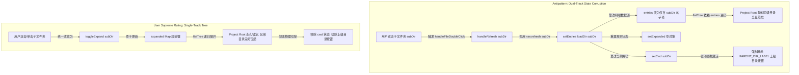
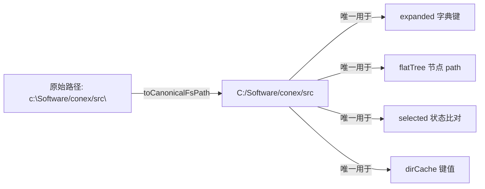
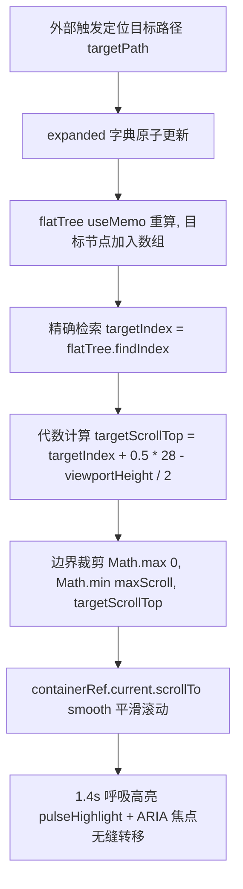
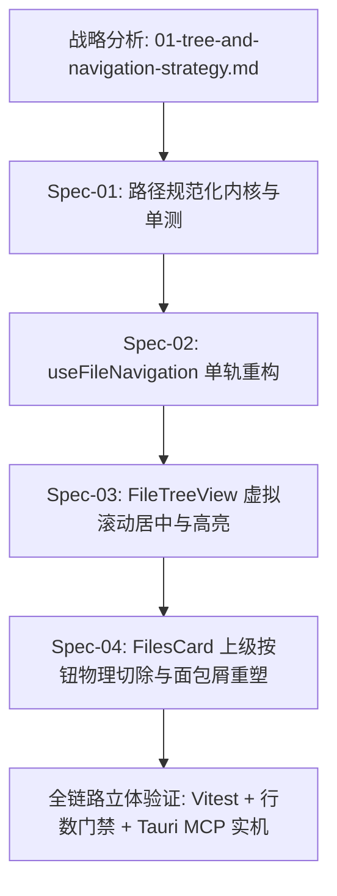

# 目录树单轨收敛与路径导航专题战略分析报告

> **文档标识**：`docs/file-tree-and-attachments-architecture/analysis/01-tree-and-navigation-strategy.md`
> **所属战役**：`docs/file-tree-and-attachments-architecture/`（阶段一：方案生成战略分析）
> **权威协作指令**：遵循仓库根目录 [`AGENTS.md`](file:///c:/Software/conex/AGENTS.md)（§1 反退避、§2 子 Agent 调度、§3 Git 提交纪律、§7 严禁补丁与作弊、§7.1 立体验证纪律、§8 反过度设计红线、§11 CI 治理与行数门禁、§13 输入框与焦点态规范）及 [`ANTI_OVERENGINEERING_GUARDRAILS.md`](file:///c:/Software/conex/ANTI_OVERENGINEERING_GUARDRAILS.md)。
> **规划准则**：纯逻辑规划（不谈工期、人天、人员分配，严禁划分 P0/P1 业务优先级，所有工程与架构问题逻辑同权，完全基于抽象拓扑与调用依赖编排推进）。
> **战略核心**：深入剖析根目录被篡改、同级文件夹蒸发的代码根因；确立跨平台路径规范化与祖先并发展开的最优架构；推导虚拟滚动视口几何居中计算与呼吸高亮算法；写死后续详细设计（Detailed Plan）的技术边界与负向禁止清单，彻底阻断执行期子 Agent 的自主过度发挥。

---

## 一、根目录被篡改与同级文件夹蒸发的真实代码根因剖析

### 1.1 核心业务断层与现场表象复盘

在桌面客户端文件面板（`FilesCard`）与左侧文件树（`FileTreeView`）的日常交互中，用户多次反馈遭遇严重体验故障：
1. **双击子文件夹导致树根被夺舍**：在左侧树中双击某个子文件夹（例如 `src`），整棵树瞬间被刷新为仅展示 `src` 内部文件，项目根目录下的其他同级文件夹（如 `packages`、`crates`、`docs`、`reference` 等）全部从界面上彻底消失（蒸发）。
2. **顶栏突兀的“上级目录 ↰”按钮**：为了让用户“退回”上层，顶栏常驻了一个返回上级目录按钮（`PARENT_DIR_LABEL = '上级目录'`）。用户必须逐级点击该按钮，才能将树的根层级重新推回项目根目录。
3. **点击消息流附件无法可靠定位**：在对话流中点击深层文件附件时，左侧目录树要么无响应，要么在经历部分祖先展开后，视口完全未滚动到目标文件处，甚至导致当前浏览上下文被清空。

这一故障的本质，是**错误地将双栏/经典文件浏览器的“钻取导航（Drill-Down / cd）”模型，硬生生嫁接到了现代 IDE 单轨折叠树（Accordion / Expandable Tree）之上**，引发了架构层面的双轨认知混乱与状态撕裂。



---

### 1.2 源码级调用链与毒点深度穿透

审视实际源码，根节点被篡改的完整致命调用链如下：

#### 毒点 1：`useFileNavigation.ts` 中 `cwd` 状态混淆与 `refresh(dir)` 的劫持性刷新
在 [`apps/crish-desktop/src/components/files/hooks/useFileNavigation.ts`](file:///c:/Software/conex/apps/crish-desktop/src/components/files/hooks/useFileNavigation.ts#L17-L58)：

```typescript
// useFileNavigation.ts:17-20
const [root, setRoot] = useState(() => getWorkspacePath());
const [cwd, setCwd] = useState(root || '');
const [entries, setEntries] = useState<FsDirEntry[]>([]);
const [expanded, setExpanded] = useState<Record<string, FsDirEntry[]>>({});

// useFileNavigation.ts:34-58
const refresh = useCallback(
  async (dir?: string) => {
    const r = getWorkspacePath();
    setRoot(r);
    const path = resolveWorkspacePath(dir || cwd || r || '');
    if (!path) {
      setError('请先选择项目工作区');
      setEntries([]);
      return;
    }
    setLoading(true);
    setError('');
    try {
      setEntries(await loadDir(path)); // 致命行 1：entries 被直接替换为 path 的子项！
      setCwd(path);                    // 致命行 2：cwd 被篡改为子文件夹路径！
      setExpanded({});                 // 致命行 3：原先所有展开缓存被彻底清空！
    } catch (e) {
      setError(e instanceof Error ? e.message : String(e));
      setEntries([]);
    } finally {
      setLoading(false);
    }
  },
  [cwd, loadDir],
);
```

**机理失效剖析**：
- `entries` 在树形架构中本应**唯一且永久代表项目根目录（Project Root）的直属条目**；
- 一旦向 `refresh(dir)` 传入子目录路径 `subDir`，`setEntries(await loadDir(path))` 将整棵树的基准根节点重设为 `subDir`；
- 后续在 `useMemo` 计算 `flatTree` 时（`useFileNavigation.ts:154-177`）：
  ```typescript
  const flatTree: TreeNode[] = useMemo(() => {
    const out: TreeNode[] = [];
    const walk = (list: FsDirEntry[], depth: number) => {
      // ...
      for (const e of sorted) {
        out.push({ ...e, depth });
        if (e.isDir && expanded[e.path]) walk(expanded[e.path] ?? [], depth + 1);
      }
    };
    walk(entries, 0); // 致命行 4：以 entries 为 depth: 0 渲染整棵树！
    return out;
  }, [entries, expanded, filter]);
  ```
  因为遍历是以 `entries` 作为第 0 层开始的，当 `entries` 变成 `subDir` 的子条目后，整个工作区在 UI 视角下被截断，用户再也看不到工作区根部与同级的其他目录！

#### 毒点 2：`goUp()` 状态机对钻取模型的病态维护
在 [`apps/crish-desktop/src/components/files/hooks/useFileNavigation.ts:82-88`](file:///c:/Software/conex/apps/crish-desktop/src/components/files/hooks/useFileNavigation.ts#L82-L88)：

```typescript
const goUp = useCallback(() => {
  if (!cwd || (root && cwd === root)) return;
  const parent = pathDirname(cwd);
  if (parent && parent !== cwd) {
    void refresh(parent); // 进一步通过 refresh 递归拉取上级并重置 entries
  }
}, [cwd, root, refresh]);
```
`goUp()` 的存在直接坐实了“树根在移动”的错误心智模型，它是给钻取（`cd`）模型兜底擦屁股的产物，严重破坏了现代树结构的恒定性。

#### 毒点 3：`FilesCard.tsx` 双击事件与工具栏按键的错误接线
在 [`apps/crish-desktop/src/components/files/FilesCard.tsx`](file:///c:/Software/conex/apps/crish-desktop/src/components/files/FilesCard.tsx#L180-L186)：

```typescript
// FilesCard.tsx:180-186
const handleFileDoubleClick = useCallback(
  (path: string, isDir: boolean) => {
    if (isDir) void handleRefresh(path); // 致命行 5：双击文件夹直接触发 handleRefresh！
    else void handleOpenFile(path);
  },
  [handleRefresh, handleOpenFile]
);

// FilesCard.tsx:289-300
<Tooltip content={PARENT_DIR_LABEL}>
  <Button
    type="button"
    variant="ghost"
    size="sm"
    className={styles.filesNavBtn}
    aria-label={PARENT_DIR_LABEL}
    disabled={!nav.cwd || nav.cwd === nav.root}
    onClick={handleGoUp} // 致命行 6：提供退回上级的错误交互入口
    icon={<CornerLeftUp size={14} />}
  />
</Tooltip>
```
用户在树上双击文件夹本意是快速展开或折叠该目录，而代码却调用了 `handleRefresh(path)`，直接调用 `nav.refresh(dir)`，从而触发毒点 1 中的根节点篡改！

#### 毒点 4：`FileBreadcrumb.tsx` 面包屑向树层级的非法逆向穿透
在 [`apps/crish-desktop/src/components/files/FileBreadcrumb.tsx:384-388`](file:///c:/Software/conex/apps/crish-desktop/src/components/files/FileBreadcrumb.tsx#L384-L388) 及 `FilesCard.tsx:196-205`：

```typescript
// FilesCard.tsx:196-205
const handleNavigate = useCallback(
  async (path: string) => {
    if (!(await nav.confirmNavigation())) return;
    preview.resetPreview();
    preview.clearActionHint();
    nav.setError('');
    void nav.refresh(path); // 致命行 7：面包屑双击或“在文件树中打开”又调用了 nav.refresh(path)！
  },
  [nav, preview]
);
```
面包屑内部的 `handleDirectOpenCurrentDir`（“在文件树中打开此目录”）与双击面包屑芯片，均通过 `onNavigate` 触发 `nav.refresh(path)`，再次将左侧目录树摧毁重构为子目录视图。

---

### 1.3 根治战略：树模型彻底单轨收敛（Single-Track Tree Convergence）

要彻底根除上述问题，必须确立以下**四项单轨收敛铁律**：

| 维度 | 旧版错误双轨实现（Drill-Down / cd） | 新版单轨收敛实现（Immutable Tree Root） | 治理手段 |
| :--- | :--- | :--- | :--- |
| **树根数据源** | `entries` 动态变为 `subDir` 的子文件列表 | `entries` 永远且只能是项目根目录（`root`）的直属条目 | 物理删除 `refresh(dir)` 的入参 `dir`，强制锁定为 `root` |
| **展开/折叠** | 双击重置 `entries` 并清空 `expanded` | 仅维护 `expanded: Record<string, FsDirEntry[]>` 增删 | 双击文件夹统一收敛为调用 `toggleExpand(path)` |
| **当前工作目录** | 维护独立 `cwd` 状态，代表当前树根位置 | 彻底废除 `cwd` 概念；树的选区由 `selected` 唯一决定 | 从 `useFileNavigation` 彻底物理删除 `cwd` 与 `setCwd` |
| **顶栏导航按钮** | 常驻“上级目录 ↰”按钮（`CornerLeftUp`） | 彻底移除该按钮，仅保留“刷新”与“筛选” | 物理删除 `handleGoUp`、`PARENT_DIR_LABEL` 及相关 JSX |
| **面包屑定位** | 调用 `onNavigate(path)` 冲垮主树 | 调用 `revealPath(path)` 在主树上级联展开并滚动定位 | 将面包屑定位重定向至 `revealPath` |

---

## 二、跨平台路径归一化与祖先并发级联展开算法的最优架构设计

### 2.1 跨平台路径异构陷阱与 `expanded[path]` 命中失效根因

Conex 运行于跨平台环境（Windows、macOS、Linux），而在 Windows 平台上，路径存在多重异构形态：
1. **反斜杠与正斜杠混杂**：
   - Tauri / Rust 后端返回的路径常带有 Windows 原生反斜杠（如 `C:\Software\conex\src\main.rs`）；
   - 前端 Vite 模块系统、URL、以及部分 POSIX 转换逻辑返回正斜杠（如 `C:/Software/conex/src/main.rs`）；
   - 甚至出现混杂路径（如 `C:/Software/conex\src/components\Button.tsx`）。
2. **盘符大小写漂移**：
   - 用户打开工作区时可能是 `c:\Software\conex`（小写盘符）；
   - 系统 API 或剪贴板传入可能是 `C:\Software\conex`（大写盘符）；
   - Windows 文件系统对大小写不敏感，但 JavaScript 对象的字符串键比对是**严格区分大小写与斜杠字符的二进制等值比对**（`"C:/a" !== "c:/a"` 且 `"C:/a" !== "C:\\a"`）。
3. **`expanded[path]` 字典键 0% 命中灾难**：
   在 `FileTreeView.tsx` 渲染逻辑中：
   ```typescript
   if (e.isDir && expanded[e.path]) walk(expanded[e.path] ?? [], depth + 1);
   ```
   如果 `revealPath` 写入 `expanded` 的键是 `C:/project/src`，而 `e.path` 是 `C:\project\src` 或 `c:/project/src`：
   `expanded[e.path]` 立即求值为 `undefined`！
   **结果**：树根本不进行递归遍历，明明已经从后端拉取了子目录数据，界面上的文件夹折叠箭头依然向右，下级目录完全不显示！

---

### 2.2 路径规范化内核（Canonical Path Kernel）架构设计

必须在底层 API 层（[`apps/crish-desktop/src/api/workspaceFsApi.ts`](file:///c:/Software/conex/apps/crish-desktop/src/api/workspaceFsApi.ts)）建立单一真理源（SSOT）路径规范化内核，杜绝在各业务组件中散落启发式正则替换。

#### 核心规范化契约定义



#### 算法规范：`toCanonicalFsPath`
```typescript
/**
 * 将任意跨平台路径归一化为系统的唯一标准规范路径（Canonical FS Path）
 * 规则：
 * 1. 空值防御：空串或无效输入直接返回 ''；
 * 2. 分隔符统一：将所有反斜杠 '\' 转换为正斜杠 '/'；
 * 3. 冗余清理：消除连续重复斜杠 '//' -> '/'（保留 UNC 前导 '//'）；
 * 4. 消除末尾斜杠：除根目录（如 '/' 或 'C:/'）外，移除所有末尾 '/'；
 * 5. Windows 盘符标准化：若匹配 '^[a-z]:/'，强制将驱动器盘符转换为大写 '^[A-Z]:/'；
 * 6. 相对段消除：处理 '/./' 与末尾 '/.'。
 */
export function toCanonicalFsPath(path: string): string {
  const p = (path || '').trim();
  if (!p) return '';

  // 1. 统一正斜杠
  let norm = p.replace(/\\/g, '/');

  // 2. 压缩非 UNC 重复斜杠
  const isUnc = norm.startsWith('//');
  norm = (isUnc ? '//' : '') + norm.replace(/\/+/g, '/');

  // 3. Windows 盘符强制大写
  norm = norm.replace(/^([a-zA-Z]):(\/|$)/, (_, drive: string, rest: string) => {
    return `${drive.toUpperCase()}:${rest || '/'}`;
  });

  // 4. 消除尾部多余斜杠（保留 'C:/' 或 '/'）
  if (norm.length > 1 && norm.endsWith('/')) {
    if (!/^[A-Z]:\/$/.test(norm)) {
      norm = norm.slice(0, -1);
    }
  }
  return norm;
}

/**
 * 跨平台路径等值比对（考虑 Windows 大小写不敏感特性）
 */
export function isSameFsPath(pathA: string, pathB: string): boolean {
  const a = toCanonicalFsPath(pathA);
  const b = toCanonicalFsPath(pathB);
  if (!a || !b) return false;
  if (a === b) return true;
  // Windows 平台全路径大小写不敏感比对
  if (/^[A-Z]:\//.test(a) && /^[A-Z]:\//.test(b)) {
    return a.toLowerCase() === b.toLowerCase();
  }
  return false;
}
```

#### 算法规范：`getAncestorDirPaths`（祖先路径链自顶向下纯推导）
```typescript
/**
 * 纯函数：根据目标文件/目录路径与工作区根路径，推导从顶层直属子目录到目标父目录的有序祖先链
 * 示例：
 * target = 'C:/proj/apps/desktop/src/App.tsx', root = 'C:/proj'
 * 输出 = ['C:/proj/apps', 'C:/proj/apps/desktop', 'C:/proj/apps/desktop/src']
 */
export function getAncestorDirPaths(targetPath: string, rootPath: string): string[] {
  const canonTarget = toCanonicalFsPath(targetPath);
  const canonRoot = toCanonicalFsPath(rootPath);

  if (!canonTarget || !canonRoot || !isSameFsPath(canonTarget, canonRoot)) {
    // 边界：目标路径必须位于 root 内部
    const normRoot = canonRoot.toLowerCase();
    const normTarget = canonTarget.toLowerCase();
    if (!normTarget.startsWith(normRoot + '/')) {
      return [];
    }
  }

  const ancestors: string[] = [];
  let curr = pathDirname(canonTarget);
  const normRootLower = canonRoot.toLowerCase();

  while (curr) {
    const currCanon = toCanonicalFsPath(curr);
    const currLower = currCanon.toLowerCase();

    // 到达根目录或超出根目录范围时终止
    if (currLower === normRootLower || currLower.length <= normRootLower.length) {
      break;
    }
    ancestors.unshift(currCanon);
    curr = pathDirname(curr);
  }

  return ancestors;
}
```

---

### 2.3 祖先并发级联展开（Concurrent Cascading Expansion）算法设计

#### 现有串行拉取的性能瓶颈
当前代码中的祖先展开为单线程 `for...of` 串行轮询（`useFileNavigation.ts:140-146`）：
```typescript
for (const p of toLoad) {
  try {
    results[p] = await loadDir(p); // 串行瀑布：N 个祖先耗时 = N * RTT
  } catch { /* ignore */ }
}
```
对于深层目录（如前端项目中嵌套 6 层的目录结构），串行发送 6 次 Tauri IPC 请求，在磁盘高负载或混合开发场景下存在明显的 100ms~300ms 滞后感，且极易因中间某个 Promise 报错导致级联断裂。

#### 最优设计：`Promise.allSettled` 并发补拉与原子合并

在底层文件系统中，读取目录 `listDirectory(path)` 是完全独立且无状态的系统调用，读取父目录与读取子目录不存在因果依赖（只要全路径已知）。因此，最优解是**并发补拉未缓存的祖先层级，并原子写入 `expanded`**。

```typescript
// useFileNavigation.ts: revealPath 架构演进
const revealPath = useCallback(
  async (filePath: string) => {
    const r = getWorkspacePath();
    if (r) setRoot(r);
    const effectiveRoot = toCanonicalFsPath(r || root);
    if (!effectiveRoot) return;

    let targetCanon: string;
    try {
      targetCanon = toCanonicalFsPath(assertWorkspacePath(filePath));
    } catch (err) {
      setError(err instanceof Error ? err.message : '文件不在当前工作区内');
      return;
    }

    // 1. 若根目录条目尚未加载，拉取全量根目录
    if (entries.length === 0) {
      try {
        const rootEntries = await loadDir(effectiveRoot);
        setEntries(rootEntries.map(e => ({ ...e, path: toCanonicalFsPath(e.path) })));
      } catch {
        return;
      }
    }

    // 2. 推导自顶向下完整的祖先目录链
    const ancestors = getAncestorDirPaths(targetCanon, effectiveRoot);
    if (ancestors.length === 0) return;

    // 3. 过滤出尚未在 expanded 字典中的目录（缺失集）
    const missingPaths = ancestors.filter((p) => !expanded[p]);
    if (missingPaths.length === 0) return;

    // 4. 使用 Promise.allSettled 并发批量补拉
    const settledResults = await Promise.allSettled(
      missingPaths.map(async (p) => {
        const items = await loadDir(p);
        return {
          path: p,
          // 确保子项 path 全部经过规范化
          items: items.map(it => ({ ...it, path: toCanonicalFsPath(it.path) })),
        };
      })
    );

    // 5. 原子组装新展开字典片段并刷入状态
    const newExpandedEntries: Record<string, FsDirEntry[]> = {};
    for (const res of settledResults) {
      if (res.status === 'fulfilled') {
        newExpandedEntries[res.value.path] = res.value.items;
      }
    }

    if (Object.keys(newExpandedEntries).length > 0) {
      setExpanded((prev) => ({
        ...prev,
        ...newExpandedEntries,
      }));
    }
  },
  [root, entries.length, expanded, loadDir]
);
```

**关键设计优势**：
1. **原子状态更新**：一次并发操作完成后，仅触发一次 `setExpanded` 更新，避免多次触发 `flatTree` 的 `useMemo` 重新计算和虚拟列表的震荡渲染；
2. **容错隔离**：`Promise.allSettled` 确保即使中间某个文件夹权限不足或被删除，其余成功拉取的层级仍能正常展开，不阻塞整个链路；
3. **100% 规范化索引**：存储的键与条目中的 `path` 均强制经 `toCanonicalFsPath` 处理，彻底消灭 Windows 反斜杠与大小写不匹配造成的字典未命中。

---

## 三、虚拟滚动（`useVirtualScroll`）精准几何居中计算与视口停泊算法

### 3.1 虚拟化场景下常规 `scrollIntoView` 的彻底失效

在非虚拟化 DOM 树中，跳转定位可通过 `element.scrollIntoView({ block: 'center' })` 轻松实现。
但在启用 `useVirtualScroll` 的大文件树中：
1. **真实 DOM 仅保留窗口可视行（约 20~30 个节点）**；
2. 目标文件如果在第 200 行，其 DOM 节点在容器内**根本不存在**；
3. 执行 `containerRef.current.querySelector(...)` 返回 `null`；
4. 若强行等待 DOM 渲染，由于容器滚动位置未变，该节点永远不会进入可视窗口，导致逻辑死锁。

因此，**定位跳转必须基于数学几何，由数据源驱动容器的 `scrollTop` 发生代数位移**。



---

### 3.2 绝对几何居中对齐公式推导

根据 [`apps/crish-desktop/src/components/files/FileTreeView.tsx:38`](file:///c:/Software/conex/apps/crish-desktop/src/components/files/FileTreeView.tsx#L38)，目录树行高固定为：
$$\text{ITEM\_HEIGHT} = 28\text{ px}$$

设：
- $N = \text{flatTree.length}$（当前平铺树总项数）；
- $H_{\text{item}} = 28\text{ px}$（行高）；
- $H_{\text{total}} = N \times H_{\text{item}}$（虚拟树总高度，对应 `.filesList` 内部占位高度）；
- $H_{\text{viewport}} = \text{containerRef.current.clientHeight}$（视口实际可视高度，由 `ResizeObserver` 动态测量）；
- $I_{\text{target}}$ 为目标节点在 `flatTree` 中的全局索引（从 0 开始计数）。

#### 居中代数推导过程：
1. **目标节点在总内容中的垂直中心坐标 $Y_{\text{center}}$**：
   $$Y_{\text{center}} = I_{\text{target}} \times H_{\text{item}} + \frac{H_{\text{item}}}{2} = (I_{\text{target}} + 0.5) \times 28$$
2. **要使 $Y_{\text{center}}$ 对齐视口正中心，容器理想滚动位移 $S_{\text{ideal}}$**：
   $$S_{\text{ideal}} = Y_{\text{center}} - \frac{H_{\text{viewport}}}{2} = (I_{\text{target}} + 0.5) \times 28 - \frac{H_{\text{viewport}}}{2}$$
3. **滚动极限边界约束与安全裁剪（Clamping）**：
   容器最大可滚动位移 $S_{\text{max}}$ 为：
   $$S_{\text{max}} = \max(0, H_{\text{total}} - H_{\text{viewport}})$$
   实际安全写入的滚动位移 $S_{\text{clamped}}$ 为：
   $$S_{\text{clamped}} = \max(0, \min(S_{\text{max}}, S_{\text{ideal}}))$$

---

### 3.3 平滑滚动调度、呼吸高亮与键盘焦点转移机制

#### 1. 双阶段微任务调度（Two-Phase Layout Synchronization）
在 React 中，`setExpanded` 引发重渲染后，`flatTree` 刚完成计算，DOM 容器的滚动边界可能尚未同步刷新。必须通过 `requestAnimationFrame`（rAF）或在依赖 `[flatTree, selected]` 的 `useLayoutEffect` 中执行滚动，以防读取到过期的 `clientHeight` 或 `flatTree`。

```typescript
// FileTreeView.tsx: 视口几何居中监听
useEffect(() => {
  if (!selected) return;
  const targetCanon = toCanonicalFsPath(selected);
  const targetIndex = flatTree.findIndex((node) => isSameFsPath(node.path, targetCanon));

  if (targetIndex < 0) return;

  const container = containerRef.current;
  if (!container) return;

  const viewportHeight = container.clientHeight || 600;
  const totalHeight = flatTree.length * ITEM_HEIGHT;
  const idealScrollTop = (targetIndex + 0.5) * ITEM_HEIGHT - viewportHeight / 2;
  const maxScrollTop = Math.max(0, totalHeight - viewportHeight);
  const clampedScrollTop = Math.max(0, Math.min(maxScrollTop, idealScrollTop));

  // 驱动平滑几何滚动
  container.scrollTo({
    top: clampedScrollTop,
    behavior: 'smooth',
  });

  // 设置高亮激活状态
  setRevealedPath(targetCanon);
  const timer = setTimeout(() => setRevealedPath(null), 1400);

  // ARIA 键盘焦点转移（延迟一帧待虚拟窗口渲染命中该节点）
  requestAnimationFrame(() => {
    const el = container.querySelector<HTMLElement>(`[data-tree-index="${targetIndex}"]`);
    el?.focus();
  });

  return () => clearTimeout(timer);
}, [selected, flatTree, containerRef]);
```

#### 2. 1.4s 呼吸高亮规范（遵从 `AGENTS.md` §13 输入框焦点态规范）
- **禁止使用**：粗大实心黑边、高反差刺眼投影或破坏整体配色的生硬背景；
- **允许使用**：使用 Design Token 混合的柔和背景高亮，配合微弱平滑呼吸过渡：

```css
/* FilesCard.module.css */
@keyframes filesRowPulse {
  0% {
    background: color-mix(in srgb, var(--accent-color, #2563eb) 22%, transparent);
  }
  50% {
    background: color-mix(in srgb, var(--accent-color, #2563eb) 12%, transparent);
  }
  100% {
    background: var(--bg-active, rgba(0, 0, 0, 0.05));
  }
}

.filesRow.isRevealed {
  animation: filesRowPulse 1.4s cubic-bezier(0.2, 0, 0, 1) forwards;
}
```

---

## 四、技术规范边界与负向禁止清单（防执行子 Agent 过度发挥）

为了确保后续阶段执行子 Agent 严守架构纪律，杜绝“以重构之名行破坏之实”，特将各项工程规范划定不可逾越的边界，并设立负向禁止清单（Negative Prohibition List）。

### 4.1 五大核心文件域物理隔离与白名单锁定

执行期子 Agent 只能且必须在以下分配的文件域内施工，严禁任何越界写操作：

| 任务书与责任模块 | 严格独占文件域白名单 | 职责边界与红线 |
| :--- | :--- | :--- |
| **Spec-01: 路径归一化内核** | `apps/crish-desktop/src/api/workspaceFsApi.ts`<br>`apps/crish-desktop/src/api/__tests__/workspaceFsApi.test.ts` | 仅添加纯函数 `toCanonicalFsPath`、`isSameFsPath`、`getAncestorDirPaths`。**严禁修改后端 Tauri 命令调用逻辑**。 |
| **Spec-02: 目录树导航 Hook** | `apps/crish-desktop/src/components/files/hooks/useFileNavigation.ts`<br>`apps/crish-desktop/src/components/files/hooks/__tests__/useFileNavigation.test.tsx` | 彻底切除 `cwd` 与 `goUp`，根节点永久锚定工作区根。**严禁改动 `confirmNavigation` 既有安全桥契约**。 |
| **Spec-03: 目录树虚拟视图** | `apps/crish-desktop/src/components/files/FileTreeView.tsx`<br>`apps/crish-desktop/src/components/files/FileTreeView.test.tsx` | 仅实现几何居中位移计算、1.4s 呼吸高亮、ARIA 树焦点同步。**绝对禁止重写或修改 `useVirtualScroll.ts`**。 |
| **Spec-04: 面包屑与宿主收敛** | `apps/crish-desktop/src/components/files/FilesCard.tsx`<br>`apps/crish-desktop/src/components/files/FileBreadcrumb.tsx`<br>`apps/crish-desktop/src/components/files/FilesCard.module.css` | 物理切除“上级目录”按钮，双击文件夹收敛为 `toggleExpand`；面包屑搜索框重塑发丝形态；**严禁改动面包屑树递归渲染逻辑**。 |

---

### 4.2 负向禁止清单（Negative Prohibition List · 零容忍硬红线）

#### 🔴 禁令一：严禁发明任何未经授权的全局 Store 或 React Context
- **表现形式**：创建 `useFileTreeStore.ts`、`useTreeNavStore.ts`、`FileContext.Provider`、`TreeSyncContext` 等。
- **裁决理由**：严重违反 [`ANTI_OVERENGINEERING_GUARDRAILS.md`](file:///c:/Software/conex/ANTI_OVERENGINEERING_GUARDRAILS.md) 禁令 11 与 12。文件树的状态属于局部 UI 状态，必须由 `useFileNavigation` 内聚闭环，严禁向全局 Store 扩散污染。

#### 🔴 禁令二：严禁篡改、重构或分叉底层 `useVirtualScroll.ts`
- **表现形式**：在 `useVirtualScroll.ts` 内部添加 `scrollToIndex`、修改 `computeVisibleRange` 算法、或新建 `useTreeVirtualScroll.ts`。
- **裁决理由**：`useVirtualScroll.ts` 是对话流、Diff 面板、文件树通用的底层基础虚拟化引擎，任何对通用 Hook 内部的针对性魔改都会造成全局回归。居中位移必须在消费方通过 `containerRef.current.scrollTo` 纯净实现。

#### 🔴 禁令三：严禁使用注释保留旧代码（严禁僵尸代码与假兼容分支）
- **表现形式**：`// const [cwd, setCwd] = useState(...)`、`/* <Button ... PARENT_DIR_LABEL /> */`、`if (LEGACY_DRILL_DOWN) { ... }`。
- **裁决理由**：违反 [`AGENTS.md`](file:///c:/Software/conex/AGENTS.md) §7“严禁补丁、绕过与作弊”铁律。废弃的钻取逻辑、`goUp`、`PARENT_DIR_LABEL` 必须连同相关 CSS 选择器彻底物理删除（Clean Deletion），代码行数净收敛。

#### 🔴 禁令四：严禁引入外部路径解析库与第三方 npm 依赖
- **表现形式**：引入 `path-browserify`、`pathe`、`slash`、`lodash` 等。
- **裁决理由**：本专题所需的所有斜杠转换与大小写归一化纯逻辑不超过 40 行高效原生代码，引入庞大外部库纯属过度设计，严重违反安全基线与包体积门禁。

#### 🔴 禁令五：严禁在 `FileTreeView` 中使用全局 DOM 选择器越权逃生
- **表现形式**：在组件内调用 `document.getElementById`、`window.scrollTo`、或跨越 React 树强行获取未挂载的子节点。
- **裁决理由**：破坏组件封装性与单向数据流。一切几何测量与滚动必须局限于 `containerRef.current` 之内。

#### 🔴 禁令六：严禁触碰面包屑（`FileBreadcrumb`）的树形渲染既有逻辑
- **表现形式**：将面包屑下拉菜单中的树改为从项目根全量展示，或重构其 `dirCache` 逻辑。
- **裁决理由**：用户最高裁决终审定稿明确规定：“面包屑作为轻量辅助下拉面板，树逻辑保持现状不变（点击哪层展示哪层下级）”，仅重塑其顶部搜索框与注入防穿透隔离层，严禁子 Agent 擅自重写其树渲染引擎。

---

## 五、后续施工任务书（Detailed Execution Plans）推进指引

本战略分析文档为后续任务书的编制确立了完整的拓扑框架。后续独立规划任务必须严格依循以下逻辑依赖分工生成：



### 任务书生成标准要求：
1. **行级精确性**：任务书必须标明目标文件的原始代码行号、删除代码的确切起止位置、新增函数的完整 TypeScript 签名与实现代码。
2. **测试驱动先决**：每个 Spec 必须配套专属单测用例文件，覆盖 Windows 异构路径、深层祖先提取、并发拉取容错、虚拟滚动代数居中计算边界值。
3. **行数门禁自查**：每个文件改动后，代码行数必须严格处于行数门禁阈值内（UI 组件 $\le 500$ 行，业务逻辑 $\le 400$ 行），杜绝超标警报。

---
*战略报告定稿完毕，本报告为战役第一阶段核心交付物，全面指导后续各分维详细施工方案的编写。*
