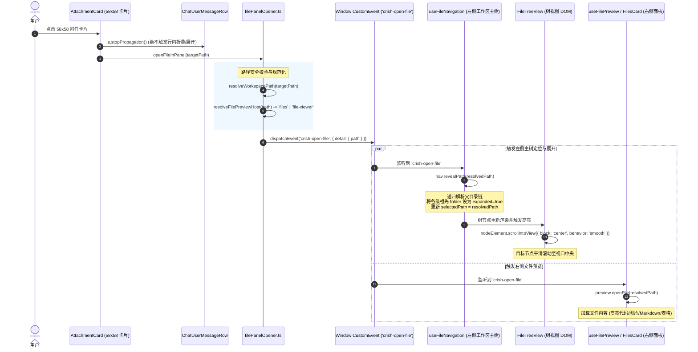

# 阶段一：气泡附件全新布局与卡片系统战略分析报告

> **文档标识**：`docs/file-tree-and-attachments-architecture/analysis/02-message-attachment-strategy.md`  
> **所属战役**：`docs/file-tree-and-attachments-architecture/`（目录树同步展开、单轨收敛、消息附件卡片统一与面包屑重塑战役）  
> **指派角色**：资深前端 UI 架构师与消息流组件战略专家  
> **设计基准**：用户最终效果参考图（`media_1788837641997.png`）及用户最高裁决  
> **协作纪律**：严格遵循仓库根目录 `AGENTS.md`（§1 逻辑规划与反退避、§3 Git 提交纪律、§7 严禁补丁与作弊、§7.1 立体验证纪律、§8 反过度设计红线、§11 CI 治理与前端解耦断言、§12 自定义 Tooltip 规范、§13 输入框与焦点悬浮态规范、§14 色彩空间规范）及 `ANTI_OVERENGINEERING_GUARDRAILS.md`。  
> **规划纪律**：纯逻辑规划，不谈工期、人天、P0/P1，所有逻辑问题同权，严禁执行 git commit。

---

## 目录

- [一、战略背景与用户最高裁决对齐](#一战略背景与用户最高裁决对齐)
- [二、全新布局推导：DOM 层级、CSS 盒模型与空文本气泡隐藏状态机](#二全新布局推导dom-层级css-盒模型与空文本气泡隐藏状态机)
  - [2.1 参考图解构与顶层布局重塑](#21-参考图解构与顶层布局重塑)
  - [2.2 DOM 树结构严密推导](#22-dom-树结构严密推导)
  - [2.3 CSS 盒模型与横向自适应折行规则](#23-css-盒模型与横向自适应折行规则)
  - [2.4 空文本气泡自动隐藏状态机](#24-空文本气泡自动隐藏状态机)
  - [2.5 与长文本展开/折叠（isLong）的状态解耦](#25-与长文本展开折叠islong的状态解耦)
- [三、58×58 原子卡片（AttachmentCard）体系设计规范](#三5858-原子卡片attachmentcard体系设计规范)
  - [3.1 统一几何与盒模型基准](#31-统一几何与盒模型基准)
  - [3.2 图片模式（Image Mode）全幅裁切与安全渲染](#32-图片模式image-mode全幅裁切与安全渲染)
  - [3.3 非图片文件模式（File Mode）三元排版体系](#33-非图片文件模式file-mode三元排版体系)
  - [3.4 交互动效、微边框与无黑 Hover 规范（AGENTS.md §13 & §14）](#34-交互动效微边框与无黑-hover-规范agentsmd-13--14)
  - [3.5 全自定义 Tooltip 规范（彻底杜绝原生 title）](#35-全自定义-tooltip-规范彻底杜绝原生-title)
  - [3.6 Design Tokens 契约与深浅主题适配](#36-design-tokens-契约与深浅主题适配)
- [四、源码物理删除清单与死代码清理策略](#四源码物理删除清单与死代码清理策略)
  - [4.1 `ChatMessageRow.module.css` 61 行死亡样式精确审计](#41-chatmessagerowmodulecss-61-行死亡样式精确审计)
  - [4.2 `ChatUserMessageRow.tsx` 废弃代码切除审计](#42-chatusermessagerowtsx-废弃代码切除审计)
  - [4.3 物理切除彻底性保证与防回潮机制](#43-物理切除彻底性保证与防回潮机制)
- [五、附件卡片点击与文件系统双向联动确定性时序](#五附件卡片点击与文件系统双向联动确定性时序)
  - [5.1 全链路端到端事件时序图](#51-全链路端到端事件时序图)
  - [5.2 路径安全解析与边界保护（assertWorkspacePath）](#52-路径安全解析与边界保护assertworkspacepath)
  - [5.3 `openFileInPanel` 调度与宿主叶路由策略](#53-openfileinpanel-调度与宿主叶路由策略)
  - [5.4 左侧主树自动级联展开（revealPath）与平滑滚动居中](#54-左侧主树自动级联展开revealpath与平滑滚动居中)
  - [5.5 右侧文件预览器（useFilePreview）同频挂载](#55-右侧文件预览器usefilepreview同频挂载)
- [六、技术规范边界与负向禁止清单（硬性红线）](#六技术规范边界与负向禁止清单硬性红线)
  - [6.1 负向禁止清单（Negative Constraints）](#61-负向禁止清单negative-constraints)
  - [6.2 正向设计约束（Positive Guardrails）](#62-正向设计约束positive-guardrails)
- [七、执行阶段子 Agent 指导与立体验证断言](#七执行阶段子-agent-指导与立体验证断言)

---

## 一、战略背景与用户最高裁决对齐

在桌面端产品体验中，消息流（Message Stream）与输入区（Composer）是用户发生交互最频繁的高频视域。在过去的历史演进中，Conex/Crish 桌面端在输入框侧与气泡侧产生了严重的**视觉与架构撕裂**：

1. **视觉呈现分裂与审美落后**：输入框已经全面采用 58×58 现代高质感正方形实体卡片（配备 160+ 彩色矢量图标、cover 裁切缩略图、柔和微边框），而用户消息气泡（`ChatUserMessageRow.tsx`）中却依然渲染着陈旧的灰色药丸胶囊（`.userAttachmentChip`）以及突兀撑大至 320×240px 的裸图画廊（`.userImages` / `.userImageWrapper`），造成巨大的视觉反差与排版混乱。
2. **容器包裹错误与信息层级倒置**：原实现将附件粗暴塞入带有内边距和灰底的文本气泡（`userBubble`）内部，使得文本排版、折叠控制、背景几何与附件排列深度耦合。气泡为了适应大图或多胶囊被过度撑大，导致留白失控；当用户仅发送图片或附件时，依然会出现一个包着卡片的庞大气泡壳子。
3. **交互断层与定位缺失**：气泡内附件的点击行为零散，缺乏与右侧工作区文件面板加载以及左侧主目录树级联展开高亮的确定性联动。

### 用户最高裁决（Ground Truth）

针对上述痛点，用户上传了最终效果参考图（`media_1788837641997.png`）并明确拍板了最高裁决：
1. **附件全新布局严格遵照参考图**：
   - **上方**为独立的 58×58 方形实体卡片横向自适应流（`userAttachmentStrip`，支持多张卡片一字排开，`gap: 8px`，`flex-wrap: wrap`，**靠右排布**）；
   - **下方**为独立的半圆角文本气泡（`userBubble`）；
   - **空文本气泡自动隐藏**：若用户仅发附件而无文字输入，下方的空气泡彻底隐藏，不得渲染任何空节点或空背景壳。
2. **彻底告别旧排版，物理切除 61 行死亡 CSS 与废弃 JSX**：
   - 将 `ChatMessageRow.module.css` 中的 61 行旧画廊与药丸胶囊 CSS 规则全数物理切除，不留痕迹；
   - 彻底删除 `ChatUserMessageRow.tsx` 中的旧图片画廊与旧药丸 JSX。
3. **统一接入 58×58 现代高质感实体卡片（AttachmentCard）**：
   - 图片 cover 居中裁剪、官方 160+ 彩色格式图标、大写格式徽标、截断文件名、全自定义 Tooltip、无黑色混入的微边框 Hover。

---

## 二、全新布局推导：DOM 层级、CSS 盒模型与空文本气泡隐藏状态机

### 2.1 参考图解构与顶层布局重塑

对照用户参考图（`media_1788837641997.png`），用户消息由单体复合气泡演进为**分层独立的解耦流**。

#### 核心视觉特征：
1. **对齐线**：卡片流与下方文本气泡均严格以右边缘为基准线（Right-Aligned）；
2. **空间解耦**：58×58 卡片直接悬浮于消息行内，拥有自己独立的 12px 圆角和微边框底板，不再受制于文本气泡的半透明底色和 22px 超椭圆气泡外壳；
3. **自适应弹性**：多张卡片在横向空间充裕时一字排开；当卡片数量较多超过消息行最大宽度（`min(70.2%, 560px)`）时，自动向左下折行，形成整齐紧凑的网格；
4. **垂直呼吸节奏**：卡片流与文本气泡之间维持紧凑舒适的 6px 间隙（`gap: var(--space-1_5, 6px)`）。

### 2.2 DOM 树结构严密推导

在 `ChatUserMessageRow.tsx` 中，顶层容器为 `userStack`，内部子节点按逻辑执行严格平铺，严禁嵌套关系回潮：

```text
div.row.rowUser (消息行容器, align-items: flex-end)
 └── div.userStack (用户消息垂直堆栈, flex-col, align-items: flex-end, gap: 6px)
      ├── [可选] Tooltip > span.pinBadge (固定标记)
      │
      ├── [条件渲染] div.userAttachmentStrip (上方：独立的 58×58 卡片横向自适应流)
      │    ├── AttachmentCard (卡片 1)
      │    ├── AttachmentCard (卡片 2)
      │    └── ...
      │
      ├── [条件渲染] div.userBubble (下方：独立的纯文本气泡，仅在 displayText 存在时渲染)
      │    ├── {displayText}
      │    └── [可选] span.queued (排队中提示)
      │
      └── UserMessageActionsBar (底部操作栏：时间戳、复制、固定、撤回)
```

#### JSX 渲染骨架对照：
```tsx
<div className={styles.userStack}>
  {/* 1. 固定徽标（若已固定） */}
  {isPinned ? (
    <Tooltip content="已固定">
      <span className={styles.pinBadge} aria-hidden="true">
        <Pin size={11} strokeWidth={2.25} />
        已固定
      </span>
    </Tooltip>
  ) : null}

  {/* 2. 上方：独立的 58×58 卡片横排流（AttachmentStrip，靠右对齐） */}
  {hasAttachments ? (
    <div
      className={styles.userAttachmentStrip}
      data-testid="user-attachments-strip"
      role="list"
      aria-label={`附件列表，共 ${normalizedAttachments.length} 个`}
    >
      {normalizedAttachments.map((att) => (
        <AttachmentCard
          key={att.id || att.path || att.name}
          item={att}
          variant="message"
          onClick={() => handleAttachmentClick(att)}
        />
      ))}
    </div>
  ) : null}

  {/* 3. 下方：独立的文本对话气泡（仅在有文本时渲染，空气泡自动销毁） */}
  {hasTextContent ? (
    <div
      className={styles.userBubble}
      onClick={toggleExpand}
      onKeyDown={onBubbleKeyDown}
      style={{ cursor: isLong ? 'pointer' : 'default' }}
      role={isLong ? 'button' : undefined}
      tabIndex={isLong ? 0 : undefined}
      aria-expanded={isLong ? isExpanded : undefined}
      aria-label={isLong ? userBubbleExpandAria(isExpanded) : undefined}
    >
      {displayText}
      {msg.status === 'queued' && (
        <span className={styles.queued}>排队中</span>
      )}
    </div>
  ) : null}

  {/* 4. 操作栏 */}
  <UserMessageActionsBar
    timestamp={msg.timestamp}
    isPinned={isPinned}
    copied={copied}
    onCopy={handleCopy}
    onTogglePin={() => onTogglePin(msg.id)}
    onRetract={retractHandler}
    alwaysVisible={Boolean(retractHandler)}
  />
</div>
```

### 2.3 CSS 盒模型与横向自适应折行规则

#### 1. `userStack` 盒模型
```css
.userStack {
  display: flex;
  flex-direction: column;
  align-items: flex-end; /* 强制所有子元素沿右侧基线靠齐 */
  max-width: min(70.2%, 560px);
  min-width: min-content;
  gap: var(--space-1_5, 6px); /* 子项垂直呼吸间距统一为 6px */
  box-sizing: border-box;
}
```

#### 2. `userAttachmentStrip` 盒模型
```css
.userAttachmentStrip {
  display: flex;
  flex-direction: row;
  flex-wrap: wrap; /* 空间不足时自动优雅折行 */
  justify-content: flex-end; /* 行内卡片从右向左紧凑靠拢排布 */
  align-items: center;
  gap: var(--space-2, 8px); /* 卡片间距严格锁定 8px */
  width: 100%;
  max-width: min(70.2%, 560px);
  box-sizing: border-box;
  margin: 0;
  padding: 0;
}
```

#### 3. 折行几何断点分析
- 单张卡片宽度：`58px`，间距：`8px`；
- 容器最大宽度：560px（视口较宽时）；
  - 1 张卡片：`58px`，贴右；
  - 2 张卡片：`58 * 2 + 8 = 124px`，贴右；
  - 4 张卡片：`58 * 4 + 8 * 3 = 256px`，贴右；
  - 8 张卡片：`58 * 8 + 8 * 7 = 520px < 560px`，保持单行横排；
  - 超过 8 张或在窄视口（70.2% < 520px）下：自动向下换行，每行内部卡片自动从右至左排列，整齐贴合右边缘，不留空白空隙。

### 2.4 空文本气泡自动隐藏状态机

为了杜绝消息仅发附件时渲染丑陋的“空气泡（空背景框、空 padding）”，构建严密的纯布尔状态机：

```mermaid
stateDiagram-v2
    [*] --> DetermineState
    
    DetermineState --> StateA : hasText && !hasAtts
    DetermineState --> StateB : !hasText && hasAtts
    DetermineState --> StateC : hasText && hasAtts
    DetermineState --> StateD : !hasText && !hasAtts
    
    state "纯文本模式 (Text Only)" as StateA {
        userAttachmentStrip: 隐藏 (DOM 不挂载)
        userBubble: 显示 (承载文本)
    }
    
    state "纯附件模式 (Attachments Only)" as StateB {
        userAttachmentStrip: 显示 (顶部横排 58x58 卡片)
        userBubble: 销毁 (空气泡自动隐藏，DOM 零渲染)
    }
    
    state "混合模式 (Text + Attachments)" as StateC {
        userAttachmentStrip: 显示 (上方 58x58 卡片流)
        userBubble: 显示 (下方半圆角文本气泡)
        gap: userStack 6px 间距自然分隔
    }
    
    state "退化异常/排队态" as StateD {
        userAttachmentStrip: 隐藏
        userBubble: 仅在 status==='queued' 时渲染微型排队态
    }
```

#### 状态判断原子布尔谓词：
```typescript
// 1. 文本有效性检测（过滤空行与空白字符）
const rawText = msg.text || '';
const hasTextContent = rawText.trim().length > 0;

// 2. 附件有效性检测（融合 attachments 与 images）
const normalizedAttachments = useMemo(() => normalizeMessageAttachments(msg), [msg.attachments, msg.images]);
const hasAttachments = normalizedAttachments.length > 0;
```

- **当 `!hasTextContent && hasAttachments`**：`hasTextContent` 为 `false`，JSX 中的 `{hasTextContent ? <div className={styles.userBubble}>...</div> : null}` 评估为 `null`，DOM 树上不会产生任何 `userBubble` 节点。气泡彻底隐藏，只有上方卡片和下方操作条，干净利落。

### 2.5 与长文本展开/折叠（isLong）的状态解耦

在旧架构中，附件位于气泡内部，当消息文字较长时，气泡具有 `onClick={toggleExpand}` 行为，卡片点击极易误触发折叠。
在全新布局中：
- `toggleExpand`、`onBubbleKeyDown`、`role="button"`、`aria-expanded` 属性**严格只挂载于 `userBubble` 节点**；
- `userAttachmentStrip` 位于 `userBubble` 外部，作为其兄弟节点；
- 点击 `AttachmentCard` 时，天然无法向 `userBubble` 冒泡，从 DOM 层次结构上彻底消除了事件穿透与冲突隐患。

---

## 三、58×58 原子卡片（AttachmentCard）体系设计规范

### 3.1 统一几何与盒模型基准

抽离出的原子卡片组件 `AttachmentCard` 必须成为全桌面端的单一真理源（SSOT），在输入框待发区与消息流已发区保持物理规格严格一致：

| 参数项 | 标称数值 | CSS 属性与 Token 声明 | 设计意图与护栏 |
| :--- | :--- | :--- | :--- |
| **物理尺寸** | `58px × 58px` | `width: 58px; height: 58px; min-width: 58px; min-height: 58px;` | 严格正方形，禁止 flex 挤压变形（`flex-shrink: 0`） |
| **圆角半径** | `12px` | `border-radius: var(--radius-xl, 12px);` | 现代精致平滑同心大圆角 |
| **盒模型计算** | `border-box` | `box-sizing: border-box;` | 边框计入 58px 内部，杜绝像素溢出 |
| **外框边框** | `1px solid` | `border: 1px solid var(--border-subtle);` | 发丝微边框，高清晰度勾勒轮廓 |
| **底板背景** | Card Bg | `background: var(--bg-card, #ffffff);` | 纯净纸质白底（暗色为中性炭黑 `#1e1e1e`） |
| **内部溢出** | `hidden` | `overflow: hidden;` | 保证内部图片或高亮徽标不超出圆角外框 |
| **投影策略** | `none` | `box-shadow: none;` | 严格遵守 `AGENTS.md` §13 零重阴影铁律 |

### 3.2 图片模式（Image Mode）全幅裁切与安全渲染

#### 1. 判定逻辑
```typescript
export function isImageAttachment(att: { name: string; mime?: string; dataUrl?: string }): boolean {
  if (att.dataUrl && att.dataUrl.startsWith('data:image/')) return true;
  if (att.mime && att.mime.startsWith('image/')) return true;
  return /\.(png|jpe?g|gif|webp|bmp|svg|ico)$/i.test(att.name);
}
```

#### 2. 视觉排版规范
- 容器：`padding: 0; position: relative; width: 58px; height: 58px;`；
- 图片标签：
  ```css
  .cardImage {
    width: 100%;
    height: 100%;
    object-fit: cover; /* 居中全幅覆盖，等比裁切溢出边缘，严禁拉伸畸变 */
    object-position: center;
    display: block;
    border-radius: inherit;
    background: var(--bg-primary); /* 加载期间呈现微灰占位底色 */
  }
  ```

#### 3. 资源加载安全屏障
严禁直接将未经校验的本地文件绝对路径赋予 ``。加载流水线必须遵循安全基线：
```typescript
function resolveImageSrc(source: string | undefined, dataUrl: string | undefined): string {
  if (dataUrl) return dataUrl;
  if (!source) return '';
  if (source.startsWith('data:') || source.startsWith('blob:') || source.startsWith('http')) {
    return source;
  }
  if (isAbsoluteFsPath(source)) {
    try {
      const safePath = assertWorkspacePath(source);
      return convertFileSrc(safePath);
    } catch {
      return ''; // 越界路径拒绝加载
    }
  }
  return source;
}
```

### 3.3 非图片文件模式（File Mode）三元排版体系

非图片卡片内部可用安全区为 `46px × 46px`（`58px - 6px * 2`），严格分为**上下双层三元空间**：

```text
┌───────────────────────────────────────┐
│ ┌──────────────┐    ┌───────────────┐ │
│ │ 18px 彩色图标 │    │   CODE / MD   │ │  <- 顶部行 (Top Row)
│ └──────────────┘    └───────────────┘ │
│                                       │
│ ┌───────────────────────────────────┐ │
│ │ 11px 截断文件名: index.tsx...     │ │  <- 底部行 (Bottom Row)
│ └───────────────────────────────────┘ │
└───────────────────────────────────────┘
```

#### 1. 顶部功能行（`cardTopRow`）：
- 布局：`display: flex; align-items: center; justify-content: space-between; width: 100%;`；
- **左侧：官方 160+ 彩色矢量图标 `FileFormatIcon`**：
  - 尺寸固定为 `18px`（`size={18}`）；
  - 能够根据扩展名精准命中专属品牌色与图标（例如 `.ts` 蓝白方形、`.rs` 橘色齿轮、`.json` 黄色大括号、`.md` 灰蓝下箭头等）；
- **右侧：大写格式徽标（`kindBadge`）**：
  - 尺寸与字形：`font-size: 8px; font-weight: 700; line-height: 1; letter-spacing: 0.02em; text-transform: uppercase;`；
  - 材质填充：`padding: 1.5px 3px; border-radius: 3px; color: var(--text-tertiary); background: color-mix(in srgb, var(--text-primary) 6%, transparent);`；
  - 文本内容：依据扩展名或类型自动计算，如 `CODE`、`TABLE`、`TEXT`、`FILE`、`PDF`。

#### 2. 底部文件名行（`cardName`）：
- 字号与字重：`font-size: 11px; font-weight: 500; line-height: 1.25;`；
- 文本色值：`color: var(--text-primary);`（保证在小字号下的清晰可读性）；
- 防溢出三件套：`white-space: nowrap; overflow: hidden; text-overflow: ellipsis; width: 100%; max-width: 100%; display: block;`，绝对禁止折行破坏卡片高度。

### 3.4 交互动效、微边框与无黑 Hover 规范（AGENTS.md §13 & §14）

严格遵循仓库红线 `AGENTS.md` §13「克制激活边框与无黑微变规范」：
- **禁止硬实黑线**：严禁在 Hover 或 Focus 时使用 `border-color: #000000` 或直接引用 `var(--text-primary)`；
- **微边框平滑过渡**：
  ```css
  .attachmentCard {
    border: 1px solid var(--border-subtle);
    background-color: var(--bg-card);
    transition:
      border-color var(--transition-fast, 120ms ease),
      background-color var(--transition-fast, 120ms ease);
  }

  .attachmentCard:hover,
  .attachmentCard:focus-visible {
    border-color: var(--border-color); /* 仅比基准边框略深 5-10% */
    background-color: color-mix(in srgb, var(--text-primary) 2.5%, var(--bg-card)); /* 2.5% 超轻度混入 */
    outline: none;
  }
  ```

### 3.5 全自定义 Tooltip 规范（彻底杜绝原生 title）

- **违规危害**：在卡片或其子节点上使用原生 `title="xxx"` 属性会导致系统在悬停时弹出陈旧且不受控的原生黄色/灰色气泡，严重破坏现代化桌面端沉浸感。
- **强制约束**：卡片根节点一律由 `@/components/ui` 或当前公共库提供的 `<Tooltip content={att.path || att.name}>` 包裹。支持自动延迟、圆角胶囊、反色高对比与暗色阴影。

### 3.6 Design Tokens 契约与深浅主题适配

统一收敛至 `tokens.css` 中，定义标准的卡片 Token：

```css
/* --- Global Attachment Card Token Contract --- */
:root {
  --attach-card-size: 58px;
  --attach-card-radius: var(--radius-xl, 12px);
  --attach-card-gap: 8px;
  --attach-card-border: 1px solid var(--border-subtle);
  --attach-card-bg: var(--bg-card, #ffffff);
  --attach-card-hover-border: var(--border-color);
  --attach-card-hover-bg: color-mix(in srgb, var(--text-primary) 2.5%, var(--bg-card));
  --attach-card-name-size: 11px;
  --attach-card-name-color: var(--text-primary);
  --attach-card-badge-bg: color-mix(in srgb, var(--text-primary) 6%, transparent);
  --attach-card-badge-color: var(--text-tertiary);
}

[data-theme='dark'] {
  --attach-card-border: 1px solid var(--border-subtle);
  --attach-card-bg: var(--bg-card, hsl(0 0% 12%));
  --attach-card-hover-border: var(--border-color);
  --attach-card-hover-bg: color-mix(in srgb, var(--text-primary) 3.5%, var(--bg-card));
  --attach-card-name-color: var(--text-primary);
}
```

---

## 四、源码物理删除清单与死代码清理策略

在过去的重构实践中，常常存在“用注释屏蔽代码”、“把旧类名隐藏在样式表角落”的敷衍打补丁行为，这在架构规范中被定为**零容忍死罪**。本次重构必须实施彻底的**物理行级剔除**。

### 4.1 `ChatMessageRow.module.css` 61 行死亡样式精确审计

在 `apps/crish-desktop/src/components/chat-message-row/ChatMessageRow.module.css` 中，第 116 行至第 176 行共计 **61 行无用死亡 CSS 规则**必须全数物理删除：

```css
/* ==========================================================================
   【当前存在于源码中的 61 行死亡 CSS（行 116 - 行 176）】
   ========================================================================== */
116: .userImages {
117:   display: flex;
118:   flex-wrap: wrap;
119:   gap: var(--space-2, 8px);
120:   margin-bottom: var(--space-2, 8px);
121: }
122: 
123: .userImageWrapper {
124:   cursor: pointer;
125:   border-radius: var(--radius-lg, 10px);
126:   overflow: hidden;
127:   border: 1px solid var(--border-subtle);
128:   background: var(--bg-card);
129:   transition: transform var(--transition-base, 150ms ease), border-color var(--transition-base, 150ms ease);
130: }
131: 
132: .userImageWrapper:hover {
133:   border-color: var(--border-color);
134:   transform: scale(1.01);
135: }
136: 
137: .userImage {
138:   display: block;
139:   max-width: min(100%, 320px);
140:   max-height: 240px;
141:   object-fit: cover;
142:   border-radius: inherit;
143: }
144: 
145: .userAttachments {
146:   display: flex;
147:   flex-wrap: wrap;
148:   gap: var(--space-1_5, 6px);
149:   margin-bottom: var(--space-2, 8px);
150: }
151: 
152: .userAttachmentChip {
153:   display: inline-flex;
154:   align-items: center;
155:   gap: var(--space-1_5, 6px);
156:   padding: var(--space-1, 4px) var(--space-2, 8px);
157:   font-size: var(--font-size-xs, 12px);
158:   background: color-mix(in srgb, var(--text-primary) 8%, transparent);
159:   border-radius: var(--radius-md, 6px);
160:   border: 1px solid var(--border-subtle);
161:   cursor: pointer;
162:   color: var(--text-secondary);
163:   transition: background var(--transition-fast), color var(--transition-fast);
164: }
165: 
166: .userAttachmentChip:hover {
167:   background: color-mix(in srgb, var(--text-primary) 14%, transparent);
168:   color: var(--text-primary);
169: }
170: 
171: .userAttachmentName {
172:   max-width: 180px;
173:   overflow: hidden;
174:   text-overflow: ellipsis;
175:   white-space: nowrap;
176: }
```

#### 物理替换方案：
将上述 61 行全部删除，原位替换为极简、高内聚的 `.userAttachmentStrip` 规则（仅 11 行）：
```css
.userAttachmentStrip {
  display: flex;
  flex-direction: row;
  flex-wrap: wrap;
  justify-content: flex-end;
  align-items: center;
  gap: var(--space-2, 8px);
  width: 100%;
  max-width: min(70.2%, 560px);
  box-sizing: border-box;
}
```
**净收敛成效**：样式文件净减少 50 行，彻底根除旧画廊与旧药丸样式。

### 4.2 `ChatUserMessageRow.tsx` 废弃代码切除审计

在 `apps/crish-desktop/src/components/chat-message-row/ChatUserMessageRow.tsx` 中，必须实施三处手术级物理切除：

| 目标代码位置 | 原代码内容 | 物理切除后替换方案 |
| :--- | :--- | :--- |
| **行 108 - 113** | ```tsx<br>const images = msg.images ?? [];<br>const nonImageAttachments = (msg.attachments ?? []).filter(<br>  (a) => !a.dataUrl && (!a.mime \|\| !a.mime.startsWith('image/'))<br>);<br>const hasImages = images.length > 0;<br>const hasAttachments = nonImageAttachments.length > 0;<br>``` | **彻底物理删除**。替换为统一归一化：<br>```tsx<br>const normalizedAttachments = useMemo(<br>  () => normalizeMessageAttachments(msg),<br>  [msg.attachments, msg.images]<br>);<br>const hasAttachments = normalizedAttachments.length > 0;<br>const hasTextContent = Boolean(msg.text?.trim());<br>``` |
| **行 229 - 257** | `{hasImages ? (<div className={styles.userImages}...>...</div>) : null}`（共 29 行旧大图画廊 JSX） | **彻底物理删除**，不留任何碎片。 |
| **行 259 - 283** | `{hasAttachments ? (<div className={styles.userAttachments}...>...</div>) : null}`（共 25 行旧灰色胶囊 JSX） | **彻底物理删除**，不留任何碎片。 |

### 4.3 物理切除彻底性保证与防回潮机制

为了防止后续开发人员或自动化脚本将旧类名带回，在前端自动化门禁中必须部署**刚性断言**：
1. **全局无残留扫描**：在测试套件中扫描编译后的 CSS Module，断言 `.userAttachmentChip`、`.userImages`、`.userImageWrapper` 的 key 均为 `undefined`；
2. **DOM 负向断言**：
   ```typescript
   expect(container.querySelector(`.${styles.userAttachmentChip}`)).toBeNull();
   expect(container.querySelector('[data-testid="user-images-gallery"]')).toBeNull();
   ```

---

## 五、附件卡片点击与文件系统双向联动确定性时序

在桌面应用中，点击消息附件卡片绝不是简单地弹出一个新标签，而是整个 IDE/工作区文件管理骨架的高精度协同。

### 5.1 全链路端到端事件时序图



### 5.2 路径安全解析与边界保护（assertWorkspacePath）

所有来自消息历史或外部注入的附件路径，在交给打开器前必须进行严密的安全校验：
- **拒绝非工作区逃逸**：调用 `assertWorkspacePath(path)`，若尝试通过 `../../etc/passwd` 等路径逃逸工作区根目录，直接抛出安全阻断异常并弹出 Toast 告警；
- **纯虚拟/DataUrl 分流**：若无本地物理路径（如直接粘贴在会话中的截图，仅有 Base64 `dataUrl`），则拦截向本地文件树的定位请求，转为打开内置轻量模态或在新窗口中无损查看；
- **空路径防御**：若既无本地路径又无数据 URL，展示温和 Toast：“该附件无关联本地物理路径”，不发生系统崩溃。

### 5.3 `openFileInPanel` 调度与宿主叶路由策略

在 `apps/crish-desktop/src/api/filePanelOpener.ts` 中，`openFileInPanel` 拥有严格的宿主叶分流契约（S6 规范）：
- **`file-viewer` 宿主叶**：代码文件（非 Markdown 纯文本、代码、diff 比对）；
- **`files` 宿主叶**：Markdown、图片、PDF、表格、二进制资产。
- **严禁越界行为**：严禁挂载旧版模态弹窗、严禁写入临时持久化脏数据、严禁在 `document.body` 上裸挂浮动 DOM。

### 5.4 左侧主树自动级联展开（revealPath）与平滑滚动居中

通过 `useFileNavigation` 暴露的 `revealPath` 契约，完成确定性定位：
1. **祖先链路解析**：将工作区相对路径 `src/components/chat/AttachmentCard.tsx` 分解为目录层级 `["src", "src/components", "src/components/chat"]`；
2. **级联展开状态写入**：将上述所有目录节点的状态原子性更新为 `expanded: true`，触发树组件递归重渲染；
3. **居中聚焦视区**：利用 `nodeElement.scrollIntoView({ block: 'center', behavior: 'smooth' })` 确保即使用户在巨大的数万文件树深处，目标节点也能瞬间跃入视野中心，并赋予醒目的临时呼吸高亮光晕。

### 5.5 右侧文件预览器（useFilePreview）同频挂载

右侧工作区预览器同步响应 `crish-open-file` 事件：
- **即时响应**：不需要等待目录树展开动画结束，右侧预览器以并行微任务启动；
- **防抖与竞态消除**：若用户快速连续点击多个卡片，利用 `AbortController` 自动取消前一次读取，仅呈现最后一次选中的文件内容，保证最终一致性。

---

## 六、技术规范边界与负向禁止清单（硬性红线）

为了彻底杜绝后续执行子 Agent 自主过度发挥、随意打补丁或产生视觉回潮，必须白纸黑字写死技术红线：

### 6.1 负向禁止清单（Negative Constraints）

1. ❌ **严禁在文本气泡（`userBubble`）内部嵌套任何卡片容器**：
   - 必须保持 `userAttachmentStrip` 与 `userBubble` 为平级兄弟节点；严禁将卡片写回 `userBubble` 内部！
2. ❌ **严禁在代码与样式表中保留任何旧药丸类名与大图规则**：
   - 严禁出现 `.userAttachmentChip`、`.userImages`、`.userImageWrapper`、`.userImage`、`.userAttachments`、`.userAttachmentName`；
   - 严禁使用 `display: none` 假装删除，必须物理彻底移除！
3. ❌ **严禁在卡片或子元素上使用原生 HTML `title` 属性**：
   - 必须全量使用项目自定义 `<Tooltip content="...">`；
4. ❌ **严禁在卡片 Hover 态混入纯黑粗边框与浓重阴影**：
   - 边框加深混入不得超过 10%（必须使用 `color-mix` 柔和渐变）；
   - `box-shadow` 必须为 `none`；
5. ❌ **严禁在空文本状态下渲染空文本气泡**：
   - 当 `!displayText` 且有附件时，`userBubble` 必须彻底在 DOM 中消失，严禁渲染空的白色或灰色胶囊背景；
6. ❌ **严禁执行 `git commit` 或破坏工作区其他文件**：
   - 遵守仓库调度铁律，提交权只归主控，子 Agent 严禁提交。

### 6.2 正向设计约束（Positive Guardrails）

1. ✅ **自适应右对齐横向自适应流**：
   - `userAttachmentStrip` 必须采用 `flex-wrap: wrap; justify-content: flex-end; gap: 8px;`；
2. ✅ **58×58 标尺绝对一致**：
   - 图片模式与非图片模式必须严丝合缝对齐 58×58 几何尺寸与 12px 圆角；
3. ✅ **160+ 彩色格式图标高保真**：
   - 必须调用统一的 `FileFormatIcon`，尺寸统一为 18px；
4. ✅ **立体化单测守门**：
   - 必须提供覆盖纯附件、纯文本、混合消息三种状态机的确定性 Vitest 测试用例。

---

## 七、执行阶段子 Agent 指导与立体验证断言

在后续执行阶段（阶段二），具体的代码编写与修改将由执行子 Agent 落地。以下为写死给执行子 Agent 的施工标准与验收门禁：

### 1. 独占文件域清单（Strict File Boundary）
- `apps/crish-desktop/src/components/chat-attachment/AttachmentCard.tsx`（新建）
- `apps/crish-desktop/src/components/chat-attachment/AttachmentCard.module.css`（新建）
- `apps/crish-desktop/src/components/chat-message-row/ChatUserMessageRow.tsx`（重构）
- `apps/crish-desktop/src/components/chat-message-row/ChatMessageRow.module.css`（重构）
- `apps/crish-desktop/src/components/chat-message-row/__tests__/ChatUserMessageRow.test.tsx`（单测强化）

### 2. 立体验证断言矩阵
执行子 Agent 交付前必须通过以下全套立体测试：

```typescript
describe('ChatUserMessageRow New Attachment Layout & Deletion Verification', () => {
  it('应当在仅发附件时渲染 userAttachmentStrip，且空气泡 userBubble 彻底不挂载', () => {
    // 渲染无文本、有附件的消息
    const { container } = renderUserRow({ text: '', attachments: [mockFile] });
    expect(container.querySelector('[data-testid="user-attachments-strip"]')).toBeTruthy();
    expect(container.querySelector('[data-testid="unified-attach-card"]')).toBeTruthy();
    // 核心断言：空气泡彻底消失
    expect(container.querySelector('.userBubble')).toBeNull();
  });

  it('应当在图文混排时上方渲染卡片流，下方渲染文本气泡', () => {
    const { container } = renderUserRow({ text: '请查看这些文件', attachments: [mockFile] });
    expect(container.querySelector('[data-testid="user-attachments-strip"]')).toBeTruthy();
    expect(container.querySelector('.userBubble')).toBeTruthy();
  });

  it('负向门禁：源码与渲染树中绝无旧药丸胶囊与大图画廊残留', () => {
    const { container } = renderUserRow({ text: '测试', attachments: [mockFile, mockImage] });
    expect(container.querySelector('.userAttachmentChip')).toBeNull();
    expect(container.querySelector('[data-testid="user-images-gallery"]')).toBeNull();
  });
});
```

### 3. 验收执行命令
```powershell
npx vitest run apps/crish-desktop/src/components/chat-message-row/
npm run typecheck
```
通过上述标准，杜绝任何理解偏差，确保重构代码一次性高品质交付！
