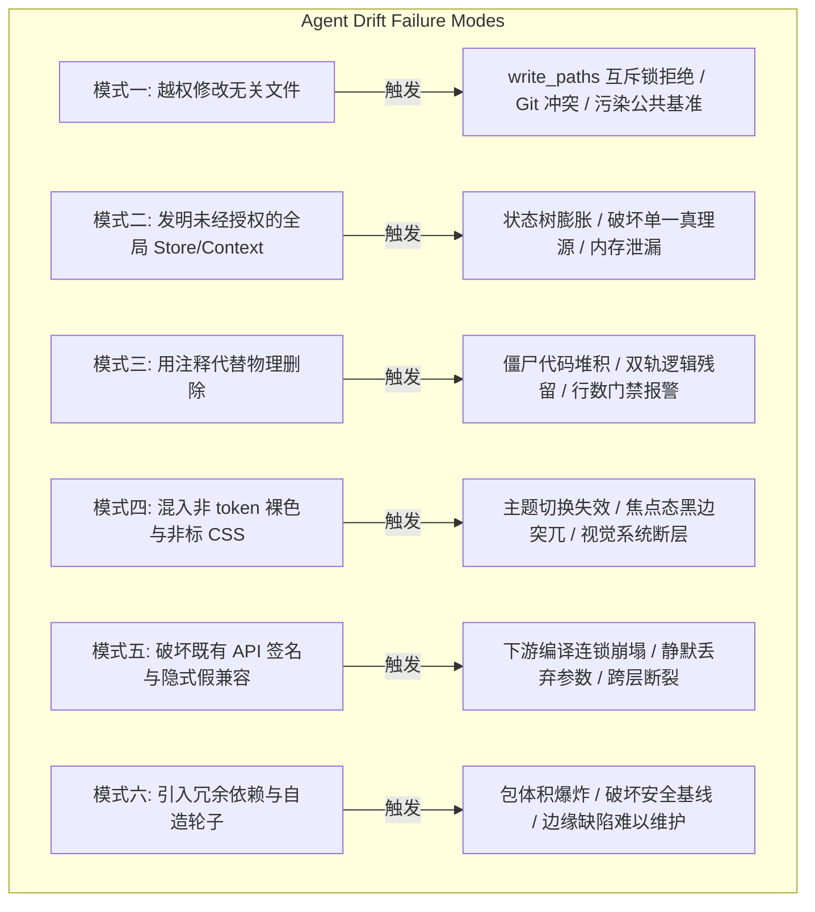
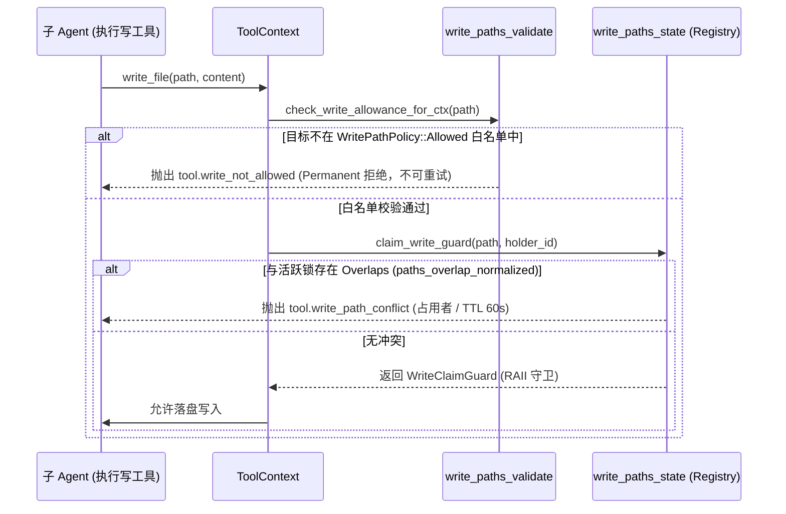
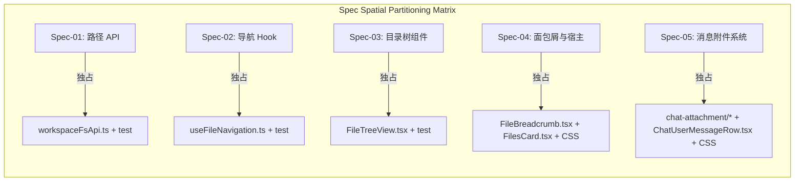
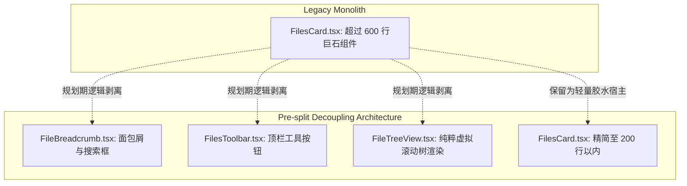
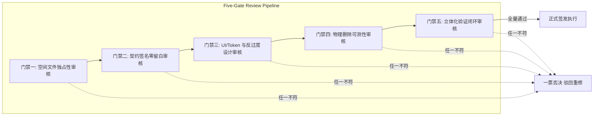

# 多 Agent 任务拆解与防自由发挥机制战略分析

> **文档标识**：`docs/file-tree-and-attachments-architecture/analysis/04-execution-specs-strategy.md`  
> **所属战役**：`docs/file-tree-and-attachments-architecture/`（阶段一：方案生成战略分析）  
> **权威纪律**：严格遵循仓库根目录 [`AGENTS.md`](file:///c:/Software/conex/AGENTS.md)（§1 反退避、§2 子 Agent 调度、§3 Git 提交纪律、§7 严禁补丁与作弊、§7.1 立体验证、§8 反过度设计红线、§11 CI 治理与行数门禁、§13 输入框焦点态、§14 色彩空间）与 [`ANTI_OVERENGINEERING_GUARDRAILS.md`](file:///c:/Software/conex/ANTI_OVERENGINEERING_GUARDRAILS.md)。  
> **规划准则**：纯逻辑规划（不谈工期、人天、人员分配，严禁划分 P0/P1 业务优先级，所有工程与架构问题逻辑同权，完全基于抽象拓扑与调用依赖编排推进）。  
> **核心使命**：剖析多 Agent 并行执行期失控与过度发挥的 6 大反模式，确立“施工图级任务书（Execution Spec）”规范范式，制定单文件空间独占与波次串行推进拓扑，建立阶段二任务书生成与五维审核硬门禁。

---

## 一、多 Agent 执行期 6 大过度发挥与失控模式深度剖析

在复杂工程重构与多 Agent 协同体系中，LLM 驱动的子 Agent 具有天然的“过度发散（Semantic Drift）”倾向。当方案任务书出现模糊描述、接口留白或语义宽泛时，子 Agent 极易以“优化、防御性编程、通用化”为名自行越权。以下深入剖析实践中频繁出现的 6 大典型失控模式及其根因与硬性防御策略。



---

### 模式一：越权修改无关文件（Scope Creep / Out-of-Bounds Write）

#### 1. 典型表象与现场案例
子 Agent 被指派重构 `ChatUserMessageRow.tsx` 中的附件展示，在编写过程中发现上游类型 `SessionMessage` 的某个字段不够便利，擅自打开 `apps/crish-desktop/src/store/types.ts` 修改类型定义；或者为了调试快捷，擅自修改 `apps/crish-desktop/src/App.tsx` 或根路由配置；又如为了统一图标导出，顺手格式化了 `assets/icons/index.ts`。

#### 2. 系统性灾难与多米诺骨牌效应
- **引擎级硬阻断**：直接撞上 Conex 内核 [`crates/agent-tools/src/write_paths.rs`](file:///c:/Software/conex/crates/agent-tools/src/write_paths.rs) 的权限沙箱与互斥锁，抛出 `tool.write_not_allowed`（未在白名单中，Permanent 错误）或 `tool.write_path_conflict`（与其他子 Agent 发生写锁争抢）。
- **污染并行工作区**：改动了其他并行子 Agent 正在依赖的公共基准，造成不可调和的 AST 断裂与编译报错。
- **踩坏主 Agent 提交收口**：根据 [`AGENTS.md`](file:///c:/Software/conex/AGENTS.md) §3「Git 提交纪律」，提交时须使用 `git commit --only <paths>` 精确收口。越权文件将使工作区处于“脏状态”，阻碍 Husky 预提交检查。

#### 3. 根因诊断
- **任务书留白**：任务书仅给出业务目标（“完成附件卡片展示”），未通过**唯一独占文件白名单**限定操作边界。
- **LLM 行为倾向**：模型倾向于“扫清眼前的一切障碍”，遇到阻碍时习惯性自发向上游修改，缺乏对团队并行边界的系统感知。

#### 4. 任务书硬性防御范式
- **文件域零容忍硬锁定**：任务书开头必须声明 `【独占文件白名单（Exclusive Write Whitelist）】`。
- **白名单外写操作一票否决**：明确警示子 Agent：“除白名单文件外，绝对禁止创建、修改、重命名或删除仓库中的任何其他文件。如遇类型阻碍，必须使用既有导出或在任务书规定文件内进行局部类型收敛，严禁向外溢出”。

---

### 模式二：发明未经授权的全局 Store/Context（State Architecture Sprawl）

#### 1. 典型表象与现场案例
子 Agent 在处理 `FileBreadcrumb.tsx` 与左侧目录树 `FileTreeView.tsx` 的交互时，为了避免层层传递回调函数或借助现有 Props 链路，自作主张新建 `apps/crish-desktop/src/store/useFileTreeBreadcrumbStore.ts`，引入一套新的 Zustand 全局状态；或者在 `FilesCard.tsx` 外层额外套一层 `FileSelectionContext.Provider`。

#### 2. 系统性灾难与多米诺骨牌效应
- **严重违背反过度设计红线**：直接违反 [`ANTI_OVERENGINEERING_GUARDRAILS.md`](file:///c:/Software/conex/ANTI_OVERENGINEERING_GUARDRAILS.md) 禁令 11（“同进程内禁止设计 4~5 层逐级转发的虚假 Store/Service Facade”）与禁令 12（“严禁高频状态穿透全局 Store”）。
- **瓦解单一真相源（SSOT）**：导致左侧目录树的选中国态散落在 `useFileNavigation` 本地 hook、Zustand 全局 store 与 React Context 之中，三者状态互相打架，产生双向同步循环与状态撕裂。
- **引发灾难性级联重渲染**：全局 Store 一旦触发更新，导致大量无关的侧边栏组件频繁 Diff，严重损耗桌面端流畅度。

#### 3. 根因诊断
- **架构拓扑未定死**：方案没有明确指定“状态应该寄宿在哪个具体的 Hook/组件内部”，给子 Agent 留下了架构架构师的自我幻想空间。
- **捷径思维**：全局 Store 是 React 开发中最省事的全局逃生通道，子 Agent 在面临跨组件传参时会自动倾向于选择成本最低的滥用方案。

#### 4. 任务书硬性防御范式
- **状态宿主与拓扑强约束**：任务书必须强制指定状态归属（State Colocation）。例如明确锁定：“展开状态 `expanded` 与选中状态 `selected` 严格由 `useFileNavigation.ts` 内部 `useState` 单一维护，通过明确的 Props 接口下传，绝对禁止创建任何全局 Store 或 React Context”。
- **架构负向禁令**：在 Spec 禁令清单中设立“全局状态红线”——禁止出现 `create<...>()`、`createContext`。

---

### 模式三：用注释代替物理删除（Tombstone / Zombie Code / Dual-Track）

#### 1. 典型表象与现场案例
在重塑 `ChatUserMessageRow.tsx` 与 `ChatMessageRow.module.css` 时，对于废弃的旧灰色药丸胶囊（`.userAttachmentChip`）与裸图堆叠（`.userImages`），子 Agent 仅仅使用 `// {hasImages ? ... : null}` 将 JSX 块注释掉，或者在 CSS 中标注 `/* .userAttachmentChip { ... } */`，甚至加上 `if (process.env.LEGACY_ATTACHMENTS) { ... }` 保留双轨兼容分支。

#### 2. 系统性灾难与多米诺骨牌效应
- **违反彻底物理删除铁律**：违反 [`AGENTS.md`](file:///c:/Software/conex/AGENTS.md) §7“严禁补丁、绕过与作弊”及战役总方案 §1.3“旧附件样式物理删除”要求。
- **行数门禁拦截报错**：存量死代码持续消耗行数配额，极易触发 `scripts/check-line-counts.mjs` 的行数硬阻断（UI 组件限约 500 行，业务逻辑限约 400 行）。
- **污染未来维护心智**：后续 Agent 在阅读代码时无法辨析旧逻辑是否具有暗中依赖，导致“死代码永远不敢删”的破窗效应。

#### 3. 根因诊断
- **LLM 防御性保守偏见**：大模型受预训练数据中“保留向后兼容”、“注释备忘”习惯的影响，极度害怕直接物理切除代码导致外部不可预见的崩塌。
- **任务书缺乏具体切除坐标**：任务书仅写“删除旧样式”，未指出具体行号范围与代码特征，子 Agent 无法建立 100% 确信度。

#### 4. 任务书硬性防御范式
- **物理删除行号对照表（Tombstone Purge Matrix）**：任务书必须精确列出被删除代码的起始行号、结束行号、关键文本签名与替换动作（Replace with empty / Remove block）。
- **负向单测守门**：任务书必须要求编写针对已删除类名/节点的负向断言测试（如 `expect(container.querySelector('.userAttachmentChip')).toBeNull()`），确保物理抹除在 CI 层面具有不可逆性。

---

### 模式四：混入非 token 裸色与非标 CSS 样式（Design Token Drift & Magic Values）

#### 1. 典型表象与现场案例
在重写卡片悬浮效果或面包屑搜索框时，子 Agent 随意写出：
```css
/* 违规示范：裸色与厚重黑边阴影 */
.attachmentCard:hover {
  border: 1px solid #333333;
  box-shadow: 0 4px 12px rgba(0, 0, 0, 0.2);
  background: #ffffff;
}
.searchInput:focus {
  border-color: #000;
  box-shadow: 0 0 0 2px #000;
}
```

#### 2. 系统性灾难与多米诺骨牌效应
- **违反 UI 规范强制红线**：
  - 违反 [`AGENTS.md`](file:///c:/Software/conex/AGENTS.md) §13「输入框与焦点态规范」：“默认不要重阴影”、“禁止粗、深、实心黑边”、“相对基线，灰色加深混入文本色不超过约 10%（例如 `color-mix(in srgb, var(--border-color) 90%, var(--text-primary) 10%)` 为上限量级）”。
  - 违反 [`AGENTS.md`](file:///c:/Software/conex/AGENTS.md) §14「色彩空间规范」：“避免散落旧式 `rgba(r,g,b,a)`；UI 与 Design Token 优先 `hsl(h s l / a)` 或 `hsla(...)`，用斜杠 `/` 分隔不透明度”。
- **暗黑主题彻底破坏**：硬编码的 `#333333` 或 `#ffffff` 在系统切换为深色或浅色主题时呈现灾难性的反色断裂与刺眼白斑。

#### 3. 根因诊断
- **任务书视觉描述抽象**：仅给出“质感微边框、柔和悬浮”，未直接提供符合设计 Token 的确定性 CSS 规则代码块。
- **LLM 惯性生成通用 Web CSS**：模型在缺乏具体 Token 字典时，倾向于输出通用的 Bootstrap/Tailwind 样式的黑灰裸色与默认 shadow。

#### 4. 任务书硬性防御范式
- **确定性 CSS 类名与属性清单**：任务书必须提供“即拷即用”的完整 CSS 规则代码块，精确到每一个变量（如 `var(--border-subtle)`、`var(--bg-card)`、`color-mix(...)`）。
- **样式硬红线断言**：显式禁止任何 `#hex` 裸色、禁止任何散落 `rgba()`、禁止非 `color-mix` 的高对比度黑边。

---

### 模式五：破坏已有公共 API 签名与隐式假性兼容（Breaking Public API Contracts & Pseudo-Compatibility）

#### 1. 典型表象与现场案例
在重构 `apps/crish-desktop/src/api/workspaceFsApi.ts` 时，子 Agent 发现 `toCanonicalFsPath` 处理逻辑可以合并，顺手将既有函数 `resolveWorkspacePath(root: string, rel: string)` 改为了 `resolveWorkspacePath(fullPath: string)`；或者将返回值从 `Promise<string>` 变为了同步 `string`；又或者表面保留参数，但函数体内直接忽略，造成调用方传递的数据静默丢失。

#### 2. 系统性灾难与多米诺骨牌效应
- **跨模块类型雪崩**：导致所有调用该基础 API 的上游文件在 `npm run typecheck` 时触发大量 TS2554（Expected N arguments, but got M）报错。
- **静默运行时异常**：若子 Agent 自行加上了宽泛类型（如 `any`）或假性兼容逻辑，会在运行时引发未捕获的 `TypeError: Cannot read properties of undefined`，彻底破坏主干稳定性。

#### 3. 根因诊断
- **缺乏接口冻结清单（Interface Freeze）**：任务书未明确标注“哪些接口属于存量冻结资产，绝对不可变动”。
- **局部最优陷阱**：子 Agent 仅从当前正在编写的单一用例视角出发，认为“新签名更优雅”，缺乏对全仓几百处调用点的敬畏。

#### 4. 任务书硬性防御范式
- **TypeScript 契约代码块锁定**：任务书必须以无歧义的 TypeScript `type` 或 `function` 完整签名呈现接口，明确标注现有接口的不可变性（Frozen API）。
- **调用点排查清单（Callsite Invariant）**：列出受影响的既有调用点，要求重构必须在保持原有签名兼容的前提下实现功能扩展。

---

### 模式六：引入冗余依赖与自造轮子（Dependency Bloat & Re-inventing the Wheel）

#### 1. 典型表象与现场案例
- **滥引第三方库**：在实现路径规范化或祖先目录推导时，子 Agent 试图在 `package.json` 中引入 `path-browserify`、`lodash`、`normalize-path` 等第三方 npm 依赖。
- **盲目自造劣质轮子**：在已有通用组件库 `@/components/ui`（例如 `Tooltip`）或 `@/assets/icons`（已有 160+ 种彩色格式图标 `FileFormatIcon`）的情况下，子 Agent 视而不见，重新手写了一套简陋的 HTML 原生 `title` 提示或自制了一批粗糙的 SVG 图标。

#### 2. 系统性灾难与多米诺骨牌效应
- **违反安全基线与包体积门禁**：擅自更改 `package.json` 会引入未审计的供应链安全风险，违反 [`docs/rust-rewrite/31-security-baseline.md`](file:///c:/Software/conex/docs/rust-rewrite/31-security-baseline.md)。
- **违背 UI 规范一致性**：直接违背 [`AGENTS.md`](file:///c:/Software/conex/AGENTS.md) §12「Tooltip / 悬停提示」：“始终使用项目自定义 `<Tooltip>` 组件，不要用原生 HTML `title`”。
- **架构冗余与资产割裂**：代码库出现两套功能重叠但实现各异的图标/工具函数体系。

#### 3. 根因诊断
- **资产透明度不足**：任务书未向子 Agent 披露仓库已有的可复用基础设施（如共享组件、已测试工具函数）的具体导入路径与用法。
- **偷懒依赖外部生态**：LLM 习惯性调用 `npm install` 解决一切算法与工具需求。

#### 4. 任务书硬性防御范式
- **依赖变更零容忍红线**：任务书明确规定：“禁止执行任何 `npm install` / `pnpm add` 命令，禁止修改任何 `package.json`。如需使用依赖，只能从既有已安装依赖中导入”。
- **既有资产白名单清单（Reused Assets Whitelist）**：在 Spec 中显式列出必须复用的内部组件路径、图标库路径与工具函数签名。

---

## 二、“施工图级任务书（Execution Spec）”标准规范结构模版

为将上述防御范式标准化、工业化，彻底抹平子 Agent 的自主发挥空间，确立施工图级任务书的 **10 节标准规范模版**。后续所有阶段二任务书必须 100% 遵循此规范结构。

### 施工图任务书 10 节标准结构规范

| 章节序号与名称 | 核心职责与约束力度 | 强制包含要素 |
| :--- | :--- | :--- |
| **§1 文档元数据与指派角色** | 确立文档唯一坐标与执行者专职身份 | 文档 ID、所属战役、指派角色、前置依赖 Spec ID、严禁提交 Git 警告 |
| **§2 严格独占文件白名单** | 划定空间绝对边界（`write_paths.rs` 契约） | 仅允许修改/创建的文件列表（绝对路径与相对路径），其他文件严禁触碰 |
| **§3 既有依赖与复用资产清单** | 锁定单一真源，防止自造轮子或滥加包 | 必须复用的组件（如 `Tooltip`）、图标（`FileFormatIcon`）、工具函数与具体 import 语句 |
| **§4 精确接口与类型契约代码块** | 消除类型与签名歧义，零留白 | 完整的 TypeScript `interface` / `type` / 函数导出代码块，严禁包含 `// ...` |
| **§5 物理删除行号与特征对照表** | 刚性指导死代码清退，杜绝注释敷衍 | 文件名、精准起始/结束行号、原代码特征片段、替换动作（物理清除） |
| **§6 确定性 CSS 类名与 Token 规范** | 锁定样式与视觉规范，消除裸色 | 完整 CSS Module 代码块、Design Token 映射表、焦点态参数、微边框规格 |
| **§7 算法实现与状态迁移严格断言** | 锁定核心逻辑分支与数学不变量 | 边界条件处理表、正逆向对称断言、状态迁移触发源与归宿 |
| **§8 负向约束禁令清单** | 将“绝对禁止做的事情”穷举说明 | 不准新建 Store、不准改外部接口、不准引新库、不准用原生 title 等明确禁令 |
| **§9 强制单元测试用例与负向断言** | 建立可重复履行的交付断言 | 包含正向用例代码块、极端边界用例代码块、针对旧代码的负向断言代码块 |
| **§10 闭环验证执行命令与交付准则** | 一键可执行的自检守门闭环 | 精确到单文件的 `npx vitest run ...`、`npm run check:line-counts` 等完整命令行 |

---

### 标准模板示范（Execution Spec Template）

````markdown
# 施工任务书 [SPEC-ID]：[模块/功能精准名称]

> **文档标识**：`docs/file-tree-and-attachments-architecture/execution-specs/spec-[ID]-[kebab-name].md`  
> **所属战役**：`docs/file-tree-and-attachments-architecture/`  
> **指派角色**：`[专用角色名称，例如：Workspace Path & Canonical API Engineer]`  
> **前置依赖**：`[明确的前置 Spec ID，无则填无]`  
> **纪律铁律**：纯逻辑实现，禁止自主过度发挥，严禁越权修改白名单外文件，严禁执行 git commit。

---

## 一、严格独占文件白名单（Exclusive Write Whitelist）

本任务书授权执行的写操作严格限制在以下物理文件内。除此以外，严禁修改、创建、删除任何其他文件：
1. `[目标生产代码文件路径 1，例如：apps/crish-desktop/src/components/files/FileTreeView.tsx]`（核心实现）
2. `[目标测试代码文件路径 2，例如：apps/crish-desktop/src/components/files/FileTreeView.test.tsx]`（配套单测）

---

## 二、既有依赖与复用资产清单（Reused Assets & SSOT）

必须复用以下既有资产，严禁自造轮子，严禁修改 `package.json` 引入新包：
- **Tooltip 组件**：`import { Tooltip } from '@/components/ui';`（严禁使用原生 HTML `title`）
- **格式图标库**：`import { FileFormatIcon } from '@/assets/icons';`（内置 160+ 格式彩色图标）
- **路径规范化纯函数**：`import { toCanonicalFsPath, isSameFsPath } from '@/api/workspaceFsApi';`
- **Tauri Core**：`import { convertFileSrc } from '@tauri-apps/api/core';`

---

## 三、精确接口与类型契约代码块（Exact TypeScript Contracts）

必须在 `[生产文件路径]` 中完整导出以下类型与组件签名（零留白，字段与类型必须完全一致）：

```typescript
export interface TargetComponentProps {
  /** 目标物理文件绝对路径（必须已完成 toCanonicalFsPath 规范化） */
  targetPath: string;
  /** 是否处于高亮激活态 */
  isActive: boolean;
  /** 点击回调：传递规范化路径 */
  onSelect: (normalizedPath: string) => void;
  /** 自定义类名（可选） */
  className?: string;
}

export const TargetComponent: React.FC<TargetComponentProps> = ({
  targetPath,
  isActive,
  onSelect,
  className,
}) => {
  // 具体实现必须满足第四、五、六节的全部约束
};
```

---

## 四、物理删除行号与特征代码对照表（Tombstone Purge Matrix）

必须彻底物理删除以下旧代码，严禁使用注释（`//` 或 `/* */`）保留，严禁保留双轨兼容逻辑：

| 目标文件 | 目标行号区间 | 原代码特征片段 | 处置动作 |
| :--- | :--- | :--- | :--- |
| `apps/.../OldFile.tsx` | L120-L145 | `<div className={styles.legacyChip}>...</div>` | **彻底物理删除**，不留任何遗迹 |
| `apps/.../OldFile.module.css` | L80-L115 | `.legacyChip { ... }`及其伪类 | **彻底物理删除**，清除整块样式 |

---

## 五、确定性 CSS 类名与 Design Token 规范（CSS & Token Specs）

必须在 `[目标样式文件]` 中使用以下确定性样式代码块，严禁散落裸色与非标阴影：

```css
/* 严格基于 CSS Module 与 Design Tokens */
.targetContainer {
  display: flex;
  align-items: center;
  gap: var(--space-2, 8px);
  padding: var(--space-1_5, 6px);
  background: var(--bg-card);
  border: 1px solid var(--border-subtle);
  border-radius: var(--radius-md, 6px);
  transition: border-color var(--transition-fast, 150ms ease),
              background var(--transition-fast, 150ms ease);
}

.targetContainer:hover {
  border-color: color-mix(in srgb, var(--border-color) 85%, var(--text-primary) 15%);
  background: color-mix(in srgb, var(--bg-card) 95%, var(--text-primary) 5%);
}

.targetContainer:focus-visible {
  outline: none;
  /* 焦点态对比度加深上限严格控制在约 10%，禁止深黑实心粗边框 */
  box-shadow: 0 0 0 1.5px color-mix(in srgb, var(--border-color) 90%, var(--text-primary) 10%);
}
```

---

## 六、算法实现与状态迁移严格断言（State & Logic Invariants）

在 `[函数/Hook 逻辑]` 中，必须严格遵守以下代数不变量与分支逻辑：
1. **空值与异常防御**：当输入为空串、`undefined` 或仅包含空白符时，必须恒定返回指定默认值（如 `''` 或 `[]`），严禁抛出未捕获异常；
2. **Windows 异构路径对齐**：所有路径必须经 `toCanonicalFsPath` 处理，消除反斜杠 `\`、末尾多余斜杠 `/` 以及盘符大小写差异；
3. **状态单向流向**：状态转移必须满足闭环对称性，严禁出现多源状态同步竞态。

---

## 七、负向约束禁令清单（Negative Constraints）

1. **🚫 严禁引入任何未授权外部包**：禁止修改 `package.json`，禁止使用 `lodash`、`path` 等 node 私有或外部 npm 模块；
2. **🚫 严禁发明全局 Store/Context**：禁止调用 `create()` 创建 Zustand 状态，禁止声明新的 React Context；
3. **🚫 严禁篡改既有导出函数签名**：已有公开 API 契约严禁破坏；
4. **🚫 严禁使用原生 HTML title**：悬浮提示一律使用 `@/components/ui` 的 `<Tooltip>`；
5. **🚫 严禁使用硬编码非 Token 裸色**：禁止写死 `#000`、`rgba(...)` 等颜色；
6. **🚫 严禁执行 git commit**：所有改动留存工作区，严禁提交。

---

## 八、强制单元测试用例与负向断言（Compulsory Tests）

必须在 `[配套测试文件]` 中实现以下完整测试套件，必须包含旧逻辑的**负向断言**：

```typescript
import { render, screen } from '@testing-library/react';
import { describe, it, expect } from 'vitest';
import { TargetComponent } from './TargetComponent';

describe('TargetComponent 施工验收测试', () => {
  it('应正确渲染目标组件并响应规范化交互', () => {
    // 明确的正向行为验证
  });

  it('【负向断言】严禁渲染任何废弃旧类名或旧节点', () => {
    const { container } = render(<TargetComponent targetPath="c:/test/file.ts" isActive={false} onSelect={() => {}} />);
    // 验证废弃类名已被物理抹除，页面不存在该 DOM
    expect(container.querySelector('.legacyChip')).toBeNull();
  });
});
```

---

## 九、闭环验证执行命令与交付准则

子 Agent 完成编码后，必须在终端执行以下完整验证套件：

1. **单测套件验证**：
   ```powershell
   npx vitest run [测试文件相对路径]
   ```
2. **TypeScript 静态检查**：
   ```powershell
   npm run typecheck
   ```
3. **行数门禁验证**：
   ```powershell
   npm run check:line-counts
   ```

**交付标准**：上述所有命令执行退出码为 0，零报错，零 Warning，所有测试用例全绿通过。
````

---

## 三、单文件独占与串行推进拓扑架构

### 1. Conex 引擎底层互斥锁机制深度解析

在 Conex 内核架构中，[`crates/agent-tools/src/write_paths.rs`](file:///c:/Software/conex/crates/agent-tools/src/write_paths.rs)（及关联状态机 `write_paths_state.rs`、验证器 `write_paths_validate.rs`）构建了严格的双层防护网：



#### 引擎核心约束特性
1. **第一层：`WritePathPolicy` 权限沙箱**：
   - 子 Agent spawn 时若声明了允许前缀集，写操作前必须经 `check_write_allowance_for_ctx` 判定。目标路径不在允许集下，直接抛出 `codes::TOOL_WRITE_NOT_ALLOWED`（`tool.write_not_allowed`）。这是**永久性不可重试错误**。
2. **第二层：`WriteClaimGuard` 并发互斥锁**：
   - 经 `claim_write_guard` 申请写锁。采用 `paths_overlap_normalized` 算法，判定路径前缀重叠关系（例如声明 `a/b/c.txt` 与他人持有的 `a/b/` 会发生冲突）。
   - 冲突时抛出 `codes::TOOL_WRITE_PATH_CONFLICT`（`tool.write_path_conflict`），携带占用者 ID、申请时间及 TTL（默认 60,000 ms = 60s）。
3. **并发写同一文件的灾难后果**：
   - 当多个子 Agent 试图修改同一文件时，后发起的 Agent 必定遭遇 `tool.write_path_conflict` 阻断退出，导致子 Agent 报告空返回或死锁重试，严重浪费上下文并破坏协同进程。

---

### 2. 空间独占拓扑（Spatial Partitioning）

为从根源上杜绝 `write_paths.rs` 的锁冲突与 Git 冲突，必须在方案规划期确立**空间物理完全隔离**原则：



#### 空间独占 3 大铁律
1. **单一文件仅由单一 Spec 独占**：任何一个源代码文件（及对应的单元测试文件），在同一逻辑执行波次内，**只能且必须归属于唯一一份 Execution Spec**。严禁将同一文件拆分给两个并行子 Agent 修改。
2. **前缀包含严禁重叠**：声明写路径时，禁止一个 Agent 声明父级目录（如 `src/components/files/`），而另一个 Agent 声明子文件（如 `src/components/files/FileTreeView.tsx`），因为引擎的 `paths_overlap_normalized` 会精准识别目录与子文件的父子重叠并触发硬冲突。
3. **测试文件共址独占**：测试文件与被测生产文件视为同一个原子空间域（例如 `foo.ts` 与 `__tests__/foo.test.ts` 必须捆绑在同一个 Spec 内），禁止由 A Agent 写代码、B Agent 并发写单测。

---

### 3. 时间串行推进拓扑（Temporal Serialization & Phased DAG Waves）

当模块间存在不可避免的数据流、调用依赖或上游契约输入时，必须通过**有向无环图（DAG）分波推进（Phased Waves）**，严格实现时间串行调度：

```mermaid
graph TD
    subgraph Wave 1: 契约与纯函数内核 (前置基石)
        W1[Spec-01: workspaceFsApi 路径规范化内核]
    end

    subgraph Wave 2: 状态机单轨收敛 (依赖 Wave 1 规范化 API)
        W2[Spec-02: useFileNavigation 树状态收敛与祖先加载]
    end

    subgraph Wave 3: 核心交互与视口停泊 (依赖 Wave 2 状态机)
        W3[Spec-03: FileTreeView 虚拟滚动平滑居中]
    end

    subgraph Wave 4: 宿主装配与面板隔离 (依赖 Wave 2 & 3 闭环)
        W4[Spec-04: FilesCard 面包屑重塑与分割线隔离]
    end

    subgraph Wave 5: 消息附件系统端到端串联 (依赖全局路径规范与导航能力)
        W5[Spec-05: 58x58 方形卡片流 + 气泡新布局 + 死亡代码彻底切除]
    end

    subgraph Wave 6: 立体化质量门禁验收 (依赖 Wave 1-5 全量落地)
        W6[全套单测 + 类型检查 + 行数门禁 + Tauri MCP 4000 实机验收]
    end

    W1 -->|API 验证全绿| W2
    W2 -->|Hook 验证全绿| W3
    W3 -->|视图验证全绿| W4
    W4 -->|宿主集成全绿| W5
    W5 -->|业务串联全绿| W6
```

#### 波次推进纪律
- **波次间硬同步屏障（Barrier Synchronization）**：Wave N 内的所有子 Agent 必须全部跑通其任务书规定的验证命令、代码安全落盘，并经主 Agent 审视无误后，主 Agent 方可签发并启动 Wave N+1。
- **严禁跨波次抢跑**：任何子 Agent 严禁在所依赖的上游 Wave 尚未落盘时启动实现。如果下游模块需要调用上游尚未合并的代码，必须等待上游波次验收完毕。

---

### 4. 复杂巨石文件的前置解耦与物理拆分策略（Pre-split Decoupling）

当某个核心文件体积庞大（接近或超过 CI 行数门禁阈值，如 UI 组件 500 行、业务逻辑 400 行），或者承担过多交互职责时，若多个功能都需修改该文件，**绝对禁止让多个 Agent 同时修改该巨石文件**。

必须在阶段二详细规划时，制定**物理拆分前置方案**：



#### 拆分落地三步走
1. **Wave 0 预拆分**：先由单一专职子 Agent 执行结构解耦，将巨石组件内的子模块（如头部搜索、面包屑、树展示）抽离为独立的子组件文件，主文件仅保留组合与事件下发；
2. **分配独立白名单**：子组件拆出后，分别拥有独立的物理文件路径（如 `FileBreadcrumb.tsx`、`FileTreeView.tsx`），后续子 Agent 即可分别独占各自的物理文件；
3. **行数与架构双收益**：不仅彻底消灭了多 Agent 写锁争抢，而且天然保障了各子文件严格处于 CI 行数门禁安全线以内（UI ≤ 500 行，业务 ≤ 400 行），实现了架构的净收敛。

---

## 四、阶段二各子模块详细任务书生成标准与审核硬门禁

在进入【阶段二：各子模块详细规划任务书生成】前，所有方案设计者与审查者必须严格遵守以下生成标准与审核硬门禁。未达到标准的任务书严禁指派给任何执行子 Agent。



---

### 1. 任务书生成三大基石原则（The 3 Pillars of Spec Generation）

#### 原则 1：零留白原则（Zero-Ambiguity Principle）
- **禁止任何语义省略**：任务书中绝对禁止出现“等”、“类似逻辑”、“根据实际情况补充实现”、“自行设计适当的数据结构”等模糊指导词。
- **AST 级代码定义**：所有需要实现的新增函数、接口、React 组件 Props、类型定义，必须以完整的 TypeScript 代码块呈现，包含准确的参数名、类型、返回值、默认值及 JSDoc 注释。

#### 原则 2：闭环自测原则（Self-Contained Verifiability Principle）
- **每份任务书自带确定性测试**：每份 Spec 必须配有明确的配套单测文件路径，并在任务书中直接编写关键测试用例的代码片段（包含正向逻辑验证与异常边界验证）。
- **可复制粘贴的一键验证命令**：任务书结尾必须给出完整的命令行指令（如 `npx vitest run ...`），子 Agent 运行成功即代表本 Spec 在逻辑层面达到验收基线。

#### 原则 3：纯粹收敛原则（SSOT & Clean Purge Principle）
- **绝不保留双轨兼容**：针对重构与替换需求，必须在任务书中严厉声明禁止旧逻辑共存，严禁添加兼容模式开关。
- **物理删除明细化**：凡涉及废弃代码、旧类名、旧组件，必须在任务书中附带具体的物理删除对照表，明确要求物理抹除字符。

---

### 2. 五维门禁审核准则（Five-Gate Review Checklist）

在主控 Agent 批准派发任何一份 Execution Spec 之前，必须对照以下五维检查清单逐项核验：

#### 门禁一：空间文件独占性审核（File Isolation Gate）
- [ ] **1.1 白名单明确性**：任务书是否在开头醒目声明了独占文件白名单？
- [ ] **1.2 跨 Spec 无重叠**：白名单中的每一个文件是否未被当前波次或并行波次的其他 Spec 占用？
- [ ] **1.3 目录前缀无包含**：白名单是否仅包含具体文件路径，未声明任何宽泛目录路径，避免触发 `write_paths.rs` 的 `paths_overlap_normalized` 冲突？
- [ ] **1.4 排除范围完备**：是否显式强调严禁修改白名单之外的任何文件？

#### 门禁二：契约签名零留白审核（Signature Freeze Gate）
- [ ] **2.1 TypeScript 契约完备**：新导出的类型、接口、函数签名是否 100% 完整书写，无任何 `...` 占位？
- [ ] **2.2 既有 API 冻结**：是否明确标明被保护的既有公共导出列表，禁止改动其参数个数与类型？
- [ ] **2.3 资产复用指定**：是否详尽列出了必须复用的既有工具函数、组件库与图标库的具体 import 路径？
- [ ] **2.4 零外部依赖声明**：是否明确禁止修改 `package.json` 或执行任何包安装命令？

#### 门禁三：UI/Token 与反过度设计审核（Guardrails & Token Gate）
- [ ] **3.1 严格遵循 Design Tokens**：涉及样式的 Spec，其 CSS 规则是否全部使用项目 Design Tokens（如 `var(--border-subtle)`、`var(--bg-card)`）？是否存在 `#hex` 裸色或旧式 `rgba()`？
- [ ] **3.2 焦点态与边框合规**：焦点态是否遵循 `AGENTS.md` §13 规范（禁止实心粗黑边、禁止重阴影、对比度加深上限严格控制在约 10%）？
- [ ] **3.3 Tooltip 组件规范**：涉及浮层悬停时，是否强制使用 `@/components/ui` 的 `<Tooltip>`，严禁原生 HTML `title`？
- [ ] **3.4 架构红线合规**：是否符合 `ANTI_OVERENGINEERING_GUARDRAILS.md` 禁令 11 & 12？是否严禁创建未经授权的全局 Store 或 Context？

#### 门禁四：物理删除可测性审核（Purge Verification Gate）
- [ ] **4.1 物理删除对照表完备**：废弃的 JSX 块、CSS 类名是否明确指出了具体的目标文件、行号区间及代码特征？
- [ ] **4.2 严禁注释与双轨**：是否显式禁止用 `//` 注释代替删除？是否禁止保留 `if (legacy)` 类似逻辑？
- [ ] **4.3 配套负向断言测试**：测试用例中是否明确包含对旧类名、旧 DOM 节点的负向断言（断言其为 null 或不存在）？

#### 门禁五：立体化验证闭环审核（3D Verification Gate）
- [ ] **5.1 单测命令确定性**：是否提供了一条可以在终端直接跑通的针对性单测命令？
- [ ] **5.2 类型检查门禁**：是否包含 `npm run typecheck` 检查要求？
- [ ] **5.3 行数门禁防御**：修改后预计文件行数是否严格控制在门禁允许范围内（UI ≤ 500 行，业务 ≤ 400 行）？
- [ ] **5.4 实机验收指引（若涉及 UI）**：对于核心交互，是否标明后续需通过 Tauri MCP 4000 端口进行物理验收？

---

### 3. 一票否决机制（Hard Rejection & Remand Criteria）

凡存在以下任一缺陷的 Execution Spec 草案，审查者**必须实行一票否决（Hard Reject）**，驳回方案设计者重新修改，严禁带病派发：

```
[一票否决判定树]
├── 发现未列明独占文件白名单或白名单与其他任务书重叠 ─────────────► [REJECT: 驳回重构空间拓扑]
├── 发现函数签名或 Props 定义中含有省略号 "// ..." 或文字模糊描述 ────► [REJECT: 驳回补齐完整代码块]
├── 发现 CSS 中包含未经批准的裸色或焦点态黑边 ─────────────────────► [REJECT: 驳回重写样式代码]
├── 发现废弃代码仅要求“废弃”而无行号与物理删除对照表 ──────────────► [REJECT: 驳回补充切除明细]
├── 发现单测用例留白或缺少负向断言 ──────────────────────────────► [REJECT: 驳回补充完整测试用例]
└── 发现未提供可一键执行的 CLI 验证命令 ─────────────────────────► [REJECT: 驳回补充验证闭环]
```

---

## 五、结论与向阶段二的战略交接

本分析文档深入剖析了多 Agent 执行期的 6 大失控反模式，确立了“施工图级任务书”的 10 节工业标准规范模板，明确了基于 Conex 引擎底层 `write_paths.rs` 互斥保护的空间独占与时间串行波次推进拓扑，并设立了严格的五维审核硬门禁。

本篇分析成果作为**方法论与规范底座**，将直接指导阶段二中针对以下五大子模块 Execution Specs 的精细化编制与审核：
1. **Spec-01**：路径规范化内核与 SSOT 契约库（`workspaceFsApi.ts`）
2. **Spec-02**：目录树单轨收敛与祖先并发加载 Hook（`useFileNavigation.ts`）
3. **Spec-03**：虚拟列表平滑居中与键盘焦点停泊组件（`FileTreeView.tsx`）
4. **Spec-04**：面包屑搜索框重塑与防穿透隔离舱宿主（`FileBreadcrumb.tsx` + `FilesCard.tsx`）
5. **Spec-05**：消息附件 58×58 卡片重塑与气泡新布局（`chat-attachment/*` + `ChatUserMessageRow.tsx`）

在后续阶段二编制过程中，所有 Spec 必须全面对齐本文档的模版要求与审核清单，确保子 Agent 在施工期“**只能按图施工、无法自作主张**”，保障多 Agent 协同体系的确定性、稳定性与架构高净度。
