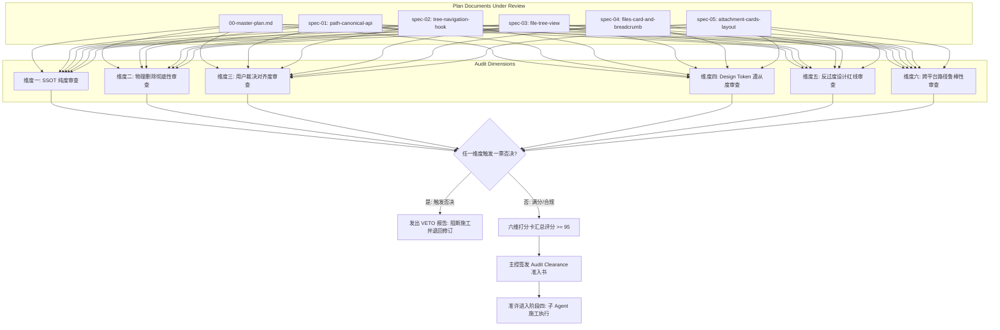
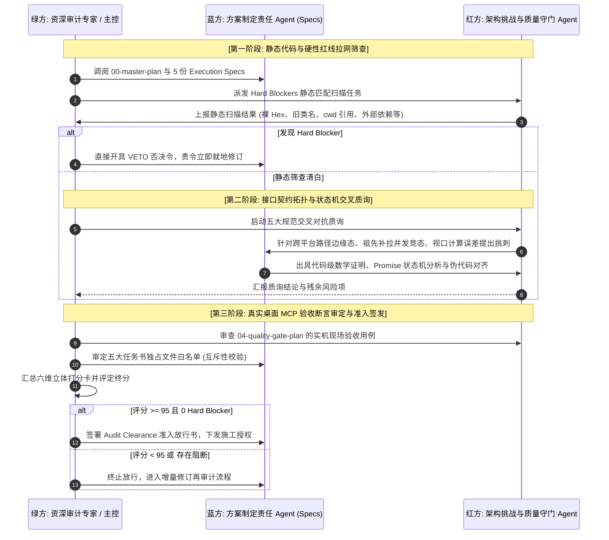

# 目录树同步展开、单轨收敛、消息附件卡片统一与面包屑重塑 · 方案合理性审计框架与审查准则（Plan Soundness Audit Framework）

> **文档标识**：`docs/file-tree-and-attachments-architecture/analysis/05-audit-framework-strategy.md`
> **战役工作区**：`docs/file-tree-and-attachments-architecture/`
> **设计角色**：资深软件质量工程与架构审查专家（Senior Software Quality Engineering & Architecture Audit Expert）
> **编制依据**：`AGENTS.md`（§1 反退避、§7 严禁补丁与作弊、§7.1 立体验证纪律、§8 反过度设计硬性红线、§11 CI 治理与行数门禁、§12 自定义 Tooltip、§13 输入框与焦点态规范、§14 现代 CSS 语法规范、§15/§16 Tauri MCP 4000 唯一合法调试通道）、`ANTI_OVERENGINEERING_GUARDRAILS.md` 13 项禁令、用户关于【目录树单轨展开、附件 58×58 卡片与气泡独立横排、面包屑树逻辑维持现状及防穿透】的最高战略裁决。
> **核心属性**：纯逻辑工程审计规划（不谈工期、人天、人员偏见，技术与质量问题在逻辑上同权，纯粹以源码真理源与数学确定性为裁判准绳）。

---

## 目录

- [一、审计体系建立背景与最高战略裁决](#一审计体系建立背景与最高战略裁决)
  - [1.1 方案合理性审计的必要性与定位](#11-方案合理性审计的必要性与定位)
  - [1.2 仓库纪律权威依据与反退避铁律](#12-仓库纪律权威依据与反退避铁律)
  - [1.3 方案合理性审计在战役流程中的纯逻辑拓扑](#13-方案合理性审计在战役流程中的纯逻辑拓扑)
- [二、六大核心审查维度与源码级穿透准则](#二六大核心审查维度与源码级穿透准则)
  - [2.1 维度一：单一真理源（SSOT）纯度审查](#21-维度一单一真理源ssot纯度审查)
  - [2.2 维度二：物理删除彻底性审查（Zero Zombie Code & Zero Legacy Classes）](#22-维度二物理删除彻底性审查zero-zombie-code--zero-legacy-classes)
  - [2.3 维度三：用户裁决对齐度审查（Strict Alignment with User Verdicts & Effect Lock）](#23-维度三用户裁决对齐度审查strict-alignment-with-user-verdicts--effect-lock)
  - [2.4 维度四：Design Token 100% 遵从度审查（Visual Consistency & Modern CSS）](#24-维度四design-token-100-遵从度审查visual-consistency--modern-css)
  - [2.5 维度五：反过度设计红线审查（Anti-Overengineering Compliance）](#25-维度五反过度设计红线审查anti-overengineering-compliance)
  - [2.6 维度六：跨平台路径鲁棒性与边界安全审查（Cross-Platform Path Robustness）](#26-维度六跨平台路径鲁棒性与边界安全审查cross-platform-path-robustness)
- [三、各维度的“一票否决项（Hard Blockers / VETO Criteria）”](#三各维度的一票否决项hard-blockers--veto-criteria)
  - [3.1 硬性阻断判定原则](#31-硬性阻断判定原则)
  - [3.2 六大维度一票否决全景矩阵](#32-六大维度一票否决全景矩阵)
  - [3.3 违规模式代码指纹与拦截特征](#33-违规模式代码指纹与拦截特征)
- [四、阶段三“方案合理性审计”的多 Agent 交叉互审与对抗审查流程](#四阶段三方案合理性审计的多-agent-交叉互审与对抗审查流程)
  - [4.1 红蓝对抗架构设计（Red-Blue Adversarial Architecture）](#41-红蓝对抗架构设计red-blue-adversarial-architecture)
  - [4.2 施工任务书（Execution Specs）交叉互审拓扑结构](#42-施工任务书execution-specs交叉互审拓扑结构)
  - [4.3 三阶段对抗推进与闭环仲裁流程](#43-三阶段对抗推进与闭环仲裁流程)
  - [4.4 审计缺陷修复与增量复审（Delta Re-Audit）机制](#44-审计缺陷修复与增量复审delta-re-audit机制)
- [五、验收打分卡与审计通过准入标准](#五验收打分卡与审计通过准入标准)
  - [5.1 六维立体定量审核打分卡（Scorecard Matrix）](#51-六维立体定量审核打分卡scorecard-matrix)
  - [5.2 准入与放行刚性门槛（Clearance Thresholds）](#52-准入与放行刚性门槛clearance-thresholds)
  - [5.3 方案审计准入签发书模版（Audit Clearance Sign-off Template）](#53-方案审计准入签发书模版audit-clearance-sign-off-template)
- [六、施工落地前置检验命令矩阵与自动化拦截脚本](#六施工落地前置检验命令矩阵与自动化拦截脚本)

---

## 一、审计体系建立背景与最高战略裁决

### 1.1 方案合理性审计的必要性与定位

在 Conex / Crish 桌面客户端（Tauri + React + Rust）的代码演进历程中，曾多次出现“方案编制详尽，但执行期因未对方案做深层合理性审计，导致子 Agent 各自为战、残留伪兼容补丁、破坏用户锁定效果、甚至私自降级”的工程事故。

用户对此做出了最高战略裁决：
> **“方案详细文档生成完后，还要做严格的方案合理性审计才行！严禁不经严格审查就匆忙执行。必须建立起由表及里、穿透源码的立体化方案审计体系。”**

方案合理性审计（Plan Soundness Audit）不是走过场的格式核查，而是**在代码改动落地之前，对全部规划方案（Master Plan、Independent Plans、Execution Specs）进行端到端逻辑闭环、源码真理源穿透、契约接口一致性、用户裁决对齐度及反过度设计红线的全面深度审判**。只有当规划方案通过该严苛审计并获得主控准入签发后，工程方可准许进入子 Agent 施工阶段。

```
┌────────────────────────────────────────────────────────────────────────────────────────┐
│                        战役方案治理流水线 (Plan Governance Pipeline)                    │
├────────────────────────────────────────────────────────────────────────────────────────┤
│  [阶段一] 战略分析与推演 ──────► [阶段二] 方案规划与任务书拟定 ──────► [阶段三] 方案合理性审计   │
│  (Analysis & Survey)            (Master Plan & Specs)             (Soundness Audit)    │
│                                                                           │            │
│                                           ┌───────────────────────────────┴─────────┐  │
│                                           ▼                                         ▼  │
│                                     [发现一票否决]                            [全维严审通过] │
│                                           │                                         │  │
│                                           ▼                                         ▼  │
│                                     退回修订与对抗澄清                       准入签发 (Sign-off) │
│                                           │                                         │  │
│                                           └─────────────────────────► [阶段四] 子 Agent 施工落地 │
└────────────────────────────────────────────────────────────────────────────────────────┘
```

### 1.2 仓库纪律权威依据与反退避铁律

本审计框架严格以仓库最高工程纪律为唯一准绳，核心条款刚性约束如下：

1. **`AGENTS.md` §1 逻辑规划与反退避（强制）**：
   - **效果锁（Effect Lock）**：用户给定的效果与范围（如 58×58 实体方卡、上方独立横向排开、下方独立文本气泡、单轨工作区根常驻、面包屑树逻辑维持现状、发丝极简搜索框、原生隔离舱根除分割线穿透）不得自行降级为“简化版 / MVP 砍功能”。
   - **纯逻辑规划**：方案只谈逻辑依赖、任务单元、文件域、验收断言；严禁使用工期、人天、人力资源或 P0/P1 业务优先级为借口裁剪或延后技术要求。所有问题在逻辑上同权。
   - **禁止退避裁判**：不得以“技术太难 / 业界无现成方案 / 依赖不成熟”劝退自研或妥协。不确定性必须转化为严格的测试验证与红蓝对抗。
2. **`AGENTS.md` §7 严禁补丁、绕过与作弊（零容忍）**：
   - 追求架构优雅，杜绝“打补丁”：严禁使用盲目猜测的遍历循环、基于坐标测距的魔术数字补偿、或临时性的兼容代码；必须穿透到层叠上下文（Stacking Context）与单一真理源（SSOT）根因，用原生、精确、确定性方式解决问题。
   - 绝对禁止绕过流水线门禁：严禁使用 `--no-verify`，严禁降低 Lint/Typecheck/Coverage 门槛。
3. **`AGENTS.md` §7.1 立体验证纪律（禁止单一检查冒充验收）**：
   - 静态检查仅为底线：TypeScript 编译通过无法证明状态机与异步时序正确；
   - 算法与状态转移必须解耦为独立纯逻辑，通过自动化测试覆盖极限边界与退化态；
   - 真实环境现场验收：必须在 127.0.0.1:4000 Tauri MCP 套接字真实桌面宿主环境下验收。
4. **`AGENTS.md` §8 与 `ANTI_OVERENGINEERING_GUARDRAILS.md`（反过度设计 13 项硬性红线）**：
   - 严禁同进程微服务套娃与 Tauri IPC 嵌套字符串路由；
   - 严禁出站请求前发起 DNS 解析；
   - 严禁设计 6 阶段中间件流水线；
   - 严禁高频流式状态穿透全局 Store 与盲目包裹 `React.memo`；
   - 严禁单机桌面端引入分布式共识；
   - 严禁引入外部非必要的重量级依赖库（如路径规范化自研纯函数，严禁引入第三方 npm 库）。
5. **`AGENTS.md` §11 CI 治理与行数门禁（RL-03）**：
   - UI 组件限制约 500 行，业务逻辑限制约 400 行，类型契约放宽至约 800 行；
   - 严禁单文件多组件（`no-multi-comp`）与循环依赖（`no-circular`）。
6. **`AGENTS.md` §12、§13、§14 UI 与视觉规范**：
   - §12：始终使用自定义 `<Tooltip>` 组件，严禁原生 HTML `title`；
   - §13：输入框与激活态禁止深黑硬边，相对基线混入文本色上限约 10%，默认无重阴影；
   - §14：优先使用 HSLA / OKLCH / 现代 CSS `color-mix` 与斜杠不透明度语法，严禁散落裸 Hex。
7. **`AGENTS.md` §15 & §16 调试通道唯一合法口径**：
   - 唯一合法调试通道为 Tauri MCP Socket（`127.0.0.1:4000`）；
   - 严禁走 WebView2 的 9222 CDP 端口进行 UI 调试、截图与状态检查。

### 1.3 方案合理性审计在战役流程中的纯逻辑拓扑

在方案设计产出后、代码施工执行前，方案合理性审计充当不可逾越的“逻辑防火墙”。其依赖拓扑严格编排如下：



---

## 二、六大核心审查维度与源码级穿透准则

审计专家必须穿透规划文档的文字描述，直达其声明的代码片段、状态机转移方程、接口签名及 CSS 样式规则，依据六大核心维度展开拉网式审查。

```
┌──────────────────────────────────────────────────────────────────────────────┐
│                    六大方案合理性审查核心维度 (Core 6 Dimensions)             │
├──────────────────────────────────────────────────────────────────────────────┤
│  [1. SSOT 纯度]       │ 单轨根节点不变性、零多轨缓存、状态只读单向投影         │
│  [2. 物理删除彻底性]   │ 61 行死亡样式与 JSX 零遗迹、无钻取残余代码、负向测试  │
│  [3. 用户裁决对齐度]   │ 严格对齐参考图、上方独立卡片+下方独立气泡、面包屑树现状│
│  [4. Token 100% 遵从] │ 零裸 Hex、自定义 Tooltip 100%、激活对比度<=10%、隔离舱│
│  [5. 反过度设计红线]   │ 13 项禁令无触犯、零外部路径库、零同进程微服务套娃      │
│  [6. 路径跨平台鲁棒性] │ Windows 盘符/斜杠归一化、有序祖先链、防越界遍历防御    │
└──────────────────────────────────────────────────────────────────────────────┘
```

### 2.1 维度一：单一真理源（SSOT）纯度审查

**审查核心目标**：根除多轨并存、状态割裂与双重状态机，确保整个文件管理与附件浏览体系具备唯一权威的真理源。

#### 1. 目录树根节点真理源收敛（Root Immutability）
- **真理源断言**：主文件树的根目录必须恒定锚定在当前打开的工作区根目录（`root = getWorkspacePath()`）。
- **审查穿透点**：
  - 审视 `useFileNavigation.ts`：方案中是否彻底去除了 `cwd` 独立状态？如果方案依然维护 `const [cwd, setCwd] = useState(root)`，且在目录点击时通过 `setCwd(subDir)` 篡改根节点，则直接判定违反 SSOT；
  - 审视 `FilesCard.tsx`：双击文件夹的响应必须收敛为 `nav.toggleExpand(path)`，严禁调用任何带刷新路径语义的 `handleRefresh(subDir)`。

#### 2. 面包屑与主树解耦与轻量投影（Decoupled Breadcrumb Projection）
- **真理源断言**：面包屑面板（`FileBreadcrumb`）是主树选中项路径的单向只读与导航辅助投影，不得作为主树的平行替代状态机。
- **审查穿透点**：
  - 面包屑展开面板中的下钻浏览行为仅局限在浮层内部（作为快速找文件的轻量抽屉），点击文件派发打开事件，绝不篡改主文件树的根路径；
  - 面包屑内部的数据缓存（`dirCache`）仅作为只读展示缓冲，主文件树的展开收起状态字典（`expanded`）依然保留在 `useFileNavigation` 中，严禁在面包屑内反向劫持全局树状态。

#### 3. 消息气泡与附件元数据统一（Unified Attachment Model）
- **真理源断言**：消息流中的文件附件与输入框附件栏（`ComposerAttachmentBar`）必须基于同构的 `ChatAttachment` 元数据协议渲染。
- **审查穿透点**：
  - 审视 `AttachmentCard.tsx`：必须直接消费 `ChatAttachment` 接口（`{ name, path, mime, dataUrl }`），严禁在 `ChatUserMessageRow` 中分裂出孤立的、无法传递路径的脱水对象；
  - 无论来自用户直接拖拽、粘贴截图还是文件选择器，路径解析必须经由 `workspaceFsApi` 提供的规范化校验，杜绝“图片走一套、普通文件走一套”的双轨分流。

#### 4. 展开字典键空间规范化收敛（Canonical Map Keys）
- **真理源断言**：`expanded: Record<string, boolean>` 字典的键必须 100% 经过规范化处理。
- **审查穿透点**：
  - 方案中所有向 `expanded` 写入或读取键的操作（如 `nav.revealPath`、`nav.toggleExpand`、`FileTreeView` 渲染索引），必须统一经过 `toCanonicalFsPath` 转换；
  - 严禁出现同个物理目录因正斜杠与反斜杠混用导致在 `expanded` 中产生两个键（如同时存在 `c:/repo/src` 与 `C:\repo\src`）而导致展开失效的 Bug。

---

### 2.2 维度二：物理删除彻底性审查（Zero Zombie Code & Zero Legacy Classes）

**审查核心目标**：执行彻底的工程减法，坚决消灭“死代码注释留存”、“废弃 CSS 选择器残留”、“隐藏未调用废函数”等伪重构行为，实现架构净收敛。

#### 1. 对话流消息气泡 61 行死亡 CSS 规则及 JSX 物理切除
- **审查穿透点**：
  - 审查 `ChatMessageRow.module.css`：确认原第 118-177 行中的以下 6 个死亡类名是否被**彻底物理删除**：
    1. `.userImages`
    2. `.userImageWrapper`
    3. `.userImage`
    4. `.userAttachments`
    5. `.userAttachmentChip`
    6. `.userAttachmentName`
  - 审查 `ChatUserMessageRow.tsx`：确认渲染树中是否完全清除了 `<div className={styles.userImages}>` 与 `<span className={styles.userAttachmentChip}>` 等废弃节点，转由全新的 `<div className={styles.userAttachmentStrip}>` 与 `<AttachmentCard>` 替代；
  - **严禁手段**：禁止通过 `display: none` 隐藏旧类，禁止通过 `/* 注释 */` 保留旧代码，必须彻底移除源码字符。

#### 2. “上级目录”钻取残余符号物理清除
- **审查穿透点**：
  - 审查 `FilesCard.tsx`：确认以下 4 处钻取残余符号是否 100% 物理移除：
    1. 常量定义：`const PARENT_DIR_LABEL = '上级目录';`；
    2. 图标导入：`import { CornerLeftUp, ... } from 'lucide-react';`；
    3. 钻取回调：`const handleGoUp = useCallback(...)`；
    4. 顶栏按钮 JSX：`<Tooltip content={PARENT_DIR_LABEL}><Button ... icon={<CornerLeftUp />} /></Tooltip>`。
  - 审查 `useFileNavigation.ts`：确认 `goUp` 方法从导出的 Hook 返回对象中彻底移除，类型定义 `useFileNavigationResult` 中不再包含 `goUp` 签名。

#### 3. 负向断言测试刚性守门（Negative Assertions）
- **审查穿透点**：
  - 审查 `04-quality-gate-plan.md` 与任务书 05：方案中是否包含针对历史废弃类名的“负向断言测试”；
  - 要求方案必须提供自动化测试脚本或 Vitest 用例，直接读取 `ChatMessageRow.module.css` 与 `ChatUserMessageRow.tsx` 的磁盘文件文本内容，断言以下字符串出现次数严格为 0：
    ```typescript
    expect(cssContent).not.toContain('.userAttachmentChip');
    expect(cssContent).not.toContain('.userImages');
    expect(tsxContent).not.toContain('CornerLeftUp');
    expect(tsxContent).not.toContain('PARENT_DIR_LABEL');
    ```

---

### 2.3 维度三：用户裁决对齐度审查（Strict Alignment with User Verdicts & Effect Lock）

**审查核心目标**：严格锁死用户裁决效果，确保方案对用户指示与视觉参考图的遵从度达到 100%，杜绝任何私自范围降级或自主越界发挥。

#### 1. 消息气泡附件布局 100% 对齐用户参考图（`media_1788837641997.png`）
- **审查穿透点**：
  - **分层拓扑核验**：方案必须明确声明**双层独立结构**：
    - **上方（Top）**：独立的 58×58 卡片横向自适应流（`userAttachmentStrip`），样式声明必须包含 `display: flex; flex-wrap: wrap; gap: 8px; justify-content: flex-end;`；
    - **下方（Bottom）**：独立的半圆角文本气泡（`userBubble`）；
  - **空气泡静默隐藏**：当消息仅包含附件且 `msg.text` 为纯空白时，下方 `userBubble` 必须完全不挂载或 `display: none`，绝不允许在上方卡片下方展示一个多余的灰色空白小圆包；
  - **58×58 方卡规格核验**：尺寸严格锁定为 `width: 58px; height: 58px; min-width: 58px; min-height: 58px;`；图片附件必须 `object-fit: cover` 居中裁剪满幅填满卡片；非图片附件上部展示 18px 彩色格式图标与大写类型徽标，下部展示截断文件名。

#### 2. 面包屑树逻辑“维持现状”裁决审查（Strict Status Quo Lock）
- **审查穿透点**：
  - 用户明确裁决：**“面包屑下拉面板逻辑维持现状，作为轻量补充面板，点击哪层展示哪层下级，绝不重写树逻辑！”**
  - 审查 `spec-04-files-card-and-breadcrumb.md` 及相关方案：
    - **一票否决项核查**：方案中严禁出现“重写面包屑树为全局工作区根”、“删除面包屑目录层级展开”等过度重构内容；
    - 面包屑的改造边界严格限制为：
      1. 重塑搜索框样式为极简一体化发丝形态；
      2. 注入 CSS 隔离舱阻断分割线穿透；
      3. 保持树的展开与下钻行为原汁原味不变。

#### 3. 路径级联展开与视口几何平滑居中停泊（Reveal & Viewport Centering）
- **审查穿透点**：
  - 用户核心痛点：点击消息中或外部定位的文件时，左侧树展开后目标节点不在视口内，用户看不见。
  - 审查 `spec-03-file-tree-view.md`：
    - 方案必须包含基于虚拟滚动容器的视口居中算法：当 `selected` 变化且存在于 `flatTree` 时，精准计算 `targetIndex = flatTree.findIndex(...)`；
    - 视口计算公式核验：`targetScrollTop = Math.max(0, targetIndex * ITEM_HEIGHT - containerHeight / 2 + ITEM_HEIGHT / 2)`；
    - 动画与高亮核验：必须调用 `containerRef.current.scrollTo({ top: targetScrollTop, behavior: 'smooth' })`，并附带 1.4 秒柔和呼吸微高亮（`styles.revealedTarget`）。

---

### 2.4 维度四：Design Token 100% 遵从度审查（Visual Consistency & Modern CSS）

**审查核心目标**：守卫视觉系统尊严，严格恪守仓库现代 CSS 与 Design Token 规范，杜绝一切裸色、脏样式、生硬阴影与原生浏览器气泡。

#### 1. 零裸 Hex 刚性守门（Zero Raw Hex Policy）
- **审查穿透点**：
  - 审查所有新增与改动的 CSS 文件（`AttachmentCard.module.css`、`ChatMessageRow.module.css`、`FilesCard.module.css`）：
  - 方案声明的代码中严禁出现任何未经 Design Token 包装的十六进制颜色（如 `#ffffff`、`#000000`、`#2563eb`、`#333`、`#e2e8f0` 等）；
  - 即使是变量 fallback，也必须使用语义 Token 或标准透明度，如 `var(--accent-color, hsl(215 90% 52%))`，严禁使用裸 Hex 作兜底；
  - 颜色微调一律使用现代 CSS `color-mix(in srgb, var(--border-color) 90%, var(--text-primary) 10%)` 或 `hsl(h s l / a)` 语法。

#### 2. 自定义 Tooltip 100% 遵从审查（遵从 `AGENTS.md` §12）
- **审查穿透点**：
  - 审查所有涉及交互气泡的 JSX 代码：
  - 严禁在卡片、按钮、面包屑节点上使用 HTML 原生 `title="..."` 属性；
  - 必须 100% 导入并包裹项目自定义组件 `<Tooltip content={...}>`，确保悬浮提示具有统一的圆角胶囊、柔和阴影与暗色适配。

#### 3. 输入框与焦点态对比度上限审查（遵从 `AGENTS.md` §13）
- **审查穿透点**：
  - 审查面包屑搜索框重塑与卡片焦点态样式：
  - **禁止粗、深、实心黑边**：`:focus` 与 `:focus-visible` 严禁使用深黑描边（如 `border-color: #000` 或 `0 0 0 1px var(--text-primary)`）；
  - **对比度上限 10%**：相对基线，边框混入文本色比例上限为 10%（例如 `color-mix(in srgb, var(--border-color) 92%, var(--text-primary) 8%)`）；
  - **面包屑搜索框极简形态**：完全对齐 `ModelBadgePickerMenu.module.css` 中的“形态 ④”，全态无边框、无阴影、仅发丝下边框（`border-bottom: 1px solid var(--sep-divider-color, rgba(0, 0, 0, 0.06))`），只有光标纯粹闪烁。

#### 4. CSS 原生隔离舱与防穿透审查（Stacking Context Isolation）
- **审查穿透点**：
  - 审查 `FilesCard.module.css`：方案中解决底层拖拽分割线（`.filesSplitResizer`）穿透盖在下拉面板上的方案，**必须在内容容器 `.filesBody` 注入原生 CSS 隔离舱**：
    ```css
    .filesBody {
      position: relative;
      isolation: isolate;
      z-index: var(--z-base, 0);
    }
    ```
  - 严禁通过给面包屑下拉面板暴力累加 `z-index: 99999` 或给 resizer 设置 `display: none` 的打补丁方式应对；必须通过 `isolation: isolate` 在几何层级上切断子层级穿透。

---

### 2.5 维度五：反过度设计红线审查（Anti-Overengineering Compliance）

**审查核心目标**：严守 `ANTI_OVERENGINEERING_GUARDRAILS.md` 13 项硬性红线与仓库反过度设计纪律，切除一切炫技式的无效抽象与套娃架构。

#### 1. 13 项禁令排查矩阵核验
- **审查穿透点**：
  - **禁令 1~3（系统底座）**：严禁在路径处理中设计跨平台沙盒 C 绑定、严禁引入 SAB 环形缓冲、严禁单机引入分布式共识；
  - **禁令 4~6（LLM 链路）**：严禁在文件预览中插入黑盒大模型改写与自动换模拦截；
  - **禁令 10（中间件流水线）**：严禁将简单的“路径规范化”或“目录遍历”设计为 6 阶段洋葱 Hook 中间件链（`MiddlewarePipeline`）；必须使用纯函数直接调用；
  - **禁令 11（同进程微服务与路由）**：严禁同进程内设计嵌套 HashMap 字符串路由，Tauri Command 直调 Rust 业务；严禁在前端引入虚假 Service Facade 套娃（如 `fileRouterService -> pathOrchestratorStore -> navigationProxy`）；
  - **禁令 12（全局 Store 穿透与 memo 滥用）**：严禁将树的高频滚动坐标或临时 hover 状态打入全局 Zustand Store；严禁为了刷指标而在每个无状态小组件上盲目套用 `React.memo`。

#### 2. 严禁引入外部第三方路径解析依赖
- **审查穿透点**：
  - 路径规范化（`toCanonicalFsPath`、`isSameFsPath`、`getAncestorDirPaths`）属于确定性有限状态机，逻辑复杂度完全处于几十行纯正则与原生字符串操作范围之内；
  - 审查 `spec-01-path-canonical-api.md`：**严禁在 `package.json` 中引入 `path-browserify`、`normalize-path`、`pathe`、`slash` 或 `lodash` 等外部依赖**；所有实现必须基于原生纯 TS 函数。

---

### 2.6 维度六：跨平台路径鲁棒性与边界安全审查（Cross-Platform Path Robustness）

**审查核心目标**：根除 Windows 反斜杠、大小写盘符、网络共享盘（UNC）与 POSIX 路径的异构异动，保障文件路径解析在任何极端操作系统环境下的鲁棒性与边界安全性。

#### 1. 跨平台异构路径三态归一化契约
- **审查穿透点**：
  - 审查 `toCanonicalFsPath(path: string): string` 的算法契约：
    1. **分隔符正规化**：所有反斜杠 `\` 统一转换为正斜杠 `/`；
    2. **Windows 盘符小写化**：匹配 `^[A-Za-z]:` 时强制将盘符字母转为小写（例如 `C:/Project` 必须稳定转换为 `c:/Project`），防止因用户输入或不同 API 返回大小写盘符导致 `Map` 字典查找失配；
    3. **末尾多余斜杠消除**：去除路径尾部多余的 `/`，但严密保留根路径（如 POSIX 根 `/`、Windows 盘符根 `c:/`、UNC 根 `//server/share`）；
    4. **相对段消解（Dot Normalization）**：安全消解内部的 `/./` 与不越界的 `/../` 路径段。

#### 2. 路径越界安全防御矩阵（Path Traversal & Injection Defense）
- **审查穿透点**：
  - 方案中涉及从外部传入的路径（如消息气泡点击的路径），必须具备严格的边界断言：
    1. 拒绝包含 `\0` NUL 字节截断注入；
    2. 拒绝包含 Unicode Bidi 覆盖字符（`[\u202A-\u202E\u2066-\u2069]`）；
    3. 拒绝 Windows 保留设备名（`CON`, `PRN`, `AUX`, `NUL`, `COM1-9`, `LPT1-9`）；
    4. 跨工作区边界硬拦截：目标路径必须严格以 `normalizedRoot + '/'` 开头或是根自身，严禁因未加斜杠导致 `c:/repo_secret` 误匹配 `c:/repo`。

#### 3. 直系祖先链自顶向下有序推导（Ancestor Chain Derivation）
- **审查穿透点**：
  - 审查 `getAncestorDirPaths(targetPath, rootPath)`：
    - 输入：目标文件路径与工作区根路径；
    - 边界用例：目标不在工作区根下时，必须安全返回空数组 `[]`，绝不抛出未捕获异常，绝不陷入死循环；
    - 边界用例：目标文件直接位于工作区根下（如 `c:/repo/README.md`），直系子目录祖先应为空数组 `[]`；
    - 输出顺序：必须严格为自顶向下由浅入深的有顺排列（例如：`['c:/repo/src', 'c:/repo/src/components', 'c:/repo/src/components/files']`），确保后续层级补拉时遵循拓扑树深度顺序。

#### 4. 异步并发拉取与竞态消除（Promise.allSettled & Atomic State Update）
- **审查穿透点**：
  - 审查 `useFileNavigation.ts` 的祖先加载逻辑：
  - 严禁在 `for` 循环中串行 `await loadDir(ancestor)` 形成 I/O 瀑布延时；
  - 必须使用 `Promise.allSettled(toLoad.map(...))` 并发请求所有尚未缓存的祖先目录；
  - 拿到所有返回结果后，必须在一次 React 调度周期内原子合并注入 `expanded`，规避多次 `setState` 引起的虚拟列表抖动与多次重渲染。

---

## 三、各维度的“一票否决项（Hard Blockers / VETO Criteria）”

### 3.1 硬性阻断判定原则

在方案合理性审计中，设定**“一票否决制（VETO）”**。只要方案中存在任意一条触犯一票否决项的描述、接口声明、状态设计或代码实现，**无论其他维度评分多高，审计裁决必须直接判定为 FAIL / BLOCK**。必须责令方案制定者立即纠偏修订，杜绝带着设计缺陷进入施工阶段。

### 3.2 六大维度一票否决全景矩阵

| 审查维度 | 编号 | 一票否决项（Hard Blocker） | 违规模式 / 毒点代码特征 | 强制纠正要求 |
| :--- | :--- | :--- | :--- | :--- |
| **一、SSOT 纯度** | **HB-01** | **保留或重置 `cwd` 破坏单轨根** | 在 `useFileNavigation` 中保留 `cwd` 状态；在双击目录时调用 `handleRefresh(subDir)` 篡改整棵树的根。 | 树根永久锚定 `root`；双击目录收敛为原地 `toggleExpand`；彻底切除 `cwd`。 |
| **一、SSOT 纯度** | **HB-02** | **面包屑反向篡改主文件树根** | 面包屑双击子项时重设主文件树根；或在面包屑内另建全局 Store 形成双树竞争。 | 面包屑树逻辑维持现状；仅在浮层内下钻；双击仅打开预览或定位主树。 |
| **一、SSOT 纯度** | **HB-03** | **字典键未规范化导致多轨键分裂** | 直接用未归一化的原始路径（含 `\` 或大写盘符）作为 `expanded[p]` 的索引键。 | 所有存取操作 100% 经过 `toCanonicalFsPath` 统一为规范化键。 |
| **二、物理删除** | **HB-04** | **保留旧药丸或旧裸图类名及样式** | 在 `ChatMessageRow.module.css` 保留 `.userAttachmentChip` 或 `.userImages`；或在 JSX 用注释/隐藏兜底。 | 彻底物理删除 61 行死亡 CSS 规则及废弃 JSX 分支，代码中旧类名引用计数为 0。 |
| **二、物理删除** | **HB-05** | **残留“上级目录”钻取按钮或函数** | 在 `FilesCard.tsx` 保留 `handleGoUp`、`PARENT_DIR_LABEL` 或 `CornerLeftUp` 顶栏图标。 | 物理清除该按钮 JSX、回调函数及图标导入，顶栏仅保留刷新按钮与面包屑。 |
| **二、物理删除** | **HB-06** | **缺乏负向断言保护测试** | 任务书与方案中未声明针对旧类名、废弃符号的负向断言测试用例。 | 在单测中增加对文件内容的字符串匹配负向断言，确保编译期守门。 |
| **三、用户裁决** | **HB-07** | **气泡附件未按用户参考图双层重塑** | 未采用“上方独立 58×58 卡片横向流 + 下方独立文本气泡”布局；或空气泡未静默隐藏。 | 严格落地上方 `userAttachmentStrip` 与下方独立 `userBubble`；无文字时空气泡不渲染。 |
| **三、用户裁决** | **HB-08** | **擅自推倒重写面包屑树渲染逻辑** | 企图将面包屑树逻辑改为全局根展示，或删减其原本的逐层下钻能力。 | 面包屑树渲染逻辑严格维持现状不变，仅重塑搜索框与防穿透隔离舱。 |
| **三、用户裁决** | **HB-09** | **缺失虚拟滚动视口几何居中算法** | `revealPath` 展开祖先节点后，未执行几何计算与 `container.scrollTo` 平滑居中。 | 必须按 `targetIndex * 28px` 计算精确偏移并平滑滚动，并驱动 1.4s 呼吸高亮。 |
| **四、Design Token**| **HB-10** | **源码出现任何未经收敛的裸 Hex** | 在 CSS 或 TSX 中直接硬编码 `#ffffff`、`#2563eb`、`#000` 等十六进制颜色。 | 100% 替换为系统 Design Token 变量、HSLA 或 `color-mix` 语法。 |
| **四、Design Token**| **HB-11** | **使用原生 HTML `title` 冒充悬浮提示** | 在组件中书写 `title={...}` 代替自定义 Tooltip 组件。 | 100% 导入 `@/components/ui` 的 `<Tooltip content={...}>` 包裹目标元素。 |
| **四、Design Token**| **HB-12** | **输入框/焦点态出现重阴影或粗黑边** | 面包屑搜索框或卡片焦点态使用深黑描边（`#000` 或纯文本色）、或 heavy box-shadow。 | 搜索框对齐极简一体化发丝下边框；激活边框混入文本色比例严禁超过 10%。 |
| **四、Design Token**| **HB-13** | **未用 CSS 隔离舱解决分割线穿透** | 用 `z-index: 9999` 或隐藏 resizer 代替层叠上下文根治方案。 | 必须在 `.filesBody` 显式声明 `position: relative; isolation: isolate; z-index: var(--z-base, 0);`。 |
| **五、反过度设计** | **HB-14** | **引入外部第三方路径解析依赖库** | 在 `package.json` 新增 `path-browserify`、`normalize-path`、`lodash` 等外部库。 | 严禁引入新包，纯手写高效正则与字符串操作纯函数。 |
| **五、反过度设计** | **HB-15** | **触犯 13 项硬性红线（同进程微服务套娃等）**| 引入 6 阶段洋葱中间件、设计多层 Service Facade、或在单机设计复杂分布式共识。 | 架构正交扁平，纯函数直调，零套娃，严格恪守 `ANTI_OVERENGINEERING_GUARDRAILS.md`。 |
| **六、路径鲁棒性** | **HB-16** | **Windows 盘符未做小写化归一化** | 路径规范化未将 `C:` 统一转换为 `c:`，导致不同系统调用产生的路径在字典中无法命中。 | 正则强制转换 `^[A-Za-z]:` 为小写盘符；全平台统一正斜杠 `/`。 |
| **六、路径鲁棒性** | **HB-17** | **路径越界防御漏洞或死循环风险** | 祖先目录推导算法未作越界校验，在遇到非法路径时进入 `while` 死循环或溢出。 | 严格执行 `startsWith(root + '/')` 守卫；越界与空路径直接返回空数组并抛出受控错误。 |
| **调度与工程纪律**| **HB-18** | **任务书授权子 Agent 提交 Git** | 在施工任务书中允许子 Agent 执行 `git commit` 或未划分独占文件域发生文件冲突。 | 提交权唯一归主 Agent；任务书文件域严格互斥；子 Agent 严禁提交代码。 |

### 3.3 违规模式代码指纹与拦截特征

审计专家在进行静态文档与代码审计时，必须匹配以下“毒点代码指纹”，一旦命中立即拉响警报：

```typescript
// ❌ 毒点指纹 1 (HB-01): 残留 cwd 钻取修改根节点
const handleFileDoubleClick = (path: string, isDir: boolean) => {
  if (isDir) handleRefresh(path); // 致命违规：双击篡改了整棵树的根！
};

// ❌ 毒点指纹 2 (HB-04): 伪删除，用 display:none 或注释保留死亡代码
.userAttachmentChip {
  display: none; /* 致命违规：必须物理删除整段 CSS 规则！ */
}

// ❌ 毒点指纹 3 (HB-10): 裸 Hex 颜色与生硬阴影
.attachmentCard {
  background: #ffffff; /* 致命违规：严禁裸 Hex！ */
  box-shadow: 0 4px 12px rgba(0, 0, 0, 0.25); /* 致命违规：严禁重阴影！ */
  border: 1px solid #000000; /* 致命违规：严禁深黑边框！ */
}

// ❌ 毒点指纹 4 (HB-11): 滥用原生 title 属性
<div title={a.name}>...</div> // 致命违规：必须使用 <Tooltip content={a.name}>！

// ❌ 毒点指纹 5 (HB-13): 暴力堆砌 z-index 掩盖分割线穿透
.breadcrumbFlyout {
  z-index: 999999 !important; /* 致命违规：未用 isolation: isolate 隔离舱根治！ */
}

// ❌ 毒点指纹 6 (HB-14): 偷懒引入外部 npm 库
import normalize from 'normalize-path'; // 致命违规：反过度设计红线禁止引入外部路径库！
```

---

## 四、阶段三“方案合理性审计”的多 Agent 交叉互审与对抗审查流程

### 4.1 红蓝对抗架构设计（Red-Blue Adversarial Architecture）

为了防止单一 Agent 审视容易产生的“思维定势”与“自我包庇”，阶段三方案合理性审计采用**红蓝对抗与交叉互审拓扑机制**。

```
┌─────────────────────────────────────────────────────────────────────────────────────────┐
│                        方案合理性红蓝对抗体系 (Red-Blue Adversarial)                    │
├─────────────────────────────────────────────────────────────────────────────────────────┤
│                                                                                         │
│   ┌────────────────────────────────┐            ┌───────────────────────────────────┐   │
│   │   蓝方：方案制定阵营 (Blue)    │            │     红方：严苛挑战阵营 (Red)      │   │
│   │   - Spec-01 路径规范化规划者   │            │   - 架构挑战专家 (Challenger)     │   │
│   │   - Spec-02 导航 Hook 规划者   │ ◄────────► │   - 质量守门专家 (Quality Gate)   │   │
│   │   - Spec-03 虚拟树视图规划者   │  对抗质询  │   - 边界魔鬼测试专家 (Adversary)  │   │
│   │   - Spec-04 面包屑 UI 规划者   │            │                                   │   │
│   │   - Spec-05 附件卡片规划者     │            │                                   │   │
│   └────────────────────────────────┘            └───────────────────────────────────┘   │
│                   ▲                                               ▲                     │
│                   │                                               │                     │
│                   └───────────────────────┬───────────────────────┘                     │
│                                           │ 对抗结果与证据汇聚                          │
│                                           ▼                                             │
│                       ┌───────────────────────────────────────┐                         │
│                       │    绿方：主控与资深审计专家 (Green)   │                         │
│                       │    - 一票否决硬阻断判定 (HB Checking) │                         │
│                       │    - 跨规范接口契约终审仲裁           │                         │
│                       │    - 准入签发书签署 (Sign-off)        │                         │
│                       └───────────────────────────────────────┘                         │
└─────────────────────────────────────────────────────────────────────────────────────────┘
```

1. **蓝方阵营（Blue Team - Defending Authors）**：
   - 角色成员：五份 Execution Specs 的责任规划者；
   - 职责：陈述设计意图、提供函数签名数学证明、解释状态机转换边界、捍卫方案的逻辑完备性。
2. **红方阵营（Red Team - Challenging Auditors）**：
   - 角色成员：架构挑战专家（`05-challenger-plan.md` 制定者）与质量守门专家（`04-quality-gate-plan.md` 制定者）；
   - 职责：扮演“挑刺者”，专门寻找跨平台边界漏洞、异步竞态死锁、CSS 层叠上下文失效点、历史死代码残留遗迹及过度设计冗余。
3. **绿方裁决阵营（Green Team - Lead Auditor & Orchestrator）**：
   - 角色成员：主控 Agent 与资深架构审计专家；
   - 职责：主持对抗会审、依据一票否决项（Hard Blockers）执行无情拦截、对存在争议的技术路线做出最终裁决，签发准入书。

---

### 4.2 施工任务书（Execution Specs）交叉互审拓扑结构

五份施工任务书之间存在紧密的上下游接口调用关系，必须执行严格的**双向交叉互审（Bidirectional Cross-Review）**，确保调用方与提供方契约 100% 吻合。

```
┌─────────────────────────────────────────────────────────────────────────────────────────┐
│                        五大任务书交叉互审依赖拓扑 (Cross-Review Topology)                │
├─────────────────────────────────────────────────────────────────────────────────────────┤
│                                                                                         │
│      [Spec-01: 路径规范化内核] ◄──────── 交叉校验 1 ────────► [Spec-02: 目录树导航 Hook]  │
│      (toCanonicalFsPath 等纯函数)                            (revealPath 补拉与展开)   │
│                   ▲                                                     ▲               │
│                   │                                                     │               │
│               交叉校验 2                                            交叉校验 3          │
│                   │                                                     │               │
│                   ▼                                                     ▼               │
│      [Spec-05: 消息附件 58x58] ◄──────── 交叉校验 4 ────────► [Spec-03: 虚拟树居中定位]  │
│      (点击附件派发规范路径)                                   (selected 视口居中停泊)   │
│                                                                         ▲               │
│                                                                         │               │
│                                                                     交叉校验 5          │
│                                                                         │               │
│                                                                         ▼               │
│                                                              [Spec-04: 面包屑与防穿透]   │
│                                                              (isolation 隔离与搜索重塑) │
└─────────────────────────────────────────────────────────────────────────────────────────┘
```

#### 交叉校验矩阵与审查要点：

1. **交叉校验 1（Spec-01 与 Spec-02）**：
   - 审查重点：`Spec-02` 的 `revealPath` 内部调用 `getAncestorDirPaths` 时，入参与返回值格式是否严格匹配 `Spec-01` 的导出签名；
   - 校验断言：`Spec-02` 中的 `expanded` 缓存写入是否严格采用 `toCanonicalFsPath` 处理过的字符串作为键，绝不允许二次自定义处理。
2. **交叉校验 2（Spec-01 与 Spec-05）**：
   - 审查重点：`Spec-05` 中点击 58×58 附件卡片派发的打开路径，是否通过 `Spec-01` 的安全校验纯函数过滤（非本地路径、越界路径拦截提示）。
3. **交叉校验 3（Spec-02 与 Spec-03）**：
   - 审查重点：`Spec-02` 展开完所有直系祖先目录并更新 `expanded` 后，`Spec-03` 的 `FileTreeView` 何时接收到更新并计算 `flatTree`；
   - 校验断言：时序必须保证 `expanded` 更新后触发重渲染，紧接着在 `useEffect([selected, flatTree])` 中触发几何居中滚动，确保不会在展开前空滚。
4. **交叉校验 4（Spec-05 与 Spec-03/04）**：
   - 审查重点：点击消息流附件卡片触发 `openFileInPanel`，派发的 `crish-open-file` 事件在 `FilesCard` 接收后，是否能同时唤醒右侧预览与左侧树定位，验证端到端全链路畅通。
5. **交叉校验 5（Spec-04 与 Spec-03）**：
   - 审查重点：`Spec-04` 中切除“上级目录”按钮并收敛双击事件后，`Spec-03` 虚拟列表的目录行点击与双击行为是否完全一致；
   - 校验断言：验证 `.filesBody` 的 `isolation: isolate` 隔离舱是否会影响 `FileTreeView` 的虚拟滚动层级。

---

### 4.3 三阶段对抗推进与闭环仲裁流程

方案合理性审计分为三个标准逻辑步进阶段推进，环环相扣，严格闭环：



---

### 4.4 审计缺陷修复与增量复审（Delta Re-Audit）机制

在审计过程中，若红方挑刺发现设计漏洞，或绿方裁定触发了一票否决，必须遵循以下严谨的**增量复审机制**，坚决防止“敷衍了事”：

1. **缺陷登记与结构化工单**：
   审计专家必须输出包含具体文档路径、行号、违规性质、修复断言的结构化缺陷项（如 `[DEFECT-SSOT-01] spec-02:L45 仍保留 cwd 状态`）。
2. **原子化修订与独占修复**：
   蓝方责任 Agent 仅针对被指出的缺陷进行最小化原子修订，严禁借修复缺陷之机引入未经审查的大面积结构改动。
3. **增量对抗复审（Delta Re-Audit）**：
   红方针对修订后的 Diff 进行针对性对抗再质询，确认原缺陷已根除且未衍生次生问题。
4. **一票否决清零核验**：
   绿方重新扫描全维度一票否决矩阵，确保违规计数彻底清零后，方可重新进入评分打分卡。

---

## 五、验收打分卡与审计通过准入标准

### 5.1 六维立体定量审核打分卡（Scorecard Matrix）

方案合理性审计采用百分制加权定量打分体系，结合定性判定。总分 100 分，六大维度权重及详细分值分配如下：

```
┌─────────────────────────────────────────────────────────────────────────────┐
│                    方案合理性六维定量打分体系 (100分制)                     │
├─────────────────────────────────────────────────────────────────────────────┤
│  [维度一] 单一真理源 (SSOT) 纯度审查           │ 权重: 20 分                 │
│  [维度二] 物理删除彻底性审查                   │ 权重: 20 分                 │
│  [维度三] 用户最高裁决对齐度审查               │ 权重: 20 分                 │
│  [维度四] Design Token 100% 遵从度审查         │ 权重: 15 分                 │
│  [维度五] 反过度设计红线审查                   │ 权重: 15 分                 │
│  [维度六] 跨平台路径鲁棒性审查                 │ 权重: 10 分                 │
└─────────────────────────────────────────────────────────────────────────────┘
```

#### 详细评分标准与扣分规则表：

| 审查维度 | 满分 | 细分项与考核要点 | 扣分标准（发现一处扣除） |
| :--- | :---: | :--- | :--- |
| **一、SSOT 纯度** | **20分** | 1. 目录树根节点永久锚定 `root`，彻底清除 `cwd` (8分)<br>2. 面包屑与主树解耦，仅作只读下钻抽屉 (4分)<br>3. 消息附件模型与输入栏同构统一为 `ChatAttachment` (4分)<br>4. `expanded` 字典键空间 100% 规范化收敛 (4分) | 出现 `cwd` 钻取残余扣 8分（触发 HB-01 否决）；面包屑反向重设主树根扣 4分（触发 HB-02 否决）；附件模型分裂扣 4分；字典键未规范化扣 4分（触发 HB-03 否决）。 |
| **二、物理删除彻底性** | **20分** | 1. 61 行死亡 CSS 规则及废弃 JSX 彻底物理移除 (8分)<br>2. “上级目录”按钮、常量及 `CornerLeftUp` 物理清除 (6分)<br>3. 提供编译期/单测负向断言测试用例 (6分) | 遗留任何旧样式类名扣 8分（触发 HB-04 否决）；遗留上级目录按钮或函数扣 6分（触发 HB-05 否决）；缺失负向断言用例扣 6分（触发 HB-06 否决）；用注释代替删除扣 8分。 |
| **三、用户裁决对齐度** | **20分** | 1. 气泡布局严格对齐参考图（上方卡片横排+下方独立气泡）(8分)<br>2. 面包屑树渲染逻辑严格维持现状不变 (6分)<br>3. 目录树平滑居中停泊（`targetIndex * 28px` + 1.4s 高亮）(6分) | 未采用双层布局或空气泡未隐藏扣 8分（触发 HB-07 否决）；擅自重写面包屑树逻辑扣 6分（触发 HB-08 否决）；缺失视口居中算法扣 6分（触发 HB-09 否决）。 |
| **四、Design Token 遵从**| **15分** | 1. 零裸 Hex 刚性遵从，全量使用 CSS 变量或现代色彩语法 (5分)<br>2. 100% 采用自定义 `<Tooltip>` 组件，零原生 title (3分)<br>3. 搜索框发丝下边框极简重塑，焦点态对比度 <= 10% (4分)<br>4. `.filesBody` 注入 `isolation: isolate` 隔离舱彻底防穿透 (3分) | 出现一处裸 Hex 扣 5分（触发 HB-10 否决）；使用原生 title 扣 3分（触发 HB-11 否决）；搜索框或焦点态违规扣 4分（触发 HB-12 否决）；未用隔离舱解决穿透扣 3分（触发 HB-13 否决）。 |
| **五、反过度设计红线** | **15分** | 1. 13 项反过度设计禁令零违规 (7分)<br>2. 路径解析纯原生纯函数实现，严禁引入第三方 npm 库 (5分)<br>3. 文件行数预算在合理范围内，无多层套娃与虚假 Facade (3分) | 触犯任一红线禁令扣 7分（触发 HB-15 否决）；引入外部路径库扣 5分（触发 HB-14 否决）；过度抽象或行数严重超标扣 3分。 |
| **六、跨平台路径鲁棒性**| **10分** | 1. Windows 盘符小写化与跨平台统一正斜杠 `/` 归一化 (3分)<br>2. 祖先链有序自顶向下推导，无边界死循环 (3分)<br>3. 路径遍历越界防御、NUL 字节与设备名注入防御 (2分)<br>4. `Promise.allSettled` 并发拉取祖先，无串行瀑布与竞态 (2分) | 盘符未做小写归一化扣 3分（触发 HB-16 否决）；祖先链推导算法漏洞扣 3分（触发 HB-17 否决）；越界注入未防范扣 2分；串行瀑布 I/O 扣 2分。 |

---

### 5.2 准入与放行刚性门槛（Clearance Thresholds）

规划方案要获得施工准入放行，必须**同时满足以下四项刚性门槛**：

```
┌─────────────────────────────────────────────────────────────────────────────┐
│                      方案施工准入放行四大金科玉律                           │
├─────────────────────────────────────────────────────────────────────────────┤
│  [门槛 1: 零票否决]  全景一票否决矩阵（HB-01 至 HB-18）违规发生次数严格 = 0  │
│  [门槛 2: 极限高分]  六维立体打分卡总分必须 >= 95 分，且单维度得分率 >= 90% │
│  [门槛 3: 契约互斥]  五份 Execution Specs 独占文件域白名单严格互斥，零冲突   │
│  [门槛 4: 闭环可验]  所有交付物必须包含对应的自动化测试与 Tauri MCP 验收断言 │
└─────────────────────────────────────────────────────────────────────────────┘
```

1. **门槛 1：一票否决项绝对清零（Zero Hard Blockers）**：
   在全景一票否决矩阵的 18 项检查中，违规项发生次数必须**严格为 0**。任何单项否决直接封杀方案，不得以“总分较高”为由折抵。
2. **门槛 2：总分与单项得分率达标（Total Score >= 95）**：
   打分卡总得分必须达到 **95 分及以上**，且六大维度中任意单一维度的得分率不得低于 **90%**（杜绝某单项严重偏科但总分侥幸及格）。
3. **门槛 3：独占文件白名单绝对互斥（Mutual File Exclusivity）**：
   核验五份施工任务书的独占文件白名单，必须满足以下数学互斥条件：
   $$\text{Files}(\text{Spec}_i) \cap \text{Files}(\text{Spec}_j) = \emptyset \quad (\forall i \ne j)$$
   严禁两份任务书同时修改同一个代码文件，防止多子 Agent 并行施工时发生 Git 冲突与代码踩踏。
4. **门槛 4：立体验证断言 100% 具备可执行性（100% Executable Assertions）**：
   方案中的每一项重构与功能点，必须对应明确的：
   - 单元测试函数签名与测试文件路径；
   - 静态检查命令（`npm run check:line-counts`、`npm run typecheck`）；
   - Tauri MCP 4000 端口实机现场检视断言。

---

### 5.3 方案审计准入签发书模版（Audit Clearance Sign-off Template）

当阶段三审查完成且全部门槛达标时，主控 Agent 必须依据以下模版生成正式的准入签发文档，存盘于战役工作区：

```markdown
# 方案合理性审计通过与施工准入签发书 (Plan Soundness Audit Clearance Sign-off)

- **战役工作区**：`docs/file-tree-and-attachments-architecture/`
- **签发日期**：2026-09-08
- **主审专家**：Senior Software Quality Engineering & Architecture Audit Expert
- **核验对象**：`00-master-plan.md` 及 `execution-specs/spec-01 ~ spec-05`
- **审计裁决**：**CLEARED FOR EXECUTION (准予施工)**

## 一、一票否决项（Hard Blockers）扫描核验结果
| 检查编号 | 检查项目 | 违规计数 | 判定结果 |
| :--- | :--- | :---: | :---: |
| HB-01 ~ HB-03 | SSOT 纯度与单轨根节点核查 | 0 | ✅ PASS |
| HB-04 ~ HB-06 | 物理删除彻底性与负向断言核查 | 0 | ✅ PASS |
| HB-07 ~ HB-09 | 用户最高裁决对齐度核查 | 0 | ✅ PASS |
| HB-10 ~ HB-13 | Design Token 100% 遵从与隔离舱核查 | 0 | ✅ PASS |
| HB-14 ~ HB-15 | 反过度设计 13 项禁令与零外部依赖核查 | 0 | ✅ PASS |
| HB-16 ~ HB-17 | 跨平台路径鲁棒性与边界防注入核查 | 0 | ✅ PASS |
| HB-18 | 施工调度与 Git 权限唯一归主核查 | 0 | ✅ PASS |

## 二、六维立体打分卡汇总
- 维度一：单一真理源 (SSOT) 纯度审查：___ / 20 分
- 维度二：物理删除彻底性审查：___ / 20 分
- 维度三：用户最高裁决对齐度审查：___ / 20 分
- 维度四：Design Token 100% 遵从度审查：___ / 15 分
- 维度五：反过度设计红线审查：___ / 15 分
- 维度六：跨平台路径鲁棒性审查：___ / 10 分
- **总得分**：**___ / 100 分**（必须 >= 95 分）

## 三、文件域互斥性校验
- [x] Spec-01 (`workspaceFsApi.ts`) 与其他任务书零交集
- [x] Spec-02 (`useFileNavigation.ts`) 与其他任务书零交集
- [x] Spec-03 (`FileTreeView.tsx`) 与其他任务书零交集
- [x] Spec-04 (`FilesCard.tsx`, `FileBreadcrumb.tsx`, `FilesCard.module.css`) 与其他任务书零交集
- [x] Spec-05 (`AttachmentCard.tsx`, `ChatUserMessageRow.tsx`, `ChatMessageRow.module.css`) 与其他任务书零交集

## 四、主控签发意见与放行指令
经资深审计专家与多 Agent 交叉红蓝对抗审定，本战役重构方案在逻辑完备性、源码穿透度、物理删除彻底性、用户裁决对齐度及反过度设计合规性上达到顶级工程标准。正式批准进入阶段四子 Agent 并行施工。子 Agent 必须严格按施工任务书白名单实施，严禁越界修改，严禁执行 git commit。
```

---

## 六、施工落地前置检验命令矩阵与自动化拦截脚本

为确保审计标准在执行期得到计算机程序的刚性拦截，本审计框架规定在代码施工与提交前必须全绿执行以下自动化检验流水线：

```bash
# ==============================================================================
# 阶段六立体验证与门禁自动化执行流水线 (必须全绿，零 Warning，零 Error)
# ==============================================================================

# 1. 静态类型检查底线 (零 any 逃逸，零类型漂移)
npm run typecheck

# 2. RL-03 前端有效行数门禁 (FilesCard <= 500, FileBreadcrumb <= 500)
npm run check:line-counts

# 3. 单元测试全量通过 (包含路径纯函数、状态机及新卡片测试)
npm test -- apps/crish-desktop/src/api/__tests__/workspaceFsApi.test.ts
npm test -- apps/crish-desktop/src/components/files/hooks/__tests__/useFileNavigation.test.tsx
npm test -- apps/crish-desktop/src/components/files/FileTreeView.test.tsx
npm test -- apps/crish-desktop/src/components/chat-message-row/__tests__/ChatUserMessageRow.test.tsx

# 4. 零裸 Hex 与历史废弃类名物理删除自动化扫描器 (自动化拦截脚本)
node -e '
const fs = require("fs");
const files = [
  "apps/crish-desktop/src/components/chat-message-row/ChatMessageRow.module.css",
  "apps/crish-desktop/src/components/chat-message-row/ChatUserMessageRow.tsx",
  "apps/crish-desktop/src/components/files/FilesCard.tsx",
  "apps/crish-desktop/src/components/files/FilesCard.module.css",
  "apps/crish-desktop/src/components/chat-attachment/AttachmentCard.module.css"
];

let failed = false;
const bannedPatterns = [
  { re: /\.userAttachmentChip\b/, msg: "发现残留的死亡 CSS 类名: .userAttachmentChip" },
  { re: /\.userImages\b/, msg: "发现残留的死亡 CSS 类名: .userImages" },
  { re: /PARENT_DIR_LABEL/, msg: "发现残留的上级目录标签: PARENT_DIR_LABEL" },
  { re: /CornerLeftUp/, msg: "发现残留的上级目录图标: CornerLeftUp" },
  { re: /#[0-9a-fA-F]{3,8}\b/, msg: "发现违规裸 Hex 颜色" }
];

for (const f of files) {
  if (!fs.existsSync(f)) continue;
  const content = fs.readFileSync(f, "utf8");
  for (const { re, msg } of bannedPatterns) {
    if (re.test(content)) {
      console.error(`[AUDIT VETO] 文件 ${f} 触发一票否决: ${msg}`);
      failed = true;
    }
  }
}

if (failed) {
  process.exit(1);
} else {
  console.log("[AUDIT PASS] 源码级物理删除与零裸 Hex 检查 100% 合规通过！");
}
'

# 5. 真实桌面环境现场验收 (必须通过 Tauri MCP 4000 端口，严禁 9222 CDP)
# 启动应用后通过 Tauri MCP 执行 DOM 检视与物理交互断言：
# - 检视 .filesBody 的 computedStyle.isolation === "isolate"
# - 检视 .userAttachmentStrip 存在且内部卡片尺寸严格为 58x58
# - 点击附件卡片，验证左侧树平滑滚动并且目标行处于视口居中位置
