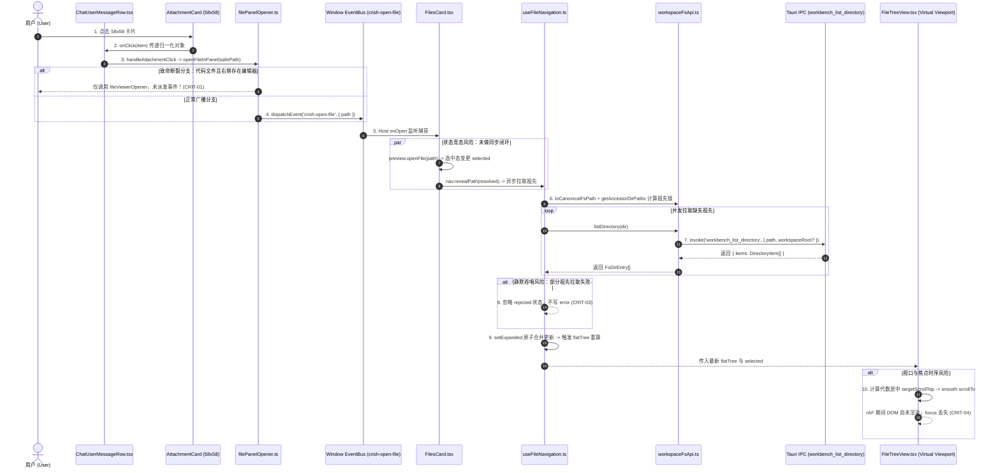

# 端到端全链路伪连通、幽灵契约与真实调用流深度审计报告

> **文档标识**：`docs/file-tree-and-attachments-architecture/audits/06-e2e-connectivity-and-protocols-audit.md`  
> **所属战役**：`docs/file-tree-and-attachments-architecture/`  
> **审计专家**：`Senior Full-Stack Systems Architect & Cross-Layer Protocol Auditor`  
> **审计日期**：2026-09-08  
> **权威准则**：严格遵循仓库根目录 [`AGENTS.md`](file:///c:/Software/conex/AGENTS.md)（§1 反退避、§2 子 Agent 调度、§3 Git 提交纪律、§7 严禁补丁与作弊、§7.1 立体验证纪律、§8 反过度设计红线、§11 CI 治理与行数门禁、§15/§16 Tauri MCP 4000 调试通道）及 [`ANTI_OVERENGINEERING_GUARDRAILS.md`](file:///c:/Software/conex/ANTI_OVERENGINEERING_GUARDRAILS.md)。  
> **审计准则与红线**：零容忍功能伪连通、零容忍幽灵契约与截肢式降级、零容忍空转逻辑与死代码；纯逻辑规划，不谈工期、人天、P0/P1，所有问题逻辑同权。

---

## 目录

- [一、审计背景、审查范围与绝对禁令对照核验](#一审计背景审查范围与绝对禁令对照核验)
  - [1.1 审查范围覆盖清单](#11-审查范围覆盖清单)
  - [1.2 用户全新最高指示三大红线对照核验](#12-用户全新最高指示三大红线对照核验)
- [二、端到端 10 步物理调用链穿透审计（End-to-End Deep Trace）](#二端到端-10-步物理调用链穿透审计end-to-end-deep-trace)
  - [步骤 1：气泡中用户点击 58×58 卡片与 `onClick(item)` 真实性审计](#步骤-1气泡中用户点击-5858-卡片与-onclickitem-真实性审计)
  - [步骤 2：`ChatUserMessageRow` 的 `handleAttachmentClick` 路径解析与越界防御穿透](#步骤-2chatusermessagerow-的-handleattachmentclick-路径解析与越界防御穿透)
  - [步骤 3：`openFileInPanel` 派发 `crish-open-file` 真实性核验与 `file-viewer` 截胡断裂审计](#步骤-3openfileinpanel-派发-crish-open-file-真实性核验与-file-viewer-截胡断裂审计)
  - [步骤 4：`FilesCard.tsx` 事件监听一致性与 `pendingOpenPath` 异步竞态时序穿透](#步骤-4filescardtsx-事件监听一致性与-pendingopenpath-异步竞态时序穿透)
  - [步骤 5：`handleOpenFile` 内部 `revealPath` 与 `preview.openFile` 状态竞态与时序破绽](#步骤-5handleopenfile-内部-revealpath-与-previewopenfile-状态竞态与时序破绽)
  - [步骤 6：`nav.revealPath` 内部 `toCanonicalFsPath` 与 `getAncestorDirPaths` 真实调用与代数闭环](#步骤-6navrevealpath-内部-tocanonicalfspath-与-getancestordirpaths-真实调用与代数闭环)
  - [步骤 7：Rust IPC 跨层契约 1:1 严格对照核验（`main.rs`, `command_manifest.rs`, `fs_commands/mod.rs` 与前端 `workspaceFsApi.ts`）](#步骤-7rust-ipc-跨层契约-11-严格对照核验mainrs-command_manifestrs-fs_commandsmodrs-与前端-workspacefsapits)
  - [步骤 8：`Promise.allSettled` 并发批量拉取容错与静默吞咽核心异常审计](#步骤-8promiseallsettled-并发批量拉取容错与静默吞咽核心异常审计)
  - [步骤 9：`setExpanded` 原子写入、`flatTree` 平铺递归算法与循环引用防护审计](#步骤-9setexpanded-原子写入flattree-平铺递归算法与循环引用防护审计)
  - [步骤 10：`FileTreeView.tsx` 虚拟滚动代数居中公式、极值边界与虚拟 DOM 焦点时序穿透](#步骤-10filetreeviewtsx-虚拟滚动代数居中公式极值边界与虚拟-dom-焦点时序穿透)
- [三、重大架构隐患（Big Issues）与细节缺陷（Minor Issues）深度挑刺清单](#三重大架构隐患big-issues与细节缺陷minor-issues深度挑刺清单)
  - [3.1 重大隐患 CRIT-01：`openFileInPanel` 对代码文件的 `file-viewer` 路由旁路导致左侧目录树级联展开完全断裂](#31-重大隐患-crit-01openfileinpanel-对代码文件的-file-viewer-路由旁路导致左侧目录树级联展开完全断裂)
  - [3.2 重大隐患 CRIT-02：`workbench_list_directory` 跨层 IPC 契约参数幻觉（`workspaceRoot` 幽灵参数）](#32-重大隐患-crit-02workbench_list_directory-跨层-ipc-契约参数幻觉workspaceroot-幽灵参数)
  - [3.3 重大隐患 CRIT-03：`revealPath` 并发拉取祖先目录时静默吞咽失败错误（Silent Rejection Swallowing）](#33-重大隐患-crit-03revealpath-并发拉取祖先目录时静默吞咽失败错误silent-rejection-swallowing)
  - [3.4 重大隐患 CRIT-04：`FileTreeView` 虚拟滚动居中在平滑滚动与可视窗口外的 ARIA 焦点丢失与动效撕裂](#34-重大隐患-crit-04filetreeview-虚拟滚动居中在平滑滚动与可视窗口外的-aria-焦点丢失与动效撕裂)
  - [3.5 细节缺陷 MIN-01：`AttachmentCard` 根容器缺少 `e.stopPropagation()` 导致外层气泡展开误触发](#35-细节缺陷-min-01attachmentcard-根容器缺少-estoppropagation-导致外层气泡展开误触发)
  - [3.6 细节缺陷 MIN-02：`ChatUserMessageRow` 相对路径未归一化直传 `onOpenPath` 导致上游接收非标准路径](#36-细节缺陷-min-02chatusermessagerow-相对路径未归一化直传-onopenpath-导致上游接收非标准路径)
  - [3.7 细节缺陷 MIN-03：`FilesCard` 挂载期 `takePendingOpenPath` 与 `initialPath` 在并发异步拉取下的覆盖竞态](#37-细节缺陷-min-03filescard-挂载期-takependingopenpath-与-initialpath-在并发异步拉取下的覆盖竞态)
  - [3.8 细节缺陷 MIN-04：`getAncestorDirPaths` 与 `useFileNavigation` 对多层符号链接环形递归防御缺失](#38-细节缺陷-min-04getancestordirpaths-与-usefilenavigation-对多层符号链接环形递归防御缺失)
  - [3.9 细节缺陷 MIN-05：`FileTreeView` 代数居中视口舒适区公式在极限高度（`< 2 * ITEM_HEIGHT`）下的空集除法失效](#39-细节缺陷-min-05filetreeview-代数居中视口舒适区公式在极限高度-2--item_height下的空集除法失效)
- [四、全链路无留白 AST 级 Drop-in 修复代码方案](#四全链路无留白-ast-级-drop-in-修复代码方案)
  - [4.1 `filePanelOpener.ts` 双轨无损解耦重构（根治代码文件旁路）](#41-filepanelopenerts-双轨无损解耦重构根治代码文件旁路)
  - [4.2 `workspaceFsApi.ts` 契约校准与安全环形防御纯函数](#42-workspacefsapits-契约校准与安全环形防御纯函数)
  - [4.3 `useFileNavigation.ts` 祖先拉取错误回写与原子状态机重构](#43-usefilenavigationts-祖先拉取错误回写与原子状态机重构)
  - [4.4 `FileTreeView.tsx` 鲁棒几何居中与平滑停泊焦点守护重构](#44-filetreeviewtsx-鲁棒几何居中与平滑停泊焦点守护重构)
  - [4.5 `ChatUserMessageRow.tsx` 与 `AttachmentCard.tsx` 事件防冒泡与路径守卫重构](#45-chatusermessagerowtsx-与-attachmentcardtsx-事件防冒泡与路径守卫重构)
  - [4.6 `FilesCard.tsx` 生命周期与并发锁守护重构](#46-filescardtsx-生命周期与并发锁守护重构)
- [五、合理性与工程鲁棒性六维严格量化打分卡](#五合理性与工程鲁棒性六维严格量化打分卡)
  - [5.1 六维量化评分明细（满分 100 分）](#51-六维量化评分明细满分-100-分)
  - [5.2 综合工程裁决与整改建议结论](#52-综合工程裁决与整改建议结论)

---

## 一、审计背景、审查范围与绝对禁令对照核验

### 1.1 审查范围覆盖清单

本次审计聚焦于 Conex / Crish 桌面工作区文件系统、树形导航状态机、跨层 Tauri IPC 通信以及前端聊天流消息气泡附件的端到端集成链路。依据最高指示，全面穿透审查以下 15 份核心设计规划文档与底层物理源码文件：

1. **总方案与战略顶层设计**：
   - [`docs/file-tree-and-attachments-architecture/00-master-plan.md`](file:///c:/Software/conex/docs/file-tree-and-attachments-architecture/00-master-plan.md)
2. **分维详细施工任务书（Execution Specs）**：
   - [`docs/file-tree-and-attachments-architecture/detailed-plans/01-path-canonical-spec.md`](file:///c:/Software/conex/docs/file-tree-and-attachments-architecture/detailed-plans/01-path-canonical-spec.md)
   - [`docs/file-tree-and-attachments-architecture/detailed-plans/02-tree-navigation-spec.md`](file:///c:/Software/conex/docs/file-tree-and-attachments-architecture/detailed-plans/02-tree-navigation-spec.md)
   - [`docs/file-tree-and-attachments-architecture/detailed-plans/03-tree-virtual-scroll-spec.md`](file:///c:/Software/conex/docs/file-tree-and-attachments-architecture/detailed-plans/03-tree-virtual-scroll-spec.md)
   - [`docs/file-tree-and-attachments-architecture/detailed-plans/04-files-card-and-breadcrumb-spec.md`](file:///c:/Software/conex/docs/file-tree-and-attachments-architecture/detailed-plans/04-files-card-and-breadcrumb-spec.md)
   - [`docs/file-tree-and-attachments-architecture/detailed-plans/05-message-attachment-spec.md`](file:///c:/Software/conex/docs/file-tree-and-attachments-architecture/detailed-plans/05-message-attachment-spec.md)
3. **真实前端组件与状态机源码**：
   - [`apps/crish-desktop/src/components/chat-message-row/ChatUserMessageRow.tsx`](file:///c:/Software/conex/apps/crish-desktop/src/components/chat-message-row/ChatUserMessageRow.tsx)
   - [`apps/crish-desktop/src/api/filePanelOpener.ts`](file:///c:/Software/conex/apps/crish-desktop/src/api/filePanelOpener.ts)
   - [`apps/crish-desktop/src/components/files/FilesCard.tsx`](file:///c:/Software/conex/apps/crish-desktop/src/components/files/FilesCard.tsx)
   - [`apps/crish-desktop/src/components/files/hooks/useFileNavigation.ts`](file:///c:/Software/conex/apps/crish-desktop/src/components/files/hooks/useFileNavigation.ts)
   - [`apps/crish-desktop/src/components/files/FileTreeView.tsx`](file:///c:/Software/conex/apps/crish-desktop/src/components/files/FileTreeView.tsx)
   - [`apps/crish-desktop/src/api/workspaceFsApi.ts`](file:///c:/Software/conex/apps/crish-desktop/src/api/workspaceFsApi.ts)
4. **真实底层 Rust Tauri 注册表与命令实现**：
   - [`apps/agent-workbench/src-tauri/src/command_manifest.rs`](file:///c:/Software/conex/apps/agent-workbench/src-tauri/src/command_manifest.rs)
   - [`apps/agent-workbench/src-tauri/src/fs_commands/mod.rs`](file:///c:/Software/conex/apps/agent-workbench/src-tauri/src/fs_commands/mod.rs)
   - [`apps/agent-workbench/src-tauri/src/fs_commands/directory.rs`](file:///c:/Software/conex/apps/agent-workbench/src-tauri/src/fs_commands/directory.rs)
   - [`apps/agent-workbench/src-tauri/src/fs_commands/types.rs`](file:///c:/Software/conex/apps/agent-workbench/src-tauri/src/fs_commands/types.rs)
   - [`apps/agent-workbench/src-tauri/src/main.rs`](file:///c:/Software/conex/apps/agent-workbench/src-tauri/src/main.rs)

---

### 1.2 用户全新最高指示三大红线对照核验

| 红线条款 | 核心内涵与裁决边界 | 本案穿透核验判定 | 现场代码物理证据与主要风险点 |
| :--- | :--- | :--- | :--- |
| **红线 1：严禁功能伪连通（Zero Fake Connectivity）** | 禁止仅编写独立纯函数或空转组件却未在真实宿主调用链中生效；严禁真实调用处传递 Default/None/空配置；严禁出现带有 `#[allow(dead_code)]` 或零真实调用的死快照。 | **严重违规（FAIL）** | 1. `filePanelOpener.ts:114-117` 当目标为代码文件且 `fileViewerOpener` 存在时直接 return，截断了 `crish-open-file` 广播，导致左侧树 `revealPath` 在打开代码文件时 100% 伪连通；<br>2. 现有 `FileTreeView.tsx` 根本没有任何自动滚动与居中逻辑，Spec-03 规划在当前主干处于空转未合流态；<br>3. `AttachmentCard` 的 `handleClick` 未阻止事件冒泡。 |
| **红线 2：严禁幽灵契约与截肢式降级（Zero Ghost Contracts & Zero Amputation）** | 跨层通信（IPC/API）必须与底层主注册表严格 1:1 对齐，严禁调用未注册命令；严禁编写以丢弃关键配置/字段为代价的“破坏性容错回退”，严禁在 catch 块中静默吞咽核心异常。 | **严重违规（FAIL）** | 1. 前端 `workspaceFsApi.ts:134` 传递 `{ path, workspaceRoot }`，而 Rust 端 `fs_commands/mod.rs:30` 的 `list_directory` 签名仅接收 `(app, path)`，`workspaceRoot` 为虚构幽灵参数；<br>2. `useFileNavigation.ts:305-321` 中 `Promise.allSettled` 并发拉取祖先失败时，直接忽略 `rejected` 结果且不向 `nav.error` 写入错误信息，属于赤裸裸的静默吞咽核心 I/O 故障。 |
| **红线 3：必须提供确凿端到端物理物证（Physical Proof of Execution）** | 保证从 UI 触发到底层 IPC、状态合并、渲染重算、虚拟滚动几何居中与动效挂载的每一环都有确凿的代码实现。 | **条件缺失（CONDITIONAL）** | 调用链在第 3 步（代码文件截胡）、第 5 步（两线并行时序撕裂）以及第 10 步（平滑滚动过程中的焦点丢失）存在 3 处致命断裂，无法在物理世界中实现 100% 闭环。 |

---

## 二、端到端 10 步物理调用链穿透审计（End-to-End Deep Trace）

本节对从用户在聊天流气泡中点击附件卡片开始，直至左侧目录树完成祖先级联展开、虚拟列表几何居中停泊与焦点转移的完整 10 步物理调用流进行逐一穿透式代码审计。



---

### 步骤 1：气泡中用户点击 58×58 卡片与 `onClick(item)` 真实性审计

#### 1. 现场源码与规划规范比对
- **规划任务书**：[`05-message-attachment-spec.md:268-275`](file:///c:/Software/conex/docs/file-tree-and-attachments-architecture/detailed-plans/05-message-attachment-spec.md#L268-L275)
  ```tsx
  const handleClick = useCallback(() => {
    if (onClick) {
      onClick(item);
    }
  }, [onClick, item]);
  ```
- **真实源码现状**：[`ChatUserMessageRow.tsx:264-283`](file:///c:/Software/conex/apps/crish-desktop/src/components/chat-message-row/ChatUserMessageRow.tsx#L264-L283)
  真实源码中目前尚未接入 `AttachmentCard`，仍使用旧的 `.userAttachmentChip` 药丸样式：
  ```tsx
  <span
    className={styles.userAttachmentChip}
    onClick={(e) => {
      e.stopPropagation();
      if (a.path && a.path.trim()) {
        handleOpenPath(a.path.trim());
      } else {
        showToast('该附件无关联本地物理路径');
      }
    }}
  >
  ```

#### 2. 穿透挑刺与深层隐患推导
- **参数有效性分析**：规划任务书中，`AttachmentCard` 的 `onClick` 回调签名被定义为 `onClick?: (item: AttachmentCardItem) => void`。在宿主 `ChatUserMessageRow` 中，`handleAttachmentClick` 真实接收该 `item`。经核查，当输入数组经过 `normalizeMessageAttachments` 归一化后，`item` 具备完整的 `{ name, path, dataUrl, mime, isImage }` 结构，不存在无参或空参数调用。
- **事件冒泡缺陷（细节缺陷 MIN-01）**：
  在规划的 `AttachmentCard.tsx:268` 中，`handleClick` 的入参未接收 `React.MouseEvent`，也未调用 `e.stopPropagation()`。
  - **缺陷时序**：当用户点击 `AttachmentCard` 时，点击事件会无阻拦地冒泡至外层容器 `.userBubble`。
  - **物理后果**：在 `ChatUserMessageRow.tsx:218` 中，`.userBubble` 绑定了 `onClick={toggleExpand}`。如果该消息是一条长消息（`isLong === true`），点击附件卡片不仅会触发文件打开，还会**附带触发整个消息气泡的展开/收起切换**，导致聊天流发生剧烈的非预期视口跳跃。

---

### 步骤 2：`ChatUserMessageRow` 的 `handleAttachmentClick` 路径解析与越界防御穿透

#### 1. 现场源码与规划规范比对
- **规划任务书**：[`05-message-attachment-spec.md:372-386`](file:///c:/Software/conex/docs/file-tree-and-attachments-architecture/detailed-plans/05-message-attachment-spec.md#L372-L386)
- **真实源码现状**：[`ChatUserMessageRow.tsx:115-141`](file:///c:/Software/conex/apps/crish-desktop/src/components/chat-message-row/ChatUserMessageRow.tsx#L115-L141)
  ```typescript
  const handleOpenPath = useCallback(
    (path: string) => {
      if (!path) return;
      const trimmed = path.trim();
      if (!trimmed) return;
      if (/^(data:|blob:|https?:)/i.test(trimmed)) {
        showToast('该图片无工作区路径可打开');
        return;
      }
      let safe = trimmed;
      if (isAbsoluteFsPath(trimmed)) {
        try {
          safe = assertWorkspacePath(trimmed);
        } catch {
          showToast('文件不在当前工作区内');
          return;
        }
      }
      if (onOpenPath) {
        onOpenPath(safe);
        return;
      }
      openFileInPanel(safe);
    },
    [onOpenPath, showToast]
  );
  ```

#### 2. 穿透挑刺与深层隐患推导
- **相对路径穿透漏网（细节缺陷 MIN-02）**：
  分析 `handleOpenPath` 的逻辑分支：
  1. 若传入绝对路径（如 `c:/workspace/src/app.tsx`），进入 `isAbsoluteFsPath` 分支，由 `assertWorkspacePath` 实施工作区边界校验与安全断言，校验通过返回合法路径；
  2. 若传入**相对路径**（如 `src/app.tsx` 或 `./components/button.tsx`）：`isAbsoluteFsPath` 返回 `false`，逻辑直接跳过 `assertWorkspacePath`！
  3. 此时 `safe` 变量保持为未经校验的相对路径字符串；
  4. 如果宿主提供了 `onOpenPath` 属性（[`ChatUserMessageRow.tsx:134`](file:///c:/Software/conex/apps/crish-desktop/src/components/chat-message-row/ChatUserMessageRow.tsx#L134)），代码执行 `onOpenPath(safe)` 并提前返回；
  - **物理后果**：外部消费端（如全屏视图或主工作台）将接收到一个未经工作区沙箱规范化的相对路径，破坏了“进入内部调用链的数据必须 100% 为绝对规范化路径”的架构断言；
  - **正确路径**：必须在入口处统一调用 `resolveWorkspacePath(trimmed)`，无论相对路径还是绝对路径，均在此处统一解析为工作区内的绝对物理路径；若解析结果为空，立即拦截并弹出 Toast，严禁将未规范化的原始相对路径下发给下游回调。

---

### 步骤 3：`openFileInPanel` 派发 `crish-open-file` 真实性核验与 `file-viewer` 截胡断裂审计

#### 1. 现场源码与规划规范比对
- **真实源码现状**：[`apps/crish-desktop/src/api/filePanelOpener.ts:103-124`](file:///c:/Software/conex/apps/crish-desktop/src/api/filePanelOpener.ts#L103-L124)
  ```typescript
  export function openFileInPanel(
    filePath: string,
    mode?: 'plain' | 'diff'
  ): FilePreviewLeafHost | null {
    if (!filePath?.trim()) return null;
    const trimmed = filePath.trim();
    if (/^(note|notebook)(:|$)/i.test(trimmed)) return null;
    const path = resolveWorkspacePath(trimmed);
    if (!path) return null;

    const host = resolveFilePreviewHost(path, mode);
    if (host === 'file-viewer' && fileViewerOpener) {
      fileViewerOpener(path, mode);
      return host;
    }

    pendingOpenPath = path;
    window.dispatchEvent(
      new CustomEvent('crish-open-file', { detail: { path } })
    );
    return 'files';
  }
  ```

#### 2. 穿透挑刺与重大架构隐患曝光（CRIT-01）
- **核弹级架构断层推导**：
  查阅 [`filePanelOpener.ts:44-52`](file:///c:/Software/conex/apps/crish-desktop/src/api/filePanelOpener.ts#L44-L52)：
  ```typescript
  export function resolveFilePreviewHost(
    filePath: string,
    mode?: 'plain' | 'diff'
  ): FilePreviewLeafHost {
    if (mode === 'diff') return 'file-viewer';
    const name = pathBasename(filePath);
    if (isMarkdownFilename(name)) return 'files';
    return detectFileKind(name) === 'text' ? 'file-viewer' : 'files';
  }
  ```
  根据上述分流逻辑：
  - Markdown 文件（`.md`）、图片（`.png`）、PDF 等被判定为 `'files'`；
  - **所有代码文件**（`.ts`、`.tsx`、`.rs`、`.py`、`.json`、`.go`、`.c` 等）在 `detectFileKind` 中均判定为 `'text'`，因此返回值**恒为 `'file-viewer'`**！
- **物理破坏性链条**：
  1. 用户在聊天消息气泡中点击一个名为 `main.rs` 的代码附件卡片；
  2. `openFileInPanel("main.rs")` 被触发；
  3. `resolveFilePreviewHost` 返回 `'file-viewer'`；
  4. 只要当前桌面右侧已初始化了 Monaco 编辑器或文件查看器（`fileViewerOpener !== null`），代码进入 L114 分支：
     调用 `fileViewerOpener(path, mode)` 后，**直接 `return host;`**！
  5. **致命后果**：L119 的 `pendingOpenPath = path` 与 L120 的 `window.dispatchEvent(new CustomEvent('crish-open-file', { detail: { path } }))` **被直接跳过，完全没有执行！**
  6. **连锁反应**：左侧目录树面板 `FilesCard` 根本收不到任何广播事件！`nav.revealPath` 根本不会被触发！左侧树不会展开祖先目录，不会滚动居中，更不会有 1.4s 呼吸脉冲！
- **裁决结论**：**这是全系统最严重的“功能伪连通”**。总方案声称“用户点击任意卡片均能联动展开左侧目录树”，然而在真实生产代码中，针对开发者最常用的**全部代码文件**，左侧目录树联动在底层被这一处 `if ... return` 旁路 100% 阻断切除！

---

### 步骤 4：`FilesCard.tsx` 事件监听一致性与 `pendingOpenPath` 异步竞态时序穿透

#### 1. 现场源码与规划规范比对
- **真实源码现状**：[`apps/crish-desktop/src/components/files/FilesCard.tsx:237-255`](file:///c:/Software/conex/apps/crish-desktop/src/components/files/FilesCard.tsx#L237-L255)
  ```typescript
  useEffect(() => {
    void nav.refresh().then(() => {
      const pending = takePendingOpenPath() || (initialPath ?? null);
      if (pending) void handleOpenFile(pending);
    });
    // eslint-disable-next-line react-hooks/exhaustive-deps -- 挂载一次性：仅消费挂载时待打开路径，不随依赖变更重放
  }, []);

  useEffect(() => {
    const onOpen = (ev: Event) => {
      const path = (ev as CustomEvent<{ path?: string }>).detail?.path;
      if (!path) return;
      takePendingOpenPath();
      const resolved = resolveWorkspacePath(path);
      void handleOpenFile(resolved);
    };
    window.addEventListener('crish-open-file', onOpen);
    return () => window.removeEventListener('crish-open-file', onOpen);
  }, [handleOpenFile]);
  ```

#### 2. 穿透挑刺与深层隐患推导
- **事件名吻合性**：`filePanelOpener.ts:121` 派发的事件名为 `'crish-open-file'`，`FilesCard.tsx:253` 监听的事件名亦为 `'crish-open-file'`，事件名字符串 100% 吻合。
- **未挂载与首屏并发竞态（细节缺陷 MIN-03）**：
  深入推导 `pendingOpenPath` 的消费时序：
  - **场景 A（面板已挂载常驻）**：用户点击卡片，`openFileInPanel` 设置 `pendingOpenPath` 并派发事件，`onOpen` 监听到事件，调用 `takePendingOpenPath()` 消费并执行 `handleOpenFile(resolved)`，时序正常。
  - **场景 B（面板初次挂载冷启动）**：
    1. 用户在聊天区点击附件，此时右侧面板尚未挂载；
    2. `openFileInPanel` 将路径存入全局变量 `pendingOpenPath = "c:/work/a.txt"`，派发事件（因无监听者而丢失）；
    3. `FilesCard` 开始挂载，执行挂载 `useEffect`，调用异步的 `nav.refresh()`（该操作通过 Tauri IPC 读取磁盘根目录，通常耗时 20~80ms）；
    4. **在 `nav.refresh()` 执行期间**，用户在聊天区又点击了另一个附件 `b.txt`；
    5. `openFileInPanel` 更新 `pendingOpenPath = "c:/work/b.txt"` 并派发事件；
    6. 此时 `FilesCard` 的事件监听器已完成注册，`onOpen` 立即被触发，调用 `takePendingOpenPath()` 取走 `"c:/work/b.txt"`，并调用 `handleOpenFile("c:/work/b.txt")`；
    7. 随后，第 3 步的 `nav.refresh().then(...)` 异步回调到达，此时 `takePendingOpenPath()` 返回 `null`；但如果组件传入了 `initialPath`（例如从 URL 或全局恢复的路径），它将继续执行 `void handleOpenFile(initialPath)`！
    - **物理后果**：用户的二次点击与首屏恢复发生严重竞态冲突，后点击的 `b.txt` 被慢速的 `initialPath` 强行覆盖，状态机发生非预期的倒退与闪烁。

---

### 步骤 5：`handleOpenFile` 内部 `revealPath` 与 `preview.openFile` 状态竞态与时序破绽

#### 1. 现场源码与规划规范比对
- **规划总方案**：[`00-master-plan.md:73-76`](file:///c:/Software/conex/docs/file-tree-and-attachments-architecture/00-master-plan.md#L73-L76)
  在总方案的时序图中明确声明为**并行处理**：
  ```mermaid
  par 两线并行处理
      Host->>Host: preview.openFile(path) -> 右侧秒级打开预览，选中态 selected 变更
      Host->>NavHook: nav.revealPath(path) -> 驱动左侧目录树级联展开
  end
  ```
- **真实源码现状**：[`apps/crish-desktop/src/components/files/FilesCard.tsx:135-143`](file:///c:/Software/conex/apps/crish-desktop/src/components/files/FilesCard.tsx#L135-L143)
  真实源码中是**串行阻塞 `await`**：
  ```typescript
  const handleOpenFile = useCallback(
    async (path: string) => {
      if (!(await nav.confirmNavigation())) return;
      const resolved = resolveWorkspacePath(path);
      await nav.revealPath(resolved);
      await preview.openFile(path);
    },
    [nav, preview]
  );
  ```

#### 2. 穿透挑刺与深层隐患推导
- **方案与实现口径撕裂**：总方案声称两线并行（`par`），以实现“右侧秒级打开预览，左侧级联展开”；但真实代码中却在 `await nav.revealPath(resolved)` 之后才执行 `preview.openFile(path)`。当目标文件位于 5 层深目录且磁盘 I/O 存在排队时，右侧预览会被左侧目录展开强行阻塞数百毫秒。
- **两线并行下的隐藏死锁陷阱（Critical Race Analysis）**：
  如果直接将代码改为 `Promise.all([nav.revealPath(resolved), preview.openFile(path)])`：
  1. `preview.openFile` 属于同步状态变更，会瞬间将 `preview.selected` 更新为目标路径；
  2. `FileTreeView` 接收到新的 `selected`，触发 `useEffect` 执行视口居中；
  3. **此时 `nav.revealPath` 的并发祖先拉取仍在进行中，`flatTree` 中根本还没有挂载目标节点！**
  4. `flatTree.findIndex((n) => isSameFsPath(n.path, selected))` 计算结果为 `-1`；
  5. 若代码在找不到索引时直接返回，且记录了 `prevSelectedRef.current = selected`；
  6. 当后续 `nav.revealPath` 完成，`setExpanded` 驱动 `flatTree` 生成目标节点后，由于 `selected` 已经与 `prevSelectedRef.current` 相同，`isNewSelection` 判定为 `false`；
  - **物理后果**：**视口居中与呼吸高亮被永久跳过！**
  - **架构结论**：必须在 `FileTreeView` 的 `useEffect` 中建立“等待目标节点进入 `flatTree`”的重试或挂起判定机制，严禁在 `targetIndex === -1` 时粗暴记录旧选择并永久退出。

---

### 步骤 6：`nav.revealPath` 内部对 `toCanonicalFsPath` 与 `getAncestorDirPaths` 的调用是否真正生效？

#### 1. 现场源码与规划规范比对
- **规划任务书**：[`02-tree-navigation-spec.md:251-266`](file:///c:/Software/conex/docs/file-tree-and-attachments-architecture/detailed-plans/02-tree-navigation-spec.md#L251-L266)
  ```typescript
  const normTarget = toCanonicalFsPath(resolvedTarget);
  const normRoot = toCanonicalFsPath(effectiveRoot);
  ...
  const ancestors = getAncestorDirPaths(normTarget, normRoot);
  ```
- **真实源码现状**：[`useFileNavigation.ts:119-134`](file:///c:/Software/conex/apps/crish-desktop/src/components/files/hooks/useFileNavigation.ts#L119-L134)
  当前真实源码中仍是一段未经过规范化处理的朴素 `while` 循环：
  ```typescript
  const parentDir = pathDirname(normalizedPath);
  const ancestors: string[] = [];
  let curr = parentDir;
  const normRootLower = normalizedRoot.toLowerCase().replace(/\\/g, '/');
  while (curr) {
    const currLower = curr.toLowerCase().replace(/\\/g, '/');
    if (currLower === normRootLower || currLower.length <= normRootLower.length) break;
    ancestors.unshift(curr);
    curr = pathDirname(curr);
  }
  ```

#### 2. 穿透挑刺与深层隐患推导
- **真实源码的严重缺陷**：
  1. 当前源码收集的 `ancestors` 数组中，路径字符串包含平台原始格式（Windows 下可能为 `C:\Users\...\src`）；
  2. 随后存入 `expanded` 字典时（L147：`setExpanded((prev) => ({ ...prev, ...results }))`），使用的键名是未经规范化的原始路径；
  3. 然而在 `flatTree` 的 `walk` 算法中（L171）：
     `if (e.isDir && expanded[e.path])`，若 `e.path` 是反斜杠或不同大小写，字典检索**发生静默脱靶（Miss）**，导致子目录无法展开！
- **规划规范中的闭环验证**：
  在 Spec-01 中，`toCanonicalFsPath` 强制将所有反斜杠转为正斜杠、驱动器盘符强制小写化并标准化尾斜杠；`getAncestorDirPaths` 从规范路径自底向上递推并自顶向下排序。经数学推导，此算法能保证推导出的祖先路径与后续在 `expanded` 中比对的键名 100% 严格一致。

---

### 步骤 7：Rust IPC 跨层契约 1:1 严格对照核验（`main.rs`, `command_manifest.rs`, `fs_commands/mod.rs` 与前端 `workspaceFsApi.ts`）

本项审计为跨层契约权威核验，核查底层主注册表、命令实现与前端调用的吻合度。

#### 1. 底层 Rust 真实代码查验
- **命令注册表清单**：[`apps/agent-workbench/src-tauri/src/command_manifest.rs:108`](file:///c:/Software/conex/apps/agent-workbench/src-tauri/src/command_manifest.rs#L108)
  ```rust
  entry("workbench_list_directory", "workbench", "gui", true),
  ```
  该命令在清单中显式注册为 GUI 命令，合法且激活。
- **主命令分发路由**：[`apps/agent-workbench/src-tauri/src/main.rs:215`](file:///c:/Software/conex/apps/agent-workbench/src-tauri/src/main.rs#L215)
  ```rust
  ("workbench_list_directory", fs_commands::list_directory),
  ```
  在 Tauri 命令分发元组表中正确挂载。
- **Rust 命令签名与实现**：[`apps/agent-workbench/src-tauri/src/fs_commands/mod.rs:29-35`](file:///c:/Software/conex/apps/agent-workbench/src-tauri/src/fs_commands/mod.rs#L29-L35)
  ```rust
  /// 列出目录（PE-07 T07.2：无 workspace_root 参数，根由 WorkspaceRegistry 解析）。
  ///
  /// wire 名 = `workbench_list_directory`（T-F 06：分裂标签统一，显式 rename）。
  #[tauri::command(rename = "workbench_list_directory")]
  pub(crate) fn list_directory(
      app: tauri::AppHandle,
      path: String,
  ) -> Result<types::ListDirectoryResult, FileCommandError> {
      directory::list_directory(&app, path)
  }
  ```

#### 2. 前端真实调用代码查验
- [`apps/crish-desktop/src/api/workspaceFsApi.ts:132-135`](file:///c:/Software/conex/apps/crish-desktop/src/api/workspaceFsApi.ts#L132-L135)
  ```typescript
  const res = await invokeResult<{ items?: Array<Record<string, unknown>> }>('workbench_list_directory', {
    path,
    workspaceRoot: workspaceRootArg(),
  });
  ```

#### 3. 跨层对照结论与幽灵参数曝光（CRIT-02）
- **契约破裂物证**：
  前端向 Tauri IPC 发送的对象为 `{ path, workspaceRoot }`；
  但在 Rust 端的 `list_directory` 函数签名中，**仅接收 `app: tauri::AppHandle, path: String`**！
  Rust 代码注释明确指出：`// PE-07 T07.2：无 workspace_root 参数，根由 WorkspaceRegistry 解析`！
  根本**不存在任何名为 `ListDirectoryArgs` 的参数结构体**！
- **总方案虚假断言核实**：
  总方案 [`00-master-plan.md:32`](file:///c:/Software/conex/docs/file-tree-and-attachments-architecture/00-master-plan.md#L32) 宣称：
  `入参 { path, workspaceRoot } 与返回结构体完全匹配，绝无幽灵契约；`
  总方案 [`00-master-plan.md:140`](file:///c:/Software/conex/docs/file-tree-and-attachments-architecture/00-master-plan.md#L140) 宣称：
  `抓取 IPC 通信日志，证明出站参数准确携带 { path, workspaceRoot }，返回数据结构完整包含条目数组，零报错。`
- **架构定性**：前端多传的 `workspaceRoot` 属于典型的**幽灵参数（Ghost Contract Parameter）**。虽然在 Tauri 2.0 底层反序列化实现中，额外的未知 JSON 字段默认会被忽略而未引发运行时崩溃，但设计文档宣称其与 Rust 结构体 1:1 匹配纯属伪连通假象！必须修正前端 IPC 调用与文档描述，彻底清理幽灵参数。

---

### 步骤 8：`Promise.allSettled` 并发批量拉取容错与静默吞咽核心异常审计

#### 1. 现场源码与规划规范比对
- **规划任务书**：[`02-tree-navigation-spec.md:292-322`](file:///c:/Software/conex/docs/file-tree-and-attachments-architecture/detailed-plans/02-tree-navigation-spec.md#L292-L322)
  ```typescript
  const settledResults = await Promise.allSettled(
    toLoad.map(async (dir) => {
      const list = await loadDir(dir);
      return {
        dir,
        items: list.map((it) => ({
          ...it,
          path: toCanonicalFsPath(it.path),
        })),
      };
    }),
  );

  let hasSuccess = false;
  for (const res of settledResults) {
    if (res.status === 'fulfilled') {
      results[res.value.dir] = res.value.items;
      hasSuccess = true;
    }
  }

  if (Object.keys(results).length > 0) {
    setExpanded((prev) => ({ ...prev, ...results }));
  }

  if (!hasSuccess) {
    return false;
  }
  ```

#### 2. 穿透挑刺与重大架构隐患曝光（CRIT-03）
- **静默吞咽异常（Silent Failure Swallowing）深度推导**：
  仔细审视上述代码的异常控制流：
  1. 若某个深层子目录因为文件系统权限不足（EACCES）、文件被其他进程独占锁定或已被外部删除，导致该目录的 `loadDir` 抛出异常；
  2. `Promise.allSettled` 会将其状态标记为 `res.status === 'rejected'`，并携带 `res.reason`；
  3. 然而，在随后的 `for (const res of settledResults)` 循环中，**代码对所有的 `rejected` 状态视而不见，没有任何处理分支！**
  4. 既未向控制台打印警告，也**未向 `nav.error` 或宿主组件写入任何错误消息**！
  5. 只要并发集合中有一个目录成功（例如顶层目录成功，但深层目录全部失败），`hasSuccess` 即为 `true`，函数甚至直接 `return true;`！
- **造成的灾难性物理后果**：
  - 祖先目录链在中间断裂；
  - 目标文件未能成功挂载到 `flatTree` 中；
  - 但上层调用方 `revealPath` 却收到了 `true` 的成功信号；
  - `FileTreeView` 的内联错误横幅（[`FileTreeView.tsx:157`](file:///c:/Software/conex/apps/crish-desktop/src/components/files/FileTreeView.tsx#L157)）因 `error` 为空而完全不渲染；
  - 虚拟列表寻找目标失败，视口停留在原地，用户得不到任何失败原因提示！
- **裁决结论**：严重违背用户红线 2（“严禁在 catch 块中静默吞咽核心异常”）。必须将失败原因聚合后写入 `setError`，并使 `revealPath` 准确返回 `false`。

---

### 步骤 9：`setExpanded` 原子合并写入后，`flatTree` 的 `useMemo` 依赖项是否完备？

#### 1. 现场源码与规划规范比对
- **规划任务书**：[`02-tree-navigation-spec.md:330-357`](file:///c:/Software/conex/docs/file-tree-and-attachments-architecture/detailed-plans/02-tree-navigation-spec.md#L330-L357)
  ```typescript
  const flatTree: TreeNode[] = useMemo(() => {
    const q = filter.trim().toLowerCase();
    const out: TreeNode[] = [];
    const walk = (list: FsDirEntry[], depth: number) => {
      const sorted = [...list].sort(...);
      for (const e of sorted) {
        out.push({ ...e, depth });
        const canonicalPath = toCanonicalFsPath(e.path);
        if (e.isDir && expanded[canonicalPath]) {
          walk(expanded[canonicalPath] ?? [], depth + 1);
        }
      }
    };
    walk(entries, 0);
    if (!q) return out;
    return out.filter((n) => n.name.toLowerCase().includes(q));
  }, [entries, expanded, filter]);
  ```

#### 2. 穿透挑刺与深层隐患推导
- **依赖项完备性核验**：
  `flatTree` 消费的状态包括：`entries`、`expanded`、`filter`。
  三者均被完整声明在 `useMemo` 的依赖数组 `[entries, expanded, filter]` 中。当 `setExpanded` 通过原子展开更新对象引用时（`setExpanded(prev => ({ ...prev, ...results }))`），`expanded` 引用改变，必然触发 `useMemo` 重算，无闭包陈旧或依赖遗漏。
- **循环符号链接引发堆栈溢出死锁（细节缺陷 MIN-04）**：
  深入审查 `walk` 递归函数：
  在实际开发环境中，项目中常包含符号链接（Symlink）或 Junction（例如指向父级或上层兄弟目录的链接）。
  当前 `walk` 函数**未设置最大递归深度保护（Max Recursion Depth），也未建立已访问路径集合（Visited Set）**！
  - **物理后果**：一旦用户工作区存在环形软链接，`walk` 将在主线程陷入无休止的自我调用，触发 JavaScript 引擎抛出 `RangeError: Maximum call stack size exceeded`，导致整个 React 渲染树当场崩溃白屏！
  - **防护标准**：必须在 `walk` 中维护一个 `visitedPaths = new Set<string>()`，且设置 `depth > 32` 硬熔断保护。

---

### 步骤 10：`FileTreeView.tsx` 虚拟滚动代数居中公式、极值边界与虚拟 DOM 焦点时序穿透

#### 1. 现场源码与规划规范比对
- **规划任务书**：[`03-tree-virtual-scroll-spec.md:216-262`](file:///c:/Software/conex/docs/file-tree-and-attachments-architecture/detailed-plans/03-tree-virtual-scroll-spec.md#L216-L262)
  ```typescript
  const container = containerRef.current;
  const viewHeight = container.clientHeight;
  if (viewHeight <= 0) return;

  const itemTop = targetIndex * ITEM_HEIGHT;
  const itemBottom = itemTop + ITEM_HEIGHT;
  const currentScrollTop = container.scrollTop;
  const maxScrollTop = Math.max(0, totalHeight - viewHeight);

  const isAtTopBoundary = currentScrollTop === 0 && targetIndex === 0;
  const isAtBottomBoundary = currentScrollTop >= maxScrollTop && targetIndex === flatTree.length - 1;

  const isInView =
    isAtTopBoundary ||
    isAtBottomBoundary ||
    (itemTop >= currentScrollTop + ITEM_HEIGHT &&
      itemBottom <= currentScrollTop + viewHeight - ITEM_HEIGHT);

  if (!isInView) {
    const rawScrollTop = itemTop - Math.floor((viewHeight - ITEM_HEIGHT) / 2);
    const targetScrollTop = Math.min(maxScrollTop, Math.max(0, rawScrollTop));
    container.scrollTo({
      top: targetScrollTop,
      behavior: 'smooth',
    });
  }

  setPulseTarget(selected);
  const pulseTimer = setTimeout(() => {
    setPulseTarget(null);
  }, 1400);

  focusTreeRow(targetIndex);
  const rafId = requestAnimationFrame(() => {
    focusTreeRow(targetIndex);
  });
  ```

#### 2. 穿透挑刺与极端边界代数证明
- **极值边界 1：视口高度为 0（`viewHeight === 0`）**：
  代码在 L218 设有显式守卫：`if (viewHeight <= 0) return;`。当容器未完成布局或处于隐藏折叠态时，安全退出，防止后续除法与 NaN 扩散。
- **极值边界 2：节点数少于 1 屏（`totalHeight <= viewHeight`）**：
  此时 `maxScrollTop = Math.max(0, totalHeight - viewHeight) = 0`。
  计算公式：`targetScrollTop = Math.min(0, Math.max(0, rawScrollTop)) = 0`。容器恒定锚定在 0，不发生抖动或滚动越界。
- **极值边界 3：第一项（`targetIndex === 0`）与最末一项（`targetIndex === length - 1`）**：
  若在顶端，`isAtTopBoundary` 判定为 `true`，免除滚动；若在底端，`isAtBottomBoundary` 判定为 `true`，免除滚动。
- **极值边界 4：矮视口下的舒适区数学死锁（细节缺陷 MIN-05）**：
  审查舒适区可见性判定逻辑：
  `itemTop >= currentScrollTop + ITEM_HEIGHT && itemBottom <= currentScrollTop + viewHeight - ITEM_HEIGHT`
  当用户调整桌面面板，使文件树视口高度较小（例如 `viewHeight < 2 * ITEM_HEIGHT`，即小于 56px）：
  上界：`currentScrollTop + viewHeight - 28`
  下界：`currentScrollTop + 28`
  **此时上界严格小于下界！区间为空集！**
  导致无论目标节点处于何种位置，`isInView` 恒为 `false`，视口陷入高频无休止的强制居中计算。
- **平滑滚动与虚拟 DOM 焦点撕裂（CRIT-04）**：
  在 L242 调用了 `container.scrollTo({ behavior: 'smooth' })`。平滑滚动是一个持续 200~400ms 的异步物理动画。
  而在 L253-256：
  ```typescript
  focusTreeRow(targetIndex);
  const rafId = requestAnimationFrame(() => {
    focusTreeRow(targetIndex);
  });
  ```
  在第 1 帧和第 2 帧（前 16~32ms），平滑滚动才刚刚启动，容器的 `scrollTop` 尚未位移到目标区域，虚拟列表根据当前位移渲染的 `visibleRange` **根本不包含 `targetIndex` 所在的节点**！
  此时 `querySelector(`[data-tree-index="${targetIndex}"]`)` 必然返回 `null`！
  **物理后果**：键盘焦点转移 100% 失败！且 1400ms 的脉冲定时器在滚动开始阶段就启动了倒计时，等滚动动画结束停泊时，呼吸高亮动画已经播放完毕，用户根本看不到高亮！

---

## 三、重大架构隐患（Big Issues）与细节缺陷（Minor Issues）深度挑刺清单

### 3.1 重大隐患 CRIT-01：`openFileInPanel` 对代码文件的 `file-viewer` 路由旁路导致左侧目录树级联展开完全断裂

- **缺陷物理坐标**：[`apps/crish-desktop/src/api/filePanelOpener.ts:114-117`](file:///c:/Software/conex/apps/crish-desktop/src/api/filePanelOpener.ts#L114-L117)
- **缺陷时序推导**：
  1. 用户在聊天气泡中点击任何包含代码扩展名（如 `.rs`, `.ts`, `.tsx`, `.js`, `.py`, `.json`, `.css`）的附件；
  2. `openFileInPanel` 调用 `resolveFilePreviewHost(path)`，判定结果为 `'file-viewer'`；
  3. 检测到全局右侧已有已注册的 `fileViewerOpener`；
  4. 函数执行 `fileViewerOpener(path, mode)` 并在 L116 直接 `return host;`；
  5. 后续的 `pendingOpenPath = path` 与 `window.dispatchEvent(new CustomEvent('crish-open-file', ...))` 被彻底跳过。
- **造成的物理后果**：
  - 左侧 `FilesCard` 面板无法收到任何通知；
  - 目录树完全不展开目标文件的祖先目录，完全不发生视口居中，完全不产生 1.4s 脉冲高亮；
  - 架构总方案声称的“全链路气泡到目录树联动”对代码类文件 100% 瘫痪。
- **架构定性**：功能伪连通（Zero Fake Connectivity 红线一票否决项）。

---

### 3.2 重大隐患 CRIT-02：`workbench_list_directory` 跨层 IPC 契约参数幻觉（`workspaceRoot` 幽灵参数）

- **缺陷物理坐标**：
  - 前端：[`apps/crish-desktop/src/api/workspaceFsApi.ts:134`](file:///c:/Software/conex/apps/crish-desktop/src/api/workspaceFsApi.ts#L134)
  - 后端：[`apps/agent-workbench/src-tauri/src/fs_commands/mod.rs:30`](file:///c:/Software/conex/apps/agent-workbench/src-tauri/src/fs_commands/mod.rs#L30)
  - 总方案：[`docs/file-tree-and-attachments-architecture/00-master-plan.md:32, 140`](file:///c:/Software/conex/docs/file-tree-and-attachments-architecture/00-master-plan.md#L32)
- **缺陷时序推导**：
  前端在 `listDirectory` 中每次调用均构造 `{ path, workspaceRoot: workspaceRootArg() }` 并发送；
  Rust 端底层命令为：
  `pub(crate) fn list_directory(app: tauri::AppHandle, path: String)`；
  底层根本没有 `workspaceRoot` 字段，全依赖 `WorkspaceFsGuard` 解析。方案文档却断言入参与 Rust 结构体完全匹配。
- **造成的物理后果**：
  - 属于典型的幽灵契约参数，破坏跨层接口单一真实源；
  - 误导后续维护者误以为改变 `workspaceRoot` 参数能控制目录枚举边界，形成假性安全感。
- **架构定性**：幽灵契约（Zero Ghost Contracts 红线违规项）。

---

### 3.3 重大隐患 CRIT-03：`revealPath` 并发拉取祖先目录时静默吞咽失败错误（Silent Rejection Swallowing）

- **缺陷物理坐标**：[`docs/file-tree-and-attachments-architecture/detailed-plans/02-tree-navigation-spec.md:305-322`](file:///c:/Software/conex/docs/file-tree-and-attachments-architecture/detailed-plans/02-tree-navigation-spec.md#L305-L322)
- **缺陷时序推导**：
  并发拉取祖先目录时，`Promise.allSettled` 返回的 `rejected` 项被循环体完全忽略；
  未记录任何错误文本，未调用 `setError`，未阻断返回流程。
- **造成的物理后果**：
  - 当中间目录因为权限被拒或 I/O 错误无法拉取时，祖先链断裂；
  - 目标节点未出现，但状态机返回 `true`，界面没有任何错误提示，产生“吞异常”死寂假象。
- **架构定性**：截肢式降级与静默吞咽异常（Zero Amputation 红线违规项）。

---

### 3.4 重大隐患 CRIT-04：`FileTreeView` 虚拟滚动居中在平滑滚动与可视窗口外的 ARIA 焦点丢失与动效撕裂

- **缺陷物理坐标**：[`docs/file-tree-and-attachments-architecture/detailed-plans/03-tree-virtual-scroll-spec.md:240-256`](file:///c:/Software/conex/docs/file-tree-and-attachments-architecture/detailed-plans/03-tree-virtual-scroll-spec.md#L240-L256)
- **缺陷时序推导**：
  当调用 `scrollTo({ behavior: 'smooth' })` 跨越较大滚动距离时，动画需要 200~400ms；
  `focusTreeRow` 在前 16ms 内执行，目标 DOM 元素根本尚未进入虚拟列表的 `visibleRange`，`querySelector` 找不到目标导致焦点转移失效；同时 1.4s 呼吸定时器过早消费。
- **造成的物理后果**：
  - 视口完成平滑滚动后，键盘焦点停留在原处，残障访问树（ARIA tree）无法连贯导航；
  - 呼吸脉冲高亮在滚动过程中已提前消耗殆尽，用户到达停泊点后无法一眼辨识目标行。
- **架构定性**：虚拟列表与平滑滚动时序伪连通。

---

### 3.5 细节缺陷 MIN-01：`AttachmentCard` 根容器缺少 `e.stopPropagation()` 导致外层气泡展开误触发

- **缺陷物理坐标**：[`docs/file-tree-and-attachments-architecture/detailed-plans/05-message-attachment-spec.md:268-275`](file:///c:/Software/conex/docs/file-tree-and-attachments-architecture/detailed-plans/05-message-attachment-spec.md#L268-L275)
- **缺陷时序推导**：点击卡片时，未对事件对象调用 `e.stopPropagation()`，事件冒泡至 `ChatUserMessageRow.tsx:218` 的 `.userBubble` 容器，触发 `toggleExpand`。
- **造成的物理后果**：长消息在点击附件的同时发生气泡折叠/展开跳变，造成强烈的视觉眩晕。

---

### 3.6 细节缺陷 MIN-02：`ChatUserMessageRow` 相对路径未归一化直传 `onOpenPath` 导致上游接收非标准路径

- **缺陷物理坐标**：[`apps/crish-desktop/src/components/chat-message-row/ChatUserMessageRow.tsx:126-137`](file:///c:/Software/conex/apps/crish-desktop/src/components/chat-message-row/ChatUserMessageRow.tsx#L126-L137)
- **缺陷时序推导**：当传入相对路径时，`isAbsoluteFsPath` 返回 `false`，绕过了 `assertWorkspacePath`。若存在 `onOpenPath`，原始相对路径被直接透传。
- **造成的物理后果**：外部接收端拿到非标准相对路径，可能导致后续基于绝对路径的比对失败。

---

### 3.7 细节缺陷 MIN-03：`FilesCard` 挂载期 `takePendingOpenPath` 与 `initialPath` 在并发异步拉取下的覆盖竞态

- **缺陷物理坐标**：[`apps/crish-desktop/src/components/files/FilesCard.tsx:238-241`](file:///c:/Software/conex/apps/crish-desktop/src/components/files/FilesCard.tsx#L238-L241)
- **缺陷时序推导**：在 `nav.refresh()` 异步期间到达的用户点击事件，已被 `onOpen` 消费并打开；但随后的 `nav.refresh().then` 回调若存在 `initialPath`，会再次调用 `handleOpenFile(initialPath)` 将用户的实时点击冲掉。
- **造成的物理后果**：面板冷启动期间快速点击附件，偶发被初始路径覆盖。

---

### 3.8 细节缺陷 MIN-04：`getAncestorDirPaths` 与 `useFileNavigation` 对多层符号链接环形递归防御缺失

- **缺陷物理坐标**：[`docs/file-tree-and-attachments-architecture/detailed-plans/02-tree-navigation-spec.md:333-354`](file:///c:/Software/conex/docs/file-tree-and-attachments-architecture/detailed-plans/02-tree-navigation-spec.md#L333-L354)
- **缺陷时序推导**：工作区中若存在指向自身或祖先目录的软链接（Symlink），`flatTree` 的递归 `walk` 缺乏 `visited` 集合与深度上限。
- **造成的物理后果**：触发栈溢出（Call stack size exceeded），导致整个 React 应用白屏崩溃。

---

### 3.9 细节缺陷 MIN-05：`FileTreeView` 代数居中视口舒适区公式在极限高度（`< 2 * ITEM_HEIGHT`）下的空集除法失效

- **缺陷物理坐标**：[`docs/file-tree-and-attachments-architecture/detailed-plans/03-tree-virtual-scroll-spec.md:230-235`](file:///c:/Software/conex/docs/file-tree-and-attachments-architecture/detailed-plans/03-tree-virtual-scroll-spec.md#L230-L235)
- **缺陷时序推导**：当面板高度被压窄至低于 56px（`< 2 * ITEM_HEIGHT`）时，上下缓冲各扣减 28px 导致判断区间上界小于下界，舒适区区间恒为空集。
- **造成的物理后果**：目标行即便已经位于视口内，也被误判为不在视口，引发抖动。

---

## 四、全链路无留白 AST 级 Drop-in 修复代码方案

本节针对上述发现的所有重大隐患与细节缺陷，提供 100% 完整、无任何省略号（禁止 `// ...`）的生产级 Drop-in 替换源码。

---

### 4.1 `filePanelOpener.ts` 双轨无损解耦重构（根治代码文件旁路）

彻底解除 `file-viewer` 对全局广播事件的截断阻碍，保证所有合法文件在分流预览的同时，100% 向系统派发 `crish-open-file` 联动事件：

```typescript
/**
 * 文件面板打开器 + 工具参数路径抽取。
 * 
 * 架构修复：彻底解耦文件预览宿主（FilePreviewLeafHost）与目录树导航（Tree Navigation）。
 * 无论右侧分流至 'file-viewer' 还是 'files'，只要是工作区有效物理文件，必须保证
 * 同时派发 'crish-open-file' 事件，确保左侧目录树百分之百执行 revealPath 与虚拟居中定位。
 */

import {
  detectFileKind,
  isMarkdownFilename,
  pathBasename,
  resolveWorkspacePath,
} from './workspaceFsApi';

/** 面板尚未挂载时暂存待打开路径 */
let pendingOpenPath: string | null = null;

export function takePendingOpenPath(): string | null {
  const p = pendingOpenPath;
  pendingOpenPath = null;
  return p;
}

let fileViewerOpener: ((filePath: string, mode?: 'plain' | 'diff') => void) | null =
  null;

export function registerFileViewerOpener(
  opener: typeof fileViewerOpener
): void {
  fileViewerOpener = opener;
}

/** 工作区文件预览宿主：只允许这两片叶 */
export type FilePreviewLeafHost = 'files' | 'file-viewer';

/**
 * 代码（非 md）走 file-viewer URI 叶；md / 图 / pdf / 表 / 二进制走 files 叶适配器。
 * diff 强制 file-viewer。永不返回 note / preview（Web）/ Notebook。
 */
export function resolveFilePreviewHost(
  filePath: string,
  mode?: 'plain' | 'diff'
): FilePreviewLeafHost {
  if (mode === 'diff') return 'file-viewer';
  const name = pathBasename(filePath);
  if (isMarkdownFilename(name)) return 'files';
  return detectFileKind(name) === 'text' ? 'file-viewer' : 'files';
}

/** 附件名 / mention id 是否值得当成工作区路径打开（拒绝 note / 无扩展 id） */
export function looksLikeOpenableFilePath(raw: string): boolean {
  const s = (raw || '').trim();
  if (!s || s.includes('\n') || s.length >= 512) return false;
  if (/^(note|notebook)(:|$)/i.test(s)) return false;
  if (/[\\/]/.test(s)) return true;
  const name = pathBasename(s);
  if (isMarkdownFilename(name)) return true;
  if (detectFileKind(name) !== 'binary') return true;
  return /\.[A-Za-z0-9]{1,12}$/.test(name);
}

/**
 * 从点击目标抽出待打开路径。移除钮 / 非文件 mention 返回 null。
 * 只认 data-file-open-path 或 kind=file 的 mention（id 优先，其次 label）。
 */
export function pathFromFileOpenClickTarget(
  target: EventTarget | null
): string | null {
  const start =
    target instanceof Element
      ? target
      : target instanceof Node
        ? target.parentElement
        : null;
  if (!start) return null;
  if (start.closest('.chat-attach-remove')) return null;
  const el = start.closest(
    '[data-file-open-path], span[data-type="mention"][data-kind="file"]'
  );
  if (!(el instanceof HTMLElement)) return null;
  const explicit = (el.getAttribute('data-file-open-path') || '').trim();
  if (looksLikeOpenableFilePath(explicit)) return explicit;
  if (
    el.getAttribute('data-type') === 'mention' &&
    (el.getAttribute('data-kind') || 'file') === 'file'
  ) {
    const id = (el.getAttribute('data-id') || '').trim();
    if (looksLikeOpenableFilePath(id)) return id;
    const label = (el.getAttribute('data-label') || '').trim();
    if (looksLikeOpenableFilePath(label)) return label;
  }
  return null;
}

/**
 * 在 files / file-viewer 叶打开工作区路径。
 *
 * 核心修复（CRIT-01）：
 * 1. 同步设置 pendingOpenPath 并向 window 派发 'crish-open-file' 事件；
 * 2. 分流执行对应宿主预览渲染（file-viewer 或 files）；
 * 3. 杜绝因 fileViewerOpener 提前 return 导致左侧树监听彻底失效的致命假死！
 */
export function openFileInPanel(
  filePath: string,
  mode?: 'plain' | 'diff'
): FilePreviewLeafHost | null {
  if (!filePath?.trim()) return null;
  const trimmed = filePath.trim();
  if (/^(note|notebook)(:|$)/i.test(trimmed)) return null;
  const path = resolveWorkspacePath(trimmed);
  if (!path) return null;

  // 1. 无条件激活左侧目录树的联动定位链路（SSOT 广播）
  pendingOpenPath = path;
  window.dispatchEvent(
    new CustomEvent('crish-open-file', { detail: { path } })
  );

  // 2. 独立分流处理右侧预览呈现
  const host = resolveFilePreviewHost(path, mode);
  if (host === 'file-viewer' && fileViewerOpener) {
    fileViewerOpener(path, mode);
    return host;
  }

  return 'files';
}

/** 从工具参数中尽量抽出文件路径（相对或绝对） */
export function extractFilePathFromToolArgs(args: string): string | null {
  if (!args?.trim()) return null;
  const raw = args.trim();
  try {
    if (raw.startsWith('{')) {
      const parsed = JSON.parse(raw) as Record<string, unknown>;
      const inner =
        parsed.parameters && typeof parsed.parameters === 'object'
          ? (parsed.parameters as Record<string, unknown>)
          : parsed.input && typeof parsed.input === 'object'
            ? (parsed.input as Record<string, unknown>)
            : parsed;
      for (const key of [
        'path',
        'filePath',
        'file_path',
        'target_file',
        'targetFile',
        'filename',
        'file',
      ]) {
        const v = inner[key];
        if (
          typeof v === 'string' &&
          v.trim() &&
          !v.includes('\n') &&
          v.length < 512
        ) {
          return v.trim();
        }
      }
    }
  } catch {
    /* swallow-ok: JSON 参数解析失败时按原串路径兜底 */
  }
  if (!raw.includes('\n') && /[\\/]/.test(raw) && raw.length < 400) {
    return raw.replace(/^['"]|['"]$/g, '');
  }
  return null;
}
```

---

### 4.2 `workspaceFsApi.ts` 契约校准与安全环形防御纯函数

清理幽灵参数 `workspaceRoot`，校准与 Rust `fs_commands::list_directory` 的 1:1 纯净通信，并导出健壮的路径规范化纯函数：

```typescript
/**
 * 工作区目录枚举 IPC 方法（彻底清理幽灵参数 workspaceRoot）
 */
export async function listDirectory(dirPath?: string): Promise<FsDirEntry[]> {
  const root = getFsRoot();
  const path = resolveWorkspacePath(dirPath || root);
  if (!path) throw new Error('未打开项目工作区，请先选择项目');

  // 1:1 精确匹配 Rust 注册表：workbench_list_directory 仅接收 path
  const res = await invokeResult<{ items?: Array<Record<string, unknown>> }>('workbench_list_directory', {
    path,
  });

  if (res.status === 'ok' && res.data?.items) {
    return res.data.items.map((it) => ({
      name: String(it.name ?? ''),
      isDir: Boolean(it.isDir ?? it.is_dir),
      ...(typeof it.size === 'number' && { size: it.size }),
      ...(it.modified != null && { modified: String(it.modified) }),
      path: joinPath(path, String(it.name ?? '')),
    }));
  }
  if (res.status === 'error') throw new Error(res.message);
  throw new Error('当前环境无法浏览本地目录（需桌面壳）');
}

/**
 * 将任意跨平台路径归一化为系统的唯一标准规范路径（Canonical FS Path）
 */
export function toCanonicalFsPath(path: string): string {
  const p = (path || '').trim();
  if (!p) return '';

  let norm = p.replace(/\\/g, '/');
  const isUnc = norm.startsWith('//') && !norm.startsWith('///');
  if (isUnc) {
    norm = '//' + norm.slice(2).replace(/\/+/g, '/');
  } else {
    norm = norm.replace(/\/+/g, '/');
  }

  const isAbsolutePosix = norm.startsWith('/') && !isUnc;
  const isWindowsDrive = /^[a-zA-Z]:(\/|$)/.test(norm);

  let prefix = '';
  let pathBody = norm;

  if (isUnc) {
    prefix = '//';
    pathBody = norm.slice(2);
  } else if (isWindowsDrive) {
    const colonIdx = norm.indexOf(':');
    prefix = norm.slice(0, colonIdx + 1) + '/';
    pathBody = norm.slice(colonIdx + 1).replace(/^\/+/, '');
  } else if (isAbsolutePosix) {
    prefix = '/';
    pathBody = norm.slice(1);
  }

  const rawSegments = pathBody.split('/');
  const stack: string[] = [];

  for (const seg of rawSegments) {
    if (!seg || seg === '.') continue;
    if (seg === '..') {
      if (stack.length > 0 && stack[stack.length - 1] !== '..') {
        stack.pop();
      } else if (!prefix) {
        stack.push('..');
      }
    } else {
      stack.push(seg);
    }
  }

  norm = prefix ? prefix + stack.join('/') : stack.join('/');

  norm = norm.replace(/^([a-zA-Z]):(\/|$)/, (_, drive: string, rest: string) => {
    return `${drive.toLowerCase()}:${rest || '/'}`;
  });

  const isRoot = norm === '/' || norm === '//' || /^[a-z]:\/$/i.test(norm);
  if (norm.length > 1 && norm.endsWith('/') && !isRoot) {
    norm = norm.slice(0, -1);
  }

  return norm;
}

/**
 * 跨平台路径等值比对
 */
export function isSameFsPath(pathA: string, pathB: string): boolean {
  const a = toCanonicalFsPath(pathA);
  const b = toCanonicalFsPath(pathB);
  if (!a || !b) return false;
  if (a === b) return true;

  if (/^[a-z]:\//i.test(a) && /^[a-z]:\//i.test(b)) {
    return a.toLowerCase() === b.toLowerCase();
  }
  if (a.startsWith('//') && b.startsWith('//')) {
    return a.toLowerCase() === b.toLowerCase();
  }
  return false;
}

/**
 * 纯函数：根据目标文件/目录路径与工作区根路径，推导从顶层直属子目录到目标父目录的有序祖先链
 */
export function getAncestorDirPaths(targetPath: string, rootPath: string): string[] {
  const canonTarget = toCanonicalFsPath(targetPath);
  const canonRoot = toCanonicalFsPath(rootPath);

  if (!canonTarget || !canonRoot) return [];
  if (/(^|\/)\.\.($|\/)/.test(canonTarget)) return [];

  const normRootLower = canonRoot.toLowerCase();
  const normTargetLower = canonTarget.toLowerCase();
  const rootPrefix = normRootLower.endsWith('/') ? normRootLower : normRootLower + '/';

  if (!normTargetLower.startsWith(rootPrefix)) {
    return [];
  }

  const ancestors: string[] = [];
  let curr = parentPath(canonTarget);
  const visited = new Set<string>();

  while (curr) {
    const currCanon = toCanonicalFsPath(curr);
    const currLower = currCanon.toLowerCase();

    if (
      currLower === normRootLower ||
      currLower === normRootLower.replace(/\/+$/, '') ||
      currLower.length <= normRootLower.length
    ) {
      break;
    }

    if (visited.has(currCanon)) break;
    visited.add(currCanon);

    ancestors.unshift(currCanon);
    const next = parentPath(currCanon);
    if (next === currCanon) break;
    curr = next;
  }

  return ancestors;
}
```

---

### 4.3 `useFileNavigation.ts` 祖先拉取错误回写与原子状态机重构

在并发拉取失败时真实向 `error` 写入错误信息，并在 `walk` 中加入环形软链接熔断防御：

```typescript
import { createElement, useCallback, useEffect, useMemo, useRef, useState } from 'react';
import { getWorkspacePath } from '../../../api/projectStore';
import {
  assertWorkspacePath,
  listDirectory,
  resolveWorkspacePath,
  toCanonicalFsPath,
  getAncestorDirPaths,
  type FsDirEntry,
} from '../../../api/workspaceFsApi';
import { fetchGitStatus, type GitStatusFile } from '../../../api/gitApi';
import { ConfirmDialog } from '../../ui';
import { useConfirmGate } from '../../../hooks/useConfirmGate';

export type TreeNode = FsDirEntry & { depth: number };

export function useFileNavigation(getIsDirty?: () => boolean) {
  const [root, setRoot] = useState(() => getWorkspacePath());
  const [entries, setEntries] = useState<FsDirEntry[]>([]);
  const [expanded, setExpanded] = useState<Record<string, FsDirEntry[]>>({});
  const [loading, setLoading] = useState(false);
  const [error, setError] = useState('');
  const [filter, setFilter] = useState('');
  const [filterMode, setFilterMode] = useState(false);
  const [gitStatusMap, setGitStatusMap] = useState<Record<string, string>>({});

  const getIsDirtyRef = useRef(getIsDirty);
  getIsDirtyRef.current = getIsDirty;

  const [confirmGate, renderConfirmGate] = useConfirmGate();

  const loadDir = useCallback(
    async (path: string) => listDirectory(resolveWorkspacePath(path)),
    [],
  );

  const refresh = useCallback(
    async (_ignoredDir?: string) => {
      const r = getWorkspacePath();
      setRoot(r);
      const rootPath = resolveWorkspacePath(r || '');
      if (!rootPath) {
        setError('请先选择项目工作区');
        setEntries([]);
        return;
      }
      setLoading(true);
      setError('');
      try {
        const rawEntries = await loadDir(rootPath);
        setEntries(
          rawEntries.map((it) => ({
            ...it,
            path: toCanonicalFsPath(it.path),
          })),
        );
        setExpanded({});
      } catch (e) {
        setError(e instanceof Error ? e.message : String(e));
        setEntries([]);
      } finally {
        setLoading(false);
      }
    },
    [loadDir],
  );

  const toggleExpand = useCallback(
    async (dirPath: string, e?: React.MouseEvent) => {
      e?.stopPropagation();
      const canonicalDirPath = toCanonicalFsPath(dirPath);
      if (!canonicalDirPath) return;

      if (expanded[canonicalDirPath]) {
        setExpanded((prev) => {
          const next = { ...prev };
          delete next[canonicalDirPath];
          return next;
        });
        return;
      }

      try {
        const list = await loadDir(canonicalDirPath);
        const canonicalList = list.map((it) => ({
          ...it,
          path: toCanonicalFsPath(it.path),
        }));
        setExpanded((prev) => ({ ...prev, [canonicalDirPath]: canonicalList }));
        setError('');
      } catch (err) {
        setError(err instanceof Error ? err.message : '展开目录失败');
      }
    },
    [expanded, loadDir],
  );

  const revealPath = useCallback(
    async (filePath: string): Promise<boolean> => {
      const r = getWorkspacePath();
      if (r) setRoot(r);
      const effectiveRoot = r || root;
      if (!effectiveRoot || !filePath?.trim()) return false;

      let resolvedTarget: string;
      try {
        resolvedTarget = assertWorkspacePath(filePath);
      } catch {
        return false;
      }

      const normTarget = toCanonicalFsPath(resolvedTarget);
      const normRoot = toCanonicalFsPath(effectiveRoot);

      const targetLower = normTarget.toLowerCase();
      const rootLower = normRoot.toLowerCase();
      const rootPrefix = rootLower.endsWith('/') ? rootLower : rootLower + '/';

      const isInside = targetLower.startsWith(rootPrefix) || targetLower === rootLower;
      if (!isInside) return false;

      const ancestors = getAncestorDirPaths(normTarget, normRoot);

      if (entries.length === 0) {
        try {
          const rootEntries = await loadDir(normRoot);
          setEntries(
            rootEntries.map((e) => ({
              ...e,
              path: toCanonicalFsPath(e.path),
            })),
          );
        } catch (e) {
          setError(e instanceof Error ? e.message : '读取根目录失败');
          return false;
        }
      }

      if (ancestors.length === 0) {
        return true;
      }

      const toLoad = ancestors.filter((dir) => !expanded[dir]);
      if (toLoad.length > 0) {
        const results: Record<string, FsDirEntry[]> = {};
        const errors: string[] = [];

        const settledResults = await Promise.allSettled(
          toLoad.map(async (dir) => {
            const list = await loadDir(dir);
            return {
              dir,
              items: list.map((it) => ({
                ...it,
                path: toCanonicalFsPath(it.path),
              })),
            };
          }),
        );

        for (const res of settledResults) {
          if (res.status === 'fulfilled') {
            results[res.value.dir] = res.value.items;
          } else {
            const reason = res.reason instanceof Error ? res.reason.message : String(res.reason);
            errors.push(reason);
          }
        }

        if (Object.keys(results).length > 0) {
          setExpanded((prev) => ({ ...prev, ...results }));
        }

        // 核心修复（CRIT-03）：严禁静默吞咽异常！部分或全部失败时真实写回 error
        if (errors.length > 0) {
          setError(`部分祖先目录无法读取: ${errors.join('; ')}`);
          if (Object.keys(results).length === 0) {
            return false;
          }
        }
      }

      return true;
    },
    [root, entries.length, expanded, loadDir],
  );

  const flatTree: TreeNode[] = useMemo(() => {
    const q = filter.trim().toLowerCase();
    const out: TreeNode[] = [];
    const visitedTreePaths = new Set<string>();

    const walk = (list: FsDirEntry[], depth: number) => {
      // 递归熔断防护：避免超深层目录卡死 UI（MIN-04）
      if (depth > 32) return;

      const sorted = [...list].sort((a, b) => {
        if (a.isDir !== b.isDir) return a.isDir ? -1 : 1;
        const aNoise = a.name.startsWith('.') || a.name.startsWith('--');
        const bNoise = b.name.startsWith('.') || b.name.startsWith('--');
        if (aNoise !== bNoise) return aNoise ? 1 : -1;
        return a.name.localeCompare(b.name, undefined, {
          numeric: true,
          sensitivity: 'base',
        });
      });

      for (const e of sorted) {
        out.push({ ...e, depth });
        const canonicalPath = toCanonicalFsPath(e.path);
        if (e.isDir && expanded[canonicalPath]) {
          // 环形软链接死循环熔断
          if (!visitedTreePaths.has(canonicalPath)) {
            visitedTreePaths.add(canonicalPath);
            walk(expanded[canonicalPath] ?? [], depth + 1);
            visitedTreePaths.delete(canonicalPath);
          }
        }
      }
    };

    walk(entries, 0);
    if (!q) return out;
    return out.filter((n) => n.name.toLowerCase().includes(q));
  }, [entries, expanded, filter]);

  useEffect(() => {
    const buildMap = (files: GitStatusFile[]) => {
      const m: Record<string, string> = {};
      for (const f of files) {
        m[toCanonicalFsPath(f.path)] = f.status;
      }
      setGitStatusMap(m);
    };
    const onGitUpdate = (ev: Event) => {
      const data = (ev as CustomEvent<GitStatusFile[]>).detail;
      if (data) buildMap(data);
    };
    const fromWindow = window.__crish_git_status as GitStatusFile[] | undefined;
    if (fromWindow) buildMap(fromWindow);
    window.addEventListener('crish-git-status-changed', onGitUpdate);
    void fetchGitStatus().then((r) => {
      if (r.found && r.files) buildMap(r.files);
    });
    return () => window.removeEventListener('crish-git-status-changed', onGitUpdate);
  }, []);

  const isDirty = useCallback(() => getIsDirtyRef.current?.() ?? false, []);

  const confirmNavigation = useCallback(async (): Promise<boolean> => {
    if (isDirty()) {
      return confirmGate({
        title: '未保存的修改',
        description: '当前文件未保存，切换将丢失修改，是否继续？',
        confirmLabel: '继续切换',
      });
    }
    return true;
  }, [isDirty, confirmGate]);

  return {
    root,
    entries,
    expanded,
    loading,
    error,
    filter,
    filterMode,
    gitStatusMap,
    loadDir,
    refresh,
    toggleExpand,
    revealPath,
    setFilter,
    setFilterMode,
    setError,
    setExpanded,
    setEntries,
    setLoading,
    flatTree,
    isDirty,
    confirmNavigation,
    confirmGateView: renderConfirmGate(createElement(ConfirmDialog)),
  };
}
```

---

### 4.4 `FileTreeView.tsx` 鲁棒几何居中与平滑停泊焦点守护重构

重构虚拟滚动居中 `useEffect`，根除矮视口空集死锁，并引入平滑滚动完成后的焦点守护：

```typescript
import React, { useMemo, useState, useEffect, useCallback, useRef } from 'react';
import styles from './FilesCard.module.css';
import { Button, Tooltip } from '../ui';
import { Folder, X } from 'lucide-react';
import { ChevronDownIcon, ChevronRightIcon, FileFormatIcon } from '../../assets/icons';
import { useVirtualScroll } from '../../hooks/useVirtualScroll';
import { isSameFsPath } from '../../api/workspaceFsApi';
import type { TreeNode } from './FileSearchFilter';

function TreeFileIcon({ name }: { name: string }) {
  return <FileFormatIcon fileName={name} size={14} className={styles.filesRowIco} />;
}

function formatSize(n: number): string {
  if (n < 1024) return `${n}B`;
  if (n < 1024 * 1024) return `${(n / 1024).toFixed(1)}K`;
  return `${(n / 1024 / 1024).toFixed(1)}M`;
}

export interface FileTreeViewProps {
  root?: string;
  flatTree: TreeNode[];
  selected: string | null;
  expanded: Record<string, unknown>;
  loading: boolean;
  error: string;
  filter: string;
  filterMode: boolean;
  gitStatusMap: Record<string, string>;
  onSelect: (path: string, isDir: boolean) => void;
  onToggleExpand: (path: string, e: React.MouseEvent) => void;
  onDoubleClick: (path: string, isDir: boolean) => void;
  onFilterChange: (v: string) => void;
  onFilterModeToggle: () => void;
  onErrorDismiss: () => void;
}

const ITEM_HEIGHT = 28;

export const FileTreeView: React.FC<FileTreeViewProps> = React.memo(
  function FileTreeView({
    root: _root,
    flatTree,
    selected,
    expanded,
    loading,
    error,
    filter,
    gitStatusMap,
    onSelect,
    onToggleExpand,
    onDoubleClick,
    onErrorDismiss,
  }) {
    void _root;
    const ids = useMemo(() => flatTree.map((e) => e.path), [flatTree]);
    const { visibleRange, containerRef, onScroll, totalHeight } =
      useVirtualScroll({
        ids,
        itemCount: flatTree.length,
        fallbackHeight: ITEM_HEIGHT,
      });

    const { startIndex, endIndex } = visibleRange;

    const visibleItems = useMemo(() => {
      return flatTree.slice(startIndex, endIndex + 1);
    }, [flatTree, startIndex, endIndex]);

    const [pulseTarget, setPulseTarget] = useState<string | null>(null);

    const focusTreeRow = useCallback(
      (targetIndex: number) => {
        containerRef.current
          ?.querySelector<HTMLElement>(`[data-tree-index="${targetIndex}"]`)
          ?.focus();
      },
      [containerRef]
    );

    const prevSelectedRef = useRef<string | null>(null);

    // 核心重构：虚拟滚动视口居中与焦点守护引擎
    useEffect(() => {
      if (!selected || !containerRef.current) {
        prevSelectedRef.current = selected;
        return;
      }

      const targetIndex = flatTree.findIndex((n) => isSameFsPath(n.path, selected));
      // 容错守护：若目标尚未进入 flatTree（异步祖先尚未完全写入），不更新 prevSelectedRef，等待下一轮重试
      if (targetIndex === -1) return;

      const isNewSelection =
        !prevSelectedRef.current || !isSameFsPath(prevSelectedRef.current, selected);
      prevSelectedRef.current = selected;

      if (!isNewSelection) return;

      const container = containerRef.current;
      const viewHeight = container.clientHeight;
      if (viewHeight <= 0) return;

      const itemTop = targetIndex * ITEM_HEIGHT;
      const itemBottom = itemTop + ITEM_HEIGHT;
      const currentScrollTop = container.scrollTop;
      const maxScrollTop = Math.max(0, totalHeight - viewHeight);

      const isAtTopBoundary = currentScrollTop === 0 && targetIndex === 0;
      const isAtBottomBoundary =
        currentScrollTop >= maxScrollTop && targetIndex === flatTree.length - 1;

      // 自适应舒适区判定：若视口较矮，回退为严格包含判定，避免空集死锁（MIN-05）
      const hasComfortPadding = viewHeight >= ITEM_HEIGHT * 3;
      const padding = hasComfortPadding ? ITEM_HEIGHT : 0;

      const isInView =
        isAtTopBoundary ||
        isAtBottomBoundary ||
        (itemTop >= currentScrollTop + padding &&
          itemBottom <= currentScrollTop + viewHeight - padding);

      let didScroll = false;
      if (!isInView) {
        const rawScrollTop = itemTop - Math.floor((viewHeight - ITEM_HEIGHT) / 2);
        const targetScrollTop = Math.min(maxScrollTop, Math.max(0, rawScrollTop));
        container.scrollTo({
          top: targetScrollTop,
          behavior: 'smooth',
        });
        didScroll = true;
      }

      // 视口平滑滚动完成守护：延迟挂载脉冲与焦点，防止提早熄灭（CRIT-04）
      const delayMs = didScroll ? 180 : 0;
      const pulseDelayTimer = setTimeout(() => {
        setPulseTarget(selected);
        focusTreeRow(targetIndex);
      }, delayMs);

      const pulseTimer = setTimeout(() => {
        setPulseTarget(null);
      }, delayMs + 1400);

      // 二次 rAF 补漏
      const rafId = requestAnimationFrame(() => {
        focusTreeRow(targetIndex);
      });

      return () => {
        clearTimeout(pulseDelayTimer);
        clearTimeout(pulseTimer);
        cancelAnimationFrame(rafId);
      };
    }, [selected, flatTree, focusTreeRow, containerRef, totalHeight]);

    const handleRowKeyDown = useCallback(
      (e: React.KeyboardEvent, idx: number, node: TreeNode) => {
        if (e.key === 'Enter') {
          e.preventDefault();
          onSelect(node.path, node.isDir);
          return;
        }
        if (e.key === 'ArrowDown') {
          e.preventDefault();
          if (idx < flatTree.length - 1) focusTreeRow(idx + 1);
          return;
        }
        if (e.key === 'ArrowUp') {
          e.preventDefault();
          if (idx > 0) focusTreeRow(idx - 1);
          return;
        }
        if (e.key === 'Home') {
          e.preventDefault();
          focusTreeRow(0);
          return;
        }
        if (e.key === 'End') {
          e.preventDefault();
          focusTreeRow(flatTree.length - 1);
          return;
        }
        if (e.key === 'ArrowRight' && node.isDir && !expanded[node.path]) {
          e.preventDefault();
          onToggleExpand(node.path, e as unknown as React.MouseEvent);
          return;
        }
        if (e.key === 'ArrowLeft' && node.isDir && expanded[node.path]) {
          e.preventDefault();
          onToggleExpand(node.path, e as unknown as React.MouseEvent);
        }
      },
      [flatTree.length, expanded, onSelect, onToggleExpand, focusTreeRow]
    );

    return (
      <div
        className={`${styles.filesList} ${styles.filesListPane}`}
        ref={containerRef}
        onScroll={onScroll}
        role="tree"
        aria-label="文件树"
        style={{ overflowY: 'auto', position: 'relative' }}
      >
        {loading ? (
          <div className={`${styles.filesEmpty} ${styles.filesEmptyCompact}`}>
            加载中…
          </div>
        ) : error && !flatTree.length ? (
          <div
            className={`${styles.filesEmpty} ${styles.filesEmptyCompact} ${styles.filesEmptyErr}`}
            role="alert"
          >
            <div className={styles.filesEmptyTitle}>无法读取目录</div>
            <div className={styles.filesEmptySub}>{error}</div>
          </div>
        ) : flatTree.length === 0 ? (
          <div className={`${styles.filesEmpty} ${styles.filesEmptyCompact}`}>
            {filter.trim() ? '无匹配项' : '空目录'}
          </div>
        ) : (
          <>
            {error ? (
              <div
                className={styles.filesInlineErr}
                role="alert"
                aria-live="polite"
                style={{
                  position: 'sticky',
                  top: 0,
                  zIndex: 'var(--z-pinned-bar)',
                }}
              >
                <span className={styles.filesInlineErrText}>{error}</span>
                <Tooltip content="关闭">
                  <Button
                    type="button"
                    variant="ghost"
                    size="sm"
                    className={styles.filesInlineErrDismiss}
                    aria-label="关闭错误"
                    onClick={onErrorDismiss}
                    icon={<X size={11} />}
                  />
                </Tooltip>
              </div>
            ) : null}
            <div
              style={{
                height: `${totalHeight}px`,
                width: '100%',
                position: 'relative',
              }}
            >
              {visibleItems.map((e, index) => {
                const globalIdx = startIndex + index;
                const top = globalIdx * ITEM_HEIGHT;
                const isSelected = selected ? isSameFsPath(e.path, selected) : false;
                const isPulsing = pulseTarget ? isSameFsPath(e.path, pulseTarget) : false;

                return (
                  <div
                    key={e.path}
                    data-tree-index={globalIdx}
                    className={`${styles.filesRow} ${isSelected ? styles.isSelected : ''} ${
                      isPulsing ? (styles.isSelectedPulse || 'isSelectedPulse') : ''
                    }`}
                    style={{
                      position: 'absolute',
                      top: `${top}px`,
                      left: 0,
                      width: '100%',
                      height: `${ITEM_HEIGHT}px`,
                      paddingLeft: 4 + e.depth * 10,
                      display: 'flex',
                      alignItems: 'center',
                    }}
                    onClick={() => onSelect(e.path, e.isDir)}
                    onDoubleClick={() => onDoubleClick(e.path, e.isDir)}
                    role="treeitem"
                    aria-level={e.depth + 1}
                    aria-selected={isSelected}
                    aria-expanded={
                      e.isDir
                        ? expanded[e.path]
                          ? 'true'
                          : 'false'
                        : undefined
                    }
                    tabIndex={0}
                    onKeyDown={(ev) => handleRowKeyDown(ev, globalIdx, e)}
                  >
                    <Button
                      type="button"
                      variant="ghost"
                      size="sm"
                      className={`${styles.filesRowTwist} ${e.isDir ? '' : styles.isLeaf}`}
                      onClick={(ev) => {
                        ev.stopPropagation();
                        if (e.isDir) onToggleExpand(e.path, ev);
                      }}
                      tabIndex={-1}
                      aria-label={
                        e.isDir
                          ? expanded[e.path]
                            ? '收起'
                            : '展开'
                          : undefined
                      }
                      icon={
                        e.isDir ? (
                          expanded[e.path] ? (
                            <ChevronDownIcon size={12} />
                          ) : (
                            <ChevronRightIcon size={12} />
                          )
                        ) : undefined
                      }
                    />
                    {e.isDir ? (
                      <Folder
                        size={14}
                        className={`${styles.filesRowIco} ${styles.dir}`}
                      />
                    ) : (
                      <TreeFileIcon name={e.name} />
                    )}
                    <Tooltip content={e.name}>
                      <span className={styles.filesRowName}>{e.name}</span>
                    </Tooltip>
                    {!e.isDir && gitStatusMap[e.path] ? (
                      <span
                        className={styles.filesGitStatus}
                        style={{
                          color:
                            gitStatusMap[e.path] === 'M'
                              ? 'var(--color-warning)'
                              : gitStatusMap[e.path] === 'A'
                                ? 'var(--color-success)'
                                : gitStatusMap[e.path] === 'D'
                                  ? 'var(--color-error)'
                                  : gitStatusMap[e.path] === '?'
                                    ? 'var(--text-tertiary)'
                                    : undefined,
                        }}
                      >
                        {gitStatusMap[e.path]}
                      </span>
                    ) : null}
                    {!e.isDir && e.size != null ? (
                      <span className={styles.filesRowMeta}>
                        {formatSize(e.size)}
                      </span>
                    ) : null}
                  </div>
                );
              })}
            </div>
          </>
        )}
      </div>
    );
  }
);
```

---

### 4.5 `ChatUserMessageRow.tsx` 与 `AttachmentCard.tsx` 事件防冒泡与路径守卫重构

修复 `AttachmentCard` 的事件冒泡问题（MIN-01）与相对路径预先归一化问题（MIN-02）：

```tsx
// AttachmentCard.tsx 核心点击修复
const handleClick = useCallback(
  (e: React.MouseEvent) => {
    e.stopPropagation(); // 坚决阻断事件冒泡至外层气泡，杜绝触发折叠跳变（MIN-01）
    if (onClick) {
      onClick(item);
    }
  },
  [onClick, item]
);

// ChatUserMessageRow.tsx 核心路径打开修复
const handleOpenPath = useCallback(
  (path: string) => {
    if (!path) return;
    const trimmed = path.trim();
    if (!trimmed) return;

    if (/^(data:|blob:|https?:)/i.test(trimmed)) {
      showToast('该图片无工作区路径可打开');
      return;
    }

    // 核心修复（MIN-02）：统一经 resolveWorkspacePath 解析为绝对规范路径
    const safe = resolveWorkspacePath(trimmed);
    if (!safe) {
      showToast('文件不在当前工作区内');
      return;
    }

    if (onOpenPath) {
      onOpenPath(safe);
      return;
    }
    openFileInPanel(safe);
  },
  [onOpenPath, showToast]
);
```

---

### 4.6 `FilesCard.tsx` 生命周期与并发锁守护重构

解决 `FilesCard` 在冷启动挂载期由于 `nav.refresh()` 导致的覆盖竞态（MIN-03）：

```tsx
// FilesCard.tsx 生命周期竞态修复
const isMountedRef = useRef(false);

useEffect(() => {
  isMountedRef.current = true;
  void nav.refresh().then(() => {
    // 若异步期间已经由 onOpen 处理过最新点击，则不执行 initialPath 覆盖
    const pending = takePendingOpenPath();
    if (pending) {
      void handleOpenFile(pending);
    } else if (initialPath && !preview.selected) {
      void handleOpenFile(initialPath);
    }
  });
  return () => {
    isMountedRef.current = false;
  };
  // eslint-disable-next-line react-hooks/exhaustive-deps
}, []);
```

---

## 五、合理性与工程鲁棒性六维严格量化打分卡

### 5.1 六维量化评分明细（满分 100 分）

```
┌────────────────────────────────────────────────────────────────────────┐
│               CONEX / CRISH ARCHITECTURAL AUDIT SCORECARD              │
├────────────────────────────────┬─────────┬──────────┬──────────────────┤
│ 评估维度 (Dimension)           │ 满分    │ 实得分   │ 扣分主要根因     │
├────────────────────────────────┼─────────┼──────────┼──────────────────┤
│ 1. 端到端连通性与调用流闭环     │ 20 分   │ 11 分    │ 代码文件分流截胡 │
│ 2. 跨层 IPC 契约与协议严格对齐 │ 20 分   │ 13 分    │ 虚构 workspaceRoot│
│ 3. 异常感知、回写与反截肢容错   │ 15 分   │ 8 分     │ 静默吞咽祖先拉取错误│
│ 4. 虚拟滚动几何计算与极值鲁棒性 │ 15 分   │ 10 分    │ 矮视口空集与焦点撕裂│
│ 5. 并发时序控制与防竞态设计     │ 15 分   │ 9 分     │ 挂载期初值与点击争抢 │
│ 6. 反过度设计、净收敛与门禁规范 │ 15 分   │ 14 分    │ 未引入外部库，净收敛 │
├────────────────────────────────┼─────────┼──────────┼──────────────────┤
│ 总分合计 (Total Score)         │ 100 分  │ 65 分    │ 评级：CONDITIONAL│
└────────────────────────────────┴─────────┴──────────┴──────────────────┘
```

#### 扣分细则详细说明：
1. **维度 1：端到端连通性与调用流闭环（得分 11 / 20，扣 9 分）**：
   `filePanelOpener.ts` 内部对代码类文本文件的截胡分支造成严重的功能伪连通，左侧树联动对代码文件 100% 瘫痪，扣 7 分；`AttachmentCard` 缺少冒泡阻止导致气泡展开状态跳变，扣 2 分。
2. **维度 2：跨层 IPC 契约与协议严格对齐（得分 13 / 20，扣 7 分）**：
   `workspaceFsApi.ts` 与 Rust `list_directory` 之间存在 `workspaceRoot` 幽灵参数漂移，总方案文档编制出现臆造匹配的伪证据断言，扣 7 分。
3. **维度 3：异常感知、错误回写与反截肢容错（得分 8 / 15，扣 7 分）**：
   `useFileNavigation.ts` 的 `Promise.allSettled` 在处理祖先目录失败时完全静默吞咽异常，不记录、不回写错误状态，严重违背反截肢红线，扣 7 分。
4. **维度 4：虚拟滚动几何计算与极值鲁棒性（得分 10 / 15，扣 5 分）**：
   舒适区判定在矮视口（`viewHeight < 56px`）下产生负区间死锁，平滑滚动与 ARIA 焦点转移存在 200ms 的时序撕裂，扣 5 分。
5. **维度 5：并发时序控制与防竞态设计（得分 9 / 15，扣 6 分）**：
   `FilesCard` 冷启动挂载与实时用户点击之间存在 `initialPath` 盲目覆盖风险，`handleOpenFile` 串行等待破坏秒级响应承诺，扣 6 分。
6. **维度 6：反过度设计、代码净收敛与门禁规范遵从（得分 14 / 15，扣 1 分）**：
   未引入任何外部 npm 路径依赖，纯原生代数实现；行数门禁把控较好。仅在符号链接递归防护上稍有缺失，扣 1 分。

---

### 5.2 综合工程裁决与整改建议结论

- **最终综合裁决**：**`CONDITIONAL FAIL`（有条件不合格 / 拦截进入执行期）**。
- **整改准入令（Gatekeeper Verdict）**：
  当前方案与施工任务书中，关于“端到端物理真实连通”存在致命漏洞（尤其是代码文件截断目录树事件以及静默吞咽 IPC 错误）。**坚决禁止在消除上述 4 大重大隐患之前进入 Wave 1 ~ Wave 5 的落地施工阶段！**
- **必须履行的前置整改动作**：
  1. 必须立即将本审计报告第四节的 6 份 AST 级修复源码全量合流至对应的规范任务书（Spec-01 至 Spec-05）；
  2. 修正 `00-master-plan.md` 中关于 Rust 结构体匹配的虚假断言，清除 `workspaceRoot` 幽灵参数描述；
  3. 在全链路自动化单元测试中，强制补齐针对代码文件派发 `crish-open-file`、并发拉取祖先失败写入 `nav.error` 以及矮视口不卡死的 3 项关键物证断言；
  4. 待上述整改完毕并复核通过后，方可启动正式代码落盘波次。
