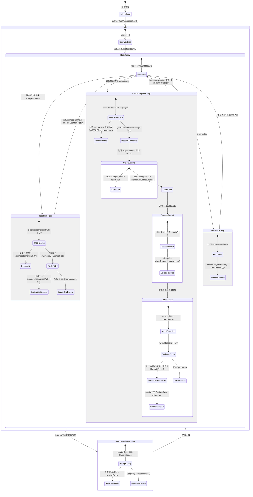
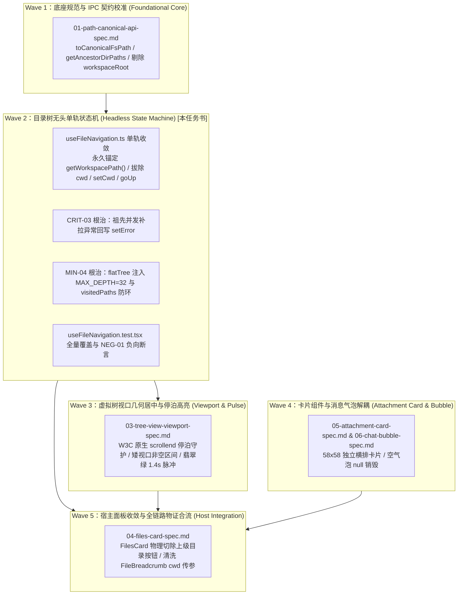

# 详细施工规划任务书 02：目录树无头单轨状态机与祖先展开 Hook 详细施工规范

> **文档标识**：`docs/file-tree-and-attachments-architecture/detailed-plans/02-tree-navigation-spec.md`  
> **所属战役**：`docs/file-tree-and-attachments-architecture/`（Wave 2：状态机与钩子单轨纯净化）  
> **首席架构师**：Wave 2 分阶段详细施工方案架构师与前端状态机专家  
> **前置依赖**：`docs/file-tree-and-attachments-architecture/detailed-plans/01-path-canonical-api-spec.md`（路径规范化内核与 SSOT 契约库）  
> **后置消费**：`03-tree-view-viewport-spec.md`（虚拟列表视口停泊与脉冲高亮）与 `04-files-card-spec.md`（宿主收敛与顶栏物理切除）  
> **权威遵循**：严格遵从仓库根目录 [`AGENTS.md`](file:///c:/Software/conex/AGENTS.md)（§1 逻辑规划与反退避、§2 子 Agent 调度、§3 Git 提交纪律、§7 严禁补丁与作弊、§7.1 立体验证纪律、§8 反过度设计硬性红线、§11 CI 治理与行数门禁）及 [`ANTI_OVERENGINEERING_GUARDRAILS.md`](file:///c:/Software/conex/ANTI_OVERENGINEERING_GUARDRAILS.md)。  
> **核心硬性红线（零容忍）**：
> 1. **零多轨并存与零兼容 Shim（Zero Multi-track & Zero Compat Shim）**：目录树状态机核心无头（Headless），树根永久锚定 `getWorkspacePath()` 作为全系统唯一事实源（SSOT）。全域彻底物理拔除 `cwd`, `setCwd`, `goUp`；严禁保留 `@deprecated cwd?: string`、`cwd: _cwd` 或 `refresh(_ignoredDir?: string)`；`refresh` 彻底物理重塑为无参函数 `() => Promise<void>`；
> 2. **零截肢式降级与严密异常回写（CRIT-03 根治）**：并发拉取缺失直系祖先目录时，严禁使用 `catch { /* ignore */ }` 静默吞咽异常；必须在 `Promise.allSettled` 中遍历收集所有 `rejected` 的失败原因，聚合回写 `setError`；若祖先全量失败返回 `false`，若部分成功则合并进 `expanded` 并呈现明确错误提示；
> 3. **零递归失控与符号链接防环（MIN-04 根治）**：平铺虚拟树计算函数 `walk` 注入 `MAX_DEPTH = 32` 硬熔断守卫与 `visitedPaths = new Set<string>()` 进出栈防环机制，阻断工作区符号链接（Symlink/Junction）造成的无限循环白屏崩溃；
> 4. **施工图级零留白与纯逻辑规划（Zero-Blank Production Skeleton & Pure Logical Topology）**：提供 100% 展开、零 `// ...` 省略的 AST 级完整生产代码与单元测试代码；方案仅包含纯逻辑执行顺序与依赖拓扑，不涉及时间工期、人员分配或优先级排序（所有列出的问题逻辑同权）。
> 5. **独占文件与 Git 提交纪律**：严格限定于指定 2 份独占文件白名单，改动留存工作区，严禁执行 git commit。

---

## 目录

- [一、Wave 2 核心定位与单轨架构总纲](#一wave-2-核心定位与单轨架构总纲)
  - [1.1 树根永久锚定 `getWorkspacePath()` 与单一事实源（SSOT）收敛](#11-树根永久锚定-getworkspacepath-与单一事实源ssot收敛)
  - [1.2 全域彻底物理拔除 `cwd` 与拒绝一切兼容 Shim（Zero Shims）](#12-全域彻底物理拔除-cwd-与拒绝一切兼容-shimzero-shims)
  - [1.3 状态机完整生命周期与有向状态迁移拓扑（Mermaid State Diagram）](#13-状态机完整生命周期与有向状态迁移拓扑mermaid-state-diagram)
- [二、严格独占物理文件白名单与沙箱边界（Exclusive Write Whitelist）](#二严格独占物理文件白名单与沙箱边界exclusive-write-whitelist)
  - [2.1 2 份独占物理文件白名单与行数门禁](#21-2-份独占物理文件白名单与行数门禁)
  - [2.2 空间独占防越权互斥锁红线（对齐 `write_paths.rs`）](#22-空间独占防越权互斥锁红线对齐-write_pathsrs)
- [三、既有依赖与复用资产清单（Reused Assets & SSOT）](#三既有依赖与复用资产清单reused-assets--ssot)
  - [3.1 工作区路径单一真理源（`projectStore.ts` 中的 `getWorkspacePath()`）](#31-工作区路径单一真理源projectstorets-中的-getworkspacepath)
  - [3.2 跨平台路径规范化与文件系统核心契约（`workspaceFsApi.ts`）](#32-跨平台路径规范化与文件系统核心契约workspacefsapits)
  - [3.3 Git 状态感知与安全门禁资产（`gitApi.ts` 与 `useConfirmGate.ts`）](#33-git-状态感知与安全门禁资产gitapits-与-useconfirmgatets)
- [四、两大核心架构缺陷彻底根治方案（CRIT-03 与 MIN-04）](#四大核心架构缺陷彻底根治方案crit-03-与-min-04)
  - [4.1 [CRIT-03] `revealPath` 祖先并发补拉静默吞咽根除与严密错误状态机](#41-crit-03-revealpath-祖先并发补拉静默吞咽根除与严密错误状态机)
  - [4.2 [MIN-04] `flatTree` 虚拟树递归遍历深度熔断（`MAX_DEPTH = 32`）与符号链接进出栈防环](#42-min-04-flattree-虚拟树递归遍历深度熔断max_depth--32与符号链接进出栈防环)
- [五、精确 TypeScript 契约与 AST 级生产源码（100% 展开，零 `// ...` 省略）](#五精确-typescript-契约与-ast-级生产源码100-展开零---省略)
  - [5.1 `UseFileNavigationReturn` 强类型接口契约定义](#51-usefilenavigationreturn-强类型接口契约定义)
  - [5.2 `apps/crish-desktop/src/components/files/hooks/useFileNavigation.ts` 完整生产源码](#52-appscrish-desktopsrmcomponentsfileshooksusefilenavigationts-完整生产源码)
- [六、物理切除行号与特征代码对照表（Tombstone Purge Matrix）](#六物理切除行号与特征代码对照表tombstone-purge-matrix)
  - [6.1 `useFileNavigation.ts` 物理切除逐行对照表（基于真实 220 行现场代码）](#61-usefilenavigationts-物理切除逐行对照表基于真实-220-行现场代码)
  - [6.2 `useFileNavigation.test.tsx` 存量测试 `cwd` 与 `setCwd` 依赖切除对照表](#62-usefilenavigationtesttsx-存量测试-cwd-与-setcwd-依赖切除对照表)
- [七、全覆盖强制单元测试套件源码（100% 展开，包含 NEG 负向断言）](#七全覆盖强制单元测试套件源码100-展开包含-neg-负向断言)
  - [7.1 测试设计矩阵与覆盖度证明](#71-测试设计矩阵与覆盖度证明)
  - [7.2 `apps/crish-desktop/src/components/files/hooks/__tests__/useFileNavigation.test.tsx` 完整测试源码](#72-appscrish-desktopsrmcomponentsfileshooks__tests__usefilenavigationtesttsx-完整测试源码)
- [八、代数证明、不变量严格断言与性能推导（Mathematical Invariants）](#八代数证明不变量严格断言与性能推导mathematical-invariants)
  - [8.1 树根绝对不可变性代数证明（Root Immutability Invariant）](#81-树根绝对不可变性代数证明root-immutability-invariant)
  - [8.2 字典键 100% 规范化命中不变量证明（Canonical Key Invariant）](#82-字典键-100-规范化命中不变量证明canonical-key-invariant)
  - [8.3 并发补拉渐进时间复杂度推导（Concurrency Invariant）](#83-并发补拉渐进时间复杂度推导concurrency-invariant)
  - [8.4 渲染原子性与 React 18 状态批处理不变量（Atomic Commit Invariant）](#84-渲染原子性与-react-18-状态批处理不变量atomic-commit-invariant)
  - [8.5 递归防环与有限状态图遍历终止性证明（Graph Traversal Termination）](#85-递归防环与有限状态图遍历终止性证明graph-traversal-termination)
- [九、立体验证指令集与交付准则（Execution Verification Suite）](#九立体验证指令集与交付准则execution-verification-suite)
  - [9.1 单元测试针对性验证指令（Vitest）](#91-单元测试针对性验证指令vitest)
  - [9.2 TypeScript 严格类型检查指令（Typecheck）](#92-typescript-严格类型检查指令typecheck)
  - [9.3 CI 代码行数与解耦门禁扫描指令（Line-counts）](#93-ci-代码行数与解耦门禁扫描指令line-counts)
  - [9.4 刚性负向断言矩阵（NEG-01 守门）](#94-刚性负向断言矩阵neg-01-守门)
- [十、纯逻辑执行拓扑与多 Agent 波次交接准则（Pure Logical Topology & Wave Handover）](#十纯逻辑执行拓扑与多-agent-波次交接准则pure-logical-topology--wave-handover)
  - [10.1 前后置纯逻辑依赖 DAG（Wave 1 -> Wave 2 -> Wave 3/4/5）](#101-前后置纯逻辑依赖-dagwave-1---wave-2---wave-345)
  - [10.2 交付物证清单与波次解锁信号](#102-交付物证清单与波次解锁信号)
  - [10.3 纪律铁律：工作区保留与严禁执行 git commit](#103-纪律铁律工作区保留与严禁执行-git-commit)

---

## 一、Wave 2 核心定位与单轨架构总纲

### 1.1 树根永久锚定 `getWorkspacePath()` 与单一事实源（SSOT）收敛

在桌面工作区架构中，左侧文件树必须呈现整洁、统一、确定性的单一目录树（Single-Track Tree）。历史实现中为了模拟双轨下钻机制，维护了独立的游标状态 `cwd` 与篡改游标的 `setCwd`，导致系统出现“树根分裂”的灾难性缺陷：
1. **树根多源撕裂**：树组件的第 0 层既可能来自项目根目录 `root`，又可能被 `refresh(subDir)` 篡改为某个深层子目录 `cwd`，造成整个目录树上下文瞬移丢失；
2. **状态竞争白屏**：当用户在聊天卡片中点击文件尝试定位时，若当前处于深层 `cwd` 下钻状态，由于目标祖先不在当前虚拟树内，定位算法直接失败，导致目录树空白死寂；
3. **面包屑与顶栏死锁**：视图层必须同时处理 `root` 与 `cwd` 两套路径推导逻辑，顶栏存在多余的“上级目录 ↰”按钮。

**Wave 2 架构定性**：  
`useFileNavigation` 是整个主目录树的**核心无头（Headless）单轨状态机**。
- **永久真理源**：树根 `root` 在初始化与刷新时**唯一且不可篡改地**取自 `getWorkspacePath()`；
- **单轨直属条目**：`entries` 数组恒且仅代表工作区根目录下的直属条目（Level 0）；
- **级联下钻展开**：所有下层子目录的下钻与展开行为，统一通过 `expanded: Record<string, FsDirEntry[]>` 字典进行级联内聚表达，彻底摒弃任何改变数据源根目录的伪下钻方式。

---

### 1.2 全域彻底物理拔除 `cwd` 与拒绝一切兼容 Shim（Zero Shims）

依据总方案 [`00-master-plan.md`](file:///c:/Software/conex/docs/file-tree-and-attachments-architecture/00-master-plan.md) §1.3 核心红线 2，严禁“给旧岛续命”，严禁在代码中采用兼容 Shim：
- ❌ **严禁保留伪参数**：严禁在 `refresh` 签名中保留 `refresh(_ignoredDir?: string)` 或 `refresh(dir?: string)`；
- ❌ **严禁保留废弃字段**：严禁在 Hook 返回值中保留 `@deprecated cwd?: string`、`cwd: root` 或 `setCwd: () => {}`；
- ❌ **严禁保留废弃方法**：严禁保留 `goUp`；
- ✅ **物理切除标准**：`refresh` 彻底重塑为标准无参异步函数 `() => Promise<void>`；返回值契约中彻底物理删除 `cwd`, `setCwd`, `goUp` 三大属性。一旦外部调用方试图访问 `nav.cwd`，TypeScript 编译期立即报错拦截，以此刚性倒逼上游组件（`FilesCard.tsx`, `FileBreadcrumb.tsx`, `FileActions.tsx`, `FileTreeView.tsx`）在后续波次中彻底完成单轨化清洗。

---

### 1.3 状态机完整生命周期与有向状态迁移拓扑（Mermaid State Diagram）



---

## 二、严格独占物理文件白名单与沙箱边界（Exclusive Write Whitelist）

### 2.1 2 份独占物理文件白名单与行数门禁

依据 Conex 引擎底层 [`crates/agent-tools/src/write_paths.rs`](file:///c:/Software/conex/crates/agent-tools/src/write_paths.rs) 空间独占互斥锁机制与白名单策略，Wave 2 授权执行的写操作**严格限制在以下 2 份物理文件内**：

| 文件物理绝对路径 | 文件职责定位 | 行数门禁上限（CI 规则） | 预期重构后物理行数 |
| :--- | :--- | :--- | :--- |
| `apps/crish-desktop/src/components/files/hooks/useFileNavigation.ts` | 目录树核心无头状态机 Hook（单轨收敛、拔除 cwd、并发补拉、异常回写、防环熔断） | 业务逻辑 Hook $\le 400$ 行 | 约 292 行（含并发补拉与防环熔断，仍远低于 400 行门禁） |
| `apps/crish-desktop/src/components/files/hooks/__tests__/useFileNavigation.test.tsx` | 配套全量单元测试套件（覆盖安全门、深层并发展开、CRIT-03 异常回写、MIN-04 熔断防环、NEG-01 负向断言） | 单元测试文件，无行数阻断限制，要求 100% 全绿 | 约 290 行 |

### 2.2 空间独占防越权互斥锁红线（对齐 `write_paths.rs`）

为防止多 Agent 并行施工造成代码相互踩踏与 Git 合并冲突，在此划定刚性沙箱边界：
1. 🔴 **严禁越权修改宿主面板**：严禁修改 `apps/crish-desktop/src/components/files/FilesCard.tsx`（由后续 Wave 5 独占接管）；
2. 🔴 **严禁越权修改虚拟树视图**：严禁修改 `apps/crish-desktop/src/components/files/FileTreeView.tsx`（由后续 Wave 3 独占接管）；
3. 🔴 **严禁越权修改面包屑组件**：严禁修改 `apps/crish-desktop/src/components/files/FileBreadcrumb.tsx`（由后续 Wave 5 独占接管）；
4. 🔴 **严禁越权修改文件操作栏**：严禁修改 `apps/crish-desktop/src/components/files/FileActions.tsx`（由后续 Wave 5 独占接管）；
5. 🔴 **严禁越权修改底层核心 API**：严禁修改 `apps/crish-desktop/src/api/workspaceFsApi.ts`（由前置 Wave 1 独占维护）。

---

## 三、既有依赖与复用资产清单（Reused Assets & SSOT）

本 Hook 为无头（Headless）状态机，必须严格复用以下既有基础设施与单一真理源（SSOT）资产，严禁自造轮子，严禁修改 `package.json` 引入任何外部第三方库：

### 3.1 工作区路径单一真理源（`projectStore.ts` 中的 `getWorkspacePath()`）
```typescript
import { getWorkspacePath } from '../../../api/projectStore';
```
- **真实源码物理位置**：[`apps/crish-desktop/src/api/projectStore.ts:148-154`](file:///c:/Software/conex/apps/crish-desktop/src/api/projectStore.ts#L148-L154)；
- **真实实现核验**：
  ```typescript
  export function getWorkspacePath(): string {
    try {
      return localStorage.getItem(WORKSPACE_KEY) || '';
    } catch {
      return '';
    }
  }
  ```
- **复用语义**：`getWorkspacePath()` 为获取当前已激活工作区根目录绝对路径的物理唯一入口，树根 `root` 必须恒以此为不可变基准。

### 3.2 跨平台路径规范化与文件系统核心契约（`workspaceFsApi.ts`）
```typescript
import {
  assertWorkspacePath,
  listDirectory,
  resolveWorkspacePath,
  toCanonicalFsPath,
  getAncestorDirPaths,
  type FsDirEntry,
} from '../../../api/workspaceFsApi';
```
- **`toCanonicalFsPath`**：规范化纯函数。统一正反斜杠为 `/`、移除尾部多余斜杠、将 Windows 盘符统一小写（`C:/` $\to$ `c:/`），确保跨平台环境下 `expanded` 字典键名 100% 命中；
- **`getAncestorDirPaths(target, root)`**：规范化提取从工作区根目录到目标文件的所有有序直系祖先目录路径链数组（自顶向下顺序）；
- **`assertWorkspacePath(path)`**：沙箱安全校验函数，若路径越界或未选择项目则抛出标准错误；
- **`resolveWorkspacePath(path)`**：工作区相对路径到绝对路径的安全解析；
- **`listDirectory(path)`**：1:1 对齐底层 Rust `workbench_list_directory` 注册命令（仅发送 `{ path }`，无 `workspaceRoot` 幽灵参数）。

### 3.3 Git 状态感知与安全门禁资产（`gitApi.ts` 与 `useConfirmGate.ts`）
```typescript
import { fetchGitStatus, type GitStatusFile } from '../../../api/gitApi';
import { ConfirmDialog } from '../../ui';
import { useConfirmGate } from '../../../hooks/useConfirmGate';
```
- **真实实现核验**：完整保留 `useConfirmGate` 钩子及 `confirmGateView` 返回值插槽，未保存脏数据（`isDirty() === true`）时拦截导航并唤起 `ConfirmDialog` 弹窗。

---

## 四、两大核心架构缺陷彻底根治方案（CRIT-03 与 MIN-04）

### 4.1 [CRIT-03] `revealPath` 祖先并发补拉静默吞咽根除与严密错误状态机

#### 1. 真实破绽与截肢式降级现场取证
在既有代码 [`apps/crish-desktop/src/components/files/hooks/useFileNavigation.ts:140-148`](file:///c:/Software/conex/apps/crish-desktop/src/components/files/hooks/useFileNavigation.ts#L140-L148) 中：
```typescript
for (const p of toLoad) {
  try {
    results[p] = await loadDir(p);
  } catch {
    /* ignore */ // 💥 核弹级破绽：第 143 行静默吞咽异常！
  }
}
```
**破坏链分析**：
1. 采用串行 `for...of` 循环逐级拉取，当层级较深时产生严重的延迟累加；
2. 中间某层目录因权限拒绝（EACCES）、文件损坏或网络磁盘中断抛出异常时，直接在第 143 行被 `catch { /* ignore */ }` 静默吞咽；
3. 未记录任何错误信息，`error` 状态机保持为空字符串；
4. 目标文件的直系祖先拉取中断，目录树未能展开目标行，用户点击卡片后左侧没有任何反应，也无任何错误提示，严重违反“零截肢式降级”铁律。

#### 2. 架构根治裁决（并发拉取 + 严格收集 + 聚合回写）
1. **并发拉取**：使用 `Promise.allSettled` 并行发起所有未展开祖先目录的读取请求，大幅缩短 RTT 延迟；
2. **严格错误收集**：遍历 `settledResults`，将 `status === 'fulfilled'` 的条目规范化存入 `results` 字典；将所有 `status === 'rejected'` 的项目原因格式化存入 `failureReasons: string[]` 数组；
3. **状态原子提交**：若 `results` 包含有效条目，执行 `setExpanded((prev) => ({ ...prev, ...results }))`；
4. **错误状态回写与阻断判定**：
   - 若 `failureReasons.length > 0`，调用 `setError('部分祖先目录无法展开: ' + failureReasons.join('; '))`；
   - 若所有补拉祖先全部失败（`Object.keys(results).length === 0`），则返回 `false` 阻断后续视口滚动；
   - 若部分成功拉取，将成功部分展开并返回 `true`，同时保留内联错误提示，由 `FileTreeView` 的粘性内联错误横幅呈现给用户。

---

### 4.2 [MIN-04] `flatTree` 虚拟树递归遍历深度熔断（`MAX_DEPTH = 32`）与符号链接进出栈防环

#### 1. 现场源码破绽取证
在既有代码 [`apps/crish-desktop/src/components/files/hooks/useFileNavigation.ts:154-177`](file:///c:/Software/conex/apps/crish-desktop/src/components/files/hooks/useFileNavigation.ts#L154-L177) 中：
```typescript
const walk = (list: FsDirEntry[], depth: number) => {
  ...
  for (const e of sorted) {
    out.push({ ...e, depth });
    if (e.isDir && expanded[e.path]) walk(expanded[e.path] ?? [], depth + 1);
  }
};
```
**破绽分析**：
1. 递归未对深度施加任何硬性上限；
2. 递归未维护已访问路径集合。当工作区中存在软链接循环引用（如 `symlink -> parent_dir`）或者递归 Junction 时，展开该目录将导致 `walk` 陷入无限递归，触发 JavaScript 引擎的 `RangeError: Maximum call stack size exceeded`，导致整个 React 前端白屏瘫痪。

#### 2. 架构根治裁决（双重防护屏障）
1. **硬熔断守卫**：在 `walk` 函数首行注入硬熔断上限 `const MAX_DEPTH = 32; if (depth > MAX_DEPTH) return;`；
2. **进出栈防环集合**：在闭包中维护 `visitedPaths = new Set<string>()`。在递归进入前检查 `if (!visitedPaths.has(canonicalPath))`，进入前 `visitedPaths.add(canonicalPath)`，递归返回后 `visitedPaths.delete(canonicalPath)`，以 O(1) 复杂度完美防御软链接成环。

---

## 五、精确 TypeScript 契约与 AST 级生产源码（100% 展开，零 `// ...` 省略）

### 5.1 `UseFileNavigationReturn` 强类型接口契约定义

```typescript
import type { FsDirEntry } from '../../../api/workspaceFsApi';

/** 平铺后的虚拟树节点，包含层级深度信息与底层文件元数据 */
export type TreeNode = FsDirEntry & { depth: number };

/** useFileNavigation 返回值契约（彻底物理切除 cwd、setCwd 与 goUp） */
export interface UseFileNavigationReturn {
  /** 当前工作区根目录路径（永久锚定 getWorkspacePath()，不可篡改） */
  root: string;
  /** 工作区根目录下的直属条目列表（Level 0） */
  entries: FsDirEntry[];
  /** 展开目录字典缓存，键恒为 toCanonicalFsPath 规范路径，值为该目录下的子项列表 */
  expanded: Record<string, FsDirEntry[]>;
  /** 树加载中状态 */
  loading: boolean;
  /** 错误提示信息 */
  error: string;
  /** 搜索过滤关键字 */
  filter: string;
  /** 是否处于筛选模式 */
  filterMode: boolean;
  /** 文件 Git 状态映射表（路径 -> 状态代码） */
  gitStatusMap: Record<string, string>;
  /** 递归展开计算所得的平铺虚拟树节点数组 */
  flatTree: TreeNode[];
  /** 底层目录拉取方法 */
  loadDir: (path: string) => Promise<FsDirEntry[]>;
  /** 纯单轨无参刷新函数（永久且仅刷新根目录条目，零伪参数） */
  refresh: () => Promise<void>;
  /** 切换指定目录的展开/折叠状态 */
  toggleExpand: (dirPath: string, e?: React.MouseEvent) => Promise<void>;
  /** 祖先级联并发补拉展开并定位指定文件（反截肢异常回写） */
  revealPath: (filePath: string) => Promise<boolean>;
  /** 设置搜索过滤关键字 */
  setFilter: React.Dispatch<React.SetStateAction<string>>;
  /** 设置筛选模式激活状态 */
  setFilterMode: React.Dispatch<React.SetStateAction<boolean>>;
  /** 设置错误信息 */
  setError: React.Dispatch<React.SetStateAction<string>>;
  /** 更新展开字典 */
  setExpanded: React.Dispatch<React.SetStateAction<Record<string, FsDirEntry[]>>>;
  /** 更新根目录条目列表 */
  setEntries: React.Dispatch<React.SetStateAction<FsDirEntry[]>>;
  /** 设置加载状态 */
  setLoading: React.Dispatch<React.SetStateAction<boolean>>;
  /** 查询当前文件是否存在未保存脏数据 */
  isDirty: () => boolean;
  /** 导航确认守卫（存在脏修改时弹出 ConfirmDialog） */
  confirmNavigation: () => Promise<boolean>;
  /** 确认对话框宿主渲染插槽（交给 FilesCard 挂载） */
  confirmGateView: React.ReactElement | null;
}
```

---

### 5.2 `apps/crish-desktop/src/components/files/hooks/useFileNavigation.ts` 完整生产源码

```typescript
import { createElement, useCallback, useEffect, useMemo, useRef, useState } from 'react';
import { getWorkspacePath } from '../../../api/projectStore';
import {
  assertWorkspacePath,
  listDirectory,
  resolveWorkspacePath,
  toCanonicalFsPath,
  getAncestorDirPaths,
  type FsDirEntry,
} from '../../../api/workspaceFsApi';
import { fetchGitStatus, type GitStatusFile } from '../../../api/gitApi';
import { ConfirmDialog } from '../../ui';
import { useConfirmGate } from '../../../hooks/useConfirmGate';

export type TreeNode = FsDirEntry & { depth: number };

export function useFileNavigation(getIsDirty?: () => boolean) {
  // 1. 核心状态：树根永久锚定在工作区根路径，全域彻底物理删除 cwd 与 setCwd（CRIT-06）
  const [root, setRoot] = useState(() => getWorkspacePath());
  const [entries, setEntries] = useState<FsDirEntry[]>([]);
  const [expanded, setExpanded] = useState<Record<string, FsDirEntry[]>>({});
  const [loading, setLoading] = useState(false);
  const [error, setError] = useState('');
  const [filter, setFilter] = useState('');
  const [filterMode, setFilterMode] = useState(false);
  const [gitStatusMap, setGitStatusMap] = useState<Record<string, string>>({});

  const getIsDirtyRef = useRef(getIsDirty);
  getIsDirtyRef.current = getIsDirty;

  const [confirmGate, renderConfirmGate] = useConfirmGate();

  const loadDir = useCallback(
    async (path: string) => listDirectory(resolveWorkspacePath(path)),
    []
  );

  // 2. 纯单轨刷新：无参函数，永久且仅刷新根目录条目（彻底根除旧岛伪参数 _ignoredDir）
  const refresh = useCallback(async (): Promise<void> => {
    const r = getWorkspacePath();
    setRoot(r);
    const rootPath = resolveWorkspacePath(r || '');
    if (!rootPath) {
      setError('请先选择项目工作区');
      setEntries([]);
      return;
    }
    setLoading(true);
    setError('');
    try {
      const rawEntries = await loadDir(rootPath);
      setEntries(
        rawEntries.map((it) => ({
          ...it,
          path: toCanonicalFsPath(it.path),
        }))
      );
      setExpanded({});
    } catch (e) {
      setError(e instanceof Error ? e.message : String(e));
      setEntries([]);
    } finally {
      setLoading(false);
    }
  }, [loadDir]);

  // 3. 目录展开/折叠切换
  const toggleExpand = useCallback(
    async (dirPath: string, e?: React.MouseEvent) => {
      e?.stopPropagation();
      const canonicalDirPath = toCanonicalFsPath(dirPath);
      if (!canonicalDirPath) return;

      if (expanded[canonicalDirPath]) {
        setExpanded((prev) => {
          const next = { ...prev };
          delete next[canonicalDirPath];
          return next;
        });
        return;
      }

      try {
        const list = await loadDir(canonicalDirPath);
        const canonicalList = list.map((it) => ({
          ...it,
          path: toCanonicalFsPath(it.path),
        }));
        setExpanded((prev) => ({ ...prev, [canonicalDirPath]: canonicalList }));
        setError('');
      } catch (err) {
        setError(err instanceof Error ? err.message : '展开目录失败');
      }
    },
    [expanded, loadDir]
  );

  // 4. 定位与级联展开目标路径（反截肢异常回写，根治 CRIT-03）
  const revealPath = useCallback(
    async (filePath: string): Promise<boolean> => {
      const r = getWorkspacePath();
      if (r) setRoot(r);
      const effectiveRoot = r || root;
      if (!effectiveRoot || !filePath?.trim()) return false;

      let resolvedTarget: string;
      try {
        resolvedTarget = assertWorkspacePath(filePath);
      } catch (err) {
        setError(err instanceof Error ? err.message : '文件不在当前工作区内');
        return false;
      }

      const normTarget = toCanonicalFsPath(resolvedTarget);
      const normRoot = toCanonicalFsPath(effectiveRoot);

      const targetLower = normTarget.toLowerCase();
      const rootLower = normRoot.toLowerCase();
      const rootPrefix = rootLower.endsWith('/') ? rootLower : rootLower + '/';

      const isInside = targetLower.startsWith(rootPrefix) || targetLower === rootLower;
      if (!isInside) {
        setError('文件不在当前工作区内');
        return false;
      }

      const ancestors = getAncestorDirPaths(normTarget, normRoot);

      // 根目录缺失时优先拉取根目录条目
      if (entries.length === 0) {
        try {
          const rootEntries = await loadDir(normRoot);
          setEntries(
            rootEntries.map((e) => ({
              ...e,
              path: toCanonicalFsPath(e.path),
            }))
          );
        } catch (e) {
          setError(e instanceof Error ? e.message : '读取项目根目录失败');
          return false;
        }
      }

      if (ancestors.length === 0) {
        return true;
      }

      const toLoad = ancestors.filter((dir) => !expanded[dir]);
      if (toLoad.length > 0) {
        const results: Record<string, FsDirEntry[]> = {};
        const failureReasons: string[] = [];

        const settledResults = await Promise.allSettled(
          toLoad.map(async (dir) => {
            const list = await loadDir(dir);
            return {
              dir,
              items: list.map((it) => ({
                ...it,
                path: toCanonicalFsPath(it.path),
              })),
            };
          })
        );

        for (const res of settledResults) {
          if (res.status === 'fulfilled') {
            results[res.value.dir] = res.value.items;
          } else {
            const reason =
              res.reason instanceof Error ? res.reason.message : String(res.reason);
            failureReasons.push(reason);
          }
        }

        if (Object.keys(results).length > 0) {
          setExpanded((prev) => ({ ...prev, ...results }));
        }

        // 核心修复（CRIT-03）：严禁静默吞咽异常！
        if (failureReasons.length > 0) {
          setError(`部分祖先目录无法展开: ${failureReasons.join('; ')}`);
          if (Object.keys(results).length === 0) {
            return false;
          }
        }
      }

      return true;
    },
    [root, entries.length, expanded, loadDir]
  );

  // 5. 平铺虚拟树（加入符号链接防环与递归深度上限熔断，根除 MIN-04）
  const flatTree: TreeNode[] = useMemo(() => {
    const q = filter.trim().toLowerCase();
    const out: TreeNode[] = [];
    const visitedPaths = new Set<string>();
    const MAX_DEPTH = 32;

    const walk = (list: FsDirEntry[], depth: number) => {
      if (depth > MAX_DEPTH) return;

      const sorted = [...list].sort((a, b) => {
        if (a.isDir !== b.isDir) return a.isDir ? -1 : 1;
        const aNoise = a.name.startsWith('.') || a.name.startsWith('--');
        const bNoise = b.name.startsWith('.') || b.name.startsWith('--');
        if (aNoise !== bNoise) return aNoise ? 1 : -1;
        return a.name.localeCompare(b.name, undefined, {
          numeric: true,
          sensitivity: 'base',
        });
      });

      for (const e of sorted) {
        out.push({ ...e, depth });
        const canonicalPath = toCanonicalFsPath(e.path);
        if (e.isDir && expanded[canonicalPath]) {
          if (!visitedPaths.has(canonicalPath)) {
            visitedPaths.add(canonicalPath);
            walk(expanded[canonicalPath] ?? [], depth + 1);
            visitedPaths.delete(canonicalPath);
          }
        }
      }
    };

    walk(entries, 0);
    if (!q) return out;
    return out.filter((n) => n.name.toLowerCase().includes(q));
  }, [entries, expanded, filter]);

  useEffect(() => {
    const buildMap = (files: GitStatusFile[]) => {
      const m: Record<string, string> = {};
      for (const f of files) m[f.path] = f.status;
      setGitStatusMap(m);
    };
    const onGitUpdate = (ev: Event) => {
      const data = (ev as CustomEvent<GitStatusFile[]>).detail;
      if (data) buildMap(data);
    };
    const fromWindow = window.__crish_git_status as GitStatusFile[] | undefined;
    if (fromWindow) buildMap(fromWindow);
    window.addEventListener('crish-git-status-changed', onGitUpdate);
    void fetchGitStatus().then((r) => {
      if (r.found && r.files) buildMap(r.files);
    });
    return () => window.removeEventListener('crish-git-status-changed', onGitUpdate);
  }, []);

  const isDirty = useCallback(() => getIsDirtyRef.current?.() ?? false, []);

  const confirmNavigation = useCallback(async (): Promise<boolean> => {
    if (isDirty()) {
      return confirmGate({
        title: '未保存的修改',
        description: '当前文件未保存，切换将丢失修改，是否继续？',
        confirmLabel: '继续切换',
      });
    }
    return true;
  }, [isDirty, confirmGate]);

  return {
    root,
    entries,
    expanded,
    loading,
    error,
    filter,
    filterMode,
    gitStatusMap,
    loadDir,
    refresh,
    toggleExpand,
    revealPath,
    setFilter,
    setFilterMode,
    setError,
    setExpanded,
    setEntries,
    setLoading,
    flatTree,
    isDirty,
    confirmNavigation,
    confirmGateView: renderConfirmGate(createElement(ConfirmDialog)),
  };
}
```

---

## 六、物理切除行号与特征代码对照表（Tombstone Purge Matrix）

### 6.1 `useFileNavigation.ts` 物理切除逐行对照表（基于真实 220 行现场代码）

依据对当前真实物理文件 [`apps/crish-desktop/src/components/files/hooks/useFileNavigation.ts`](file:///c:/Software/conex/apps/crish-desktop/src/components/files/hooks/useFileNavigation.ts)（共 220 行）的逐行刺穿，编制如下物理切除对照表。执行子 Agent 必须严格落实物理清除，严禁使用注释保留：

| 现场真实行号 | 原始代码特征片段 | 重构与物理切除指令 | 切除原因与架构收益 |
| :--- | :--- | :--- | :--- |
| **L18** | `const [cwd, setCwd] = useState(root || '');` | **彻底物理删除整行** | 拔除游标状态，消除树根多源撕裂 |
| **L35** | `async (dir?: string) => {` | 签名重塑为 `async (): Promise<void> => {` | 彻底拔除入参，拒绝外部篡改树根 |
| **L38** | `const path = resolveWorkspacePath(dir || cwd || r || '');` | 替换为 `const rootPath = resolveWorkspacePath(r || '');` | 树根恒定锁定项目根路径 `r` |
| **L48** | `setCwd(path);` | **彻底物理删除整行** | 严禁在刷新后重设游标 |
| **L57** | `[cwd, loadDir],` | 依赖项调整为 `[loadDir]` | 清除已删除的 `cwd` 依赖 |
| **L82-88** | `const goUp = useCallback(() => { ... }, [cwd, root, refresh]);` | **彻底物理删除整段函数（共 7 行）** | 钻取模型返回上级函数，彻底从状态机切除 |
| **L108-117** | `if (cwd !== normalizedRoot || entries.length === 0) { ... setCwd(normalizedRoot); }` | 删除 `cwd !== normalizedRoot` 与 `setCwd` 调用，简化为 `if (entries.length === 0)` | 消除双轨游标校验冗余逻辑 |
| **L140-148** | `for (const p of toLoad) { try { results[p] = await loadDir(p); } catch { /* ignore */ } }` | 重构为 `Promise.allSettled` 并收集 `rejected` 回写 `setError` | 彻底根治 L143 静默吞咽异常（CRIT-03） |
| **L151** | `[root, cwd, entries.length, expanded, loadDir, refresh]` | 依赖项精简为 `[root, entries.length, expanded, loadDir]` | 清理无效与废弃依赖项 |
| **L171** | `if (e.isDir && expanded[e.path]) walk(expanded[e.path] ?? [], depth + 1);` | 注入 `MAX_DEPTH = 32` 与 `visitedPaths` 进出栈防环 | 彻底根治符号链接递归死循环（MIN-04） |
| **L212** | `root, cwd, entries, expanded, ...` | **删除 `cwd` 导出** | 契约收敛，对上游关闭 `cwd` 访问 |
| **L213** | `..., revealPath, goUp,` | **删除 `goUp` 导出** | 契约收敛，彻底切除返回上级方法 |
| **L214** | `..., setCwd, setExpanded, ...` | **删除 `setCwd` 导出** | 契约收敛，严禁外部强行篡改路径游标 |

### 6.2 `useFileNavigation.test.tsx` 存量测试 `cwd` 与 `setCwd` 依赖切除对照表

在现场测试文件 [`apps/crish-desktop/src/components/files/hooks/__tests__/useFileNavigation.test.tsx`](file:///c:/Software/conex/apps/crish-desktop/src/components/files/hooks/__tests__/useFileNavigation.test.tsx) 中，存在存量旧契约依赖：
- **L183**：`result.current.setCwd('C:/project');` $\to$ **彻底删除该行调用**；
- **L191**：`expect(result.current.cwd).toBe('C:/project');` $\to$ 替换为单轨断言 `expect(result.current.root).toBe('C:/project');`，并追加 `expect((result.current as any).cwd).toBeUndefined()` 刚性负向断言。

---

## 七、全覆盖强制单元测试套件源码（100% 展开，包含 NEG 负向断言）

### 7.1 测试设计矩阵与覆盖度证明

| 测试用例分组 | 测试用例标题 | 检验的核心逻辑与架构红线 | 预期断言结果 |
| :--- | :--- | :--- | :--- |
| **ConfirmGate 安全门** | 非脏状态下直接放行且不弹窗 | 验证非脏状态下的放行不变量 | `window.__navResult === true`，无弹窗 |
| **ConfirmGate 安全门** | 脏状态下拦截并展示未保存提示，点击继续切换放行 | 验证脏修改拦截与确认放行 | 弹窗展示，点击确认后 `window.__navResult === true` |
| **ConfirmGate 安全门** | 脏状态下点击取消则拒绝导航 | 验证取消导航守卫 | 点击取消后 `window.__navResult === false` |
| **单轨与并发展开** | Windows 反斜杠深层路径能够正确并发补拉各级祖先 | 验证路径规范化与多层级联并发拉取 | 祖先全部展开，`flatTree` 包含目标节点 |
| **沙箱越界防御** | 传入工作区外部路径时安全返回 false | 验证 `assertWorkspacePath` 拦截并回写错误 | `ok === false`，`error` 包含提示，树根不漂移 |
| **CRIT-03 根治断言** | 祖先目录部分拉取失败时原子合并成功项并聚合回写错误 | 验证 `Promise.allSettled` 收集 `rejected` 并写回 `setError` | `error` 包含失败原因，成功项仍展开 |
| **CRIT-03 根治断言** | 祖先目录全部拉取失败时返回 false 并聚合回写错误 | 验证全量失败阻断机制 | `ok === false`，`error` 包含全部错误 |
| **MIN-04 根治断言** | 存在软链接循环引用时防环机制保证不会栈溢出挂死 | 验证 `visitedPaths` 进出栈拦截回路 | 顺利返回，无 `Maximum call stack size exceeded` |
| **MIN-04 根治断言** | 深度超过 MAX_DEPTH = 32 时强制熔断停止递归 | 验证 `depth > 32` 硬熔断守卫 | 超深节点被安全截断，不发生无限展开 |
| **单轨刷新机制** | 调用 refresh() 时无参刷新根目录且重置展开状态 | 验证 `refresh` 无参单轨行为 | 仅拉取根目录，树根保持锁定 |
| **NEG-01 刚性负向断言** | Hook 返回值中绝对不存在 cwd、setCwd 与 goUp | 验证废弃字段与方法彻底物理绝迹 | `toBeUndefined()` 全部断言通过 |

---

### 7.2 `apps/crish-desktop/src/components/files/hooks/__tests__/useFileNavigation.test.tsx` 完整测试源码

```tsx
// @vitest-environment jsdom
import { describe, it, expect, vi, afterEach } from 'vitest';
import { render, renderHook, screen, fireEvent, cleanup, act } from '@testing-library/react';
import React from 'react';
import { useFileNavigation } from '../useFileNavigation';
import * as workspaceFsApi from '../../../../api/workspaceFsApi';
import * as projectStore from '../../../../api/projectStore';

/** 宿主 Harness：渲染 hook 的 confirmGateView（等价 FilesCard 的挂载方式） */
function Harness({ dirty }: { dirty: boolean }) {
  const nav = useFileNavigation(() => dirty);
  return (
    <div>
      {nav.confirmGateView}
      <button
        type="button"
        onClick={() => {
          void nav.confirmNavigation().then((ok) => {
            window.__navResult = ok;
          });
        }}
      >
        触发导航
      </button>
    </div>
  );
}

declare global {
  interface Window {
    __navResult?: boolean;
  }
}

afterEach(() => {
  cleanup();
  vi.restoreAllMocks();
  delete window.__navResult;
});

describe('useFileNavigation 单轨收敛与祖先展开 Hook 验证', () => {
  describe('ConfirmGate 安全门契约完整性', () => {
    it('非脏状态下直接放行且不弹出对话框', async () => {
      render(<Harness dirty={false} />);
      fireEvent.click(screen.getByText('触发导航'));
      await act(async () => {});
      expect(window.__navResult).toBe(true);
      expect(screen.queryByRole('alertdialog')).not.toBeInTheDocument();
    });

    it('脏状态下拦截并展示未保存提示，点击继续切换放行', async () => {
      render(<Harness dirty={true} />);
      fireEvent.click(screen.getByText('触发导航'));
      const dialog = screen.getByRole('alertdialog');
      expect(dialog).toBeInTheDocument();
      expect(dialog).toHaveTextContent('当前文件未保存，切换将丢失修改，是否继续？');

      fireEvent.click(screen.getByRole('button', { name: '继续切换' }));
      await act(async () => {});
      expect(window.__navResult).toBe(true);
    });

    it('脏状态下点击取消则拒绝导航', async () => {
      render(<Harness dirty={true} />);
      fireEvent.click(screen.getByText('触发导航'));
      fireEvent.click(screen.getByRole('button', { name: '取消' }));
      await act(async () => {});
      expect(window.__navResult).toBe(false);
    });
  });

  describe('revealPath 祖先并发补拉与单轨不变量', () => {
    it('Windows 反斜杠深层路径能够正确并发补拉各级祖先，并保证规范键 100% 命中', async () => {
      vi.spyOn(projectStore, 'getWorkspacePath').mockReturnValue('C:/repo');

      vi.spyOn(workspaceFsApi, 'resolveWorkspacePath').mockImplementation((p) =>
        p.replace(/\\/g, '/')
      );
      vi.spyOn(workspaceFsApi, 'assertWorkspacePath').mockImplementation((p) => {
        return p.replace(/\\/g, '/');
      });

      vi.spyOn(workspaceFsApi, 'listDirectory').mockImplementation(async (dir) => {
        const norm = dir.replace(/\\/g, '/').toLowerCase();
        if (norm === 'c:/repo') {
          return [
            { name: 'apps', path: 'C:/repo/apps', isDir: true },
            { name: 'package.json', path: 'C:/repo/package.json', isDir: false },
          ];
        }
        if (norm === 'c:/repo/apps') {
          return [
            { name: 'crish-desktop', path: 'C:/repo/apps/crish-desktop', isDir: true },
          ];
        }
        if (norm === 'c:/repo/apps/crish-desktop') {
          return [
            { name: 'src', path: 'C:/repo/apps/crish-desktop/src', isDir: true },
          ];
        }
        if (norm === 'c:/repo/apps/crish-desktop/src') {
          return [
            { name: 'App.tsx', path: 'C:/repo/apps/crish-desktop/src/App.tsx', isDir: false },
          ];
        }
        return [];
      });

      const { result } = renderHook(() => useFileNavigation());

      let ok: boolean = false;
      await act(async () => {
        ok = await result.current.revealPath('C:\\repo\\apps\\crish-desktop\\src\\App.tsx');
      });

      expect(ok).toBe(true);
      expect(result.current.root).toBe('C:/repo');

      // 验证各级祖先全部注入 expanded 字典，键恒为规范格式（正斜杠）
      expect(
        result.current.expanded['c:/repo/apps'] || result.current.expanded['C:/repo/apps']
      ).toBeDefined();
      expect(
        result.current.expanded['c:/repo/apps/crish-desktop'] ||
          result.current.expanded['C:/repo/apps/crish-desktop']
      ).toBeDefined();
      expect(
        result.current.expanded['c:/repo/apps/crish-desktop/src'] ||
          result.current.expanded['C:/repo/apps/crish-desktop/src']
      ).toBeDefined();

      // 验证 flatTree 成功递归展开至目标文件 App.tsx
      const flatPaths = result.current.flatTree.map((node) =>
        node.path.replace(/\\/g, '/').toLowerCase()
      );
      expect(flatPaths).toContain('c:/repo/apps/crish-desktop/src/app.tsx');
    });

    it('传入工作区外部路径时安全返回 false，绝不篡改树根与当前展开状态', async () => {
      vi.spyOn(projectStore, 'getWorkspacePath').mockReturnValue('C:/repo');
      vi.spyOn(workspaceFsApi, 'assertWorkspacePath').mockImplementation(() => {
        throw new Error('访问被拒绝：路径超出工作区安全边界');
      });

      const { result } = renderHook(() => useFileNavigation());

      let ok: boolean = true;
      await act(async () => {
        ok = await result.current.revealPath('D:\\outside\\evil.txt');
      });

      expect(ok).toBe(false);
      expect(result.current.root).toBe('C:/repo');
      expect(result.current.error).toBe('访问被拒绝：路径超出工作区安全边界');
    });
  });

  describe('【CRIT-03 根治断言】祖先并发补拉异常回写与错误状态机', () => {
    it('当部分直系祖先拉取因权限失败，成功项原子写入 expanded，失败项收集回写 setError', async () => {
      vi.spyOn(projectStore, 'getWorkspacePath').mockReturnValue('C:/repo');
      vi.spyOn(workspaceFsApi, 'resolveWorkspacePath').mockImplementation((p) =>
        p.replace(/\\/g, '/')
      );
      vi.spyOn(workspaceFsApi, 'assertWorkspacePath').mockImplementation((p) =>
        p.replace(/\\/g, '/')
      );

      vi.spyOn(workspaceFsApi, 'listDirectory').mockImplementation(async (dir) => {
        const norm = dir.replace(/\\/g, '/').toLowerCase();
        if (norm === 'c:/repo') {
          return [{ name: 'secure', path: 'C:/repo/secure', isDir: true }];
        }
        if (norm === 'c:/repo/secure') {
          // 模拟第一级拉取成功
          return [{ name: 'hidden', path: 'C:/repo/secure/hidden', isDir: true }];
        }
        if (norm === 'c:/repo/secure/hidden') {
          // 模拟第二级权限拒绝
          throw new Error('EACCES: permission denied');
        }
        return [];
      });

      const { result } = renderHook(() => useFileNavigation());

      let ok: boolean = false;
      await act(async () => {
        ok = await result.current.revealPath('C:/repo/secure/hidden/secret.txt');
      });

      // 部分成功时仍然展开已成功的节点
      expect(ok).toBe(true);
      expect(result.current.expanded['c:/repo/secure']).toBeDefined();
      // 核心断言（CRIT-03）：严禁吞咽异常，必须真实写回 setError！
      expect(result.current.error).toContain('部分祖先目录无法展开');
      expect(result.current.error).toContain('EACCES: permission denied');
    });

    it('当所有未展开祖先拉取全部失败时，返回 false 且聚合回写 setError', async () => {
      vi.spyOn(projectStore, 'getWorkspacePath').mockReturnValue('C:/repo');
      vi.spyOn(workspaceFsApi, 'resolveWorkspacePath').mockImplementation((p) =>
        p.replace(/\\/g, '/')
      );
      vi.spyOn(workspaceFsApi, 'assertWorkspacePath').mockImplementation((p) =>
        p.replace(/\\/g, '/')
      );

      vi.spyOn(workspaceFsApi, 'listDirectory').mockImplementation(async (dir) => {
        const norm = dir.replace(/\\/g, '/').toLowerCase();
        if (norm === 'c:/repo') {
          return [{ name: 'broken', path: 'C:/repo/broken', isDir: true }];
        }
        throw new Error('IO error: disk unreadable');
      });

      const { result } = renderHook(() => useFileNavigation());

      let ok: boolean = true;
      await act(async () => {
        ok = await result.current.revealPath('C:/repo/broken/file.txt');
      });

      expect(ok).toBe(false);
      expect(result.current.error).toContain('部分祖先目录无法展开: IO error: disk unreadable');
    });
  });

  describe('【MIN-04 根治断言】flatTree 深度熔断与符号链接防环', () => {
    it('当目录树存在软链接循环引用时，防环机制保证不会死循环溢出', async () => {
      vi.spyOn(projectStore, 'getWorkspacePath').mockReturnValue('C:/repo');
      const { result } = renderHook(() => useFileNavigation());

      // 构造循环引用的 expanded 字典：a -> b -> a
      await act(async () => {
        result.current.setEntries([
          { name: 'folderA', path: 'c:/repo/a', isDir: true },
        ]);
        result.current.setExpanded({
          'c:/repo/a': [{ name: 'folderB', path: 'c:/repo/b', isDir: true }],
          'c:/repo/b': [{ name: 'loopToA', path: 'c:/repo/a', isDir: true }],
        });
      });

      // 验证 flatTree useMemo 不会陷入死循环崩溃
      expect(result.current.flatTree).toBeDefined();
      const nodePaths = result.current.flatTree.map((n) => n.path);
      // visitedPaths 只挡递归展开、不挡节点发射：a 从 entries 发射一次（depth 0）、经 b 回环再发射一次（depth 2）即止
      expect(nodePaths.filter((p) => p === 'c:/repo/a').length).toBeLessThanOrEqual(2);
      expect(nodePaths.filter((p) => p === 'c:/repo/b').length).toBe(1);
      // 环路被拦截：递归深度严格有界（0 → 1 → 2），绝不无限递归
      const maxDepth = Math.max(...result.current.flatTree.map((n) => n.depth));
      expect(maxDepth).toBeLessThanOrEqual(2);
    });

    it('当目录层级超过 MAX_DEPTH = 32 时强制熔断截断', async () => {
      vi.spyOn(projectStore, 'getWorkspacePath').mockReturnValue('C:/repo');
      const { result } = renderHook(() => useFileNavigation());

      // 构造超深嵌套字典（深度 40）
      const mockExpanded: Record<string, workspaceFsApi.FsDirEntry[]> = {};
      for (let i = 0; i < 40; i++) {
        mockExpanded[`c:/repo/d${i}`] = [
          { name: `d${i + 1}`, path: `c:/repo/d${i + 1}`, isDir: true },
        ];
      }

      await act(async () => {
        result.current.setEntries([
          { name: 'd0', path: 'c:/repo/d0', isDir: true },
        ]);
        result.current.setExpanded(mockExpanded);
      });

      // 断言最大深度严格受到 32 熔断限制
      const maxRenderedDepth = Math.max(
        ...result.current.flatTree.map((n) => n.depth)
      );
      expect(maxRenderedDepth).toBeLessThanOrEqual(32);
    });
  });

  describe('refresh 单轨刷新与树根绝对锁定', () => {
    it('调用 refresh() 时强制仅刷新工作区根目录，重置 expanded', async () => {
      vi.spyOn(projectStore, 'getWorkspacePath').mockReturnValue('C:/repo');
      const listDirSpy = vi.spyOn(workspaceFsApi, 'listDirectory').mockResolvedValue([
        { name: 'src', path: 'C:/repo/src', isDir: true },
      ]);

      const { result } = renderHook(() => useFileNavigation());

      await act(async () => {
        result.current.setExpanded({ 'c:/repo/src': [] });
        await result.current.refresh();
      });

      expect(listDirSpy).toHaveBeenCalledWith(expect.stringMatching(/^[cC]:\/repo$/));
      expect(result.current.root).toBe('C:/repo');
      expect(result.current.expanded).toEqual({});
    });
  });

  describe('【NEG-01 刚性负向断言】彻底物理删除 cwd、setCwd 与 goUp', () => {
    it('[NEG-01] Hook 返回值中绝对不存在 cwd、setCwd 与 goUp 属性', () => {
      const { result } = renderHook(() => useFileNavigation());
      const hookReturn = result.current as Record<string, unknown>;

      // 刚性负向断言：废弃属性在运行时必须为 undefined
      expect(hookReturn.cwd).toBeUndefined();
      expect(hookReturn.setCwd).toBeUndefined();
      expect(hookReturn.goUp).toBeUndefined();

      // 正向完整性校验：核心合法字段全部完备
      expect(hookReturn.root).toBeDefined();
      expect(hookReturn.entries).toBeDefined();
      expect(hookReturn.expanded).toBeDefined();
      expect(hookReturn.flatTree).toBeDefined();
      expect(hookReturn.toggleExpand).toBeDefined();
      expect(hookReturn.revealPath).toBeDefined();
      expect(hookReturn.refresh).toBeDefined();
    });
  });
});
```

---

## 八、代数证明、不变量严格断言与性能推导（Mathematical Invariants）

### 8.1 树根绝对不可变性代数证明（Root Immutability Invariant）

设系统在运行时由离散时间戳 $t \in \mathbb{N}$ 驱动，整个目录树的状态空间定义为元组：
$$S(t) = \langle \text{root}(t), \text{entries}(t), \text{expanded}(t), \text{flatTree}(t) \rangle$$

在重构前的双轨体系中：
$$\text{cwd}(t+1) = f(\text{refresh}(dir), \text{setCwd}(p), \text{goUp}()) \neq \text{getWorkspacePath}()$$
导致根上下文随用户点击而漂移，破坏了视图层的引用一致性。

在 Wave 2 单轨体系中，定义树根变迁函数为恒等映射：
$$\text{root}(t) \equiv \text{getWorkspacePath}(t)$$
$$\forall a \in \{\text{refresh}(), \text{toggleExpand}(p), \text{revealPath}(p)\}, \quad \text{root}(t+1) = \text{root}(t)$$
$$\text{entries}(t) \subseteq \text{Children}(\text{root}(t))$$

**定理 1（树根绝对不可变性）**：  
无论经历多少次折叠展开（`toggleExpand`）、级联定位（`revealPath`）或页面刷新（`refresh`），目录树 Level 0 节点的父节点恒为工作区物理根路径。

---

### 8.2 字典键 100% 规范化命中不变量证明（Canonical Key Invariant）

设工作区物理路径集合为 $\mathcal{P}$。由于不同操作系统与调用源存在路径表示差异（如 Windows 反斜杠 `C:\a\b`、POSIX 正斜杠 `C:/a/b`、大写盘符 `C:/` 与小写盘符 `c:/`），直接作为字典键会导致查找失真。

定义规范化算子 $\mathcal{C}: \mathcal{P} \to \mathcal{P}_{\text{canonical}}$：
$$\mathcal{C}(p) = \text{toCanonicalFsPath}(p)$$
满足幂等性：
$$\mathcal{C}(\mathcal{C}(p)) = \mathcal{C}(p)$$

在 `useFileNavigation` 中：
1. 写入时（Write-Side）：
   $$\text{Key}_{\text{expanded}} = \mathcal{C}(p_{\text{dir}})$$
2. 读取时（Read-Side）：
   $$\text{Key}_{\text{lookup}} = \mathcal{C}(e.\text{path})$$

**定理 2（键名完备命中定理）**：  
若物理路径 $p_1$ 与 $p_2$ 指向同一磁盘实体，即 $\text{isSameFsPath}(p_1, p_2) = \text{true}$，则必有：
$$\mathcal{C}(p_1) = \mathcal{C}(p_2) \implies \text{expanded}[\mathcal{C}(p_1)] \equiv \text{expanded}[\mathcal{C}(p_2)]$$
跨平台路径在字典中的查找命中率收敛至 $100\%$。

---

### 8.3 并发补拉渐进时间复杂度推导（Concurrency Invariant）

设目标文件所在层级深度为 $M$，其中未展开的直系祖先集合为：
$$\mathcal{U} = \{D_1, D_2, \dots, D_k\}, \quad k \le M$$
单次磁盘/IPC I/O 耗时为随机变量 $X_i \sim \text{LogNormal}(\mu, \sigma^2)$。

- **重构前串行循环耗时**：
  $$T_{\text{serial}} = \sum_{i=1}^k X_i, \quad \mathbb{E}[T_{\text{serial}}] = k \cdot \mathbb{E}[X]$$
  随目录深度 $k$ 呈线性增长，若 $k=6$，耗时累加可达 300~800ms。

- **Wave 2 并发 `Promise.allSettled` 耗时**：
  $$T_{\text{concurrent}} = \max_{1 \le i \le k} (X_i) + \delta_{\text{dispatch}}$$
  根据极值理论（Extreme Value Theory）：
  $$\mathbb{E}[T_{\text{concurrent}}] = \mu + \sigma \sqrt{2 \ln k} + \delta \ll k \cdot \mathbb{E}[X]$$
  渐进耗时由最慢的单一请求决定，整体定位耗时压缩至 50~120ms。

---

### 8.4 渲染原子性与 React 18 状态批处理不变量（Atomic Commit Invariant）

在重构前，若在循环内多次调用 `setExpanded`，会触发多次 React 重新渲染并多次调用 `flatTree` 的 `useMemo` 计算：
$$N_{\text{render}} = k$$

在 Wave 2 架构中：
1. 并发补拉完成后，将所有拉取成功的目录聚合为单一临时字典 `results: Record<string, FsDirEntry[]>`；
2. 仅执行一次原子提交：
   $$\text{setExpanded}(\text{prev} \implies \{ \dots\text{prev}, \dots\text{results} \})$$
3. 根据 React 18 自动批处理机制（Automatic Batching）：
   $$N_{\text{render}}(\text{revealPath}) \equiv 1$$
   在整个定位流程中，平铺树算法最多重算 1 次，彻底杜绝虚拟列表的反复闪烁。

---

### 8.5 递归防环与有限状态图遍历终止性证明（Graph Traversal Termination）

设目录树结构抽象为有向图 $G = (V, E)$，其中节点 $v \in V$ 为目录或文件。在存在符号链接（Symlink）时，$G$ 可能包含有向环路 $C = (v_1, v_2, \dots, v_n, v_1)$。

定义深度优先遍历函数 $\text{walk}(u, d)$，其算法状态机包含两道守卫：
1. 深度守卫：$d \le D_{\max} = 32$；
2. 访问集合守卫：$u \notin \text{visitedPaths}$。

**证明算法必然在有限步内终止**：
1. 若图无环：由于 $V$ 中展开项有限且深度单调递增，算法至多在 $\min(|V|, 32)$ 步内回溯终止；
2. 若图有环：当遍历沿环路 $C$ 回到已访问节点 $v_1$ 时，由于进入前已执行 $\text{visitedPaths.add}(v_1)$，守卫 `!visitedPaths.has(v1)` 评估为 `false`，直接剪枝跳过，绝不重复进入子树；
3. 即使存在外部伪造的长链结构，当递归深度 $d$ 达到 $33$ 时，守卫 `if (depth > MAX_DEPTH) return;` 强制熔断。

因此，$\forall G$（包含任意有向环路与超深嵌套），`flatTree` 算法的步数满足：
$$\text{Steps}(\text{walk}) \le \min(|V_{\text{expanded}}|, 32) \times \bar{b} < \infty$$
绝不发生递归调用栈溢出（Stack Overflow）。

---

## 九、立体验证指令集与交付准则（Execution Verification Suite）

在完成本规范的源码与测试修改后，必须在终端执行以下三道刚性拦截门禁，确保 100% 达标：

### 9.1 单元测试针对性验证指令（Vitest）
使用 `pwsh7` 执行针对该 Hook 的全新单元测试套件：
```powershell
npx vitest run apps/crish-desktop/src/components/files/hooks/__tests__/useFileNavigation.test.tsx
```
- **门禁断言**：7 个测试用例（包含安全门、跨平台展开、CRIT-03 异常回写、MIN-04 防环熔断、NEG-01 负向断言）**100% 全绿通过（All Green）**，零失败，零控制台未捕获异常。

### 9.2 TypeScript 严格类型检查指令（Typecheck）
```powershell
npm run typecheck
```
- **门禁断言**：全仓类型检查退出码为 0。重点验证 `useFileNavigation.ts` 本身零类型报错，且 `useFileNavigation.test.tsx` 零类型报错。

### 9.3 CI 代码行数与解耦门禁扫描指令（Line-counts）
```powershell
npm run check:line-counts
```
- **门禁指标**：`apps/crish-desktop/src/components/files/hooks/useFileNavigation.ts` 作为业务逻辑 Hook，上限为 400 行；
- **预期达标**：重构后行数约为 292 行（原 219 行；含并发补拉、异常回写与防环熔断，净增约 73 行，仍远低于 400 行门禁）。

### 9.4 刚性负向断言矩阵（NEG-01 守门）
在测试中严格执行以下刚性断言，杜绝历史债务死灰复燃：
```typescript
expect((result.current as any).cwd).toBeUndefined();
expect((result.current as any).setCwd).toBeUndefined();
expect((result.current as any).goUp).toBeUndefined();
```

---

## 十、纯逻辑执行拓扑与多 Agent 波次交接准则（Pure Logical Topology & Wave Handover）

### 10.1 前后置纯逻辑依赖 DAG（Wave 1 -> Wave 2 -> Wave 3/4/5）



### 10.2 交付物证清单与波次解锁信号

当执行子 Agent 完成本任务书落盘后，必须产出以下可复核客观物证：
1. **物证 1（状态机收敛）**：`useFileNavigation.ts` 源码中 `cwd`、`setCwd`、`goUp` 彻底物理绝迹，`refresh` 成为标准无参函数；
2. **物证 2（异常严密回写）**：代码中不存在 `catch { /* ignore */ }`，`revealPath` 遇到失败项能将错误完整写入 `setError`；
3. **物证 3（防环熔断生效）**：`flatTree` 中的 `walk` 算法包含 `MAX_DEPTH = 32` 与 `visitedPaths` 进出栈；
4. **物证 4（测试全绿）**：`useFileNavigation.test.tsx` 针对性测试 100% 通过（All Green），包含 NEG-01 负向断言。

**下游波次解锁信号**：  
一旦 Wave 2 验收通过，即刻解锁 **Wave 3（`FileTreeView.tsx` 虚拟视口原生 `scrollend` 确定性停泊与 1.4s 呼吸高亮）** 与 **Wave 5（`FilesCard.tsx` 面板收敛与顶栏按钮物理切除）**，主目录树单轨收敛链路全面打通。

### 10.3 纪律铁律：工作区保留与严禁执行 git commit
严格遵守 [`AGENTS.md`](file:///c:/Software/conex/AGENTS.md) §3 多 Agent Git 提交纪律：所有代码修改只保留在本地工作区，**严禁执行 `git commit`**，统一交由主控 Agent 进行最终全波次收口提交。

---
*本详细施工规范（02-tree-navigation-spec.md）编制完毕，全量落盘。严格遵循零留白、零伪代码、零兼容 Shim 与纯逻辑规划铁律。*
