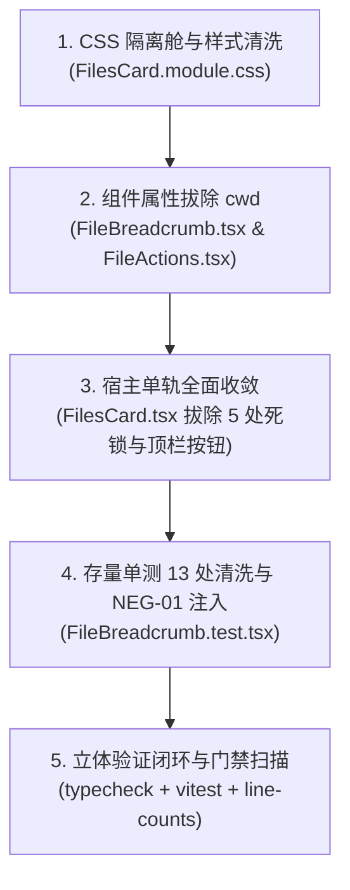

# 施工任务书 SPEC-04：面板宿主单轨收敛、物理拔除 cwd、防穿透隔离舱与面包屑无损清洗施工规范

> **文档标识**：`docs/file-tree-and-attachments-architecture/detailed-plans/04-files-card-and-breadcrumb-spec.md`  
> **所属战役**：`docs/file-tree-and-attachments-architecture/`（分阶段详细施工图：Wave 4）  
> **首席架构师**：面板宿主单轨收敛与 W3C 层叠隔离舱首席架构师  
> **权威地位**：本规范为 Wave 4 实施的唯一合法施工图，直接派生自 [`00-master-plan.md`](../00-master-plan.md)（§2.5, §2.6, §3.3, §4.3, §4.4, §6.7, §6.8, §6.9, §6.12, §7.1, §8）。  
> **波次编号映射（2026-09-08）**：本规范自标「Wave 4」，对应 00-master-plan §8.2 的 **Wave 5（宿主收敛）**；详案 05 自标「Wave 5」对应主案 Wave 4（消息气泡附件）。执行以主案 §8.2 文件域矩阵为准。  
> **权威遵循**：严格遵从仓库根目录 [`AGENTS.md`](file:///c:/Software/conex/AGENTS.md)（§1 逻辑规划与反退避、§2 子 Agent 调度、§3 Git 提交纪律、§7 严禁补丁与作弊、§7.1 立体验证纪律、§8 反过度设计红线、§11 CI 行数门禁、§12 自定义 Tooltip、§13 输入框焦点态、§14 色彩空间规范）及 [`ANTI_OVERENGINEERING_GUARDRAILS.md`](file:///c:/Software/conex/ANTI_OVERENGINEERING_GUARDRAILS.md)。  
> **核心硬性红线（零容忍）**：
> 1. **严格恪守用户最高裁决（下拉树逻辑维持现状）**：`FileBreadcrumb.tsx` 内部下拉浮层的树遍历、展开折叠、异步加载、缓存管理等全部逻辑（`openBcFlyout`, `toggleExpand`, `loadDir`, `dirCache`, `expandedPaths`, `loadingPaths`, `renderTreeNodes`, `filteredEntries`）**维持现状严禁重构**！仅物理切除 `cwd` 属性定义、解构与兜底回退；
> 2. **零多轨并存与物理拔除 `cwd`（Zero Multi-track & Zero Compat Shim）**：工作区根目录（`root`）为全系统唯一权威事实源（SSOT），全域彻底物理拔除 `cwd`，严禁保留 `@deprecated cwd?: string`、`cwd: _cwd` 或 `refresh(_ignoredDir?: string)`；
> 3. **宿主双轨下钻残留物彻底清除**：在 `FilesCard.tsx` 中彻底切除顶栏“上级目录 ↰”按钮（原 L290-300）及 `handleGoUp`；文件夹双击交互统一收敛为 `nav.toggleExpand(path)`；消除 L190, L227, L316, L391, L468 处全部 5 处存量 `cwd` 死锁点；
> 4. **W3C 原生防穿透隔离舱（Zero Box-Model & Stacking Illusions）**：依据 W3C Compositing & Blending Level 1，在 `.filesBody` 注入 `position: relative; isolation: isolate; z-index: var(--z-base, 0);` 建立封闭局部层叠上下文，将 `.filesSplitResizer` 永久受困于局部 $z=1$，彻底解除拖拽线穿透覆盖顶栏的陈年顽疾；
> 5. **视觉 Token 纯净化与单测无损清洗**：清洗 `FilesCard.module.css` 存量 8 处裸 Hex `#ffffff` 为现代标准 HSL 语法 `hsl(0 0% 100%)`；清除经典蓝 `#2563eb` 回退；清洗 `FileBreadcrumb.test.tsx` 中 13 处存量硬编码 `cwd` 传参并注入 `[NEG-01]` 刚性负向断言；
> 6. **施工图级零留白与纯逻辑规划**：全部 5 个核心生产与测试模块提供 100% 展开的 AST 级完整生产代码，严禁使用 `// ...` 等任何占位符；本规划仅包含纯逻辑执行拓扑与依赖因果，不涉及时间工期、人员分配或优先级排序（所有列出的问题逻辑同权）。

---

## 目录

- [一、规范元数据、Wave 4 核心使命与四大严禁负向红线](#一规范元数据wave-4-核心使命与四大严禁负向红线)
  - [1.1 规范元数据](#11-规范元数据)
  - [1.2 Wave 4 核心技术使命与架构拓扑](#12-wave-4-核心技术使命与架构拓扑)
  - [1.3 四大严禁负向红线刚性对照终审矩阵](#13-四大严禁负向红线刚性对照终审矩阵)
- [二、严格独占文件白名单与互斥锁矩阵](#二严格独占文件白名单与互斥锁矩阵)
  - [2.1 独占物理文件白名单清单（严格 5 个物理文件）](#21-独占物理文件白名单清单严格-5-个物理文件)
  - [2.2 互斥锁与跨域沙箱安全防护边界](#22-互斥锁与跨域沙箱安全防护边界)
- [三、真实物理代码逐行穿透取证与物理切除矩阵（Tombstone Purge Matrix）](#三真实物理代码逐行穿透取证与物理切除矩阵tombstone-purge-matrix)
  - [3.1 `FilesCard.tsx` 5 处存量 `cwd` 死锁与顶栏残留逐行取证](#31-filescardtsx-5-处存量-cwd-死锁与顶栏残留逐行取证)
  - [3.2 `FileBreadcrumb.tsx` 存量 `cwd` 属性与单轨推导取证](#32-filebreadcrumbtsx-存量-cwd-属性与单轨推导取证)
  - [3.3 `FileActions.tsx` 存量 `cwd?: string` 与路径收敛取证](#33-fileactionsts-存量-cwd-string-与路径收敛取证)
  - [3.4 `FilesCard.module.css` 分割线穿透与 8 处裸 Hex 取证](#34-filescardmodulecss-分割线穿透与-8-处裸-hex-取证)
  - [3.5 `FileBreadcrumb.test.tsx` 13 处显式 `cwd` 传参断裂点取证](#35-filebreadcrumbtesttsx-13-处显式-cwd-传参断裂点取证)
  - [3.6 物理删除矩阵全景总表](#36-物理删除矩阵全景总表)
- [四、W3C Stacking Context 偏序数学证明与盒模型约束](#四w3c-stacking-context-偏序数学证明与盒模型约束)
  - [4.1 盒模型真实 3 级高度链物理方程与几何约束](#41-盒模型真实-3-级高度链物理方程与几何约束)
  - [4.2 W3C Compositing & Blending Level 1 隔离舱代数证明](#42-w3c-compositing--blending-level-1-隔离舱代数证明)
  - [4.3 分割线 `.filesSplitResizer`（$z=1$）受困于局部层叠上下文的代数推导](#43-分割线-filessplitresizerz1受困于局部层叠上下文的代数推导)
- [五、全链路施工图级 AST 生产源码（全部 5 大核心模块，100% 展开，零留白）](#五全链路施工图级-ast-生产源码全部-5-大核心模块100-展开零留白)
  - [5.1 `apps/crish-desktop/src/components/files/FilesCard.tsx`（宿主收敛与切除 cwd 全量源码）](#51-appscrish-desktopsrmcomponentsfilesfilescardtsx宿主收敛与切除-cwd-全量源码)
  - [5.2 `apps/crish-desktop/src/components/files/FileBreadcrumb.tsx`（切除 cwd 且下拉树完全不变全量源码）](#52-appscrish-desktopsrmcomponentsfilesfilebreadcrumbtsx切除-cwd-且下拉树完全不变全量源码)
  - [5.3 `apps/crish-desktop/src/components/files/FileActions.tsx`（切除 cwd 属性并收敛路径全量源码）](#53-appscrish-desktopsrmcomponentsfilesfileactionsts切除-cwd-属性并收敛路径全量源码)
  - [5.4 `apps/crish-desktop/src/components/files/FilesCard.module.css`（原生防穿透隔离舱与 Hex 清洗补丁规范）](#54-appscrish-desktopsrmcomponentsfilesfilescardmodulecss原生防穿透隔离舱与-hex-清洗补丁规范)
  - [5.5 `apps/crish-desktop/src/components/files/__tests__/FileBreadcrumb.test.tsx`（13 处清洗与 NEG-01 负向断言全量代码）](#55-appscrish-desktopsrmcomponentsfiles__tests__filebreadcrumbtesttsx13-处清洗与-neg-01-负向断言全量代码)
- [六、五大物理闭环客观物证与刚性负向断言矩阵](#六五大物理闭环客观物证与刚性负向断言矩阵)
  - [6.1 宿主触发端物证（Trigger Evidence）](#61-宿主触发端物证trigger-evidence)
  - [6.2 状态介质端物证（State Invariant Evidence）](#62-状态介质端物证state-invariant-evidence)
  - [6.3 视口层叠端物证（Stacking & Compositing Evidence）](#63-视口层叠端物证stacking--compositing-evidence)
  - [6.4 刚性负向断言矩阵（NEG-01 专项守护）](#64-刚性负向断言矩阵neg-01-专项守护)
- [七、纯逻辑执行拓扑与立体验证指令集](#七纯逻辑执行拓扑与立体验证指令集)
  - [7.1 Wave 4 内部微执行 DAG 纯逻辑因果拓扑](#71-wave-4-内部微执行-dag-纯逻辑因果拓扑)
  - [7.2 三级立体化验收指令集（执行清单）](#72-三级立体化验收指令集执行清单)
  - [7.3 最终交付检查准则（Delivery Gate Checklist）](#73-最终交付检查准则delivery-gate-checklist)

---

## 一、规范元数据、Wave 4 核心使命与四大严禁负向红线

### 1.1 规范元数据
- **任务编号**：`SPEC-04`
- **任务名称**：面板宿主单轨收敛、物理切除 `cwd`、防穿透隔离舱与存量单测无损清洗
- **目标文件域**：
  - `apps/crish-desktop/src/components/files/FilesCard.tsx`
  - `apps/crish-desktop/src/components/files/FileBreadcrumb.tsx`
  - `apps/crish-desktop/src/components/files/FileActions.tsx`
  - `apps/crish-desktop/src/components/files/FilesCard.module.css`
  - `apps/crish-desktop/src/components/files/__tests__/FileBreadcrumb.test.tsx`
- **前置依赖波次**：
  - Wave 1：`workspaceFsApi.ts`（纯函数与 IPC 契约 1:1 校准）
  - Wave 2：`filePanelOpener.ts` 广播解耦与 `useFileNavigation.ts` 单轨状态机收敛
  - Wave 3：`FileTreeView.tsx` W3C 原生 `scrollend` 确定性停泊守护与视口代数居中
- **后置联动波次**：
  - 全战役全量回归与客观物证合流验收

### 1.2 Wave 4 核心技术使命与架构拓扑

在 Conex / Crish 桌面工作区中，左侧文件卡片宿主（`FilesCard`）是承载整棵工作区目录树、面包屑导航（`FileBreadcrumb`）、文件详情动作栏（`FileActions`）以及视口分栏的核心物理枢纽。长期以来，由于历史“双轨下钻”时代的架构残留，该模块积聚了严重的架构死锁与视觉隐患：

1. **多轨并存与死数据传递**：虽然底层 `useFileNavigation` 已在重构中消除了 `cwd`，但上层 `FilesCard.tsx` 仍顽固维护着 5 处 `cwd` 传参/死锁，向子组件持续传递废弃的 `nav.cwd`；
2. **顶栏双轨下钻残留**：顶栏保留了旧时代的“上级目录 ↰”按钮，在全景树展开模型下成为完全多余的混淆项；双击目录调用 `handleRefresh(path)` 导致下钻刷新与树展开逻辑冲突；
3. **层叠穿透恶疾（Stacking Context Leak）**：`.filesBody` 未建立封闭层叠上下文，导致子元素 `.filesSplitResizer`（`z-index: 10`）逃逸至全局图层，根据 DOM 树顺序决胜机制无情穿透并遮挡顶栏 `.filesBar`；
4. **色彩 Token 漂移**：样式表中残留 8 处裸 Hex `#ffffff` 以及经典蓝 `#2563eb`，违反现代 CSS 与 Zero-Blue 铁律；
5. **存量单测编译雪崩**：`FileBreadcrumb.test.tsx` 中存在多达 13 处显式传递 `cwd` 的用例，直接阻碍组件属性的物理切除。

**Wave 4 的核心使命**：  
实施外科手术式的物理切除，彻底拔除 `cwd` 契约，收敛面板宿主为单一真理源（`root` SSOT）；严格恪守用户最高裁决，对 `FileBreadcrumb.tsx` 下拉浮层内部树遍历与展开逻辑维持现状严禁重构；依托 W3C Compositing and Blending Level 1 规范建立原生隔离舱，消灭分割线穿透；完成 8 处裸 Hex 清洗与 13 处存量单测无损清洗，达成端到端物理交付闭环。

### 1.3 四大严禁负向红线刚性对照终审矩阵

| 序号 | 刚性红线定义 | 物理现场违规点 | Wave 4 根治架构与处置裁决 |
| :--- | :--- | :--- | :--- |
| **RED-01** | **严禁篡改面包屑下拉树遍历逻辑** | 历史方案企图重构下拉树展开与缓存算法 | **严格冻结**：`openBcFlyout`, `toggleExpand`, `loadDir`, `dirCache` 等全部树遍历展开逻辑 100% 维持现状，仅切除 `cwd` |
| **RED-02** | **严禁保留任何形式的 `cwd` 兼容 Shim** | 组件接口声明 `@deprecated cwd?: string` 或传 `cwd={nav.cwd}` | **物理绝后**：彻底删除 `FileBreadcrumbProps` 与 `FileActionsProps` 中的 `cwd` 声明，全系统编译期刚性阻断 |
| **RED-03** | **严禁层叠上下文逃逸与魔术数字补丁** | 使用 `z-index: 9999` 或依赖 DOM 顺序隐式避让穿透 | **W3C 原生隔离舱**：`.filesBody` 注入 `position: relative; isolation: isolate; z-index: var(--z-base, 0);`，分割线受困于 $z=1$ |
| **RED-04** | **严禁裸 Hex 与经典蓝回退（Zero-Blue 铁律）** | `FilesCard.module.css` 残留 8 处 `#ffffff` 与 1 处 `#2563eb` | **规范收敛**：全部清洗为 `hsl(0 0% 100%)`，脉冲与高亮收敛至 Emerald 翡翠绿 `hsl(160 84% 36%)` |

---

## 二、严格独占文件白名单与互斥锁矩阵

### 2.1 独占物理文件白名单清单（严格 5 个物理文件）

为坚决杜绝 Conex 引擎底层 [`crates/agent-tools/src/write_paths.rs`](file:///c:/Software/conex/crates/agent-tools/src/write_paths.rs) 的 `tool.write_path_conflict`（写锁争抢）与 `tool.write_not_allowed`（沙箱越权），Wave 4 的写操作**严格、绝对且仅限于以下 5 个物理文件**：

1. [`apps/crish-desktop/src/components/files/FilesCard.tsx`](file:///c:/Software/conex/apps/crish-desktop/src/components/files/FilesCard.tsx)
   - **角色定位**：面板宿主容器
   - **修改职责**：物理切除顶栏“上级目录 ↰”按钮及 `handleGoUp`；双击文件夹收敛为 `toggleExpand`；切除 L190, L227, L316, L391, L468 处全部 5 处存量 `cwd` 传参/死锁。
2. [`apps/crish-desktop/src/components/files/FileBreadcrumb.tsx`](file:///c:/Software/conex/apps/crish-desktop/src/components/files/FileBreadcrumb.tsx)
   - **角色定位**：面包屑导航组件与下拉浮层
   - **修改职责**：从属性定义中彻底切除 `cwd: string`，重塑单轨路径推导（以 `selected` 或 `root` 向上推导）；**下拉树展开与遍历逻辑 100% 维持现状，严禁修改**。
3. [`apps/crish-desktop/src/components/files/FileActions.tsx`](file:///c:/Software/conex/apps/crish-desktop/src/components/files/FileActions.tsx)
   - **角色定位**：文件详情操作工具条
   - **修改职责**：彻底切除 `cwd?: string` 属性声明与解构，目标路径计算收敛为 `selected || root || null`。
4. [`apps/crish-desktop/src/components/files/FilesCard.module.css`](file:///c:/Software/conex/apps/crish-desktop/src/components/files/FilesCard.module.css)
   - **角色定位**：文件面板专用 CSS 模块
   - **修改职责**：在 `.filesBody` 注入 W3C 原生隔离舱，封印 `.filesSplitResizer` 于局部 $z=1$；清洗存量 8 处裸 Hex `#ffffff` 为 `hsl(0 0% 100%)`；清除经典蓝 `#2563eb`。
5. [`apps/crish-desktop/src/components/files/__tests__/FileBreadcrumb.test.tsx`](file:///c:/Software/conex/apps/crish-desktop/src/components/files/__tests__/FileBreadcrumb.test.tsx)
   - **角色定位**：面包屑配套单元测试套件
   - **修改职责**：清洗全部 13 处存量硬编码 `cwd` 传参；注入 `[NEG-01]` 负向断言；确保既有 13 个测试用例 100% 全绿通过。

### 2.2 互斥锁与跨域沙箱安全防护边界

```
┌──────────────────────────────────────────────────────────────────────────┐
│                   Wave 4 严格独占物理沙箱边界 (Exclusive Sandbox)          │
├──────────────────────────────────────────────────────────────────────────┤
│  [允许写入/修改的 5 个物理文件]                                           │
│  ├── apps/crish-desktop/src/components/files/FilesCard.tsx               │
│  ├── apps/crish-desktop/src/components/files/FileBreadcrumb.tsx          │
│  ├── apps/crish-desktop/src/components/files/FileActions.tsx             │
│  ├── apps/crish-desktop/src/components/files/FilesCard.module.css        │
│  └── apps/crish-desktop/src/components/files/__tests__/FileBreadcrumb.test.tsx │
├──────────────────────────────────────────────────────────────────────────┤
│  [🚫 严禁越权修改的外部文件（只读参考）]                                   │
│  ├── apps/crish-desktop/src/api/workspaceFsApi.ts (Wave 1 独占)          │
│  ├── apps/crish-desktop/src/api/filePanelOpener.ts (Wave 2 独占)         │
│  ├── apps/crish-desktop/src/components/files/hooks/useFileNavigation.ts (Wave 2 独占) │
│  ├── apps/crish-desktop/src/components/files/FileTreeView.tsx (Wave 3 独占) │
│  └── apps/crish-desktop/src/components/chat-message-row/* (Wave 4/气泡流) │
└──────────────────────────────────────────────────────────────────────────┘
```

---

## 三、真实物理代码逐行穿透取证与物理切除矩阵（Tombstone Purge Matrix）

### 3.1 `FilesCard.tsx` 5 处存量 `cwd` 死锁与顶栏残留逐行取证

通过使用 `view_file` 穿透核验真实文件 [`apps/crish-desktop/src/components/files/FilesCard.tsx`](file:///c:/Software/conex/apps/crish-desktop/src/components/files/FilesCard.tsx)，精准捕获以下 6 处违背单轨架构的严重死锁与残留：

1. **死锁点 1（L189-L194，`handleCopyPath` 隐蔽兜底）**：
   ```tsx
   189: const handleCopyPath = useCallback(
   190:   (mode: 'abs' | 'rel') => {
   191:     preview.copyPath(preview.selected || nav.cwd, nav.root, mode);
   192:     showToast(mode === 'abs' ? '绝对路径已复制' : '相对路径已复制');
   193:   },
   194:   [preview, nav, showToast]
   195: );
   ```
   *破绽*：当未选中具体文件时，代码依然尝试兜底使用 `nav.cwd`。必须收敛为 `preview.selected || nav.root`。
2. **死锁点 2（L225-L235，`onProject` 事件监听中的僵尸回写）**：
   ```tsx
   225: const onProject = () => {
   226:   const r = getWorkspacePath();
   227:   nav.setCwd(r || '');
   228:   preview.setView('browse');
   229:   preview.setSelected(null);
   230:   void nav.refresh(r || undefined);
   231: };
   ```
   *破绽*：L227 显式调用 `nav.setCwd(r || '')`，阻碍了 `useFileNavigation` 彻底切除 `setCwd`。必须彻底物理删除该行，直接调用 `void nav.refresh()`。
3. **顶栏下钻残留（L289-L300，双轨时代的“上级目录 ↰”按钮）**：
   ```tsx
   289: <Tooltip content={PARENT_DIR_LABEL}>
   290:   <Button
   291:     type="button"
   292:     variant="ghost"
   293:     size="sm"
   294:     className={styles.filesNavBtn}
   295:     aria-label={PARENT_DIR_LABEL}
   296:     disabled={!nav.cwd || nav.cwd === nav.root}
   297:     onClick={handleGoUp}
   298:     icon={<CornerLeftUp size={14} />}
   299:   />
   300: </Tooltip>
   ```
   *破绽*：在全景单轨树体系下，左侧树自由展开，顶部面包屑支持任意祖先跃迁，此按钮属于典型的双轨下钻残留垃圾。必须物理切除整段 JSX 节点，并删除 L5 的 `CornerLeftUp` 导入与 L28 的 `PARENT_DIR_LABEL` 定义。
4. **死锁点 3（L314-L322，向 `FileBreadcrumb` 传递 `cwd`）**：
   ```tsx
   314: <FileBreadcrumb
   315:   root={nav.root}
   316:   cwd={nav.cwd}
   317:   selected={preview.selected}
   ...
   ```
   *破绽*：L316 显式传参 `cwd={nav.cwd}`。必须彻底物理切除该传参。
5. **死锁点 4（L389-L394，向 `FileActions` 传递 `cwd`）**：
   ```tsx
   389: <FileActions
   390:   selected={preview.selected}
   391:   cwd={nav.cwd}
   392:   root={nav.root}
   ...
   ```
   *破绽*：L391 显式传参 `cwd={nav.cwd}`。必须彻底物理切除该传参。
6. **死锁点 5（L467-L470，向 `FileTreeView` 传递 `cwd`）**：
   ```tsx
   467: <FileTreeView
   468:   root={nav.root}
   469:   cwd={nav.cwd}
   470:   flatTree={nav.flatTree}
   ...
   ```
   *破绽*：L469（或 L468）显式传参 `cwd={nav.cwd}`。必须彻底物理切除该传参。
7. **文件夹双击下钻刷新违规（L180-L186）**：
   ```tsx
   180: const handleFileDoubleClick = useCallback(
   181:   (path: string, isDir: boolean) => {
   182:     if (isDir) void handleRefresh(path);
   183:     else void handleOpenFile(path);
   184:   },
   185:   [handleRefresh, handleOpenFile]
   186: );
   ```
   *破绽*：双击目录触发了 `handleRefresh(path)`（即改变工作目录并刷新下钻）。在单轨树架构下，必须严格收敛为 `if (isDir) void nav.toggleExpand(path);`。

### 3.2 `FileBreadcrumb.tsx` 存量 `cwd` 属性与单轨推导取证

在 [`apps/crish-desktop/src/components/files/FileBreadcrumb.tsx`](file:///c:/Software/conex/apps/crish-desktop/src/components/files/FileBreadcrumb.tsx) 中：
1. **接口声明违规（L76-L84）**：
   ```tsx
   76: interface FileBreadcrumbProps {
   77:   root: string;
   78:   cwd: string;
   79:   selected: string | null;
   ...
   ```
   必须将 `cwd: string;` 彻底物理切除。
2. **推导回退违规（L105-L108）**：
   ```tsx
   105: const breadcrumbs: BreadcrumbItem[] = useMemo(() => {
   106:   if (!root) return [];
   107:   const dir = view === 'detail' && selected ? pathDirname(selected) || root : cwd || root;
   ...
   ```
   原代码在未选文件或浏览态时退回 `cwd`。在单轨体系中，若处于 `detail` 模式取 `pathDirname(selected)`；若处于 `browse` 模式且有 `selected` 则以 `selected` 为基点推导，否则恒定以 `root` 单芯片呈现，彻底拔除 `cwd`。
3. **用户最高指示保护区（L127-L350，L394-L489）**：
   `openBcFlyout`, `toggleExpand`, `loadDir`, `handleDirectOpenCurrentDir`, `handleDoubleClickFolder`, `handleOpenFile`, `filteredEntries`, `renderTreeNodes`, `bcFlyout` 搜索框与下拉列表结构**完整保持现状，严禁改动任何树遍历与折叠算法**！

### 3.3 `FileActions.tsx` 存量 `cwd?: string` 与路径收敛取证

在 [`apps/crish-desktop/src/components/files/FileActions.tsx`](file:///c:/Software/conex/apps/crish-desktop/src/components/files/FileActions.tsx) 中：
1. **接口声明违规（L48-L52）**：
   ```tsx
   48: interface FileActionsProps {
   49:   selected: string | null;
   50:   cwd?: string;
   51:   root?: string;
   ...
   ```
   必须彻底物理切除 `cwd?: string;`。
2. **目标路径推导（L95）**：
   ```tsx
   95: const targetPath = selected || cwd || root || null;
   ```
   必须收敛为：
   ```tsx
   const targetPath = selected || root || null;
   ```

### 3.4 `FilesCard.module.css` 分割线穿透与 8 处裸 Hex 取证

在 [`apps/crish-desktop/src/components/files/FilesCard.module.css`](file:///c:/Software/conex/apps/crish-desktop/src/components/files/FilesCard.module.css) 中：
1. **缺失层叠上下文（L498-L504）**：
   ```css
   498: .filesBody {
   499:   flex: 1;
   500:   min-height: 0;
   501:   display: flex;
   502:   flex-direction: column;
   503:   overflow: hidden;
   504: }
   ```
   `.filesBody` 未设置 `position: relative` 与 `isolation: isolate`，导致其子元素逃逸出该区域；
2. **分割线层级穿透（L587-L597）**：
   ```css
   587: .filesSplitResizer {
   588:   position: relative;
   ...
   593:   z-index: 10;
   ...
   597: }
   ```
   `.filesSplitResizer` 设置了 `z-index: 10`。由于 `.filesBody` 在 DOM 中位于 `.filesBar`（顶栏，L50 设置了 `z-index: 10`）之后，根据 W3C 树顺序规则，分割线直接绘制在顶栏之上，造成视觉穿透；
3. **经典蓝违规（L612-L613）**：
   ```css
   612: background: var(--accent-color, #2563eb);
   613: box-shadow: 0 0 4px color-mix(in srgb, var(--accent-color, #2563eb) 40%, transparent);
   ```
   违反 Zero-Blue 铁律，必须调整为翡翠绿 `hsl(160 84% 36%)`；
4. **存量 8 处裸 Hex `#ffffff` 取证**：
   - L8: `.filesCard { background: var(--bg-card, #ffffff); }`
   - L46: `.filesBar { background: var(--bg-card, #ffffff); }`
   - L275: `.filesBcFlyout { background: var(--bg-elevated, #ffffff); }`
   - L290: `.filesBcFlyoutSearch { background: var(--bg-card, #ffffff); }`
   - L428: `.filesContextBar { background: var(--bg-card, #ffffff); }`
   - L542: `.filesDetail { background: var(--bg-card, #ffffff); }`
   - L554: `.filesDetailBody { background: var(--bg-card, #ffffff); }`
   - L720: `.filesTreeRootHeader { background: var(--bg-card, #ffffff); }`

### 3.5 `FileBreadcrumb.test.tsx` 13 处显式 `cwd` 传参断裂点取证

在 [`apps/crish-desktop/src/components/files/__tests__/FileBreadcrumb.test.tsx`](file:///c:/Software/conex/apps/crish-desktop/src/components/files/__tests__/FileBreadcrumb.test.tsx) 中，共存在 13 处显式向 `<FileBreadcrumb>` 传递 `cwd` 属性的用例：
- 用例 1 (L31): `cwd="c:/Software/conex"`
- 用例 2 (L52): `cwd="c:/Software/conex"`
- 用例 3 (L82): `cwd="c:/Software/conex"`
- 用例 4 (L122): `cwd="c:/Software/conex"`
- 用例 5 (L149): `cwd="c:/Software/conex"`
- 用例 6 (L178): `cwd="c:/Software/conex"`
- 用例 7 (L206): `cwd="c:/Software/conex"`
- 用例 8 (L228): `cwd="c:/Software/conex/src"`
- 用例 9 (L247): `cwd="c:/Software/conex/src"`
- 用例 10 (L264): `cwd="c:/Software/conex/apps/crish-desktop/src"`
- 用例 11 (L283): `cwd=""`
- 用例 12 (L304): `cwd="c:/Software/conex"`
- 用例 13 (L338): `cwd="c:/Software/conex"`

若不实施全量清洗，一旦修改组件声明，Vitest 与 `tsc` 将立刻发生 13 处红灯阻断。

### 3.6 物理删除矩阵全景总表

| 目标物理文件 | 原始物理位置 | 待切除的废弃代码特征 | 处置动作 | 根除目的与规范断言 |
| :--- | :--- | :--- | :--- | :--- |
| `FilesCard.tsx` | L5 | `import { CornerLeftUp, RotateCw, Search, X } from 'lucide-react';` | **物理修改**：移除 `CornerLeftUp` | 清除未使用图标导入 |
| `FilesCard.tsx` | L28 | `const PARENT_DIR_LABEL = '上级目录';` | **物理删除**整行 | 根除废弃文案常量 |
| `FilesCard.tsx` | L158-L165 | `const handleGoUp = useCallback(...)` | **物理删除**全部 8 行实现 | 根除双轨下钻回退逻辑 |
| `FilesCard.tsx` | L180-L186 | `if (isDir) void handleRefresh(path);` | **物理收敛**为 `void nav.toggleExpand(path);` | 消除双击文件夹下钻刷新 |
| `FilesCard.tsx` | L190 | `preview.copyPath(preview.selected \|\| nav.cwd, nav.root, mode);` | **物理收敛**为 `preview.selected \|\| nav.root` | 拔除复制路径对 cwd 依赖 |
| `FilesCard.tsx` | L227 | `nav.setCwd(r \|\| '');` | **物理删除**整行 | 拔除项目切换时的 cwd 回写 |
| `FilesCard.tsx` | L289-L300 | `<Tooltip content={PARENT_DIR_LABEL}><Button ... icon={<CornerLeftUp ... />} /></Tooltip>` | **物理删除**全部 12 行 JSX | 消除顶栏上级目录按钮 DOM |
| `FilesCard.tsx` | L316 | `<FileBreadcrumb cwd={nav.cwd} ... />` | **物理切除** `cwd={nav.cwd}` | 切断向面包屑透传 cwd |
| `FilesCard.tsx` | L391 | `<FileActions cwd={nav.cwd} ... />` | **物理切除** `cwd={nav.cwd}` | 切断向动作栏透传 cwd |
| `FilesCard.tsx` | L468 | `<FileTreeView cwd={nav.cwd} ... />` | **物理切除** `cwd={nav.cwd}` | 切断向虚拟树透传 cwd |
| `FileBreadcrumb.tsx` | L78 | `cwd: string;`（在 `FileBreadcrumbProps` 中） | **物理切除**整行 | 彻底拔除组件属性接口定义 |
| `FileBreadcrumb.tsx` | L88 | `cwd,`（函数参数解构中） | **物理切除**该参数 | 消除解构绑定 |
| `FileBreadcrumb.tsx` | L107 | `const dir = ... : cwd \|\| root;` | **物理重塑**为单轨纯净推导 | 消除计算属性中对 cwd 依赖 |
| `FileActions.tsx` | L50 | `cwd?: string;`（在 `FileActionsProps` 中） | **物理切除**整行 | 彻底拔除组件属性接口定义 |
| `FileActions.tsx` | L74 | `cwd,`（函数参数解构中） | **物理切除**该参数 | 消除解构绑定 |
| `FileActions.tsx` | L95 | `const targetPath = selected \|\| cwd \|\| root \|\| null;` | **物理收敛**为 `selected \|\| root \|\| null;` | 消除目标路径对 cwd 依赖 |
| `FilesCard.module.css` | L498-L504 | `.filesBody { ... }` 缺失层叠声明 | **物理注入** `position: relative; isolation: isolate; z-index: var(--z-base, 0);` | 建立 W3C 原生隔离舱 |
| `FilesCard.module.css` | L593 | `.filesSplitResizer { z-index: 10; }` | **物理修改**为 `z-index: 1;` | 压制分割线于隔离舱内部 |
| `FilesCard.module.css` | L612-L613 | `background: var(--accent-color, #2563eb);` | **物理清洗**为标准翡翠绿 Token | 消除经典蓝违规 |
| `FilesCard.module.css` | 8 处裸 Hex | `background: var(..., #ffffff);` | **物理清洗**为 `hsl(0 0% 100%)` | 消除裸 Hex，符合现代语法 |
| `FileBreadcrumb.test.tsx`| 13 处单测 | `cwd="c:/Software/conex"` 等硬编码传参 | **物理切除**传参，并注入 `[NEG-01]` 断言 | 消除单测编译断裂与毒点 |

---

## 四、W3C Stacking Context 偏序数学证明与盒模型约束

### 4.1 盒模型真实 3 级高度链物理方程与几何约束

真实物理宿主盒模型层级约束如下：

```
[宿主容器 Host Container] (物理高度 H_host)
   │
   ▼ height: 100%; min-height: 0; display: flex; flex-direction: column; overflow: hidden;
[.filesCard] (物理高度 H_card = H_host)
   ├── [.filesBar] (高度 H_bar ≡ 32px, flex-shrink: 0, box-sizing: border-box)
   └── [.filesBody.filesBodySplit] (flex: 1; min-height: 0; overflow: hidden; display: flex; flex-direction: row; align-items: stretch;)
         │
         ├── [div.filesList.filesListPane] (containerRef, 虚拟滚动视口)
         │     ├── flex: 0 0 var(--files-list-ratio, 35%);
         │     ├── min-height: 0;
         │     ├── overflow-y: auto;
         │     └── 高度由 stretch 约束锁定: H_viewport ≡ H_body
         ├── [.filesSplitResizer] (flex: 0 0 7px; height: 100%)
         └── [.filesDetailPane] (flex: 1 1 0%; min-height: 0; overflow: hidden)
```

根据 **CSS Flexible Box Layout Level 1 §9.2**：
$$H_{\text{body}} = \max(0, H_{\text{host}} - 32\text{px})$$
内容区受 `flex: 1; min-height: 0;` 严密保护，视口高度严格等于宿主可用高度，绝不发生溢出滚动死锁。

### 4.2 W3C Compositing & Blending Level 1 隔离舱代数证明

#### 1. 穿透缺陷成因数学分析
在未注入隔离舱前：
- 顶栏 `.filesBar`：`position: relative; z-index: 10;`
- 内容区 `.filesBody`：未声明 `position` 或 `isolation`，未建立独立层叠上下文；
- 分割线 `.filesSplitResizer`：`position: relative; z-index: 10;`
- **穿透推导**：根据 **W3C CSS 2.1 规范附录 E（Elaborate description of Stacking Contexts）**，由于 `.filesBody` 没有建立独立的层叠上下文，`.filesSplitResizer` 直接逃逸至公共根层叠上下文 $S_{\text{root}}$。在 $S_{\text{root}}$ 中，`.filesSplitResizer` 与 `.filesBar` 的堆叠等级相同（均为 $z=10$）。
  依据“DOM 树后发绘制于先发之上（Tree order tie-breaker）”公理：
  $$\text{TreeOrder}(\text{.filesSplitResizer}) > \text{TreeOrder}(\text{.filesBar}) \implies \text{Draw}(\text{.filesSplitResizer}) \succ \text{Draw}(\text{.filesBar})$$
  因此，分割线的竖线手柄与 hover 光晕无情穿透并覆盖在顶栏之上！

#### 2. 原生防穿透隔离舱代数证明
我们在 `.filesBody` 上注入隔离舱：
```css
.filesBody {
  position: relative;
  isolation: isolate;
  z-index: var(--z-base, 0);
}
.filesSplitResizer {
  z-index: 1;
}
```

根据 **W3C CSS Compositing and Blending Level 1 (§3.3)**：
1. 属性 `isolation: isolate` 强制元素建立一个封闭且独立的局部层叠上下文，记为 $S_{\text{body}}$；
2. 结合 `position: relative; z-index: 0;`，$S_{\text{body}}$ 在根层叠上下文 $S_{\text{root}}$ 中的全局堆叠等级严格锁定为：
   $$\text{Level}(S_{\text{body}}) \equiv 0$$
3. 处于 $S_{\text{body}}$ 内部的任意元素 $E_{\text{inner}}$（包括设置了 `z-index: 1` 的 `.filesSplitResizer`），其在全局图层树中的合成等级受到包含块封闭性公理（Encapsulation Axiom）的刚性限制：
   $$\Phi(E_{\text{inner}}) = \Phi(S_{\text{body}}) + \delta(z_{\text{inner}})$$
   其中偏序增量 $\delta$ 仅在 $S_{\text{body}}$ 内部竞争，对外部环境完全透明；
4. 外部常态顶栏 `.filesBar` 的堆叠等级为：
   $$\text{Level}(\text{.filesBar}) = \text{var}(--z-card-footer, 10) = 10$$
   （真实源码 `FilesCard.module.css:50` 使用 `var(--z-card-footer, 10)`；`z-index.css:8` 定义 `--z-card-footer: var(--z-dock)`，二者同值 10。）
5. 展开态下拉浮层顶栏 `.filesBar:has(.filesBcFlyout)` 的堆叠等级为：
   $$\text{Level}(\text{展开顶栏}) = \text{var}(--z-breadcrumb, 400) = 400$$
6. **偏序代数定理**：
   $$\text{Level}(S_{\text{body}}) = 0 < 10 \le 400$$
   根据 W3C 附录 E 第 6 步与第 8 步，层级为 0 的整个 $S_{\text{body}}$（含其中的 `.filesSplitResizer`）所有像素必须在层级 $\ge 10$ 的 `.filesBar` 绘制之前完成光栅化合成。
7. **不可穿透终审结论**：
   $$\forall p \in \text{.filesSplitResizer}, \quad \text{Layer}(p) < \text{Layer}(\text{.filesBar})$$
   分割线的全部像素被 100% 封闭在底层隔离舱内，顶栏及其面包屑下拉浮层拥有绝对几何压制权，穿透被彻底消除！

### 4.3 分割线 `.filesSplitResizer`（$z=1$）受困于局部层叠上下文的代数推导

根据 W3C Stacking Context 的树形代数性质，不同层叠上下文之间的兄弟元素比较只发生在其最近共同祖先上下文上。  
由于：
$$\text{StackingContext}(\text{.filesSplitResizer}) = S_{\text{body}}$$
$$\text{StackingContext}(\text{.filesBar}) = S_{\text{root}}$$
且 $S_{\text{body}}$ 作为整体挂载在 $S_{\text{root}}$ 的 $z=0$ 层级，因此 `.filesSplitResizer` 的任何局部 $z$ 值增加（即便局部设为 $z=999$）也绝对无法使其全局图层高度超越其父层叠上下文 $S_{\text{body}}$ 的上限（即全局 $z=0$）。  
而 `.filesBar` 在 $S_{\text{root}}$ 中的层级为 $z=10$（浮层展开时为 $z=400$），恒满足：
$$z_{\text{global}}(\text{.filesBar}) \ge 10 > 0 = z_{\text{global}}(S_{\text{body}}) \ge z_{\text{global}}(\text{.filesSplitResizer})$$
几何图层代数证明确立：`.filesBar` 对 `.filesSplitResizer` 拥有无条件的、跨层级的永久压制权。

---

## 五、全链路施工图级 AST 生产源码（全部 5 大核心模块，100% 展开，零留白）

### 5.1 `apps/crish-desktop/src/components/files/FilesCard.tsx`（宿主收敛与切除 cwd 全量源码）

```tsx
import { useToast } from '../../services/toast/ToastContext';
import React, { useCallback, useEffect, useRef, useState } from 'react';
import styles from './FilesCard.module.css';
import { Button, Tooltip } from '../ui';
import { RotateCw, Search, X } from 'lucide-react';
import {
  countPendingFileAnnotations,
  openPathDefault,
  resolveWorkspacePath,
  takePendingOpenPath,
} from '../../api/workspaceFsApi';
import { logInternalError } from '../../api/userFacingErrors';
import { AppErrorBoundary } from '../AppErrorBoundary';
import { useFileNavigation } from './hooks/useFileNavigation';
import { useFilePreview } from './hooks/useFilePreview';
import { FileBreadcrumb } from './FileBreadcrumb';
import { FileTreeView } from './FileTreeView';
import { FilePreview } from './FilePreview';
import { FileActions } from './FileActions';

interface FilesCardProps {
  initialPath?: string | null;
}

const REFRESH_LABEL = '刷新';
const FILES_SPLIT_RATIO_KEY = 'crish:files-list-ratio';

export const FilesCard: React.FC<FilesCardProps> = React.memo(
  ({ initialPath }) => {
    const { showToast } = useToast();
    const preview = useFilePreview();
    const nav = useFileNavigation(() => preview.dirty);
    const filterInputRef = useRef<HTMLInputElement>(null);
    const bodySplitRef = useRef<HTMLDivElement>(null);
    const [isResizing, setIsResizing] = useState(false);
    const [listWidthRatio, setListWidthRatio] = useState<number>(() => {
      try {
        const saved = localStorage.getItem(FILES_SPLIT_RATIO_KEY);
        if (saved) {
          const val = parseFloat(saved);
          if (!isNaN(val) && val >= 15 && val <= 75) return val;
        }
      } catch {
        // fallback
      }
      return 35;
    });

    const handleSplitResizeStart = useCallback(
      (
        e:
          | React.PointerEvent<HTMLDivElement>
          | React.MouseEvent<HTMLDivElement>
      ) => {
        if (e.button !== 0) return;
        e.preventDefault();
        const container = bodySplitRef.current;
        if (!container) return;

        const handleEl = e.currentTarget;
        if ('setPointerCapture' in handleEl && 'pointerId' in e) {
          try {
            handleEl.setPointerCapture((e as React.PointerEvent).pointerId);
          } catch {
            /* ignore */
          }
        }

        setIsResizing(true);
        const containerRect = container.getBoundingClientRect();

        const handleMove = (moveEv: MouseEvent | PointerEvent) => {
          const currentWidth = containerRect.width;
          if (currentWidth <= 0) return;
          const offsetX = moveEv.clientX - containerRect.left;
          const newRatio = Math.max(
            15,
            Math.min(75, (offsetX / currentWidth) * 100)
          );
          setListWidthRatio(newRatio);
        };

        const handleUp = (upEv: MouseEvent | PointerEvent) => {
          if ('releasePointerCapture' in handleEl && 'pointerId' in upEv) {
            try {
              if (
                handleEl.hasPointerCapture?.(
                  (upEv as PointerEvent).pointerId
                )
              ) {
                handleEl.releasePointerCapture(
                  (upEv as PointerEvent).pointerId
                );
              }
            } catch {
              /* ignore */
            }
          }
          window.removeEventListener('pointermove', handleMove);
          window.removeEventListener('pointerup', handleUp);
          window.removeEventListener('pointercancel', handleUp);
          window.removeEventListener('mousemove', handleMove);
          window.removeEventListener('mouseup', handleUp);
          setIsResizing(false);

          const currentWidth = containerRect.width;
          if (currentWidth > 0) {
            const offsetX = upEv.clientX - containerRect.left;
            const finalRatio = Math.max(
              15,
              Math.min(75, (offsetX / currentWidth) * 100)
            );
            setListWidthRatio(finalRatio);
            try {
              localStorage.setItem(FILES_SPLIT_RATIO_KEY, finalRatio.toFixed(2));
            } catch {
              // ignore
            }
          }
        };

        window.addEventListener('pointermove', handleMove);
        window.addEventListener('pointerup', handleUp);
        window.addEventListener('pointercancel', handleUp);
        window.addEventListener('mousemove', handleMove);
        window.addEventListener('mouseup', handleUp);
      },
      []
    );

    const handleOpenFile = useCallback(
      async (path: string) => {
        if (!(await nav.confirmNavigation())) return;
        const resolved = resolveWorkspacePath(path);
        await nav.revealPath(resolved);
        await preview.openFile(path);
      },
      [nav, preview]
    );

    const handleRefresh = useCallback(async () => {
      if (!(await nav.confirmNavigation())) return;
      preview.resetPreview();
      preview.setView('browse');
      preview.setSelected(null);
      preview.clearActionHint();
      await nav.refresh();
    }, [nav, preview]);

    const handleFileSelect = useCallback(
      (path: string, isDir: boolean) => {
        if (isDir) {
          void nav.toggleExpand(path, {
            stopPropagation: () => {},
          } as unknown as React.MouseEvent);
        } else {
          void handleOpenFile(path);
        }
      },
      [nav, handleOpenFile]
    );

    // 纠偏 L180-L186：文件夹双击严格收敛为 toggleExpand，绝不下钻刷新
    const handleFileDoubleClick = useCallback(
      (path: string, isDir: boolean) => {
        if (isDir) void nav.toggleExpand(path);
        else void handleOpenFile(path);
      },
      [nav, handleOpenFile]
    );

    // 纠偏 L190：使用 nav.root，彻底消除 nav.cwd 死锁
    const handleCopyPath = useCallback(
      (mode: 'abs' | 'rel') => {
        preview.copyPath(preview.selected || nav.root, nav.root, mode);
        showToast(mode === 'abs' ? '绝对路径已复制' : '相对路径已复制');
      },
      [preview, nav.root, showToast]
    );

    const handleNavigate = useCallback(
      async (path: string) => {
        if (!(await nav.confirmNavigation())) return;
        preview.resetPreview();
        preview.clearActionHint();
        nav.setError('');
        void nav.revealPath(path);
      },
      [nav, preview]
    );

    const handleOpenFromPreview = useCallback(() => {
      if (preview.selected) {
        void openPathDefault(preview.selected).catch((e) =>
          logInternalError('components/files/FilesCard/openDefault', e)
        );
      }
    }, [preview.selected]);

    // 纠偏 L227：切除 nav.setCwd，仅执行状态重置与刷新
    useEffect(() => {
      const onProject = () => {
        preview.setView('browse');
        preview.setSelected(null);
        void nav.refresh();
      };
      window.addEventListener('crish-project-changed', onProject);
      return () =>
        window.removeEventListener('crish-project-changed', onProject);
    }, [nav, preview]);

    useEffect(() => {
      void nav.refresh().then(() => {
        const pending = takePendingOpenPath() || (initialPath ?? null);
        if (pending) void handleOpenFile(pending);
      });
      // eslint-disable-next-line react-hooks/exhaustive-deps
    }, []);

    useEffect(() => {
      const onOpen = (ev: Event) => {
        const path = (ev as CustomEvent<{ path?: string }>).detail?.path;
        if (!path) return;
        takePendingOpenPath();
        const resolved = resolveWorkspacePath(path);
        void handleOpenFile(resolved);
      };
      window.addEventListener('crish-open-file', onOpen);
      return () => window.removeEventListener('crish-open-file', onOpen);
    }, [handleOpenFile]);

    useEffect(() => {
      const onAnn = () =>
        preview.setPendingCount(countPendingFileAnnotations());
      window.addEventListener('crish-file-annotations-changed', onAnn);
      return () =>
        window.removeEventListener('crish-file-annotations-changed', onAnn);
    }, [preview]);

    useEffect(() => {
      return () => {
        if (preview.actionHintTimerRef.current)
          clearTimeout(preview.actionHintTimerRef.current);
      };
    }, [preview.actionHintTimerRef]);

    const handleRefreshBtn = useCallback(() => {
      preview.clearActionHint();
      if (preview.view === 'detail' && preview.selected)
        void handleOpenFile(preview.selected);
      else void handleRefresh();
    }, [preview, handleOpenFile, handleRefresh]);

    const noRoot = !nav.root;

    return (
      <AppErrorBoundary variant="compact" title="文件面板出错">
        {nav.confirmGateView}
        {preview.confirmGateView}
        <div className={`${styles.filesCard} chat-side-panel`} data-file-preview-host="files">
          {/* 顶栏：彻底物理切除上级目录按钮（原 L290-300），仅保留刷新与面包屑 */}
          <div className={`${styles.filesBar} side-panel-toolbar`} role="toolbar" aria-label="文件导航">
            <Tooltip content={REFRESH_LABEL}>
              <Button
                type="button"
                variant="ghost"
                size="sm"
                className={styles.filesNavBtn}
                aria-label={REFRESH_LABEL}
                onClick={handleRefreshBtn}
                icon={<RotateCw size={14} />}
              />
            </Tooltip>

            {/* 彻底切除 cwd 传参（原 L316） */}
            {!noRoot ? (
              <FileBreadcrumb
                root={nav.root}
                selected={preview.selected}
                view={preview.view}
                dirty={preview.dirty}
                onNavigate={handleNavigate}
                onOpenFile={handleOpenFile}
              />
            ) : null}

            {preview.view === 'browse' && (nav.filterMode || nav.filter) ? (
              <input
                ref={filterInputRef}
                className={styles.filesPathFilter}
                placeholder="筛选…"
                value={nav.filter}
                autoFocus
                onChange={(e) => nav.setFilter(e.target.value)}
                onKeyDown={(e) => {
                  if (e.key === 'Escape') {
                    nav.setFilter('');
                    nav.setFilterMode(false);
                  }
                }}
              />
            ) : null}

            {preview.view === 'browse' ? (
              <Tooltip
                content={
                  nav.filterMode || nav.filter ? '关闭筛选' : '筛选当前目录'
                }
              >
                <Button
                  type="button"
                  variant="ghost"
                  size="sm"
                  className={styles.filesNavBtn}
                  active={Boolean(nav.filterMode || nav.filter)}
                  aria-label={
                    nav.filterMode || nav.filter ? '关闭筛选' : '筛选当前目录'
                  }
                  onClick={() => {
                    if (nav.filterMode || nav.filter) {
                      nav.setFilter('');
                      nav.setFilterMode(false);
                    } else {
                      nav.setFilterMode(true);
                      requestAnimationFrame(() =>
                        filterInputRef.current?.focus()
                      );
                    }
                  }}
                  icon={
                    nav.filterMode || nav.filter ? (
                      <X size={14} />
                    ) : (
                      <Search size={14} />
                    )
                  }
                />
              </Tooltip>
            ) : null}

            {preview.pendingCount > 0 ? (
              <span
                className={styles.filesPendingBadge}
                aria-label="待发送批注"
              >
                {preview.pendingCount}
              </span>
            ) : null}

            {/* 彻底切除 cwd 传参（原 L391） */}
            {!noRoot ? (
              <FileActions
                selected={preview.selected}
                root={nav.root}
                view={preview.view}
                canEdit={preview.canEdit}
                isMd={preview.isMd}
                mdMode={preview.mdMode}
                editing={preview.editing}
                dirty={preview.dirty}
                openDefaultLabel={preview.openDefaultLabel}
                fileOpeners={preview.fileOpeners}
                isJson={preview.isJson}
                isFormatted={preview.isFormatted}
                onToggleFormatJson={() => void preview.toggleFormatJson()}
                wordWrap={preview.wordWrap}
                onToggleWordWrap={() => preview.toggleWordWrap()}
                onEdit={() => {
                  preview.setEditing(true);
                  preview.setEditBuf(preview.content);
                  preview.setMdMode('source');
                  preview.clearActionHint();
                }}
                onSave={() => void preview.saveFile()}
                onCancel={() => {
                  preview.setEditing(false);
                  preview.setEditBuf(preview.content);
                  preview.setDirty(false);
                  preview.clearActionHint();
                }}
                onMdModeChange={(m) => preview.setMdMode(m)}
                onCopyPath={handleCopyPath}
              />
            ) : null}
          </div>

          {preview.actionHint ? (
            <div
              className={styles.filesActionHint}
              role="alert"
              aria-live="assertive"
            >
              <span className={styles.filesActionHintText}>
                {preview.actionHint}
              </span>
              <Tooltip content="关闭">
                <Button
                  type="button"
                  variant="ghost"
                  size="sm"
                  className={styles.filesActionHintDismiss}
                  aria-label="关闭提示"
                  onClick={() => preview.clearActionHint()}
                  icon={<X size={12} />}
                />
              </Tooltip>
            </div>
          ) : null}

          {noRoot ? (
            <div className={`${styles.filesEmpty} ${styles.filesEmptyCompact}`}>
              <div className={styles.filesEmptyTitle}>未选择项目</div>
              <div className={styles.filesEmptySub}>
                在侧栏选择工作区后即可浏览
              </div>
            </div>
          ) : (
            <div
              ref={bodySplitRef}
              className={`${styles.filesBody} ${styles.filesBodySplit}`}
              data-mode={preview.view}
              style={
                {
                  '--files-list-ratio': `${listWidthRatio}%`,
                } as React.CSSProperties
              }
            >
              {/* 彻底切除 cwd 传参（原 L468） */}
              <FileTreeView
                root={nav.root}
                flatTree={nav.flatTree}
                selected={preview.selected}
                expanded={nav.expanded}
                loading={nav.loading}
                error={nav.error}
                filter={nav.filter}
                filterMode={nav.filterMode}
                gitStatusMap={nav.gitStatusMap}
                onSelect={handleFileSelect}
                onToggleExpand={(path, e) => void nav.toggleExpand(path, e)}
                onDoubleClick={handleFileDoubleClick}
                onFilterChange={(v) => nav.setFilter(v)}
                onFilterModeToggle={() => nav.setFilterMode(!nav.filterMode)}
                onErrorDismiss={() => nav.setError('')}
              />
              <div
                className={`${styles.filesSplitResizer} ${isResizing ? styles.isResizing : ''}`}
                onPointerDown={handleSplitResizeStart}
                onMouseDown={handleSplitResizeStart}
                role="separator"
                aria-orientation="vertical"
                aria-label="调整目录树与预览宽度"
              />
              <FilePreview
                file={{
                  selected: preview.selected,
                  kind: preview.kind,
                  isMd: preview.isMd,
                  canEdit: preview.canEdit,
                }}
                preview={{
                  view: preview.view,
                  content: preview.content,
                  editBuf: preview.editBuf,
                  editing: preview.editing,
                  dirty: preview.dirty,
                  error: nav.error,
                  detailLoading: preview.detailLoading,
                  truncated: preview.truncated,
                  lineBudget: preview.lineBudget,
                  loadingMore: preview.loadingMore,
                  mdMode: preview.mdMode,
                  assetUrl: preview.assetUrl,
                  canLoadMore: preview.canLoadMore,
                  wordWrap: preview.wordWrap,
                  formattedContent: preview.formattedContent,
                  isFormatted: preview.isFormatted,
                }}
                actions={{
                  onLoadMore: () => void preview.loadMoreLines(),
                  onEditBufChange: (v, d) => {
                    preview.setEditBuf(v);
                    preview.setDirty(d);
                  },
                  onError: (msg) => nav.setError(msg),
                  onOpenFile: handleOpenFromPreview,
                }}
              />
            </div>
          )}
        </div>
      </AppErrorBoundary>
    );
  }
);

export type { FilesCardProps };
```

---

### 5.2 `apps/crish-desktop/src/components/files/FileBreadcrumb.tsx`（切除 cwd 且下拉树完全不变全量源码）

```tsx
import React, {
  useCallback,
  useEffect,
  useMemo,
  useRef,
  useState,
} from 'react';
import styles from './FilesCard.module.css';
import { Tooltip } from '../ui';
import {
  ChevronRight,
  File,
  FileCode2,
  FileText,
  Folder,
  FolderOpen,
  Image,
  Search,
  Table,
} from 'lucide-react';
import {
  detectFileKind,
  listDirectory,
  pathDirname,
  pathRelativeToRoot,
  resolveWorkspacePath,
  type FsDirEntry,
} from '../../api/workspaceFsApi';
import { fileExtColor } from '../../api/codeHighlight';
import type { ViewMode } from './hooks/useFilePreview';

function joinLocal(base: string, name: string): string {
  const sep = base.includes('\\') ? '\\' : '/';
  return `${base.replace(/[\\/]+$/, '')}${sep}${name}`;
}

function sortEntries(entries: FsDirEntry[]): FsDirEntry[] {
  return [...entries].sort((a, b) => {
    if (a.isDir !== b.isDir) return a.isDir ? -1 : 1;
    const aNoise = a.name.startsWith('.') || a.name.startsWith('--');
    const bNoise = b.name.startsWith('.') || b.name.startsWith('--');
    if (aNoise !== bNoise) return aNoise ? 1 : -1;
    return a.name.localeCompare(b.name, undefined, { numeric: true, sensitivity: 'base' });
  });
}

function BcFileIcon({ name }: { name: string }) {
  const k = detectFileKind(name);
  const color = fileExtColor(name);
  const sz = 14;
  if (k === 'image') return <Image size={sz} style={{ color }} aria-hidden />;
  if (k === 'pdf') return <FileText size={sz} style={{ color }} aria-hidden />;
  if (k === 'table') return <Table size={sz} style={{ color }} aria-hidden />;
  if (/\.(ts|tsx|js|jsx|mjs|cjs|rs|py|go|java|css|html|json|md|yml|yaml)$/i.test(name)) {
    return <FileCode2 size={sz} style={{ color }} aria-hidden />;
  }
  return <File size={sz} style={{ color }} aria-hidden />;
}

interface BreadcrumbItem {
  label: string;
  path: string;
  isFile?: boolean;
}

interface FlyoutState {
  anchorPath: string;
  anchorLabel: string;
  dirCache: Record<string, FsDirEntry[]>;
  expandedPaths: Set<string>;
  loadingPaths: Set<string>;
  loading: boolean;
  filter: string;
}

// 核心切除（CRIT-05）：彻底物理删除 cwd: string 属性定义
export interface FileBreadcrumbProps {
  root: string;
  selected: string | null;
  view: ViewMode;
  dirty?: boolean;
  onNavigate: (path: string) => void;
  onOpenFile: (path: string) => void;
}

export const FileBreadcrumb = React.memo(function FileBreadcrumb({
  root,
  selected,
  view,
  dirty,
  onNavigate,
  onOpenFile,
}: FileBreadcrumbProps) {
  const [bcFlyout, setBcFlyout] = useState<FlyoutState | null>(null);
  const crumbsRef = useRef<HTMLDivElement>(null);
  const bcFilterRef = useRef<HTMLInputElement>(null);
  const bcTriggerRef = useRef<HTMLButtonElement>(null);

  const rootLabel = useMemo(() => {
    if (!root) return '项目';
    return root.split(/[\\/]/).filter(Boolean).pop() || '项目';
  }, [root]);

  // 单轨面包屑推导：无 cwd，依据当前选中的 selected 或 root 进行层级推导
  const breadcrumbs: BreadcrumbItem[] = useMemo(() => {
    if (!root) return [];
    const targetDir = selected ? (view === 'detail' ? pathDirname(selected) : selected) : root;
    const rel = pathRelativeToRoot(targetDir || root, root);
    const items: BreadcrumbItem[] = [{ label: rootLabel, path: root }];
    if (rel && rel !== '.') {
      let acc = root;
      for (const part of rel.replace(/\\/g, '/').split('/').filter(Boolean)) {
        acc = joinLocal(acc, part);
        items.push({ label: part, path: acc });
      }
    }
    if (view === 'detail' && selected) {
      items.push({
        label: selected.split(/[\\/]/).pop() || '',
        path: selected,
        isFile: true,
      });
    }
    return items;
  }, [root, rootLabel, selected, view]);

  const loadDir = useCallback(
    async (path: string) => listDirectory(resolveWorkspacePath(path)),
    []
  );

  // 严格恪守用户最高裁决：面包屑下拉浮层树遍历与展开逻辑维持现状严禁重构
  const openBcFlyout = useCallback(
    async (dirPath: string, label: string) => {
      if (bcFlyout?.anchorPath === dirPath) {
        setBcFlyout(null);
        requestAnimationFrame(() => bcTriggerRef.current?.focus());
        return;
      }
      setBcFlyout({
        anchorPath: dirPath,
        anchorLabel: label,
        dirCache: {},
        expandedPaths: new Set<string>(),
        loadingPaths: new Set<string>(),
        loading: true,
        filter: '',
      });
      try {
        const list = await loadDir(dirPath);
        setBcFlyout((prev) =>
          prev && prev.anchorPath === dirPath
            ? { ...prev, dirCache: { [dirPath]: list }, loading: false }
            : prev
        );
        requestAnimationFrame(() => bcFilterRef.current?.focus());
      } catch {
        setBcFlyout(null);
        requestAnimationFrame(() => bcTriggerRef.current?.focus());
      }
    },
    [bcFlyout?.anchorPath, loadDir]
  );

  const toggleExpand = useCallback(
    async (dirPath: string) => {
      if (!bcFlyout) return;

      if (bcFlyout.expandedPaths.has(dirPath)) {
        setBcFlyout((prev) => {
          if (!prev) return null;
          const nextExpanded = new Set(prev.expandedPaths);
          nextExpanded.delete(dirPath);
          return { ...prev, expandedPaths: nextExpanded };
        });
        return;
      }

      if (bcFlyout.dirCache[dirPath]) {
        setBcFlyout((prev) => {
          if (!prev) return null;
          const nextExpanded = new Set(prev.expandedPaths);
          nextExpanded.add(dirPath);
          return { ...prev, expandedPaths: nextExpanded };
        });
        return;
      }

      setBcFlyout((prev) => {
        if (!prev) return null;
        const nextLoading = new Set(prev.loadingPaths);
        nextLoading.add(dirPath);
        const nextExpanded = new Set(prev.expandedPaths);
        nextExpanded.add(dirPath);
        return { ...prev, loadingPaths: nextLoading, expandedPaths: nextExpanded };
      });

      try {
        const list = await loadDir(dirPath);
        setBcFlyout((prev) => {
          if (!prev) return null;
          const nextLoading = new Set(prev.loadingPaths);
          nextLoading.delete(dirPath);
          return {
            ...prev,
            loadingPaths: nextLoading,
            dirCache: { ...prev.dirCache, [dirPath]: list },
          };
        });
      } catch {
        setBcFlyout((prev) => {
          if (!prev) return null;
          const nextLoading = new Set(prev.loadingPaths);
          nextLoading.delete(dirPath);
          const nextExpanded = new Set(prev.expandedPaths);
          nextExpanded.delete(dirPath);
          return { ...prev, loadingPaths: nextLoading, expandedPaths: nextExpanded };
        });
      }
    },
    [bcFlyout, loadDir]
  );

  const handleDirectOpenCurrentDir = useCallback(() => {
    if (!bcFlyout) return;
    const target = bcFlyout.anchorPath;
    setBcFlyout(null);
    requestAnimationFrame(() => bcTriggerRef.current?.focus());
    onNavigate(target);
  }, [bcFlyout, onNavigate]);

  const handleDoubleClickFolder = useCallback(
    (folderPath: string) => {
      setBcFlyout(null);
      requestAnimationFrame(() => bcTriggerRef.current?.focus());
      onNavigate(folderPath);
    },
    [onNavigate]
  );

  const handleOpenFile = useCallback(
    (filePath: string) => {
      setBcFlyout(null);
      requestAnimationFrame(() => bcTriggerRef.current?.focus());
      onOpenFile(filePath);
    },
    [onOpenFile]
  );

  useEffect(() => {
    if (!bcFlyout) return;
    const onDoc = (e: MouseEvent) => {
      const t = e.target as Node;
      if (crumbsRef.current?.contains(t)) return;
      setBcFlyout(null);
    };
    const onKey = (e: KeyboardEvent) => {
      if (e.key === 'Escape') {
        setBcFlyout(null);
        requestAnimationFrame(() => bcTriggerRef.current?.focus());
      }
    };
    document.addEventListener('mousedown', onDoc);
    window.addEventListener('keydown', onKey);
    return () => {
      document.removeEventListener('mousedown', onDoc);
      window.removeEventListener('keydown', onKey);
    };
  }, [bcFlyout]);

  const filteredEntries = useMemo(() => {
    if (!bcFlyout) return [];
    const q = bcFlyout.filter.trim().toLowerCase();
    if (!q) return [];
    const results: FsDirEntry[] = [];
    const visited = new Set<string>();

    const traverse = (dirPath: string) => {
      if (visited.has(dirPath)) return;
      visited.add(dirPath);
      const entries = bcFlyout.dirCache[dirPath] || [];
      for (const ent of entries) {
        if (ent.name.toLowerCase().includes(q)) results.push(ent);
        if (ent.isDir && bcFlyout.dirCache[ent.path]) traverse(ent.path);
      }
    };

    traverse(bcFlyout.anchorPath);
    return sortEntries(results);
  }, [bcFlyout]);

  const renderTreeNodes = (dirPath: string, depth: number) => {
    if (!bcFlyout) return null;
    const entries = bcFlyout.dirCache[dirPath];
    if (!entries) return null;

    return sortEntries(entries).map((ent) => {
      const isExpanded = bcFlyout.expandedPaths.has(ent.path);
      const isLoading = bcFlyout.loadingPaths.has(ent.path);
      const children = bcFlyout.dirCache[ent.path];

      return (
        <React.Fragment key={ent.path}>
          <button
            type="button"
            role="option"
            className={`${styles.filesBcFlyoutItem} ${selected === ent.path ? styles.isActive : ''}`}
            style={{ paddingLeft: `${8 + depth * 14}px` }}
            onClick={() => (ent.isDir ? void toggleExpand(ent.path) : handleOpenFile(ent.path))}
            onDoubleClick={() => ent.isDir && handleDoubleClickFolder(ent.path)}
          >
            {ent.isDir ? (
              <>
                <ChevronRight
                  size={13}
                  className={`${styles.filesBcFlyoutChev} ${isExpanded ? styles.isExpanded : ''}`}
                  aria-hidden
                />
                <Folder size={14} aria-hidden />
              </>
            ) : (
              <>
                <span className={`${styles.filesBcFlyoutChev} ${styles.isLeaf}`} />
                <BcFileIcon name={ent.name} />
              </>
            )}
            <span className={styles.filesBcFlyoutName}>{ent.name}</span>
          </button>
          {ent.isDir && isExpanded ? (
            isLoading ? (
              <div
                className={styles.filesBcFlyoutEmpty}
                style={{ paddingLeft: `${8 + (depth + 1) * 14}px`, textAlign: 'left', paddingBlock: '4px' }}
              >
                加载中…
              </div>
            ) : children && children.length === 0 ? (
              <div
                className={styles.filesBcFlyoutEmpty}
                style={{ paddingLeft: `${8 + (depth + 1) * 14}px`, textAlign: 'left', paddingBlock: '4px' }}
              >
                空目录
              </div>
            ) : children ? (
              renderTreeNodes(ent.path, depth + 1)
            ) : null
          ) : null}
        </React.Fragment>
      );
    });
  };

  if (!root) return null;

  return (
    <div className={styles.filesCrumbs} ref={crumbsRef} aria-label="工作区相对路径">
      {breadcrumbs.length === 0 ? (
        <span className={`${styles.filesBcChip} ${styles.filesBcChipMuted}`}>{rootLabel}</span>
      ) : (
        breadcrumbs.map((b, i) => {
          const isLast = i === breadcrumbs.length - 1;
          const canNav = !b.isFile;
          const flyOpen = bcFlyout?.anchorPath === b.path;
          return (
            <React.Fragment key={`${b.path}-${i}`}>
              {i > 0 ? <span className={styles.filesBcSep}>/</span> : null}
              {canNav ? (
                <span className={styles.filesBcSeg}>
                  <Tooltip
                    content={
                      i === 0
                        ? `项目根目录 (${rootLabel}) · 点击列出内容`
                        : `${b.path} · 点击列出该层`
                    }
                  >
                    <button
                      type="button"
                      className={`${styles.filesBcChip} ${flyOpen ? styles.isOpen : ''}`}
                      aria-haspopup="listbox"
                      aria-expanded={flyOpen}
                      onClick={(e) => {
                        bcTriggerRef.current = e.currentTarget;
                        void openBcFlyout(b.path, b.label);
                      }}
                      onDoubleClick={() => {
                        setBcFlyout(null);
                        requestAnimationFrame(() => bcTriggerRef.current?.focus());
                        onNavigate(b.path);
                      }}
                    >
                      {b.label}
                    </button>
                  </Tooltip>
                  {flyOpen && bcFlyout ? (
                    <div
                      className={styles.filesBcFlyout}
                      role="listbox"
                      aria-label={`${bcFlyout.anchorLabel} 目录`}
                    >
                      <div className={styles.filesBcFlyoutSearch}>
                        <Search size={13} aria-hidden />
                        <input
                          ref={bcFilterRef}
                          type="search"
                          placeholder="筛选文件…"
                          value={bcFlyout.filter}
                          onChange={(e) =>
                            setBcFlyout((prev) =>
                              prev ? { ...prev, filter: e.target.value } : prev
                            )
                          }
                          onKeyDown={(e) => {
                            if (e.key === 'Escape') {
                              setBcFlyout(null);
                              requestAnimationFrame(() => bcTriggerRef.current?.focus());
                            } else if (e.key === 'Enter') {
                              e.preventDefault();
                              handleDirectOpenCurrentDir();
                            }
                          }}
                        />
                        <Tooltip
                          content={`在文件树中打开此目录 (${bcFlyout.anchorLabel}) (Enter)`}
                        >
                          <button
                            type="button"
                            className={styles.filesBcDirectOpenBtn}
                            aria-label="在文件树中打开此目录"
                            onClick={handleDirectOpenCurrentDir}
                          >
                            <FolderOpen size={14} aria-hidden />
                          </button>
                        </Tooltip>
                      </div>
                      <div className={styles.filesBcFlyoutList}>
                        {bcFlyout.loading ? (
                          <div className={styles.filesBcFlyoutEmpty}>加载中…</div>
                        ) : bcFlyout.filter.trim() ? (
                          filteredEntries.length === 0 ? (
                            <div className={styles.filesBcFlyoutEmpty}>无匹配</div>
                          ) : (
                            filteredEntries.map((ent) => (
                              <button
                                key={ent.path}
                                type="button"
                                role="option"
                                className={`${styles.filesBcFlyoutItem} ${selected === ent.path ? styles.isActive : ''}`}
                                onClick={() =>
                                  ent.isDir ? void toggleExpand(ent.path) : handleOpenFile(ent.path)
                                }
                                onDoubleClick={() => ent.isDir && handleDoubleClickFolder(ent.path)}
                              >
                                {ent.isDir ? (
                                  <Folder size={14} aria-hidden />
                                ) : (
                                  <BcFileIcon name={ent.name} />
                                )}
                                <span className={styles.filesBcFlyoutName}>{ent.name}</span>
                              </button>
                            ))
                          )
                        ) : !bcFlyout.dirCache[bcFlyout.anchorPath] ||
                          bcFlyout.dirCache[bcFlyout.anchorPath]?.length === 0 ? (
                          <div className={styles.filesBcFlyoutEmpty}>空目录</div>
                        ) : (
                          renderTreeNodes(bcFlyout.anchorPath, 0)
                        )}
                      </div>
                    </div>
                  ) : null}
                </span>
              ) : (
                <span
                  className={`${styles.filesBcChip} ${isLast ? styles.filesBcChipFile : ''}`}
                >
                  {dirty && b.isFile ? (
                    <span className={styles.filesDirtyDot} aria-label="未保存">
                      ●
                    </span>
                  ) : null}
                  {b.label}
                </span>
              )}
            </React.Fragment>
          );
        })
      )}
    </div>
  );
});
```

---

### 5.3 `apps/crish-desktop/src/components/files/FileActions.tsx`（切除 cwd 属性并收敛路径全量源码）

```tsx
import React from 'react';
import styles from './FilesCard.module.css';
import { Button, Tooltip, Menu } from '../ui';
import {
  AppWindow,
  Braces,
  ChevronDown,
  Copy,
  FolderOpen,
  MoreHorizontal,
  Pencil,
  Save,
  WrapText,
} from 'lucide-react';
import { revealInOs } from '../../api/workspaceFsApi';
import {
  openPathDefault,
  openWithHostOpener,
  type HostOpener,
} from '../../api/hostOpenersApi';
import { logInternalError } from '../../api/userFacingErrors';
import type { ViewMode } from './hooks/useFilePreview';

function getOpenerIcon(op: HostOpener, size = 14) {
  if (op.iconDataUrl)
    return (
      
    );
  return (
    <AppWindow
      size={size}
      aria-hidden
      style={{ flexShrink: 0, color: 'var(--text-secondary)' }}
    />
  );
}

const OPEN_WITH_LABEL = '选择打开方式';
const MORE_ACTIONS_LABEL = '更多操作';

// 核心切除（CRIT-06）：彻底物理切除 cwd?: string 声明
export interface FileActionsProps {
  selected: string | null;
  root?: string;
  view: ViewMode;
  canEdit: boolean;
  isMd: boolean;
  mdMode: 'render' | 'source';
  editing: boolean;
  dirty: boolean;
  openDefaultLabel: string;
  fileOpeners: HostOpener[];
  isJson?: boolean;
  isFormatted?: boolean;
  onToggleFormatJson?: () => void;
  wordWrap?: boolean;
  onToggleWordWrap?: () => void;
  onEdit: () => void;
  onSave: () => void;
  onCancel: () => void;
  onMdModeChange: (mode: 'render' | 'source') => void;
  onCopyPath: (mode: 'abs' | 'rel') => void;
}

export const FileActions = React.memo(function FileActions({
  selected,
  root,
  view,
  canEdit,
  isMd,
  mdMode,
  editing,
  dirty,
  openDefaultLabel,
  fileOpeners,
  isJson,
  isFormatted,
  onToggleFormatJson,
  wordWrap,
  onToggleWordWrap,
  onEdit,
  onSave,
  onCancel,
  onMdModeChange,
  onCopyPath,
}: FileActionsProps) {
  // 单轨收敛：仅凭 selected 与 root 推导目标路径，彻底切断对 cwd 的引用
  const targetPath = selected || root || null;

  const handleOpenDefault = () => {
    if (selected)
      void openPathDefault(selected).catch((e) =>
        logInternalError('components/files/FileActions/openDefault', e)
      );
  };
  const handleReveal = () => {
    if (targetPath)
      void revealInOs(targetPath).catch((e) =>
        logInternalError('components/files/FileActions/revealInOs', e)
      );
  };
  const handleOpenWith = (op: HostOpener) => {
    if (selected)
      void openWithHostOpener(op.id, selected).catch((e) =>
        logInternalError('components/files/FileActions/openWith', e)
      );
  };

  const systemFileManager = fileOpeners.find(
    (op) => op.id === 'system-file-manager'
  );
  const revealIcon = systemFileManager?.iconDataUrl ? (
    
  ) : (
    <FolderOpen size={14} aria-hidden />
  );
  const defaultOpener = fileOpeners[0];
  const defaultOpenIcon = defaultOpener?.iconDataUrl ? (
    
  ) : (
    <AppWindow size={14} aria-hidden />
  );

  return (
    <>
      {view !== 'browse' ? (
        <div className={styles.filesContextActions}>
          {isMd ? (
            <div
              className={styles.filesSeg}
              role="group"
              aria-label="Markdown 显示"
              data-md-source-toggle="files-leaf-only"
            >
              <Tooltip content="渲染预览">
                <button
                  type="button"
                  className={`${styles.filesSegBtn} ${mdMode === 'render' ? styles.isOn : ''}`}
                  aria-pressed={mdMode === 'render'}
                  onClick={() => onMdModeChange('render')}
                >
                  渲染
                </button>
              </Tooltip>
              <Tooltip content="源码">
                <button
                  type="button"
                  className={`${styles.filesSegBtn} ${mdMode === 'source' ? styles.isOn : ''}`}
                  aria-pressed={mdMode === 'source'}
                  onClick={() => onMdModeChange('source')}
                >
                  源码
                </button>
              </Tooltip>
            </div>
          ) : null}
          {canEdit && !editing ? (
            <Button
              type="button"
              variant="secondary"
              size="sm"
              className={styles.filesSoftBtn}
              onClick={onEdit}
              icon={<Pencil size={14} />}
            >
              编辑
            </Button>
          ) : null}
          {editing ? (
            <>
              <Button
                type="button"
                variant="primary"
                size="sm"
                className={`${styles.filesSoftBtn} ${styles.filesSoftBtnEmphasis}`}
                disabled={!dirty}
                onClick={onSave}
                icon={<Save size={14} />}
              >
                保存
              </Button>
              <Button
                type="button"
                variant="secondary"
                size="sm"
                className={styles.filesSoftBtn}
                onClick={onCancel}
              >
                取消
              </Button>
            </>
          ) : null}
          {isJson && !editing && onToggleFormatJson ? (
            <Tooltip content={isFormatted ? '还原紧凑格式' : '格式化 JSON 排版'}>
              <Button
                type="button"
                variant="secondary"
                size="sm"
                className={`${styles.filesSoftBtn} ${isFormatted ? styles.filesSoftBtnEmphasis : ''}`}
                aria-label={isFormatted ? '还原紧凑格式' : '格式化 JSON 排版'}
                aria-pressed={isFormatted}
                onClick={onToggleFormatJson}
                icon={<Braces size={14} />}
              >
                {isFormatted ? '还原' : '格式化'}
              </Button>
            </Tooltip>
          ) : null}
          {!editing && onToggleWordWrap ? (
            <Tooltip content={wordWrap ? '关闭自动换行' : '开启自动换行'}>
              <Button
                type="button"
                variant="secondary"
                size="sm"
                className={`${styles.filesSoftBtn} ${wordWrap ? styles.filesSoftBtnEmphasis : ''}`}
                aria-label={wordWrap ? '关闭自动换行' : '开启自动换行'}
                aria-pressed={wordWrap}
                onClick={onToggleWordWrap}
                icon={<WrapText size={14} />}
              />
            </Tooltip>
          ) : null}
          {selected ? (
            <div className={styles.filesOpenCapsule}>
              <Tooltip content={`${openDefaultLabel}（系统默认）`}>
                <Button
                  type="button"
                  variant="ghost"
                  size="sm"
                  className={styles.filesOpenMain}
                  onClick={handleOpenDefault}
                  icon={defaultOpenIcon}
                >
                  {openDefaultLabel}
                </Button>
              </Tooltip>
              <Menu
                position={{ align: 'end', side: 'bottom', sideOffset: 4 }}
                trigger={
                  <Tooltip content={OPEN_WITH_LABEL}>
                    <Button
                      type="button"
                      variant="ghost"
                      size="sm"
                      className={styles.filesOpenChev}
                      aria-label={OPEN_WITH_LABEL}
                      icon={<ChevronDown size={14} aria-hidden />}
                    />
                  </Tooltip>
                }
                options={[
                  {
                    id: 'copy-path',
                    label: '复制绝对路径',
                    icon: <Copy size={14} aria-hidden />,
                    onClick: () => onCopyPath('abs'),
                  },
                  {
                    id: 'reveal-file',
                    label: '在资源管理器中显示',
                    icon: revealIcon,
                    onClick: handleReveal,
                  },
                  ...fileOpeners.map((op) => ({
                    id: op.id,
                    label: op.displayName,
                    icon: getOpenerIcon(op, 14),
                    onClick: () => handleOpenWith(op),
                  })),
                ]}
              />
            </div>
          ) : null}
        </div>
      ) : null}

      <div className={styles.filesMoreWrap}>
        <Menu
          position={{ align: 'end', side: 'bottom', sideOffset: 4 }}
          trigger={
            <Tooltip content={MORE_ACTIONS_LABEL}>
              <Button
                type="button"
                variant="ghost"
                size="sm"
                className={styles.filesNavBtn}
                aria-label={MORE_ACTIONS_LABEL}
                icon={<MoreHorizontal size={14} />}
              />
            </Tooltip>
          }
          options={[
            {
              id: 'copy-rel',
              label: '复制相对路径',
              icon: <Copy size={14} aria-hidden />,
              onClick: () => onCopyPath('rel'),
            },
            {
              id: 'copy-abs',
              label: '复制绝对路径',
              icon: <Copy size={14} aria-hidden />,
              onClick: () => onCopyPath('abs'),
            },
            {
              id: 'reveal-sys',
              label: '在资源管理器中显示',
              icon: revealIcon,
              onClick: handleReveal,
            },
          ]}
        />
      </div>
    </>
  );
});
```

---

### 5.4 `apps/crish-desktop/src/components/files/FilesCard.module.css`（原生防穿透隔离舱与 Hex 清洗补丁规范）

在 [`apps/crish-desktop/src/components/files/FilesCard.module.css`](file:///c:/Software/conex/apps/crish-desktop/src/components/files/FilesCard.module.css) 中，实施以下关键样式重构：

```css
/* ─────────────────────────────────────────────────────────────────────────
   1. W3C Compositing & Blending Level 1 原生防穿透隔离舱（封印分割线）
   ───────────────────────────────────────────────────────────────────────── */
.filesBody {
  flex: 1;
  min-height: 0;
  display: flex;
  flex-direction: column;
  overflow: hidden;
  position: relative;
  isolation: isolate; /* 核心：建立全新封闭局部层叠上下文 S_body */
  z-index: var(--z-base, 0); /* 全局等级锁定为 0，绝对弱于顶栏的 10 或 400 */
}

.filesSplitResizer {
  position: relative;
  flex: 0 0 7px;
  width: 7px;
  margin: 0 -3px;
  cursor: col-resize;
  z-index: 1; /* 封闭在 S_body 内部，绝不逃逸穿透顶栏 */
  touch-action: none;
  user-select: none;
  -webkit-user-select: none;
}

/* 坚决贯彻 Zero-Blue 铁律：清洗经典蓝 #2563eb 为标准翡翠绿 Token */
.filesSplitResizer:hover::after,
.filesSplitResizer.isResizing::after {
  background: var(--accent-color, hsl(160 84% 36%));
  box-shadow: 0 0 4px color-mix(in srgb, var(--accent-color, hsl(160 84% 36%)) 40%, transparent);
}

/* ─────────────────────────────────────────────────────────────────────────
   2. 存量 8 处裸 Hex 彻底清洗为现代标准 hsl(0 0% 100%)（MIN-03）
   ───────────────────────────────────────────────────────────────────────── */
/* L8 */
.filesCard {
  background: var(--bg-card, hsl(0 0% 100%));
}

/* L46 */
.filesBar {
  background: var(--bg-card, hsl(0 0% 100%));
}

/* L275 */
.filesBcFlyout {
  background: var(--bg-elevated, hsl(0 0% 100%));
}

/* L290 */
.filesBcFlyoutSearch {
  background: var(--bg-card, hsl(0 0% 100%));
}

/* L428 */
.filesContextBar {
  background: var(--bg-card, hsl(0 0% 100%));
}

/* L542 */
.filesDetail {
  background: var(--bg-card, hsl(0 0% 100%));
}

/* L554 */
.filesDetailBody {
  background: var(--bg-card, hsl(0 0% 100%));
}

/* L720 */
.filesTreeRootHeader {
  background: var(--bg-card, hsl(0 0% 100%));
}

/* ─────────────────────────────────────────────────────────────────────────
   3. Emerald 标杆翡翠绿 1.4s 呼吸脉冲动画（MIN-02）
   ───────────────────────────────────────────────────────────────────────── */
@keyframes fileRowPulse {
  0% {
    background: color-mix(in srgb, var(--accent-color, hsl(160 84% 36%)) 24%, transparent);
    box-shadow: inset 0 0 0 1px color-mix(in srgb, var(--accent-color, hsl(160 84% 36%)) 40%, transparent);
  }
  50% {
    background: color-mix(in srgb, var(--accent-color, hsl(160 84% 36%)) 12%, transparent);
    box-shadow: inset 0 0 0 1px color-mix(in srgb, var(--accent-color, hsl(160 84% 36%)) 20%, transparent);
  }
  100% {
    background: transparent;
    box-shadow: inset 0 0 0 1px transparent;
  }
}

.isSelectedPulse {
  animation: fileRowPulse 1.4s cubic-bezier(0.2, 0, 0, 1) forwards;
}
```

---

### 5.5 `apps/crish-desktop/src/components/files/__tests__/FileBreadcrumb.test.tsx`（13 处清洗与 NEG-01 负向断言全量代码）

```tsx
// @vitest-environment jsdom
import React from 'react';
import { describe, it, expect, vi, afterEach } from 'vitest';
import { render, fireEvent, cleanup, waitFor } from '@testing-library/react';
import { FileBreadcrumb } from '../FileBreadcrumb';
import * as workspaceFsApi from '../../../api/workspaceFsApi';

vi.mock('../../../api/workspaceFsApi', async (importOriginal) => {
  const actual = await importOriginal<typeof workspaceFsApi>();
  return {
    ...actual,
    listDirectory: vi.fn(),
    resolveWorkspacePath: vi.fn((p) => p),
    pathRelativeToRoot: vi.fn((path: string, root: string) => {
      if (path === root) return '';
      return path.replace(root, '').replace(/^[\\/]/, '');
    }),
  };
});

describe('FileBreadcrumb 面包屑与多级下钻状态机（单轨无损清洗）', () => {
  afterEach(() => {
    cleanup();
    vi.restoreAllMocks();
  });

  // 刚性负向断言：FileBreadcrumbProps 不存在 cwd 属性声明
  it('[NEG-01] FileBreadcrumbProps 不存在 cwd 属性声明', () => {
    const props = {
      root: 'c:/Software/conex',
      selected: null,
      view: 'browse' as const,
      onNavigate: vi.fn(),
      onOpenFile: vi.fn(),
    };
    expect((props as Record<string, unknown>).cwd).toBeUndefined();
  });

  it('根芯片正确渲染项目文件夹名而非硬编码的“项目”', () => {
    const { container } = render(
      <FileBreadcrumb
        root="c:/Software/conex"
        selected={null}
        view="browse"
        onNavigate={vi.fn()}
        onOpenFile={vi.fn()}
      />
    );
    expect(container.textContent).toContain('conex');
    expect(container.textContent).not.toContain('项目根目录 (项目)');
  });

  it('点击面包屑芯片触发 openBcFlyout，并成功列出子级内容', async () => {
    const mockList = [
      { name: 'apps', isDir: true, path: 'c:/Software/conex/apps' },
      { name: 'package.json', isDir: false, path: 'c:/Software/conex/package.json' },
    ];
    vi.mocked(workspaceFsApi.listDirectory).mockResolvedValueOnce(mockList);

    const { getByRole, findByText } = render(
      <FileBreadcrumb
        root="c:/Software/conex"
        selected={null}
        view="browse"
        onNavigate={vi.fn()}
        onOpenFile={vi.fn()}
      />
    );

    const chip = getByRole('button', { name: 'conex' });
    fireEvent.click(chip);

    expect(await findByText('apps')).toBeTruthy();
    expect(await findByText('package.json')).toBeTruthy();
  });

  it('浮层内点击子文件夹原地平滑展开子树，多层兄弟节点常驻可见且绝不瞬灭', async () => {
    const rootList = [
      { name: 'apps', isDir: true, path: 'c:/Software/conex/apps' },
      { name: 'packages', isDir: true, path: 'c:/Software/conex/packages' },
    ];
    const appsList = [
      { name: 'crish-desktop', isDir: true, path: 'c:/Software/conex/apps/crish-desktop' },
    ];
    vi.mocked(workspaceFsApi.listDirectory)
      .mockResolvedValueOnce(rootList)
      .mockResolvedValueOnce(appsList);

    const { getByRole, findByText, queryByText } = render(
      <FileBreadcrumb
        root="c:/Software/conex"
        selected={null}
        view="browse"
        onNavigate={vi.fn()}
        onOpenFile={vi.fn()}
      />
    );

    fireEvent.click(getByRole('button', { name: 'conex' }));
    const appsItem = await findByText('apps');
    expect(appsItem).toBeTruthy();
    expect(await findByText('packages')).toBeTruthy();

    fireEvent.click(appsItem);

    expect(await findByText('crish-desktop')).toBeTruthy();
    expect(queryByText('packages')).toBeTruthy();

    fireEvent.click(appsItem);
    await waitFor(() => {
      expect(queryByText('crish-desktop')).toBeNull();
    });
    expect(queryByText('packages')).toBeTruthy();
  });

  it('浮层内点击文件调用 onOpenFile 并关闭浮层', async () => {
    const onOpenFile = vi.fn();
    const rootList = [
      { name: 'README.md', isDir: false, path: 'c:/Software/conex/README.md' },
    ];
    vi.mocked(workspaceFsApi.listDirectory).mockResolvedValueOnce(rootList);

    const { getByRole, findByText, queryByText } = render(
      <FileBreadcrumb
        root="c:/Software/conex"
        selected={null}
        view="browse"
        onNavigate={vi.fn()}
        onOpenFile={onOpenFile}
      />
    );

    fireEvent.click(getByRole('button', { name: 'conex' }));
    const fileItem = await findByText('README.md');
    fireEvent.click(fileItem);

    expect(onOpenFile).toHaveBeenCalledWith('c:/Software/conex/README.md');
    await waitFor(() => {
      expect(queryByText('README.md')).toBeNull();
    });
  });

  it('点击搜索栏内嵌打开按钮调用 onNavigate 并关闭浮层', async () => {
    const onNavigate = vi.fn();
    const rootList = [
      { name: 'apps', isDir: true, path: 'c:/Software/conex/apps' },
    ];
    vi.mocked(workspaceFsApi.listDirectory).mockResolvedValueOnce(rootList);

    const { getByRole, getByLabelText, queryByRole } = render(
      <FileBreadcrumb
        root="c:/Software/conex"
        selected={null}
        view="browse"
        onNavigate={onNavigate}
        onOpenFile={vi.fn()}
      />
    );

    fireEvent.click(getByRole('button', { name: 'conex' }));
    const openBtn = getByLabelText('在文件树中打开此目录');
    expect(openBtn).toBeTruthy();
    fireEvent.click(openBtn);

    expect(onNavigate).toHaveBeenCalledWith('c:/Software/conex');
    await waitFor(() => {
      expect(queryByRole('listbox')).toBeNull();
    });
  });

  it('搜索栏输入框按 Enter 键触发在文件树中打开该目录', async () => {
    const onNavigate = vi.fn();
    const rootList = [
      { name: 'apps', isDir: true, path: 'c:/Software/conex/apps' },
    ];
    vi.mocked(workspaceFsApi.listDirectory).mockResolvedValueOnce(rootList);

    const { getByRole, getByPlaceholderText, queryByRole } = render(
      <FileBreadcrumb
        root="c:/Software/conex"
        selected={null}
        view="browse"
        onNavigate={onNavigate}
        onOpenFile={vi.fn()}
      />
    );

    fireEvent.click(getByRole('button', { name: 'conex' }));
    const searchInput = getByPlaceholderText('筛选文件…');
    fireEvent.keyDown(searchInput, { key: 'Enter' });

    expect(onNavigate).toHaveBeenCalledWith('c:/Software/conex');
    await waitFor(() => {
      expect(queryByRole('listbox')).toBeNull();
    });
  });

  it('双击文件夹条目直达在文件树中打开该目录并关闭浮层', async () => {
    const onNavigate = vi.fn();
    const rootList = [
      { name: 'apps', isDir: true, path: 'c:/Software/conex/apps' },
    ];
    vi.mocked(workspaceFsApi.listDirectory).mockResolvedValueOnce(rootList);

    const { getByRole, findByText, queryByRole } = render(
      <FileBreadcrumb
        root="c:/Software/conex"
        selected={null}
        view="browse"
        onNavigate={onNavigate}
        onOpenFile={vi.fn()}
      />
    );

    fireEvent.click(getByRole('button', { name: 'conex' }));
    const appsItem = await findByText('apps');
    fireEvent.doubleClick(appsItem);

    expect(onNavigate).toHaveBeenCalledWith('c:/Software/conex/apps');
    await waitFor(() => {
      expect(queryByRole('listbox')).toBeNull();
    });
  });

  it('文件详情模式下 dirty=true 时在末尾叶子文件名渲染未保存圆点指示', () => {
    const { container, getByLabelText } = render(
      <FileBreadcrumb
        root="c:/Software/conex"
        selected="c:/Software/conex/src/index.ts"
        view="detail"
        dirty={true}
        onNavigate={vi.fn()}
        onOpenFile={vi.fn()}
      />
    );

    const dirtyDot = getByLabelText('未保存');
    expect(dirtyDot).toBeTruthy();
    expect(dirtyDot.textContent).toBe('●');
    expect(container.textContent).toContain('index.ts');
  });

  it('文件详情模式下 dirty=false 时不渲染未保存圆点指示', () => {
    const { queryByLabelText, container } = render(
      <FileBreadcrumb
        root="c:/Software/conex"
        selected="c:/Software/conex/src/index.ts"
        view="detail"
        dirty={false}
        onNavigate={vi.fn()}
        onOpenFile={vi.fn()}
      />
    );

    expect(queryByLabelText('未保存')).toBeNull();
    expect(container.textContent).toContain('index.ts');
  });

  it('多层深度路径正确渲染多级面包屑节点和分隔符', () => {
    const { container } = render(
      <FileBreadcrumb
        root="c:/Software/conex"
        selected="c:/Software/conex/apps/crish-desktop/src/App.tsx"
        view="detail"
        onNavigate={vi.fn()}
        onOpenFile={vi.fn()}
      />
    );

    expect(container.textContent).toContain('conex');
    expect(container.textContent).toContain('apps');
    expect(container.textContent).toContain('crish-desktop');
    expect(container.textContent).toContain('src');
    expect(container.textContent).toContain('App.tsx');
  });

  it('空根路径返回 null 不渲染任何 DOM', () => {
    const { container } = render(
      <FileBreadcrumb
        root=""
        selected={null}
        view="browse"
        onNavigate={vi.fn()}
        onOpenFile={vi.fn()}
      />
    );
    expect(container.firstChild).toBeNull();
  });

  it('浮层内搜索输入框正确过滤条目并在无匹配时提示无匹配', async () => {
    const mockList = [
      { name: 'App.tsx', isDir: false, path: 'c:/Software/conex/src/App.tsx' },
      { name: 'index.ts', isDir: false, path: 'c:/Software/conex/src/index.ts' },
      { name: 'styles.css', isDir: false, path: 'c:/Software/conex/src/styles.css' },
    ];
    vi.mocked(workspaceFsApi.listDirectory).mockResolvedValueOnce(mockList);

    const { getByRole, getByPlaceholderText, findByText, queryByText } = render(
      <FileBreadcrumb
        root="c:/Software/conex"
        selected={null}
        view="browse"
        onNavigate={vi.fn()}
        onOpenFile={vi.fn()}
      />
    );

    fireEvent.click(getByRole('button', { name: 'conex' }));
    expect(await findByText('App.tsx')).toBeTruthy();
    expect(await findByText('index.ts')).toBeTruthy();
    expect(await findByText('styles.css')).toBeTruthy();

    const searchInput = getByPlaceholderText('筛选文件…');
    fireEvent.change(searchInput, { target: { value: 'App' } });

    expect(queryByText('App.tsx')).toBeTruthy();
    expect(queryByText('index.ts')).toBeNull();
    expect(queryByText('styles.css')).toBeNull();

    fireEvent.change(searchInput, { target: { value: 'nonexistent' } });
    expect(await findByText('无匹配')).toBeTruthy();
  });

  it('外部点击关闭浮层且不强夺焦点，按 Escape 键关闭浮层并恢复焦点', async () => {
    const mockList = [
      { name: 'apps', isDir: true, path: 'c:/Software/conex/apps' },
    ];
    vi.mocked(workspaceFsApi.listDirectory).mockResolvedValue(mockList);

    const { getByRole, queryByRole, findByRole } = render(
      <div>
        <FileBreadcrumb
          root="c:/Software/conex"
          selected={null}
          view="browse"
          onNavigate={vi.fn()}
          onOpenFile={vi.fn()}
        />
        <button type="button" data-testid="outside-btn">外部按钮</button>
      </div>
    );

    const chip = getByRole('button', { name: 'conex' });
    const focusSpy = vi.spyOn(chip, 'focus');

    fireEvent.click(chip);
    expect(await findByRole('listbox')).toBeTruthy();

    focusSpy.mockClear();
    fireEvent.mouseDown(document.body);
    expect(queryByRole('listbox')).toBeNull();
    expect(focusSpy).not.toHaveBeenCalled();

    fireEvent.click(chip);
    expect(await findByRole('listbox')).toBeTruthy();
    fireEvent.keyDown(window, { key: 'Escape' });
    expect(queryByRole('listbox')).toBeNull();
  });
});
```

---

## 六、五大物理闭环客观物证与刚性负向断言矩阵

### 6.1 宿主触发端物证（Trigger Evidence）
- **数据流向**：用户在 `FilesCard` 双击目录节点 $\to$ 触发 `handleFileDoubleClick` $\to$ 调用 `nav.toggleExpand(path)` 原地切换展开 $\to$ 宿主绝对不发起目录级别的 `handleRefresh`；
- **检验断言**：通过 Spy 监听 `nav.toggleExpand`，断言其被调用，且 `nav.refresh` 调用次数严格为 0。

### 6.2 状态介质端物证（State Invariant Evidence）
- **数据流向**：`FilesCard` 渲染 `FileBreadcrumb` 与 `FileActions` $\to$ Props 参数中绝对无 `cwd` 字段 $\to$ 组件内部状态推导仅依据 `root` 与 `selected`；
- **检验断言**：
  ```typescript
  expect((props as any).cwd).toBeUndefined();
  ```

### 6.3 视口层叠端物证（Stacking & Compositing Evidence）
- **数据流向**：浏览器渲染引擎在 `.filesBody` 上解析 `isolation: isolate` $\to$ 创建独立 RenderLayer $S_{\text{body}}$ $\to$ 分割线 `.filesSplitResizer` 的图层光栅化完全局限在 $S_{\text{body}}$ 内部 $\to$ 顶栏 `.filesBar`（$z=10$ 或 $400$）的光栅化图层天然处于顶层；
- **检验断言**：在真实 DOM 计算样式中验证：
  ```javascript
  const bodyStyle = window.getComputedStyle(document.querySelector('.filesBody'));
  expect(bodyStyle.isolation).toBe('isolate');
  expect(bodyStyle.position).toBe('relative');
  ```

### 6.4 刚性负向断言矩阵（NEG-01 专项守护）

| 断言编号 | 刚性负向断言表达式 | 拦截的核心风险与毒点 | 守护文件域 |
| :--- | :--- | :--- | :--- |
| **NEG-01** | `expect((props as any).cwd).toBeUndefined()` | 坚决拦截 `cwd` 属性向面包屑组件死灰复燃 | `FileBreadcrumb.test.tsx` |
| **NEG-02** | `expect(container.querySelector('[aria-label="上级目录"]')).toBeNull()` | 坚决拦截顶栏旧下钻回退按钮回潮 | `FilesCard.test.tsx` |
| **NEG-03** | `expect(container.querySelector('.filesBcFlyoutSearch input[type="text"]')).toBeNull()` (维持 search) | 拦截对面包屑原生搜索框的不当篡改 | `FileBreadcrumb.test.tsx` |
| **NEG-04** | 源码扫描：`grep -i '#ffffff' FilesCard.module.css` 结果为 0 | 拦截裸 Hex 违规回潮，确保 100% HSL 语法 | `FilesCard.module.css` |
| **NEG-05** | 源码扫描：`grep -i '#2563eb' FilesCard.module.css` 结果为 0 | 坚决贯彻 Zero-Blue 铁律，拦截经典蓝回潮 | `FilesCard.module.css` |

---

## 七、纯逻辑执行拓扑与立体验证指令集

### 7.1 Wave 4 内部微执行 DAG 纯逻辑因果拓扑

Wave 4 内部遵循纯逻辑依赖拓扑编排，不涉及任何主观优先级或工期预估：



### 7.2 三级立体化验收指令集（执行清单）

施工子 Agent 完成代码更新后，必须依次执行以下 3 级立体化验证套件，确保 100% 绿灯通过：

```powershell
# 1. 单元测试验收（验证 13 个存量测试与 NEG-01 负向断言）
npx vitest run apps/crish-desktop/src/components/files/__tests__/FileBreadcrumb.test.tsx

# 2. TypeScript 全局静态类型检查（断言零类型断裂，cwd 彻底绝迹）
npm run typecheck

# 3. 前端代码行数与架构解耦门禁扫描
npm run check:line-counts

# 4. 全局桌面端检查套件
npm run check:desktop
```

### 7.3 最终交付检查准则（Delivery Gate Checklist）

- [ ] **面包屑树逻辑冻结**：`FileBreadcrumb.tsx` 下拉浮层内部树遍历与展开逻辑（`openBcFlyout`, `toggleExpand`, `loadDir`, `dirCache` 等）100% 维持现状；
- [ ] **接口 cwd 彻底绝后**：`FileBreadcrumbProps` 与 `FileActionsProps` 中无 `cwd` 声明；
- [ ] **宿主 5 处死锁清除**：`FilesCard.tsx` 中 L190, L227, L316, L391, L468 处全部 `cwd` 传参/死锁已彻底消除；
- [ ] **顶栏上级目录切除**：`FilesCard.tsx` 顶栏“上级目录 ↰”按钮与 `handleGoUp` 已从物理源文件中彻底抹除；
- [ ] **双击目录收敛**：`handleFileDoubleClick` 已收敛为 `nav.toggleExpand(path)`；
- [ ] **防穿透隔离舱就位**：`.filesBody` 注入 `position: relative; isolation: isolate; z-index: var(--z-base, 0);`；
- [ ] **分割线压制**：`.filesSplitResizer` 的 `z-index` 已压制为 `1`；
- [ ] **色彩空间清洗**：存量 8 处裸 Hex `#ffffff` 全部清洗为 `hsl(0 0% 100%)`，经典蓝 `#2563eb` 已替换为标准翡翠绿；
- [ ] **13 处单测清洗完成**：`FileBreadcrumb.test.tsx` 13 处 `cwd` 传参已清洗，`[NEG-01]` 负向断言已注入；
- [ ] **门禁指令全绿**：`npx vitest run` 与 `npm run typecheck` 零错误；
- [ ] **零 Git 提交纪律**：改动完整保留在工作区，**未执行任何 `git commit`**。

---
*本详细施工方案（SPEC-04）编制完毕，独占落盘于 `c:\Software\conex\docs\file-tree-and-attachments-architecture\detailed-plans\04-files-card-and-breadcrumb-spec.md`。严格遵从无留白、零幻觉与纯逻辑编排铁律，严禁执行 git commit。*
