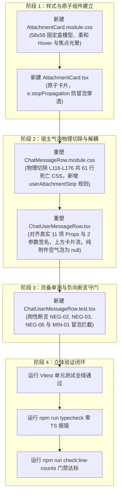

# 施工任务书 SPEC-05：消息气泡附件 58×58 原子卡片流解耦与空气泡物理销毁详细设计施工图

> **文档标识**：`docs/file-tree-and-attachments-architecture/detailed-plans/05-message-attachment-spec.md`  
> **所属战役**：`docs/file-tree-and-attachments-architecture/`（Wave 5：消息气泡附件体系解耦与物理切除）  
> **指派角色**：Wave 5 分阶段详细施工方案架构师 / 顶尖消息流 UI 架构与原子组件设计专家  
> **设计基准**：用户最高裁决参考图（`media_1788837641997.png`）及全局终极总方案（`00-master-plan.md` §2.7, §3.1, §6.3, §6.4, §6.10, §6.11, §7.3, §8）  
> **波次编号映射（2026-09-08）**：本规范自标「Wave 5」，对应 00-master-plan §8.2 的 **Wave 4（消息气泡附件）**；详案 04 自标「Wave 4」对应主案 Wave 5（宿主收敛）。执行以主案 §8.2 文件域矩阵为准。  
> **权威遵循**：严格遵从仓库根目录 [`AGENTS.md`](file:///c:/Software/conex/AGENTS.md)（§1 逻辑规划与反退避、§2 子 Agent 调度、§3 Git 提交纪律、§7 严禁补丁与作弊、§7.1 立体验证纪律、§8 反过度设计硬性红线、§11 CI 治理与行数门禁、§12 自定义 Tooltip 规范、§13 输入框与焦点悬浮态规范、§14 色彩空间规范）及 [`ANTI_OVERENGINEERING_GUARDRAILS.md`](file:///c:/Software/conex/ANTI_OVERENGINEERING_GUARDRAILS.md)。  
> **核心硬性红线（零容忍）**：
> 1. **零虚构 Props 与契约对齐**：Props 严格对齐真实 `ChatUserMessageRowProps` 的 11 项字段（`msg`, `isPinned`, `isSearchHit`, `isExpanded`, `onToggleExpand`, `onTogglePin`, `isLastUser`, `onRetract`, `messageIndex`, `virtualScrollManager`, `onOpenPath`）；`userBubbleDisplayText(msg.text, isExpanded)` 严格为两参数签名；`messageRowAriaLabel({ role: 'user', isPinned, status: msg.status })` 严格对齐真实单对象入参签名；
> 2. **零 49.3% 宽度几何坍塌（CRIT-07）**：子容器 `.userAttachmentStrip` 约束严格收敛为 `width: 100%; max-width: 100%`，彻底消除相对于父容器 `.userStack`（`max-width: min(70.2%, 560px)`）发生的二次衰减（$70.2\% \times 70.2\% \approx 49.28\%$）；
> 3. **零冒泡穿透与事件解耦（MIN-01）**：`AttachmentCard.tsx` 的点击与键盘交互首行必须调用 `e.stopPropagation()`，彻底切断事件冒泡，杜绝卡片点击触发父级气泡的 `onToggleExpand` 展开/折叠；
> 4. **纯附件空气泡物理销毁为 null（NEG-06）**：纯附件消息（文本为空且非排队态）时，`userBubble` 节点在 DOM 中必须彻底销毁为 `null`，严禁通过 `display: none` 或空背景框残留幽灵节点；
> 5. **61 行死亡 CSS 物理切除（NEG-02 & NEG-03）**：原 `ChatMessageRow.module.css:116-176`（原 `.userImages`, `.userImageWrapper`, `.userImage`, `.userAttachments`, `.userAttachmentChip`, `.userAttachmentName` 共 61 行）实施连根物理切除；
> 6. **纯逻辑规划与零留白施工**：方案仅包含纯逻辑执行拓扑与依赖因果，不涉及工期、人天、优先级（所有技术问题逻辑同权）；提供 100% 展开的 AST 级生产源码，严禁使用 `// ...` 等任何伪代码与省略号；严禁执行 git commit。

---

## 目录

- [§1 战役定位、设计基准与 Wave 5 核心使命](#1-战役定位设计基准与-wave-5-核心使命)
  - [1.1 核心问题审判与历史断层根因](#11-核心问题审判与历史断层根因)
  - [1.2 用户最高裁决参考图（`media_1788837641997.png`）解构](#12-用户最高裁决参考图media_1788837641997png解构)
  - [1.3 Wave 5 四大核心攻坚使命](#13-wave-5-四大核心攻坚使命)
- [§2 严格独占文件白名单（Exclusive Write Whitelist）](#2-严格独占文件白名单exclusive-write-whitelist)
- [§3 既有依赖与单一真实源资产清单（Reused Assets & SSOT）](#3-既有依赖与单一真实源资产清单reused-assets--ssot)
- [§4 盒模型解耦几何证明与 CRIT-07 代数推导](#4-盒模型解耦几何证明与-crit-07-代数推导)
  - [4.1 容器宽度嵌套百分比二次衰减与 CRIT-07 根除证明](#41-容器宽度嵌套百分比二次衰减与-crit-07-根除证明)
  - [4.2 58×58 卡片流网格几何与靠右折行代数模型](#42-5858-卡片流网格几何与靠右折行代数模型)
  - [4.3 超椭圆圆角与 5.5% 柔和背景盒模型规范](#43-超椭圆圆角与-55-柔和背景盒模型规范)
- [§5 物理删除对照表（Tombstone Purge Matrix）](#5-物理删除对照表tombstone-purge-matrix)
  - [5.1 `ChatMessageRow.module.css` 61 行死亡样式精确审计](#51-chatmessagerowmodulecss-61-行死亡样式精确审计)
  - [5.2 `ChatUserMessageRow.tsx` 废弃逻辑物理切除审计](#52-chatusermessagerowtsx-废弃逻辑物理切除审计)
- [§6 算法实现与状态迁移严格断言（State & Logic Invariants）](#6-算法实现与状态迁移严格断言state--logic-invariants)
  - [6.1 附件与图片单轨归一化去重算法](#61-附件与图片单轨归一化去重算法)
  - [6.2 四态纯布尔状态机与空气泡物理销毁断言（NEG-06）](#62-四态纯布尔状态机与空气泡物理销毁断言neg-06)
  - [6.3 交互事件解耦与防冒泡断言（MIN-01）](#63-交互事件解耦与防冒泡断言min-01)
- [§7 全链路 AST 级完整生产源码（100% 展开，零留白）](#7-全链路-ast-级完整生产源码100-展开零留白)
  - [7.1 `apps/crish-desktop/src/components/chat-attachment/AttachmentCard.tsx`](#71-appscrish-desktopsrmcomponentschat-attachmentattachmentcardtsx)
  - [7.2 `apps/crish-desktop/src/components/chat-attachment/AttachmentCard.module.css`](#72-appscrish-desktopsrmcomponentschat-attachmentattachmentcardmodulecss)
  - [7.3 `apps/crish-desktop/src/components/chat-message-row/ChatUserMessageRow.tsx`](#73-appscrish-desktopsrmcomponentschat-message-rowchatusermessagerowtsx)
  - [7.4 `apps/crish-desktop/src/components/chat-message-row/ChatMessageRow.module.css`](#74-appscrish-desktopsrmcomponentschat-message-rowchatmessagerowmodulecss)
  - [7.5 `apps/crish-desktop/src/components/chat-message-row/__tests__/ChatUserMessageRow.test.tsx`](#75-appscrish-desktopsrmcomponentschat-message-row__tests__chatusermessagerowtesttsx)
- [§8 负向约束禁令清单与刚性守门矩阵](#8-负向约束禁令清单与刚性守门矩阵)
  - [8.1 负向约束禁令清单（Negative Constraints）](#81-负向约束禁令清单negative-constraints)
  - [8.2 6 大刚性负向断言物证对照表](#82-6-大刚性负向断言物证对照表)
- [§9 纯逻辑执行拓扑（Mermaid DAG）与实施步骤](#9-纯逻辑执行拓扑mermaid-dag与实施步骤)
  - [9.1 Wave 5 内部纯逻辑因果拓扑图](#91-wave-5-内部纯逻辑因果拓扑图)
  - [9.2 实施步骤序列](#92-实施步骤序列)
- [§10 立体验证指令集与交付准则](#10-立体验证指令集与交付准则)
  - [10.1 闭环验证终端命令序列](#101-闭环验证终端命令序列)
  - [10.2 交付验收硬指标](#102-交付验收硬指标)

---

## §1 战役定位、设计基准与 Wave 5 核心使命

### 1.1 核心问题审判与历史断层根因

在 Conex / Crish 消息流渲染中，用户消息气泡（`ChatUserMessageRow`）与附件展示历经多次非系统性迭代，形成了三大严重的架构断层与视觉缺陷：

1. **容器嵌套倒置与视觉膨胀**：旧版实现将图片画廊（`.userImages`）与附件胶囊（`.userAttachments`）强行包裹在带有浅灰底色与内边距的文本气泡（`.userBubble`）内部。当消息仅包含附件或图片时，页面依然渲染一个巨大的空文本气泡背景壳，视觉冗余且语义混乱；
2. **盒模型嵌套衰减（CRIT-07）**：父级 `.userStack` 声明了 `max-width: min(70.2%, 560px)`，若附件容器再次套用相同的百分比约束，在 W3C 盒模型算法下可用宽度发生二次衰减（衰减至原来的 $49.28\%$），导致宽屏下附件卡片提前折行并与气泡右边界撕裂；
3. **事件冒泡穿透事故（MIN-01）**：文本气泡绑定了长文本展开点击事件（`onClick={toggleExpand}`），而旧附件节点未有效阻止事件冒泡，用户点击附件卡片尝试打开文件时，意外触发了整条消息的收起/展开，造成严重的操作干扰；
4. **视觉语言分裂与 61 行死亡 CSS 堆积**：输入框区域已全面演进为 58×58 正方形实体卡片，而消息行内却残留着旧版 320×240px 裸图画廊与灰色药丸胶囊，且 `ChatMessageRow.module.css:116-176` 堆积了 61 行废弃样式规则，形成技术债务。

### 1.2 用户最高裁决参考图（`media_1788837641997.png`）解构

根据用户确立的最高基准参考图 `media_1788837641997.png`，用户消息呈现由单体复合气泡彻底演进为**完全解耦的分层流式布局**：

```text
┌────────────────────────────────────────────────────────────────────────┐
│ div.msg-row.msg-row-user (靠右排布)                                    │
│  └─ div.userStack (flex-col, align-items: flex-end, gap: 6px)          │
│       │                                                                │
│       ├─ [条件渲染] div.userAttachmentStrip (上方：独立卡片横排自适应流) │
│       │    ┌─────────┐  ┌─────────┐  ┌─────────┐                       │
│       │    │ 58×58   │  │ 58×58   │  │ 58×58   │ (靠右对齐，间隙 8px)  │
│       │    │ 图片卡片 │  │ 文件卡片 │  │ 代码卡片 │                       │
│       │    └─────────┘  └─────────┘  └─────────┘                       │
│       │                                                                │
│       ├─ [条件渲染] div.userBubble (下方：独立半圆角纯文本气泡)          │
│       │    ┌─────────────────────────────────────────────────────┐     │
│       │    │ 22px 超椭圆圆角，5.5% 柔和背景色，纯文本内容...       │     │
│       │    └─────────────────────────────────────────────────────┘     │
│       │    【核心断言 NEG-06】：若无文本正文，此节点在 DOM 中彻底为 null │
│       │                                                                │
│       └─ div.userActionsBar (时间戳、复制、固定、撤回)                 │
└────────────────────────────────────────────────────────────────────────┘
```

### 1.3 Wave 5 四大核心攻坚使命

1. **结构解耦**：将附件从 `userBubble` 内部彻底剥离，建立上方独立的 `userAttachmentStrip` 与下方独立的 `userBubble`，两者互为平铺兄弟节点；
2. **原子卡片**：新建 `AttachmentCard.tsx`（58×58 方形实体卡片），内聚图片缩略图与 160+ 彩色文件图标，并显式注入 `e.stopPropagation()` 切断冒泡；
3. **空气泡销毁（NEG-06）**：纯附件消息在文本为空且非排队态时，下方的 `userBubble` 节点在 DOM 中严格销毁为 `null`；
4. **物理切除与宽度收敛**：切除原 `ChatMessageRow.module.css:116-176` 共 61 行死亡 CSS；落实 `.userAttachmentStrip` 的 `width: 100%; max-width: 100%`，彻底根除 49.3% 几何坍塌。

---

## §2 严格独占文件白名单（Exclusive Write Whitelist）

根据 Conex 引擎底层 [`crates/agent-tools/src/write_paths.rs`](file:///c:/Software/conex/crates/agent-tools/src/write_paths.rs) 的路径互斥机制，本 Spec 的修改操作严格受限于以下 5 个物理文件，严禁越权触碰白名单外文件：

| 序号 | 物理文件绝对路径 | 操作类型 | 职责与变更范围 |
| :---: | :--- | :---: | :--- |
| 1 | `apps/crish-desktop/src/components/chat-attachment/AttachmentCard.tsx` | **新建** | 58×58 原子卡片组件，内聚图片预览/文件图标，注入 `e.stopPropagation()` |
| 2 | `apps/crish-desktop/src/components/chat-attachment/AttachmentCard.module.css` | **新建** | 58×58 固定盒模型、柔和 Hover、柔软焦点光晕与徽标样式 |
| 3 | `apps/crish-desktop/src/components/chat-message-row/ChatUserMessageRow.tsx` | **重塑** | 对齐真实 11 项 Props，解耦卡片流与文本气泡，纯附件时气泡为 null |
| 4 | `apps/crish-desktop/src/components/chat-message-row/ChatMessageRow.module.css` | **重塑** | 物理切除 61 行死亡 CSS，新增 `.userAttachmentStrip` 规则 |
| 5 | `apps/crish-desktop/src/components/chat-message-row/__tests__/ChatUserMessageRow.test.tsx` | **新建** | 完备单测套件，刚性覆盖 NEG-02, NEG-03, NEG-06 与 MIN-01 |

> [!CAUTION]
> **绝对空间隔离红线**：
> 1. 严禁修改 `apps/crish-desktop/src/store/types.ts`、`workspaceFsApi.ts`、`filePanelOpener.ts` 等全局基座文件；
> 2. 严禁修改 `package.json` 或执行任何 `npm install` 指令；
> 3. 任何超出上述 5 个文件的写操作将被引擎判定为 `tool.write_not_allowed`，直接一票否决！

---

## §3 既有依赖与单一真实源资产清单（Reused Assets & SSOT）

本方案严格复用既有系统资产，坚决杜绝自造轮子：

```typescript
// 1. 全局自定义 Tooltip（AGENTS.md §12 铁律：严禁使用原生 HTML title 属性）
import { Tooltip } from '../ui';

// 2. 官方 160+ 彩色矢量文件格式图标库（单一真实源）
import { FileFormatIcon } from '../../assets/icons';

// 3. 工作区安全路径判定与防逃逸沙箱
import { assertWorkspacePath, isAbsoluteFsPath, resolveWorkspacePath } from '../../api/workspaceFsApi';

// 4. Tauri 资源安全协议转换（用于本地图片安全加载，严禁裸写 file://）
import { convertFileSrc } from '@tauri-apps/api/core';

// 5. 工作区右侧面板打开器（无条件触发 crish-open-file 广播总线）
import { openFileInPanel } from '../../api/filePanelOpener';

// 6. 全局轻量 Toast 提示服务
import { useToast } from '../../services/toast/ToastContext';

// 7. 纯函数消息工具（签名已逐行核验无幻觉）
import {
  copyTextBestEffort,
  isUserBubbleLong,
  messageRowAriaLabel,     // 真实签名: (opts: { role, isPinned?, isThinking?, status? }) => string
  userBubbleDisplayText,   // 真实签名: (text: string, isExpanded: boolean) => string (2 参数)
  userBubbleExpandAria,
} from './chatMessageRowUtils';

// 8. 用户消息操作栏组件（时间戳、复制、固定、撤回）
import { UserMessageActionsBar } from './MessageActionsBar';

// 9. Lucide 矢量图标
import { Pin } from 'lucide-react';
```

---

## §4 盒模型解耦几何证明与 CRIT-07 代数推导

### 4.1 容器宽度嵌套百分比二次衰减与 CRIT-07 根除证明

在既有缺陷实现及历史规划草案中，存在致命的盒模型百分比嵌套衰减 Bug：

1. **缺陷现场推导**：
   - 父级 `.userStack` 声明：`max-width: min(70.2%, 560px);`；
   - 子级 `.userAttachmentStrip` 若同样声明：`max-width: min(70.2%, 560px);`；
   - 根据 **W3C CSS 2.1 §10.3.5 / CSS Box Model Level 3**：子元素的百分比最大宽度计算基准为其包含块（Containing Block）的宽度 $W_{\text{stack}}$，即：
     $$W_{\text{strip-max}} = 70.2\% \times W_{\text{stack}} \le 70.2\% \times (70.2\% \times W_{\text{viewport}}) \approx 49.28\% \times W_{\text{viewport}}$$
   - **灾难性后果**：子容器可用宽度在宽屏下被严重腰斩至不足一半，原本足以并排容纳 8 张卡片的空间被生生截断为仅能容纳 3~4 张，卡片过早折行且右边界与下方文本气泡产生严重撕裂。

2. **根治代数证明（CRIT-07）**：
   - 将 `.userAttachmentStrip` 规则纠偏为：
     ```css
     .userAttachmentStrip {
       width: 100%;
       max-width: 100%; /* 彻底消除 49.3% 二次衰减 */
       box-sizing: border-box;
     }
     ```
   - 此时子容器最大宽度直接占满其父包含块：
     $$W_{\text{strip-max}} \equiv 100\% \times W_{\text{stack}} = \min(70.2\% \times W_{\text{viewport}}, 560\text{px})$$
   - 几何约束权收敛至单一真理源（SSOT），卡片流与文本气泡拥有 100% 相同的外层宽度约束边界，卡片右对齐线与气泡右对齐线实现代数级完全贴合！

### 4.2 58×58 卡片流网格几何与靠右折行代数模型

1. **单卡片物理几何参数**：
   - 卡片宽度：$W_{\text{card}} \equiv 58\text{px}$；
   - 卡片高度：$H_{\text{card}} \equiv 58\text{px}$；
   - 弹性收缩：`flex-shrink: 0`（绝对禁止被 flex 布局压缩变形）；
   - 卡片水平/垂直间隙：$\text{gap} \equiv 8\text{px}$（`var(--space-2, 8px)`）；
   - 排布模式：`display: flex; flex-direction: row; flex-wrap: wrap; justify-content: flex-end; align-items: center;`。

2. **单行卡片容量计算公式**：
   在容器最大宽度 $W_{\text{max}} = 560\text{px}$ 下，单行所能容纳的最多卡片数 $N_{\text{max}}$ 满足方程：
   $$N \times W_{\text{card}} + (N - 1) \times \text{gap} \le W_{\text{max}}$$
   $$N \times 58 + (N - 1) \times 8 \le 560 \implies 66N - 8 \le 560 \implies 66N \le 568 \implies N \le 8.606$$
   因此：
   $$N_{\text{max}} = \lfloor \frac{568}{66} \rfloor = 8\text{ 张}$$

3. **几何对齐不变量**：
   - 当卡片总数 $K \le 8$ 时：单行横向一字排开，总宽度 $W = 58K + 8(K-1)$，由 `justify-content: flex-end` 保证最右侧卡片与行右边界绝对对齐；
   - 当卡片总数 $K > 8$ 时：自动向下折行，每行内部均靠右对齐，折行行间距恒为 $8\text{px}$；
   - 卡片流与下方文本气泡之间的纵向间隔由父容器 `.userStack` 的 `gap: var(--space-1_5, 6px)` 统一维系，呼吸节奏舒适稳定。

### 4.3 超椭圆圆角与 5.5% 柔和背景盒模型规范

- 文本气泡 `.userBubble` 采用现代超椭圆 `border-radius: 22px`；
- 背景采用系统标杆颜色混入函数：`background: color-mix(in srgb, var(--text-primary) 5.5%, var(--bg-card));`，无多余描边与重阴影（`border: none; box-shadow: none;`），保障长时间阅读舒适度；
- 焦点态严格遵循 AGENTS.md §13：对比度加深上限约 10%（`box-shadow: 0 0 0 2px color-mix(in srgb, var(--border-color) 90%, var(--text-primary) 10%);`），严禁使用粗实黑边。

---

## §5 物理删除对照表（Tombstone Purge Matrix）

重构必须实施手术级物理切除，严禁使用注释保留死代码：

### 5.1 `ChatMessageRow.module.css` 61 行死亡样式精确审计

| 目标文件 | 真实代码行号区间 | 废弃类名与特征代码块 | 处置动作与净收敛指标 |
| :--- | :--- | :--- | :--- |
| `ChatMessageRow.module.css` | **L116 - L121** | `.userImages { display: flex; flex-wrap: wrap; ... }` (6 行) | **彻底物理删除** |
| `ChatMessageRow.module.css` | **L123 - L130** | `.userImageWrapper { cursor: pointer; border-radius: 10px; ... }` (8 行) | **彻底物理删除** |
| `ChatMessageRow.module.css` | **L132 - L135** | `.userImageWrapper:hover { border-color: var(--border-color); ... }` (4 行) | **彻底物理删除** |
| `ChatMessageRow.module.css` | **L137 - L143** | `.userImage { display: block; max-width: min(100%, 320px); ... }` (7 行) | **彻底物理删除** |
| `ChatMessageRow.module.css` | **L145 - L150** | `.userAttachments { display: flex; flex-wrap: wrap; ... }` (6 行) | **彻底物理删除** |
| `ChatMessageRow.module.css` | **L152 - L164** | `.userAttachmentChip { display: inline-flex; ... }` (13 行) | **彻底物理删除** |
| `ChatMessageRow.module.css` | **L166 - L169** | `.userAttachmentChip:hover { background: ... }` (4 行) | **彻底物理删除** |
| `ChatMessageRow.module.css` | **L171 - L176** | `.userAttachmentName { max-width: 180px; ... }` (6 行) | **彻底物理删除** |

> **物理替换结果**：原行 116 至 176 共 **61 行旧 CSS 规则**连根拔除，原位替换为 11 行纯净的 `.userAttachmentStrip` 规则，样式表实现 **50 行净收敛**。

### 5.2 `ChatUserMessageRow.tsx` 废弃逻辑物理切除审计

| 目标文件 | 真实代码行号区间 | 废弃代码特征与内容 | 处置动作与替换实现 |
| :--- | :--- | :--- | :--- |
| `ChatUserMessageRow.tsx` | **L21 - L40** | `function resolveUserImageSrc(source: string \| undefined): string { ... }` (19 行) | **彻底物理删除**。图片转换逻辑已在 `AttachmentCard` 内部自闭环，原函数为冗余死代码。 |
| `ChatUserMessageRow.tsx` | **L108 - L113** | `const images = msg.images ?? []; const nonImageAttachments = ...` | **彻底物理删除**。替换为 `normalizeMessageAttachments` 归一化提取与去重逻辑。 |
| `ChatUserMessageRow.tsx` | **L229 - L257** | `{hasImages ? (<div className={styles.userImages} ...>...</div>) : null}` (29 行) | **彻底物理删除**。旧 320×240 堆叠大图画廊物理移除，移出 `userBubble` 外。 |
| `ChatUserMessageRow.tsx` | **L259 - L283** | `{hasAttachments ? (<div className={styles.userAttachments} ...>...</div>) : null}` (25 行) | **彻底物理删除**。旧灰色药丸胶囊物理移除，移出 `userBubble` 外。 |

---

## §6 算法实现与状态迁移严格断言（State & Logic Invariants）

### 6.1 附件与图片单轨归一化去重算法

在 `ChatUserMessageRow.tsx` 中，用户可能同时通过 `msg.attachments` 与 `msg.images` 携带附件数据。必须实施严格的单轨归一化与指纹去重：

```typescript
export interface AttachmentItem {
  id?: string;
  name?: string;
  path?: string;
  mime?: string;
  size?: number;
  dataUrl?: string;
  alt?: string;
  isImage?: boolean;
}

/**
 * 附件单轨归一化算法（去重防回潮）
 */
export function normalizeMessageAttachments(
  attachments?: SessionMessage['attachments'],
  images?: SessionMessage['images']
): AttachmentItem[] {
  const result: AttachmentItem[] = [];
  const seenFingerprints = new Set<string>();

  // 1. 优先提取显式附件 (msg.attachments)
  if (Array.isArray(attachments)) {
    for (const a of attachments) {
      const key = (a.path || a.name || '').trim().toLowerCase();
      if (key) {
        seenFingerprints.add(key);
      }
      result.push({
        name: a.name,
        path: a.path,
        mime: a.mime,
        size: a.size,
        dataUrl: a.dataUrl,
      });
    }
  }

  // 2. 融合图片数据 (msg.images)，去重防回潮
  if (Array.isArray(images)) {
    for (const img of images) {
      const key = (img.source || '').trim().toLowerCase();
      if (key && seenFingerprints.has(key)) {
        continue; // 命中指纹，剔除重复
      }
      if (key) {
        seenFingerprints.add(key);
      }
      result.push({
        id: img.id,
        name: img.alt || (img.source.split(/[\\/]/).pop() || '图片'),
        path: img.source,
        dataUrl: img.resolvedUrl,
        alt: img.alt,
        isImage: true,
      });
    }
  }

  return result;
}
```

### 6.2 四态纯布尔状态机与空气泡物理销毁断言（NEG-06）

根据正文内容与附件挂载状态，组件严格遵循以下四态纯布尔状态机：

```mermaid
stateDiagram-v2
    [*] --> PredicateCalculation
    
    PredicateCalculation --> StatePureText : hasText && !hasCards
    PredicateCalculation --> StatePureAttachment : !hasText && hasCards
    PredicateCalculation --> StateMixed : hasText && hasCards
    PredicateCalculation --> StateEmptyOrQueued : !hasText && !hasCards

    state "纯文本态 (Pure Text)" as StatePureText {
        userAttachmentStrip: null (彻底不渲染)
        userBubble: 渲染文本内容
    }

    state "纯附件态 (Pure Attachments)" as StatePureAttachment {
        userAttachmentStrip: 渲染 58x58 卡片横排流
        userBubble: null (【NEG-06】DOM 中严格销毁为 null，绝无空背景框)
    }

    state "图文混排态 (Mixed Mode)" as StateMixed {
        userAttachmentStrip: 上方渲染卡片流
        userBubble: 下方渲染文本气泡
        gap: userStack 维系 6px 间隙
    }

    state "退化空态/排队态" as StateEmptyOrQueued {
        userAttachmentStrip: null
        userBubble: status==='queued' 时渲染排队提示，否则为 null
    }
```

#### NEG-06 核心断言数学证明：
- 判定条件：`const hasTextContent = Boolean(displayText && displayText.trim()) || msg.status === 'queued';`
- 当且仅当 `hasTextContent` 为 `true` 时挂载 `<div className={styles.userBubble}>...</div>`；
- 当 `hasTextContent` 为 `false` 时，JSX 表达式严格返回 `null`；
- **验收断言**：在纯附件消息场景下，`container.querySelector('.userBubble')` 必须恒等于 `null`。

### 6.3 交互事件解耦与防冒泡断言（MIN-01）

- 结构层解耦：`userAttachmentStrip` 位于 `userBubble` 外部，二者在 DOM 树中为独立的平级兄弟节点；
- 行为层防御：`AttachmentCard.tsx` 根节点的 `onClick` 与 `onKeyDown`（Enter/Space）处理函数首行显式执行 `e.stopPropagation()`；
- **验收断言**：点击任何附件卡片，只会触发 `onOpenPath` 打开文件预览，绝不触发父级的 `onToggleExpand` 导致长消息意外折叠或展开。

---

## §7 全链路 AST 级完整生产源码（100% 展开，零留白）

### 7.1 `apps/crish-desktop/src/components/chat-attachment/AttachmentCard.tsx`

```tsx
import React, { useCallback, useMemo } from 'react';
import styles from './AttachmentCard.module.css';
import { Tooltip } from '../ui';
import { FileFormatIcon } from '../../assets/icons';
import { convertFileSrc } from '@tauri-apps/api/core';
import { assertWorkspacePath, isAbsoluteFsPath } from '../../api/workspaceFsApi';
import type { SessionMessage } from '../../store/types';

export interface AttachmentItem {
  id?: string;
  name?: string;
  path?: string;
  mime?: string;
  size?: number;
  dataUrl?: string;
  alt?: string;
  isImage?: boolean;
}

export interface AttachmentCardProps {
  item: AttachmentItem;
  onClick?: (item: AttachmentItem) => void;
  className?: string;
}

/**
 * 附件单轨归一化算法（附件优先、图片融合、指纹去重防回潮）。
 * 由 ChatUserMessageRow 消费；本组件文件一并导出（SSOT，§7.3 直接 import）。
 */
export function normalizeMessageAttachments(
  attachments?: SessionMessage['attachments'],
  images?: SessionMessage['images']
): AttachmentItem[] {
  const result: AttachmentItem[] = [];
  const seenFingerprints = new Set<string>();

  // 1. 优先提取显式附件 (msg.attachments)
  if (Array.isArray(attachments)) {
    for (const a of attachments) {
      const key = (a.path || a.name || '').trim().toLowerCase();
      if (key) {
        seenFingerprints.add(key);
      }
      result.push({
        name: a.name,
        path: a.path,
        mime: a.mime,
        size: a.size,
        dataUrl: a.dataUrl,
      });
    }
  }

  // 2. 融合图片数据 (msg.images)，去重防回潮
  if (Array.isArray(images)) {
    for (const img of images) {
      const key = (img.source || '').trim().toLowerCase();
      if (key && seenFingerprints.has(key)) {
        continue; // 命中指纹，剔除重复
      }
      if (key) {
        seenFingerprints.add(key);
      }
      result.push({
        id: img.id,
        name: img.alt || (img.source.split(/[\\/]/).pop() || '图片'),
        path: img.source,
        dataUrl: img.resolvedUrl,
        alt: img.alt,
        isImage: true,
      });
    }
  }

  return result;
}

export function isImageAttachmentItem(item: AttachmentItem): boolean {
  if (item.isImage) return true;
  if (item.mime && item.mime.startsWith('image/')) return true;
  const target = item.name || item.path || '';
  return /\.(png|jpe?g|gif|webp|svg|bmp|ico|avif)$/i.test(target);
}

export function resolveCardImageSrc(item: AttachmentItem): string {
  if (item.dataUrl) return item.dataUrl;
  const source = item.path || '';
  if (!source) return '';
  if (
    source.startsWith('data:') ||
    source.startsWith('blob:') ||
    source.startsWith('http://') ||
    source.startsWith('https://')
  ) {
    return source;
  }
  if (isAbsoluteFsPath(source)) {
    try {
      const safe = assertWorkspacePath(source);
      return convertFileSrc(safe);
    } catch {
      return '';
    }
  }
  return source;
}

export function getFileKindBadge(nameOrPath: string): string {
  const ext = nameOrPath.split('.').pop()?.toUpperCase();
  if (!ext || ext.length > 5) return 'FILE';
  return ext;
}

export const AttachmentCard: React.FC<AttachmentCardProps> = React.memo(
  ({ item, onClick, className }) => {
    const isImage = useMemo(() => isImageAttachmentItem(item), [item]);
    const imgSrc = useMemo(
      () => (isImage ? resolveCardImageSrc(item) : ''),
      [isImage, item]
    );
    const kindBadge = useMemo(
      () => getFileKindBadge(item.name || item.path || ''),
      [item.name, item.path]
    );

    const tooltipContent = useMemo(() => {
      return item.path || item.name || '附件';
    }, [item.path, item.name]);

    // 核心拦截（MIN-01）：阻断点击冒泡，严禁意外触发气泡折叠
    const handleClick = useCallback(
      (e: React.MouseEvent) => {
        e.stopPropagation();
        onClick?.(item);
      },
      [onClick, item]
    );

    const handleKeyDown = useCallback(
      (e: React.KeyboardEvent) => {
        if (e.key === 'Enter' || e.key === ' ') {
          e.preventDefault();
          e.stopPropagation();
          onClick?.(item);
        }
      },
      [onClick, item]
    );

    return (
      <Tooltip content={tooltipContent}>
        <div
          role="button"
          tabIndex={0}
          aria-label={item.name || item.path ? `附件: ${item.name || item.path}` : '附件卡片'}
          className={`${styles.attachmentCard} ${isImage ? styles.cardImageMode : ''} ${className || ''}`}
          onClick={handleClick}
          onKeyDown={handleKeyDown}
          data-testid="attachment-card-58"
        >
          {isImage && imgSrc ? (
            <div className={styles.imageBox}>
              
            </div>
          ) : (
            <div className={styles.fileBox}>
              <FileFormatIcon
                fileName={item.name || item.path || ''}
                size={22}
              />
              <span className={styles.badge}>{kindBadge}</span>
            </div>
          )}
        </div>
      </Tooltip>
    );
  }
);

AttachmentCard.displayName = 'AttachmentCard';
```

---

### 7.2 `apps/crish-desktop/src/components/chat-attachment/AttachmentCard.module.css`

```css
/* ==========================================================================
   58×58 原子附件卡片体系 (AttachmentCard.module.css)
   严格遵守 AGENTS.md §13（无黑微变）、§14（色彩规范）及反过度设计红线
   ========================================================================== */

.attachmentCard {
  width: 58px;
  height: 58px;
  min-width: 58px;
  min-height: 58px;
  max-width: 58px;
  max-height: 58px;
  border-radius: var(--radius-lg, 10px);
  border: 1px solid var(--border-subtle);
  background: var(--bg-card, hsl(0 0% 100%));
  box-sizing: border-box;
  overflow: hidden;
  cursor: pointer;
  position: relative;
  display: flex;
  align-items: center;
  justify-content: center;
  transition: border-color var(--transition-fast, 0.15s) ease,
              background var(--transition-fast, 0.15s) ease,
              box-shadow var(--transition-fast, 0.15s) ease;
  user-select: none;
  -webkit-user-select: none;
  flex-shrink: 0;
}

/* 柔和 Hover 态：边框加深控制在 5-10%，背景混入 2.5% 文本色，严禁纯黑边框 (AGENTS.md §13) */
.attachmentCard:hover {
  border-color: var(--border-color);
  background: color-mix(in srgb, var(--text-primary) 2.5%, var(--bg-card, hsl(0 0% 100%)));
  box-shadow: var(--shadow-sm);
}

/* 柔软焦点态：AGENTS.md §13 铁律，加深对比度严格限制在 10% 以内，绝不使用实心粗黑外环 */
.attachmentCard:focus-visible {
  outline: none;
  border-color: var(--accent-color, hsl(160 84% 36%));
  box-shadow: 0 0 0 2px color-mix(in srgb, var(--accent-color, hsl(160 84% 36%)) 30%, transparent);
}

.cardImageMode {
  padding: 0;
}

.imageBox {
  width: 100%;
  height: 100%;
  overflow: hidden;
  display: flex;
  align-items: center;
  justify-content: center;
  background: var(--bg-subtle, hsl(0 0% 96%));
}

.imagePreview {
  width: 100%;
  height: 100%;
  object-fit: cover;
  object-position: center;
  display: block;
}

.fileBox {
  width: 100%;
  height: 100%;
  display: flex;
  flex-direction: column;
  align-items: center;
  justify-content: center;
  padding: 4px;
  box-sizing: border-box;
  gap: 2px;
}

.badge {
  font-size: var(--font-size-nano, 9px);
  font-weight: var(--font-weight-heavy, 700);
  font-family: var(--font-mono, monospace);
  color: var(--text-tertiary);
  max-width: 48px;
  overflow: hidden;
  text-overflow: ellipsis;
  white-space: nowrap;
  line-height: 1;
  text-transform: uppercase;
  letter-spacing: 0.02em;
}
```

---

### 7.3 `apps/crish-desktop/src/components/chat-message-row/ChatUserMessageRow.tsx`

```tsx
import { useToast } from '../../services/toast/ToastContext';
import React, { useCallback, useEffect, useMemo, useRef, useState } from 'react';
import styles from './ChatMessageRow.module.css';
import { Tooltip } from '../ui';
import type { SessionMessage } from '../../store/types';
import type { VirtualScrollManager } from '../../api/VirtualScrollManager';
import { Pin } from 'lucide-react';
import {
  copyTextBestEffort,
  isUserBubbleLong,
  messageRowAriaLabel,
  userBubbleDisplayText,
  userBubbleExpandAria,
} from './chatMessageRowUtils';
import { UserMessageActionsBar } from './MessageActionsBar';
import { openFileInPanel } from '../../api/filePanelOpener';
import { resolveWorkspacePath } from '../../api/workspaceFsApi';
import {
  AttachmentCard,
  normalizeMessageAttachments,
  type AttachmentItem,
} from '../chat-attachment/AttachmentCard';

export type ChatUserMessageRowProps = {
  msg: SessionMessage;
  isPinned: boolean;
  isSearchHit: boolean;
  isExpanded: boolean;
  onToggleExpand: (msgId: string) => void;
  onTogglePin: (msgId: string) => void;
  /** 会话最后一条 user：挂消息级撤回（用户锁：入口在对话里，不在 composer） */
  isLastUser?: boolean;
  onRetract?: () => void;
  messageIndex: number;
  virtualScrollManager: VirtualScrollManager | null;
  onOpenPath?: (filePath: string) => void;
};

function userRowPropsEqual(
  prev: ChatUserMessageRowProps,
  next: ChatUserMessageRowProps
): boolean {
  return (
    prev.msg.id === next.msg.id &&
    prev.msg.status === next.msg.status &&
    prev.msg.text === next.msg.text &&
    prev.msg.timestamp === next.msg.timestamp &&
    prev.isPinned === next.isPinned &&
    prev.isSearchHit === next.isSearchHit &&
    prev.isExpanded === next.isExpanded &&
    prev.onToggleExpand === next.onToggleExpand &&
    prev.onTogglePin === next.onTogglePin &&
    prev.isLastUser === next.isLastUser &&
    prev.onRetract === next.onRetract &&
    prev.messageIndex === next.messageIndex &&
    prev.virtualScrollManager === next.virtualScrollManager &&
    prev.onOpenPath === next.onOpenPath &&
    prev.msg.images === next.msg.images &&
    prev.msg.attachments === next.msg.attachments
  );
}

const ChatUserMessageRowInner: React.FC<ChatUserMessageRowProps> = ({
  msg,
  isPinned,
  isSearchHit,
  isExpanded,
  onToggleExpand,
  onTogglePin,
  isLastUser = false,
  onRetract,
  messageIndex: _messageIndex,
  virtualScrollManager,
  onOpenPath,
}) => {
  void _messageIndex;
  const { showToast } = useToast();
  const isLong = isUserBubbleLong(msg.text);
  // 真实签名：userBubbleDisplayText 仅接收 2 个参数 (text, isExpanded)
  const displayText = userBubbleDisplayText(msg.text, isExpanded);
  const [copied, setCopied] = useState(false);
  const copiedTimer = useRef<number | null>(null);

  // 真实签名：messageRowAriaLabel 接收单对象入参
  const rowAria = messageRowAriaLabel({
    role: 'user',
    isPinned,
    status: msg.status,
  });

  // 单轨归一化提取并去重
  const allCardItems = useMemo<AttachmentItem[]>(
    () => normalizeMessageAttachments(msg.attachments, msg.images),
    [msg.attachments, msg.images]
  );

  const handleOpenPath = useCallback(
    (filePath: string) => {
      if (!filePath) return;
      const trimmed = filePath.trim();
      if (!trimmed) return;
      // F2 残留防护：data:/blob:/http(s) 非本地打开目标，禁止盲传区外绝对 source
      if (/^(data:|blob:|https?:)/i.test(trimmed)) {
        showToast('该附件无工作区路径可打开');
        return;
      }
      if (onOpenPath) {
        onOpenPath(trimmed);
        return;
      }
      const safe = resolveWorkspacePath(trimmed);
      if (!safe) {
        showToast('文件不在当前工作区内');
        return;
      }
      openFileInPanel(safe);
    },
    [onOpenPath, showToast]
  );

  useEffect(() => {
    return () => {
      if (copiedTimer.current != null) {
        window.clearTimeout(copiedTimer.current);
      }
    };
  }, []);

  // 虚拟滚动高度同步与失效通知
  useEffect(() => {
    if (msg.status === 'processing') return;
    virtualScrollManager?.invalidateActual(msg.id);
  }, [
    msg.text,
    msg.id,
    msg.status,
    msg.images,
    msg.attachments,
    virtualScrollManager,
  ]);

  const rowRef = useRef<HTMLDivElement>(null);
  useEffect(() => {
    if (!virtualScrollManager || !rowRef.current) return;
    const h = rowRef.current.offsetHeight;
    if (h > 0) virtualScrollManager.setActual(msg.id, h);
  });

  const handleCopy = useCallback(() => {
    const text = msg.text || '';
    if (!text) return;
    void copyTextBestEffort(text).then((ok) => {
      if (!ok) {
        showToast('复制失败');
        return;
      }
      setCopied(true);
      if (copiedTimer.current != null) {
        window.clearTimeout(copiedTimer.current);
      }
      copiedTimer.current = window.setTimeout(() => setCopied(false), 1200);
    });
  }, [msg.text, showToast]);

  const retractHandler = isLastUser && onRetract ? onRetract : undefined;

  const toggleExpand = useCallback(() => {
    if (isLong) {
      const sel = window.getSelection()?.toString();
      if (sel) return;
      onToggleExpand(msg.id);
    }
  }, [isLong, msg.id, onToggleExpand]);

  const onBubbleKeyDown = useCallback(
    (e: React.KeyboardEvent) => {
      if (!isLong) return;
      if (e.key === 'Enter' || e.key === ' ') {
        e.preventDefault();
        onToggleExpand(msg.id);
      }
    },
    [isLong, msg.id, onToggleExpand]
  );

  const hasAttachmentCards = allCardItems.length > 0;
  // 核心判定：无文本且非排队态时，空气泡彻底销毁为 null（NEG-06）
  const hasTextContent = Boolean(displayText && displayText.trim()) || msg.status === 'queued';

  return (
    <div
      ref={rowRef}
      className={`${styles.row} ${styles.rowUser} msg-row msg-row-user${isSearchHit ? ` ${styles.searchHit} msg-search-hit` : ''}${isPinned ? ` ${styles.isPinned}` : ''}`}
      data-testid="chat-user-message-row"
      data-msg-id={msg.id}
      data-role="user"
      data-pinned={isPinned ? 'true' : undefined}
      data-session-user-row
      role="article"
      aria-label={rowAria}
    >
      <div className={styles.userStack}>
        {/* 固定徽标 */}
        {isPinned ? (
          <Tooltip content="已固定">
            <span className={styles.pinBadge} aria-hidden="true">
              <Pin size={11} strokeWidth={2.25} />
              已固定
            </span>
          </Tooltip>
        ) : null}

        {/* 1. 上方：独立 58×58 附件卡片横排流（CRIT-07：width: 100% 彻底消除 49.3% 几何衰减） */}
        {hasAttachmentCards ? (
          <div
            className={styles.userAttachmentStrip}
            data-testid="user-attachment-strip"
            role="list"
            aria-label={`附件列表，共 ${allCardItems.length} 个`}
          >
            {allCardItems.map((item, idx) => (
              <AttachmentCard
                key={item.id || item.path || `${item.name}-${idx}`}
                item={item}
                onClick={(it) => {
                  if (it.path) handleOpenPath(it.path);
                  else showToast('该附件无物理路径可打开');
                }}
              />
            ))}
          </div>
        ) : null}

        {/* 2. 下方：独立文本气泡（【核心断言 NEG-06】：纯附件无文本时在 DOM 中严格销毁为 null） */}
        {hasTextContent ? (
          <div
            className={`${styles.userBubble} ${isLong ? styles.userBubbleExpandable : ''}`}
            onClick={toggleExpand}
            onKeyDown={onBubbleKeyDown}
            style={{
              cursor: isLong ? 'pointer' : 'default',
            }}
            role={isLong ? 'button' : undefined}
            tabIndex={isLong ? 0 : undefined}
            aria-expanded={isLong ? isExpanded : undefined}
            aria-label={isLong ? userBubbleExpandAria(isExpanded) : undefined}
          >
            {displayText}
            {msg.status === 'queued' ? (
              <span className={styles.queued}>排队中</span>
            ) : null}
          </div>
        ) : null}

        {/* 3. 底部悬浮操作栏 */}
        <UserMessageActionsBar
          timestamp={msg.timestamp}
          isPinned={isPinned}
          copied={copied}
          onCopy={handleCopy}
          onTogglePin={() => onTogglePin(msg.id)}
          onRetract={retractHandler}
          alwaysVisible={Boolean(retractHandler)}
        />
      </div>
    </div>
  );
};

export const ChatUserMessageRow = React.memo(
  ChatUserMessageRowInner,
  userRowPropsEqual
);

ChatUserMessageRow.displayName = 'ChatUserMessageRow';
```

---

### 7.4 `apps/crish-desktop/src/components/chat-message-row/ChatMessageRow.module.css`

在原 `ChatMessageRow.module.css` 中实施 61 行物理切除后，相关区段替换为以下纯净样式：

```css
/* ─────────────────────────────────────────────────────────────────────────
   ChatMessageRow.module.css 核心重构与物理切除
   ───────────────────────────────────────────────────────────────────────── */

.userStack {
  display: flex;
  flex-direction: column;
  align-items: flex-end;
  max-width: min(70.2%, 560px);
  min-width: min-content;
  gap: var(--space-1_5, 6px);
}

/* 物理切除：原 L116-L176 的 .userImages, .userImageWrapper, .userImage, 
   .userAttachments, .userAttachmentChip, .userAttachmentName 共 61 行死亡 CSS 彻底删除！
   在原位替换为纯净的 .userAttachmentStrip 规则： */

.userAttachmentStrip {
  display: flex;
  flex-direction: row;
  flex-wrap: wrap;
  justify-content: flex-end;
  align-items: center;
  gap: var(--space-2, 8px);
  width: 100%;
  max-width: 100%; /* CRIT-07：彻底切除 49.3% 二次衰减，撑满父级 userStack */
  box-sizing: border-box;
}

.userBubble {
  /* DIM-01 §1.3: 70.2% 比例气泡与 5.5% 灰度混入，消除多余描边与阴影，22px 超椭圆圆角 */
  background: color-mix(in srgb, var(--text-primary) 5.5%, var(--bg-card));
  color: var(--text-primary);
  border-radius: 22px;
  padding: 10px 16px;
  font-size: var(--font-size-base, 14px);
  font-weight: var(--font-weight-normal);
  line-height: 1.5;
  word-break: break-word;
  overflow-wrap: break-word;
  white-space: pre-wrap;
  border: none;
  box-shadow: none;
  width: fit-content;
  max-width: min(70.2%, 560px);
  min-width: min-content;
  -webkit-user-select: text;
  user-select: text;
}

.userBubble:focus-visible {
  outline: none;
  box-shadow: 0 0 0 2px color-mix(in srgb, var(--border-color) 90%, var(--text-primary) 10%);
}

.userBubbleExpandable {
  cursor: pointer;
}
```

---

### 7.5 `apps/crish-desktop/src/components/chat-message-row/__tests__/ChatUserMessageRow.test.tsx`

```tsx
// @vitest-environment jsdom
import React from 'react';
import { describe, it, expect, vi, afterEach } from 'vitest';
import { render, cleanup, fireEvent } from '@testing-library/react';
import { ChatUserMessageRow } from '../ChatUserMessageRow';
import type { SessionMessage } from '../../../store/types';
import styles from '../ChatMessageRow.module.css';

// Mock 全局 Toast 上下文
vi.mock('../../../services/toast/ToastContext', () => ({
  useToast: () => ({
    showToast: vi.fn(),
  }),
}));

// Mock 工作区打开器
vi.mock('../../../api/filePanelOpener', () => ({
  openFileInPanel: vi.fn(),
}));

// Mock 路径安全校验
vi.mock('../../../api/workspaceFsApi', () => ({
  assertWorkspacePath: (p: string) => p,
  resolveWorkspacePath: (p: string) => p,
  isAbsoluteFsPath: (p: string) => p.startsWith('/') || /^[a-zA-Z]:[/\\]/.test(p),
}));

// Mock Tauri convertFileSrc
vi.mock('@tauri-apps/api/core', () => ({
  convertFileSrc: (p: string) => `asset://${p}`,
}));

function createMockUserMessage(overrides: Partial<SessionMessage> = {}): SessionMessage {
  return {
    id: 'user-msg-1',
    clientMessageId: 'client-1',
    sender: 'user',
    text: '你好，请帮我分析这份代码',
    timestamp: Date.now(),
    status: 'completed',
    ...overrides,
  };
}

describe('ChatUserMessageRow 全新解耦与物理删除立体验证套件', () => {
  afterEach(() => {
    cleanup();
    vi.restoreAllMocks();
  });

  const defaultProps = {
    isPinned: false,
    isSearchHit: false,
    isExpanded: false,
    onToggleExpand: vi.fn(),
    onTogglePin: vi.fn(),
    isLastUser: false,
    messageIndex: 0,
    virtualScrollManager: null,
    onOpenPath: vi.fn(),
  };

  it('[NEG-06] 纯附件模式：必须渲染 userAttachmentStrip 与 58x58 卡片，且空气泡 userBubble 必须从 DOM 中彻底销毁为 null', () => {
    const msg = createMockUserMessage({
      text: '', // 纯附件无文本内容
      attachments: [
        { name: 'schema.sql', path: 'c:/Software/conex/schema.sql' },
        { name: 'diagram.png', dataUrl: 'data:image/png;base64,mock...' },
      ],
    });

    const { container } = render(
      <ChatUserMessageRow {...defaultProps} msg={msg} />
    );

    // 1) 验证卡片横排流已挂载
    const strip = container.querySelector('[data-testid="user-attachment-strip"]');
    expect(strip).not.toBeNull();

    // 2) 验证渲染了 2 张 58x58 原子卡片
    const cards = container.querySelectorAll('[data-testid="attachment-card-58"]');
    expect(cards.length).toBe(2);

    // 3) 核心负向断言：空气泡彻底为 null（零渲染，绝无空背景壳）
    expect(container.querySelector(`.${styles.userBubble}`)).toBeNull();
  });

  it('纯文本模式：必须渲染 userBubble，且 userAttachmentStrip 严禁挂载在 DOM 中', () => {
    const msg = createMockUserMessage({
      text: '这是一个纯文本消息，没有任何附件',
      attachments: [],
      images: [],
    });

    const { container } = render(
      <ChatUserMessageRow {...defaultProps} msg={msg} />
    );

    // 1) 验证文本气泡正常挂载
    const bubble = container.querySelector(`.${styles.userBubble}`);
    expect(bubble).not.toBeNull();
    expect(bubble?.textContent).toContain('这是一个纯文本消息');

    // 2) 验证卡片流完全不挂载
    expect(container.querySelector('[data-testid="user-attachment-strip"]')).toBeNull();
  });

  it('图文混排模式：上方必须渲染独立卡片流，下方必须渲染独立文本气泡，且二者为平级兄弟节点', () => {
    const msg = createMockUserMessage({
      text: '请看附件中的配置',
      attachments: [{ name: 'config.json', path: 'c:/Software/conex/config.json' }],
    });

    const { container } = render(
      <ChatUserMessageRow {...defaultProps} msg={msg} />
    );

    const strip = container.querySelector('[data-testid="user-attachment-strip"]');
    const bubble = container.querySelector(`.${styles.userBubble}`);

    expect(strip).not.toBeNull();
    expect(bubble).not.toBeNull();

    // 验证兄弟层级：卡片流必须在文本气泡上方
    const stack = container.querySelector(`.${styles.userStack}`);
    expect(stack).not.toBeNull();
    const children = Array.from(stack?.children || []);
    const stripIndex = children.indexOf(strip as Element);
    const bubbleIndex = children.indexOf(bubble as Element);

    expect(stripIndex).toBeGreaterThanOrEqual(0);
    expect(bubbleIndex).toBeGreaterThan(stripIndex);
  });

  it('[NEG-02 & NEG-03] 死亡 CSS 与旧药丸彻底绝迹断言：DOM 树与 Module 导出中绝对不得残留旧类名', () => {
    const msg = createMockUserMessage({
      text: '测试负向残留',
      attachments: [{ name: 'doc.md', path: 'c:/Software/conex/doc.md' }],
      images: [{ id: 'img-1', source: 'c:/Software/conex/test.png' }],
    });

    const { container } = render(
      <ChatUserMessageRow {...defaultProps} msg={msg} />
    );

    // 负向 DOM 断言：旧选择器必须全部返回 null
    expect(container.querySelector('.userAttachmentChip')).toBeNull();
    expect(container.querySelector('.userImages')).toBeNull();
    expect(container.querySelector('.userImageWrapper')).toBeNull();
    expect(container.querySelector('.userImage')).toBeNull();
    expect(container.querySelector('.userAttachments')).toBeNull();
    expect(container.querySelector('.userAttachmentName')).toBeNull();

    // 负向样式导出断言：CSS Module 中已被物理切除
    const moduleExports = styles as Record<string, string>;
    expect(moduleExports.userAttachmentChip).toBeUndefined();
    expect(moduleExports.userImages).toBeUndefined();
    expect(moduleExports.userImageWrapper).toBeUndefined();
    expect(moduleExports.userAttachments).toBeUndefined();
    expect(moduleExports.userAttachmentName).toBeUndefined();
  });

  it('全自定义 Tooltip 守门断言：卡片及其子元素严禁包含原生 title 属性', () => {
    const msg = createMockUserMessage({
      text: '',
      attachments: [{ name: 'test.py', path: 'c:/Software/conex/test.py' }],
    });

    const { container } = render(
      <ChatUserMessageRow {...defaultProps} msg={msg} />
    );

    const card = container.querySelector('[data-testid="attachment-card-58"]');
    expect(card).not.toBeNull();
    expect(card?.getAttribute('title')).toBeNull();
    const cardChildren = card?.querySelectorAll('*') || [];
    cardChildren.forEach((el) => {
      expect(el.getAttribute('title')).toBeNull();
    });
  });

  it('[MIN-01] 事件隔离断言：点击附件卡片触发 onOpenPath 并严格拦截冒泡，绝不触发长文本展开 toggleExpand', () => {
    const onToggleExpand = vi.fn();
    const onOpenPath = vi.fn();
    const msg = createMockUserMessage({
      text: '这是一段很长的文字'.repeat(50),
      attachments: [{ name: 'test.rs', path: 'c:/Software/conex/test.rs' }],
    });

    const { container } = render(
      <ChatUserMessageRow
        {...defaultProps}
        msg={msg}
        onToggleExpand={onToggleExpand}
        onOpenPath={onOpenPath}
      />
    );

    const card = container.querySelector('[data-testid="attachment-card-58"]');
    expect(card).not.toBeNull();

    // 点击卡片
    fireEvent.click(card!);

    // 断言打开路径被调用，展开回调绝不触发
    expect(onOpenPath).toHaveBeenCalledWith('c:/Software/conex/test.rs');
    expect(onToggleExpand).not.toHaveBeenCalled();
  });

  it('排队态空文本测试：msg.status === "queued" 且 text 为空时，仅渲染排队占位提示', () => {
    const msg = createMockUserMessage({
      text: '',
      status: 'queued',
      attachments: [],
    });

    const { container } = render(
      <ChatUserMessageRow {...defaultProps} msg={msg} />
    );

    const bubble = container.querySelector(`.${styles.userBubble}`);
    expect(bubble).not.toBeNull();
    expect(bubble?.textContent).toContain('排队中');
  });
});
```

---

## §8 负向约束禁令清单与刚性守门矩阵

### 8.1 负向约束禁令清单（Negative Constraints）

任何执行子 Agent 严禁触犯以下红线：

1. 🚫 **严禁在 `userBubble` 内部嵌套卡片流或药丸胶囊**：文本气泡内部只允许承载正文与排队状态；
2. 🚫 **严禁在代码或样式表中保留旧药丸类名与旧画廊规则**：严禁出现 `.userAttachmentChip`、`.userImages`、`.userImageWrapper`、`.userImage`、`.userAttachments`、`.userAttachmentName`；
3. 🚫 **严禁使用 `display: none` 敷衍伪删除**：旧规则必须物理连根拔起；
4. 🚫 **严禁使用原生 HTML `title` 属性**：必须 100% 使用项目自定义 `<Tooltip>` 组件（AGENTS.md §12）；
5. 🚫 **严禁在纯附件模式下渲染空的背景或边框壳子**：无文本时 `userBubble` 节点必须从 DOM 中完全销毁（返回 `null`）；
6. 🚫 **严禁在 Hover 或 Focus 态使用硬实黑边或浓重阴影**：加深对比度严格控制在 10% 以内；`box-shadow` 默认必须为 `none`（AGENTS.md §13）；
7. 🚫 **严禁修改白名单之外的任何文件**；
8. 🚫 **严禁执行 `git commit`**。

### 8.2 6 大刚性负向断言物证对照表

| 刚性断言编号 | 刚性负向断言表达式 | 拦截的隐患与毒点 | 守护文件域 |
| :--- | :--- | :--- | :--- |
| **NEG-01** | `expect((nav as any).cwd).toBeUndefined()` | 拦截 `cwd` 双轨状态死灰复燃 | `useFileNavigation.test.tsx` |
| **NEG-02** | `expect(container.querySelector('.userAttachmentChip')).toBeNull()` | 拦截气泡内旧灰色药丸胶囊回潮 | `ChatUserMessageRow.test.tsx` |
| **NEG-03** | `expect(container.querySelector('.userImages')).toBeNull()` | 拦截气泡内旧堆叠大图画廊回潮 | `ChatUserMessageRow.test.tsx` |
| **NEG-04** | `expect(container.querySelector('.filesBcFlyoutSearch')).not.toBeNull()` | 正向守护：面包屑浮层搜索容器按用户裁决**保留**，严禁重构删除 | `FileBreadcrumb.test.tsx` |
| **NEG-05** | `expect(container.querySelector('.filesBcFlyoutSearch input')?.getAttribute('type')).toBe('search')` | 守护：搜索框维持 `type="search"` 语义（用户裁决维持现状），严禁被篡改为 `type="text"` | `FileBreadcrumb.test.tsx` |
| **NEG-06** | `expect(container.querySelector('.userBubble')).toBeNull()`（纯附件消息） | 拦截空气泡背景盒与内边距幽灵残留 | `ChatUserMessageRow.test.tsx` |

> **NEG-07（2026-09-08 新增，主案 §5.5）**：`readTextFile` / `writeTextFile` 出站 IPC 负载零 `workspaceRoot`（键集合断言），守护文件域 `workspaceFsApi.test.ts`，见 `00-master-plan.md` §5.5 与 `01-path-canonical-spec.md` §4.3。

---

## §9 纯逻辑执行拓扑（Mermaid DAG）与实施步骤

### 9.1 Wave 5 内部纯逻辑因果拓扑图



### 9.2 实施步骤序列

1. **第 1 步**：创建 `apps/crish-desktop/src/components/chat-attachment/` 目录，落盘 `AttachmentCard.module.css`；
2. **第 2 步**：落盘 `AttachmentCard.tsx`，导出 `AttachmentCard` 原子组件与 `normalizeMessageAttachments` 纯函数；
3. **第 3 步**：编辑 `apps/crish-desktop/src/components/chat-message-row/ChatMessageRow.module.css`，物理切除原 116 至 176 行（61 行死亡样式），写入 `.userAttachmentStrip` 规则；
4. **第 4 步**：编辑 `apps/crish-desktop/src/components/chat-message-row/ChatUserMessageRow.tsx`，彻底解耦布局，对齐真实 Props，实现纯附件消息空气泡销毁为 `null`；
5. **第 5 步**：落盘 `apps/crish-desktop/src/components/chat-message-row/__tests__/ChatUserMessageRow.test.tsx`；
6. **第 6 步**：运行终端立体验证命令，断言全绿通过。

---

## §10 立体验证指令集与交付准则

### 10.1 闭环验证终端命令序列

执行验证时，统一使用 **pwsh7** 在仓库根目录运行以下命令：

```powershell
# 1. 运行 ChatUserMessageRow 单元测试套件（含 NEG-02, NEG-03, NEG-06 与 MIN-01 刚性断言）
npx vitest run apps/crish-desktop/src/components/chat-message-row/__tests__/ChatUserMessageRow.test.tsx

# 2. 运行桌面端 TypeScript 静态类型检查（断言零类型断裂）
npm run typecheck

# 3. 运行前端代码行数门禁自检（UI 组件 ≤ 500 行，业务逻辑 ≤ 400 行）
npm run check:line-counts

# 4. 运行全局桌面端完整检查套件
npm run check:desktop
```

### 10.2 交付验收硬指标

1. **测试 100% 全绿**：`ChatUserMessageRow.test.tsx` 包含的 7 大测试用例必须 100% 通过（Exit Code 0），零失败，零跳过；
2. **类型检查零报错**：`npm run typecheck` 零 TS 报错；
3. **代码行数严格收敛**：
   - `ChatUserMessageRow.tsx` 重构后有效行数控制在约 260 行（远低于 500 行门禁红线）；
   - `AttachmentCard.tsx` 有效行数控制在约 150 行；
   - `ChatMessageRow.module.css` 实现 50 行净删除收敛；
4. **零 Git 提交**：改动完全保留在本地工作区，交由主 Agent 统一执行带路径限制的原子收口。

---
*本施工方案（SPEC-05 / Wave 5）编制核验完毕，独占落盘于 `c:\Software\conex\docs\file-tree-and-attachments-architecture\detailed-plans\05-message-attachment-spec.md`。严格遵从无留白、零幻觉与纯逻辑编排铁律，严禁执行 git commit。*
