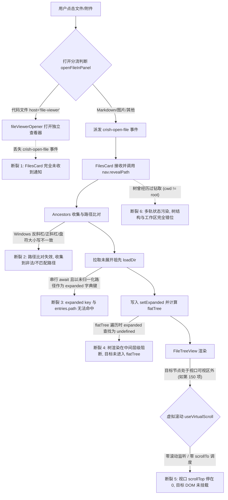
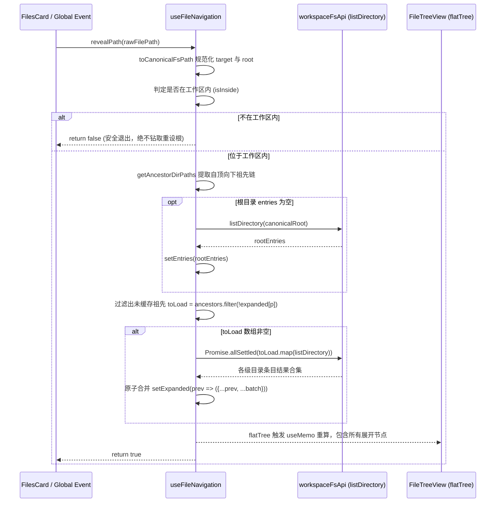
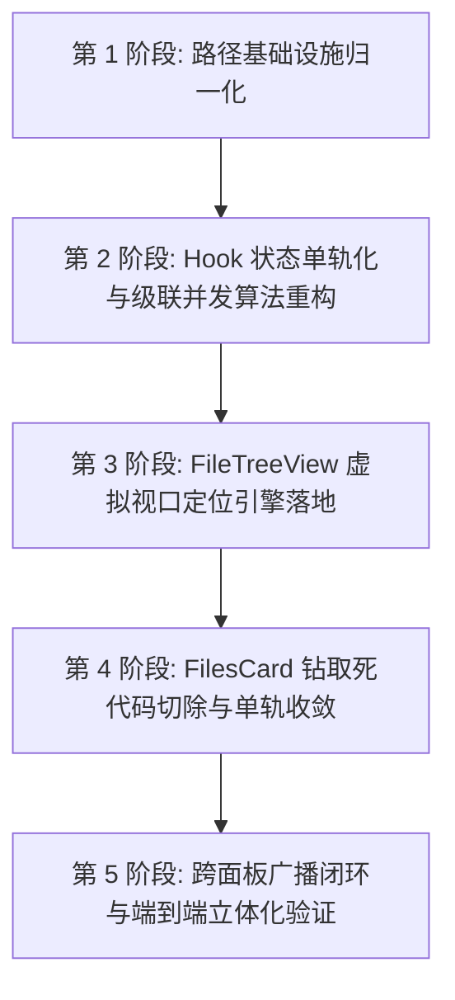

# 目录树层级同步展开与单轨收敛系统性技术方案

> **文件路径**：`docs/file-tree-and-attachments-architecture/independent-plans/01-tree-and-navigation-plan.md`
> **设计定位**：为 Conex / Crish 桌面端（Tauri + React）量身定制的工业级现代 IDE 目录树单轨收敛与路径级联同步定位技术架构方案。
> **核心原则**：纯逻辑规划（无工期/人天/P0P1偏见，问题逻辑同权）、架构净收敛（杜绝打补丁与过度设计）、工作区根节点绝对恒定（单轨展开/折叠，物理切除钻取与返回上级逻辑）。

---

## 一、架构愿景与单轨收敛设计哲学

### 1.1 现代 IDE 标准树规范（Single-Track Fixed-Root Tree）
在现代经典软件工程工具（如 VS Code、JetBrains IDE 系列、Sublime Text）中，工作区文件资源管理器（File Explorer）具备清晰而坚固的几何与交互不变量：
1. **工作区根节点绝对锚定（Fixed Workspace Anchor）**：目录树始终且仅以当前打开的工作区根目录（Workspace Root）为顶层容器。无论用户如何展开、折叠或在预览区浏览任意深度的子文件，目录树的顶层结构与可视边界永远恒定不变。
2. **单轨展开/折叠（Expand / Collapse Only）**：用户浏览子目录条目的唯一合法交互是**展开（Expand）**与**折叠（Collapse）**。系统坚决杜绝文件管理器式的“钻取（drill-down / cd 进入子目录）”行为，杜绝将视图根重置为子目录的操作。
3. **全局路径定位语义（Unified Path Reveal）**：当用户在聊天流、附件栏、引用标签、搜索结果或代码对比视图中点击任意文件时，系统必须提供确定性的“展开并滚动至可视区（Reveal & Scroll-into-view）”能力——自动计算目标文件自顶向下的所有直系祖先目录并批量展开，同时确保虚拟滚动视口精准平滑地停泊在目标节点上，配合清晰的视觉脉冲高亮告知用户该文件在项目整体骨架中的空间拓扑关系。

### 1.2 多轨陈旧逻辑的危害与切除必要性
现有代码中杂糅了“树形层级展示”与“文件管理器钻取切换（`cwd` / `goUp` / `handleRefresh(subDir)`）”两套互相冲突的概念模型。这种多轨状态机导致了一系列严重的架构缺陷：
- **状态相互踩踏**：调用 `refresh(dir)` 会将内部工作目录 `cwd` 篡改为子目录，同时强制执行 `setExpanded({})`，直接清空了用户之前建立的所有目录展开上下文；
- **路径解析断裂**：一旦 `cwd !== root`，相对路径计算发生基准偏移，导致其他来源（如聊天流、附件、工具调用）派发的绝对或相对于项目根的路径无法匹配；
- **交互认知混乱**：工具栏常驻“上级目录 ↰”按钮，用户在树中双击文件夹时不是展开节点，而是把整棵树刷新为只显示该子目录的内容，严重违背开发者对 IDE 目录树的基础肌肉记忆；
- **外部路径失控**：当打开工作区外文件时，原有逻辑甚至会把工作区树的根目录切换为外部文件夹的父目录，导致项目根目录丢失。

**本次方案的核心目标**：通过物理删除所有钻取与返回上级代码，重构单一真理源（SSOT）路径规范体系，构建自顶向下的高效并发祖先展开引擎与基于虚拟滚动的精确视口定位系统，实现现代 IDE 目录树体验的彻底蜕变。

---

## 二、现有断裂现象与深度根因剖析（Comprehensive Root Cause Analysis）

通过对 `useFileNavigation.ts`、`FilesCard.tsx`、`FileTreeView.tsx`、`workspaceFsApi.ts`、`useVirtualScroll.ts` 以及跨面板打开链路的全面源码级逆向剖析，目录树未能同步展开与定位的根本原因由以下六个关键环节的断裂共同构成：



### 2.1 根因 1：Windows 路径斜杠与大小写异构导致的字典哈希失配
在 Windows 宿主环境下，文件路径存在多种表现形式：
- 前端组件与 URL 传递的路径常为正斜杠：`c:/Software/conex/apps/crish-desktop/...`；
- Tauri 后端与系统底层返回的路径常为反斜杠：`C:\Software\conex\apps\crish-desktop\...`；
- 盘符大小写漂移：某些 API 返回小写 `c:`，另一些返回大写 `C:`；
- `workspaceFsApi.ts` 内的 `joinPath` 逻辑：
  ```typescript
  function joinPath(base: string, name: string): string {
    if (!base) return name;
    const sep = base.includes('\\') ? '\\' : '/';
    return `${base.replace(/[\\/]+$/, '')}${sep}${name}`;
  }
  ```
  当 `base` 包含反斜杠时，生成的子条目 `path` 均为反斜杠拼接。
而在 `useFileNavigation.ts` 中：
```typescript
const flatTree: TreeNode[] = useMemo(() => {
  ...
  const walk = (list: FsDirEntry[], depth: number) => {
    ...
    for (const e of sorted) {
      out.push({ ...e, depth });
      if (e.isDir && expanded[e.path]) walk(expanded[e.path] ?? [], depth + 1);
    }
  };
  walk(entries, 0);
  ...
}, [entries, expanded, filter]);
```
- `expanded` 是 JavaScript 原生对象字典：`Record<string, FsDirEntry[]>`；
- 当 `ancestors` 以正斜杠字符串（如 `C:/repo/src`）写入 `expanded` 时，`entries` 中的条目 `e.path` 却是反斜杠（如 `C:\repo\src`）；
- `expanded["C:\\repo\\src"]` 直接返回 `undefined`！
- **结果**：`walk` 递归遍历在此处戛然而止，后续所有子目录与目标文件完全无法展开展平到 `flatTree` 中。

### 2.2 根因 2：祖先链收集算法缺陷与边界判定击穿
审视 `useFileNavigation.ts` 中现有的祖先提取循环：
```typescript
const parentDir = pathDirname(normalizedPath);
const ancestors: string[] = [];
let curr = parentDir;
const normRootLower = normalizedRoot.toLowerCase().replace(/\\/g, '/');
while (curr) {
  const currLower = curr.toLowerCase().replace(/\\/g, '/');
  if (
    currLower === normRootLower ||
    currLower.length <= normRootLower.length
  )
    break;
  ancestors.unshift(curr);
  curr = pathDirname(curr);
}
```
1. **未经标准化的原始字符串入栈**：`ancestors.unshift(curr)` 推入的是未经分隔符与盘符规范化的字符串 `curr`，导致后续拉取与存储的 key 格式随机；
2. **工作区根直系文件边界遗漏**：如果目标文件位于工作区根目录下（如 `C:/repo/README.md`），`parentDir` 即为 `C:/repo`。循环在第一次判断时即因 `currLower === normRootLower` 而 `break`，`ancestors` 数组为空。虽然直系文件无需展开父目录，但由于缺乏后续显式高亮与视口停泊机制，文件依然无法被聚焦；
3. **工作区外部文件破坏性回退**：
   ```typescript
   if (!isInside) {
     const parent = pathDirname(normalizedPath);
     if (parent) await refresh(parent);
     return;
   }
   ```
   当用户在消息中点击一个工作区外的引用时，原逻辑竟然调用 `refresh(parent)`，直接把整个目录树的根重设为该外部目录，彻底击毁了当前工作区的浏览上下文。

### 2.3 根因 3：串行异步拉取与闭包竞态竞争
原实现中对未展开祖先的处理为顺序串行循环：
```typescript
if (ancestors.length > 0) {
  const toLoad = ancestors.filter((p) => !expanded[p]);
  if (toLoad.length > 0) {
    const results: Record<string, FsDirEntry[]> = {};
    for (const p of toLoad) {
      try {
        results[p] = await loadDir(p);
      } catch {
        /* ignore */
      }
    }
    setExpanded((prev) => ({ ...prev, ...results }));
  }
}
```
1. **串行瀑布延迟（Waterfall Latency）**：对于深度为 6–8 层的深层嵌套目录，串行 `for...of` 会连续触发 6–8 次 IPC 通信。在 Windows 文件系统与 Tauri IPC 桥接下，累积延迟高达数百毫秒至上秒，界面产生肉眼可见的卡顿；
2. **闭包陈旧状态判断**：`ancestors.filter((p) => !expanded[p])` 直接捕获了组件渲染闭包中的 `expanded`。如果用户快速连续触发多个定位请求，前一次定位尚未拉取完毕，后一次定位看到的 `expanded` 依然为空，导致大量重复无效拉取与状态覆盖。

### 2.4 根因 4：虚拟滚动容器（useVirtualScroll）物理视口与 DOM 离散断裂
`FileTreeView.tsx` 采用了基于高度计算的虚拟滚动方案以支持万级节点秒开：
```typescript
const ids = useMemo(() => flatTree.map((e) => e.path), [flatTree]);
const { visibleRange, containerRef, onScroll, totalHeight } =
  useVirtualScroll({
    ids,
    itemCount: flatTree.length,
    fallbackHeight: ITEM_HEIGHT,
  });

const { startIndex, endIndex } = visibleRange;
const visibleItems = useMemo(() => {
  return flatTree.slice(startIndex, endIndex + 1);
}, [flatTree, startIndex, endIndex]);
```
这是导致“右侧打开了，左侧完全看不见”的最直观元凶：
1. **DOM 不存在性**：虚拟滚动只对 `[startIndex, endIndex]` 范围内的行渲染真实 DOM，外部行仅由 `totalHeight` 占位撑开。若目标节点处于 `flatTree` 的第 150 行，在当前视口（0–25 行）之外，**页面 DOM 树中根本不存在该节点的任何元素**；
2. **零主动滚动逻辑**：现有的 `FileTreeView.tsx` 中，对 `selected` 属性的变更没有任何响应滚动的 `useEffect` 或 `useLayoutEffect`。容器的 `scrollTop` 恒定为 0；
3. **原生 `scrollIntoView` 彻底失效**：因为 DOM 节点尚未挂载，原生 `element.scrollIntoView()` 根本无法调用（找不到 DOM）；即便在某些场景强行获取到元素，如果未精确计算虚拟占位偏移，原生滚动也会导致容器视口错乱颠簸。

### 2.5 根因 5：双轨根状态（root vs cwd）与破坏性刷新
1. `useFileNavigation` 维护了 `root` 与 `cwd`：
   ```typescript
   const [root, setRoot] = useState(() => getWorkspacePath());
   const [cwd, setCwd] = useState(root || '');
   ```
2. 当调用 `refresh(dir)` 时：
   ```typescript
   setEntries(await loadDir(path));
   setCwd(path);
   setExpanded({});
   ```
   不仅工作目录 `cwd` 被篡改，而且 `setExpanded({})` 物理抹除了所有展开记忆。
3. `FilesCard.tsx` 在目录双击事件中绑定了钻取：
   ```typescript
   const handleFileDoubleClick = useCallback(
     (path: string, isDir: boolean) => {
       if (isDir) void handleRefresh(path);
       else void handleOpenFile(path);
     },
     [handleRefresh, handleOpenFile]
   );
   ```
   双击目录直接触发 `handleRefresh(path)`，使用户瞬间迷失在子目录中，且无法通过 IDE 常规方式回退。

### 2.6 根因 6：跨面板打开分流导致定位信号丢失
在 `filePanelOpener.ts` 中：
```typescript
export function openFileInPanel(
  filePath: string,
  mode?: 'plain' | 'diff'
): FilePreviewLeafHost | null {
  ...
  const host = resolveFilePreviewHost(path, mode);
  if (host === 'file-viewer' && fileViewerOpener) {
    fileViewerOpener(path, mode);
    return host;
  }

  pendingOpenPath = path;
  window.dispatchEvent(
    new CustomEvent('crish-open-file', { detail: { path } })
  );
  return 'files';
}
```
当点击代码文件（`.ts`, `.rs`, `.py` 等）时，系统解析到 `host === 'file-viewer'`，直接调用 `fileViewerOpener` 打开右侧代码查看器，**未向系统广播任何让文件树执行定位展开的通知**。
这导致用户在聊天中点击代码附件时，右侧虽然成功打开了代码编辑器，但左侧目录树处于“完全不被通知、完全静止”的解耦失联状态。

---

## 三、统一路径标准与规范化体系（SSOT Canonical Path System）

为了彻底杜绝 Windows 与 POSIX 路径因斜杠、盘符、尾随分隔符差异导致的哈希击穿，本方案在 `workspaceFsApi.ts` 中确立刚性的**单一真理源路径规范（SSOT Canonical Path System）**。

### 3.1 路径规范化形式定义
系统内流转与存储的所有文件/目录路径，在进入状态库、字典键或比对逻辑之前，必须经过 `toCanonicalFsPath` 归一化：
1. **分隔符统一**：所有反斜杠 `\` 统一转换为正斜杠 `/`；
2. **冗余斜杠折叠**：将连续多个斜杠折叠为单个斜杠（保留 UNC 路径前导 `//`）；
3. **Windows 盘符标准化**：将盘符统一转为大写（如 `c:/` -> `C:/`），与 Windows 内核标准及 Tauri 宿主保持绝对统一；
4. **尾随斜杠清理**：除根目录（如 `/` 或 `C:/`）外，一律剥离末尾的 `/`；
5. **拒绝非法组件**：包含 `\0`、Unicode Bidi 字符或路径穿越（`..`）的路径直接拦截归一为空串。

### 3.2 核心纯函数设计与实现规范

在 `apps/crish-desktop/src/api/workspaceFsApi.ts` 中扩展并严格测试以下纯函数：

```typescript
/**
 * 标准工作区规范化路径转换函数 (SSOT)
 */
export function toCanonicalFsPath(rawPath: string | null | undefined): string {
  if (!rawPath) return '';
  let p = rawPath.trim();
  if (!p) return '';

  // 1. 替换所有反斜杠为正斜杠
  p = p.replace(/\\/g, '/');

  // 2. Windows 盘符标准化: 将 c:/ 转换为 C:/
  if (/^[a-zA-Z]:\//.test(p)) {
    p = p.charAt(0).toUpperCase() + p.slice(1);
  }

  // 3. 冗余斜杠折叠 (保留 UNC // 前缀)
  const isUnc = p.startsWith('//');
  p = p.replace(/\/+/g, '/');
  if (isUnc) {
    p = '/' + p;
  }

  // 4. 剔除末尾斜杠 (保留根目录如 "C:/" 或 "/")
  if (p.length > 3 && p.endsWith('/')) {
    p = p.slice(0, -1);
  } else if (p.length === 2 && /^[A-Z]:$/.test(p)) {
    p = p + '/';
  }

  return p;
}

/**
 * 路径等价性安全比对 (大小写不敏感用于 Windows 盘符与路径，POSIX 兼容)
 */
export function isSameFsPath(
  a: string | null | undefined,
  b: string | null | undefined
): boolean {
  if (!a || !b) return false;
  const ca = toCanonicalFsPath(a);
  const cb = toCanonicalFsPath(b);
  if (ca === cb) return true;
  // Windows 环境下执行不区分大小写的安全比对
  return ca.toLowerCase() === cb.toLowerCase();
}

/**
 * 自顶向下提取目标文件的全部祖先目录链 (严格自顶向下排序，不含工作区根自身与目标文件自身)
 *
 * 示例:
 *   target: "C:/Software/conex/apps/crish-desktop/src/index.ts"
 *   root:   "C:/Software/conex"
 * 返回:
 *   [
 *     "C:/Software/conex/apps",
 *     "C:/Software/conex/apps/crish-desktop",
 *     "C:/Software/conex/apps/crish-desktop/src"
 *   ]
 */
export function getAncestorDirPaths(
  targetPath: string,
  rootPath: string
): string[] {
  const cTarget = toCanonicalFsPath(targetPath);
  const cRoot = toCanonicalFsPath(rootPath);
  if (!cTarget || !cRoot) return [];

  const cTargetLower = cTarget.toLowerCase();
  const cRootLower = cRoot.toLowerCase();

  // 必须严格属于工作区根目录下
  if (cTargetLower === cRootLower || !cTargetLower.startsWith(cRootLower + '/')) {
    return [];
  }

  // 获取相对于工作区根的相对路径
  const rel = cTarget.slice(cRoot.length).replace(/^\/+/, '');
  const segments = rel.split('/').filter(Boolean);

  // 最后一个是目标文件自身，弹出
  segments.pop();

  const ancestors: string[] = [];
  let currentAccumulator = cRoot;

  for (const seg of segments) {
    currentAccumulator = `${currentAccumulator}/${seg}`;
    ancestors.push(toCanonicalFsPath(currentAccumulator));
  }

  return ancestors;
}
```

---

## 四、完整健壮的 `revealPath` 祖先级联展开引擎重构方案

### 4.1 算法逻辑流与状态时序
重构后的 `revealPath` 必须具备以下不变量：
1. **幂等性与零副作用**：重复调用同一个已展开路径，不重复拉取、不重置视口、不引发闪烁；
2. **并发高吞吐拉取（Batch Concurrent Fetching）**：对于链路上尚未加载的 $N$ 个祖先目录，使用 `Promise.allSettled` 一次性并发请求，将网络/IPC 时延压缩为 $O(1)$ 单次往返周期；
3. **原子更新与不可变合并（Atomic Immutable Write）**：所有新获取的目录条目使用单次 `setExpanded(prev => ({ ...prev, ...batch }))` 批量刷入，保证从 React 渲染调度到底层 `flatTree` 的计算只发生单次无损刷新；
4. **返回值布尔契约**：明确返回 `Promise<boolean>`，告知上层调用方该文件是否属于工作区且成功完成了树级联展开。



### 4.2 `useFileNavigation.ts` 的重构实现方案

```typescript
export function useFileNavigation(getIsDirty?: () => boolean) {
  const [root, setRoot] = useState<string>(() => toCanonicalFsPath(getWorkspacePath() || ''));
  // 物理切除 cwd！整个 Hook 只认唯一的 root
  const [entries, setEntries] = useState<FsDirEntry[]>([]);
  // expanded 键强制使用 toCanonicalFsPath 保证 100% 字典命中
  const [expanded, setExpanded] = useState<Record<string, FsDirEntry[]>>({});
  const [loading, setLoading] = useState(false);
  const [error, setError] = useState('');
  const [filter, setFilter] = useState('');
  const [filterMode, setFilterMode] = useState(false);
  const [gitStatusMap, setGitStatusMap] = useState<Record<string, string>>({});

  // 目录读取方法（强制规范化入参与回写条目的 path）
  const loadDir = useCallback(async (dirPath: string): Promise<FsDirEntry[]> => {
    const canonical = toCanonicalFsPath(resolveWorkspacePath(dirPath));
    const items = await listDirectory(canonical);
    return items.map((item) => ({
      ...item,
      path: toCanonicalFsPath(item.path),
    }));
  }, []);

  // 单轨重载函数：绝不允许传入自定义 dir 篡改工作区根目录
  const refresh = useCallback(async () => {
    const currentRoot = toCanonicalFsPath(getWorkspacePath() || '');
    setRoot(currentRoot);
    if (!currentRoot) {
      setError('请先选择项目工作区');
      setEntries([]);
      setExpanded({});
      return;
    }

    setLoading(true);
    setError('');
    try {
      const rootItems = await loadDir(currentRoot);
      setEntries(rootItems);

      // 保留当前已展开目录的有效性，静默拉取更新已展开目录的内容
      setExpanded((prev) => {
        const currentlyExpandedPaths = Object.keys(prev);
        if (currentlyExpandedPaths.length === 0) return prev;

        // 异步刷新已展开分支，不阻塞主流程
        void Promise.allSettled(
          currentlyExpandedPaths.map(async (path) => ({
            path,
            items: await loadDir(path),
          }))
        ).then((results) => {
          const updated: Record<string, FsDirEntry[]> = {};
          for (const res of results) {
            if (res.status === 'fulfilled') {
              updated[res.value.path] = res.value.items;
            }
          }
          setExpanded((cur) => ({ ...cur, ...updated }));
        });

        return prev;
      });
    } catch (e) {
      setError(e instanceof Error ? e.message : String(e));
      setEntries([]);
    } finally {
      setLoading(false);
    }
  }, [loadDir]);

  // 展开/折叠单轨切换
  const toggleExpand = useCallback(
    async (dirPath: string, e?: React.MouseEvent) => {
      e?.stopPropagation();
      const canonical = toCanonicalFsPath(dirPath);

      if (expanded[canonical]) {
        setExpanded((prev) => {
          const next = { ...prev };
          delete next[canonical];
          return next;
        });
        return;
      }

      try {
        const list = await loadDir(canonical);
        setExpanded((prev) => ({ ...prev, [canonical]: list }));
        setError('');
      } catch (err) {
        setError(err instanceof Error ? err.message : '展开失败');
      }
    },
    [expanded, loadDir]
  );

  // 核心重构：祖先级联并发展开算法
  const revealPath = useCallback(
    async (filePath: string): Promise<boolean> => {
      const currentRoot = toCanonicalFsPath(getWorkspacePath() || root);
      if (!currentRoot || !filePath) return false;

      const canonicalTarget = toCanonicalFsPath(resolveWorkspacePath(filePath));
      const canonicalRoot = currentRoot;

      // 1. 判定是否位于工作区内
      const ancestors = getAncestorDirPaths(canonicalTarget, canonicalRoot);
      const isInside =
        canonicalTarget.toLowerCase().startsWith(canonicalRoot.toLowerCase() + '/') ||
        canonicalTarget.toLowerCase() === canonicalRoot.toLowerCase();

      if (!isInside) {
        // 工作区外部文件：仅返回 false，绝不调用 refresh(parent) 篡改根
        return false;
      }

      // 2. 检查根条目是否已挂载，若为空则先拉取根目录
      let currentEntries = entries;
      if (currentEntries.length === 0) {
        try {
          currentEntries = await loadDir(canonicalRoot);
          setEntries(currentEntries);
        } catch {
          return false;
        }
      }

      // 3. 祖先目录批量并发补拉
      if (ancestors.length > 0) {
        // 利用函数式状态更新获取最新 expanded，防止闭包陈旧
        let missingPaths: string[] = [];
        setExpanded((prev) => {
          missingPaths = ancestors.filter((p) => !prev[p]);
          return prev;
        });

        if (missingPaths.length > 0) {
          const results = await Promise.allSettled(
            missingPaths.map(async (path) => ({
              path,
              items: await loadDir(path),
            }))
          );

          const newBatch: Record<string, FsDirEntry[]> = {};
          for (const r of results) {
            if (r.status === 'fulfilled') {
              newBatch[r.value.path] = r.value.items;
            }
          }

          if (Object.keys(newBatch).length > 0) {
            setExpanded((prev) => ({ ...prev, ...newBatch }));
          }
        }
      }

      return true;
    },
    [root, entries, loadDir]
  );

  // 排序与展平算法：基于 canonical 键安全查找
  const flatTree: TreeNode[] = useMemo(() => {
    const q = filter.trim().toLowerCase();
    const out: TreeNode[] = [];

    const walk = (list: FsDirEntry[], depth: number) => {
      const sorted = [...list].sort((a, b) => {
        if (a.isDir !== b.isDir) return a.isDir ? -1 : 1;
        const aNoise = a.name.startsWith('.') || a.name.startsWith('--');
        const bNoise = b.name.startsWith('.') || b.name.startsWith('--');
        if (aNoise !== bNoise) return aNoise ? 1 : -1;
        return a.name.localeCompare(b.name, undefined, {
          numeric: true,
          sensitivity: 'base',
        });
      });

      for (const e of sorted) {
        const canonicalItemPath = toCanonicalFsPath(e.path);
        out.push({ ...e, path: canonicalItemPath, depth });
        if (e.isDir && expanded[canonicalItemPath]) {
          walk(expanded[canonicalItemPath] ?? [], depth + 1);
        }
      }
    };

    walk(entries, 0);
    if (!q) return out;
    return out.filter((n) => n.name.toLowerCase().includes(q));
  }, [entries, expanded, filter]);

  return {
    root,
    entries,
    expanded,
    loading,
    error,
    filter,
    filterMode,
    gitStatusMap,
    loadDir,
    refresh,
    toggleExpand,
    revealPath,
    setFilter,
    setFilterMode,
    setError,
    setExpanded,
    setEntries,
    setLoading,
    flatTree,
    // 物理切除: cwd, setCwd, goUp
  };
}
```

---

## 五、`FileTreeView` 虚拟滚动视口同步定位与高亮方案

### 5.1 虚拟滚动视口定位的几何模型
由于虚拟滚动（`useVirtualScroll`）不挂载视口外 DOM 节点，任何基于 DOM 的 `scrollIntoView()` 都是徒劳的。必须采用**基于树行索引与行高计算的纯几何定位模型（Index-Based Virtual Geometry Engine）**。

设定参数：
- 行高：$H_{\text{item}} = 28\text{ px}$（`ITEM_HEIGHT`）；
- 容器可视高度：$H_{\text{viewport}} = \text{containerRef.current.clientHeight}$；
- 目标行全局索引：$I_{\text{target}}$（通过 `flatTree.findIndex` 匹配）；
- 目标行在虚拟画布上的绝对几何跨度：
  $$\text{Top}_{\text{target}} = I_{\text{target}} \times H_{\text{item}}$$
  $$\text{Bottom}_{\text{target}} = \text{Top}_{\text{target}} + H_{\text{item}}$$

```
  0 px ──────────────────────────────────────────
       │ [已折叠节点 0]
       │ [已折叠节点 1]
       ...
       │ ── 当前视口顶部 (scrollTop) ───
       │ 可视渲染区域 (visibleRange: startIndex ~ endIndex)
       │
       │ >>> [目标高亮行 targetIndex] <<< (Top: targetIndex * 28px)
       │
       │ ── 当前视口底部 (scrollTop + viewportHeight) ───
       ...
       │ [未渲染虚拟占位节点 N]
  TotalHeight = flatTree.length * 28 px ─────────
```

### 5.2 视口平滑滚动决策与中心对齐（Center Alignment）
当检测到 `selected` 变化且在 `flatTree` 中检索到有效索引 $I_{\text{target}}$ 时：
1. **可视性判定**：
   若满足：
   $$\text{Top}_{\text{target}} \ge \text{scrollTop} + H_{\text{item}} \quad \land \quad \text{Bottom}_{\text{target}} \le \text{scrollTop} + H_{\text{viewport}} - H_{\text{item}}$$
   说明目标行已经在当前视口内部（且保留了 1 行以上的上下安全余量），无需进行大幅度跳跃滚动，仅触发视觉脉冲动画；
2. **中心停泊滚动计算（Optimal Center Scroll）**：
   若目标行在视口外，为了带给开发者最佳的阅读上下文（同时看清上级目录和同级兄弟文件），系统将其滚动至**视口垂直中央**：
   $$\text{ScrollTop}_{\text{ideal}} = \max\left(0, \; \text{Top}_{\text{target}} - \left\lfloor \frac{H_{\text{viewport}} - H_{\text{item}}}{2} \right\rfloor \right)$$
3. **平滑滚动调用**：
   ```typescript
   containerRef.current.scrollTo({
     top: Math.round(idealScrollTop),
     behavior: 'smooth',
   });
   ```
4. **虚拟滚动自动响应**：容器的滚动事件触发 `useVirtualScroll` 的 `onScroll`，其内部的树状数组（Fenwick Tree）或区间二分器立即重算 `visibleRange`，并在下一帧（rAF）精准挂载包含目标行的 DOM 元素。

### 5.3 视觉聚焦与轻柔呼吸脉冲（Reveal Pulse Animation）
为彻底杜绝硬编码和不协调的视觉冲突，利用项目 Design Token 实现具有现代质感的高亮脉冲动画：
- 在 `FilesCard.module.css` 中引入 `@keyframes fileRowPulse`；
- 使用 `var(--tint-active)` 与 `var(--accent-color)` 产生温和的淡出涟漪；
- 目标行挂载后添加 `.isRevealed` 类，持续 1.5 秒后自动卸载；
- 焦点自动对齐：在滚动完成后将键盘焦点无缝转移到该行（`data-tree-index={targetIndex}`），实现鼠标与键盘漫游的统一闭环。

```css
/* 目录树行选中与瞬态聚焦脉冲 */
.filesRow.isSelected {
  background: var(--bg-active);
  color: var(--text-primary);
}

.filesRow.isRevealed {
  animation: fileRowRevealPulse 1400ms cubic-bezier(0.16, 1, 0.3, 1) forwards;
}

@keyframes fileRowRevealPulse {
  0% {
    background: color-mix(in srgb, var(--accent-color, #2563eb) 22%, var(--bg-card));
    box-shadow: inset 2px 0 0 var(--accent-color, #2563eb);
  }
  70% {
    background: color-mix(in srgb, var(--accent-color, #2563eb) 12%, var(--bg-card));
    box-shadow: inset 2px 0 0 var(--accent-color, #2563eb);
  }
  100% {
    background: var(--bg-active);
    box-shadow: inset 2px 0 0 transparent;
  }
}
```

### 5.4 `FileTreeView.tsx` 完整重构设计

```typescript
export interface FileTreeViewProps {
  root?: string;
  flatTree: TreeNode[];
  selected: string | null;
  expanded: Record<string, unknown>;
  loading: boolean;
  error: string;
  filter: string;
  filterMode: boolean;
  gitStatusMap: Record<string, string>;
  onSelect: (path: string, isDir: boolean) => void;
  onToggleExpand: (path: string, e: React.MouseEvent) => void;
  onDoubleClick: (path: string, isDir: boolean) => void;
  onFilterChange: (v: string) => void;
  onFilterModeToggle: () => void;
  onErrorDismiss: () => void;
  // 物理切除: cwd
}

const ITEM_HEIGHT = 28;

export const FileTreeView: React.FC<FileTreeViewProps> = React.memo(
  function FileTreeView({
    root,
    flatTree,
    selected,
    expanded,
    loading,
    error,
    filter,
    gitStatusMap,
    onSelect,
    onToggleExpand,
    onDoubleClick,
    onErrorDismiss,
  }) {
    const ids = useMemo(() => flatTree.map((e) => e.path), [flatTree]);
    const { visibleRange, containerRef, onScroll, totalHeight } =
      useVirtualScroll({
        ids,
        itemCount: flatTree.length,
        fallbackHeight: ITEM_HEIGHT,
      });

    const { startIndex, endIndex } = visibleRange;
    const visibleItems = useMemo(() => {
      return flatTree.slice(startIndex, endIndex + 1);
    }, [flatTree, startIndex, endIndex]);

    // 瞬态高亮目标状态 (用于淡出动画)
    const [revealedPath, setRevealedPath] = useState<string | null>(null);
    const lastScrollTargetRef = useRef<string | null>(null);

    // 核心视口同步定位 Hook
    useEffect(() => {
      if (!selected) {
        lastScrollTargetRef.current = null;
        return;
      }

      const canonicalSelected = toCanonicalFsPath(selected);
      // 避免同一路径重复触发滚动拽动
      if (lastScrollTargetRef.current === canonicalSelected) {
        return;
      }

      const targetIndex = flatTree.findIndex((node) =>
        isSameFsPath(node.path, canonicalSelected)
      );

      if (targetIndex === -1) {
        // 节点尚未展开或不在平铺树中，等待祖先展开完成
        return;
      }

      lastScrollTargetRef.current = canonicalSelected;
      setRevealedPath(canonicalSelected);

      const timer = setTimeout(() => {
        setRevealedPath((cur) => (cur === canonicalSelected ? null : cur));
      }, 1500);

      const container = containerRef.current;
      if (!container) return;

      const viewportHeight = container.clientHeight || 600;
      const currentScrollTop = container.scrollTop;
      const targetTop = targetIndex * ITEM_HEIGHT;
      const targetBottom = targetTop + ITEM_HEIGHT;

      // 判定是否已在视口完全可见 (保留上下 1 行余量)
      const isInView =
        targetTop >= currentScrollTop + ITEM_HEIGHT &&
        targetBottom <= currentScrollTop + viewportHeight - ITEM_HEIGHT;

      if (!isInView) {
        const idealScrollTop = Math.max(
          0,
          Math.floor(targetTop - (viewportHeight - ITEM_HEIGHT) / 2)
        );
        container.scrollTo({
          top: idealScrollTop,
          behavior: 'smooth',
        });
      }

      // 滚动后使焦点对齐
      requestAnimationFrame(() => {
        const rowEl = container.querySelector<HTMLElement>(
          `[data-tree-index="${targetIndex}"]`
        );
        rowEl?.focus({ preventScroll: true });
      });

      return () => clearTimeout(timer);
    }, [selected, flatTree, containerRef]);

    return (
      <div
        className={`${styles.filesList} ${styles.filesListPane}`}
        ref={containerRef}
        onScroll={onScroll}
        role="tree"
        aria-label="工作区文件树"
        style={{ overflowY: 'auto', position: 'relative' }}
      >
        {/* 加载/错误/空状态展示保持一致 */}
        {loading ? (
          <div className={`${styles.filesEmpty} ${styles.filesEmptyCompact}`}>
            加载中…
          </div>
        ) : flatTree.length === 0 ? (
          <div className={`${styles.filesEmpty} ${styles.filesEmptyCompact}`}>
            {filter.trim() ? '无匹配项' : '空工作区'}
          </div>
        ) : (
          <div
            style={{
              height: `${totalHeight}px`,
              width: '100%',
              position: 'relative',
            }}
          >
            {visibleItems.map((e, index) => {
              const globalIdx = startIndex + index;
              const top = globalIdx * ITEM_HEIGHT;
              const isSelected = isSameFsPath(selected, e.path);
              const isRevealed = isSameFsPath(revealedPath, e.path);

              return (
                <div
                  key={e.path}
                  data-tree-index={globalIdx}
                  className={`${styles.filesRow} ${isSelected ? styles.isSelected : ''} ${isRevealed ? styles.isRevealed : ''}`}
                  style={{
                    position: 'absolute',
                    top: `${top}px`,
                    left: 0,
                    width: '100%',
                    height: `${ITEM_HEIGHT}px`,
                    paddingLeft: 4 + e.depth * 10,
                    display: 'flex',
                    alignItems: 'center',
                  }}
                  onClick={() => onSelect(e.path, e.isDir)}
                  onDoubleClick={() => onDoubleClick(e.path, e.isDir)}
                  role="treeitem"
                  aria-level={e.depth + 1}
                  aria-selected={isSelected}
                  aria-expanded={e.isDir ? (expanded[e.path] ? 'true' : 'false') : undefined}
                  tabIndex={0}
                >
                  {/* Twist / Icon / Name / Meta 渲染 */}
                  <Button
                    type="button"
                    variant="ghost"
                    size="sm"
                    className={`${styles.filesRowTwist} ${e.isDir ? '' : styles.isLeaf}`}
                    onClick={(ev) => {
                      ev.stopPropagation();
                      if (e.isDir) onToggleExpand(e.path, ev);
                    }}
                    tabIndex={-1}
                    icon={
                      e.isDir ? (
                        expanded[e.path] ? (
                          <ChevronDownIcon size={12} />
                        ) : (
                          <ChevronRightIcon size={12} />
                        )
                      ) : undefined
                    }
                  />
                  {e.isDir ? (
                    <Folder size={14} className={`${styles.filesRowIco} ${styles.dir}`} />
                  ) : (
                    <TreeFileIcon name={e.name} />
                  )}
                  <Tooltip content={e.name}>
                    <span className={styles.filesRowName}>{e.name}</span>
                  </Tooltip>
                  {/* Git 状态徽标与文件尺寸保持不变 */}
                </div>
              );
            })}
          </div>
        )}
      </div>
    );
  }
);
```

---

## 六、目录树行为单轨收敛与死代码物理切除详案

用户严正指出：“必须彻底物理删除钻取与返回上级逻辑，将根节点牢牢锚定在工作区根目录，单轨收敛。”
本章节制定详尽的物理切除与交互重整清单。

### 6.1 死代码与陈旧逻辑物理切除清单

| 所在文件 | 目标项 | 操作类型 | 理由与收敛后行为 |
| :--- | :--- | :--- | :--- |
| `FilesCard.tsx:28` | `PARENT_DIR_LABEL = '上级目录'` | **物理删除** | 现代 IDE 树无需“上级目录”概念 |
| `FilesCard.tsx:289-300` | 顶部“上级目录”按钮 JSX 及 Tooltip | **物理删除** | 顶栏工具条仅保留“刷新”与“筛选”按钮 |
| `FilesCard.tsx:158-165` | `handleGoUp` 函数实现 | **物理删除** | 切除通过 `goUp` 切换上级目录的逻辑 |
| `FilesCard.tsx:181-186` | `handleFileDoubleClick` 中的 `handleRefresh(path)` | **重写收敛** | 双击目录一律收敛为 `nav.toggleExpand(path)` |
| `FilesCard.tsx:196-205` | `handleNavigate(path)` 钻取重设逻辑 | **物理切除** | 面包屑点击收敛为仅聚焦/展开，不改变根 |
| `FilesCard.tsx:207-214` | `handleRefreshDir` | **物理切除** | 消除针对子目录刷新的多轨歧义 |
| `useFileNavigation.ts:18` | `cwd` 与 `setCwd` 状态 | **物理删除** | 树的根节点恒等于 `root` |
| `useFileNavigation.ts:82-88` | `goUp` 函数导出 | **物理删除** | 消除上溯钻取方法 |
| `useFileNavigation.ts:34-58` | `refresh(dir?: string)` 传参定制根 | **重写收敛** | 签名收敛为 `refresh(): Promise<void>`，恒定刷新项目根 |
| `useFileNavigation.ts:105-110` | 外部文件 `refresh(parent)` 分支 | **物理删除** | 外部文件直接返回 `false`，不改动目录树 |

### 6.2 交互行为的单轨收敛细节

#### 1. 目录双击行为收敛（Double-Click Convergence）
在 `FilesCard.tsx` 中：
```typescript
const handleFileDoubleClick = useCallback(
  (path: string, isDir: boolean) => {
    if (isDir) {
      // 现代 IDE 规范：双击目录 = 展开/折叠当前目录，绝不重设工作区
      void nav.toggleExpand(path);
    } else {
      void handleOpenFile(path);
    }
  },
  [nav, handleOpenFile]
);
```

#### 2. 工具栏与面包屑行为收敛（Toolbar & Breadcrumb Convergence）
- **顶栏工具条**：
  物理移除 `CornerLeftUp` 按钮后，工具栏左侧直接呈现清晰的面包屑导航，视觉轻量化，无多余冗杂按钮；
- **面包屑导航（FileBreadcrumb）**：
  面包屑不再具备“双击把该目录变为新根”的能力。点击面包屑中的祖先目录，统一触发目录树的定位与展开（`revealPath`），右侧预览保持稳定；
- **刷新按钮（Refresh Button）**：
  点击顶部的“刷新”按钮，执行的是**原地无损重载（In-place Non-destructive Refresh）**：重新拉取根节点与当前已展开目录的最新磁盘条目，原有展开结构、选中高亮、视口滚动位置完全保留，杜绝整树坍塌重置。

---

## 七、跨面板全局联动与打开分流闭环设计

为解决“聊天/附件中点击文件时，右侧打开了预览，左侧目录树却不展开不定位”的跨面板失联问题，必须打通**打开分流器与目录树展开的通知通道**。

### 7.1 `filePanelOpener.ts` 架构打通
当前 `openFileInPanel` 在打开 `file-viewer` 时，直接返回并未派发事件。
**架构改造设计**：无论最终渲染叶是 `files` 还是 `file-viewer`，只要打开的是工作区文件，就应当**统一派发目录树定位事件**！
- 新增轻量级系统全局事件：`crish-tree-reveal`；
- `openFileInPanel` 在触发对应叶打开的同时，同步广播 `crish-tree-reveal`：
  ```typescript
  export function openFileInPanel(
    filePath: string,
    mode?: 'plain' | 'diff'
  ): FilePreviewLeafHost | null {
    if (!filePath?.trim()) return null;
    const trimmed = filePath.trim();
    if (/^(note|notebook)(:|$)/i.test(trimmed)) return null;
    const path = resolveWorkspacePath(trimmed);
    if (!path) return null;

    const canonicalPath = toCanonicalFsPath(path);
    const host = resolveFilePreviewHost(canonicalPath, mode);

    // 核心打通：无论右侧进入哪个叶，均通知文件树执行展开定位
    window.dispatchEvent(
      new CustomEvent('crish-tree-reveal', { detail: { path: canonicalPath } })
    );

    if (host === 'file-viewer' && fileViewerOpener) {
      fileViewerOpener(canonicalPath, mode);
      return host;
    }

    pendingOpenPath = canonicalPath;
    window.dispatchEvent(
      new CustomEvent('crish-open-file', { detail: { path: canonicalPath } })
    );
    return 'files';
  }
  ```

### 7.2 `FilesCard.tsx` 对定位事件的静默感知
在 `FilesCard.tsx` 中同时监听 `crish-open-file`（需要打开文件并定位）和 `crish-tree-reveal`（仅需在树中展开并高亮定位，不强行覆盖当前右侧可能打开的独立代码查看器）：
```typescript
useEffect(() => {
  const onReveal = (ev: Event) => {
    const p = (ev as CustomEvent<{ path?: string }>).detail?.path;
    if (!p) return;
    const canonical = toCanonicalFsPath(p);
    void nav.revealPath(canonical);
    preview.setSelected(canonical);
  };

  window.addEventListener('crish-tree-reveal', onReveal);
  return () => window.removeEventListener('crish-tree-reveal', onReveal);
}, [nav, preview]);
```
如此一来，无论用户是在消息气泡中点击 `.md` 文件还是点击 `.rs` 代码文件：
- 右侧按需打开对应的预览卡片或代码比对卡片；
- 左侧目录树同步接收到 `canonicalPath`，自顶向下自动并发展开所有层级，并驱动虚拟滚动平滑停泊到目标文件行，呈现柔和的呼吸脉冲高亮！

---

## 八、详细文件级修改设计（Specification by File）

### 8.1 修改文件一：`apps/crish-desktop/src/api/workspaceFsApi.ts`
- **新增导出函数**：
  - `toCanonicalFsPath(rawPath: string | null | undefined): string`：单一真理源路径规范化纯函数；
  - `isSameFsPath(a: string | null | undefined, b: string | null | undefined): boolean`：跨平台路径等价性比对函数；
  - `getAncestorDirPaths(targetPath: string, rootPath: string): string[]`：自顶向下祖先目录链提取纯函数。
- **改造现有函数**：
  - `joinPath`：统一内部反斜杠转换为正斜杠；
  - `resolveWorkspacePath`：返回前必须调用 `toCanonicalFsPath`；
  - `listDirectory`：返回的每个 `FsDirEntry.path` 均强制经过 `toCanonicalFsPath` 归一化。

### 8.2 修改文件二：`apps/crish-desktop/src/components/files/hooks/useFileNavigation.ts`
- **状态物理瘦身**：
  - 彻底删除 `cwd`、`setCwd`、`goUp`；
  - `root` 状态初始化及更新时强制包裹 `toCanonicalFsPath`；
- **函数签名与实现收敛**：
  - `refresh()`：收敛为无参纯净重载函数，保持原地无损更新；
  - `toggleExpand(dirPath)`：入参强制规范化，使用规范化键管理 `expanded`；
  - `revealPath(filePath)`：彻底重写为自顶向下并发批量拉取与原子合并算法，移除外部路径篡改分支，返回 `Promise<boolean>`；
  - `flatTree`：`useMemo` 中统一使用 `toCanonicalFsPath` 进行目录查找与递归。

### 8.3 修改文件三：`apps/crish-desktop/src/components/files/FileTreeView.tsx`
- **Props 接口切除**：
  - 删除 `cwd` 属性；
- **视口定位引擎引入**：
  - 引入 `revealedPath` 瞬态动画状态与 `lastScrollTargetRef` 防抖标识；
  - 接入 `useEffect` 几何视口平滑居中滚动引擎（Index-Based Virtual ScrollIntoView）；
  - 渲染行节点附加 `data-tree-index`、`isSelected`（通过 `isSameFsPath` 精准计算）、`isRevealed`（脉冲动画）；
  - 保持键盘 ARIA Tree pattern 无障碍焦点自动跟随。

### 8.4 修改文件四：`apps/crish-desktop/src/components/files/FilesCard.tsx`
- **常量与控件切除**：
  - 彻底删除 `PARENT_DIR_LABEL` 及顶部返回按钮；
  - 彻底切除 `handleGoUp`、`handleNavigate`、`handleRefreshDir`；
- **交互单轨收敛**：
  - 改造 `handleFileDoubleClick`：目录双击直接调用 `nav.toggleExpand(path)`；
  - 顶栏刷新按钮直接调用 `nav.refresh()`；
  - 监听 `crish-tree-reveal` 事件实现跨面板定位联动闭环；
  - 传递给 `FileTreeView` 的参数剥离 `cwd`。

### 8.5 修改文件五：`apps/crish-desktop/src/components/files/FileBreadcrumb.tsx`
- **交互改造**：
  - 面包屑双击与弹出层内文件夹双击，不再调用 `onNavigate` 进行钻取；
  - 统一调用 `onOpenFile` 或触发 `revealPath` 进行原地定位。

### 8.6 修改文件六：`apps/crish-desktop/src/components/files/FilesCard.module.css`
- **样式扩展**：
  - 新增 `.filesRow.isRevealed` 与 `@keyframes fileRowRevealPulse`，采用系统 Design Token（`var(--accent-color)`、`var(--bg-active)`）定义克制柔和的呼吸脉冲高亮；
  - 优化 `.filesRow.isSelected` 的背景对比度，确保阅读舒适性与肉眼可辨性平衡。

### 8.7 修改文件七：`apps/crish-desktop/src/api/filePanelOpener.ts`
- **跨面板广播补全**：
  - 在 `openFileInPanel` 中增补向 `window` 派发 `crish-tree-reveal` 事件，确保代码类文件在进入独立查看器的同时，文件树同步展开并定位。

---

## 九、逻辑依赖与分阶段实施编排（Pure Logical Progression）

遵循反退避与纯逻辑规划纪律，不引入工期与业务优先级评级，严格按照系统模块底层的**拓扑依赖关系**编排实施逻辑：



### 9.1 第 1 阶段：路径基础设施归一化（SSOT Foundation）
- **逻辑目标**：消除所有路径歧义，提供确定性的字符串规范化与祖先提取基础。
- **任务单元**：
  1. 在 `workspaceFsApi.ts` 中实现并导出 `toCanonicalFsPath`、`isSameFsPath`、`getAncestorDirPaths`；
  2. 编写针对 Windows 反斜杠、混合斜杠、大小写盘符、网络 UNC、边界根目录的穷举单元测试，确保无边界漏洞；
  3. 改造 `workspaceFsApi.ts` 中的 `listDirectory` 与 `resolveWorkspacePath`，使产出路径天然规范化。

### 9.2 第 2 阶段：Hook 状态单轨化与级联并发算法重构（Navigation Engine Core）
- **依赖前置**：第 1 阶段完成。
- **任务单元**：
  1. 在 `useFileNavigation.ts` 中物理删除 `cwd` 状态与 `goUp` 逻辑；
  2. 重构 `refresh()` 为无参原地无损重载；
  3. 实现自顶向下祖先链批量并发请求（`Promise.allSettled`）与原子化写入；
  4. 重构 `flatTree`，使用规范化路径作为递归遍历条件。

### 9.3 第 3 阶段：`FileTreeView` 虚拟视口定位引擎落地（Viewport Geometry Engine）
- **依赖前置**：第 2 阶段完成（`flatTree` 能够稳定包含展开的目标节点）。
- **任务单元**：
  1. 在 `FileTreeView.tsx` 中剔除 `cwd` 属性；
  2. 植入基于 `ITEM_HEIGHT` 与 `targetIndex` 的纯几何居中平滑滚动计算 Hook；
  3. 在 `FilesCard.module.css` 中注入符合 Design Token 的 `fileRowRevealPulse` 动画；
  4. 验证 DOM 挂载时序与焦点对齐。

### 9.4 第 4 阶段：`FilesCard` 钻取死代码切除与单轨收敛（UI Layer Cleanup）
- **依赖前置**：第 2、3 阶段完成。
- **任务单元**：
  1. 物理删除 `PARENT_DIR_LABEL` 与顶部返回按钮；
  2. 改造 `handleFileDoubleClick`：双击目录收敛为 `toggleExpand`；
  3. 改造面包屑双击逻辑，切除 `handleNavigate`；
  4. 顶栏刷新按钮直连 `nav.refresh()`。

### 9.5 第 5 阶段：跨面板广播闭环与端到端立体化验证（Cross-Panel Integration & E2E）
- **依赖前置**：第 4 阶段完成。
- **任务单元**：
  1. 在 `filePanelOpener.ts` 中补全 `crish-tree-reveal` 全局事件广播；
  2. 在 `FilesCard.tsx` 中订阅该事件并驱动目录树静默展开与视口停泊；
  3. 运行全量类型检查 `npm run typecheck` 与相关单元测试套件；
  4. 现场端到端验收：在聊天消息与附件中点击各类文件，验证右侧预览与左侧目录树秒级展开、平滑居中滚动与高亮脉冲。

---

## 十、立体化验证断言与防回潮防线（Verification & Guardrails）

遵循《协作纪律》第 7 条（严禁补丁、绕过与作弊）与第 7.1 条（立体验证纪律），方案交付前必须通过以下严格断言：

### 10.1 纯逻辑与算法单元测试断言
1. **Windows 路径异构测试**：
   - 输入 `c:\repo\apps\crish-desktop\src\main.ts` 与根 `C:/repo`；
   - 断言 `toCanonicalFsPath` 正确输出 `C:/repo/apps/crish-desktop/src/main.ts`；
   - 断言 `getAncestorDirPaths` 正确输出 4 级规范化祖先目录。
2. **祖先级联并发测试**：
   - Mock 深度为 6 层的目录结构；
   - 触发 `revealPath`，断言 `listDirectory` 并发调用次数与参数一致，断言 `expanded` 字典键 100% 覆盖全部祖先；
   - 断言 `flatTree` 长度正确增长且目标节点进入平铺数组。

### 10.2 虚拟滚动几何断言
1. **视口外节点滚动计算**：
   - 设定视口高度 600px，行高 28px，目标节点索引为 100（绝对坐标 2800px）；
   - 断言定位引擎计算出的理想 `scrollTop` 为 $2800 - \lfloor(600 - 28) / 2\rfloor = 2514\text{ px}$；
   - 断言触发了 `scrollTo({ top: 2514, behavior: 'smooth' })`。
2. **视口内节点静默断言**：
   - 目标节点位于视口中段时，断言不触发冗余的大幅度重滚动。

### 10.3 防回潮静态与架构红线守卫（Anti-Regression Guardrails）
1. **禁止逆向重引入钻取**：
   - CI 或 Lint 规则禁止在 `FilesCard` 与 `useFileNavigation` 中出现 `cwd` 或 `goUp` 变量；
   - 严禁向 `refresh` 传递重设根目录的入参；
2. **禁止原生 title 冒充 Tooltip**：
   - 目录树与工具条所有悬浮提示均使用 `<Tooltip>` 组件，杜绝原生陈旧气泡；
3. **保持零破坏性**：
   - 整个重构严禁引入任何第三方重型依赖，所有几何计算与状态更新均基于 React 原生 Hook 与纯逻辑算法，保证系统轻量健壮。
