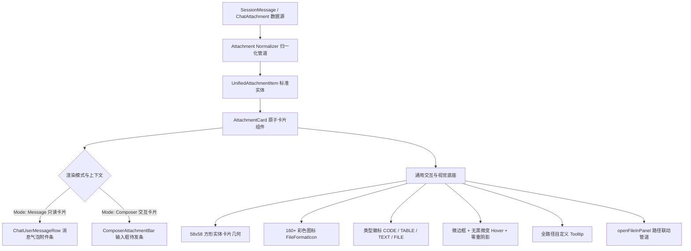
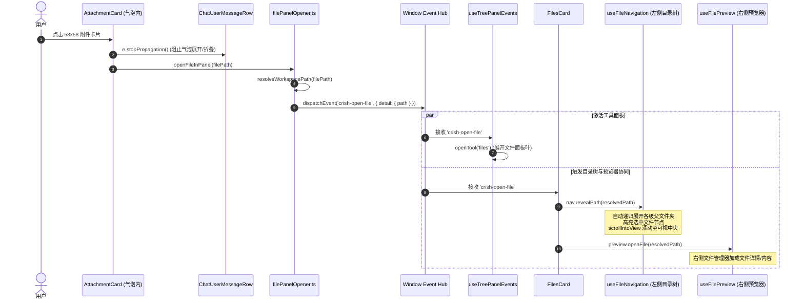
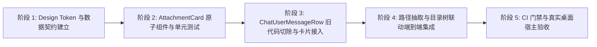

# 消息气泡附件卡片统一架构与旧样式物理删除方案

> **文档定位**：战役独立方案（`docs/file-tree-and-attachments-architecture/independent-plans/02-message-attachment-system-plan.md`）  
> **所属战役**：目录树同步展开、单轨收敛、消息附件卡片统一与面包屑重塑战役  
> **设计基准**：严格遵循仓库根目录 `AGENTS.md`（§1 逻辑规划与反退避、§3 Git 提交纪律、§7 严禁补丁与作弊、§7.1 立体验证纪律、§8 反过度设计红线、§11 CI 治理与前端解耦断言、§12 自定义 Tooltip 规范、§13 输入框与焦点悬浮态规范、§14 色彩空间规范）及 `ANTI_OVERENGINEERING_GUARDRAILS.md`。  
> **规划纪律**：纯逻辑规划，不谈工期、人天、人员分配，所有逻辑问题一律同权，方案严格按逻辑依赖拓扑编排。

---

## 摘要与核心架构目标

当前 Conex/Crish 桌面端在对话流消息气泡（`ChatUserMessageRow.tsx`）与输入框（`ComposerAttachmentBar.tsx`）之间存在严重的**样式分裂与历史负债**：
1. **旧样式残留与视觉割裂**：消息气泡中依然渲染着陈旧粗糙的灰色药丸胶囊（`.userAttachmentChip`）以及裸图堆叠画廊（`.userImages` / `.userImageWrapper`，尺寸突兀地占至 320×240px），与输入框最新上线的 58×58 高质感现代实体卡片格格不入。
2. **多轨并存与代码冗余**：输入框与气泡维护了两套完全独立的附件渲染与样式体系。输入框拥有现代彩色格式图标、缩略图剪裁与微边框；气泡则落后停留在旧时代的纯文本药丸与粗糙大图。
3. **交互断层与定位缺失**：点击气泡附件时的路径打开逻辑零散，缺乏与右侧文件管理器预览、左侧目录树级联展开（Reveal & ScrollIntoView）的统一收口管道。

本方案的核心架构目标为：
- **物理删除旧样式，不留痕迹**：对 `ChatUserMessageRow.tsx` 与 `ChatMessageRow.module.css` 中所有与旧胶囊、裸图画廊相关的 JSX 块、CSS 规则、废弃状态拆分进行彻底的**物理清退**，严禁使用任何 feature flag 或注释隐蔽留存。
- **建立全局单一真理源（SSOT）附件卡片系统**：抽离出高内聚、纯逻辑解耦的原子卡片组件 `AttachmentCard`，以 58×58 实体卡片为全局统一物理规格（图片居中 cover 缩略图、官方 160+ 彩色矢量图标 `FileFormatIcon`、精致分类类型徽标 `CODE` / `TABLE` / `TEXT` / `FILE`、底部省略号截断文件名、全自定义无原生 title 的 `Tooltip`、无黑色混入的极柔和微边框 Hover 态）。
- **打通端到端文件联动事件管道**：卡片点击统一透传物理文件路径，经过 `filePanelOpener.ts` 规范化调度，激活文件工具面板，驱动右侧文件预览器加载，并联动左侧目录树自动级联展开至对应层级并平滑滚动高亮选中。

---

## 一、旧样式与废弃类的物理删除清单（Physical Deletion Audit）

基于对 `apps/crish-desktop/src/components/chat-message-row/` 真实源码的全面静态审计，必须物理切除的代码与样式清单如下：

### 1.1 `ChatUserMessageRow.tsx` 代码切除清单

| 代码位置（当前行号） | 目标代码块 / 变量 | 删除原因与危害分析 |
| :--- | :--- | :--- |
| **行 86 - 91** | ```tsx<br>const images = msg.images ?? [];<br>const nonImageAttachments = (msg.attachments ?? []).filter(<br>  (a) => !a.dataUrl && (!a.mime \|\| !a.mime.startsWith('image/'))<br>);<br>const hasImages = images.length > 0;<br>const hasAttachments = nonImageAttachments.length > 0;<br>``` | **历史双轨派生逻辑**。人为将附件强行割裂为“裸图”与“非图片附件”两套异构数据流，导致渲染端无法实现同构网格布局。必须全部删除，替换为统一的附件数据归一化流水线。 |
| **行 191 - 226** | ```tsx<br>{hasImages ? (<br>  <div className={styles.userImages} data-testid="user-images-gallery"><br>    {images.map((img) => {<br>      const imgSrc = ...;<br>      return (<br>        <Tooltip key={...} content={...}><br>          <div className={styles.userImageWrapper} onClick={...}><br>            <br>          </div><br>        </Tooltip><br>      );<br>    })}<br>  </div><br>) : null}<br>``` | **裸图堆叠旧画廊（36 行 JSX）**。直接在气泡内部渲染最高达 240px 的大尺寸裸图，破坏了气泡的排版节奏与流式阅读体验。必须彻底物理清退。 |
| **行 228 - 252** | ```tsx<br>{hasAttachments ? (<br>  <div className={styles.userAttachments} data-testid="user-attachments-strip"><br>    {nonImageAttachments.map((a) => (<br>      <Tooltip key={a.name} content={...}><br>        <span className={styles.userAttachmentChip} onClick={...}><br>          <FileFormatIcon fileName={a.name} size={14} /><br>          <span className={styles.userAttachmentName}>{a.name}</span><br>        </span><br>      </Tooltip><br>    ))}<br>  </div><br>) : null}<br>``` | **灰色药丸胶囊旧排版（25 行 JSX）**。旧版 14px 微型图标 + 灰色半透明背景胶囊（`.userAttachmentChip`），质感粗糙且样式陈旧，与新版 58×58 卡片设计语言严重冲突。必须彻底物理清退。 |

### 1.2 `ChatMessageRow.module.css` 样式规则彻底删除清单

在 `apps/crish-desktop/src/components/chat-message-row/ChatMessageRow.module.css` 中，第 116 行至第 176 行共计 **61 行无用 CSS 规则**必须逐字逐句物理切除：

```css
/* ==========================================================================
   【彻底物理删除】第 116 - 176 行：全部旧画廊与药丸胶囊规则
   ========================================================================== */

/* 1. 裸图容器与图片包装器（行 116-143）- 彻底删除 */
.userImages {
  display: flex;
  flex-wrap: wrap;
  gap: var(--space-2, 8px);
  margin-bottom: var(--space-2, 8px);
}

.userImageWrapper {
  cursor: pointer;
  border-radius: var(--radius-lg, 10px);
  overflow: hidden;
  border: 1px solid var(--border-subtle);
  background: var(--bg-card);
  transition: transform var(--transition-base, 150ms ease), border-color var(--transition-base, 150ms ease);
}

.userImageWrapper:hover {
  border-color: var(--border-color);
  transform: scale(1.01);
}

.userImage {
  display: block;
  max-width: min(100%, 320px);
  max-height: 240px;
  object-fit: cover;
  border-radius: inherit;
}

/* 2. 旧版灰色药丸胶囊（行 145-176）- 彻底删除 */
.userAttachments {
  display: flex;
  flex-wrap: wrap;
  gap: var(--space-1_5, 6px);
  margin-bottom: var(--space-2, 8px);
}

.userAttachmentChip {
  display: inline-flex;
  align-items: center;
  gap: var(--space-1_5, 6px);
  padding: var(--space-1, 4px) var(--space-2, 8px);
  font-size: var(--font-size-xs, 12px);
  background: color-mix(in srgb, var(--text-primary) 8%, transparent);
  border-radius: var(--radius-md, 6px);
  border: 1px solid var(--border-subtle);
  cursor: pointer;
  color: var(--text-secondary);
  transition: background var(--transition-fast), color var(--transition-fast);
}

.userAttachmentChip:hover {
  background: color-mix(in srgb, var(--text-primary) 14%, transparent);
  color: var(--text-primary);
}

.userAttachmentName {
  max-width: 180px;
  overflow: hidden;
  text-overflow: ellipsis;
  white-space: nowrap;
}
```

### 1.3 废弃视觉表现根因剖析

旧样式的缺陷主要体现在三层架构断裂：
1. **视觉层次混乱**：图片作为 320×240px 巨幅展示，而代码文件却压缩在 22px 高度的灰色药丸中，信息权重极不均衡。
2. **缺乏状态连续性**：用户在输入框选择文件时看到的是精致的 58×58 正方形卡片，消息发送后立刻“突变”为大图或灰色药丸，心理模型发生剧烈断裂。
3. **维护成本翻倍**：任何关于图标尺寸、暗色模式边框或 Tooltip 逻辑的修复，都需要在 `ChatComposer` 与 `ChatMessageRow` 中各自写一遍，违反 DRY 原则与 SSOT 底线。

---

## 二、统一消息附件卡片系统架构设计（Unified Attachment Card System Architecture）

### 2.1 架构分层设计

为彻底消除输入框与消息气泡各自为政的现象，建立分层清晰的卡片系统：



### 2.2 原子组件 `AttachmentCard` 的模式契约

抽离公共原子组件 `AttachmentCard`，置于 `apps/crish-desktop/src/components/chat-attachment/`。该组件负责纯视觉呈现与标准交互，支持 `variant` 属性区分场景：

```typescript
export type AttachmentCardVariant = 'message' | 'composer';

export type AttachmentKind = 'image' | 'code' | 'table' | 'text' | 'file' | 'annotation';

export interface UnifiedAttachmentItem {
  id: string;
  name: string;
  path?: string;
  mime?: string;
  kind: AttachmentKind;
  thumbnailUrl?: string;
  dataUrl?: string;
  source?: string;
  /** 仅在 composer 模式生效的状态属性 */
  status?: 'ready' | 'parsing' | 'error';
  progress?: number;
}

export interface AttachmentCardProps {
  item: UnifiedAttachmentItem;
  variant?: AttachmentCardVariant;
  onClick?: (item: UnifiedAttachmentItem, e: React.MouseEvent) => void;
  onRemove?: (item: UnifiedAttachmentItem, e: React.MouseEvent) => void;
  className?: string;
}
```

#### 变体职责边界：
1. **`message` 模式（气泡专用）**：
   - 彻底隐藏移除叉号按钮；
   - 彻底隐藏上传/解析进度环；
   - 禁用批注弹出层编辑；
   - 保证卡片点击时不触发行内文本展开（`stopPropagation`）；
   - 卡片在气泡内采用 `flex-wrap: wrap` 网格自然换行。
2. **`composer` 模式（输入框专用）**：
   - 启用右上角微型删除叉号（纯平无黑色混入，Hover 鲜明微红变色）；
   - 启用环形进度条 SVG 与百分比胶囊；
   - 启用选区批注浮层编辑通道；
   - 卡片在输入框内采用 `flex-wrap: nowrap; overflow-x: auto` 单行平滑横滑。

### 2.3 数据归一化管道（Data Normalizer）

针对 `SessionMessage` 既有历史数据中可能存在的 `msg.attachments` 与 `msg.images` 冗余问题，提供幂等纯函数 `normalizeMessageAttachments`：

```typescript
/**
 * 将 SessionMessage 中的附件与图片字段融合成标准的 UnifiedAttachmentItem 数组
 * 规则：
 * 1. 优先使用 msg.attachments；
 * 2. 检测图片类型，映射本地或 data: 资源；
 * 3. 补全缺失但存在于 msg.images 的图片条目（去重防重复渲染）；
 * 4. 计算对应的 kind（image/code/table/text/file）。
 */
export function normalizeMessageAttachments(msg: {
  attachments?: import('../../store/types').SessionMessageAttachment[];
  images?: import('../../store/types').MessageImageRef[];
}): UnifiedAttachmentItem[] {
  const result: UnifiedAttachmentItem[] = [];
  const seenPaths = new Set<string>();

  // 1. 处理结构化 attachments
  if (msg.attachments && msg.attachments.length > 0) {
    for (const a of msg.attachments) {
      const key = (a.path || a.name || '').trim().toLowerCase();
      if (key) seenPaths.add(key);
      result.push({
        id: a.path || a.name,
        name: a.name,
        path: a.path,
        mime: a.mime,
        dataUrl: a.dataUrl,
        kind: detectAttachmentKind(a.name, a.mime, Boolean(a.dataUrl)),
        thumbnailUrl: a.dataUrl,
      });
    }
  }

  // 2. 补全仅在 msg.images 中登记的图片（历史消息兼容）
  if (msg.images && msg.images.length > 0) {
    for (const img of msg.images) {
      const srcKey = (img.source || img.id || '').trim().toLowerCase();
      if (srcKey && seenPaths.has(srcKey)) continue;

      const fileName = img.alt || (img.source ? pathBasename(img.source) : 'image.png');
      result.push({
        id: img.id || img.source,
        name: fileName,
        path: isAbsoluteFsPath(img.source) ? img.source : undefined,
        mime: img.mime || 'image/png',
        dataUrl: img.resolvedUrl || (img.source?.startsWith('data:') ? img.source : undefined),
        source: img.source,
        kind: 'image',
        thumbnailUrl: img.resolvedUrl || img.source,
      });
    }
  }

  return result;
}
```

---

## 三、58×58 卡片的视觉、布局与 Design Token 规范

### 3.1 58×58 方形实体卡片几何标尺

所有卡片无论处于气泡中还是输入框中，均严格遵循以下几何标尺：

| 几何参数 | 规格数值 | Design Token 映射 | 说明 |
| :--- | :--- | :--- | :--- |
| **卡片外宽/高** | 58px × 58px | `--attach-card-size: 58px;` | 严格正方形，flex-shrink: 0 |
| **卡片圆角** | 12px | `--attach-card-radius: var(--radius-xl, 12px);` | 平滑同心大圆角 |
| **卡片内边距** | 6px | 固定内边距（图片卡为 0） | 内容安全区为 46px × 46px |
| **卡片间距** | 8px | `--attach-card-gap: 8px;` | 网格/列表项间隙 |
| **默认边框** | 1px solid | `--attach-card-border: 1px solid var(--border-subtle);` | 发丝微边框 |
| **默认背景** | Card Bg | `--attach-card-bg: var(--bg-card, #ffffff);` | 支持深浅色模式自动适配 |
| **阴影控制** | `none` | 严格遵循 `AGENTS.md` §13 | 严禁使用浓重深色 box-shadow |

### 3.2 图片卡片排版规范

对于 `kind === 'image'` 的卡片：
1. **外容器**：`padding: 0; overflow: hidden;`，完全由圆角卡片外框裁切。
2. **缩略图核心**：
   - 必须使用 ``，样式强制设定：
     ```css
     width: 100%;
     height: 100%;
     object-fit: cover;
     display: block;
     border-radius: inherit;
     background: var(--bg-primary);
     ```
   - 彻底避免旧版 320×240px 突兀展开，保证流式信息块整齐划一。
   - 图片 URL 优先加载 `thumbnailUrl` / `resolvedUrl`，本地路径调用 Tauri `convertFileSrc` 安全加载。

### 3.3 非图片文件排版规范（图标 + 徽标 + 截断文件名）

对于非图片文件，内部区域（46px × 46px）分为两层垂直空间：
```text
┌───────────────────────────────────────┐
│ [ 18px FileFormatIcon ]  [ TYPE BADGE ]│  <- 顶部功能行（flex-between）
│                                       │
│                                       │
│ [ 11px 截断文件名: main.rs...      ]  │  <- 底部名称行（单行省略截断）
└───────────────────────────────────────┘
```

1. **顶部行**：
   - **左侧图标**：集成官方 160+ 格式彩色矢量图标 `FileFormatIcon`，尺寸固定为 `18px`，色彩鲜亮保真。
   - **右侧徽标**：提供精致半透明格式类型徽标（`CODE` / `TABLE` / `TEXT` / `FILE`）：
     ```css
     .kindBadge {
       font-size: 8.5px;
       font-weight: 700;
       line-height: 1;
       padding: 1.5px 3.5px;
       border-radius: 3px;
       letter-spacing: 0.02em;
       text-transform: uppercase;
       color: var(--text-tertiary);
       background: color-mix(in srgb, var(--text-primary) 6%, transparent);
       flex-shrink: 0;
     }
     ```
2. **底部文件名**：
   - 文本行单行显示，字号固定为 `11px`，字重 `500`，字色为 `var(--text-secondary)`。
   - 强制采用 `text-overflow: ellipsis; white-space: nowrap; overflow: hidden;`，绝对禁止换行撑破 58px 卡片外框。

### 3.4 交互动效与视觉反馈（遵守 `AGENTS.md` §13 & §14）

1. **Hover 态柔和微变**：
   - 绝对禁止使用纯黑色边框（如 `0 0 0 1px #000`）。
   - 边框颜色平滑过渡到 `var(--border-color)`；
   - 背景色微变：`background: color-mix(in srgb, var(--text-primary) 2%, var(--bg-card));`，呈现通透高阶质感；
   - 过渡曲线：`transition: border-color 120ms ease, background-color 120ms ease;`。
2. **Tooltip 提示规范**：
   - 严禁在卡片或子节点上挂载原生 HTML `title` 属性（违背 `AGENTS.md` §12 且产生双重原生黄气泡）。
   - 必须通过全局 `<Tooltip content={item.path || item.name}>` 进行包裹，悬浮呈现完整物理路径或文件名。

### 3.5 Design Token 统一收敛映射

在 `apps/crish-desktop/src/styles/tokens.css` 中，将既有的 `--composer-attach-*` 拓展为通用卡片 Token 体系：

```css
/* --- Global Attachment Card Token System (SSOT) --- */
:root {
  --attach-card-size: 58px;
  --attach-card-radius: var(--radius-xl, 12px);
  --attach-card-gap: 8px;
  --attach-card-border: 1px solid var(--border-subtle);
  --attach-card-bg: var(--bg-card, #ffffff);
  --attach-card-hover-border: var(--border-color);
  --attach-card-hover-bg: color-mix(in srgb, var(--text-primary) 2%, var(--bg-card));
  --attach-card-name-size: 11px;
  --attach-card-name-color: var(--text-secondary);
}

[data-theme='dark'] {
  --attach-card-border: 1px solid var(--border-subtle);
  --attach-card-bg: var(--bg-card, hsl(0 0% 12%));
  --attach-card-hover-border: var(--border-color);
  --attach-card-hover-bg: color-mix(in srgb, var(--text-primary) 3%, var(--bg-card));
  --attach-card-name-color: var(--text-secondary);
}
```

---

## 四、附件卡片点击联动事件管道（Event Pipeline & Tree Synchronization）

用户在气泡中点击附件卡片，其行为绝不仅是在新标签打开，而是必须与整套工作区文件管理体系深度联动。

### 4.1 端到端联动时序图



### 4.2 物理路径提取与事件透传保障

卡片根元素显式标注 `data-file-open-path` 属性，便于系统全局的事件委托与抽取函数 `pathFromFileOpenClickTarget` 识别：

```tsx
<span
  role="button"
  tabIndex={0}
  data-testid="message-attach-card"
  data-attach-kind={item.kind}
  data-file-open-path={item.path || item.name}
  className={styles.card}
  onClick={handleClick}
  onKeyDown={handleKeyDown}
>
  ...
</span>
```

点击事件处理函数严守边界：
1. **阻断冒泡**：必须显式调用 `e.stopPropagation()`，防止触发用户消息气泡的长文本展开折叠开关（`toggleExpand`）。
2. **有效路径校验**：
   - 提取 `item.path || item.name`；
   - 调用 `openFileInPanel(targetPath)`；
   - 若附件无关联本地物理路径（如纯 Base64 图片或未持久化粘贴项），弹出温和 Toast 提示：“该附件无关联本地物理路径”，并在条件允许时弹出独立预览窗口。

### 4.3 目录树展开与居中定位的契约闭环

在 `FilesCard.tsx`（行 135-141）中，系统既有的打开函数为：
```typescript
const handleOpenFile = useCallback(
  async (path: string) => {
    if (!(await nav.confirmNavigation())) return;
    const resolved = resolveWorkspacePath(path);
    await nav.revealPath(resolved);
    await preview.openFile(path);
  },
  [nav, preview]
);
```
当 `AttachmentCard` 发出 `crish-open-file` 事件后，该链路被完整激活：
- `nav.revealPath(resolved)`：解析目标文件相对于当前工作区根的祖先目录链，将目录树中对应的所有父级文件夹逐层置为 `expanded = true`；
- 节点渲染完毕后，目录树视图内部调用 `nodeElement.scrollIntoView({ block: 'center', behavior: 'smooth' })`，将目标文件置于中央；
- `preview.openFile(path)`：右侧文件预览面板同步挂载，实现左树定位与右侧展示的极致同频。

---

## 五、详细文件级修改计划与代码重构示范

### 5.1 【新建】原子卡片组件 `AttachmentCard.tsx`

新建文件：`apps/crish-desktop/src/components/chat-attachment/AttachmentCard.tsx`

```tsx
/**
 * apps/crish-desktop/src/components/chat-attachment/AttachmentCard.tsx
 * 全局统一 58×58 现代高质感附件卡片原子组件（SSOT）
 */
import React, { useCallback } from 'react';
import * as Lucide from 'lucide-react';
import styles from './AttachmentCard.module.css';
import { Tooltip } from '../ui';
import { FileFormatIcon } from '../../assets/icons';
import { isAbsoluteFsPath } from '../../api/workspaceFsApi';
import { convertFileSrc } from '@tauri-apps/api/core';
import type { UnifiedAttachmentItem, AttachmentCardVariant } from './types';

export interface AttachmentCardProps {
  item: UnifiedAttachmentItem;
  variant?: AttachmentCardVariant;
  onClick?: (item: UnifiedAttachmentItem, e: React.MouseEvent) => void;
  onRemove?: (item: UnifiedAttachmentItem, e: React.MouseEvent) => void;
  className?: string;
}

export const AttachmentCard: React.FC<AttachmentCardProps> = React.memo(({
  item,
  variant = 'message',
  onClick,
  onRemove,
  className,
}) => {
  const isComposer = variant === 'composer';
  const isImage = item.kind === 'image';

  // 解析缩略图地址（支持 data: / blob: / http: / 本地绝对路径转资产 URL）
  const imageSrc = React.useMemo(() => {
    if (!isImage) return null;
    const src = item.thumbnailUrl || item.dataUrl || item.source;
    if (!src) return null;
    if (src.startsWith('data:') || src.startsWith('blob:') || src.startsWith('http')) {
      return src;
    }
    if (isAbsoluteFsPath(src)) {
      return convertFileSrc(src);
    }
    return src;
  }, [isImage, item.thumbnailUrl, item.dataUrl, item.source]);

  const handleClick = useCallback(
    (e: React.MouseEvent) => {
      e.stopPropagation();
      onClick?.(item, e);
    },
    [onClick, item]
  );

  const handleKeyDown = useCallback(
    (e: React.KeyboardEvent) => {
      if (e.key === 'Enter' || e.key === ' ') {
        e.preventDefault();
        e.stopPropagation();
        onClick?.(item, e as unknown as React.MouseEvent);
      }
    },
    [onClick, item]
  );

  const handleRemove = useCallback(
    (e: React.MouseEvent) => {
      e.stopPropagation();
      onRemove?.(item, e);
    },
    [onRemove, item]
  );

  const tooltipContent = item.path || item.name;

  return (
    <Tooltip content={tooltipContent}>
      <span
        role="button"
        tabIndex={0}
        data-testid="unified-attach-card"
        data-attach-kind={item.kind}
        data-file-name={item.name}
        data-file-open-path={item.path || item.name}
        className={`${styles.card} ${isImage ? styles.imageCard : styles.fileCard} ${className || ''}`}
        onClick={handleClick}
        onKeyDown={handleKeyDown}
      >
        {isImage && imageSrc ? (
          
        ) : (
          <div className={styles.fileContent}>
            <div className={styles.headerRow}>
              <span className={styles.iconWrapper} aria-hidden="true">
                <FileFormatIcon fileName={item.name} size={18} />
              </span>
              <span className={styles.kindBadge}>{item.kind}</span>
            </div>
            <span className={styles.fileName}>{item.name}</span>
          </div>
        )}

        {/* 仅在 composer 模式下渲染移除叉号 */}
        {isComposer && (
          <button
            type="button"
            className={styles.removeBtn}
            aria-label={`移除附件 ${item.name}`}
            onClick={handleRemove}
          >
            <Lucide.X size={10} strokeWidth={2.2} aria-hidden="true" />
          </button>
        )}
      </span>
    </Tooltip>
  );
});

AttachmentCard.displayName = 'AttachmentCard';
```

### 5.2 【新建】原子卡片样式 `AttachmentCard.module.css`

新建文件：`apps/crish-desktop/src/components/chat-attachment/AttachmentCard.module.css`

```css
/**
 * 统一 58×58 现代高质感实体卡片样式
 * 严格遵照 AGENTS.md §13 焦点/微边框与无黑微变规范
 */

.card {
  position: relative;
  display: inline-flex;
  flex-direction: column;
  justify-content: space-between;
  width: var(--attach-card-size, 58px);
  height: var(--attach-card-size, 58px);
  max-width: var(--attach-card-size, 58px);
  border-radius: var(--attach-card-radius, 12px);
  border: var(--attach-card-border, 1px solid var(--border-subtle));
  background: var(--attach-card-bg, var(--bg-card, #ffffff));
  box-sizing: border-box;
  flex-shrink: 0;
  cursor: pointer;
  user-select: none;
  overflow: hidden;
  box-shadow: none;
  transition:
    border-color var(--transition-fast, 120ms ease),
    background-color var(--transition-fast, 120ms ease);
}

.card:hover,
.card:focus-visible {
  border-color: var(--attach-card-hover-border, var(--border-color));
  background: var(--attach-card-hover-bg, color-mix(in srgb, var(--text-primary) 2%, var(--bg-card)));
  box-shadow: none;
  outline: none;
}

/* 图片缩略图卡片 */
.imageCard {
  padding: 0;
  background: var(--bg-primary);
}

.thumbnail {
  width: 100%;
  height: 100%;
  object-fit: cover;
  display: block;
  border-radius: inherit;
  background: var(--bg-primary);
}

/* 非图片文件卡片 */
.fileCard {
  padding: 6px;
}

.fileContent {
  width: 100%;
  height: 100%;
  display: flex;
  flex-direction: column;
  justify-content: space-between;
}

.headerRow {
  width: 100%;
  display: flex;
  align-items: center;
  justify-content: space-between;
}

.iconWrapper {
  width: 18px;
  height: 18px;
  display: inline-flex;
  align-items: center;
  justify-content: center;
  flex-shrink: 0;
}

.kindBadge {
  font-size: 8.5px;
  font-weight: 700;
  line-height: 1;
  padding: 1.5px 3.5px;
  border-radius: 3px;
  letter-spacing: 0.02em;
  text-transform: uppercase;
  color: var(--text-tertiary);
  background: color-mix(in srgb, var(--text-primary) 6%, transparent);
  flex-shrink: 0;
}

.fileName {
  font-size: var(--attach-card-name-size, 11px);
  font-weight: 500;
  color: var(--attach-card-name-color, var(--text-secondary));
  white-space: nowrap;
  overflow: hidden;
  text-overflow: ellipsis;
  width: 100%;
  max-width: 100%;
  line-height: 1.25;
  display: block;
  box-sizing: border-box;
  text-align: left;
}

/* 移除按钮（仅 composer 模式使用，遵循统一无黑 hover） */
.removeBtn {
  position: absolute;
  top: 3px;
  right: 3px;
  width: 18px;
  height: 18px;
  border-radius: 50%;
  display: flex;
  align-items: center;
  justify-content: center;
  cursor: pointer;
  opacity: 0;
  transform: scale(0.85);
  pointer-events: none;
  background: rgba(255, 255, 255, 0.72);
  backdrop-filter: blur(8px);
  -webkit-backdrop-filter: blur(8px);
  border: 1px solid color-mix(in srgb, var(--border-color) 70%, transparent);
  color: var(--text-primary);
  padding: 0;
  transition:
    opacity 140ms ease,
    transform 140ms ease,
    background-color 140ms ease,
    color 140ms ease;
  z-index: 10;
}

.card:hover .removeBtn,
.card:focus-within .removeBtn {
  opacity: 1;
  transform: scale(1);
  pointer-events: auto;
}

.removeBtn:hover {
  background: hsl(0 78% 54%) !important;
  border-color: transparent !important;
  color: #ffffff !important;
}
```

### 5.3 【重构】`ChatUserMessageRow.tsx`

修改文件：`apps/crish-desktop/src/components/chat-message-row/ChatUserMessageRow.tsx`

1. **导入与数据归一化**：
   引入原子卡片组件与归一化工具：
   ```tsx
   import { AttachmentCard } from '../chat-attachment/AttachmentCard';
   import { normalizeMessageAttachments } from '../chat-attachment/attachmentUtils';
   import type { UnifiedAttachmentItem } from '../chat-attachment/types';
   ```
2. **切除旧状态计算（删除原行 86-91）**：
   ```tsx
   // 统一归一化后的所有附件（图片与非图片同权同构）
   const normalizedAttachments = React.useMemo(
     () => normalizeMessageAttachments(msg),
     [msg.attachments, msg.images]
   );
   const hasAttachments = normalizedAttachments.length > 0;
   ```
3. **点击事件统一绑定**：
   ```tsx
   const handleCardClick = useCallback(
     (item: UnifiedAttachmentItem) => {
       const targetPath = (item.path || item.name || '').trim();
       if (targetPath) {
         handleOpenPath(targetPath);
       } else if (item.dataUrl) {
         // 无物理路径的纯数据图片（备用弹出通道）
         const win = typeof window !== 'undefined' ? window.open('', '_blank') : null;
         if (win) {
           win.document.write(``);
           win.document.close();
         }
       } else {
         showToast('该附件无关联本地物理路径');
       }
     },
     [handleOpenPath, showToast]
   );
   ```
4. **彻底物理重塑 JSX（替代原行 191-252 的 61 行垃圾代码）**：
   ```tsx
   {hasAttachments ? (
     <div
       className={styles.userAttachmentsStrip}
       data-testid="user-attachments-strip"
     >
       {normalizedAttachments.map((item) => (
         <AttachmentCard
           key={item.id}
           item={item}
           variant="message"
           onClick={handleCardClick}
         />
       ))}
     </div>
   ) : null}
   ```

### 5.4 【重构】`ChatMessageRow.module.css`

修改文件：`apps/crish-desktop/src/components/chat-message-row/ChatMessageRow.module.css`

1. **物理清空原第 116 - 176 行**（`.userImages`, `.userImageWrapper`, `.userImage`, `.userAttachments`, `.userAttachmentChip`, `.userAttachmentName` 全数移除）。
2. **新增极简纯粹的附件条流式包装规则**：
   ```css
   .userAttachmentsStrip {
     display: flex;
     flex-wrap: wrap;
     gap: var(--attach-card-gap, 8px);
     margin-bottom: var(--space-2, 8px);
     width: 100%;
     max-width: 100%;
   }
   ```

---

## 六、逻辑依赖拓扑与立体化验证方案

遵循纯逻辑规划与立体化验证铁律（`AGENTS.md` §1 & §7.1），本项目按逻辑依赖分为 5 个环环相扣的验证阶段：



### 6.1 阶段一：Design Token 与数据契约建立（零运行时影响）
- **任务目标**：在 `tokens.css` 中补齐 `--attach-card-*` 拓扑映射，声明 `UnifiedAttachmentItem` 数据契约。
- **验收断言**：
  - 执行 `npm run typecheck` 无类型报错；
  - CSS 变量在深浅色模式下解析值正确。

### 6.2 阶段二：`AttachmentCard` 原子组件与单元测试
- **任务目标**：完成 `AttachmentCard.tsx`、`AttachmentCard.module.css` 以及数据归一化工具编写，并撰写专属 Vitest 单元测试套件。
- **测试覆盖矩阵（`AttachmentCard.test.tsx`）**：
  1. 图片卡片：验证 `thumbnailUrl` 优先渲染、图片标签具有 `object-fit: cover`，外框 `58×58`。
  2. 格式卡片：验证传入 `test.ts` 渲染 `CODE` 徽标与 TS 彩色图标；传入 `data.csv` 渲染 `TABLE` 徽标。
  3. 文本截断：验证长文件名具有 `text-overflow: ellipsis` 样式，无原生 `title` 属性。
  4. 交互区分：验证在 `message` 变体下不存在删除按钮；在 `composer` 变体下存在删除按钮且点击触发 `onRemove`。
  5. 阻止冒泡：验证点击卡片触发 `e.stopPropagation()`。

### 6.3 阶段三：`ChatUserMessageRow` 旧代码切除与卡片接入
- **任务目标**：物理删除 `ChatUserMessageRow.tsx` 与 `ChatMessageRow.module.css` 中所有旧胶囊与裸图规则，接入 `AttachmentCard`。
- **验收断言**：
  - 源码静态扫描：全工程检索 `.userAttachmentChip`、`.userImages`、`.userImageWrapper`，匹配结果为 **0**。
  - 行数与复杂度检查：`ChatUserMessageRow.tsx` 有效代码行数净减少约 40 行，完全符合 CI 行数门禁（<500 行）。

### 6.4 阶段四：路径抽取与目录树联动端到端集成
- **任务目标**：验证在气泡中点击卡片后，端到端事件管道的准确触发。
- **集成断言（`ChatUserMessageRow.attachment.test.tsx`）**：
  - 模拟包含附件的消息渲染；
  - 点击 `src/index.ts` 附件卡片；
  - 断言 `window.dispatchEvent` 接收到包含 `{ path: 'src/index.ts' }` 的 `crish-open-file` 事件；
  - 验证气泡的 `onToggleExpand` **未被触发**（冒泡成功阻断）。

### 6.5 阶段五：CI 门禁与真实桌面宿主验收
- **执行命令清单**：
  ```pwsh
  npm run typecheck
  npm run check:line-counts
  npm run test:coverage -- --project=unit
  npx vitest run apps/crish-desktop/src/components/chat-message-row/
  ```
- **真实宿主验收（Tauri MCP / 4000）**：
  - 启动 `npm run dev:workbench`；
  - 发送带有图片、TS 源码文件、CSV 数据表的混合消息；
  - 观察消息气泡：确认 58×58 卡片整齐网格排列，微边框与圆角完全对齐输入框设计语言；
  - 悬浮在卡片上：确认 Tooltip 呈现完整路径，无多余重阴影，Hover 边缘极其柔和；
  - 点击非图片卡片：确认右侧自动打开该文件，左侧目录树自动级联展开并滚动定位到对应节点；
  - 检查开发者工具控制台：0 未捕获异常，0 警告。
