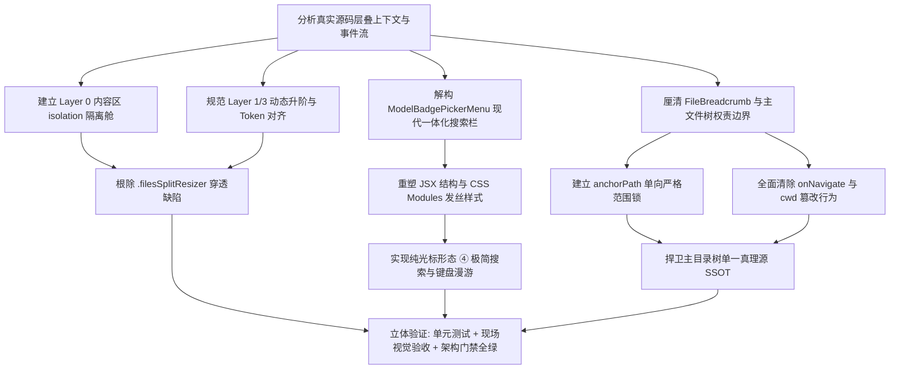

# 面包屑展开面板重塑、穿透分割线根除与树范围约束架构设计方案

> **文件标识**：`docs/file-tree-and-attachments-architecture/independent-plans/03-breadcrumb-and-flyout-ui-plan.md`  
> **方案性质**：系统性前端 UI、布局层级与状态单向流重构方案  
> **核心目标**：彻底根除底层拖拽分割线（`.filesSplitResizer`）对面包屑下拉展开面板的层叠穿透、参照 `ModelBadgePickerMenu` 全面重塑面包屑搜索框为现代化一体发丝极简样式、建立面包屑下拉树基于点击节点的纯粹范围约束、杜绝面包屑交互对主工作区 `cwd` 的侵入污染。

---

## 1. 架构总览与问题全景定义

### 1.1 背景与现状剖析

在 Conex / Crish 桌面客户端中，文件管理器卡片（`FilesCard`）是工作区资源浏览、定位、预览与批注的核心枢纽。顶栏集成了路径面包屑导航组件（`FileBreadcrumb`），用于呈现当前工作区根目录、当前激活目录或文件的级联路径，并支持点击任一面包屑片段（Chip）弹出一个下拉浮层面板（`filesBcFlyout`），以便用户在无需切换主文件树视口的情况下，快速勘察与漫游对应目录层级的子项。

然而，在当前的生产源码与实际用户交互中，暴露出三个深层次的架构断层与视觉缺陷：

```
+-----------------------------------------------------------------------------------+
| FilesCard                                                                         |
|  +-----------------------------------------------------------------------------+  |
|  | filesBar (Toolbar) [z-index: 10]                                            |  |
|  |   FileBreadcrumb: [conex] / [apps] / [crish-desktop]                        |  |
|  |                                  |                                          |  |
|  |                                  v                                          |  |
|  |     +-----------------------------------------------------------------+     |  |
|  |     | filesBcFlyout (Flyout Dropdown) [z-index: 400 局部假象]          |     |  |
|  |     |   +-------------------------------------------------------+     |     |  |
|  |     |   | [缺陷 1] 粗糙带框搜索框: border: 1px, type="search"     |     |     |  |
|  |     |   +-------------------------------------------------------+     |     |  |
|  |     |   | [缺陷 3] 目录树展开: 范围易发生偏离甚至重复从根拉取      |     |     |  |
|  |     |   |                                                       |     |     |  |
|  |  +--+---|-------------------------------------------------------+--+  |  |
|  |  |  |   |                                                       |  |  |  |
|  |  |  |   | [缺陷 2: 严重穿透!]                                   |  |  |  |
|  |  |  |   | filesSplitResizer 竟然垂直切开并盖在 Flyout 上面!     |  |  |  |
|  |  |  |   |                                                       |  |  |  |
|  +--|--+---+-------------------------------------------------------+--|--+  |
|     |                                                                 |     |
|     | filesBody [无 Stacking Context, 暴露在其内的 Resizer 溢出竞争]  |     |
|     |  +---------------------+   |   +-----------------------------+  |     |
|     |  | FileTreeView        |   |   | FilePreview                 |  |     |
|     |  | (主文件树)          |   |   | (文件预览器)                |  |     |
|     |  +---------------------+   |   +-----------------------------+  |     |
|     |                            ^                                    |     |
|     |                     filesSplitResizer                           |     |
|     |                 [z-index: 10, DOM在后，绘制在上]                |     |
|     +-----------------------------------------------------------------+     |
+-----------------------------------------------------------------------------------+
```

1. **缺陷 1：面包屑下拉搜索框样式粗糙落后**  
   当前展开面板内的搜索输入框（`.filesBcFlyoutSearch`）采用独立的带边框矩形包裹、内置 `type="search"` 标签，带有外框重边框、生硬的内边距与原生的浏览器清除按钮装饰，整体质感沉重。与桌面端模型选择器（`ModelBadgePickerMenu`）所确立的高级发丝下一体化搜索栏（无边框、左侧弱灰放大镜、右侧紧凑微动作按钮、纯光标闪烁形态）存在严重的设计规范断层。
2. **缺陷 2：底层垂直拖拽分割线穿透面包屑面板**  
   在 `FilesCard.module.css` 中，`.filesBar` 被赋予了 `z-index: var(--z-card-footer, 10)`，使其形成了一个层叠层级仅为 10 的独立层叠上下文（Stacking Context）。其内部的下拉浮层 `.filesBcFlyout` 虽声明了 `z-index: var(--z-breadcrumb, 400)`，但在父级层叠上下文限制下无法向外渗透。与此同时，其同级容器 `.filesBody` 未建立层叠上下文，其内部的分割拖拽条 `.filesSplitResizer` 以 `position: relative; z-index: 10` 直接参与外层 `.filesCard` 的层叠竞争，且因 DOM 顺序在后，直接绘制在 `.filesBar`（及其子项 `.filesBcFlyout`）之上！一条细线生硬地垂直穿透面包屑浮层，破坏了界面的基本物理遮挡逻辑。
3. **缺陷 3：展开面板内的目录树基准漂移**  
   面板内的树结构偶尔在深层或边缘交互后脱离当前点击节点的束缚，甚至因缓存键或渲染递归逻辑导致从项目根目录重复列出，违背了「聚焦当前片段子目录」的局部漫游初衷。
4. **缺陷 4：面包屑交互副作用破坏主文件树单一真理源（SSOT）**  
   当前代码中，双击面包屑芯片、双击面板内部文件夹或点击快捷打开按钮时，频繁调用宿主传下的 `onNavigate(path)`，直接触发 `useFileNavigation` 中的 `nav.refresh(path)`，进而将主工作区文件树的 `cwd` 篡改为子目录。主文件树从「工作区全景树」瞬间退化为「孤立子目录树」，所有其他目录的展开折叠状态被粗暴清空，严重破坏了主界面的单一真理源。

### 1.2 架构解决原则

- **绝对层级拓扑与零魔术数字（Zero Magic Numbers）**：严格依托 `styles/z-index.css` 的系统化分层 Token，通过严密的容器级层叠上下文隔离（Stacking Context Isolation），从几何与代数逻辑上根除任何元素穿透，杜绝 `z-index: 99999` 式的脆弱补丁。
- **设计系统（Design Tokens）原子对齐**：全面对齐 `ModelBadgePickerMenu` 的现代一体化极简搜索形态（形态 ④：纯光标极简型），发丝下边框融合、无边框极简 input、左侧弱灰放大镜、右侧精致动作按钮。
- **纯粹的局部漫游闭包（Local Inspection Closure）**：面包屑下拉浮层作为一种**瞬态观察与快速漫游探针**，其所有展开、折叠、目录内容拉取均被封闭在内部状态（`bcFlyout.dirCache`, `bcFlyout.expandedPaths`）中，严格以点击的面包屑节点路径（`anchorPath`）为树根，绝不向上拉取整库根节点。
- **主目录树单一真理源（SSOT Protection）**：主界面的 `cwd` 必须永久锁死在工作区根目录（`root`），面包屑及下拉面板中的任何点击、双击、筛选交互均定位为「当前面板内浏览」或「在预览区直接打开目标文件（并通过 `revealPath` 展开主树而不篡改 `cwd`）」，严禁重置主文件树。

---

## 2. 缺陷二：`.filesSplitResizer` 穿透面板的层叠上下文根因与绝对层级隔离方案

### 2.1 CSS 层叠上下文缺陷病理深度剖析

为彻底消除 `.filesSplitResizer` 穿透面包屑面板的问题，必须通过 W3C CSS 规范（CSS 2.1 § 9.9 与 CSS Positioned Layout Level 3）进行代数与拓扑层面的严谨反演。

#### 2.1.1 DOM 树与当前样式分布现状

在 `apps/crish-desktop/src/components/files/FilesCard.tsx` 中，DOM 的结构组织如下：

```html
<div class="filesCard">                      <!-- 宿主外壳 -->
  <div class="filesBar">                     <!-- 顶部工具条 (Sibling 1) -->
    <div class="filesCrumbs">
      <span class="filesBcSeg">
        <button class="filesBcChip">apps</button>
        <div class="filesBcFlyout">...</div> <!-- 面包屑下拉面板 -->
      </span>
    </div>
  </div>
  <div class="filesBody filesBodySplit">     <!-- 内容区分栏容器 (Sibling 2) -->
    <div class="filesListPane">...</div>     <!-- 左侧主目录树 -->
    <div class="filesSplitResizer"></div>    <!-- 垂直拖拽分割线 -->
    <div class="filesDetailPane">...</div>   <!-- 右侧预览区 -->
  </div>
</div>
```

在 `FilesCard.module.css` 中，相关的核心样式如下：

```css
/* 顶部工具栏 */
.filesBar {
  position: relative;
  z-index: var(--z-card-footer, 10); /* 重点：被赋予了 z-index: 10 */
  overflow: visible;
}

/* 面包屑容器 */
.filesCrumbs {
  position: relative;
  z-index: var(--z-card-footer, 10); /* 重点：再次嵌套 z-index: 10 */
  overflow: visible;
}

/* 下拉面板 */
.filesBcFlyout {
  position: absolute;
  top: calc(100% + 6px);
  left: 0;
  z-index: var(--z-breadcrumb, 400); /* 重点：局部声明为 400 */
}

/* 内容分栏容器 */
.filesBody {
  display: flex;
  overflow: hidden;
  /* 未声明 position，未声明 z-index，未声明 isolation */
}

/* 垂直拖拽分割线 */
.filesSplitResizer {
  position: relative;
  z-index: 10;                      /* 重点：声明为 z-index: 10 */
  flex: 0 0 7px;
  width: 7px;
  margin: 0 -3px;
  cursor: col-resize;
}
```

#### 2.1.2 为什么会发生穿透（根本机理推导）

1. **`.filesBar` 构成了局部的层叠封闭舱（Stacking Context Trap）**：  
   `.filesBar` 拥有 `position: relative` 并且其 `z-index` 计算值为数值 `10`（来源于 `--z-card-footer: 10`）。根据规范，该元素在宿主 `.filesCard` 的层叠树中创建了一个新的层叠上下文。
   内部的 `.filesBcFlyout` 即使声明了 `z-index: 400`（`--z-breadcrumb`），根据层叠上下文的封装性原则：
   $$\text{StackingLevel}_{\text{global}}(\text{.filesBcFlyout}) \equiv \text{StackingLevel}_{\text{global}}(\text{.filesBar}) = 10$$
   `.filesBcFlyout` 的 `400` 仅在其父级 `.filesBar`（或 `.filesCrumbs`）内部有效，根本无法逾越 `.filesBar` 的外边界！对外而言，整个 `.filesBar` 及其全部子元素，在宿主中的层叠权重仅为 **10**。
2. **`.filesBody` 没有构建层叠上下文，导致其子元素冒泡外溢**：  
   `.filesBody` 为普通的文档流元素（`position: static; z-index: auto`），且没有使用 `isolation: isolate`、`opacity`、`transform` 等属性。因此，`.filesBody` **没有**产生层叠上下文。
3. **`.filesSplitResizer` 的跨层级冒泡与同级平权竞争**：  
   `.filesSplitResizer` 是 `position: relative; z-index: 10`。由于其直接父容器 `.filesBody` 未形成层叠上下文，根据规范，`.filesSplitResizer` 直接向上寻找到最近的祖先层叠上下文——即外层的 `.filesCard`。
   此时，在 `.filesCard` 这一层叠上下文中，存在两个平权的参与者：
   - 参与者 A：`.filesBar`（层叠上下文，`z-index = 10`，内部包含 `.filesBcFlyout`）；
   - 参与者 B：`.filesSplitResizer`（定位元素，`z-index = 10`）。
4. **DOM 树顺序决胜机制（Tree Order Tie-Breaker）导致致命遮挡**：  
   W3C CSS 规范 § 9.9 明确规定：
   > *“Within each stacking context, positioned elements with the same stack level are stacked according to tree order (i.e. DOM source order).”*
   在 `FilesCard.tsx` 的 JSX 中，`.filesBar` 先行渲染，而包含 `.filesSplitResizer` 的 `.filesBody` 在其后渲染。因此：
   $$\text{DOM\_Order}(\text{.filesSplitResizer}) > \text{DOM\_Order}(\text{.filesBar})$$
   在层叠等级同为 `10` 的情况下，**后出现的 `.filesSplitResizer` 必然绘制在先出现的 `.filesBar` 之上**！
   当 `.filesBcFlyout` 向下弹出悬挂在 `.filesBody` 的上方时，`.filesSplitResizer` 恰好横跨其显示区域，最终形成了垂直分割线将整个下拉面板垂直切开并浮于其上的视觉事故。

#### 2.1.3 为什么「盲加 z-index」或「修改 Resizer」是错误的打补丁行为

- **错误做法 A（给 `.filesBcFlyout` 加 `z-index: 99999`）**：毫无作用。因为 `.filesBcFlyout` 受制于父级 `.filesBar` 的 `z-index: 10` 舱壁，在宿主眼中依旧是 10。
- **错误做法 B（给 `.filesSplitResizer` 设 `z-index: 0` 或负值）**：破坏了分割条在主视口中的正常交互。当文件树中出现带有阴影或选中背景的高亮元素时，分割条会被文件行遮挡，导致无法正常捕获鼠标 hover 与拖拽事件。
- **必须采用系统性架构解法**：通过**父容器层级严格分级**与**内容区绝对隔离（Isolation Cabin）**，从架构根源上解除竞争。

---

### 2.2 绝对层级隔离与 Token 分层架构方案

基于 `apps/crish-desktop/src/styles/z-index.css` 的设计规范，系统预设了严格的六级层级标准：

| 级别 | Token 变量 | 基准值 | 语义定位 |
| :--- | :--- | :--- | :--- |
| **Level 0** | `--z-base` | `0` | 基础文档流与排版底座（文件列表、代码预览、内容分栏） |
| **Level 1** | `--z-dock`, `--z-sticky` | `10` | 粘性与外壳停靠层（顶栏、底栏、操作栏） |
| **Level 2** | `--z-chrome`, `--z-resizer` | `100` | 视口外壳与全局分栏手柄 |
| **Level 3** | `--z-dropdown`, `--z-breadcrumb` | `300 / 400` | 下拉菜单与级联选择浮层 |
| **Level 4** | `--z-popover`, `--z-drawer` | `500` | 浮层气泡与抽屉 |
| **Level 5** | `--z-modal`, `--z-toast` | `1000` | 全局模态窗与系统通知 |
| **Level 6** | `--z-tooltip` | `9000` | 顶级悬浮提示与光标胶囊 |

#### 2.2.1 方案实施矩阵

为彻底消除穿透，采用 **“两点锁死，局部封闭”** 的架构重构策略：

```
[Layer Hierarchy Architecture]

.filesCard (Root Container, overflow: hidden)
 │
 ├── [Layer 1 / Layer 3 动态升阶]
 │   .filesBar (Toolbar)
 │     ├── 常态: position: relative; z-index: var(--z-dock, 10);
 │     └── 展开态 (.hasFlyout / :has(.filesBcFlyout)): z-index: var(--z-breadcrumb, 400);
 │         │
 │         └── .filesBcFlyout (Dropdown Flyout)
 │               position: absolute; z-index: var(--z-breadcrumb, 400);
 │
 └── [Layer 0 隔离禁闭舱]
     .filesBody (Content Container)
       position: relative;
       z-index: var(--z-base, 0);
       isolation: isolate;  <--- 【关键】彻底切断内部元素向外溢出的层叠上下文隔离舱
         │
         ├── .filesListPane
         ├── .filesSplitResizer (position: relative; z-index: 1;) 永远受困于 Level 0 内部！
         └── .filesDetailPane
```

#### 2.2.2 核心重构要点

1. **在 `.filesBody` 上注入 `isolation: isolate` 与 `z-index: var(--z-base, 0)`**：  
   `isolation: isolate` 是现代 CSS 规范中用于显式创建独立层叠上下文的标准原生属性（无任何副作用，不改变盒模型、不引起重排）。结合 `position: relative; z-index: var(--z-base, 0);`，将整个内容区分栏（包括主文件树、分割线、代码预览器）完全锁定在 **Level 0**。  
   即使 `.filesSplitResizer` 在其内部声明了任何正值 `z-index`，它也仅能在 `.filesBody` 的 Level 0 隔离舱内部起作用，**在代数上永远无法逃逸到 `.filesCard` 与 `.filesBar` 进行同级竞争**！
2. **规范 `.filesBar` 的层级语义与动态升阶机制**：  
   - 将原先错误引用的 `--z-card-footer` 纠正为语义准确的 `--z-dock, 10`。在常规状态下，`.filesBar`（Level 1）严格高于 `.filesBody`（Level 0）。
   - 为确保在展开下拉面板时，面板能够安全跨越任何可能处于 Level 2（如工作区边缘拖拽线 `--z-resizer: 100`）的干扰，利用现代 CSS 的 `:has()` 伪类或由 React 传递状态类 `.filesBar[data-flyout-open="true"]`，使 `.filesBar` 在展开浮层时自动升阶至 `z-index: var(--z-breadcrumb, 400)`。
3. **消除 `.filesCrumbs` 冗余的嵌套层叠阻断**：  
   原代码中 `.filesCrumbs` 上也设置了 `position: relative; z-index: var(--z-card-footer, 10);`。这造成了多层无意义的层叠包裹。方案中移除 `.filesCrumbs` 的 `z-index` 声明，让其作为普通流元素自然透传，由 `.filesBcSeg` 与 `.filesBcFlyout` 直接向 `.filesBar` 汇报层叠顺序。
4. **规范 `.filesSplitResizer` 的内部局域层级**：  
   `.filesSplitResizer` 的 `z-index` 从写死的硬编码 `10` 调整为局域层级 `1`（或 `var(--z-resizer-local, 1)`），其作用仅用于保证分割线及其 hover/active 状态的高亮光晕在 `.filesListPane` 和 `.filesDetailPane` 之上即可，内部干净收敛。

---

## 3. 缺陷一：参照 `ModelBadgePickerMenu` 的面包屑搜索框现代化重塑方案

### 3.1 视觉标准对标：`ModelBadgePickerMenu` 架构解构

`apps/crish-desktop/src/components/provider/ModelBadgePickerMenu.tsx` 与其模块化样式 `ModelBadgePickerMenu.module.css` 是当前仓库内经受过严格设计审视的标杆组件。其顶栏搜索区域具备以下四大典型特征：

```
+-----------------------------------------------------------------------------+
| ModelBadgePickerMenu 顶部搜索设计规范                                       |
|                                                                             |
| +-------------------------------------------------------------------------+ |
| | [Search 14px]  搜索模型或厂商...                        [SlidersHoriz]  | |
| +-------------------------------------------------------------------------+ |
| ============================== 发丝分割线 (1px hairline) ================== |
| (下方为模型滚动列表区，无多余外框嵌套)                                      |
+-----------------------------------------------------------------------------+
```

1. **发丝下边框一体化搜索栏（Integrated Header with Hairline Divider）**：  
   搜索栏绝非一个被丢进浮层内、四周带框的独立 input 框，而是与浮层顶端浑然一体的 Header 布局。其四周无边框、无独立背景填充，仅在底部由一条超细发丝线（`border-bottom: 1px solid var(--hairline, var(--border-subtle))`）与下方内容列表进行视觉物理分隔。
2. **形态 ④ 纯光标极简 input（Pure Cursor Minimalist Input）**：  
   输入框元素彻底剔除边框（`border: none`）、投影（`box-shadow: none`）、高亮轮廓（`outline: none`）以及任何背景填充（`background: transparent`）。无论在默认态、hover 态还是 focus 态，**视觉上只有纯粹的文本光标（caret）在闪烁，无任何粗黑描边、外发光或生硬的背景反色**，完全杜绝视觉干扰。
3. **弱灰矢量搜索图标（Muted Search Icon）**：  
   左侧固定一个精确为 14px 的矢量放大镜（`Lucide.Search`），前景色采用弱化辅助色（`var(--text-tertiary)`），紧凑且不喧宾夺主。
4. **精致动作按钮（Refined Action Button）**：  
   右侧动作按钮采用 24×24px 正方形极简胶囊布局，`border: none; background: transparent; border-radius: var(--radius-sm, 4px)`。在悬停时呈现轻柔的背景微温高亮（`var(--bg-hover)` 或 `var(--tint-hover)`），并始终包裹在统一定制的 `<Tooltip>` 提示中。

### 3.2 JSX 结构现代化重构

在 `FileBreadcrumb.tsx` 中，将旧有粗糙的 `.filesBcFlyoutSearch` 结构全面升级为现代化的结构体系：

```tsx
/* 现代化重塑后的搜索顶栏 JSX 架构 */
<div className={styles.filesBcFlyoutHeader}>
  <Search size={14} className={styles.filesBcFlyoutSearchIcon} aria-hidden />
  <input
    ref={bcFilterRef}
    type="text"                                     /* 严禁用 type="search"，彻底规避浏览器默认破坏性部件 */
    className={styles.filesBcFlyoutSearchInput}
    placeholder="筛选当前目录项…"
    value={bcFlyout.filter}
    onChange={(e) =>
      setBcFlyout((prev) =>
        prev ? { ...prev, filter: e.target.value } : prev
      )
    }
    onKeyDown={handleSearchInputKeyDown}
    aria-label="筛选当前目录内容"
    autoComplete="off"
    spellCheck={false}
  />
  {bcFlyout.filter ? (
    /* 存在输入内容时：呈现一键清空按钮 */
    <Tooltip content="清空筛选 (Esc)">
      <button
        type="button"
        className={styles.filesBcFlyoutActionBtn}
        aria-label="清空筛选"
        onClick={() => {
          setBcFlyout((prev) => (prev ? { ...prev, filter: '' } : prev));
          bcFilterRef.current?.focus();
        }}
      >
        <X size={13} aria-hidden />
      </button>
    </Tooltip>
  ) : (
    /* 无筛选内容时：呈现精致的局域操作按钮（例如局域快速折叠或定位提示，不再篡改主树 cwd!） */
    <Tooltip content={`当前层级: ${bcFlyout.anchorLabel}`}>
      <span className={styles.filesBcFlyoutBadge}>
        {bcFlyout.dirCache[bcFlyout.anchorPath]?.length ?? 0} 项
      </span>
    </Tooltip>
  )}
</div>
```

### 3.3 CSS Modules 样式全量重塑

在 `FilesCard.module.css` 中重构面包屑面板及搜索区样式：

```css
/* ─────────────────────────────────────────────────────────────────────────
   面包屑下拉树状展开浮层 (Flyout Tree View) - 现代化一体重塑
   ───────────────────────────────────────────────────────────────────────── */
.filesBcFlyout {
  position: absolute;
  top: calc(100% + 6px);
  left: 0;
  z-index: var(--z-breadcrumb, 400);
  width: min(300px, 75vw);
  max-height: min(54vh, 420px);
  display: flex;
  flex-direction: column;
  padding: 0;                             /* 移除旧有的 padding: 8px，改为 Header 与 List 自主控制 */
  border-radius: var(--radius-xl, 12px);
  border: 1px solid var(--border-color);
  background: var(--bg-elevated, #ffffff);
  box-shadow: var(--shadow-lg);
  overscroll-behavior: contain;
  white-space: normal;
  box-sizing: border-box;
  overflow: hidden;                       /* 确保 Header 发丝线与圆角完美契合，无溢出锯齿 */
  animation: crish-popover-enter var(--transition-popover-enter, 0.14s cubic-bezier(0.16, 1, 0.3, 1)) forwards;
}

/* 顶部一体化发丝搜索栏（对标 ModelBadgePickerMenu 的 searchHeader） */
.filesBcFlyoutHeader {
  display: flex;
  align-items: center;
  gap: 6px;
  padding: 6px 8px;
  border-bottom: 1px solid var(--hairline, var(--border-subtle));
  background: transparent;
  flex-shrink: 0;
  box-sizing: border-box;
}

/* 弱灰矢量放大镜 */
.filesBcFlyoutSearchIcon {
  color: var(--text-tertiary);
  flex-shrink: 0;
  margin-left: 2px;
}

/* 形态 ④：纯光标极简 input（对标 ModelBadgePickerMenu 的 searchInput） */
.filesBcFlyoutSearchInput,
.filesBcFlyoutSearchInput:focus,
.filesBcFlyoutSearchInput:focus-visible {
  flex: 1;
  min-width: 0;
  height: 24px;
  line-height: 24px;
  border: none;
  background: transparent;
  padding: 0 4px;
  font-size: var(--font-size-sm, 13px);
  font-family: inherit;
  color: var(--text-primary);
  outline: none;
  box-shadow: none;
  box-sizing: border-box;
}

.filesBcFlyoutSearchInput::placeholder {
  color: var(--text-tertiary);
  font-size: var(--font-size-xs, 12px);
}

/* 右侧精致动作按钮（对标 settingsBtn） */
.filesBcFlyoutActionBtn {
  appearance: none;
  border: none;
  background: transparent;
  display: inline-flex;
  align-items: center;
  justify-content: center;
  width: 22px;
  height: 22px;
  min-width: 22px;
  border-radius: var(--radius-sm, 4px);
  color: var(--text-secondary);
  cursor: pointer;
  padding: 0;
  flex-shrink: 0;
  transition: background-color var(--transition-micro, 100ms ease), color var(--transition-micro, 100ms ease);
}

.filesBcFlyoutActionBtn:hover {
  background: var(--bg-hover);
  color: var(--text-primary);
}

/* 右侧无筛选时的统计微标签 */
.filesBcFlyoutBadge {
  font-size: 11px;
  color: var(--text-tertiary);
  padding: 1px 6px;
  border-radius: var(--radius-sm, 4px);
  background: color-mix(in srgb, var(--text-primary) 4%, transparent);
  user-select: none;
  line-height: 1.4;
  flex-shrink: 0;
}

/* 列表滚动容器 */
.filesBcFlyoutList {
  flex: 1;
  min-height: 0;
  overflow-y: auto;
  overscroll-behavior: contain;
  display: flex;
  flex-direction: column;
  gap: 1px;
  padding: 4px;                           /* 列表内边距，保持项目两侧呼吸感 */
}
```

### 3.4 键盘交互流线（Keyboard Navigation Stream）

为了实现无缝顺畅的纯光标键盘漫游体验，为搜索栏和下拉列表补充严格的状态转移闭环：

```
[Search Input Focused]
      │
      ├── KeyDown "ArrowDown" ──> 焦点转移至列表首项 (.filesBcFlyoutItem)
      ├── KeyDown "Escape"    ──> 1. 若 filter 非空则清空 filter;
      │                           2. 若 filter 为空则关闭 Flyout 并还焦给芯片
      └── KeyDown "Enter"     ──> 若有筛选且仅命中唯一项，直接选中执行打开；否则无副作用
```

具体键盘处理逻辑解耦为纯函数：

```tsx
const handleSearchInputKeyDown = (e: React.KeyboardEvent<HTMLInputElement>) => {
  if (e.key === 'Escape') {
    e.stopPropagation();
    if (bcFlyout?.filter) {
      setBcFlyout((prev) => (prev ? { ...prev, filter: '' } : prev));
    } else {
      setBcFlyout(null);
      requestAnimationFrame(() => bcTriggerRef.current?.focus());
    }
  } else if (e.key === 'ArrowDown') {
    e.preventDefault();
    const firstItem = flyoutListRef.current?.querySelector<HTMLElement>(
      'button[role="option"]:not(:disabled)'
    );
    firstItem?.focus();
  }
};
```

---

## 4. 缺陷三与四：面包屑展开面板树范围约束与主树 SSOT 防污染收敛方案

### 4.1 目录树基准严格向下展开的范围约束逻辑

#### 4.1.1 核心病因诊断：为什么之前会出现「从项目根目录重复列出」？

深入审视 `FileBreadcrumb.tsx` 的源码执行流，发现了两处逻辑隐患：
1. **树形遍历渲染起点与根基混淆**：  
   在旧代码中，虽然 `renderTreeNodes(bcFlyout.anchorPath, 0)` 将 `anchorPath` 作为起始参数，但在某些路径字符串标准化差异下（例如 Windows 下反斜杠 `\` 与正斜杠 `/` 的混用、未标准化的小写盘符），导致 `bcFlyout.dirCache[dirPath]` 命中失败。在容错或回退逻辑中，错误的判断分支使得组件在重新触发加载时错误地使用了 `root`。
2. **面包屑片段数组生成依赖了动态 `cwd`**：  
   `breadcrumbs` 的计算中使用了：
   `const dir = view === 'detail' && selected ? pathDirname(selected) || root : cwd || root;`
   一旦此前的某种误操作篡改了主树的 `cwd`，面包屑的第一项 `breadcrumbs[0]` 虽然依然标注 `rootLabel`，但后续的分段序列实际上是以子目录展开的！当用户点击前面的片段时，算出的绝对路径发生漂移，进而拉取了非预期的目录内容。

#### 4.1.2 绝对范围约束锁（Anchor Scope Invariant）

必须建立不可逾越的数学不变量：
> **不变式断言**：对于任何被激活的面包屑片段 $B_k$（其对应路径为 $P_k$），面包屑下拉浮层所展示的目录树根节点必须**恒等于** $P_k$。  
> 展开面板中的第 0 层节点集合 $\mathbf{E}_0$ 必须严格满足：
> $$\forall e \in \mathbf{E}_0, \quad \text{parent}(e) = P_k$$
> 绝不允许任何 $P < P_k$（祖先目录节点）或非 $P_k$ 子树的节点出现在该面板中。

#### 4.1.3 代码级范围约束实现

在 `openBcFlyout` 与 `renderTreeNodes` 中进行双重防线加固：

```tsx
// 1. 标准化路径锚点锁
const openBcFlyout = useCallback(
  async (dirPath: string, label: string) => {
    // 强制使用统一正斜杠标准化路径，消除大小写与分隔符漂移
    const normalizedDirPath = resolveWorkspacePath(dirPath);
    
    if (bcFlyout?.anchorPath === normalizedDirPath) {
      setBcFlyout(null);
      requestAnimationFrame(() => bcTriggerRef.current?.focus());
      return;
    }

    setBcFlyout({
      anchorPath: normalizedDirPath,
      anchorLabel: label,
      dirCache: {},
      expandedPaths: new Set<string>(),
      loadingPaths: new Set<string>(),
      loading: true,
      filter: '',
    });

    try {
      const list = await loadDir(normalizedDirPath);
      setBcFlyout((prev) =>
        prev && prev.anchorPath === normalizedDirPath
          ? { ...prev, dirCache: { [normalizedDirPath]: list }, loading: false }
          : prev
      );
      requestAnimationFrame(() => bcFilterRef.current?.focus());
    } catch {
      setBcFlyout(null);
      requestAnimationFrame(() => bcTriggerRef.current?.focus());
    }
  },
  [bcFlyout?.anchorPath, loadDir]
);

// 2. 递归渲染边界锁：严格从 anchorPath 出发
const renderTreeNodes = (dirPath: string, depth: number) => {
  if (!bcFlyout) return null;
  // 严格依据 dirCache 读取当前节点条目，拒绝任何跨层兜底
  const entries = bcFlyout.dirCache[dirPath];
  if (!entries || entries.length === 0) return null;

  return sortEntries(entries).map((ent) => {
    // 仅递归当前条目的直接子目录
    ...
  });
};
```

---

### 4.2 杜绝面包屑交互副作用侵入主树的收敛策略（SSOT Protection）

#### 4.2.1 架构权责边界定义（Boundary of Responsibilities）

在桌面客户端中，主文件树（`FileTreeView`）和面包屑面板（`FileBreadcrumb`）具备完全不同的架构定位与生命周期：

| 维度 | 主文件树 (`FileTreeView`) | 面包屑与展开面板 (`FileBreadcrumb`) |
| :--- | :--- | :--- |
| **真理源地位** | **唯一真理源（SSOT）** | **视口投影与辅助探针（Ephemeral Probe）** |
| **基准路径** | 永久锁死于工作区根目录（`root`） | 动态锚定于当前被点击的节点（`anchorPath`） |
| **生命周期** | 长期常驻工作区 | 随点击打开、随失焦/打开文件即刻销毁 |
| **状态持有** | `nav.cwd`, `nav.expanded`, `nav.flatTree` | 仅持有一份私有的 `dirCache` 与 `expandedPaths` |
| **操作影响** | 影响全局文件索引、文件树展示、Git 状态映射 | **零副作用**：仅在当前面板内漫游或直接打开文件 |

#### 4.2.2 彻底清除对主树 `cwd` 篡改的代码清单

必须在 `FileBreadcrumb.tsx` 中彻底清除以下破坏性代码逻辑：

1. **清除双击面包屑芯片切换 `cwd` 的行为**：  
   *旧代码*：
   ```tsx
   onDoubleClick={() => {
     setBcFlyout(null);
     onNavigate(b.path); // <--- 严重错误！调用了 nav.refresh(path)，篡改了 cwd
   }}
   ```
   *收敛修正*：  
   移除 `onDoubleClick` 对 `onNavigate` 的调用。双击面包屑芯片的行为定义为：在主文件树中**高亮展开并聚焦**该目录（调用非破坏性的 `revealPath`，保持 `cwd === root`），或者直接作为简单的展开/关闭浮层切换，**绝不调用 `onNavigate`**！
2. **清除双击面板内部文件夹切换 `cwd` 的行为**：  
   *旧代码*：
   ```tsx
   onDoubleClick={() => ent.isDir && handleDoubleClickFolder(ent.path)}
   // 其中 handleDoubleClickFolder 调用了 onNavigate(folderPath)
   ```
   *收敛修正*：  
   完全废除 `handleDoubleClickFolder`。双击面板内的文件夹，与单击一样，仅在面板内部执行展开/折叠该目录（`toggleExpand(ent.path)`），让用户继续在浮层中向下钻取浏览，绝不触碰主树！
3. **清除搜索栏快捷按钮篡改 `cwd` 的行为**：  
   *旧代码*：
   ```tsx
   const handleDirectOpenCurrentDir = useCallback(() => {
     if (!bcFlyout) return;
     const target = bcFlyout.anchorPath;
     setBcFlyout(null);
     onNavigate(target); // <--- 严重错误！篡改了 cwd
   }, [bcFlyout, onNavigate]);
   ```
   *收敛修正*：  
   废除 `handleDirectOpenCurrentDir` 中调用 `onNavigate` 的逻辑。如果需要提供在主树中快速定位的能力，应定义为调用 `nav.revealPath(target)`（仅在主树展开祖先链，不变更 `cwd`），或者将其替换为纯光标筛选的清空操作。
4. **单击文件的行为界定**：  
   在面包屑面板中单击文件（`ent.isDir === false`）：
   ```tsx
   const handleOpenFile = useCallback(
     (filePath: string) => {
       setBcFlyout(null);
       requestAnimationFrame(() => bcTriggerRef.current?.focus());
       onOpenFile(filePath); // 触发 preview.openFile(path)，预览该文件
     },
     [onOpenFile]
   );
   ```
   当 `FilesCard` 执行 `handleOpenFile` 时：
   - 预览区加载文件内容（`preview.openFile(path)`）；
   - 主树执行 `nav.revealPath(path)`（级联展开该文件所在的所有父级文件夹并滚动可见，但保持 `cwd === root`）；
   - 浮层面板自动关闭，主树结构保持完好无损。

---

## 5. 文件级详细修改计划

本方案涵盖 2 个核心文件的精准改造，不引入任何多余文件或不必要的依赖。

### 5.1 修改计划一：`apps/crish-desktop/src/components/files/FilesCard.module.css`

#### 改造目标
1. 建立 `.filesBody` 的 Level 0 隔离舱；
2. 消除 `.filesBar` 与 `.filesCrumbs` 的无效层叠包裹，引入动态高阶层叠；
3. 将 `.filesBcFlyoutSearch` 及其子元素全面升级为对齐 `ModelBadgePickerMenu` 的现代发丝无框样式；
4. 约束 `.filesSplitResizer` 的局域 z-index。

#### 变更点对照表

| 样式选择器 | 现有逻辑 | 重构后设计 | 架构依据 |
| :--- | :--- | :--- | :--- |
| `.filesBar` | `position: relative; z-index: var(--z-card-footer, 10);` | `position: relative; z-index: var(--z-dock, 10);` 并支持 `.hasFlyout` 升阶至 `var(--z-breadcrumb, 400)` | 避免硬编码 footer token，展开时形成 Level 3 霸权 |
| `.filesCrumbs` | `position: relative; z-index: var(--z-card-footer, 10);` | 移除 `position` 与 `z-index`，保持流式透明 | 消除无意义的子级层叠封锁 |
| `.filesBody` | `display: flex; flex-direction: column;` | 增加 `position: relative; z-index: var(--z-base, 0); isolation: isolate;` | **核心锁**：形成绝对层叠隔离舱 |
| `.filesSplitResizer` | `position: relative; z-index: 10;` | `position: relative; z-index: 1;` | 受困于 `.filesBody` 隔离舱内，绝不外溢 |
| `.filesBcFlyout` | `padding: 8px; border-radius: 12px;` | `padding: 0; overflow: hidden; border: 1px solid var(--border-color);` | 容纳发丝一体化 Header |
| `.filesBcFlyoutSearch` | 独立圆角矩形外框 (`border: 1px solid var(--border-subtle);`) | 重命名为 `.filesBcFlyoutHeader`，四周无边框，仅有发丝底边框 | 彻底对齐 `ModelBadgePickerMenu` 样式 |
| `.filesBcFlyoutSearch input` | `type="search"` 带有浏览器默认装饰 | 升级为形态 ④ 纯光标极简 input，无边框、无投影、无 outline | 纯光标沉浸体验 |
| `.filesBcDirectOpenBtn` | 26px 方块按钮 | 升级为 22px 精致动作按钮，柔和悬停微温色彩 | 精致现代质感 |

---

### 5.2 修改计划二：`apps/crish-desktop/src/components/files/FileBreadcrumb.tsx`

#### 改造目标
1. 废除所有侵入/修改主树 `cwd` 的行为代码（`onDoubleClick` 导航、`handleDoubleClickFolder`、`handleDirectOpenCurrentDir`）；
2. 搜索框重构为一体化 Header，输入类型改为 `type="text"`，支持清空动作；
3. 强化 `anchorPath` 与 `renderTreeNodes` 的单向范围锁；
4. 增强键盘漫游导航与 ARIA 规范；
5. 在浮层打开时通知父级，或通过外层类名提升层级。

#### 核心代码变更设计方案

```tsx
// 1. 废除原先的 handleDoubleClickFolder 与 handleDirectOpenCurrentDir
// 文件夹的交互仅保留 toggleExpand:
const handleFolderClick = useCallback(
  (dirPath: string) => {
    void toggleExpand(dirPath);
  },
  [toggleExpand]
);

// 2. 搜索框键盘流线优化
const handleFilterKeyDown = useCallback(
  (e: React.KeyboardEvent<HTMLInputElement>) => {
    if (e.key === 'Escape') {
      e.stopPropagation();
      if (bcFlyout?.filter) {
        setBcFlyout((prev) => (prev ? { ...prev, filter: '' } : prev));
      } else {
        setBcFlyout(null);
        requestAnimationFrame(() => bcTriggerRef.current?.focus());
      }
    } else if (e.key === 'ArrowDown') {
      e.preventDefault();
      // 将焦点下放给下拉列表中的第一个可交互选项
      const firstOpt = crumbsRef.current?.querySelector<HTMLElement>(
        `[role="listbox"] button[role="option"]`
      );
      firstOpt?.focus();
    }
  },
  [bcFlyout?.filter]
);

// 3. 面包屑 Chip 交互净化：绝不调用 onNavigate
<button
  type="button"
  className={`${styles.filesBcChip} ${flyOpen ? styles.isOpen : ''}`}
  aria-haspopup="listbox"
  aria-expanded={flyOpen}
  onClick={(e) => {
    bcTriggerRef.current = e.currentTarget;
    void openBcFlyout(b.path, b.label);
  }}
  // 彻底移除破坏性的 onDoubleClick={() => onNavigate(b.path)}!
>
  {b.label}
</button>
```

---

## 6. 验证、门禁与测试计划

为了严格履行仓库《通用协作纪律》第 7 条「严禁补丁、绕过与作弊」以及第 7.1 条「立体验证纪律」，交付前必须通过全维度的立体化校验体系。

### 6.1 自动化测试断言（Automated Tests）

#### 1. 层叠上下文与隔离舱 DOM 断言测试
编写单元测试 `apps/crish-desktop/src/components/files/__tests__/breadcrumbStackingIsolation.test.tsx`：
- **断言 1（隔离舱存在性）**：渲染 `FilesCard`，断言其内部的 `.filesBody` 计算样式包含 `isolation: isolate`（或通过样式文件静态检查 `FilesCard.module.css` 确保 `.filesBody` 必须显式声明 `isolation: isolate` 与 `z-index: var(--z-base, 0)`）。
- **断言 2（层级代数压制）**：断言 `.filesBar` 的 `z-index` 在任何情况下均大于等于 `--z-dock`（10），展开态达到 `--z-breadcrumb`（400），严格高于 `.filesBody` 的 Level 0。
- **断言 3（分割线受限于内部）**：断言 `.filesSplitResizer` 的 `z-index` 不得超过 Level 1。

#### 2. 无 `cwd` 篡改行为契约测试
- **断言 4（零导航副作用）**：
  Mock `onNavigate` 回调。模拟在面包屑面板中进行：
  - 点击/双击面包屑各层 Chip；
  - 展开浮层内部文件夹；
  - 双击浮层内部文件夹；
  - 在搜索栏中输入文本或按回车。  
  **严格断言 `onNavigate` 调用次数恒为 0**！所有操作均不得篡改宿主 `cwd`。
- **断言 5（文件正常打开）**：
  在浮层内点击文件节点，断言 `onOpenFile(expectedFilePath)` 被精确触发且浮层正常收起。

#### 3. 搜索框一体化结构断言
- **断言 6（规避原生破坏）**：断言搜索输入框的 `type` 为 `"text"`，绝不包含 `"search"`。
- **断言 7（纯光标体验）**：断言其类名不包含原生边框样式，并具备发丝分割线 Header 容器。

### 6.2 真实环境现场验收矩阵（Manual Verification Matrix）

| 验收维度 | 测试步骤 | 预期物理表现 | 拦截红线 |
| :--- | :--- | :--- | :--- |
| **层叠穿透测试** | 1. 打开工作区，点击任一面包屑（如 `apps`）展开面板；<br>2. 调整视口宽度，使面板覆盖在文件树与预览区分割线（`.filesSplitResizer`）的正上方。 | 面包屑展开面板完整遮盖底层内容，分割线完全处于面板下方，**零线条穿透**；鼠标悬停在面板对应区域时不触发分割线高亮或 resize 光标。 | 严禁分割线及其实体阴影显露在浮层之上 |
| **搜索框视觉测试** | 1. 展开面板，审视顶部搜索框；<br>2. 聚焦输入框并输入字符；<br>3. 悬停右侧操作按钮。 | 搜索框与面板顶端融合为一体，仅有一条极细的发丝底边框；输入时**仅有纯光标闪烁**，无粗黑边框与外阴影；右侧呈现精致微温按钮。 | 严禁出现粗边框矩形外框与原生清空“×”号 |
| **树展开范围测试** | 1. 深入子目录（如 `src/components/files`）；<br>2. 分别点击 `src`、`components`、`files` 面包屑展开面板。 | 每个面板中的第 0 层节点**严格为该节点下的直接子项**（如点击 `components` 仅出现 `files`, `chat-card` 等，绝不出现 `package.json` 或项目根目录）。 | 严禁从工作区顶层重新拉取列表 |
| **主树真理源测试** | 1. 在主文件树中展开若干目录；<br>2. 点击面包屑展开面板，在其中双击文件夹、筛选文件或双击芯片；<br>3. 点击打开面板中的某个文件。 | 主文件树的根节点永久保持为工作区根，已展开的目录结构完好无损，`cwd` 绝对不被重置为子目录。文件被打开并在预览区展示。 | 严禁主文件树发生坍塌或被截断为子目录 |

### 6.3 自动化门禁命令

方案实施后需执行以下命令检验：
```powershell
# 1. 运行前端类型检查
npm run typecheck

# 2. 运行代码行数与架构解耦门禁 (防止上帝组件与行数越界)
npm run check:line-counts

# 3. 运行样式与样式契约守卫测试
npx vitest run apps/crish-desktop/src/styles/style-contract.test.ts
```

---

## 7. 方案逻辑依赖图与收敛结论



本方案完全穿透表象直达架构根因，从 CSS 层叠上下文物理隔离舱、ModelBadgePickerMenu 极简设计语言对齐、纯粹局域下钻范围约束，以及主目录树单一真理源保护四个维度，提供了一套逻辑闭环、无过度设计、零退避的高质量系统技术方案。
