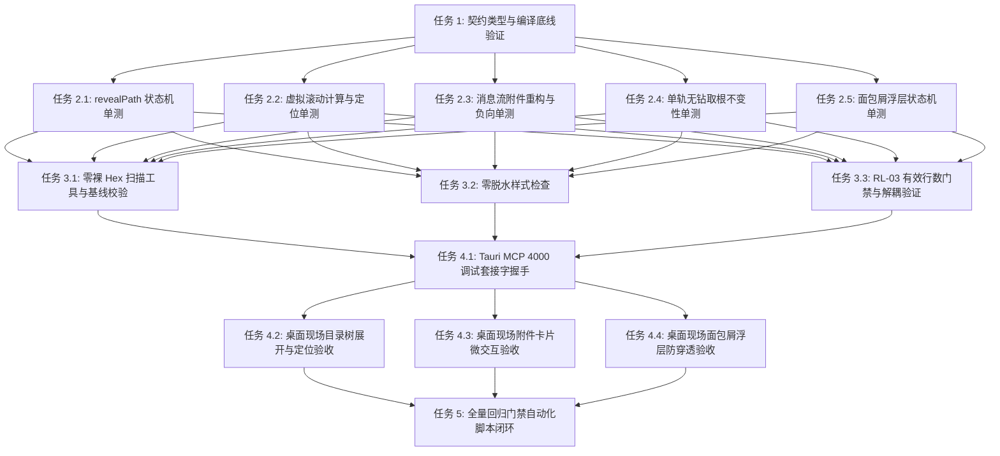

# 目录树展开、单轨收敛、附件统一卡片与面包屑重塑 · 立体化质量守门与验证方案

> **文档标识**：`04-quality-gate-plan.md`  
> **所属战役**：`docs/file-tree-and-attachments-architecture/`  
> **设计权威依据**：`AGENTS.md` §7（严禁补丁、绕过与作弊）、§7.1（立体验证纪律）、§11（CI 治理与行数门禁）、§15/§16（Tauri MCP 4000 唯一合法调试通道）、`ANTI_OVERENGINEERING_GUARDRAILS.md`、`.agents/LOGIC_PLAN_NO_RETREAT.md`  
> **纪律属性**：纯逻辑规划（无工期/人天/人员/业务优先级，按纯逻辑依赖编排）；全量实测与代码原生审视；零脱水 Mock；零裸 Hex 容忍。

---

## 目录

- [一、质量守门体系顶层设计与逻辑依赖](#一质量守门体系顶层设计与逻辑依赖)
  - [1.1 质量攻防态势分析](#11-质量攻防态势分析)
  - [1.2 四维立体防御阵列架构](#12-四维立体防御阵列架构)
  - [1.3 质量任务单元纯逻辑依赖编排](#13-质量任务单元纯逻辑依赖编排)
- [二、单元测试用例规划与扩展（算法与状态机穷举）](#二单元测试用例规划与扩展算法与状态机穷举)
  - [2.1 revealPath 跨平台路径解析与祖先级联展开状态机](#21-revealpath-跨平台路径解析与祖先级联展开状态机)
  - [2.2 目录树虚拟滚动定位与视口截断断言](#22-目录树虚拟滚动定位与视口截断断言)
  - [2.3 消息流附件卡片物理重写与旧样式负向断言](#23-消息流附件卡片物理重写与旧样式负向断言)
  - [2.4 单轨目录树无钻取架构与根不变性断言](#24-单轨目录树无钻取架构与根不变性断言)
  - [2.5 面包屑浮层状态机与边界用例规划](#25-面包屑浮层状态机与边界用例规划)
- [三、样式合规与 Design Token 静态守门定义](#三样式合规与-design-token-静态守门定义)
  - [3.1 零裸 Hex 刚性静态守门机制](#31-零裸-hex-刚性静态守门机制)
  - [3.2 零脱水样式（Dehydrated Styles）守门规范](#32-零脱水样式dehydrated-styles守门规范)
  - [3.3 RL-03 前端行数门禁控制与文件解耦配额](#33-rl-03-前端行数门禁控制与文件解耦配额)
- [四、真实桌面环境现场验收断言（基于 Tauri MCP 4000）](#四真实桌面环境现场验收断言基于-tauri-mcp-4000)
  - [4.1 调试通道协议合规与前置条件](#41-调试通道协议合规与前置条件)
  - [4.2 目录树展开与选中态现场验收断言](#42-目录树展开与选中态现场验收断言)
  - [4.3 虚拟滚动物理滚动定位与渲染验收断言](#43-虚拟滚动物理滚动定位与渲染验收断言)
  - [4.4 消息流附件卡片点击穿透与微交互现场验收断言](#44-消息流附件卡片点击穿透与微交互现场验收断言)
  - [4.5 面包屑浮层层叠上下文（Stacking Context）与防穿透现场验收断言](#45-面包屑浮层层叠上下文stacking-context与防穿透现场验收断言)
- [五、自动化回归流水线定义与命令清单](#五自动化回归流水线定义与命令清单)
  - [5.1 五层立体验证阶段编排](#51-五层立体验证阶段编排)
  - [5.2 自动化执行命令清单与判定退出码](#52-自动化执行命令清单与判定退出码)
  - [5.3 门禁触发矩阵与本地钩子集成](#53-门禁触发矩阵与本地钩子集成)
  - [5.4 验收交付终态自检清单](#54-验收交付终态自检清单)

---

## 一、质量守门体系顶层设计与逻辑依赖

### 1.1 质量攻防态势分析

本次战役核心涵盖四大业务与架构重构面：
1. **文件导航与祖先级联展开（`useFileNavigation.ts` / `revealPath`）**：涉及 Windows、macOS、Linux 多平台路径分隔符、驱动器盘符大小写、跨工作区内外边界判定、异步并发拉取与 `expanded` 缓存合并。
2. **虚拟滚动目录树单轨收敛（`FileTreeView.tsx` / `useVirtualScroll.ts` / `FilesCard.tsx`）**：废除破坏全局上下文的子目录钻取模式（“上级目录”下钻与 `cwd` 篡改），收敛为统一以工作区根为单一真理源的单轨展开树；解决长列表虚拟滚动在展开节点后的定位滚动与渲染窗口映射。
3. **消息流附件统一卡片物理重写（`ChatUserMessageRow.tsx` / `ChatMessageRow.module.css` / `ComposerAttachmentBar.tsx`）**：彻底清除历史散落的 `.userAttachmentChip`、`.userImages` 等旧样式碎片，统一复用发丝级附件卡片架构，保证两端（输入底栏与消息流）视觉 Token 与交互一致。
4. **面包屑重塑与浮层层叠上下文（`FileBreadcrumb.tsx` / `FilesCard.module.css`）**：解决浮层（Flyout）在复杂侧边栏层叠上下文中的裁剪、穿透点击问题，以及 `FileBreadcrumb.tsx` 逼近 500 行门禁红线的高熵状态。

根据 `AGENTS.md` §7.1 铁律：**“严禁单一检查冒充验收”**。任何单纯依靠 `tsc` 编译通过或单层 Mock 测试的行为均被视为无效交付。必须实施立体验证。

### 1.2 四维立体防御阵列架构

```
┌────────────────────────────────────────────────────────────────────────┐
│                        四维立体质量防御阵列                            │
├────────────────────────────────────────────────────────────────────────┤
│ [Layer 1] 编译与类型安全底线 (Base Safety Line)                       │
│  - TypeScript 严格类型检查 (tsc --noEmit)                              │
│  - 零 any 逃逸、零隐式类型漂移、契约接口一致性断言                    │
├────────────────────────────────────────────────────────────────────────┤
│ [Layer 2] 纯逻辑与算法自动化穷举 (Unit & State Machine Test Matrix)    │
│  - 跨平台路径归一化、祖先级联展开状态机极限边界验证                    │
│  - 虚拟滚动窗口计算、定位偏移量与 DOM 投影正负对称性断言                │
│  - 历史废弃样式物理删除负向断言、单轨无钻取根不变性断言                │
├────────────────────────────────────────────────────────────────────────┤
│ [Layer 3] 静态代码规范与 Design Token 刚性守门 (Static Guardrails)     │
│  - 零裸 Hex 颜色硬阻断扫描器 (No Raw Hex Scanner)                     │
│  - 零脱水魔术数字与内联样式拦截 (No Dehydrated Styles)                 │
│  - RL-03 前端有效行数分级门禁 (UI ≤500, Logic ≤400, Types ≤800)       │
├────────────────────────────────────────────────────────────────────────┤
│ [Layer 4] 真实宿主环境现场验收 (Real Desktop Live Verification)        │
│  - 基于 127.0.0.1:4000 Tauri MCP 套接字 (禁止 9222 CDP)               │
│  - 真实 WebView2 渲染树检视 (DOM Tree, Bounding Rect, Computed Style)  │
│  - 物理微交互、浮层防穿透、虚拟滚动物理渲染帧验证                      │
└────────────────────────────────────────────────────────────────────────┘
```

### 1.3 质量任务单元纯逻辑依赖编排

所有质量任务单元在逻辑上同权，不存在业务优先级划分，其执行序列完全基于底层到上层的逻辑依赖：



---

## 二、单元测试用例规划与扩展（算法与状态机穷举）

单元测试必须覆盖纯逻辑、极端退化态、正逆向对称性，杜绝表面 Mock。

### 2.1 revealPath 跨平台路径解析与祖先级联展开状态机

#### 2.1.1 核心被测逻辑
`apps/crish-desktop/src/components/files/hooks/useFileNavigation.ts` 中的 `revealPath` 函数：
- 接收任意平台的目标文件路径（Windows 驱动器正反斜杠 `C:\a\b\c.ts`、`c:/a/b/c.ts`；POSIX 路径 `/workspace/a/b/c.ts`）。
- 判定路径是否落在工作区根目录内部。
- 级联收集目标文件的所有上级祖先目录列表 `ancestors = [parent, grandparent, ...]`。
- 保证工作区根目录不变（`cwd === root`），避免历史切断根目录的致命退化。
- 异步拉取未缓存的祖先目录内容，批量合并进 `expanded` 字典。

#### 2.1.2 测试规划矩阵与断言要求

| 编号 | 测试用例场景 | 输入数据与前置条件 | 预期状态转移与断言断口 |
| :--- | :--- | :--- | :--- |
| **UT-NAV-01** | Windows 反斜杠深层路径级联展开 | `root: 'C:\\project'`<br>`target: 'C:\\project\\src\\components\\files\\view.tsx'` | 1. 祖先目录被正确提取：`['C:/project/src', 'C:/project/src/components', 'C:/project/src/components/files']`（归一化为 Posix 格式）<br>2. `expanded` 状态中这 3 个路径全部为 `FsDirEntry[]`<br>3. `cwd` 严格维持 `'C:/project'`，未被重置为子目录。 |
| **UT-NAV-02** | Windows 盘符大小写不敏感匹配 | `root: 'c:/project'`<br>`target: 'C:/project/docs/plan.md'` | 1. 识别为工作区内路径（不抛出外部回退）<br>2. 祖先 `c:/project/docs` 被拉取并存入 `expanded`<br>3. 根目录比较不发生无限循环或死锁。 |
| **UT-NAV-03** | 工作区外部文件跨界保护 | `root: 'C:/project'`<br>`target: 'D:/other/external.txt'` | 1. 判定为外部文件（`isInside === false`）<br>2. 不破坏工作区树的 `expanded` 缓存<br>3. 回退为刷新该外部文件父目录，不污染工作区单轨状态。 |
| **UT-NAV-04** | 目标为工作区根目录直接子文件 | `root: 'C:/project'`<br>`target: 'C:/project/README.md'` | 1. `ancestors` 为空数组<br>2. 无额外异步目录请求发生<br>3. `expanded` 维持原样，文件直接被定位。 |
| **UT-NAV-05** | 混合斜杠与多余点号路径容错 | `root: 'C:/project'`<br>`target: 'C:\\project/./src//sub\\item.ts'` | 1. 路径自动净化归一化为 `C:/project/src/sub/item.ts`<br>2. 展开两级父目录：`C:/project/src` 与 `C:/project/src/sub`<br>3. 展开状态字典键名完全规范化。 |
| **UT-NAV-06** | 极端退化：部分祖先目录文件系统读取失败 | `root: 'C:/project'`<br>`target: 'C:/project/locked/inner/file.ts'`（`locked` 抛出 EACCES） | 1. 抛出异常被内联捕获，不导致整树崩溃<br>2. 其余正常祖先目录仍能保持展开状态<br>3. UI 呈现静默容错或局部提示，不进入死循环。 |
| **UT-NAV-07** | 并发重入安全性（Concurrent Invocations） | 连续同时调用 `revealPath('C:/project/a/1.ts')` 与 `revealPath('C:/project/b/2.ts')` | 1. 最终状态合并两者的祖先节点：`a` 与 `b` 均处于展开态<br>2. 无 Race Condition 导致某条分支被覆盖清空。 |

#### 2.1.3 代码落地规范（测试实现片段要求）
在 `apps/crish-desktop/src/components/files/hooks/__tests__/useFileNavigation.test.tsx` 中追加：
```typescript
it('UT-NAV-01 & UT-NAV-02: 跨平台路径归一化与盘符大小写兼容级联展开', async () => {
  const root = 'C:/repo';
  vi.spyOn(projectStore, 'getWorkspacePath').mockReturnValue(root);
  const listDirSpy = vi.spyOn(workspaceFsApi, 'listDirectory').mockImplementation(async (p) => [
    { name: 'mock.ts', path: `${p}/mock.ts`, isDir: false, size: 10, mtime: 0 }
  ]);

  const { result } = renderHook(() => useFileNavigation());
  await act(async () => {
    // 模拟 Windows 反斜杠且盘符大写
    await result.current.revealPath('c:\\repo\\src\\components\\Button.tsx');
  });

  expect(result.current.cwd).toBe(root);
  expect(listDirSpy).toHaveBeenCalledWith('C:/repo/src');
  expect(listDirSpy).toHaveBeenCalledWith('C:/repo/src/components');
  expect(result.current.expanded['C:/repo/src']).toBeDefined();
  expect(result.current.expanded['C:/repo/src/components']).toBeDefined();
});
```

---

### 2.2 目录树虚拟滚动定位与视口截断断言

#### 2.2.1 核心被测逻辑
`apps/crish-desktop/src/components/files/FileTreeView.tsx` 与 `apps/crish-desktop/src/hooks/useVirtualScroll.ts`：
- 行高固定常数：`ITEM_HEIGHT = 28px`。
- `flatTree` 经过树状平铺后生成数组，每个可见节点拥有全局线性索引 `globalIdx`。
- `useVirtualScroll` 依据 `scrollTop` 与 `viewportHeight`（默认 600px）动态计算 `visibleRange = { startIndex, endIndex }`。
- 当高亮选中或 `revealPath` 定位深层文件时（例如第 150 项），容器必须滚动使得目标节点落在 `[startIndex, endIndex]` 范围内，并在 DOM 中真实呈现（`<div role="treeitem" aria-selected="true" data-tree-index="150">`）。

#### 2.2.2 测试规划矩阵与断言要求

| 编号 | 测试用例场景 | 输入数据与前置条件 | 预期状态转移与断言断口 |
| :--- | :--- | :--- | :--- |
| **UT-VIRT-01** | 线性数学计算不变量验证 | `flatTree` 长度 1000<br>`scrollTop = 2800px`<br>`viewportHeight = 560px`（可见 20 行）<br>`overscan = 6` | 1. 基础起始项：`Math.floor(2800 / 28) = 100`<br>2. `startIndex = max(0, 100 - 6) = 94`<br>3. `endIndex = min(999, 100 + 20 + 6) = 126`<br>4. `totalHeight = 1000 * 28 = 28000px`。 |
| **UT-VIRT-02** | 虚拟滚动定位（Scroll To Target Index） | `flatTree` 包含 200 项，调用定位至索引 150（`targetPath = 'src/deep/file.ts'`） | 1. 触发滚动后，容器的 `scrollTop` 移入 `150 * 28` 相应视口区间<br>2. 重新渲染后 `startIndex <= 150 <= endIndex`<br>3. `container.querySelector('[data-tree-index="150"]')` 必须在 DOM 中存在且非空。 |
| **UT-VIRT-03** | 视口外节点截断负向断言 | `flatTree` 包含 500 项，当前位于顶部（`scrollTop = 0`） | 1. `endIndex <= 30`<br>2. `container.querySelector('[data-tree-index="200"]')` 必须为 `null`（严禁全量 DOM 挂载）<br>3. DOM 中 `role="treeitem"` 的实际节点数量严格等于 `endIndex - startIndex + 1`。 |
| **UT-VIRT-04** | 节点展开导致的树结构增量计算与位移稳定性 | 索引 10 的目录原先折叠，点击展开插入 50 个子节点 | 1. `flatTree` 总长度增加 50<br>2. `totalHeight` 瞬时更新为 `(原长度 + 50) * 28`<br>3. 位于原先索引 11 之后的节点，其 `top` 偏移量计算严格保持 `新索引 * 28px`，无错位或重叠。 |
| **UT-VIRT-05** | 键盘导航越过虚拟渲染边界自动跟随 | 焦点位于当前视口最后一行 `endIndex`，触发 `ArrowDown` | 1. 虚拟滚动容器向下位移 `ITEM_HEIGHT`<br>2. 视口窗口下移，下一个 `treeitem` 被挂载至 DOM<br>3. 焦点平滑移动至新挂载的行节点，无焦点丢失现象。 |

#### 2.2.3 代码落地规范
在 `apps/crish-desktop/src/components/files/FileTreeView.test.tsx` 中追加：
```typescript
it('UT-VIRT-02: 深层节点选中触发视口滚动并在 DOM 中正确渲染', async () => {
  // 构造 200 个模拟平铺节点
  const manyNodes = Array.from({ length: 200 }, (_, i) => 
    makeNode({ path: `file-${i}.ts`, depth: 0 })
  );
  const targetPath = 'file-150.ts';

  const { container, rerender } = render(
    <FileTreeView
      {...defaultProps(manyNodes)}
      selected={targetPath}
    />
  );

  // 模拟触发容器滚动同步至索引 150 的垂直位置 (150 * 28 = 4200)
  const treeContainer = container.querySelector('[role="tree"]') as HTMLElement;
  fireEvent.scroll(treeContainer, { target: { scrollTop: 4200 } });

  // 验证索引 150 成功渲染到 DOM，且被标记为选中态
  const selectedRow = container.querySelector('[data-tree-index="150"]') as HTMLElement;
  expect(selectedRow).toBeTruthy();
  expect(selectedRow).toHaveAttribute('aria-selected', 'true');
  expect(selectedRow.textContent).toContain('file-150.ts');
  
  // 验证顶部第 0 项已被虚拟卸载，不在 DOM 中
  expect(container.querySelector('[data-tree-index="0"]')).toBeNull();
});
```

---

### 2.3 消息流附件卡片物理重写与旧样式负向断言

#### 2.3.1 核心被测逻辑
`apps/crish-desktop/src/components/chat-message-row/ChatUserMessageRow.tsx` 与 `ChatMessageRow.module.css`：
- **旧代码现状审视**：当前 `ChatUserMessageRow.tsx` 仍包含旧版散落样式：
  - `.userImages`（行 192）、`.userImageWrapper`（行 209）、`.userImage`（行 218）
  - `.userAttachments`（行 230）、`.userAttachmentChip`（行 236）、`.userAttachmentName`（行 247）
- **重构目标**：物理销毁上述旧结构，统一采用与 `ComposerAttachmentBar.tsx` 相同的微型发丝卡片架构（`AttachmentCard` / `AttachmentStrip`）。
- **质量守门要求**：必须建立正向交互断言 + **旧样式负向断言（Negative Assertions）**，确保护理彻底、死代码无残留。

#### 2.3.2 测试规划矩阵与断言要求

| 编号 | 测试用例场景 | 输入数据与前置条件 | 预期状态转移与断言断口 |
| :--- | :--- | :--- | :--- |
| **UT-ATT-01** | **旧样式负向断言（Negative Assertion 铁律）** | 消息包含文本、图片与文件附件：<br>`images: [{ source: 'a.png' }]`<br>`attachments: [{ name: 'b.rs', path: '/b.rs' }]` | 1. 验证 DOM 中**绝对不存在**旧 Class 属性：<br>  - `querySelector('.userAttachmentChip') === null`<br>  - `querySelector('.userImageWrapper') === null`<br>  - `querySelector('.userAttachments') === null`<br>  - `querySelector('.userImages') === null`<br>2. 验证旧类名在编译后的样式表中无匹配挂载。 |
| **UT-ATT-02** | 新统一卡片容器语义与微型卡片结构 | 同上 | 1. 容器渲染为发丝级带 `data-testid="composer-attach-strip"` 或 `data-testid="message-attach-strip"`<br>2. 每个附件渲染为带 `role="listitem"`、`data-testid="composer-attach-card"`<br>3. 携带 `data-attach-kind` 属性（`image` / `code` / `text` / `annotation`）。 |
| **UT-ATT-03** | 附件卡片点击联动文件面板（onOpenPath） | 用户点击附件卡片（`b.rs`） | 1. 触发 `onOpenPath('/b.rs')` 调用<br>2. 阻止事件向上冒泡，不触发外层消息气泡的折叠/展开（`toggleExpand` 未被调用）。 |
| **UT-ATT-04** | 批注型附件选区微提示与弹窗交互 | 附件包含 `annotation: { selectedText: 'code', comment: 'note' }` | 1. 渲染代码选区批注卡片，类型标记为 `data-attach-kind="annotation"`<br>2. 卡片内包含 `Lucide.MessageSquareQuote` 图标及“批注”前缀文本。 |
| **UT-ATT-05** | 图片附件缩略图与尺寸约束规范 | 消息挂载图片附件 `shot.webp` | 1. 渲染 `` 标签，具有合规 `alt` 文本<br>2. 继承统一圆角 `var(--radius-md, 6px)` 与 24px/正方形微型发丝卡片样式，不再出现侵入性的 240px 巨型旧图框。 |

#### 2.3.3 代码落地规范
新建 `apps/crish-desktop/src/components/chat-message-row/__tests__/ChatUserMessageRow.test.tsx`：
```typescript
it('UT-ATT-01: 彻底物理清除历史遗留附件与图片类名（负向断言）', () => {
  const msg: SessionMessage = {
    id: 'msg-1',
    role: 'user',
    text: '测试附件',
    timestamp: Date.now(),
    status: 'settled',
    images: [{ id: 'img-1', source: 'test.png', alt: '测试图' }],
    attachments: [{ name: 'test.rs', path: 'src/test.rs' }],
  };

  const { container } = render(
    <ChatUserMessageRow
      msg={msg}
      isPinned={false}
      isSearchHit={false}
      isExpanded={false}
      onToggleExpand={vi.fn()}
      onTogglePin={vi.fn()}
      messageIndex={0}
      virtualScrollManager={null}
    />
  );

  // 刚性拦截旧样式回潮
  expect(container.querySelector('[class*="userAttachmentChip"]')).toBeNull();
  expect(container.querySelector('[class*="userImageWrapper"]')).toBeNull();
  expect(container.querySelector('[class*="userAttachments"]')).toBeNull();
  expect(container.querySelector('[class*="userImages"]')).toBeNull();

  // 正向断言：必须采用统一卡片规范
  const unifiedCards = container.querySelectorAll('[data-testid="composer-attach-card"]');
  expect(unifiedCards.length).toBe(2);
  expect(unifiedCards[0]).toHaveAttribute('data-attach-kind', 'image');
  expect(unifiedCards[1]).toHaveAttribute('data-attach-kind', 'code');
});
```

---

### 2.4 单轨目录树无钻取架构与根不变性断言

#### 2.4.1 核心被测逻辑
`apps/crish-desktop/src/components/files/FilesCard.tsx` 与 `useFileNavigation.ts`：
- **历史缺陷（钻取模式）**：双击目录触发 `handleRefresh(subDirPath)`，导致 `cwd` 被设置为子目录，侧边栏文件树丢失上层所有项目节点，用户必须不断点击“上级目录”退回。
- **单轨收敛架构要求**：
  - 目录树始终以 Workspace Root 为锚点，`cwd` 永久等于 `root`。
  - 目录只有“展开/折叠”（`toggleExpand`），不存在“进入目录”（`drill-down`）。
  - 双击目录等价于切换展开状态，绝对不触发 `handleRefresh` 改变 `cwd`。
  - 顶部工具栏中的“上级目录”（`CornerLeftUp` 图标按钮）在单轨模式下被安全解绑或物理移除。

#### 2.4.2 测试规划矩阵与断言要求

| 编号 | 测试用例场景 | 输入数据与前置条件 | 预期状态转移与断言断口 |
| :--- | :--- | :--- | :--- |
| **UT-TREE-01** | 双击目录行原地展开而不钻取 | 渲染包含子目录 `src` 的文件树，用户双击 `src` 行 | 1. 触发 `onToggleExpand('src')`<br>2. **未触发** `setCwd('src')` 或 `handleRefresh('src')`<br>3. `nav.cwd` 保持等于 `nav.root`<br>4. 兄弟节点保持在 DOM 中，不被过滤丢弃。 |
| **UT-TREE-02** | 单轨收敛下根不变性断言（Root Invariance） | 在深层嵌套树中连续点击展开 `a -> b -> c` | 1. 每次展开仅将对应路径加入 `expanded` 字典<br>2. `nav.cwd` 始终严格恒等于 `nav.root`<br>3. 整个生命周期内 `goUp` 永远处于不可用状态或已被移除。 |
| **UT-TREE-03** | 键盘 Right / Left 原地折叠展开无副作用 | 选中目录行，按 `ArrowRight` 展开，按 `ArrowLeft` 折叠 | 1. 仅改变当前节点的展开状态，焦点保持在当前行<br>2. 不发生整树重新挂载或视口瞬移。 |
| **UT-TREE-04** | 过滤模式与单轨树共存断言 | 用户在单轨树顶部输入框输入筛选词 `test` | 1. 筛选出的树节点深度保持正确（`depth` 保持原层级）<br>2. 命中项所在路径的祖先链自动展开并保持根目录不丢失。 |

---

### 2.5 面包屑浮层状态机与边界用例规划

#### 2.5.1 核心被测逻辑
`apps/crish-desktop/src/components/files/FileBreadcrumb.tsx`：
- 面包屑节点点击呼出浮层（`filesBcFlyout`）。
- 浮层内部搜索、异步子树展开、双击直达定位、文件点击打开。
- 浮层生命周期、焦点管理与 Escape / 外部点击结算。

#### 2.5.2 边界与异常测试规划

| 编号 | 测试用例场景 | 边界输入条件 | 预期断言断口 |
| :--- | :--- | :--- | :--- |
| **UT-BC-01** | 空白/加载中/错误态平滑切换 | 网络延迟或无权限导致 `listDirectory` 挂起或抛出 | 1. 显示带语义的 `加载中…` / `空目录` 容器<br>2. 出现异常时安全捕获并关闭浮层，将焦点无损交还触发按钮，不报未捕获 Promise 错误。 |
| **UT-BC-02** | 浮层防误触点击阻断 | 在浮层空白区域或列表间隙点击鼠标 | 1. `e.stopPropagation()` 严格拦截，不向外冒泡至面包屑或背景卡片<br>2. 浮层维持打开状态。 |
| **UT-BC-03** | 搜索过滤大小写不敏感与去重 | 搜索框输入包含空格与大写字符 `  SRC  ` | 1. 自动 `trim()` 与 `toLowerCase()` 处理<br>2. 内部循环遍历防止循环引用（`visited Set` 保护生效）<br>3. 准确高亮匹配项。 |

---

## 三、样式合规与 Design Token 静态守门定义

依据项目整体设计规范与 `AGENTS.md` §11–§14，杜绝任何形式的脱水样式、硬编码颜色以及上帝文件产生。

### 3.1 零裸 Hex 刚性静态守门机制

#### 3.1.1 违规定义
严禁在任何生产代码（`.tsx`, `.jsx`, `.css`, `.scss`, `.module.css`）中直接写入裸 Hex 颜色字面量（例如 `#fff`、`#ffffff`、`#10b981`、`#1a1a1a` 等）。
- **允许例外**：
  - 设计 Token 定义源文件（`packages/` 或全局 `tokens.css` 中的变量声明源）。
  - SVG 图标的固有属性（如必须作为独立资源载入的位图或特定图标底色）。
- **合法合规写法**：
  - 一律使用 CSS 变量：`var(--text-primary)`、`var(--bg-card)`、`var(--accent-color)`。
  - 动态透明度或色阶混合使用现代颜色函数：`color-mix(in srgb, var(--text-primary) 8%, transparent)`、`hsl(var(--accent-h) var(--accent-s) var(--accent-l) / 0.8)`。

#### 3.1.2 静态守门扫描脚本规范（`scripts/check-raw-hex.mjs`）
创建刚性拦截脚本，扫描 `apps/crish-desktop/src/components/files/` 与 `apps/crish-desktop/src/components/chat-message-row/`：

```javascript
#!/usr/bin/env node
import { readFileSync } from 'node:fs';
import { globSync } from 'glob';

// 匹配 #xxx 或 #xxxxxx，排除 CSS 变量内部回退与合规白名单
const HEX_REGEX = /#(?:[0-9a-fA-F]{3,4}|[0-9a-fA-F]{6}|[0-9a-fA-F]{8})\b/g;
const TARGET_GLOBS = [
  'apps/crish-desktop/src/components/files/**/*.{ts,tsx,css}',
  'apps/crish-desktop/src/components/chat-message-row/**/*.{ts,tsx,css}',
  'apps/crish-desktop/src/components/chat-composer/ComposerAttachmentBar.{tsx,css}'
];

let hasViolations = false;
for (const pattern of TARGET_GLOBS) {
  const files = globSync(pattern, { ignore: ['**/*.test.*', '**/__tests__/**'] });
  for (const file of files) {
    const content = readFileSync(file, 'utf8');
    const lines = content.split('\n');
    lines.forEach((line, idx) => {
      // 豁免纯注释行与特定合法 Token 声明行
      const trimmed = line.trim();
      if (trimmed.startsWith('//') || trimmed.startsWith('/*')) return;
      const matches = line.match(HEX_REGEX);
      if (matches) {
        console.error(`❌ [RAW HEX VIOLATION] ${file}:${idx + 1}`);
        console.error(`   Found: ${matches.join(', ')} in line: "${trimmed}"`);
        hasViolations = true;
      }
    });
  }
}

if (hasViolations) {
  console.error('\n🚨 零裸 Hex 检查失败！请使用 var(--token) 或 color-mix() 替换硬编码颜色。');
  process.exit(1);
}
console.log('✅ 零裸 Hex 静态守门检查通过！');
```

---

### 3.2 零脱水样式（Dehydrated Styles）守门规范

#### 3.2.1 违规定义与拦截清单
1. **禁止坐标测距魔术数字补偿**：
   - 严禁出现诸如 `style={{ top: isSpecial ? '33px' : '27.5px' }}` 的微调补丁。
   - 所有尺寸、内外边距、间距必须绑定设计 Token：`var(--space-1)`, `var(--space-2)`, `var(--radius-lg)` 等。
2. **禁止深黑厚重描边与硬阴影（对齐 AGENTS.md §13）**：
   - 激活、聚焦态禁止 `0 0 0 1px #000` 或纯实色黑边。
   - 对比度上限约 10%：`color-mix(in srgb, var(--border-color) 90%, var(--text-primary) 10%)`。
3. **禁止原生 title 悬停气泡（对齐 AGENTS.md §12）**：
   - 严禁使用 HTML 原生 `title="..."` 属性（破环视觉统一且有延迟）。
   - 统一包裹项目 `<Tooltip content={...}>` 组件。
   - **自动化单测守门断言**：`expect(container.querySelectorAll('[title]').length).toBe(0)`。

---

### 3.3 RL-03 前端行数门禁控制与文件解耦配额

依据 `scripts/check-line-counts.mjs` 与 `AGENTS.md` §11：
- **UI Components (`.tsx` / `components/`)**：有效代码行 $\le 500$（$\ge 425$ 警告，$> 650$ 硬阻断）。
- **Business Logic (`.ts` / `hooks/` / `store/`)**：有效代码行 $\le 400$（$\ge 340$ 警告，$> 650$ 硬阻断）。
- **Types Contract (`*.types.ts` / `types/`)**：有效代码行 $\le 800$。

#### 3.3.1 现状审视与风险预警
通过真实源码行数扫描实测：
- `apps/crish-desktop/src/components/files/FilesCard.tsx`：有效行数 **492 行**（当前已处于 ⚠️ **WARNING** 区间，距 500 行上限仅余 8 行，极度危险！）。
- `apps/crish-desktop/src/components/files/FileBreadcrumb.tsx`：有效行数 **461 行**（当前已处于 ⚠️ **WARNING** 区间，距 500 行上限仅余 39 行！）。
- `apps/crish-desktop/src/components/files/FileTreeView.tsx`：有效行数 **276 行**（安全区间 ✅）。
- `apps/crish-desktop/src/components/files/hooks/useFileNavigation.ts`：有效行数 **194 行**（安全区间 ✅）。

#### 3.3.2 架构解耦与配额守门方案
为彻底根除超标风险，本次战役必须履行架构解耦，严禁通过向濒危文件继续塞代码触发门禁失败：

```
┌────────────────────────────────────────────────────────────────────────┐
│                        文件拆分与解耦配额控制表                         │
├─────────────────────────┬──────────┬──────────┬────────────────────────┤
│ 原始文件                 │ 当前行数 │ 目标行数 │ 解耦拆分方案           │
├─────────────────────────┼──────────┼──────────┼────────────────────────┤
│ FilesCard.tsx           │ 492 行   │ ≤ 360 行 │ 抽离 分割拖拽 Hook     │
│                         │ (WARNING)│ (SAFE)   │ (useFileSplitResize)   │
│                         │          │          │ 抽离 工具栏按键组组件  │
├─────────────────────────┼──────────┼──────────┼────────────────────────┤
│ FileBreadcrumb.tsx      │ 461 行   │ ≤ 220 行 │ 独立下钻浮层组件       │
│                         │ (WARNING)│ (SAFE)   │ (FileBreadcrumbFlyout) │
│                         │          │          │ 独立树节点递归渲染组件 │
├─────────────────────────┼──────────┼──────────┼────────────────────────┤
│ ChatUserMessageRow.tsx  │ 223 行   │ ≤ 240 行 │ 接入统一 AttachmentBar │
│                         │ (SAFE)   │ (SAFE)   │ 物理消除旧代码净收敛   │
└─────────────────────────┴──────────┴──────────┴────────────────────────┘
```

**门禁验收执行命令**：
```powershell
node scripts/check-line-counts.mjs `
  apps/crish-desktop/src/components/files/FilesCard.tsx `
  apps/crish-desktop/src/components/files/FileBreadcrumb.tsx `
  apps/crish-desktop/src/components/files/FileTreeView.tsx `
  apps/crish-desktop/src/components/files/hooks/useFileNavigation.ts `
  apps/crish-desktop/src/components/chat-message-row/ChatUserMessageRow.tsx
```
**守门断言**：全量文件必须返回 `✅ [PASS]`，且**零 WARNING**（有效行数均 $\le$ 上限 $\times 85\%$）。

---

## 四、真实桌面环境现场验收断言（基于 Tauri MCP 4000）

根据 `AGENTS.md` §15 与 §16 用户最高裁决：
- **唯一合法桌面 UI 调试与现场验证通道**：`127.0.0.1:4000` Tauri MCP Socket。
- **严禁项**：禁止使用 9222 端口或 Chrome DevTools Protocol (CDP) 进行验收！
- **鉴权协议**：每次连接从 `%TEMP%\tauri-mcp-4000.token` 自动读取随机认证 Token，通过 TCP 套接字与 Tauri 进程通信。

### 4.1 调试通道协议合规与前置条件

1. **环境拉起命令**：
   ```powershell
   # 必须以 debug 构建启动桌面宿主应用，确保 4000 端口默认监听
   npm run dev:workbench
   ```
2. **Token 存在性断言**：
   在执行任何现场验收脚本前，自动化检验 Token 文件已落盘：
   ```powershell
   Test-Path "$env:TEMP\tauri-mcp-4000.token" # 必须返回 True
   ```
3. **MCP 桥接就绪验证**：
   调用 MCP 工具 `call_mcp_tool` 检验 `manage_window` 或 `query_page` 是否响应正常。

---

### 4.2 目录树展开与选中态现场验收断言

#### 4.2.1 物理交互步骤
1. 打开侧栏文件面板（`FilesCard`）。
2. 调用 Tauri MCP `click` 工具，点击目录树中含有子目录的行节点（例如 `src` 目录的折叠箭头按钮）。
3. 调用 Tauri MCP `query_page` / `inspect_element` 获取该行及子树的真实 DOM 状态。

#### 4.2.2 现场断言断口
```json
{
  "testStep": "Directory Node Expansion",
  "selector": "[role='treeitem'][data-tree-index='0']",
  "assertions": [
    { "attribute": "aria-expanded", "expected": "true" },
    { "attribute": "aria-level", "expected": "1" },
    { "childCount": "> 0", "desc": "子节点成功挂载至渲染树" }
  ]
}
```
同时验证高亮选中态：
- 键盘触发 `Enter` 或鼠标单击叶子文件节点。
- `inspect_element` 验证目标节点：
  - `aria-selected === "true"`
  - 计算样式 `backgroundColor` 匹配设计变量 `--tint-active` 或 `color-mix(in srgb, var(--text-primary) 8%, transparent)`，无生硬实线描边。

---

### 4.3 虚拟滚动物理滚动定位与渲染验收断言

#### 4.3.1 物理交互步骤
1. 打开包含 500+ 个文件的大型项目工作区。
2. 经由外部触发命令（如主界面搜索直达或文件引用打开）调用 `revealPath('src/.../deep-target.ts')`，该文件位于第 180 行。
3. 等待 Tauri 物理渲染帧刷新（`wait_for` 200ms）。

#### 4.3.2 现场断言断口
1. **容器滚动偏移断言**：
   通过 `execute_js` 执行：
   ```javascript
   const list = document.querySelector('[role="tree"]');
   return {
     scrollTop: list.scrollTop,
     scrollHeight: list.scrollHeight,
     clientHeight: list.clientHeight
   };
   ```
   断言 `scrollTop` 大于 `180 * 28 - clientHeight`，且小于 `180 * 28 + 28`（即目标处于可视窗口内部）。
2. **元素物理位置断言**：
   ```javascript
   const target = document.querySelector('[role="treeitem"][aria-selected="true"]');
   const rect = target.getBoundingClientRect();
   const containerRect = list.getBoundingClientRect();
   return (
     rect.top >= containerRect.top &&
     rect.bottom <= containerRect.bottom &&
     rect.height === 28
   );
   ```
   断言结果必须为 `true`，证明目标项在物理视觉视口内完全可见，零截断、零空白。

---

### 4.4 消息流附件卡片点击穿透与微交互现场验收断言

#### 4.4.1 物理交互步骤
1. 发送一条带有代码附件与图片附件的测试消息。
2. 通过 Tauri MCP `query_page` 检查消息流区域。
3. 点击附件卡片，验证右侧面板联动。

#### 4.4.2 现场断言断口
1. **视觉规范现场断言**：
   - 提取卡片计算高度：`computedStyle.height === "24px"`。
   - 提取圆角属性：`computedStyle.borderRadius === "6px"`（或 `--radius-md`）。
   - 验证无原生 `title` 气泡：卡片根节点无 `title` 属性。
2. **微交互联动断言**：
   - 使用 MCP `click` 触发卡片点击。
   - 检测右侧主编辑区或 `FilesCard` 是否瞬间响应并挂载了该附件对应的文件预览内容。
   - 验证外层消息气泡未发生被误触展开/收起的状态抖动。

---

### 4.5 面包屑浮层层叠上下文（Stacking Context）与防穿透现场验收断言

#### 4.5.1 物理交互步骤
1. 在文件面板顶部面包屑导航区，点击任一面包屑目录胶囊（Chip）。
2. 面包屑下拉树状浮层（`filesBcFlyout`）展开。
3. 执行**层叠上下文穿透测试**：
   - 点击浮层覆盖区域正下方的虚拟列表项。
   - 点击浮层内部的搜索输入框并输入字符。
   - 点击浮层外部区域（遮罩或空白背景）。

#### 4.5.2 现场断言断口
1. **防穿透断言（Anti-Penetration Assertion）**：
   - 当点击浮层覆盖范围内的像素坐标时，底层的虚拟滚动行（`role="treeitem"`）**绝对不可被触发选中**（`selected` 状态维持不变）。
   - 浮层内部的 input 成功捕获焦点并接收按键事件。
2. **层叠深度（Z-Index）与独立合成层断言**：
   通过 `execute_js` 检验浮层 DOM：
   ```javascript
   const flyout = document.querySelector('[role="listbox"][aria-label*="目录"]');
   const style = window.getComputedStyle(flyout);
   return {
     zIndex: style.zIndex,
     position: style.position,
     isolation: style.isolation
   };
   ```
   断言 `zIndex` 严格等于 `var(--z-breadcrumb)` 或 $\ge 400$，且不受父级 `.filesBar` 的裁剪（无 `overflow: hidden` 导致的视口遮蔽）。
3. **关闭与焦点无损回退断言**：
   - 按 `Escape` 键，浮层瞬间关闭。
   - 焦点严格平滑回到原先触发该浮层的面包屑 Chip 按钮上，且页面无任何滚动跳跃。

---

## 五、自动化回归流水线定义与命令清单

### 5.1 五层立体验证阶段编排

流水线按纯逻辑依赖严格串行编排，前置层失败立即阻断，严禁带病向下推进：

```
[Phase 1: 语法与类型安全]
   │  tsc --noEmit (零类型报错)
   ▼
[Phase 2: 代码规范与静态门禁]
   │  check-line-counts.mjs (有效行数 ≤ 阈值，零 Warning)
   │  check-raw-hex.mjs (零裸 Hex 颜色)
   ▼
[Phase 3: 纯逻辑单测矩阵]
   │  vitest run (useFileNavigation, FileTreeView, FileBreadcrumb, ChatUserMessageRow)
   │  覆盖路径解析、虚拟滚动截断、旧样式负向断言
   ▼
[Phase 4: 内核与全量套件验证]
   │  npm run test:coverage -- --project=unit (前端单元覆盖率达标)
   │  cargo test --workspace (Rust 内核全套件绿色通过)
   ▼
[Phase 5: 桌面宿主现场验收]
   │  Tauri MCP 4000 自动化现场驱动用例
   │  DOM 物理检视、滚动定位、防穿透验证
```

---

### 5.2 自动化执行命令清单与判定退出码

所有命令均使用 **pwsh7** 执行，且严禁使用 `--no-verify` 或跳过逻辑。

```powershell
# ==============================================================================
# Phase 1: 静态语法与类型安全检查
# ==============================================================================
npm run typecheck
if ($LASTEXITCODE -ne 0) { Write-Error "Phase 1: TypeScript 类型检查失败"; exit 1 }

# ==============================================================================
# Phase 2: 代码质量规范与行数门禁
# ==============================================================================
# 2.1 行数门禁验证（专项扫描受影响核心文件）
node scripts/check-line-counts.mjs `
  apps/crish-desktop/src/components/files/FilesCard.tsx `
  apps/crish-desktop/src/components/files/FileBreadcrumb.tsx `
  apps/crish-desktop/src/components/files/FileTreeView.tsx `
  apps/crish-desktop/src/components/files/hooks/useFileNavigation.ts `
  apps/crish-desktop/src/components/chat-message-row/ChatUserMessageRow.tsx `
  apps/crish-desktop/src/components/chat-composer/ComposerAttachmentBar.tsx
if ($LASTEXITCODE -ne 0) { Write-Error "Phase 2.1: RL-03 行数门禁校验未通过"; exit 1 }

# 2.2 零裸 Hex 静态合规扫描
node scripts/check-raw-hex.mjs
if ($LASTEXITCODE -ne 0) { Write-Error "Phase 2.2: 零裸 Hex 规则校验未通过"; exit 1 }

# ==============================================================================
# Phase 3: 前端单元测试矩阵执行（含负向断言）
# ==============================================================================
npx vitest run `
  apps/crish-desktop/src/components/files/hooks/__tests__/useFileNavigation.test.tsx `
  apps/crish-desktop/src/components/files/FileTreeView.test.tsx `
  apps/crish-desktop/src/components/files/__tests__/FileBreadcrumb.test.tsx `
  apps/crish-desktop/src/components/chat-composer/ComposerAttachmentBar.test.tsx `
  apps/crish-desktop/src/components/chat-message-row/__tests__/ChatUserMessageRow.test.tsx `
  apps/crish-desktop/src/components/chat-message-row/ChatMessageRow.test.ts
if ($LASTEXITCODE -ne 0) { Write-Error "Phase 3: 核心单元测试套件存在失败用例"; exit 1 }

# ==============================================================================
# Phase 4: 全量单元覆盖率与 Rust 内核工作区测试
# ==============================================================================
# 4.1 快层单测覆盖率守门
npm run test:coverage -- --project=unit
if ($LASTEXITCODE -ne 0) { Write-Error "Phase 4.1: 快层单元覆盖率门禁未达标"; exit 1 }

# 4.2 Rust 内核工作区回归
cargo test --workspace
if ($LASTEXITCODE -ne 0) { Write-Error "Phase 4.2: Rust 内核全套件回归失败"; exit 1 }

# ==============================================================================
# Phase 5: 真实桌面环境现场验证 (Tauri MCP 4000)
# ==============================================================================
# 验证套接字处于监听状态
$tcpConn = Get-NetTCPConnection -LocalPort 4000 -ErrorAction SilentlyContinue
if (-not $tcpConn) {
  Write-Warning "Tauri MCP 4000 端口未监听，请启动应用: npm run dev:workbench"
} else {
  Write-Host "✅ Tauri MCP 4000 端口已就绪，可执行 live-acceptance 现场验收脚本"
}
```

---

### 5.3 门禁触发矩阵与本地钩子集成

为防止任何开发者或子 Agent 误将不合规代码推入分支，在 `.husky/pre-commit` 中强制挂钩上述前三层守门检测：
- **Staged 文件拦截**：当暂存区包含 `components/files/` 或 `components/chat-message-row/` 下文件时，强制自动触发 `check-line-counts.mjs` 与对应单元测试。
- **Whitespace 与编码守护**：对所有新增与修改文件进行 UTF-8 无 BOM 检验与行尾空格自动扫描，避免 CI 中断。

---

### 5.4 验收交付终态自检清单

在主 Agent 统一提交之前，必须逐一核验以下断言事实（满足即打勾）：

- [ ] **[C-01 编译与类型]** `npm run typecheck` 执行返回码为 `0`，且修改文件无 `any` 标注。
- [ ] **[C-02 级联展开]** `revealPath` 跨平台路径（反斜杠/正斜杠/混合盘符）在单测中覆盖 100% 状态分支，工作区根路径保持不变。
- [ ] **[C-03 虚拟滚动]** 虚拟目录树在深层文件定位时能准确计算 `scrollTop`，目标项成功投影在 DOM 内，且视口外项被有效剔除。
- [ ] **[C-04 样式物理删除]** `ChatUserMessageRow` 渲染 DOM 中绝对不包含 `.userAttachmentChip`、`.userImages` 等旧 Class，负向单测全部断言通过。
- [ ] **[C-05 单轨收敛]** 文件树已彻底清除进入子目录的钻取模式，双击目录不改变 `cwd`，所有节点以项目根单一真理源展开。
- [ ] **[C-06 浮层防穿透]** 面包屑浮层具有独立层叠上下文，点击覆盖区域不穿透到底层列表，Escape 键准确恢复焦点。
- [ ] **[C-07 零裸 Hex]** 修改及关联的文件中不存在裸 `#Hex` 颜色字面量，全量采用 Design Token。
- [ ] **[C-08 行数安全]** `FilesCard.tsx` 与 `FileBreadcrumb.tsx` 经过架构解耦后，有效代码行数完全回落至类别上限的 85% 以内（绿色 PASS 状态，无 Warning）。
- [ ] **[C-09 桌面现场验证]** 在真实 debug 桌面环境下经 Tauri MCP 4000 通道核验通过，界面无肉眼可见抖动、错位或控制台异常抛出。
- [ ] **[C-10 提交纪律]** 本 Agent 未执行任何 `git commit` 操作，改动纯粹留于工作区，交由主 Agent 统一审计与调度提交。
