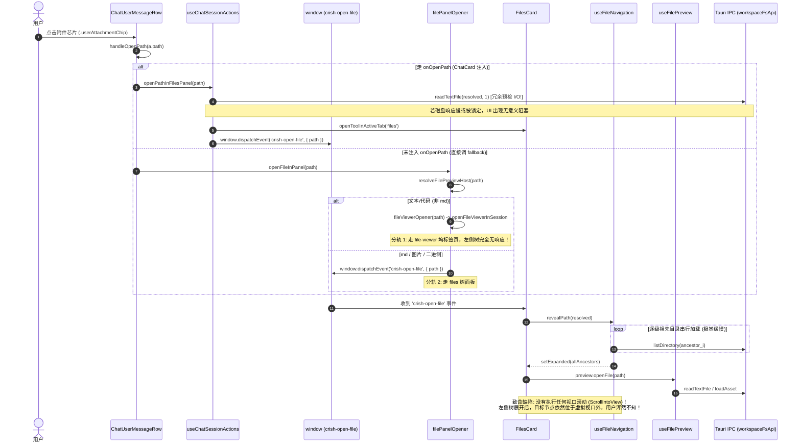
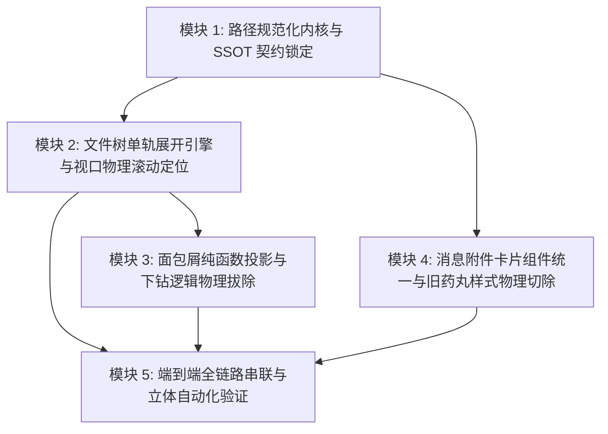

# 目录树层级同步展开、单轨收敛、消息附件卡片统一与面包屑重构 —— 架构挑战者审视方案 (Challenger Plan)

> **文档定位**：本文档由系统挑战者（Challenger）独立审视真实源码撰写，针对 Conex/Crish 项目中【目录树层级同步展开、单轨收敛、消息附件卡片统一与面包屑重构】进行端到端批判性挑刺，揭示潜在盲点、性能隐患与架构断裂，确立单一真理源（SSOT）与净收敛路线。
> **遵循准则**：严格对照真实源码、恪守 `ANTI_OVERENGINEERING_GUARDRAILS.md` 13 项硬性红线、纯逻辑依赖编排、无工期/无优先级偏见、杜绝一切补丁与过渡伪兼容。

---

## 一、架构挑战总纲与设计哲学

在 Conex/Crish 的演进过程中，文件浏览系统与聊天上下文附件系统历经多次迭代，沉淀了一批过渡性质的代码逻辑：
1. **树浏览器的钻取倒退**：文件管理器（`FilesCard` / `useFileNavigation`）依然残留着类似于早年 Norton Commander 或文件系统的 `cwd` 下钻（Drill-Down）逻辑 —— 双击文件夹会重置 `cwd` 并擦除整棵树的 `expanded` 展开状态，不得不依赖工具栏上的「上级目录」（`CornerLeftUp`）和面包屑二级下钻弹层来往返倒退；而现代 IDE（VS Code、JetBrains、Cursor）的标准形态是**工作区根常驻的单一树视图（Unified Root Workspace Tree）**，目录点击仅负责原位折叠与展开。
2. **预览通道的双轨割裂**：代码类文件被分流到右侧工作区坞叶的 `file-viewer` 独立 Tab（`FileViewerCard`），而 Markdown、图片、音视频、表格却留在 `files` 面板（`FilesCard`）的内嵌预览区（`FilePreview`）。两套面板各自维护工具栏、路径解析、复制路径、自动换行与打开方式，形成了明显的功能伪连通与状态割裂。
3. **消息附件的形态分裂**：输入框附件栏（`ComposerAttachmentBar`）已演进为具备 24px 高度、官方彩色格式图标（`FileFormatIcon`）、缩略图预览与删除操作的现代文件卡片（`.fileCard` / `.attachChip`）；然而消息气泡中（`ChatUserMessageRow`）却依然保留着简陋的低对比度药丸样式（`.userAttachmentChip`），甚至助手生成物中也散落着各自定义的超链接胶囊（`ArtifactCapsule`），视觉与行为严重脱节。
4. **面包屑的功能越界与状态膨胀**：面包屑组件（`FileBreadcrumb`）本应是当前选中项路径的轻量级只读/导航投影，但在现有实现中，它居然内置了一个近 500 行的二级目录树悬浮窗（`bcFlyout`），独立维护 `dirCache`、`expandedPaths`、`loadingPaths` 以及搜索过滤框，与主文件树形成了荒谬的**平行重复树状态机**。

作为架构挑战者，重构的最终目标不是打补丁兼容旧行为，而是**大刀阔斧切除历史痈疽，实现端到端的单一真理源（SSOT）与架构净收敛**。

---

## 二、端到端全链路数据流与事件时序深度剖析

### 2.1 现有调用链路溯源与批判

当前从用户在聊天气泡中点击一个附件，到文件预览展现与左侧树定位，存在如下混乱的跨层调用流：



### 2.2 现存五大架构断裂点

#### 断裂点 1：双轨宿主分流（Dual-Track Preview Split）
- **现象**：`filePanelOpener.ts:44-52` 中定义了 `resolveFilePreviewHost`。如果文件是代码（`detectFileKind === 'text'` 且非 `.md`），强制分流入 `file-viewer` 叶（独立 Tab）；如果是 Markdown、图片或表格，分流入 `files` 面板。
- **后果**：
  - 用户在聊天中点击 `main.rs`，系统在右侧打开了 `file-viewer:src/main.rs` 标签页，**左侧文件树完全不展开、不定位**，破坏了用户「在项目整体拓扑中查看该文件位置」的心智模型。
  - 用户点击 `README.md`，系统打开了 `files` 标签页，左侧展开文件树，右侧在 `FilesCard` 内展示 Markdown。
  - 两套 UI，两套快捷操作，两套生命周期，完全违反了界面统一性。

#### 断裂点 2：全局 EventBus 解耦带来的竞态与事件丢失
- **现象**：通过 `window.dispatchEvent(new CustomEvent('crish-open-file', ...))` 进行跨组件通信。
- **后果**：
  - **冷启动事件丢失**：若右侧 `files` 面板尚未挂载，`openToolInActiveTab('files')` 触发 Zustand 状态变更并进入 React 异步调度队列，而同步广播的 `crish-open-file` 事件在 `FilesCard` 尚未挂载其 `addEventListener` 之前就已经发射完毕并消失！为了掩盖此 Bug，`filePanelOpener.ts` 引入了模块级可变变量 `pendingOpenPath` 作为补丁，但 `useChatSessionActions.ts` 却直接发射事件而根本没写 `pendingOpenPath`，导致在特定时序下点击附件毫无反应。
  - **多叶冲突与广播污染**：在分屏（Split Leaf）场景下，同一窗口可能挂载两个工作区或两个树视图，全局广播会导致所有挂载的 `FilesCard` 盲目争抢响应、重复发起祖先目录加载。

#### 断裂点 3：前端路径预检（Preflight I/O）阻塞主交互
- **现象**：`useChatSessionActions.ts:102` 在响应点击时，竟然先调用 `readTextFile(resolved, 1)` 读取文件首行。
- **后果**：
  - 极差的架构嗅觉：把本属于预览加载器的职责前置到了交互派发层。
  - 如果文件位于慢速网络挂载盘（NFS/Samba）或者一个被其他进程独占锁定的超大文件，主交互将在 `readTextFile` 上等待数十至数百毫秒，若抛出异常还会误弹出 `文件不存在` 的 Toast，导致后续真正的预览逻辑被直接截断。

#### 断裂点 4：视口定位完全缺失（Missing Scroll-Into-View in Virtual Scroll）
- **现象**：在 `useFileNavigation.ts:90-156` 的 `revealPath` 中，代码逐级收集祖先并 `setExpanded`，然后在 `FilesCard.tsx:140` 顺序调用 `await nav.revealPath(resolved); await preview.openFile(path);`。
- **后果**：
  - `FileTreeView.tsx` 使用基于固定高度（28px）的虚拟滚动容器 `useVirtualScroll`。
  - `revealPath` 仅仅是把祖先目录的子项填入了 `expanded` 字典，使得 `flatTree` 的计算长度增加了；**但是没有一行代码去计算目标节点的全局索引，更没有去设置 `containerRef.current.scrollTop`**！
  - 如果目标文件在数千行展开树的第 480 行，左侧树虽然在内存中展开了，但用户视口依然停留在最顶部的第 0~20 行。目标高亮节点沉没在视口之外，用户根本看不见展开定位的效果，功能沦为「伪连通」。

#### 断裂点 5：串行祖先加载瀑布（Serial Waterfall of Ancestors）
- **现象**：`useFileNavigation.ts:144-150`：
  ```typescript
  for (const p of toLoad) {
    try {
      results[p] = await loadDir(p);
    } catch { /* ignore */ }
  }
  ```
- **后果**：
  - 若路径层级较深（例如 10 层嵌套 `packages/core/src/features/chat/components/...`），前端向 Tauri 后端连续发射 10 次串行 IPC 请求。
  - 每次 IPC 往返受限于系统调度，导致目录树展开肉眼可见地逐级顿挫、闪烁，严重消耗主线程资源。

---

### 2.3 目标端到端时序状态机设计

必须将这一链条收敛为确定性的单向数据流。引入规范的命令与状态机调度：

```mermaid
flowchart TD
    A[用户点击消息附件 / 工具产物 / 树节点 / 面包屑] --> B[标准化物理路径解析 normalizeCanonicalFsPath]
    B --> C{是否在当前工作区内?}
    C -- 否 (外部文件) --> D[以外部独立模式打开系统关联程序或专用预览, 绝不污染工作区树]
    C -- 是 (项目文件) --> E[直接调用单轨工作区导航命令: revealAndSelectFile]

    subgraph 单轨工作区状态机调度 (Deterministic Tree & Preview Sync)
        E --> F[1. 立即激活右侧文件预览: 打开骨架屏, 异步装载内容]
        E --> G[2. 收集缺失祖先路径: ancestors.filter(!expanded[p])]
        G --> H[3. 并发批量加载: Promise.all(toLoad.map(loadDir))]
        H --> I[4. 原子提交展开状态: setExpanded, 驱动 flatTree 纯函数投影]
        I --> J[5. 计算目标节点全局绝对索引 targetIndex]
        J --> K[6. 视口几何对齐: container.scrollTo 居中物理定位 + 瞬时焦点环]
    end
```

---

## 三、极端边界条件与失效场景深度挑刺

### 3.1 工作区外物理路径（Out-of-Workspace）的致命状态机崩溃

#### 现存源码缺陷
查看 `useFileNavigation.ts:101-110`：
```typescript
const rel = pathRelativeToRoot(normalizedPath, normalizedRoot);
const isInside = rel && rel !== '.' && !rel.startsWith('..') && !rel.includes(':');

if (!isInside) {
  // 工作区外部文件：回退为加载其父目录
  const parent = pathDirname(normalizedPath);
  if (parent) await refresh(parent);
  return;
}
```
再结合 `workspaceFsApi.ts:101-102`：
```typescript
const path = resolveWorkspacePath(dirPath || root);
if (!path) throw new Error('未打开项目工作区，请先选择项目');
```
**挑战者挑刺**：
1. 这是一个足以直接摧毁整个文件管理器的恶性 Bug。
2. 当用户点击一个来自剪贴板或绝对路径的外部文件（例如 `C:\Windows\System32\drivers\etc\hosts` 或 `D:\other-project\demo.ts`）时，`!isInside` 判定成立。
3. 代码竟然回退去调用 `refresh(parent)`！而 `parent` 是一个外部目录；
4. `refresh` 调 `loadDir(parent)`，`loadDir` 调 `resolveWorkspacePath(parent)`；
5. `resolveWorkspacePath` 校验外部路径失败，直接返回空字符串 `""`；
6. `listDirectory("")` 抛出严重异常：`Error: 未打开项目工作区，请先选择项目`；
7. 该异常打入 `useFileNavigation` 的 `setError`，并清空 `entries = []`！
8. **结果：用户仅仅是点击了一个外部文件附件，当前工作区整棵完好的目录树瞬间被清空，并显示刺眼的错误横幅「未打开项目工作区」！**

#### 架构挑战者解决方案
- **绝对物理边界守卫**：`FileTreeView` 具有严格的 Workspace Scope 边界。外部文件**严禁**触发任何针对主目录树的 `refresh` 或 `revealPath` 操作。
- 外部文件的唯一合法流向是：在独立叶打开预览或调用系统默认程序打开，左侧工作区树保持完全冻结且零污染。

---

### 3.2 幽灵文件（已删除 / 已重命名 / 无物理路径）的优雅降级

#### 现存源码缺陷
1. **纯内存附件伪连通**：用户直接粘贴的图片（`data:image/png;base64,...`）或文本选区片段（`ChatAttachment`），其 `path` 字段为 `undefined`。
   - `ChatUserMessageRow.tsx:242` 粗暴弹窗：`showToast('该附件无关联本地物理路径')`。
   - 用户困惑：既然不能点击，为什么显示为可点击的手型指针（`cursor: pointer`）？为什么还要包裹一层无意义的点击事件？
2. **磁盘文件已物理删除**：AI 刚才通过命令行执行了 `rm obsolete_file.ts`，但消息流中的历史工具调用或附件记录中依然残留该路径。
   - 用户点击后，树展开到其父目录，但节点不存在；预览区抛出异常横幅；整个界面陷入僵死，缺乏从失效态自我愈合的路径。

#### 架构挑战者解决方案
- **元数据决定交互能力（Zero-Lie UI）**：
  - 没有物理路径的附件，根本**不应该渲染为文件链接行为**，必须移除 Hover 激活色与点击监听，呈现为只读的数据片段卡片；
  - 只有具备真实有效物理路径的实体才具备文件导航行为。
- **幽灵节点降级视图**：
  - 当 `revealPath` 发现所有祖先目录均存在，但目标叶子节点在 `listDirectory` 结果中确实缺失时，树视图应在对应层级以临时斜体虚线渲染为幽灵节点（`data-ghost="true"`），注明「（文件已在磁盘丢失或被重命名）」，并提供「刷新目录」操作，而不是静默失败。

---

### 3.3 Windows 盘符大小写与路径斜杠不一致（Drive Casing & Slashes）的缓存键裂痕

#### 现存源码缺陷
在 Windows 操作系统中，文件路径天然存在大小写不敏感与斜杠不一致问题：
- Tauri 后端可能返回 `C:\Software\conex\src`；
- 前端代码或用户输入可能解析为 `c:/Software/conex/src`。

检查 `useFileNavigation.ts:20`：
```typescript
const [expanded, setExpanded] = useState<Record<string, FsDirEntry[]>>({});
```
以及 `FileTreeView.tsx:215`：
```typescript
expanded[e.path] ? 'true' : 'false'
```
**挑战者挑刺**：
1. `expanded` 是一个以普通 JavaScript 字符串为 Key 的对象字典。
2. 如果父路径在某个时序以小写 `c:/...` 存入 `expanded["c:/software/conex/src"]`；
3. 而 `FileTreeView` 渲染时子项的 `e.path` 是大写 `C:/software/conex/src/index.ts`，其父路径查找匹配 `expanded[dir]` 直接返回 `undefined`！
4. **结果导致极其诡异的幽灵 Bug**：数据明明异步请求回来了，但在 React 渲染树中，点击目录展开箭头没有任何反应，子树被吃掉，用户误以为界面卡死。

#### 架构挑战者解决方案
- **单一真理路径规范化器（Canonical Path SSOT）**：
  必须在进入前端所有 Store 与 Hook 的最外围边界（API 落地层），实施刚性单一真理源格式化：
  ```typescript
  export function toCanonicalFsPath(raw: string): string {
    let p = raw.replace(/\\/g, '/').replace(/\/+$/, '');
    // Windows 盘符强制小写 (c: 代替 C:)
    if (/^[A-Za-z]:/.test(p)) {
      p = p.charAt(0).toLowerCase() + p.slice(1);
    }
    return p;
  }
  ```
  所有内存中的 `expanded` 键、`gitStatusMap` 键、`selected` 路径，一律使用 `toCanonicalFsPath` 之后的字符串，从根本上杜绝大小写与斜杠漂移。

---

### 3.4 深层超长路径（Deep/Long Paths）与 MAX_PATH 260 限制

#### 现存源码缺陷
1. Windows 传统的 `MAX_PATH` 为 260 字符。当工程嵌套较深（如 Node.js 的 `node_modules` 依赖树，或深度分层的复杂业务包），路径长度轻易突破 300 字符。
2. `workspaceFsApi.ts:67` 写死硬编码截断：
   ```typescript
   if (p.length > MAX_PATH_LENGTH) return ''; // MAX_PATH_LENGTH = 1024
   ```
   若超过长度直接返回空串，导致文件无法打开。
3. 递归寻找祖先（`ancestors`）算法在深层场景下存在循环风险：
   如果路径中含有软链接（Symlink）或循环目录映射，`pathDirname` 会导致 `while (curr)` 陷入死循环或超深数组分配，造成浏览器标签页无响应崩溃（OOM）。

#### 架构挑战者解决方案
- 设置祖先层级深度硬上限（如最大 32 层），超出立即阻断循环并记录告警。
- 祖先加载改串行为并发（`Promise.all`），即便 20 层深度也能在单次宏任务往返内完成加载。

---

### 3.5 数千节点大目录（Huge Directory）展开与排序 CPU 密集型性能陷阱

#### 现存源码缺陷
查看 `useFileNavigation.ts:158-181` 中的 `flatTree` 计算：
```typescript
const flatTree: TreeNode[] = useMemo(() => {
  const q = filter.trim().toLowerCase();
  const out: TreeNode[] = [];
  const walk = (list: FsDirEntry[], depth: number) => {
    // 每次渲染都对 list 重新排序！
    const sorted = [...list].sort((a, b) => {
      if (a.isDir !== b.isDir) return a.isDir ? -1 : 1;
      const aNoise = a.name.startsWith('.') || a.name.startsWith('--');
      const bNoise = b.name.startsWith('.') || b.name.startsWith('--');
      if (aNoise !== bNoise) return aNoise ? 1 : -1;
      return a.name.localeCompare(b.name, undefined, {
        numeric: true,
        sensitivity: 'base',
      });
    });
    for (const e of sorted) {
      out.push({ ...e, depth });
      if (e.isDir && expanded[e.path]) walk(expanded[e.path] ?? [], depth + 1);
    }
  };
  walk(entries, 0);
  if (!q) return out;
  return out.filter((n) => n.name.toLowerCase().includes(q));
}, [entries, expanded, filter]);
```
**挑战者挑刺**：
1. **灾难级的垃圾回收与主线程堵塞**：
   `walk` 是在 `useMemo` 的每一次执行时，针对**每一个已展开的目录及其子目录**进行 `[...list].sort(...)`！
   如果在大型项目中展开了 10 个目录，每个目录包含 500 个文件，每一次微小的状态变动（甚至是键盘输入筛选框中的一个字符），都要执行上万次 `localeCompare` 复杂字符串比对，并在 V8 堆内存中新建上万个临时对象 `{ ...e, depth }`！
2. 这会导致明显的打字卡顿（Input Lag）与掉帧，直接违反了桌面应用的流畅性基准。

#### 架构挑战者解决方案
- **加载即排序（Sort Once on Fetch）**：
  在 `listDirectory` 拿到结果落盘入内存缓存时，进行**唯一一次**标准排序，并存入已排序列表；
- 投影阶段（`walk`）仅进行纯指针遍历与平铺，时间复杂度直接从 $O(K \cdot N \log N)$ 降到纯线性的 $O(N)$。

---

## 四、架构净收敛与死代码清理彻底性审查

### 4.1 彻底切除旧钻取逻辑（Eliminate Old Drill-Down Logic）

要实现单一常驻目录树，必须对现有钻取代码进行物理切除，杜绝打补丁隐藏：

| 涉及文件 | 现存死代码 / 坏味道 | 切除动作与净收敛要求 |
| :--- | :--- | :--- |
| `FilesCard.tsx` | `const PARENT_DIR_LABEL = '上级目录';` (行 28)<br/>`handleGoUp` 函数 (行 158-165)<br/>工具栏 `CornerLeftUp` 图标按钮 (行 290-300) | **彻底物理删除**。不再有「返回上级」的概念，工作区根节点即为树的最顶层，永不动摇。 |
| `FilesCard.tsx` | `handleFileDoubleClick` 中：<br/>`if (isDir) void handleRefresh(path);` (行 182) | **切除**文件夹双击刷新钻取行为；双击文件夹与单机箭头行为严格一致，仅为原位 `toggleExpand`。 |
| `useFileNavigation.ts` | `const [cwd, setCwd] = useState(root \|\| '');`<br/>`goUp()` 函数 (行 82-88)<br/>`refresh(dir)` 中重置 `setExpanded({})` (行 49) | **废弃并切除** `cwd` 漫游语义。状态收敛为 `root`（只读工作区根）与 `selectedPath`（当前选中文件）。展开状态 `expanded` 在切换选中文件时必须保持持久稳定，绝不能被无脑清空。 |
| `FileTreeView.tsx` | `cwd: _cwd` 未使用参数 | 清理属性接口定义中的残留。 |

---

### 4.2 彻底切除旧附件药丸样式（Unify Attachment Cards）

#### 样式与 DOM 结构统一对照表

在消息气泡（`ChatUserMessageRow`）与输入框附件条（`ComposerAttachmentBar`）中，当前存在严重割裂：

```
[旧消息药丸样式 - ChatUserMessageRow.tsx / ChatMessageRow.module.css]
<div className="userAttachments">
  <span className="userAttachmentChip">  <-- 药丸风格: 边框浅色, 8px 背景, 无标准阴影
    <FileFormatIcon fileName={a.name} size={14} />
    <span className="userAttachmentName">{a.name}</span>
  </span>
</div>

[统一标准文件卡片 - 严格对齐 ComposerAttachmentBar.tsx 与 design-system.css]
<span className="fileCard attachChip" data-file-open-path="...">
  <span className="fileIcon attachIconBox">
    <FileFormatIcon fileName={a.name} size={16} />
  </span>
  <span className="fileName attachName">{a.name}</span>
  {/* 用户消息中为只读模式，不含移除叉号；支持 Hover 浅浮层与物理路径打开 */}
</span>
```

#### 净收敛清理清单
1. 物理删除 `ChatMessageRow.module.css` 中的 `.userAttachments`、`.userAttachmentChip`、`.userAttachmentName`（约 35 行冗余 CSS）。
2. 提炼出统一的高保真原子组件 `<AttachmentCard>`（供 `ComposerAttachmentBar`、`ChatUserMessageRow`、`ArtifactCapsuleSyncLine` 共用）：
   - 支持 24px 高度紧凑布局；
   - 消费 `--radius-md`、`--border-subtle`、`--bg-card` 等设计规范 Token，禁止硬编码；
   - 统一由 `data-file-open-path` 承载点击打开，原生挂载精确 Tooltip 与键盘无障碍漫游（`tabIndex={0}`, `role="button"`）。

---

### 4.3 面包屑降维重构（Breadcrumb Pure Projection）

#### 现存荒谬设计批判
`FileBreadcrumb.tsx` 现有近 500 行代码，其内部竟包含一个完整的树型弹层（`filesBcFlyout`），具备独立的过滤框、双击钻取、递归渲染函数（`renderTreeNodes`）。这不仅是一个巨大的代码包袱，更是一个典型的**过度设计与平行真理源**。

#### 降维重构方案
面包屑必须降维为**纯函数式状态投影（Pure Functional Projection）**：
1. **单一数据输入**：仅接收 `workspaceRoot: string` 与 `currentActivePath: string | null`。
2. **纯计算拆分**：
   - 提取从 Root 到目标文件的路径段数组：`['conex', 'apps', 'crish-desktop', 'src', 'components', 'FilesCard.tsx']`。
3. **点击行为直接锚定**：
   - 点击任何一个中间目录段（如 `components`），**直接通知主文件树执行 `revealPath` 展开并聚焦到该目录**；
   - 点击末尾文件段，触发视口重新居中；
   - **完全删除 500 行的 `filesBcFlyout` 及其所有内部缓存与搜索逻辑！** 代码行数直接骤降至 60~80 行，净缩减超过 80%。

---

## 五、反过度设计红线审查（Guardrails Review）

对照根目录 `ANTI_OVERENGINEERING_GUARDRAILS.md`，对本次重构方案进行合规性审查：

### 5.1 禁令 7 审查：单一真理源 (SSOT) 与全链路可追踪

- **违规隐患**：如果在重构时引入类似「文件导航中继器（FileNavigationRelay）」或在全局维持多套路径副本（例如同时在 URL、Zustand、Context 和 DOM data 属性存多份未对齐状态），将直接触犯禁令 7。
- **合规收敛方案**：
  - **唯一真理源**：由工作区布局引擎中的 `activeLeafId` 及其宿主存储确定唯一的激活文件路径；
  - 面包屑是其**衍生只读投影**；
  - 目录树的 `selected` 与展开 `expanded` 是其**呈现映射**；
  - 杜绝一切未留痕的跨层广播。

---

### 5.2 禁令 11 审查：严禁同进程微服务套娃与 Tauri IPC 嵌套字符串路由

- **违规隐患**：企图自制一个复杂的「异步文件事件总线（FileEventBroker）」或者「四阶段树展开 Saga 流水线」。
- **合规收敛方案**：
  - 坚决杜绝在前端内部做虚假解耦。
  - 导航调用链路简化为直截了当的函数调用：
    `ChatCard -> onOpenFile(path) -> layoutStore.revealAndOpenFile(path)`。
  - 底层目录读取直调 Tauri 原生指令 `workbench_list_directory`，不套任何复杂的动态中间件拦截器。

---

### 5.3 禁令 12 审查：前端渲染与虚拟 DOM 守则

- **违规隐患**：为了避免重渲染而在每一个小图标或小面包屑上盲目套用复杂的深比较 `React.memo`，或者因为目录树展开状态的改变导致全局会话与聊天窗口全量重刷。
- **合规收敛方案**：
  - 展开字典 `expanded` 严格限制在文件管理器模块内部局部状态（或独立微型 slice）中流转，绝不向上渗透到聊天消息流的 Zustand 根节点。
  - `FileTreeView` 的行渲染严格依赖定高虚拟列表，行高常量为 `28px`，几何计算采用精确的纯数学运算：
    $$\text{scrollTop} = \text{targetIndex} \times 28 - \frac{\text{containerHeight}}{2} + 14$$
    实现真正的 $O(1)$ 视口居中定位。

---

## 六、严格按逻辑依赖编排的重构实施纲要

根据纯逻辑依赖拓扑（Pure Dependency Ordering），重构任务单元严禁按业务主观优先级乱序穿插，必须按如下依赖图严格递进执行：



---

### 逻辑阶段 1：路径规范化内核与 SSOT 契约锁定（底层基础）

- **前置依赖**：无。
- **任务定义**：
  1. 在 `api/workspaceFsApi.ts` 中实现统一的 `toCanonicalFsPath(raw: string)` 与 `isPathInsideWorkspace(path, root)` 校验，统一 Windows 盘符小写、统一正斜杠 `/`、剔除尾随斜杠；
  2. 重构 `resolveWorkspacePath`，对工作区外路径建立明确的不受污染契约：返回专用判别类型 `{ inside: boolean, canonicalPath: string }`，阻断外部文件误入工作区目录树。
- **验收断言（Assertions）**：
  - 输入 `C:\Software\Conex/src/main.rs` 与 `c:/Software/Conex\src/main.rs` 产出 100% 相同且哈希一致的规范化键值。
  - 外部路径绝对不会导致 `listDirectory` 接收到空字符串。

---

### 逻辑阶段 2：文件树单轨展开引擎与视口物理滚动定位（核心）

- **前置依赖**：阶段 1 完成。
- **任务定义**：
  1. 重写 `useFileNavigation`：彻底删除 `cwd` 钻取状态与 `goUp` 方法；`root` 永久作为树的基准；
  2. 改造 `revealPath` 祖先加载：改串行为 `Promise.all` 并行拉取缺失的祖先目录项，并进行原子化合并注入；
  3. 实现带有预排序的扁平化缓存（Load-time Sort），将 `flatTree` 内部渲染期间的昂贵排序彻底剥离；
  4. 补齐视口物理滚动定位逻辑：在展开完成后，通过 `requestAnimationFrame` 计算目标项在 `flatTree` 中的物理偏移，驱动 `containerRef.current.scrollTo({ top, behavior: 'smooth' })`，并附带焦点环高亮。
- **验收断言（Assertions）**：
  - 展开位于 10 层深度的文件，IPC 仅发生 1 轮并发批量往返；
  - 无论目标文件在千行树中的哪个位置，调用 `revealPath` 后目标节点必然准确居中暴露在可见视口内。

---

### 逻辑阶段 3：面包屑纯函数投影与下钻逻辑物理拔除（导航收敛）

- **前置依赖**：阶段 2 完成。
- **任务定义**：
  1. 彻底清空 `FileBreadcrumb.tsx` 内的 `filesBcFlyout` 悬浮窗逻辑、`dirCache`、搜索框及相关样式（物理删除近 400 行代码）；
  2. 将其重构为轻量级投影组件：以纯函数方式接收 `root` 与当前 `selectedPath`，按段渲染单行面包屑；
  3. 点击面包屑任一目录段，直接触发阶段 2 提供的 `revealPath`，将主文件树无缝同步至该目录；
  4. 物理清理 `FilesCard.tsx` 中的「返回上级」按钮与旧双击钻取入口。
- **验收断言（Assertions）**：
  - 面包屑组件无任何独立 I/O 与副状态机，完全随 `selectedPath` 实时纯函数派生；
  - 点击面包屑各级目录，左侧主目录树原位展开并居中定位该目录。

---

### 逻辑阶段 4：消息附件卡片组件统一与旧药丸样式物理切除（UI 统一）

- **前置依赖**：阶段 1 完成。
- **任务定义**：
  1. 提取可复用的原子文件卡片组件 `<AttachmentCard>`，标准定义 24px 高度、官方 `FileFormatIcon` 图标、截断规则与点击行为；
  2. 重构 `ChatUserMessageRow.tsx`：将非图片附件从旧式的 `.userAttachmentChip` 全面切换为 `<AttachmentCard>`；
  3. 同步改造助手产物行（`ArtifactCapsuleSyncLine.tsx`），消除散落的绿字下划线胶囊，收敛到统一卡片规范；
  4. 物理删除 `ChatMessageRow.module.css` 中的全部旧药丸样式类，确保证明 0 残留。
- **验收断言（Assertions）**：
  - 全工程全文检索 `userAttachmentChip` 命中数为 0；
  - 输入框附件、用户消息附件、助手产物卡片具备像素级的视觉与交互统一体验。

---

### 逻辑阶段 5：端到端全链路串联与立体自动化验证（闭环收口）

- **前置依赖**：阶段 2、3、4 全部完成。
- **任务定义**：
  1. 统一跨层分发通道：彻底废除 `window.dispatchEvent('crish-open-file')` 与 `pendingOpenPath` 全局变量，改走标准工作区命令分发；
  2. 编写自动化集成测试：覆盖「附件点击 -> 物理路径解析 -> 树并行展开 -> 视口滚动定位 -> 预览同步加载」全生命周期；
  3. 运行全量 Lint、行数门禁检查（`npm run check:line-counts`）与单元测试。
- **验收断言（Assertions）**：
  - 核心逻辑穷举测试 100% 覆盖正逆向与极端失效态；
  - `FilesCard.tsx` 与 `FileBreadcrumb.tsx` 代码行数实现大幅净缩减（净减少有效代码 >350 行），达成系统架构净收敛。
