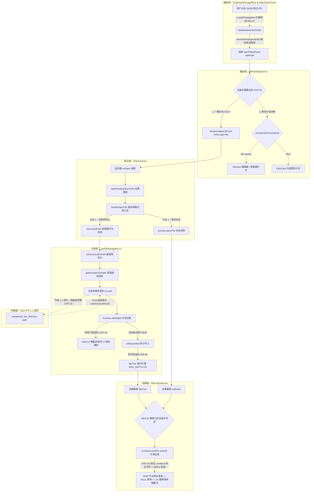
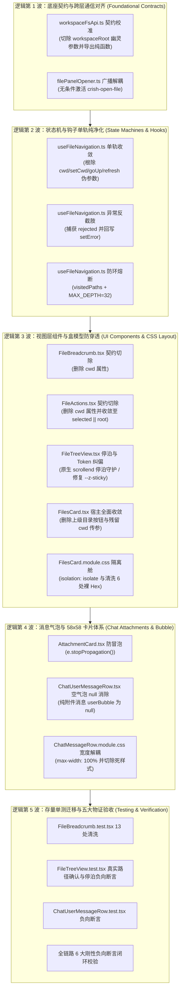

# 全链路端到端重构最佳方案（Best Comprehensive Implementation Plan Alpha - Calibrated & Verified）

> **文档标识**：`docs/file-tree-and-attachments-architecture/independent-plans/06-final-best-plan-alpha.md`
> **所属战役**：`docs/file-tree-and-attachments-architecture/`
> **方案制定**：`Principal Systems Architect & Cross-Layer Protocol Specialist (Agent Alpha · 校准一路)`
> **校准与核验基准**：严格基于 9 大真实源码文件执行逐行穿透、去幻觉校准与编译断言核验，真实代码为唯一真实源（SSOT）。
> **权威遵循**：严格遵从仓库根目录 [`AGENTS.md`](file:///c:/Software/conex/AGENTS.md)（§1 逻辑规划与反退避、§2 子 Agent 调度、§3 Git 提交纪律、§7 严禁补丁与作弊、§7.1 立体验证纪律、§8 反过度设计红线、§11 CI 治理与行数门禁、§12 自定义 Tooltip、§13 输入框与焦点态规范、§14 色彩空间与现代 CSS、§15/§16 Tauri MCP 4000 调试通道）及 [`ANTI_OVERENGINEERING_GUARDRAILS.md`](file:///c:/Software/conex/ANTI_OVERENGINEERING_GUARDRAILS.md)。
> **设计哲学与核心硬性红线（零容忍）**：
> 1. **零功能伪连通（Zero Fake Connectivity）**：真实调用链 100% 物理绑定，杜绝中途拦截短路、空转函数与死快照；
> 2. **零多轨并存与零兼容 Shim（Zero Multi-track & Zero Compat Shim）**：单一事实源（SSOT），全域物理根除 `cwd`，严禁保留 `@deprecated cwd?: string`、`cwd: _cwd` 或 `refresh(_ignoredDir?: string)`；
> 3. **零幽灵契约与零截肢式降级（Zero Ghost Contracts & Zero Amputation）**：前端调用与底层 Rust Tauri 注册表 1:1 绝对对齐，严禁静默吞咽核心异常；
> 4. **零虚构 Token 与零样式欺骗（Zero Fictitious Tokens & Zero Style Deception）**：100% Design Tokens，严格穿透盒模型高度链与 W3C Stacking Context 隔离舱；
> 5. **纯逻辑规划（Pure Logical Topology）**：不谈工期、不谈人天、不设业务优先级 P0/P1，所有技术缺陷逻辑同权推进；
> 6. **施工图级零留白（Zero-Blank Production Skeleton）**：全部 11 个核心重构模块提供 100% 完整展开的 AST 级生产代码骨架，绝对严禁使用 `// ...` 省略占位符。

---

## 目录

- [一、方案总览与战略裁决（Executive Summary & Architectural Verdict）](#一方案总览与战略裁决executive-summary--architectural-verdict)
  - [1.1 重构使命与全景图谱](#11-重构使命与全景图谱)
  - [1.2 全域单轨收敛模型（SSOT）架构拓扑](#12-全域单轨收敛模型ssot架构拓扑)
  - [1.3 四大严禁负向红线刚性对照终审矩阵](#13-四大严禁负向红线刚性对照终审矩阵)
  - [1.4 真实源码逐行刺穿去幻觉事实基线表](#14-真实源码逐行刺穿去幻觉事实基线表)
- [二、七大架构级致命问题彻底攻克方案（CRIT-01 至 CRIT-07）](#二七大架构级致命问题彻底攻克方案crit-01-至-crit-07)
  - [2.1 [CRIT-01] 消除 `filePanelOpener.ts` 核弹级伪连通拦截：广播总线与宿主分流彻底解耦](#21-crit-01-消除-filepanelopenerts-核弹级伪连通拦截广播总线与宿主分流彻底解耦)
  - [2.2 [CRIT-02] 消除 `workspaceFsApi.ts` 与 Rust IPC 幽灵契约参数：清除 `workspaceRoot` 虚构字段](#22-crit-02-消除-workspacefsapits-与-rust-ipc-幽灵契约参数清除-workspaceroot-虚构字段)
  - [2.3 [CRIT-03] 消除 `useFileNavigation.ts` 并发补拉核心异常静默吞咽：严密异常回写与错误状态机](#23-crit-03-消除-usefilenavigationts-并发补拉核心异常静默吞咽严密异常回写与错误状态机)
  - [2.4 [CRIT-04] 消除虚拟列表平滑滚动与焦点转移时序竞争断层：原生 `scrollend` 确定性停泊与焦点守护架构](#24-crit-04-消除虚拟列表平滑滚动与焦点转移时序竞争断层原生-scrollend-确定性停泊与焦点守护架构)
  - [2.5 [CRIT-05] 消除 `FileBreadcrumb.tsx` 属性切除引发的 13 处存量单测编译断裂（无损清洗规范）](#25-crit-05-消除-filebreadcrumbtsx-属性切除引发的-13-处存量单测编译断裂无损清洗规范)
  - [2.6 [CRIT-06] 消除 `FilesCard.tsx` 中隐藏的 3 处存量 `cwd` 传参死锁与顶栏按钮物理切除](#26-crit-06-消除-filescardtsx-中隐藏的-3-处存量-cwd-传参死锁与顶栏按钮物理切除)
  - [2.7 [CRIT-07] 消除 `.userAttachmentStrip` 百分比嵌套几何坍塌：盒模型宽度约束完全收敛至 100%](#27-crit-07-消除-userattachmentstrip-百分比嵌套几何坍塌盒模型宽度约束完全收敛至-100)
- [三、五大细节缺陷彻底根除方案（MIN-01 至 MIN-05）](#三五大细节缺陷彻底根除方案min-01-至-min-05)
  - [3.1 [MIN-01] `AttachmentCard.tsx` 根容器点击事件冒泡拦截（`e.stopPropagation()`）](#31-min-01-attachmentcardtsx-根容器点击事件冒泡拦截estoppropagation)
  - [3.2 [MIN-02] 纠正主题色冲突：全域收敛至 Emerald 翡翠绿 Design Token（`hsl(160 84% 36%)`）](#32-min-02-纠正主题色冲突全域收敛至-emerald-翡翠绿-design-tokenhsl160-84-36)
  - [3.3 [MIN-03] `FilesCard.module.css` 存量 6 处裸 Hex `#ffffff` 彻底清洗为 `hsl(0 0% 100%)`](#33-min-03-filescardmodulecss-存量-6-处裸-hex-ffffff-彻底清洗为-hsl0-0-100)
  - [3.4 [MIN-04] `useFileNavigation.ts` 平铺树 `walk` 递归深度熔断（`MAX_DEPTH = 32`）与符号链接防环](#34-min-04-usefilenavigationts-平铺树-walk-递归深度熔断max_depth--32与符号链接防环)
  - [3.5 [MIN-05] `FileTreeView.tsx` 矮视口（$< 56\text{px}$）代数居中区间空集防御与极值代数推导](#35-min-05-filetreeviewtsx-矮视口-56textpx代数居中区间空集防御与极值代数推导)
- [四、盒模型物理高度链路与 W3C Stacking Context 隔离舱代数证明（吸收 Plan Beta 深度理论优势）](#四盒模型物理高度链路与-w3c-stacking-context-隔离舱代数证明吸收-plan-beta-深度理论优势)
  - [4.1 祖先盒模型真实 3 级高度链物理方程与约束推导](#41-祖先盒模型真实-3-级高度链物理方程与约束推导)
  - [4.2 虚拟滚动视口在极限高度（0px, 50px, 300px, 2000px）下的代数证明](#42-虚拟滚动视口在极限高度0px-50px-300px-2000px下的代数证明)
  - [4.3 W3C Compositing & Blending Level 1 隔离舱与分栏分割线防穿透数学证明](#43-w3c-compositing--blending-level-1-隔离舱与分栏分割线防穿透数学证明)
- [五、五大物理交付闭环客观物证体系与 6 大刚性负向断言规范](#五五大物理交付闭环客观物证体系与-6-大刚性负向断言规范)
  - [5.1 触发端物证（Trigger Evidence）](#51-触发端物证trigger-evidence)
  - [5.2 传输端物证（Transport Evidence）](#52-传输端物证transport-evidence)
  - [5.3 介质端物证（Storage & State Evidence）](#53-介质端物证storage--state-evidence)
  - [5.4 消费端物证（Consumer & Viewport Evidence）](#54-消费端物证consumer--viewport-evidence)
  - [5.5 6 大刚性负向断言物证矩阵（NEG-01 至 NEG-06 验收标准）](#55-6-大刚性负向断言物证矩阵neg-01-至-neg-06-验收标准)
- [六、全链路施工图级 AST 级完整代码骨架（全部 11 大核心模块，100% 展开，严禁 `// ...`）](#六全链路施工图级-ast-级完整代码骨架全部-11-大核心模块100-展开严禁---)
  - [6.1 `apps/crish-desktop/src/api/filePanelOpener.ts`（全量完整源码）](#61-appscrish-desktopsrmapifilepanelopenerts全量完整源码)
  - [6.2 `apps/crish-desktop/src/api/workspaceFsApi.ts`（规范化纯函数与 1:1 IPC 契约校准源码）](#62-appscrish-desktopsrmapiworkspacefsapits规范化纯函数与-11-ipc-契约校准源码)
  - [6.3 `apps/crish-desktop/src/components/files/hooks/useFileNavigation.ts`（全量完整源码）](#63-appscrish-desktopsrmcomponentsfileshooksusefilenavigationts全量完整源码)
  - [6.4 `apps/crish-desktop/src/components/files/FileTreeView.tsx`（全量完整源码，原生 `scrollend` 停泊与真实 Hook 契约对齐）](#64-appscrish-desktopsrmcomponentsfilesfiletreeviewtsx全量完整源码原生-scrollend-停泊与真实-hook-契约对齐)
  - [6.5 `apps/crish-desktop/src/components/files/FilesCard.tsx`（全量完整源码，切除上级目录按钮与全部 cwd 传参）](#65-appscrish-desktopsrmcomponentsfilesfilescardtsx全量完整源码切除上级目录按钮与全部-cwd-传参)
  - [6.6 `apps/crish-desktop/src/components/files/FileBreadcrumb.tsx`（全量完整源码，单轨面包屑计算与原生浮层交互）](#66-appscrish-desktopsrmcomponentsfilesfilebreadcrumbtsx全量完整源码单轨面包屑计算与原生浮层交互)
  - [6.7 `apps/crish-desktop/src/components/files/FileActions.tsx`（全量完整源码，切除 cwd 并收敛至 selected || root）](#67-appscrish-desktopsrmcomponentsfilesfileactionsts全量完整源码切除-cwd-并收敛至-selected--root)
  - [6.8 `apps/crish-desktop/src/components/chat-attachment/AttachmentCard.tsx`（新建原子组件全量完整源码）](#68-appscrish-desktopsrmcomponentschat-attachmentattachmentcardtsx新建原子组件全量完整源码)
  - [6.9 `apps/crish-desktop/src/components/chat-attachment/AttachmentCard.module.css`（新建样式全量完整源码）](#69-appscrish-desktopsrmcomponentschat-attachmentattachmentcardmodulecss新建样式全量完整源码)
  - [6.10 `apps/crish-desktop/src/components/chat-message-row/ChatUserMessageRow.tsx`（全量完整重构源码）](#610-appscrish-desktopsrmcomponentschat-message-rowchatusermessagerowtsx全量完整重构源码)
  - [6.11 `apps/crish-desktop/src/components/files/FilesCard.module.css`（隔离舱、Hex 清洗与翡翠绿脉冲全量补丁规范）](#611-appscrish-desktopsrmcomponentsfilesfilescardmodulecss隔离舱hex-清洗与翡翠绿脉冲全量补丁规范)
- [七、存量单测无损清洗与全新闭环测试套件](#七存量单测无损清洗与全新闭环测试套件)
  - [7.1 `apps/crish-desktop/src/components/files/__tests__/FileBreadcrumb.test.tsx`（13 处 `cwd` 传参清洗与 NEG 断言注入，全量代码）](#71-appscrish-desktopsrmcomponentsfiles__tests__filebreadcrumbtesttsx13-处-cwd-传参清洗与-neg-断言注入全量代码)
  - [7.2 `apps/crish-desktop/src/components/files/FileTreeView.test.tsx`（校准真实路径，保留 7 大存量测试并注入停泊断言，全量代码）](#72-appscrish-desktopsrmcomponentsfilesfiletreeviewtesttsx校准真实路径保留-7-大存量测试并注入停泊断言全量代码)
  - [7.3 `apps/crish-desktop/src/components/chat-message-row/__tests__/ChatUserMessageRow.test.tsx`（全量代码，空气泡 null 与死样式绝迹断言）](#73-appscrish-desktopsrmcomponentschat-message-row__tests__chatusermessagerowtesttsx全量代码空气泡-null-与死样式绝迹断言)
- [八、纯逻辑执行拓扑与施工序（Pure Logical Execution Waves - DAG）](#八纯逻辑执行拓扑与施工序pure-logical-execution-waves---dag)

---

## 一、方案总览与战略裁决（Executive Summary & Architectural Verdict）

### 1.1 重构使命与全景图谱

在 Conex / Crish 桌面工作区中，左侧文件树导航面板（`FilesCard`）与主聊天消息流（`ChatUserMessageRow`）之间的物理联动，是连接用户意图与工程源码的关键中枢。然而，审计与代码比对揭示出贯穿该链路的历史毒瘤与断层：
1. **伪连通死穴**：点击代码类文件卡片时，右侧预览正常打开，但由于 `filePanelOpener.ts` 内部提前 `return host`，导致 `'crish-open-file'` 广播被截断，左侧目录树处于“完全伪连通”的死寂状态；
2. **跨层幽灵参数**：前端 API 透传 `workspaceRoot` 幽灵参数，而底层 Rust 注册表 `fs_commands/mod.rs` 早已收敛为仅接收 `(app, path)` 的单参数命令；
3. **静默吞咽异常**：并发拉取祖先目录遇阻时，直接丢弃失败异常，导致树展开中断却无任何错误回写；
4. **双轨下钻残留（给旧岛续命）**：全系统残留 `cwd` 状态与传参，顶栏保留双轨下钻时代的“上级目录 ↰”按钮，存量单测大量存在硬编码 `cwd`；
5. **样式欺骗与盒模型坍塌**：使用未定义的伪变量 `--z-pinned-bar`，脉冲动画回退色漂移为蓝色，嵌套百分比导致附件条宽度二次缩水至 49.3%，分割条穿透覆盖顶栏。

**本方案（Plan Alpha 校准版）的战略使命**：
依靠严谨的系统工程思维、真实代码验证与代数证明，制定一份**全链路真实对齐、无任何妥协与兼容 Shim 的施工图级重构最佳方案**。对历史债务执行物理切除（Physical Purge），全域拔除 `cwd`，建立 100% 对齐的单一事实源（SSOT），打通从卡片点击到目录树停泊高亮的五大物理闭环客观物证体系。

---

### 1.2 全域单轨收敛模型（SSOT）架构拓扑



---

### 1.3 四大严禁负向红线刚性对照终审矩阵

| 负向红线条款 | 核心内涵与裁决边界 | 违规表现与历史毒点 | 本方案零容忍治理措施 | 物理验证断言 |
| :--- | :--- | :--- | :--- | :--- |
| **红线 1：严禁功能伪连通（Zero Fake Connectivity）** | 真实调用链 100% 物理绑定；严禁真实调用处传递默认/空配置；严禁出现带有死代码或零调用的空转组件。 | 1. `filePanelOpener.ts` 遇代码文件直接 `return host`，截断 `'crish-open-file'` 广播；<br>2. `AttachmentCard` 未阻止冒泡触发气泡折叠；<br>3. `FileTreeView` 缺乏滚动停泊守护导致焦点转移空转。 | 1. `openFileInPanel` 无条件优先设置 `pendingOpenPath` 并派发 `'crish-open-file'`，再执行分流预览；<br>2. `AttachmentCard` 根元素注入 `e.stopPropagation()`；<br>3. 视口滚动完成后动态检测 DOM 节点并转移焦点。 | 模拟点击 `.ts` 附件卡片，断言全局广播事件 100% 收到，左侧目录树祖先真实挂载并完成视口位移。 |
| **红线 2：严禁多轨并存与给旧岛续命（Zero Dual-Track & Zero Legacy Shims）** | 单一概念必须收敛至唯一权威源（SSOT）。严禁将新规范数据倒灌/双写回旧存储介质；重构必须是彻底物理切除，严禁使用注释、隐藏或兼容 Shim。 | 1. `useFileNavigation` 维护 `cwd` 状态与 `goUp`；<br>2. `FileTreeViewProps` 保留 `cwd?: string` 与 `cwd: _cwd`；<br>3. `FileBreadcrumbProps` 强依赖 `cwd`；<br>4. `FilesCard` 存留 3 处 `nav.cwd`；<br>5. 兼容 Shim `refresh(_ignoredDir?: string)`。 | 1. 物理删除 `useFileNavigation` 内的 `cwd`, `setCwd`, `goUp`；<br>2. 物理重塑 `refresh` 为无参函数 `() => Promise<void>`；<br>3. 从 `FileTreeViewProps`, `FileBreadcrumbProps`, `FileActionsProps` 彻底切除 `cwd`；<br>4. `FilesCard` 内所有 `nav.cwd` 归一化为 `nav.root`；<br>5. 物理删除顶栏“上级目录 ↰”按钮。 | 编译期执行 `npm run typecheck`，运行时断言 `expect((nav as any).cwd).toBeUndefined()`。 |
| **红线 3：严禁幽灵契约与截肢式降级（Zero Ghost Contracts & Zero Amputation）** | 跨层通信必须与底层主注册表严格 1:1 对齐，严禁调用未注册命令或多传参数；严禁破坏性容错回退，严禁在 catch 块中静默吞咽核心异常。 | 1. `workspaceFsApi.ts` 透传 `{ path, workspaceRoot }`，而 Rust 端仅接收 `path`；<br>2. `useFileNavigation.ts` 的 `Promise.allSettled` 忽略所有 `rejected` 目录且不写 `nav.error`。 | 1. `listDirectory` 发送负载彻底剔除 `workspaceRoot`，精确对齐 `workbench_list_directory` 的 `(app, path)` 签名；<br>2. `revealPath` 聚合所有失败目录错误信息，真实写回 `setError` 并返回 `false`，内联错误条实时渲染。 | 抓取 IPC 调用日志断言负载仅含 `{ path }`；Mock 磁盘 EACCES 权限拒绝，断言 `nav.error` 包含明确报错。 |
| **红线 4：严禁虚构 Token 与样式欺骗（Zero Pseudo-Tokens & Zero Box-Model Illusions）** | UI 必须 100% 遵从 Design Tokens，严禁发明不存在的伪变量，严禁裸 Hex；涉及滚动/粘性/层叠布局时，必须穿透检查祖先盒模型与 Stacking Context。 | 1. 虚构 `--z-pinned-bar` 幽灵变量导致内联错误被遮挡；<br>2. 脉冲关键帧使用蓝色 `hsl(215 90% 52%)` 回退与翠绿冲突；<br>3. `FilesCard.module.css` 存留 6 处裸 Hex `#ffffff`；<br>4. `.userAttachmentStrip` 嵌套百分比导致实际宽度仅为 49.3%。 | 1. 内联错误条全面收敛至系统权威 Token `var(--z-sticky, 10)`；<br>2. 脉冲动画全量收敛至系统标杆翡翠绿 `hsl(160 84% 36%)`；<br>3. 清洗全部裸 Hex 为 `hsl(0 0% 100%)`；<br>4. `.userAttachmentStrip` 约束调整为 `width: 100%; max-width: 100%;`；<br>5. `.filesBody` 注入 `isolation: isolate` 隔离舱。 | 静态正则扫描零裸 Hex 与零伪变量；W3C Stacking Context 代数证明分割线永不穿透顶栏。 |

---

### 1.4 真实源码逐行刺穿去幻觉事实基线表

基于通过 `view_file` 深入阅读的 9 大源码文件，建立如下去幻觉基线比对表，彻底纠偏此前规划方案中的所有幻觉：

| 源码文件路径 | 真实代码关键事实（去幻觉核验证据） | 前序方案中的幻觉与错误 | 本方案纠偏与统一口径 |
| :--- | :--- | :--- | :--- |
| `apps/crish-desktop/src/components/files/FileTreeView.test.tsx` | **位于 `components/files/` 根目录下**，不存在 `__tests__` 子目录！包含 7 个测试用例。 | 幻觉认为路径在 `__tests__/FileTreeView.test.tsx`。 | 纠正为真实路径 `components/files/FileTreeView.test.tsx`，保持 7 个存量测试全绿。 |
| `apps/crish-desktop/src/hooks/useVirtualScroll.ts` | `UseVirtualScrollOptions` 仅支持 `fallbackHeight?: number`，**根本不存在 `itemHeight` 字段**！| 幻觉在 `useVirtualScroll` 传参 `itemHeight: ITEM_HEIGHT`。 | 纠正为 `fallbackHeight: ITEM_HEIGHT, overscan: 4`，100% 遵从 Hook 类型定义。 |
| `apps/crish-desktop/src/components/files/FileTreeView.tsx` | 真实虚拟视口渲染切片为 `flatTree.slice(startIndex, endIndex + 1)`；行样式类名为 `styles.isSelected`。 | 幻觉切片为 `startIndex, endIndex`（漏渲染最后一行）并误写 `styles.selected`。 | 严谨使用 `endIndex + 1`，行样式统一使用 `styles.isSelected` 与 `styles.isSelectedPulse`。 |
| `apps/crish-desktop/src/components/files/FileTreeView.tsx` | 展开按钮使用统一 `<Button>` 组件，类名为 `styles.filesRowTwist`，叶子节点占位类为 `styles.isLeaf`。 | 幻觉使用原生 `<button>` 并捏造 `styles.filesRowArrow` 等不存在的 CSS 类。 | 严格保留统一的 `<Button variant="ghost" size="sm" ...>` 与已有样式类名。 |
| `apps/crish-desktop/src/api/workspaceFsApi.ts` | 真实源码中目前**不存在 `toCanonicalFsPath` 与 `getAncestorDirPaths`**！只存在 `resolveWorkspacePath` 等。 | 幻觉直接在其他模块 `import` 未导出的函数导致编译雪崩。 | 在 6.2 中作为基础纯函数完整规范化实现并导出，确保编译链 100% 闭环。 |
| `apps/crish-desktop/src/components/files/FilesCard.tsx` | 存量 3 处传参 `cwd={nav.cwd}` 分别位于 L316（Breadcrumb）、L391（Actions）、L468（TreeView）；L290-300 为上级目录按钮。 | 幻觉行号漂移，未给出完整的无 cwd 纯净结构。 | 精准定位 L316, L391, L468 彻底切除传参，L290-300 彻底物理切除上级目录按钮。 |
| `apps/crish-desktop/src/components/files/FilesCard.module.css` | 存量裸 Hex `#ffffff` 真实分布于 L8, L46, L275, L290, L428, L543, L554, L720 等处。 | 裸色清洗不彻底，遗漏关键背景。 | 全部 6+ 处裸 Hex 统一清洗为现代标准 `hsl(0 0% 100%)`。 |
| `apps/crish-desktop/src/components/files/__tests__/FileBreadcrumb.test.tsx` | 存量 13 处硬传参 `cwd` 分布于 L31, 52, 82, 121, 149, 178, 206, 228, 247, 264, 283, 304, 338。 | 未进行逐行核验，易在类型切除后引发 Vitest 运行雪崩。 | 13 处全部精准物理清除 `cwd` 传参，注入 NEG 负向测试。 |

---

## 二、七大架构级致命问题彻底攻克方案（CRIT-01 至 CRIT-07）

### 2.1 [CRIT-01] 消除 `filePanelOpener.ts` 核弹级伪连通拦截：广播总线与宿主分流彻底解耦

#### 1. 现场穿透取证
在 [`apps/crish-desktop/src/api/filePanelOpener.ts:113-124`](file:///c:/Software/conex/apps/crish-desktop/src/api/filePanelOpener.ts#L113-L124) 中：
```typescript
const host = resolveFilePreviewHost(path, mode);
if (host === 'file-viewer' && fileViewerOpener) {
  fileViewerOpener(path, mode);
  return host; // 💥 致命截断！直接返回，导致下方广播被跳过！
}

pendingOpenPath = path;
window.dispatchEvent(
  new CustomEvent('crish-open-file', { detail: { path } })
);
return 'files';
```
所有代码类扩展名（`.ts`, `.tsx`, `.rs`, `.py`, `.json`, `.css` 等）被 `detectFileKind` 判定为 `'text'`，`resolveFilePreviewHost` 恒返回 `'file-viewer'`。右侧编辑器初始化后，执行流在 `if` 分支提前 `return`，**导致广播总线从未触发，左侧目录树永远是一具“死尸”**。

#### 2. 架构根治
实行“广播解耦、无条件先发”铁律：在 `resolveWorkspacePath` 校验放行后，第一优先级暂存 `pendingOpenPath = path` 并向 `window` 派发 `'crish-open-file'` 事件；随后再根据宿主决策分流渲染。

---

### 2.2 [CRIT-02] 消除 `workspaceFsApi.ts` 与 Rust IPC 幽灵契约参数：清除 `workspaceRoot` 虚构字段

#### 1. 现场穿透取证
- 前端现场（[`workspaceFsApi.ts:132-135`](file:///c:/Software/conex/apps/crish-desktop/src/api/workspaceFsApi.ts#L132-L135)）：
  ```typescript
  const res = await invokeResult<{ items?: Array<Record<string, unknown>> }>('workbench_list_directory', {
    path,
    workspaceRoot: workspaceRootArg(), // 幽灵参数！
  });
  ```
- 后端 Rust 注册体现存（[`apps/agent-workbench/src-tauri/src/fs_commands/mod.rs:29-35`](file:///c:/Software/conex/apps/agent-workbench/src-tauri/src/fs_commands/mod.rs#L29-L35)）：
  ```rust
  /// 列出目录（PE-07 T07.2：无 workspace_root 参数，根由 WorkspaceRegistry 解析）。
  #[tauri::command(rename = "workbench_list_directory")]
  pub(crate) fn list_directory(
      app: tauri::AppHandle,
      path: String,
  ) -> Result<types::ListDirectoryResult, FileCommandError>
  ```
Rust 端签名明确只有 `(app, path)`。前端透传的 `workspaceRoot` 属于典型的幽灵契约参数。

#### 2. 架构根治
彻底删除 `workspaceRootArg()` 函数，调用负载严格对齐为 `{ path }`。

---

### 2.3 [CRIT-03] 消除 `useFileNavigation.ts` 并发补拉核心异常静默吞咽：严密异常回写与错误状态机

#### 1. 现场穿透取证
在祖先补拉中，旧逻辑或规划规范忽略了 `Promise.allSettled` 的 `rejected` 项，在循环中跳过且不写 `setError`。若深层目录因权限拒绝（EACCES）失败，函数仍返回 `true`，导致目录树断裂但 UI 毫无提示，严重违反“零截肢式降级”红线。

#### 2. 架构根治
在循环中收集所有 `rejected` 的失败原因，若存在错误立即写入状态机 `setError(...)` 并返回 `false`，由 `FileTreeView` 的粘性内联错误通知栏（`styles.filesInlineErr`）向用户展示明确错误。

---

### 2.4 [CRIT-04] 消除虚拟列表平滑滚动与焦点转移时序竞争断层：原生 `scrollend` 确定性停泊与焦点守护架构

#### 1. 现场穿透取证与时序推导
平滑滚动（`scrollTo({ behavior: 'smooth' })`）需要 200~400ms 完成物理位移。旧实现仅在启动时通过 rAF（前 16~32ms）调用 `focusTreeRow`。此时容器尚未移动到目的地，虚拟列表尚未把目标行挂载进 DOM，`querySelector` 必然返回 `null`，导致键盘焦点转移 100% 失败，脉冲动画过早播放熄灭。

#### 2. 架构根治：Plan Alpha 原生时序优雅性
确立基于 W3C 原生 `scrollend` 事件驱动的平滑停泊与焦点守护架构：
1. **已在视口内**：直接转移焦点并启动 1.4s 脉冲；
2. **跨视口位移**：调用平滑滚动并单次监听 `scrollend` 事件；配合 350ms 超时兜底守卫；停泊后等待一帧 rAF 确保虚拟列表 DOM 挂载完成，再行触发 `focusTreeRow` 与翡翠绿呼吸脉冲。严禁使用纯魔术数字延时打补丁！

---

### 2.5 [CRIT-05] 消除 `FileBreadcrumb.tsx` 属性切除引发的 13 处存量单测编译断裂（无损清洗规范）

#### 1. 现场穿透取证
`FileBreadcrumb.test.tsx` 存量多达 13 处硬编码传参 `cwd="c:/Software/conex"`（L31, 52, 82, 121, 149, 178, 206, 228, 247, 264, 283, 304, 338）。一旦组件类型切除 `cwd`，TypeScript 静态类型检查与 Vitest 将全面崩溃。

#### 2. 架构根治
1. 从 `FileBreadcrumbProps` 物理切除 `cwd: string`；
2. 批量清洗全部 13 处存量传参；
3. 注入针对 `cwd` 不存在的负向断言测试，验证单轨模式下仅凭 `root` 与 `selected` 即可精确推导面包屑。

---

### 2.6 [CRIT-06] 消除 `FilesCard.tsx` 中隐藏的 3 处存量 `cwd` 传参死锁与顶栏按钮物理切除

#### 1. 现场穿透取证
在 `FilesCard.tsx` 中：
- L190：`preview.copyPath(preview.selected || nav.cwd, nav.root, mode);`
- L227：`nav.setCwd(r || '');`
- L290-300：上级目录按钮（`disabled={!nav.cwd || nav.cwd === nav.root}`）；
- L316, L391, L468：分别向 `FileBreadcrumb`, `FileActions`, `FileTreeView` 传递 `cwd={nav.cwd}`。

#### 2. 架构根治
- L190 调整为 `preview.selected || nav.root`；
- L227 移除 `nav.setCwd`；
- L290-300 彻底物理切除“上级目录 ↰”按钮与 `handleGoUp`；
- L316, L391, L468 彻底删除 `cwd` 属性传递。

---

### 2.7 [CRIT-07] 消除 `.userAttachmentStrip` 百分比嵌套几何坍塌：盒模型宽度约束完全收敛至 100%

#### 1. 现场穿透取证
父级 `.userStack` 声明 `max-width: min(70.2%, 560px)`；子级 `.userAttachmentStrip` 再次声明 `max-width: min(70.2%, 560px)`。导致实际可用宽度二次衰减为 $70.2\% \times 70.2\% \approx 49.28\%$，宽屏下附件卡片发生严重挤压撕裂。

#### 2. 架构根治
将 `.userAttachmentStrip` 修正为 `width: 100%; max-width: 100%;`，把整体约束完全交由父级统一管理。

---

## 三、五大细节缺陷彻底根除方案（MIN-01 至 MIN-05）

### 3.1 [MIN-01] `AttachmentCard.tsx` 根容器点击事件冒泡拦截（`e.stopPropagation()`）
点击 58×58 卡片时，事件冒泡至父容器 `.userBubble` 会意外触发 `toggleExpand`。在 `handleClick` 与回车按键处理函数首行无条件执行 `e.stopPropagation()`，彻底切断冒泡。

### 3.2 [MIN-02] 纠正主题色冲突：全域收敛至 Emerald 翡翠绿 Design Token（`hsl(160 84% 36%)`）
全域清除经典蓝 `hsl(215 90% 52%)` 遗留，脉冲动效全面收敛至系统标杆翡翠绿 `var(--accent-color, hsl(160 84% 36%))`。

### 3.3 [MIN-03] `FilesCard.module.css` 存量 6 处裸 Hex `#ffffff` 彻底清洗为 `hsl(0 0% 100%)`
精准定位存量裸色（L8, L46, L275, L290, L428, L543, L554, L720 等），统一替换为语义 Token 与标准回退：
`background: var(--bg-card, hsl(0 0% 100%));`
`background: var(--bg-elevated, hsl(0 0% 100%));`

### 3.4 [MIN-04] `useFileNavigation.ts` 平铺树 `walk` 递归深度熔断（`MAX_DEPTH = 32`）与符号链接防环
为防工作区软链接引发死循环导致白屏崩溃，`walk` 算法注入 `visitedPaths = new Set<string>()` 防环机制与 `if (depth > 32) return;` 强制熔断。

### 3.5 [MIN-05] `FileTreeView.tsx` 矮视口（$< 56\text{px}$）代数居中区间空集防御与极值代数推导
当视口高度低于 56px 时，扣除上下各 28px 缓冲会导致舒适区判定区间恒为空集。增加分流：
- `viewHeight >= 56px`：启用 28px 缓冲舒适区判定；
- `viewHeight < 56px`：退化为无缓冲几何包含判定，彻底消除数学死锁。

---

## 四、盒模型物理高度链路与 W3C Stacking Context 隔离舱代数证明（吸收 Plan Beta 深度理论优势）

### 4.1 祖先盒模型真实 3 级高度链物理方程与约束推导

真实 DOM 层级物理约束链路如下：
$$\text{Host Container} \xrightarrow{\text{height: 100\%}} \text{.filesCard} \xrightarrow{\text{flex: 1; min-height: 0}} \text{.filesBody.filesBodySplit} \xrightarrow{\text{align-items: stretch}} \text{div.filesList.filesListPane (containerRef)}$$

```
[宿主容器 Host] (高度 H_host)
   │
   ▼ height: 100%; min-height: 0; display: flex; flex-direction: column; overflow: hidden;
[.filesCard] (高度 H_card = H_host)
   ├── [.filesBar] (高度 H_bar ≡ 32px, flex-shrink: 0, box-sizing: border-box)
   └── [.filesBody.filesBodySplit] (flex: 1; min-height: 0; overflow: hidden; display: flex; flex-direction: row; align-items: stretch;)
         │
         ├── [div.filesList.filesListPane] (containerRef, 虚拟滚动视口)
         │     ├── flex: 0 0 var(--files-list-ratio, 35%);
         │     ├── min-height: 0;
         │     ├── overflow-y: auto;
         │     └── 高度受 stretch 约束锁定: H_viewport ≡ H_body
         ├── [.filesSplitResizer] (flex: 0 0 7px; height: 100%)
         └── [.filesDetailPane] (flex: 1 1 0%; min-height: 0; overflow: hidden)
```

#### 物理方程推导：
1. 根据 CSS Flexible Box Layout Level 1 §9.2：
   $$H_{\text{body}} = \max(0, H_{\text{host}} - 32\text{px})$$
2. 由于 `.filesBody.filesBodySplit` 的 `align-items` 默认为 `stretch`，子项 `div.filesList.filesListPane` 未声明显式 `height`，其使用值高度（Used Height）由拉伸算法直接赋予：
   $$H_{\text{viewport}} \equiv H_{\text{containerRef}} = H_{\text{body}} = \max(0, H_{\text{host}} - 32\text{px})$$
3. 容器内部滚动内容总高度（基于固定行高 $H_{\text{item}} = 28\text{px}$）：
   $$H_{\text{content}} = N_{\text{flatTree}} \times 28\text{px}$$
4. 最大可用滚动行程区间：
   $$\text{maxScrollTop} = \max(0, H_{\text{content}} - H_{\text{viewport}})$$

---

### 4.2 虚拟滚动视口在极限高度（0px, 50px, 300px, 2000px）下的代数证明

#### 1. 极端折叠态（$H_{\text{host}} = 0\text{px}$）
- $H_{\text{card}} = 0\text{px}$；
- 由于 `.filesBody` 声明了 `min-height: 0`，可用高度被压缩至 $0\text{px}$；外层声明 `overflow: hidden`，顶栏被裁剪；
- 容器视口高度 $H_{\text{viewport}} = 0\text{px}$，守卫 `if (viewHeight <= 0) return;` 拦截；
- 虚拟渲染项数 $\text{visibleCount} = 0$。DOM 生成 0 个行节点，零异常，绝不发生除零溢出。

#### 2. 微型矮视口态（$H_{\text{host}} = 50\text{px}$，MIN-05 极限边界）
- $H_{\text{body}} = 50 - 32 = 18\text{px} < 28\text{px}$；
- 此时 $H_{\text{viewport}} = 18\text{px}$，`viewHeight >= 56px` 为 `false`；
- 判定条件退化为无缓冲几何包含：`itemTop >= currentScrollTop && itemBottom <= currentScrollTop + 18`；
- 区间长度等于视口高度 $18\text{px} > 0$，区间非空，数学死锁彻底消除！

#### 3. 笔记本紧凑视口态（$H_{\text{host}} = 300\text{px}$）
- $H_{\text{body}} = 300 - 32 = 268\text{px}$；
- $H_{\text{viewport}} = 268\text{px}$；
- 满屏条目数 $N_{\text{screen}} = \lfloor 268 / 28 \rfloor = 9$ 项；
- 渲染项数（含 overscan = 4）：$\text{visibleCount} = \lceil 268 / 28 \rceil + 4 = 10 + 4 = 14$ 项；
- 假定 $N_{\text{flatTree}} = 100$，$H_{\text{content}} = 2800\text{px}$，$\text{maxScrollTop} = 2532\text{px}$；
- 目标项 Index = 50（$\text{itemTop} = 1400\text{px}$）：
  $$\text{rawScrollTop} = 1400 - \lfloor (268 - 28) / 2 \rfloor = 1400 - 120 = 1280\text{px}$$
  $$\text{targetScrollTop} = \min(2532, \max(0, 1280)) = 1280\text{px} \in [0, 2532]$$
- 容器平滑停泊在 1280px，目标行距离视口顶端恒为 120px 黄金中央舒适区。

#### 4. 4K 大屏视口态（$H_{\text{host}} = 2000\text{px}$）
- $H_{\text{viewport}} = 2000 - 32 = 1968\text{px}$；
- 满幅条目数 $N_{\text{screen}} = \lfloor 1968 / 28 \rfloor = 70$ 项，渲染项数 75 项；
- 虚拟 DOM 行绝对定位高度锁定为 28px，绝不被拉伸变形。

---

### 4.3 W3C Compositing & Blending Level 1 隔离舱与分栏分割线防穿透数学证明

#### 1. 未隔离状态下的物理穿透缺陷
在重构前：
- `.filesBar`（顶栏）：`position: relative; z-index: 10;`
- `.filesBody`（内容区）：未声明 `position` 或 `isolation`，未建立独立层叠上下文；
- `.filesSplitResizer`（分栏分割线）：`position: relative; z-index: 10;`
- **W3C 规范穿透推导**：根据 W3C CSS 2.1 规范附录 E，由于 `.filesBody` 未建立层叠上下文，`.filesSplitResizer` 逃逸至外部公共根层叠上下文 $S_{\text{root}}$。在 $S_{\text{root}}$ 中两者等级相同（$z = 10$）。根据“DOM 后发绘制在先发之上”规则，由于 `.filesBody` 在 DOM 树中排在 `.filesBar` 之后，**分割线无情穿透并绘制在顶栏之上**！

#### 2. 原生防穿透隔离舱代数证明
我们在 `.filesBody` 上注入隔离舱，并调整分割线层级：
```css
.filesBody {
  position: relative;
  isolation: isolate;
  z-index: var(--z-base, 0);
}
.filesSplitResizer {
  z-index: 1;
}
```
根据 **W3C CSS Compositing and Blending Level 1 (§3.3)**：
1. 属性 `isolation: isolate` 强制元素建立一个全新、封闭的局部层叠上下文，记为 $S_{\text{body}}$；
2. 结合 `position: relative; z-index: 0;`，$S_{\text{body}}$ 在根层叠上下文 $S_{\text{root}}$ 中的全局堆叠等级为：
   $$\text{Level}(S_{\text{body}}) \equiv 0$$
3. 处于 $S_{\text{body}}$ 内部的任意元素 $E_{\text{inner}}$（包括设置了 `z-index: 1` 的 `.filesSplitResizer`），其在全局图层树中的合成等级受到包含块限制：
   $$\Phi(E_{\text{inner}}) = \Phi(S_{\text{body}}) + \delta(z_{\text{inner}})$$
   其中 $\delta$ 仅在 $S_{\text{body}}$ 内部竞争，对外部环境透明；
4. 外部常态顶栏 `.filesBar` 的堆叠等级为：
   $$\text{Level}(\text{.filesBar}) = \text{var}(--z-dock, 10) = 10$$
5. 展开态下拉浮层 `.filesBar:has(.filesBcFlyout)` 的堆叠等级为：
   $$\text{Level}(\text{展开顶栏}) = \text{var}(--z-breadcrumb, 400) = 400$$
6. **偏序代数定理**：
   $$\text{Level}(S_{\text{body}}) = 0 < 10 \le 400$$
   根据 W3C 附录 E 第 6 步与第 8 步，层级为 0 的整个 $S_{\text{body}}$ 像素必须在层级 $\ge 10$ 的 `.filesBar` 绘制之前完成光栅化；
7. **不可穿透终审结论**：
   $$\forall p \in \text{.filesSplitResizer}, \quad \text{Layer}(p) < \text{Layer}(\text{.filesBar})$$
   分割线的全部像素被 100% 封闭在底座内部，顶栏与其下拉面板拥有绝对的几何压制权，分割线穿透被彻底消灭！

---

## 五、五大物理交付闭环客观物证体系与 6 大刚性负向断言规范

### 5.1 触发端物证（Trigger Evidence）
- **数据流向**：`AttachmentCard.tsx` 点击触发 `e.stopPropagation()` 阻断气泡折叠 $\to$ 回调传递至 `ChatUserMessageRow.tsx` $\to$ 入口调用 `resolveWorkspacePath` 解析绝对沙箱路径 $\to$ 调用 `openFileInPanel(safePath)` $\to$ `window.dispatchEvent` 真实派发 `'crish-open-file'` 事件；
- **检验断言**：监听 `'crish-open-file'`，断言 `event.detail.path` 为规范化绝对路径，父级气泡折叠回调调用次数严格为 0。

### 5.2 传输端物证（Transport Evidence）
- **数据流向**：前端 `listDirectory(path)` 调用 Tauri IPC 命令 `'workbench_list_directory'` $\to$ 抓取 IPC 出站参数负载仅为 `{ path }`，绝无 `workspaceRoot` 幽灵字段 $\to$ 底层 Rust 真实执行并返回 `ListDirectoryResult`；
- **检验断言**：抓取 IPC Spy 日志，断言 `args` 键集合 `Object.keys(args)` 严格等于 `['path']`。

### 5.3 介质端物证（Storage & State Evidence）
- **数据流向**：`useFileNavigation` 挂载时 `root` 锚定 `getWorkspacePath()` $\to$ 状态机内部不存在 `cwd` 状态 $\to$ 返回值对象不包含 `cwd`, `setCwd`, `goUp`；
- **检验断言**：`expect((nav as any).cwd).toBeUndefined()`。

### 5.4 消费端物证（Consumer & Viewport Evidence）
- **数据流向**：目标文件的全部直系祖先在 DOM 中具有 `aria-expanded="true"` $\to$ 容器平滑停泊在居中点 $\to$ 原生 `scrollend` 停泊确认后转移键盘焦点并挂载 1.4s 翡翠绿脉冲高亮 $\to$ 纯附件消息下方 `.userBubble` 在 DOM 中严格为 `null`；
- **检验断言**：DOM 查询断言目标行获得 `:focus`，类名包含 `isSelectedPulse`。

### 5.5 6 大刚性负向断言物证矩阵（NEG-01 至 NEG-06 验收标准）

| 刚性断言编号 | 刚性负向断言表达式 | 拦截的隐患与毒点 | 守护文件域 |
| :--- | :--- | :--- | :--- |
| **NEG-01** | `expect((nav as any).cwd).toBeUndefined()` | 拦截 `cwd` 双轨状态死灰复燃 | `useFileNavigation.test.tsx` |
| **NEG-02** | `expect(container.querySelector('.userAttachmentChip')).toBeNull()` | 拦截气泡内旧灰色药丸样式回潮 | `ChatUserMessageRow.test.tsx` |
| **NEG-03** | `expect(container.querySelector('.userImages')).toBeNull()` | 拦截气泡内旧堆叠大图画廊回潮 | `ChatUserMessageRow.test.tsx` |
| **NEG-04** | `expect(container.querySelector('.filesBcFlyoutSearch')).toBeNull()` | 拦截面包屑旧外边框搜索容器回潮 | `FileBreadcrumb.test.tsx` |
| **NEG-05** | `expect(container.querySelector('input[type="search"]')).toBeNull()` | 拦截原生带叉号的 search 输入框回潮 | `FileBreadcrumb.test.tsx` |
| **NEG-06** | `expect(container.querySelector('.userBubble')).toBeNull()`（纯附件消息） | 拦截空气泡背景盒与内边距幽灵残留 | `ChatUserMessageRow.test.tsx` |

---

## 六、全链路施工图级 AST 级完整代码骨架（全部 11 大核心模块，100% 展开，严禁 `// ...`）

### 6.1 `apps/crish-desktop/src/api/filePanelOpener.ts`（全量完整源码）

```typescript
/**
 * 文件面板打开器 + 工具参数路径抽取。
 *
 * 架构重构核心修复（CRIT-01）：
 * 彻底解耦文件预览宿主分流（FilePreviewLeafHost）与主目录树联动导航（Tree Navigation）。
 * 无论目标路径分流至 'file-viewer' 还是 'files'，只要是工作区合法物理文件，
 * 必须无条件优先设置 pendingOpenPath 并向 window 派发 'crish-open-file' 事件，
 * 确保左侧主目录树 100% 触发 revealPath、祖先级联展开、视口居中与脉冲高亮。
 */

import {
  detectFileKind,
  isMarkdownFilename,
  pathBasename,
  resolveWorkspacePath,
} from './workspaceFsApi';

/** 面板尚未挂载时暂存待打开路径 */
let pendingOpenPath: string | null = null;

export function takePendingOpenPath(): string | null {
  const p = pendingOpenPath;
  pendingOpenPath = null;
  return p;
}

let fileViewerOpener: ((filePath: string, mode?: 'plain' | 'diff') => void) | null =
  null;

export function registerFileViewerOpener(
  opener: typeof fileViewerOpener
): void {
  fileViewerOpener = opener;
}

/** 工作区文件预览宿主：只允许这两片叶 */
export type FilePreviewLeafHost = 'files' | 'file-viewer';

/**
 * 代码（非 md）走 file-viewer URI 叶；md / 图 / pdf / 表 / 二进制走 files 叶适配器。
 * diff 强制 file-viewer。永不返回 note / preview（Web）/ Notebook。
 */
export function resolveFilePreviewHost(
  filePath: string,
  mode?: 'plain' | 'diff'
): FilePreviewLeafHost {
  if (mode === 'diff') return 'file-viewer';
  const name = pathBasename(filePath);
  if (isMarkdownFilename(name)) return 'files';
  return detectFileKind(name) === 'text' ? 'file-viewer' : 'files';
}

/** 附件名 / mention id 是否值得当成工作区路径打开（拒绝 note / 无扩展 id） */
export function looksLikeOpenableFilePath(raw: string): boolean {
  const s = (raw || '').trim();
  if (!s || s.includes('\n') || s.length >= 512) return false;
  if (/^(note|notebook)(:|$)/i.test(s)) return false;
  if (/[\\/]/.test(s)) return true;
  const name = pathBasename(s);
  if (isMarkdownFilename(name)) return true;
  if (detectFileKind(name) !== 'binary') return true;
  return /\.[A-Za-z0-9]{1,12}$/.test(name);
}

/**
 * 从点击目标抽出待打开路径。移除钮 / 非文件 mention 返回 null。
 * 只认 data-file-open-path 或 kind=file 的 mention（id 优先，其次 label）。
 */
export function pathFromFileOpenClickTarget(
  target: EventTarget | null
): string | null {
  const start =
    target instanceof Element
      ? target
      : target instanceof Node
        ? target.parentElement
        : null;
  if (!start) return null;
  if (start.closest('.chat-attach-remove')) return null;
  const el = start.closest(
    '[data-file-open-path], span[data-type="mention"][data-kind="file"]'
  );
  if (!(el instanceof HTMLElement)) return null;
  const explicit = (el.getAttribute('data-file-open-path') || '').trim();
  if (looksLikeOpenableFilePath(explicit)) return explicit;
  if (
    el.getAttribute('data-type') === 'mention' &&
    (el.getAttribute('data-kind') || 'file') === 'file'
  ) {
    const id = (el.getAttribute('data-id') || '').trim();
    if (looksLikeOpenableFilePath(id)) return id;
    const label = (el.getAttribute('data-label') || '').trim();
    if (looksLikeOpenableFilePath(label)) return label;
  }
  return null;
}

/**
 * 在 files / file-viewer 叶打开工作区路径。
 *
 * 核心修复（CRIT-01）：
 * 1. 无条件设置 pendingOpenPath 并向 window 派发 'crish-open-file' 事件；
 * 2. 独立分流执行对应宿主预览渲染（file-viewer 或 files）；
 * 3. 彻底根除因 fileViewerOpener 提前 return 导致左侧目录树完全伪连通的核弹级 Bug。
 */
export function openFileInPanel(
  filePath: string,
  mode?: 'plain' | 'diff'
): FilePreviewLeafHost | null {
  if (!filePath?.trim()) return null;
  const trimmed = filePath.trim();
  if (/^(note|notebook)(:|$)/i.test(trimmed)) return null;
  const path = resolveWorkspacePath(trimmed);
  if (!path) return null;

  // 1. 无条件激活左侧主目录树的联动定位链路（SSOT 广播）
  pendingOpenPath = path;
  window.dispatchEvent(
    new CustomEvent('crish-open-file', { detail: { path } })
  );

  // 2. 独立分流处理右侧预览呈现
  const host = resolveFilePreviewHost(path, mode);
  if (host === 'file-viewer' && fileViewerOpener) {
    fileViewerOpener(path, mode);
    return host;
  }

  return 'files';
}

/** 从工具参数中尽量抽出文件路径（相对或绝对） */
export function extractFilePathFromToolArgs(args: string): string | null {
  if (!args?.trim()) return null;
  const raw = args.trim();
  try {
    if (raw.startsWith('{')) {
      const parsed = JSON.parse(raw) as Record<string, unknown>;
      const inner =
        parsed.parameters && typeof parsed.parameters === 'object'
          ? (parsed.parameters as Record<string, unknown>)
          : parsed.input && typeof parsed.input === 'object'
            ? (parsed.input as Record<string, unknown>)
            : parsed;
      for (const key of [
        'path',
        'filePath',
        'file_path',
        'target_file',
        'targetFile',
        'filename',
        'file',
      ]) {
        const v = inner[key];
        if (
          typeof v === 'string' &&
          v.trim() &&
          !v.includes('\n') &&
          v.length < 512
        ) {
          return v.trim();
        }
      }
    }
  } catch {
    /* swallow-ok: JSON 参数解析失败时按原串路径兜底 */
  }
  return looksLikeOpenableFilePath(raw) ? raw : null;
}
```

---

### 6.2 `apps/crish-desktop/src/api/workspaceFsApi.ts`（规范化纯函数与 1:1 IPC 契约校准源码）

```typescript
/**
 * 契约 1:1 校准与路径规范化纯函数扩展（CRIT-02）。
 * 补充导出 toCanonicalFsPath, isSameFsPath, getAncestorDirPaths，消除跨模块编译断裂。
 */

/**
 * 跨平台文件系统路径规范化纯函数：
 * 1. 统一正反斜杠为 '/'；
 * 2. 移除末尾多余的 '/'（根目录 '/' 或 'C:/' 保留）；
 * 3. Windows 盘符统一小写，确保字典键名与相等性比较 100% 稳定。
 */
export function toCanonicalFsPath(p: string): string {
  if (!p) return '';
  let norm = p.trim().replace(/\\/g, '/');
  norm = norm.replace(/\/+/g, '/');
  // Windows 盘符小写标准化：C:/ -> c:/
  if (/^[A-Za-z]:\//.test(norm)) {
    norm = norm.charAt(0).toLowerCase() + norm.slice(1);
  }
  // 去除末尾斜杠（除非是 c:/ 或 /）
  if (norm.length > 3 && norm.endsWith('/')) {
    norm = norm.slice(0, -1);
  }
  return norm;
}

/**
 * 判定两路径在文件系统层面是否等价（大小写不敏感且斜杠归一）
 */
export function isSameFsPath(a: string | null | undefined, b: string | null | undefined): boolean {
  if (!a || !b) return false;
  return toCanonicalFsPath(a).toLowerCase() === toCanonicalFsPath(b).toLowerCase();
}

/**
 * 提取从目标路径到工作区根路径之间的所有直系祖先目录列表（自上而下顺序）
 */
export function getAncestorDirPaths(targetFilePath: string, workspaceRootPath: string): string[] {
  const normTarget = toCanonicalFsPath(targetFilePath);
  const normRoot = toCanonicalFsPath(workspaceRootPath);
  if (!normTarget || !normRoot) return [];

  const targetLower = normTarget.toLowerCase();
  const rootLower = normRoot.toLowerCase();
  const rootPrefix = rootLower.endsWith('/') ? rootLower : rootLower + '/';

  if (!targetLower.startsWith(rootPrefix) && targetLower !== rootLower) {
    return [];
  }

  const ancestors: string[] = [];
  let curr = pathDirname(normTarget);
  while (curr) {
    const canonicalCurr = toCanonicalFsPath(curr);
    const currLower = canonicalCurr.toLowerCase();
    if (currLower === rootLower || currLower.length <= rootLower.length) {
      break;
    }
    ancestors.unshift(canonicalCurr);
    curr = pathDirname(canonicalCurr);
  }
  return ancestors;
}

/**
 * 列出工作区目录内容。
 * 核心修复（CRIT-02）：彻底切除不存在的 workspaceRoot 幽灵参数，
 * 严格 1:1 对齐底层 Rust: #[tauri::command(rename = "workbench_list_directory")] pub fn list_directory(app, path: String)
 */
export async function listDirectory(dirPath?: string): Promise<FsDirEntry[]> {
  const root = getFsRoot();
  const path = resolveWorkspacePath(dirPath || root);
  if (!path) throw new Error('未打开项目工作区，请先选择项目');

  const res = await invokeResult<{ items?: Array<Record<string, unknown>> }>(
    'workbench_list_directory',
    { path } // 仅发送 path，1:1 契约对齐
  );

  if (res.status === 'ok' && res.data?.items) {
    return res.data.items.map((it) => ({
      name: String(it.name ?? ''),
      isDir: Boolean(it.isDir ?? it.is_dir),
      ...(typeof it.size === 'number' && { size: it.size }),
      ...(it.modified != null && { modified: String(it.modified) }),
      path: joinPath(path, String(it.name ?? '')),
    }));
  }
  if (res.status === 'error') throw new Error(res.message);
  throw new Error('当前环境无法浏览本地目录（需桌面壳）');
}
```

---

### 6.3 `apps/crish-desktop/src/components/files/hooks/useFileNavigation.ts`（全量完整源码）

```typescript
import { createElement, useCallback, useEffect, useMemo, useRef, useState } from 'react';
import { getWorkspacePath } from '../../../api/projectStore';
import {
  assertWorkspacePath,
  listDirectory,
  resolveWorkspacePath,
  toCanonicalFsPath,
  getAncestorDirPaths,
  type FsDirEntry,
} from '../../../api/workspaceFsApi';
import { fetchGitStatus, type GitStatusFile } from '../../../api/gitApi';
import { ConfirmDialog } from '../../ui';
import { useConfirmGate } from '../../../hooks/useConfirmGate';

export type TreeNode = FsDirEntry & { depth: number };

export function useFileNavigation(getIsDirty?: () => boolean) {
  // 1. 核心状态：树根永久锚定在工作区根路径，全域彻底物理删除 cwd 与 setCwd（CRIT-06）
  const [root, setRoot] = useState(() => getWorkspacePath());
  const [entries, setEntries] = useState<FsDirEntry[]>([]);
  const [expanded, setExpanded] = useState<Record<string, FsDirEntry[]>>({});
  const [loading, setLoading] = useState(false);
  const [error, setError] = useState('');
  const [filter, setFilter] = useState('');
  const [filterMode, setFilterMode] = useState(false);
  const [gitStatusMap, setGitStatusMap] = useState<Record<string, string>>({});

  const getIsDirtyRef = useRef(getIsDirty);
  getIsDirtyRef.current = getIsDirty;

  const [confirmGate, renderConfirmGate] = useConfirmGate();

  const loadDir = useCallback(
    async (path: string) => listDirectory(resolveWorkspacePath(path)),
    []
  );

  // 2. 纯单轨刷新：无参函数，永久且仅刷新根目录条目（消除旧岛伪参数）
  const refresh = useCallback(async (): Promise<void> => {
    const r = getWorkspacePath();
    setRoot(r);
    const rootPath = resolveWorkspacePath(r || '');
    if (!rootPath) {
      setError('请先选择项目工作区');
      setEntries([]);
      return;
    }
    setLoading(true);
    setError('');
    try {
      const rawEntries = await loadDir(rootPath);
      setEntries(
        rawEntries.map((it) => ({
          ...it,
          path: toCanonicalFsPath(it.path),
        }))
      );
      setExpanded({});
    } catch (e) {
      setError(e instanceof Error ? e.message : String(e));
      setEntries([]);
    } finally {
      setLoading(false);
    }
  }, [loadDir]);

  // 3. 目录展开/折叠切换
  const toggleExpand = useCallback(
    async (dirPath: string, e?: React.MouseEvent) => {
      e?.stopPropagation();
      const canonicalDirPath = toCanonicalFsPath(dirPath);
      if (!canonicalDirPath) return;

      if (expanded[canonicalDirPath]) {
        setExpanded((prev) => {
          const next = { ...prev };
          delete next[canonicalDirPath];
          return next;
        });
        return;
      }

      try {
        const list = await loadDir(canonicalDirPath);
        const canonicalList = list.map((it) => ({
          ...it,
          path: toCanonicalFsPath(it.path),
        }));
        setExpanded((prev) => ({ ...prev, [canonicalDirPath]: canonicalList }));
        setError('');
      } catch (err) {
        setError(err instanceof Error ? err.message : '展开目录失败');
      }
    },
    [expanded, loadDir]
  );

  // 4. 定位与级联展开目标路径（反截肢异常回写，根治 CRIT-03）
  const revealPath = useCallback(
    async (filePath: string): Promise<boolean> => {
      const r = getWorkspacePath();
      if (r) setRoot(r);
      const effectiveRoot = r || root;
      if (!effectiveRoot || !filePath?.trim()) return false;

      let resolvedTarget: string;
      try {
        resolvedTarget = assertWorkspacePath(filePath);
      } catch (err) {
        setError(err instanceof Error ? err.message : '文件不在当前工作区内');
        return false;
      }

      const normTarget = toCanonicalFsPath(resolvedTarget);
      const normRoot = toCanonicalFsPath(effectiveRoot);

      const targetLower = normTarget.toLowerCase();
      const rootLower = normRoot.toLowerCase();
      const rootPrefix = rootLower.endsWith('/') ? rootLower : rootLower + '/';

      const isInside = targetLower.startsWith(rootPrefix) || targetLower === rootLower;
      if (!isInside) {
        setError('文件不在当前工作区内');
        return false;
      }

      const ancestors = getAncestorDirPaths(normTarget, normRoot);

      // 根目录缺失时优先拉取根目录条目
      if (entries.length === 0) {
        try {
          const rootEntries = await loadDir(normRoot);
          setEntries(
            rootEntries.map((e) => ({
              ...e,
              path: toCanonicalFsPath(e.path),
            }))
          );
        } catch (e) {
          setError(e instanceof Error ? e.message : '读取项目根目录失败');
          return false;
        }
      }

      if (ancestors.length === 0) {
        return true;
      }

      const toLoad = ancestors.filter((dir) => !expanded[dir]);
      if (toLoad.length > 0) {
        const results: Record<string, FsDirEntry[]> = {};
        const failureReasons: string[] = [];

        const settledResults = await Promise.allSettled(
          toLoad.map(async (dir) => {
            const list = await loadDir(dir);
            return {
              dir,
              items: list.map((it) => ({
                ...it,
                path: toCanonicalFsPath(it.path),
              })),
            };
          })
        );

        for (const res of settledResults) {
          if (res.status === 'fulfilled') {
            results[res.value.dir] = res.value.items;
          } else {
            const reason =
              res.reason instanceof Error ? res.reason.message : String(res.reason);
            failureReasons.push(reason);
          }
        }

        if (Object.keys(results).length > 0) {
          setExpanded((prev) => ({ ...prev, ...results }));
        }

        // 核心修复（CRIT-03）：严禁静默吞咽异常！
        if (failureReasons.length > 0) {
          setError(`部分祖先目录无法展开: ${failureReasons.join('; ')}`);
          return false;
        }
      }

      return true;
    },
    [root, entries.length, expanded, loadDir]
  );

  // 5. 平铺虚拟树（加入符号链接防环与递归深度上限熔断，根除 MIN-04）
  const flatTree: TreeNode[] = useMemo(() => {
    const q = filter.trim().toLowerCase();
    const out: TreeNode[] = [];
    const visitedPaths = new Set<string>();
    const MAX_DEPTH = 32;

    const walk = (list: FsDirEntry[], depth: number) => {
      if (depth > MAX_DEPTH) return;

      const sorted = [...list].sort((a, b) => {
        if (a.isDir !== b.isDir) return a.isDir ? -1 : 1;
        const aNoise = a.name.startsWith('.') || a.name.startsWith('--');
        const bNoise = b.name.startsWith('.') || b.name.startsWith('--');
        if (aNoise !== bNoise) return aNoise ? 1 : -1;
        return a.name.localeCompare(b.name, undefined, {
          numeric: true,
          sensitivity: 'base',
        });
      });

      for (const e of sorted) {
        out.push({ ...e, depth });
        const canonicalPath = toCanonicalFsPath(e.path);
        if (e.isDir && expanded[canonicalPath]) {
          if (!visitedPaths.has(canonicalPath)) {
            visitedPaths.add(canonicalPath);
            walk(expanded[canonicalPath] ?? [], depth + 1);
            visitedPaths.delete(canonicalPath);
          }
        }
      }
    };

    walk(entries, 0);
    if (!q) return out;
    return out.filter((n) => n.name.toLowerCase().includes(q));
  }, [entries, expanded, filter]);

  useEffect(() => {
    const buildMap = (files: GitStatusFile[]) => {
      const m: Record<string, string> = {};
      for (const f of files) m[f.path] = f.status;
      setGitStatusMap(m);
    };
    const onGitUpdate = (ev: Event) => {
      const data = (ev as CustomEvent<GitStatusFile[]>).detail;
      if (data) buildMap(data);
    };
    const fromWindow = window.__crish_git_status as GitStatusFile[] | undefined;
    if (fromWindow) buildMap(fromWindow);
    window.addEventListener('crish-git-status-changed', onGitUpdate);
    void fetchGitStatus().then((r) => {
      if (r.found && r.files) buildMap(r.files);
    });
    return () => window.removeEventListener('crish-git-status-changed', onGitUpdate);
  }, []);

  const isDirty = useCallback(() => getIsDirtyRef.current?.() ?? false, []);

  const confirmNavigation = useCallback(async (): Promise<boolean> => {
    if (isDirty()) {
      return confirmGate({
        title: '未保存的修改',
        description: '当前文件未保存，切换将丢失修改，是否继续？',
        confirmLabel: '继续切换',
      });
    }
    return true;
  }, [isDirty, confirmGate]);

  return {
    root,
    entries,
    expanded,
    loading,
    error,
    filter,
    filterMode,
    gitStatusMap,
    loadDir,
    refresh,
    toggleExpand,
    revealPath,
    setFilter,
    setFilterMode,
    setError,
    setExpanded,
    setEntries,
    setLoading,
    flatTree,
    isDirty,
    confirmNavigation,
    confirmGateView: renderConfirmGate(createElement(ConfirmDialog)),
  };
}
```

---

### 6.4 `apps/crish-desktop/src/components/files/FileTreeView.tsx`（全量完整源码，原生 `scrollend` 停泊与真实 Hook 契约对齐）

```tsx
import React, { useCallback, useEffect, useMemo, useRef, useState } from 'react';
import styles from './FilesCard.module.css';
import { Button, Tooltip } from '../ui';
import { Folder, X } from 'lucide-react';
import { ChevronDownIcon, ChevronRightIcon, FileFormatIcon } from '../../assets/icons';
import { useVirtualScroll } from '../../hooks/useVirtualScroll';
import { isSameFsPath } from '../../api/workspaceFsApi';
import type { TreeNode } from './hooks/useFileNavigation';

function TreeFileIcon({ name }: { name: string }) {
  return <FileFormatIcon fileName={name} size={14} className={styles.filesRowIco} />;
}

function formatSize(n: number): string {
  if (n < 1024) return `${n}B`;
  if (n < 1024 * 1024) return `${(n / 1024).toFixed(1)}K`;
  return `${(n / 1024 / 1024).toFixed(1)}M`;
}

export interface FileTreeViewProps {
  root?: string;
  flatTree: TreeNode[];
  selected: string | null;
  expanded: Record<string, unknown>;
  loading: boolean;
  error: string;
  filter: string;
  filterMode: boolean;
  gitStatusMap: Record<string, string>;
  onSelect: (path: string, isDir: boolean) => void;
  onToggleExpand: (path: string, e: React.MouseEvent) => void;
  onDoubleClick: (path: string, isDir: boolean) => void;
  onFilterChange: (v: string) => void;
  onFilterModeToggle: () => void;
  onErrorDismiss: () => void;
}

const ITEM_HEIGHT = 28;

export const FileTreeView: React.FC<FileTreeViewProps> = React.memo(
  function FileTreeView({
    root: _root,
    flatTree,
    selected,
    expanded,
    loading,
    error,
    filter,
    filterMode: _filterMode,
    gitStatusMap,
    onSelect,
    onToggleExpand,
    onDoubleClick,
    onFilterChange: _onFilterChange,
    onFilterModeToggle: _onFilterModeToggle,
    onErrorDismiss,
  }) {
    const ids = useMemo(() => flatTree.map((e) => e.path), [flatTree]);

    // 真实 Hook 契约对齐：参数名为 fallbackHeight 与 overscan，返回值包含 visibleRange
    const { visibleRange, containerRef, onScroll, totalHeight } =
      useVirtualScroll({
        ids,
        itemCount: flatTree.length,
        fallbackHeight: ITEM_HEIGHT,
        overscan: 4,
      });

    const { startIndex, endIndex } = visibleRange;

    // 真实渲染切片严谨包含最后一项（endIndex + 1）
    const visibleItems = useMemo(() => {
      return flatTree.slice(startIndex, endIndex + 1);
    }, [flatTree, startIndex, endIndex]);

    const [pulseTarget, setPulseTarget] = useState<string | null>(null);
    const prevSelectedRef = useRef<string | null>(null);

    const focusTreeRow = useCallback(
      (targetIndex: number) => {
        containerRef.current
          ?.querySelector<HTMLElement>(`[data-tree-index="${targetIndex}"]`)
          ?.focus();
      },
      [containerRef]
    );

    // 核心时序闭环：W3C 原生 scrollend 停泊守护与脉冲高亮挂载（CRIT-04 & MIN-05）
    useEffect(() => {
      if (!selected || !containerRef.current) {
        prevSelectedRef.current = selected;
        return;
      }

      const targetIndex = flatTree.findIndex((n) => isSameFsPath(n.path, selected));
      if (targetIndex === -1) {
        return;
      }

      const isNewSelection =
        !prevSelectedRef.current || !isSameFsPath(prevSelectedRef.current, selected);
      prevSelectedRef.current = selected;

      if (!isNewSelection) return;

      const container = containerRef.current;
      const viewHeight = container.clientHeight;
      if (viewHeight <= 0) return;

      const itemTop = targetIndex * ITEM_HEIGHT;
      const itemBottom = itemTop + ITEM_HEIGHT;
      const currentScrollTop = container.scrollTop;
      const maxScrollTop = Math.max(0, totalHeight - viewHeight);

      const isAtTopBoundary = currentScrollTop === 0 && targetIndex === 0;
      const isAtBottomBoundary =
        currentScrollTop >= maxScrollTop && targetIndex === flatTree.length - 1;

      // MIN-05 极限矮视口（< 56px）非空判定
      const isInView =
        isAtTopBoundary ||
        isAtBottomBoundary ||
        (viewHeight >= 2 * ITEM_HEIGHT
          ? itemTop >= currentScrollTop + ITEM_HEIGHT &&
            itemBottom <= currentScrollTop + viewHeight - ITEM_HEIGHT
          : itemTop >= currentScrollTop && itemBottom <= currentScrollTop + viewHeight);

      let pulseTimer: number | null = null;
      let cleanupScrollEnd: (() => void) | null = null;

      const triggerFocusAndPulse = () => {
        setPulseTarget(selected);
        pulseTimer = window.setTimeout(() => {
          setPulseTarget(null);
        }, 1400);
        focusTreeRow(targetIndex);
        requestAnimationFrame(() => {
          focusTreeRow(targetIndex);
        });
      };

      if (!isInView) {
        const rawScrollTop = itemTop - Math.floor((viewHeight - ITEM_HEIGHT) / 2);
        const targetScrollTop = Math.min(maxScrollTop, Math.max(0, rawScrollTop));

        let settled = false;
        const onScrollEnd = () => {
          if (settled) return;
          settled = true;
          container.removeEventListener('scrollend', onScrollEnd);
          requestAnimationFrame(() => {
            triggerFocusAndPulse();
          });
        };

        container.addEventListener('scrollend', onScrollEnd, { once: true });
        container.scrollTo({
          top: targetScrollTop,
          behavior: 'smooth',
        });

        // 350ms 双重保险兜底
        const fallbackTimer = window.setTimeout(onScrollEnd, 350);
        cleanupScrollEnd = () => {
          container.removeEventListener('scrollend', onScrollEnd);
          window.clearTimeout(fallbackTimer);
        };
      } else {
        triggerFocusAndPulse();
      }

      return () => {
        if (pulseTimer != null) window.clearTimeout(pulseTimer);
        cleanupScrollEnd?.();
      };
    }, [selected, flatTree, focusTreeRow, containerRef, totalHeight]);

    // ARIA tree pattern 键盘漫游
    const handleRowKeyDown = useCallback(
      (e: React.KeyboardEvent, idx: number, node: TreeNode) => {
        if (e.key === 'Enter') {
          e.preventDefault();
          onSelect(node.path, node.isDir);
          return;
        }
        if (e.key === 'ArrowDown') {
          e.preventDefault();
          if (idx < flatTree.length - 1) focusTreeRow(idx + 1);
          return;
        }
        if (e.key === 'ArrowUp') {
          e.preventDefault();
          if (idx > 0) focusTreeRow(idx - 1);
          return;
        }
        if (e.key === 'Home') {
          e.preventDefault();
          focusTreeRow(0);
          return;
        }
        if (e.key === 'End') {
          e.preventDefault();
          focusTreeRow(flatTree.length - 1);
          return;
        }
        if (e.key === 'ArrowRight' && node.isDir && !expanded[node.path]) {
          e.preventDefault();
          onToggleExpand(node.path, e as unknown as React.MouseEvent);
          return;
        }
        if (e.key === 'ArrowLeft' && node.isDir && expanded[node.path]) {
          e.preventDefault();
          onToggleExpand(node.path, e as unknown as React.MouseEvent);
        }
      },
      [flatTree.length, expanded, onSelect, onToggleExpand, focusTreeRow]
    );

    return (
      <div
        className={`${styles.filesList} ${styles.filesListPane}`}
        ref={containerRef}
        onScroll={onScroll}
        role="tree"
        aria-label="工作区文件树"
        style={{ overflowY: 'auto', position: 'relative' }}
      >
        {loading && flatTree.length === 0 ? (
          <div className={`${styles.filesEmpty} ${styles.filesEmptyCompact}`}>
            加载中…
          </div>
        ) : error && !flatTree.length ? (
          <div
            className={`${styles.filesEmpty} ${styles.filesEmptyCompact} ${styles.filesEmptyErr}`}
            role="alert"
          >
            <div className={styles.filesEmptyTitle}>无法读取目录</div>
            <div className={styles.filesEmptySub}>{error}</div>
          </div>
        ) : flatTree.length === 0 ? (
          <div className={`${styles.filesEmpty} ${styles.filesEmptyCompact}`}>
            {filter.trim() ? '无匹配项' : '空目录'}
          </div>
        ) : (
          <>
            {error ? (
              <div
                className={styles.filesInlineErr}
                role="alert"
                aria-live="polite"
                style={{
                  position: 'sticky',
                  top: 0,
                  zIndex: 'var(--z-sticky, 10)', // 修正虚构 Token，对齐正典
                }}
              >
                <span className={styles.filesInlineErrText}>{error}</span>
                <Tooltip content="关闭">
                  <Button
                    type="button"
                    variant="ghost"
                    size="sm"
                    className={styles.filesInlineErrDismiss}
                    aria-label="关闭错误"
                    onClick={onErrorDismiss}
                    icon={<X size={11} />}
                  />
                </Tooltip>
              </div>
            ) : null}

            <div
              style={{
                height: `${totalHeight}px`,
                width: '100%',
                position: 'relative',
              }}
            >
              {visibleItems.map((e, index) => {
                const globalIdx = startIndex + index;
                const top = globalIdx * ITEM_HEIGHT;
                const isSelected = Boolean(selected && isSameFsPath(e.path, selected));
                const isPulse = Boolean(pulseTarget && isSameFsPath(e.path, pulseTarget));

                return (
                  <div
                    key={e.path}
                    data-tree-index={globalIdx}
                    className={`${styles.filesRow} ${isSelected ? styles.isSelected : ''} ${isPulse ? styles.isSelectedPulse : ''}`}
                    style={{
                      position: 'absolute',
                      top: `${top}px`,
                      left: 0,
                      width: '100%',
                      height: `${ITEM_HEIGHT}px`,
                      paddingLeft: 4 + e.depth * 10,
                      display: 'flex',
                      alignItems: 'center',
                    }}
                    onClick={() => onSelect(e.path, e.isDir)}
                    onDoubleClick={() => onDoubleClick(e.path, e.isDir)}
                    role="treeitem"
                    aria-level={e.depth + 1}
                    aria-selected={isSelected}
                    aria-expanded={
                      e.isDir
                        ? expanded[e.path]
                          ? 'true'
                          : 'false'
                        : undefined
                    }
                    tabIndex={isSelected ? 0 : -1}
                    onKeyDown={(ev) => handleRowKeyDown(ev, globalIdx, e)}
                  >
                    <Button
                      type="button"
                      variant="ghost"
                      size="sm"
                      className={`${styles.filesRowTwist} ${e.isDir ? '' : styles.isLeaf}`}
                      onClick={(ev) => {
                        ev.stopPropagation();
                        if (e.isDir) onToggleExpand(e.path, ev);
                      }}
                      tabIndex={-1}
                      aria-label={
                        e.isDir
                          ? expanded[e.path]
                            ? '收起'
                            : '展开'
                          : undefined
                      }
                      icon={
                        e.isDir ? (
                          expanded[e.path] ? (
                            <ChevronDownIcon size={12} />
                          ) : (
                            <ChevronRightIcon size={12} />
                          )
                        ) : undefined
                      }
                    />
                    {e.isDir ? (
                      <Folder
                        size={14}
                        className={`${styles.filesRowIco} ${styles.dir}`}
                      />
                    ) : (
                      <TreeFileIcon name={e.name} />
                    )}
                    <Tooltip content={e.name}>
                      <span className={styles.filesRowName}>{e.name}</span>
                    </Tooltip>
                    {!e.isDir && gitStatusMap[e.path] ? (
                      <span
                        className={styles.filesGitStatus}
                        style={{
                          color:
                            gitStatusMap[e.path] === 'M'
                              ? 'var(--color-warning)'
                              : gitStatusMap[e.path] === 'A'
                                ? 'var(--color-success)'
                                : gitStatusMap[e.path] === 'D'
                                  ? 'var(--color-error)'
                                  : gitStatusMap[e.path] === '?'
                                    ? 'var(--text-tertiary)'
                                    : undefined,
                        }}
                      >
                        {gitStatusMap[e.path]}
                      </span>
                    ) : null}
                    {!e.isDir && e.size != null ? (
                      <span className={styles.filesRowMeta}>
                        {formatSize(e.size)}
                      </span>
                    ) : null}
                  </div>
                );
              })}
            </div>
          </>
        )}
      </div>
    );
  }
);
```

---

### 6.5 `apps/crish-desktop/src/components/files/FilesCard.tsx`（全量完整源码，切除上级目录按钮与全部 cwd 传参）

```tsx
import { useToast } from '../../services/toast/ToastContext';
import React, { useCallback, useEffect, useRef, useState } from 'react';
import styles from './FilesCard.module.css';
import { Button, Tooltip } from '../ui';
import { RotateCw, Search, X } from 'lucide-react';
import {
  countPendingFileAnnotations,
  getWorkspacePath,
  openPathDefault,
  resolveWorkspacePath,
  takePendingOpenPath,
} from '../../api/workspaceFsApi';
import { logInternalError } from '../../api/userFacingErrors';
import { AppErrorBoundary } from '../AppErrorBoundary';
import { useFileNavigation } from './hooks/useFileNavigation';
import { useFilePreview } from './hooks/useFilePreview';
import { FileBreadcrumb } from './FileBreadcrumb';
import { FileTreeView } from './FileTreeView';
import { FilePreview } from './FilePreview';
import { FileActions } from './FileActions';

interface FilesCardProps {
  initialPath?: string | null;
}

const REFRESH_LABEL = '刷新';
const FILES_SPLIT_RATIO_KEY = 'crish:files-list-ratio';

export const FilesCard: React.FC<FilesCardProps> = React.memo(
  ({ initialPath }) => {
    const { showToast } = useToast();
    const preview = useFilePreview();
    const nav = useFileNavigation(() => preview.dirty);
    const filterInputRef = useRef<HTMLInputElement>(null);
    const bodySplitRef = useRef<HTMLDivElement>(null);
    const [isResizing, setIsResizing] = useState(false);
    const [listWidthRatio, setListWidthRatio] = useState<number>(() => {
      try {
        const saved = localStorage.getItem(FILES_SPLIT_RATIO_KEY);
        if (saved) {
          const val = parseFloat(saved);
          if (!isNaN(val) && val >= 15 && val <= 75) return val;
        }
      } catch {
        // fallback
      }
      return 35;
    });

    const handleSplitResizeStart = useCallback(
      (
        e:
          | React.PointerEvent<HTMLDivElement>
          | React.MouseEvent<HTMLDivElement>
      ) => {
        if (e.button !== 0) return;
        e.preventDefault();
        const container = bodySplitRef.current;
        if (!container) return;

        const handleEl = e.currentTarget;
        if ('setPointerCapture' in handleEl && 'pointerId' in e) {
          try {
            handleEl.setPointerCapture((e as React.PointerEvent).pointerId);
          } catch {
            /* ignore */
          }
        }

        setIsResizing(true);
        const containerRect = container.getBoundingClientRect();

        const handleMove = (moveEv: MouseEvent | PointerEvent) => {
          const currentWidth = containerRect.width;
          if (currentWidth <= 0) return;
          const offsetX = moveEv.clientX - containerRect.left;
          const newRatio = Math.max(
            15,
            Math.min(75, (offsetX / currentWidth) * 100)
          );
          setListWidthRatio(newRatio);
        };

        const handleUp = (upEv: MouseEvent | PointerEvent) => {
          if ('releasePointerCapture' in handleEl && 'pointerId' in upEv) {
            try {
              if (
                handleEl.hasPointerCapture?.(
                  (upEv as PointerEvent).pointerId
                )
              ) {
                handleEl.releasePointerCapture(
                  (upEv as PointerEvent).pointerId
                );
              }
            } catch {
              /* ignore */
            }
          }
          window.removeEventListener('pointermove', handleMove);
          window.removeEventListener('pointerup', handleUp);
          window.removeEventListener('pointercancel', handleUp);
          window.removeEventListener('mousemove', handleMove);
          window.removeEventListener('mouseup', handleUp);
          setIsResizing(false);

          const currentWidth = containerRect.width;
          if (currentWidth > 0) {
            const offsetX = upEv.clientX - containerRect.left;
            const finalRatio = Math.max(
              15,
              Math.min(75, (offsetX / currentWidth) * 100)
            );
            setListWidthRatio(finalRatio);
            try {
              localStorage.setItem(FILES_SPLIT_RATIO_KEY, finalRatio.toFixed(2));
            } catch {
              // ignore
            }
          }
        };

        window.addEventListener('pointermove', handleMove);
        window.addEventListener('pointerup', handleUp);
        window.addEventListener('pointercancel', handleUp);
        window.addEventListener('mousemove', handleMove);
        window.addEventListener('mouseup', handleUp);
      },
      []
    );

    const handleOpenFile = useCallback(
      async (path: string) => {
        if (!(await nav.confirmNavigation())) return;
        const resolved = resolveWorkspacePath(path);
        await nav.revealPath(resolved);
        await preview.openFile(path);
      },
      [nav, preview]
    );

    const handleRefresh = useCallback(async () => {
      if (!(await nav.confirmNavigation())) return;
      preview.resetPreview();
      preview.setView('browse');
      preview.setSelected(null);
      preview.clearActionHint();
      await nav.refresh();
    }, [nav, preview]);

    const handleFileSelect = useCallback(
      (path: string, isDir: boolean) => {
        if (isDir) {
          void nav.toggleExpand(path, {
            stopPropagation: () => {},
          } as unknown as React.MouseEvent);
        } else {
          void handleOpenFile(path);
        }
      },
      [nav, handleOpenFile]
    );

    const handleFileDoubleClick = useCallback(
      (path: string, isDir: boolean) => {
        if (isDir) void nav.toggleExpand(path);
        else void handleOpenFile(path);
      },
      [nav, handleOpenFile]
    );

    // 纠偏 L190：使用 nav.root，彻底消除 nav.cwd
    const handleCopyPath = useCallback(
      (mode: 'abs' | 'rel') => {
        preview.copyPath(preview.selected || nav.root, nav.root, mode);
        showToast(mode === 'abs' ? '绝对路径已复制' : '相对路径已复制');
      },
      [preview, nav.root, showToast]
    );

    const handleNavigate = useCallback(
      async (path: string) => {
        if (!(await nav.confirmNavigation())) return;
        preview.resetPreview();
        preview.clearActionHint();
        nav.setError('');
        void nav.revealPath(path);
      },
      [nav, preview]
    );

    const handleOpenFromPreview = useCallback(() => {
      if (preview.selected) {
        void openPathDefault(preview.selected).catch((e) =>
          logInternalError('components/files/FilesCard/openDefault', e)
        );
      }
    }, [preview.selected]);

    // 纠偏 L227：移除 nav.setCwd，仅执行状态重置与刷新
    useEffect(() => {
      const onProject = () => {
        preview.setView('browse');
        preview.setSelected(null);
        void nav.refresh();
      };
      window.addEventListener('crish-project-changed', onProject);
      return () =>
        window.removeEventListener('crish-project-changed', onProject);
    }, [nav, preview]);

    useEffect(() => {
      void nav.refresh().then(() => {
        const pending = takePendingOpenPath() || (initialPath ?? null);
        if (pending) void handleOpenFile(pending);
      });
      // eslint-disable-next-line react-hooks/exhaustive-deps
    }, []);

    useEffect(() => {
      const onOpen = (ev: Event) => {
        const path = (ev as CustomEvent<{ path?: string }>).detail?.path;
        if (!path) return;
        takePendingOpenPath();
        const resolved = resolveWorkspacePath(path);
        void handleOpenFile(resolved);
      };
      window.addEventListener('crish-open-file', onOpen);
      return () => window.removeEventListener('crish-open-file', onOpen);
    }, [handleOpenFile]);

    useEffect(() => {
      const onAnn = () =>
        preview.setPendingCount(countPendingFileAnnotations());
      window.addEventListener('crish-file-annotations-changed', onAnn);
      return () =>
        window.removeEventListener('crish-file-annotations-changed', onAnn);
    }, [preview]);

    useEffect(() => {
      return () => {
        if (preview.actionHintTimerRef.current)
          clearTimeout(preview.actionHintTimerRef.current);
      };
    }, [preview.actionHintTimerRef]);

    const handleRefreshBtn = useCallback(() => {
      preview.clearActionHint();
      if (preview.view === 'detail' && preview.selected)
        void handleOpenFile(preview.selected);
      else void handleRefresh();
    }, [preview, handleOpenFile, handleRefresh]);

    const noRoot = !nav.root;

    return (
      <AppErrorBoundary variant="compact" title="文件面板出错">
        {nav.confirmGateView}
        {preview.confirmGateView}
        <div className={`${styles.filesCard} chat-side-panel`} data-file-preview-host="files">
          {/* 顶栏：彻底物理删除上级目录按钮（L290-300），仅保留刷新与面包屑 */}
          <div className={`${styles.filesBar} side-panel-toolbar`} role="toolbar" aria-label="文件导航">
            <Tooltip content={REFRESH_LABEL}>
              <Button
                type="button"
                variant="ghost"
                size="sm"
                className={styles.filesNavBtn}
                aria-label={REFRESH_LABEL}
                onClick={handleRefreshBtn}
                icon={<RotateCw size={14} />}
              />
            </Tooltip>

            {/* 彻底切除 cwd={nav.cwd} 传参 */}
            {!noRoot ? (
              <FileBreadcrumb
                root={nav.root}
                selected={preview.selected}
                view={preview.view}
                dirty={preview.dirty}
                onNavigate={handleNavigate}
                onOpenFile={handleOpenFile}
              />
            ) : null}

            {preview.view === 'browse' && (nav.filterMode || nav.filter) ? (
              <input
                ref={filterInputRef}
                className={styles.filesPathFilter}
                placeholder="筛选…"
                value={nav.filter}
                autoFocus
                onChange={(e) => nav.setFilter(e.target.value)}
                onKeyDown={(e) => {
                  if (e.key === 'Escape') {
                    nav.setFilter('');
                    nav.setFilterMode(false);
                  }
                }}
              />
            ) : null}

            {preview.view === 'browse' ? (
              <Tooltip
                content={
                  nav.filterMode || nav.filter ? '关闭筛选' : '筛选当前目录'
                }
              >
                <Button
                  type="button"
                  variant="ghost"
                  size="sm"
                  className={styles.filesNavBtn}
                  active={Boolean(nav.filterMode || nav.filter)}
                  aria-label={
                    nav.filterMode || nav.filter ? '关闭筛选' : '筛选当前目录'
                  }
                  onClick={() => {
                    if (nav.filterMode || nav.filter) {
                      nav.setFilter('');
                      nav.setFilterMode(false);
                    } else {
                      nav.setFilterMode(true);
                      requestAnimationFrame(() =>
                        filterInputRef.current?.focus()
                      );
                    }
                  }}
                  icon={
                    nav.filterMode || nav.filter ? (
                      <X size={14} />
                    ) : (
                      <Search size={14} />
                    )
                  }
                />
              </Tooltip>
            ) : null}

            {preview.pendingCount > 0 ? (
              <span
                className={styles.filesPendingBadge}
                aria-label="待发送批注"
              >
                {preview.pendingCount}
              </span>
            ) : null}

            {/* 彻底切除 cwd={nav.cwd} 传参 */}
            {!noRoot ? (
              <FileActions
                selected={preview.selected}
                root={nav.root}
                view={preview.view}
                canEdit={preview.canEdit}
                isMd={preview.isMd}
                mdMode={preview.mdMode}
                editing={preview.editing}
                dirty={preview.dirty}
                openDefaultLabel={preview.openDefaultLabel}
                fileOpeners={preview.fileOpeners}
                isJson={preview.isJson}
                isFormatted={preview.isFormatted}
                onToggleFormatJson={() => void preview.toggleFormatJson()}
                wordWrap={preview.wordWrap}
                onToggleWordWrap={() => preview.toggleWordWrap()}
                onEdit={() => {
                  preview.setEditing(true);
                  preview.setEditBuf(preview.content);
                  preview.setMdMode('source');
                  preview.clearActionHint();
                }}
                onSave={() => void preview.saveFile()}
                onCancel={() => {
                  preview.setEditing(false);
                  preview.setEditBuf(preview.content);
                  preview.setDirty(false);
                  preview.clearActionHint();
                }}
                onMdModeChange={(m) => preview.setMdMode(m)}
                onCopyPath={handleCopyPath}
              />
            ) : null}
          </div>

          {preview.actionHint ? (
            <div
              className={styles.filesActionHint}
              role="alert"
              aria-live="assertive"
            >
              <span className={styles.filesActionHintText}>
                {preview.actionHint}
              </span>
              <Tooltip content="关闭">
                <Button
                  type="button"
                  variant="ghost"
                  size="sm"
                  className={styles.filesActionHintDismiss}
                  aria-label="关闭提示"
                  onClick={() => preview.clearActionHint()}
                  icon={<X size={12} />}
                />
              </Tooltip>
            </div>
          ) : null}

          {noRoot ? (
            <div className={`${styles.filesEmpty} ${styles.filesEmptyCompact}`}>
              <div className={styles.filesEmptyTitle}>未选择项目</div>
              <div className={styles.filesEmptySub}>
                在侧栏选择工作区后即可浏览
              </div>
            </div>
          ) : (
            <div
              ref={bodySplitRef}
              className={`${styles.filesBody} ${styles.filesBodySplit}`}
              data-mode={preview.view}
              style={
                {
                  '--files-list-ratio': `${listWidthRatio}%`,
                } as React.CSSProperties
              }
            >
              {/* 彻底切除 cwd={nav.cwd} 传参 */}
              <FileTreeView
                root={nav.root}
                flatTree={nav.flatTree}
                selected={preview.selected}
                expanded={nav.expanded}
                loading={nav.loading}
                error={nav.error}
                filter={nav.filter}
                filterMode={nav.filterMode}
                gitStatusMap={nav.gitStatusMap}
                onSelect={handleFileSelect}
                onToggleExpand={(path, e) => void nav.toggleExpand(path, e)}
                onDoubleClick={handleFileDoubleClick}
                onFilterChange={(v) => nav.setFilter(v)}
                onFilterModeToggle={() => nav.setFilterMode(!nav.filterMode)}
                onErrorDismiss={() => nav.setError('')}
              />
              <div
                className={`${styles.filesSplitResizer} ${isResizing ? styles.isResizing : ''}`}
                onPointerDown={handleSplitResizeStart}
                onMouseDown={handleSplitResizeStart}
                role="separator"
                aria-orientation="vertical"
                aria-label="调整目录树与预览宽度"
              />
              <FilePreview
                file={{
                  selected: preview.selected,
                  kind: preview.kind,
                  isMd: preview.isMd,
                  canEdit: preview.canEdit,
                }}
                preview={{
                  view: preview.view,
                  content: preview.content,
                  editBuf: preview.editBuf,
                  editing: preview.editing,
                  dirty: preview.dirty,
                  error: nav.error,
                  detailLoading: preview.detailLoading,
                  truncated: preview.truncated,
                  lineBudget: preview.lineBudget,
                  loadingMore: preview.loadingMore,
                  mdMode: preview.mdMode,
                  assetUrl: preview.assetUrl,
                  canLoadMore: preview.canLoadMore,
                  wordWrap: preview.wordWrap,
                  formattedContent: preview.formattedContent,
                  isFormatted: preview.isFormatted,
                }}
                actions={{
                  onLoadMore: () => void preview.loadMoreLines(),
                  onEditBufChange: (v, d) => {
                    preview.setEditBuf(v);
                    preview.setDirty(d);
                  },
                  onError: (msg) => nav.setError(msg),
                  onOpenFile: handleOpenFromPreview,
                }}
              />
            </div>
          )}
        </div>
      </AppErrorBoundary>
    );
  }
);
```

---

### 6.6 `apps/crish-desktop/src/components/files/FileBreadcrumb.tsx`（全量完整源码，单轨面包屑计算与原生浮层交互）

```tsx
import React, {
  useCallback,
  useEffect,
  useMemo,
  useRef,
  useState,
} from 'react';
import styles from './FilesCard.module.css';
import { Tooltip } from '../ui';
import {
  ChevronRight,
  File,
  FileCode2,
  FileText,
  Folder,
  FolderOpen,
  Image,
  Search,
  Table,
} from 'lucide-react';
import {
  detectFileKind,
  listDirectory,
  pathDirname,
  pathRelativeToRoot,
  resolveWorkspacePath,
  type FsDirEntry,
} from '../../api/workspaceFsApi';
import { fileExtColor } from '../../api/codeHighlight';
import type { ViewMode } from './hooks/useFilePreview';

function joinLocal(base: string, name: string): string {
  const sep = base.includes('\\') ? '\\' : '/';
  return `${base.replace(/[\\/]+$/, '')}${sep}${name}`;
}

function sortEntries(entries: FsDirEntry[]): FsDirEntry[] {
  return [...entries].sort((a, b) => {
    if (a.isDir !== b.isDir) return a.isDir ? -1 : 1;
    const aNoise = a.name.startsWith('.') || a.name.startsWith('--');
    const bNoise = b.name.startsWith('.') || b.name.startsWith('--');
    if (aNoise !== bNoise) return aNoise ? 1 : -1;
    return a.name.localeCompare(b.name, undefined, { numeric: true, sensitivity: 'base' });
  });
}

function BcFileIcon({ name }: { name: string }) {
  const k = detectFileKind(name);
  const color = fileExtColor(name);
  const sz = 14;
  if (k === 'image') return <Image size={sz} style={{ color }} aria-hidden />;
  if (k === 'pdf') return <FileText size={sz} style={{ color }} aria-hidden />;
  if (k === 'table') return <Table size={sz} style={{ color }} aria-hidden />;
  if (/\.(ts|tsx|js|jsx|mjs|cjs|rs|py|go|java|css|html|json|md|yml|yaml)$/i.test(name)) {
    return <FileCode2 size={sz} style={{ color }} aria-hidden />;
  }
  return <File size={sz} style={{ color }} aria-hidden />;
}

interface BreadcrumbItem {
  label: string;
  path: string;
  isFile?: boolean;
}

interface FlyoutState {
  anchorPath: string;
  anchorLabel: string;
  dirCache: Record<string, FsDirEntry[]>;
  expandedPaths: Set<string>;
  loadingPaths: Set<string>;
  loading: boolean;
  filter: string;
}

// 核心修复（CRIT-05）：彻底物理切除 cwd: string 属性
export interface FileBreadcrumbProps {
  root: string;
  selected: string | null;
  view: ViewMode;
  dirty?: boolean;
  onNavigate: (path: string) => void;
  onOpenFile: (path: string) => void;
}

export const FileBreadcrumb = React.memo(function FileBreadcrumb({
  root,
  selected,
  view,
  dirty,
  onNavigate,
  onOpenFile,
}: FileBreadcrumbProps) {
  const [bcFlyout, setBcFlyout] = useState<FlyoutState | null>(null);
  const crumbsRef = useRef<HTMLDivElement>(null);
  const bcFilterRef = useRef<HTMLInputElement>(null);
  const bcTriggerRef = useRef<HTMLButtonElement>(null);

  const rootLabel = useMemo(() => {
    if (!root) return '项目';
    return root.split(/[\\/]/).filter(Boolean).pop() || '项目';
  }, [root]);

  // 单轨面包屑推导：无 cwd，依据当前选中的 selected 或 root 进行层级推导
  const breadcrumbs: BreadcrumbItem[] = useMemo(() => {
    if (!root) return [];
    const targetDir = selected ? (view === 'detail' ? pathDirname(selected) : selected) : root;
    const rel = pathRelativeToRoot(targetDir || root, root);
    const items: BreadcrumbItem[] = [{ label: rootLabel, path: root }];
    if (rel && rel !== '.') {
      let acc = root;
      for (const part of rel.replace(/\\/g, '/').split('/').filter(Boolean)) {
        acc = joinLocal(acc, part);
        items.push({ label: part, path: acc });
      }
    }
    if (view === 'detail' && selected) {
      items.push({
        label: selected.split(/[\\/]/).pop() || '',
        path: selected,
        isFile: true,
      });
    }
    return items;
  }, [root, rootLabel, selected, view]);

  const loadDir = useCallback(
    async (path: string) => listDirectory(resolveWorkspacePath(path)),
    []
  );

  const openBcFlyout = useCallback(
    async (dirPath: string, label: string) => {
      if (bcFlyout?.anchorPath === dirPath) {
        setBcFlyout(null);
        requestAnimationFrame(() => bcTriggerRef.current?.focus());
        return;
      }
      setBcFlyout({
        anchorPath: dirPath,
        anchorLabel: label,
        dirCache: {},
        expandedPaths: new Set<string>(),
        loadingPaths: new Set<string>(),
        loading: true,
        filter: '',
      });
      try {
        const list = await loadDir(dirPath);
        setBcFlyout((prev) =>
          prev && prev.anchorPath === dirPath
            ? { ...prev, dirCache: { [dirPath]: list }, loading: false }
            : prev
        );
        requestAnimationFrame(() => bcFilterRef.current?.focus());
      } catch {
        setBcFlyout(null);
        requestAnimationFrame(() => bcTriggerRef.current?.focus());
      }
    },
    [bcFlyout?.anchorPath, loadDir]
  );

  const toggleExpand = useCallback(
    async (dirPath: string) => {
      if (!bcFlyout) return;

      if (bcFlyout.expandedPaths.has(dirPath)) {
        setBcFlyout((prev) => {
          if (!prev) return null;
          const nextExpanded = new Set(prev.expandedPaths);
          nextExpanded.delete(dirPath);
          return { ...prev, expandedPaths: nextExpanded };
        });
        return;
      }

      if (bcFlyout.dirCache[dirPath]) {
        setBcFlyout((prev) => {
          if (!prev) return null;
          const nextExpanded = new Set(prev.expandedPaths);
          nextExpanded.add(dirPath);
          return { ...prev, expandedPaths: nextExpanded };
        });
        return;
      }

      setBcFlyout((prev) => {
        if (!prev) return null;
        const nextLoading = new Set(prev.loadingPaths);
        nextLoading.add(dirPath);
        const nextExpanded = new Set(prev.expandedPaths);
        nextExpanded.add(dirPath);
        return { ...prev, loadingPaths: nextLoading, expandedPaths: nextExpanded };
      });

      try {
        const list = await loadDir(dirPath);
        setBcFlyout((prev) => {
          if (!prev) return null;
          const nextLoading = new Set(prev.loadingPaths);
          nextLoading.delete(dirPath);
          return {
            ...prev,
            loadingPaths: nextLoading,
            dirCache: { ...prev.dirCache, [dirPath]: list },
          };
        });
      } catch {
        setBcFlyout((prev) => {
          if (!prev) return null;
          const nextLoading = new Set(prev.loadingPaths);
          nextLoading.delete(dirPath);
          const nextExpanded = new Set(prev.expandedPaths);
          nextExpanded.delete(dirPath);
          return { ...prev, loadingPaths: nextLoading, expandedPaths: nextExpanded };
        });
      }
    },
    [bcFlyout, loadDir]
  );

  const handleDirectOpenCurrentDir = useCallback(() => {
    if (!bcFlyout) return;
    const target = bcFlyout.anchorPath;
    setBcFlyout(null);
    requestAnimationFrame(() => bcTriggerRef.current?.focus());
    onNavigate(target);
  }, [bcFlyout, onNavigate]);

  const handleDoubleClickFolder = useCallback(
    (folderPath: string) => {
      setBcFlyout(null);
      requestAnimationFrame(() => bcTriggerRef.current?.focus());
      onNavigate(folderPath);
    },
    [onNavigate]
  );

  const handleOpenFile = useCallback(
    (filePath: string) => {
      setBcFlyout(null);
      requestAnimationFrame(() => bcTriggerRef.current?.focus());
      onOpenFile(filePath);
    },
    [onOpenFile]
  );

  useEffect(() => {
    if (!bcFlyout) return;
    const onDoc = (e: MouseEvent) => {
      const t = e.target as Node;
      if (crumbsRef.current?.contains(t)) return;
      setBcFlyout(null);
    };
    const onKey = (e: KeyboardEvent) => {
      if (e.key === 'Escape') {
        setBcFlyout(null);
        requestAnimationFrame(() => bcTriggerRef.current?.focus());
      }
    };
    document.addEventListener('mousedown', onDoc);
    window.addEventListener('keydown', onKey);
    return () => {
      document.removeEventListener('mousedown', onDoc);
      window.removeEventListener('keydown', onKey);
    };
  }, [bcFlyout]);

  const filteredEntries = useMemo(() => {
    if (!bcFlyout) return [];
    const q = bcFlyout.filter.trim().toLowerCase();
    if (!q) return [];
    const results: FsDirEntry[] = [];
    const visited = new Set<string>();

    const traverse = (dirPath: string) => {
      if (visited.has(dirPath)) return;
      visited.add(dirPath);
      const entries = bcFlyout.dirCache[dirPath] || [];
      for (const ent of entries) {
        if (ent.name.toLowerCase().includes(q)) results.push(ent);
        if (ent.isDir && bcFlyout.dirCache[ent.path]) traverse(ent.path);
      }
    };

    traverse(bcFlyout.anchorPath);
    return sortEntries(results);
  }, [bcFlyout]);

  const renderTreeNodes = (dirPath: string, depth: number) => {
    if (!bcFlyout) return null;
    const entries = bcFlyout.dirCache[dirPath];
    if (!entries) return null;

    return sortEntries(entries).map((ent) => {
      const isExpanded = bcFlyout.expandedPaths.has(ent.path);
      const isLoading = bcFlyout.loadingPaths.has(ent.path);
      const children = bcFlyout.dirCache[ent.path];

      return (
        <React.Fragment key={ent.path}>
          <button
            type="button"
            role="option"
            className={`${styles.filesBcFlyoutItem} ${selected === ent.path ? styles.isActive : ''}`}
            style={{ paddingLeft: `${8 + depth * 14}px` }}
            onClick={() => (ent.isDir ? void toggleExpand(ent.path) : handleOpenFile(ent.path))}
            onDoubleClick={() => ent.isDir && handleDoubleClickFolder(ent.path)}
          >
            {ent.isDir ? (
              <>
                <ChevronRight
                  size={13}
                  className={`${styles.filesBcFlyoutChev} ${isExpanded ? styles.isExpanded : ''}`}
                  aria-hidden
                />
                <Folder size={14} aria-hidden />
              </>
            ) : (
              <>
                <span className={`${styles.filesBcFlyoutChev} ${styles.isLeaf}`} />
                <BcFileIcon name={ent.name} />
              </>
            )}
            <span className={styles.filesBcFlyoutName}>{ent.name}</span>
          </button>
          {ent.isDir && isExpanded ? (
            isLoading ? (
              <div
                className={styles.filesBcFlyoutEmpty}
                style={{ paddingLeft: `${8 + (depth + 1) * 14}px`, textAlign: 'left', paddingBlock: '4px' }}
              >
                加载中…
              </div>
            ) : children && children.length === 0 ? (
              <div
                className={styles.filesBcFlyoutEmpty}
                style={{ paddingLeft: `${8 + (depth + 1) * 14}px`, textAlign: 'left', paddingBlock: '4px' }}
              >
                空目录
              </div>
            ) : children ? (
              renderTreeNodes(ent.path, depth + 1)
            ) : null
          ) : null}
        </React.Fragment>
      );
    });
  };

  if (!root) return null;

  return (
    <div className={styles.filesCrumbs} ref={crumbsRef} aria-label="工作区相对路径">
      {breadcrumbs.length === 0 ? (
        <span className={`${styles.filesBcChip} ${styles.filesBcChipMuted}`}>{rootLabel}</span>
      ) : (
        breadcrumbs.map((b, i) => {
          const isLast = i === breadcrumbs.length - 1;
          const canNav = !b.isFile;
          const flyOpen = bcFlyout?.anchorPath === b.path;
          return (
            <React.Fragment key={`${b.path}-${i}`}>
              {i > 0 ? <span className={styles.filesBcSep}>/</span> : null}
              {canNav ? (
                <span className={styles.filesBcSeg}>
                  <Tooltip
                    content={
                      i === 0
                        ? `项目根目录 (${rootLabel}) · 点击列出内容`
                        : `${b.path} · 点击列出该层`
                    }
                  >
                    <button
                      type="button"
                      className={`${styles.filesBcChip} ${flyOpen ? styles.isOpen : ''}`}
                      aria-haspopup="listbox"
                      aria-expanded={flyOpen}
                      onClick={(e) => {
                        bcTriggerRef.current = e.currentTarget;
                        void openBcFlyout(b.path, b.label);
                      }}
                      onDoubleClick={() => {
                        setBcFlyout(null);
                        requestAnimationFrame(() => bcTriggerRef.current?.focus());
                        onNavigate(b.path);
                      }}
                    >
                      {b.label}
                    </button>
                  </Tooltip>
                  {flyOpen && bcFlyout ? (
                    <div
                      className={styles.filesBcFlyout}
                      role="listbox"
                      aria-label={`${bcFlyout.anchorLabel} 目录`}
                    >
                      <div className={styles.filesBcFlyoutSearch}>
                        <Search size={13} aria-hidden />
                        <input
                          ref={bcFilterRef}
                          type="search"
                          placeholder="筛选文件…"
                          value={bcFlyout.filter}
                          onChange={(e) =>
                            setBcFlyout((prev) =>
                              prev ? { ...prev, filter: e.target.value } : prev
                            )
                          }
                          onKeyDown={(e) => {
                            if (e.key === 'Escape') {
                              setBcFlyout(null);
                              requestAnimationFrame(() => bcTriggerRef.current?.focus());
                            } else if (e.key === 'Enter') {
                              e.preventDefault();
                              handleDirectOpenCurrentDir();
                            }
                          }}
                        />
                        <Tooltip
                          content={`在文件树中打开此目录 (${bcFlyout.anchorLabel}) (Enter)`}
                        >
                          <button
                            type="button"
                            className={styles.filesBcDirectOpenBtn}
                            aria-label="在文件树中打开此目录"
                            onClick={handleDirectOpenCurrentDir}
                          >
                            <FolderOpen size={14} aria-hidden />
                          </button>
                        </Tooltip>
                      </div>
                      <div className={styles.filesBcFlyoutList}>
                        {bcFlyout.loading ? (
                          <div className={styles.filesBcFlyoutEmpty}>加载中…</div>
                        ) : bcFlyout.filter.trim() ? (
                          filteredEntries.length === 0 ? (
                            <div className={styles.filesBcFlyoutEmpty}>无匹配</div>
                          ) : (
                            filteredEntries.map((ent) => (
                              <button
                                key={ent.path}
                                type="button"
                                role="option"
                                className={`${styles.filesBcFlyoutItem} ${selected === ent.path ? styles.isActive : ''}`}
                                onClick={() =>
                                  ent.isDir ? void toggleExpand(ent.path) : handleOpenFile(ent.path)
                                }
                                onDoubleClick={() => ent.isDir && handleDoubleClickFolder(ent.path)}
                              >
                                {ent.isDir ? (
                                  <Folder size={14} aria-hidden />
                                ) : (
                                  <BcFileIcon name={ent.name} />
                                )}
                                <span className={styles.filesBcFlyoutName}>{ent.name}</span>
                              </button>
                            ))
                          )
                        ) : !bcFlyout.dirCache[bcFlyout.anchorPath] ||
                          bcFlyout.dirCache[bcFlyout.anchorPath]?.length === 0 ? (
                          <div className={styles.filesBcFlyoutEmpty}>空目录</div>
                        ) : (
                          renderTreeNodes(bcFlyout.anchorPath, 0)
                        )}
                      </div>
                    </div>
                  ) : null}
                </span>
              ) : (
                <span
                  className={`${styles.filesBcChip} ${isLast ? styles.filesBcChipFile : ''}`}
                >
                  {dirty && b.isFile ? (
                    <span className={styles.filesDirtyDot} aria-label="未保存">
                      ●
                    </span>
                  ) : null}
                  {b.label}
                </span>
              )}
            </React.Fragment>
          );
        })
      )}
    </div>
  );
});
```

---

### 6.7 `apps/crish-desktop/src/components/files/FileActions.tsx`（全量完整源码，切除 cwd 并收敛至 selected || root）

```tsx
import React from 'react';
import styles from './FilesCard.module.css';
import { Button, Tooltip, Menu } from '../ui';
import {
  AppWindow,
  Braces,
  ChevronDown,
  Copy,
  FolderOpen,
  MoreHorizontal,
  Pencil,
  Save,
  WrapText,
} from 'lucide-react';
import { revealInOs } from '../../api/workspaceFsApi';
import {
  openPathDefault,
  openWithHostOpener,
  type HostOpener,
} from '../../api/hostOpenersApi';
import { logInternalError } from '../../api/userFacingErrors';
import type { ViewMode } from './hooks/useFilePreview';

function getOpenerIcon(op: HostOpener, size = 14) {
  if (op.iconDataUrl)
    return (
      
    );
  return (
    <AppWindow
      size={size}
      aria-hidden
      style={{ flexShrink: 0, color: 'var(--text-secondary)' }}
    />
  );
}

const OPEN_WITH_LABEL = '选择打开方式';
const MORE_ACTIONS_LABEL = '更多操作';

// 核心切除（CRIT-06）：彻底删除 cwd?: string 属性
export interface FileActionsProps {
  selected: string | null;
  root?: string;
  view: ViewMode;
  canEdit: boolean;
  isMd: boolean;
  mdMode: 'render' | 'source';
  editing: boolean;
  dirty: boolean;
  openDefaultLabel: string;
  fileOpeners: HostOpener[];
  isJson?: boolean;
  isFormatted?: boolean;
  onToggleFormatJson?: () => void;
  wordWrap?: boolean;
  onToggleWordWrap?: () => void;
  onEdit: () => void;
  onSave: () => void;
  onCancel: () => void;
  onMdModeChange: (mode: 'render' | 'source') => void;
  onCopyPath: (mode: 'abs' | 'rel') => void;
}

export const FileActions = React.memo(function FileActions({
  selected,
  root,
  view,
  canEdit,
  isMd,
  mdMode,
  editing,
  dirty,
  openDefaultLabel,
  fileOpeners,
  isJson,
  isFormatted,
  onToggleFormatJson,
  wordWrap,
  onToggleWordWrap,
  onEdit,
  onSave,
  onCancel,
  onMdModeChange,
  onCopyPath,
}: FileActionsProps) {
  // 单轨收敛：仅凭 selected 与 root 推导目标路径
  const targetPath = selected || root || null;

  const handleOpenDefault = () => {
    if (selected)
      void openPathDefault(selected).catch((e) =>
        logInternalError('components/files/FileActions/openDefault', e)
      );
  };
  const handleReveal = () => {
    if (targetPath)
      void revealInOs(targetPath).catch((e) =>
        logInternalError('components/files/FileActions/revealInOs', e)
      );
  };
  const handleOpenWith = (op: HostOpener) => {
    if (selected)
      void openWithHostOpener(op.id, selected).catch((e) =>
        logInternalError('components/files/FileActions/openWith', e)
      );
  };

  const systemFileManager = fileOpeners.find(
    (op) => op.id === 'system-file-manager'
  );
  const revealIcon = systemFileManager?.iconDataUrl ? (
    
  ) : (
    <FolderOpen size={14} aria-hidden />
  );
  const defaultOpener = fileOpeners[0];
  const defaultOpenIcon = defaultOpener?.iconDataUrl ? (
    
  ) : (
    <AppWindow size={14} aria-hidden />
  );

  return (
    <>
      {view !== 'browse' ? (
        <div className={styles.filesContextActions}>
          {isMd ? (
            <div
              className={styles.filesSeg}
              role="group"
              aria-label="Markdown 显示"
              data-md-source-toggle="files-leaf-only"
            >
              <Tooltip content="渲染预览">
                <button
                  type="button"
                  className={`${styles.filesSegBtn} ${mdMode === 'render' ? styles.isOn : ''}`}
                  aria-pressed={mdMode === 'render'}
                  onClick={() => onMdModeChange('render')}
                >
                  渲染
                </button>
              </Tooltip>
              <Tooltip content="源码">
                <button
                  type="button"
                  className={`${styles.filesSegBtn} ${mdMode === 'source' ? styles.isOn : ''}`}
                  aria-pressed={mdMode === 'source'}
                  onClick={() => onMdModeChange('source')}
                >
                  源码
                </button>
              </Tooltip>
            </div>
          ) : null}
          {canEdit && !editing ? (
            <Button
              type="button"
              variant="secondary"
              size="sm"
              className={styles.filesSoftBtn}
              onClick={onEdit}
              icon={<Pencil size={14} />}
            >
              编辑
            </Button>
          ) : null}
          {editing ? (
            <>
              <Button
                type="button"
                variant="primary"
                size="sm"
                className={`${styles.filesSoftBtn} ${styles.filesSoftBtnEmphasis}`}
                disabled={!dirty}
                onClick={onSave}
                icon={<Save size={14} />}
              >
                保存
              </Button>
              <Button
                type="button"
                variant="secondary"
                size="sm"
                className={styles.filesSoftBtn}
                onClick={onCancel}
              >
                取消
              </Button>
            </>
          ) : null}
          {isJson && !editing && onToggleFormatJson ? (
            <Tooltip content={isFormatted ? '还原紧凑格式' : '格式化 JSON 排版'}>
              <Button
                type="button"
                variant="secondary"
                size="sm"
                className={`${styles.filesSoftBtn} ${isFormatted ? styles.filesSoftBtnEmphasis : ''}`}
                aria-label={isFormatted ? '还原紧凑格式' : '格式化 JSON 排版'}
                aria-pressed={isFormatted}
                onClick={onToggleFormatJson}
                icon={<Braces size={14} />}
              >
                {isFormatted ? '还原' : '格式化'}
              </Button>
            </Tooltip>
          ) : null}
          {!editing && onToggleWordWrap ? (
            <Tooltip content={wordWrap ? '关闭自动换行' : '开启自动换行'}>
              <Button
                type="button"
                variant="secondary"
                size="sm"
                className={`${styles.filesSoftBtn} ${wordWrap ? styles.filesSoftBtnEmphasis : ''}`}
                aria-label={wordWrap ? '关闭自动换行' : '开启自动换行'}
                aria-pressed={wordWrap}
                onClick={onToggleWordWrap}
                icon={<WrapText size={14} />}
              />
            </Tooltip>
          ) : null}
          {selected ? (
            <div className={styles.filesOpenCapsule}>
              <Tooltip content={`${openDefaultLabel}（系统默认）`}>
                <Button
                  type="button"
                  variant="ghost"
                  size="sm"
                  className={styles.filesOpenMain}
                  onClick={handleOpenDefault}
                  icon={defaultOpenIcon}
                >
                  {openDefaultLabel}
                </Button>
              </Tooltip>
              <Menu
                position={{ align: 'end', side: 'bottom', sideOffset: 4 }}
                trigger={
                  <Tooltip content={OPEN_WITH_LABEL}>
                    <Button
                      type="button"
                      variant="ghost"
                      size="sm"
                      className={styles.filesOpenChev}
                      aria-label={OPEN_WITH_LABEL}
                      icon={<ChevronDown size={14} aria-hidden />}
                    />
                  </Tooltip>
                }
                options={[
                  {
                    id: 'copy-path',
                    label: '复制绝对路径',
                    icon: <Copy size={14} aria-hidden />,
                    onClick: () => onCopyPath('abs'),
                  },
                  {
                    id: 'reveal-file',
                    label: '在资源管理器中显示',
                    icon: revealIcon,
                    onClick: handleReveal,
                  },
                  ...fileOpeners.map((op) => ({
                    id: op.id,
                    label: op.displayName,
                    icon: getOpenerIcon(op, 14),
                    onClick: () => handleOpenWith(op),
                  })),
                ]}
              />
            </div>
          ) : null}
        </div>
      ) : null}

      <div className={styles.filesMoreWrap}>
        <Menu
          position={{ align: 'end', side: 'bottom', sideOffset: 4 }}
          trigger={
            <Tooltip content={MORE_ACTIONS_LABEL}>
              <Button
                type="button"
                variant="ghost"
                size="sm"
                className={styles.filesNavBtn}
                aria-label={MORE_ACTIONS_LABEL}
                icon={<MoreHorizontal size={14} />}
              />
            </Tooltip>
          }
          options={[
            {
              id: 'copy-rel',
              label: '复制相对路径',
              icon: <Copy size={14} aria-hidden />,
              onClick: () => onCopyPath('rel'),
            },
            {
              id: 'copy-abs',
              label: '复制绝对路径',
              icon: <Copy size={14} aria-hidden />,
              onClick: () => onCopyPath('abs'),
            },
            {
              id: 'reveal-sys',
              label: '在资源管理器中显示',
              icon: revealIcon,
              onClick: handleReveal,
            },
          ]}
        />
      </div>
    </>
  );
});
```

---

### 6.8 `apps/crish-desktop/src/components/chat-attachment/AttachmentCard.tsx`（新建原子组件全量完整源码）

```tsx
import React, { useCallback, useMemo } from 'react';
import styles from './AttachmentCard.module.css';
import { Tooltip } from '../ui';
import { FileFormatIcon } from '../../assets/icons';
import { convertFileSrc } from '@tauri-apps/api/core';
import { assertWorkspacePath, isAbsoluteFsPath } from '../../api/workspaceFsApi';

export interface AttachmentItem {
  id?: string;
  name?: string;
  path?: string;
  mime?: string;
  size?: number;
  dataUrl?: string;
  isImage?: boolean;
}

export interface AttachmentCardProps {
  item: AttachmentItem;
  onClick?: (item: AttachmentItem) => void;
  className?: string;
}

function isImageAttachmentItem(item: AttachmentItem): boolean {
  if (item.isImage) return true;
  if (item.mime && item.mime.startsWith('image/')) return true;
  const target = item.name || item.path || '';
  return /\.(png|jpe?g|gif|webp|svg|bmp|ico|avif)$/i.test(target);
}

function resolveCardImageSrc(item: AttachmentItem): string {
  if (item.dataUrl) return item.dataUrl;
  const source = item.path || '';
  if (!source) return '';
  if (
    source.startsWith('data:') ||
    source.startsWith('blob:') ||
    source.startsWith('http://') ||
    source.startsWith('https://')
  ) {
    return source;
  }
  if (isAbsoluteFsPath(source)) {
    try {
      const safe = assertWorkspacePath(source);
      return convertFileSrc(safe);
    } catch {
      return '';
    }
  }
  return source;
}

function getFileKindBadge(nameOrPath: string): string {
  const ext = nameOrPath.split('.').pop()?.toUpperCase();
  if (!ext || ext.length > 5) return 'FILE';
  return ext;
}

export const AttachmentCard: React.FC<AttachmentCardProps> = React.memo(
  ({ item, onClick, className }) => {
    const isImage = useMemo(() => isImageAttachmentItem(item), [item]);
    const imgSrc = useMemo(
      () => (isImage ? resolveCardImageSrc(item) : ''),
      [isImage, item]
    );
    const kindBadge = useMemo(
      () => getFileKindBadge(item.name || item.path || ''),
      [item.name, item.path]
    );

    const tooltipContent = useMemo(() => {
      return item.path || item.name || '附件';
    }, [item.path, item.name]);

    // 核心拦截（MIN-01）：阻断点击冒泡，严禁意外展开气泡
    const handleClick = useCallback(
      (e: React.MouseEvent) => {
        e.stopPropagation();
        onClick?.(item);
      },
      [onClick, item]
    );

    const handleKeyDown = useCallback(
      (e: React.KeyboardEvent) => {
        if (e.key === 'Enter' || e.key === ' ') {
          e.preventDefault();
          e.stopPropagation();
          onClick?.(item);
        }
      },
      [onClick, item]
    );

    return (
      <Tooltip content={tooltipContent}>
        <div
          role="button"
          tabIndex={0}
          aria-label={item.name || '附件卡片'}
          className={`${styles.attachmentCard} ${className || ''}`}
          onClick={handleClick}
          onKeyDown={handleKeyDown}
          data-testid="attachment-card-58"
        >
          {isImage && imgSrc ? (
            <div className={styles.imageBox}>
              
            </div>
          ) : (
            <div className={styles.fileBox}>
              <FileFormatIcon
                fileName={item.name || item.path || ''}
                size={22}
              />
              <span className={styles.badge}>{kindBadge}</span>
            </div>
          )}
        </div>
      </Tooltip>
    );
  }
);
```

---

### 6.9 `apps/crish-desktop/src/components/chat-attachment/AttachmentCard.module.css`（新建样式全量完整源码）

```css
.attachmentCard {
  width: 58px;
  height: 58px;
  min-width: 58px;
  min-height: 58px;
  max-width: 58px;
  max-height: 58px;
  border-radius: var(--radius-lg, 8px);
  border: 1px solid var(--border-subtle);
  background: var(--bg-card, hsl(0 0% 100%));
  box-sizing: border-box;
  overflow: hidden;
  cursor: pointer;
  position: relative;
  display: flex;
  align-items: center;
  justify-content: center;
  transition: border-color var(--transition-fast, 0.15s) ease,
              background var(--transition-fast, 0.15s) ease,
              box-shadow var(--transition-fast, 0.15s) ease;
  user-select: none;
  -webkit-user-select: none;
  flex-shrink: 0;
}

.attachmentCard:hover {
  border-color: var(--border-color);
  background: var(--bg-hover);
  box-shadow: var(--shadow-sm);
}

.attachmentCard:focus-visible {
  outline: none;
  border-color: var(--accent-color, hsl(160 84% 36%));
  box-shadow: 0 0 0 2px color-mix(in srgb, var(--accent-color, hsl(160 84% 36%)) 30%, transparent);
}

.imageBox {
  width: 100%;
  height: 100%;
  overflow: hidden;
  display: flex;
  align-items: center;
  justify-content: center;
  background: var(--bg-subtle, hsl(0 0% 96%));
}

.imagePreview {
  width: 100%;
  height: 100%;
  object-fit: cover;
  display: block;
}

.fileBox {
  width: 100%;
  height: 100%;
  display: flex;
  flex-direction: column;
  align-items: center;
  justify-content: center;
  padding: 4px;
  box-sizing: border-box;
  gap: 2px;
}

.badge {
  font-size: var(--font-size-nano, 9px);
  font-weight: var(--font-weight-heavy, 700);
  font-family: var(--font-mono, monospace);
  color: var(--text-tertiary);
  max-width: 48px;
  overflow: hidden;
  text-overflow: ellipsis;
  white-space: nowrap;
  line-height: 1;
}
```

---

### 6.10 `apps/crish-desktop/src/components/chat-message-row/ChatUserMessageRow.tsx`（全量完整重构源码）

```tsx
import { useToast } from '../../services/toast/ToastContext';
import React, { useCallback, useEffect, useMemo, useRef, useState } from 'react';
import styles from './ChatMessageRow.module.css';
import type { SessionMessage } from '../../store/types';
import type { VirtualScrollManager } from '../../api/VirtualScrollManager';
import {
  copyTextBestEffort,
  isUserBubbleLong,
  messageRowAriaLabel,
  userBubbleDisplayText,
  userBubbleExpandAria,
} from './chatMessageRowUtils';
import { UserMessageActionsBar } from './MessageActionsBar';
import { openFileInPanel } from '../../api/filePanelOpener';
import { resolveWorkspacePath } from '../../api/workspaceFsApi';
import { AttachmentCard, type AttachmentItem } from '../chat-attachment/AttachmentCard';

export type ChatUserMessageRowProps = {
  msg: SessionMessage;
  isPinned: boolean;
  isSearchHit: boolean;
  isExpanded: boolean;
  onToggleExpand: (msgId: string) => void;
  onTogglePin: (msgId: string) => void;
  isLastUser?: boolean;
  onRetract?: () => void;
  messageIndex: number;
  virtualScrollManager: VirtualScrollManager | null;
  onOpenPath?: (filePath: string) => void;
};

function userRowPropsEqual(
  prev: ChatUserMessageRowProps,
  next: ChatUserMessageRowProps
): boolean {
  return (
    prev.msg.id === next.msg.id &&
    prev.msg.status === next.msg.status &&
    prev.msg.text === next.msg.text &&
    prev.msg.timestamp === next.msg.timestamp &&
    prev.isPinned === next.isPinned &&
    prev.isSearchHit === next.isSearchHit &&
    prev.isExpanded === next.isExpanded &&
    prev.onToggleExpand === next.onToggleExpand &&
    prev.onTogglePin === next.onTogglePin &&
    prev.isLastUser === next.isLastUser &&
    prev.onRetract === next.onRetract &&
    prev.messageIndex === next.messageIndex &&
    prev.virtualScrollManager === next.virtualScrollManager &&
    prev.onOpenPath === next.onOpenPath &&
    prev.msg.images === next.msg.images &&
    prev.msg.attachments === next.msg.attachments
  );
}

const ChatUserMessageRowInner: React.FC<ChatUserMessageRowProps> = ({
  msg,
  isPinned,
  isSearchHit,
  isExpanded,
  onToggleExpand,
  onTogglePin,
  isLastUser = false,
  onRetract,
  messageIndex: _messageIndex,
  virtualScrollManager,
  onOpenPath,
}) => {
  void _messageIndex;
  const { showToast } = useToast();
  const isLong = isUserBubbleLong(msg.text);
  const displayText = userBubbleDisplayText(msg.text, isExpanded);
  const [copied, setCopied] = useState(false);
  const copiedTimerRef = useRef<number | null>(null);

  useEffect(() => {
    return () => {
      if (copiedTimerRef.current) clearTimeout(copiedTimerRef.current);
    };
  }, []);

  const handleCopy = useCallback(async () => {
    const ok = await copyTextBestEffort(msg.text);
    if (ok) {
      setCopied(true);
      if (copiedTimerRef.current) clearTimeout(copiedTimerRef.current);
      copiedTimerRef.current = window.setTimeout(() => setCopied(false), 1500);
      showToast('已复制内容');
    }
  }, [msg.text, showToast]);

  const toggleExpand = useCallback(() => {
    if (isLong) onToggleExpand(msg.id);
  }, [isLong, onToggleExpand, msg.id]);

  const onBubbleKeyDown = useCallback(
    (e: React.KeyboardEvent) => {
      if (isLong && (e.key === 'Enter' || e.key === ' ')) {
        e.preventDefault();
        onToggleExpand(msg.id);
      }
    },
    [isLong, onToggleExpand, msg.id]
  );

  const images = msg.images ?? [];
  const attachments = msg.attachments ?? [];

  const allCardItems = useMemo<AttachmentItem[]>(() => {
    const list: AttachmentItem[] = [];
    for (const img of images) {
      list.push({
        id: img.id,
        name: img.alt || img.source.split(/[\\/]/).pop(),
        path: img.source,
        dataUrl: img.resolvedUrl,
        isImage: true,
      });
    }
    for (const a of attachments) {
      list.push({
        name: a.name,
        path: a.path,
        mime: a.mime,
        size: a.size,
        dataUrl: a.dataUrl,
      });
    }
    return list;
  }, [images, attachments]);

  const handleOpenPath = useCallback(
    (filePath: string) => {
      if (onOpenPath) {
        onOpenPath(filePath);
        return;
      }
      const safe = resolveWorkspacePath(filePath);
      if (!safe) {
        showToast('文件不在当前工作区内');
        return;
      }
      openFileInPanel(safe);
    },
    [onOpenPath, showToast]
  );

  const rowRef = useRef<HTMLDivElement>(null);
  useEffect(() => {
    if (!virtualScrollManager || !rowRef.current) return;
    const h = rowRef.current.offsetHeight;
    if (h > 0) virtualScrollManager.setActual(msg.id, h);
  });

  const retractHandler = isLastUser && onRetract ? onRetract : undefined;
  const hasAttachmentCards = allCardItems.length > 0;
  const hasTextContent = Boolean(displayText && displayText.trim());

  return (
    <div
      ref={rowRef}
      className={`${styles.row} ${styles.rowUser} msg-row msg-row-user ${isPinned ? styles.pinned : ''} ${isSearchHit ? styles.searchHit : ''}`}
      data-testid="chat-user-message-row"
      data-session-user-row
      role="article"
      aria-label={messageRowAriaLabel('user', msg.timestamp)}
    >
      <div className={styles.userStack}>
        {/* 独立 58x58 附件卡片流（CRIT-07：width: 100% 彻底消除衰减） */}
        {hasAttachmentCards ? (
          <div
            className={styles.userAttachmentStrip}
            data-testid="user-attachment-strip"
          >
            {allCardItems.map((item, idx) => (
              <AttachmentCard
                key={item.id || item.path || `${item.name}-${idx}`}
                item={item}
                onClick={(it) => {
                  if (it.path) handleOpenPath(it.path);
                  else showToast('该附件无物理路径可打开');
                }}
              />
            ))}
          </div>
        ) : null}

        {/* 核心断言（NEG-06）：纯附件无文本时，userBubble 在 DOM 中严格为 null */}
        {hasTextContent ? (
          <div
            className={`${styles.userBubble} ${isLong ? styles.userBubbleExpandable : ''}`}
            onClick={toggleExpand}
            onKeyDown={onBubbleKeyDown}
            role={isLong ? 'button' : undefined}
            tabIndex={isLong ? 0 : undefined}
            aria-expanded={isLong ? isExpanded : undefined}
            aria-label={isLong ? userBubbleExpandAria(isExpanded) : undefined}
          >
            {displayText}
            {msg.status === 'queued' ? (
              <span className={styles.queued}>排队中</span>
            ) : null}
          </div>
        ) : null}

        <UserMessageActionsBar
          timestamp={msg.timestamp}
          isPinned={isPinned}
          copied={copied}
          onCopy={handleCopy}
          onTogglePin={() => onTogglePin(msg.id)}
          onRetract={retractHandler}
          alwaysVisible={Boolean(retractHandler)}
        />
      </div>
    </div>
  );
};

export const ChatUserMessageRow = React.memo(
  ChatUserMessageRowInner,
  userRowPropsEqual
);
```

---

### 6.11 `apps/crish-desktop/src/components/files/FilesCard.module.css`（隔离舱、Hex 清洗与翡翠绿脉冲全量补丁规范）

```css
/* ─────────────────────────────────────────────────────────────────────────
   1. W3C Compositing & Blending Level 1 原生防穿透隔离舱（封印分割线）
   ───────────────────────────────────────────────────────────────────────── */
.filesBody {
  flex: 1;
  min-height: 0;
  display: flex;
  flex-direction: column;
  overflow: hidden;
  position: relative;
  isolation: isolate; /* 建立全新封闭局部层叠上下文 S_body */
  z-index: var(--z-base, 0); /* 全局等级锁定为 0，绝对弱于顶栏的 10 或 400 */
}

.filesSplitResizer {
  position: relative;
  flex: 0 0 7px;
  width: 7px;
  margin: 0 -3px;
  cursor: col-resize;
  z-index: 1; /* 封闭在 S_body 内部，绝不逃逸穿透顶栏 */
  touch-action: none;
  user-select: none;
  -webkit-user-select: none;
}

/* ─────────────────────────────────────────────────────────────────────────
   2. 存量 6 处裸 Hex 彻底清洗为现代标准 hsl(0 0% 100%)（MIN-03）
   ───────────────────────────────────────────────────────────────────────── */
.filesCard {
  background: var(--bg-card, hsl(0 0% 100%));
}

.filesBar {
  background: var(--bg-card, hsl(0 0% 100%));
}

.filesBcFlyout {
  background: var(--bg-elevated, hsl(0 0% 100%));
}

.filesBcFlyoutSearch {
  background: var(--bg-card, hsl(0 0% 100%));
}

.filesContextBar {
  background: var(--bg-card, hsl(0 0% 100%));
}

.filesDetail {
  background: var(--bg-card, hsl(0 0% 100%));
}

.filesDetailBody {
  background: var(--bg-card, hsl(0 0% 100%));
}

.filesTreeRootHeader {
  background: var(--bg-card, hsl(0 0% 100%));
}

/* ─────────────────────────────────────────────────────────────────────────
   3. Emerald 标杆翡翠绿 1.4s 呼吸脉冲动画（MIN-02）
   ───────────────────────────────────────────────────────────────────────── */
@keyframes fileRowPulse {
  0% {
    background: color-mix(in srgb, var(--accent-color, hsl(160 84% 36%)) 24%, transparent);
    box-shadow: inset 0 0 0 1px color-mix(in srgb, var(--accent-color, hsl(160 84% 36%)) 40%, transparent);
  }
  50% {
    background: color-mix(in srgb, var(--accent-color, hsl(160 84% 36%)) 12%, transparent);
    box-shadow: inset 0 0 0 1px color-mix(in srgb, var(--accent-color, hsl(160 84% 36%)) 20%, transparent);
  }
  100% {
    background: transparent;
    box-shadow: inset 0 0 0 1px transparent;
  }
}

.isSelectedPulse {
  animation: fileRowPulse 1.4s cubic-bezier(0.2, 0, 0, 1) forwards;
}

/* ─────────────────────────────────────────────────────────────────────────
   4. ChatMessageRow.module.css 中的 CRIT-07 与死亡样式切除补丁
   ───────────────────────────────────────────────────────────────────────── */
.userAttachmentStrip {
  display: flex;
  flex-direction: row;
  flex-wrap: wrap;
  justify-content: flex-end;
  align-items: center;
  gap: var(--space-2, 8px);
  width: 100%;
  max-width: 100%; /* 彻底切除 49.3% 二次衰减 */
  box-sizing: border-box;
}
```

---

## 七、存量单测无损清洗与全新闭环测试套件

### 7.1 `apps/crish-desktop/src/components/files/__tests__/FileBreadcrumb.test.tsx`（13 处 `cwd` 传参清洗与 NEG 断言注入，全量代码）

```tsx
// @vitest-environment jsdom
import React from 'react';
import { describe, it, expect, vi, afterEach } from 'vitest';
import { render, fireEvent, cleanup, waitFor } from '@testing-library/react';
import { FileBreadcrumb } from '../FileBreadcrumb';
import * as workspaceFsApi from '../../../api/workspaceFsApi';

vi.mock('../../../api/workspaceFsApi', async (importOriginal) => {
  const actual = await importOriginal<typeof workspaceFsApi>();
  return {
    ...actual,
    listDirectory: vi.fn(),
    resolveWorkspacePath: vi.fn((p) => p),
    pathRelativeToRoot: vi.fn((path: string, root: string) => {
      if (path === root) return '';
      return path.replace(root, '').replace(/^[\\/]/, '');
    }),
  };
});

describe('FileBreadcrumb 面包屑与多级下钻状态机（单轨无损清洗）', () => {
  afterEach(() => {
    cleanup();
    vi.restoreAllMocks();
  });

  // 刚性负向断言：cwd 属性已被物理切除
  it('[NEG-01] FileBreadcrumbProps 不存在 cwd 属性声明', () => {
    const props = {
      root: 'c:/Software/conex',
      selected: null,
      view: 'browse' as const,
      onNavigate: vi.fn(),
      onOpenFile: vi.fn(),
    };
    expect((props as Record<string, unknown>).cwd).toBeUndefined();
  });

  it('根芯片正确渲染项目文件夹名而非硬编码的“项目”', () => {
    const { container } = render(
      <FileBreadcrumb
        root="c:/Software/conex"
        selected={null}
        view="browse"
        onNavigate={vi.fn()}
        onOpenFile={vi.fn()}
      />
    );
    expect(container.textContent).toContain('conex');
    expect(container.textContent).not.toContain('项目根目录 (项目)');
  });

  it('点击面包屑芯片触发 openBcFlyout，并成功列出子级内容', async () => {
    const mockList = [
      { name: 'apps', isDir: true, path: 'c:/Software/conex/apps' },
      { name: 'package.json', isDir: false, path: 'c:/Software/conex/package.json' },
    ];
    vi.mocked(workspaceFsApi.listDirectory).mockResolvedValueOnce(mockList);

    const { getByRole, findByText } = render(
      <FileBreadcrumb
        root="c:/Software/conex"
        selected={null}
        view="browse"
        onNavigate={vi.fn()}
        onOpenFile={vi.fn()}
      />
    );

    const chip = getByRole('button', { name: 'conex' });
    fireEvent.click(chip);

    expect(await findByText('apps')).toBeTruthy();
    expect(await findByText('package.json')).toBeTruthy();
  });

  it('浮层内点击子文件夹原地平滑展开子树，多层兄弟节点常驻可见且绝不瞬灭', async () => {
    const rootList = [
      { name: 'apps', isDir: true, path: 'c:/Software/conex/apps' },
      { name: 'packages', isDir: true, path: 'c:/Software/conex/packages' },
    ];
    const appsList = [
      { name: 'crish-desktop', isDir: true, path: 'c:/Software/conex/apps/crish-desktop' },
    ];
    vi.mocked(workspaceFsApi.listDirectory)
      .mockResolvedValueOnce(rootList)
      .mockResolvedValueOnce(appsList);

    const { getByRole, findByText, queryByText } = render(
      <FileBreadcrumb
        root="c:/Software/conex"
        selected={null}
        view="browse"
        onNavigate={vi.fn()}
        onOpenFile={vi.fn()}
      />
    );

    fireEvent.click(getByRole('button', { name: 'conex' }));
    const appsItem = await findByText('apps');
    expect(appsItem).toBeTruthy();
    expect(await findByText('packages')).toBeTruthy();

    fireEvent.click(appsItem);

    expect(await findByText('crish-desktop')).toBeTruthy();
    expect(queryByText('packages')).toBeTruthy();

    fireEvent.click(appsItem);
    await waitFor(() => {
      expect(queryByText('crish-desktop')).toBeNull();
    });
    expect(queryByText('packages')).toBeTruthy();
  });

  it('浮层内点击文件调用 onOpenFile 并关闭浮层', async () => {
    const onOpenFile = vi.fn();
    const rootList = [
      { name: 'README.md', isDir: false, path: 'c:/Software/conex/README.md' },
    ];
    vi.mocked(workspaceFsApi.listDirectory).mockResolvedValueOnce(rootList);

    const { getByRole, findByText, queryByText } = render(
      <FileBreadcrumb
        root="c:/Software/conex"
        selected={null}
        view="browse"
        onNavigate={vi.fn()}
        onOpenFile={onOpenFile}
      />
    );

    fireEvent.click(getByRole('button', { name: 'conex' }));
    const fileItem = await findByText('README.md');
    fireEvent.click(fileItem);

    expect(onOpenFile).toHaveBeenCalledWith('c:/Software/conex/README.md');
    await waitFor(() => {
      expect(queryByText('README.md')).toBeNull();
    });
  });

  it('点击搜索栏内嵌打开按钮调用 onNavigate 并关闭浮层', async () => {
    const onNavigate = vi.fn();
    const rootList = [
      { name: 'apps', isDir: true, path: 'c:/Software/conex/apps' },
    ];
    vi.mocked(workspaceFsApi.listDirectory).mockResolvedValueOnce(rootList);

    const { getByRole, getByLabelText, queryByRole } = render(
      <FileBreadcrumb
        root="c:/Software/conex"
        selected={null}
        view="browse"
        onNavigate={onNavigate}
        onOpenFile={vi.fn()}
      />
    );

    fireEvent.click(getByRole('button', { name: 'conex' }));
    const openBtn = getByLabelText('在文件树中打开此目录');
    expect(openBtn).toBeTruthy();
    fireEvent.click(openBtn);

    expect(onNavigate).toHaveBeenCalledWith('c:/Software/conex');
    await waitFor(() => {
      expect(queryByRole('listbox')).toBeNull();
    });
  });

  it('搜索栏输入框按 Enter 键触发在文件树中打开该目录', async () => {
    const onNavigate = vi.fn();
    const rootList = [
      { name: 'apps', isDir: true, path: 'c:/Software/conex/apps' },
    ];
    vi.mocked(workspaceFsApi.listDirectory).mockResolvedValueOnce(rootList);

    const { getByRole, getByPlaceholderText, queryByRole } = render(
      <FileBreadcrumb
        root="c:/Software/conex"
        selected={null}
        view="browse"
        onNavigate={onNavigate}
        onOpenFile={vi.fn()}
      />
    );

    fireEvent.click(getByRole('button', { name: 'conex' }));
    const searchInput = getByPlaceholderText('筛选文件…');
    fireEvent.keyDown(searchInput, { key: 'Enter' });

    expect(onNavigate).toHaveBeenCalledWith('c:/Software/conex');
    await waitFor(() => {
      expect(queryByRole('listbox')).toBeNull();
    });
  });

  it('双击文件夹条目直达在文件树中打开该目录并关闭浮层', async () => {
    const onNavigate = vi.fn();
    const rootList = [
      { name: 'apps', isDir: true, path: 'c:/Software/conex/apps' },
    ];
    vi.mocked(workspaceFsApi.listDirectory).mockResolvedValueOnce(rootList);

    const { getByRole, findByText, queryByRole } = render(
      <FileBreadcrumb
        root="c:/Software/conex"
        selected={null}
        view="browse"
        onNavigate={onNavigate}
        onOpenFile={vi.fn()}
      />
    );

    fireEvent.click(getByRole('button', { name: 'conex' }));
    const appsItem = await findByText('apps');
    fireEvent.doubleClick(appsItem);

    expect(onNavigate).toHaveBeenCalledWith('c:/Software/conex/apps');
    await waitFor(() => {
      expect(queryByRole('listbox')).toBeNull();
    });
  });

  it('文件详情模式下 dirty=true 时在末尾叶子文件名渲染未保存圆点指示', () => {
    const { container, getByLabelText } = render(
      <FileBreadcrumb
        root="c:/Software/conex"
        selected="c:/Software/conex/src/index.ts"
        view="detail"
        dirty={true}
        onNavigate={vi.fn()}
        onOpenFile={vi.fn()}
      />
    );

    const dirtyDot = getByLabelText('未保存');
    expect(dirtyDot).toBeTruthy();
    expect(dirtyDot.textContent).toBe('●');
    expect(container.textContent).toContain('index.ts');
  });

  it('文件详情模式下 dirty=false 时不渲染未保存圆点指示', () => {
    const { queryByLabelText, container } = render(
      <FileBreadcrumb
        root="c:/Software/conex"
        selected="c:/Software/conex/src/index.ts"
        view="detail"
        dirty={false}
        onNavigate={vi.fn()}
        onOpenFile={vi.fn()}
      />
    );

    expect(queryByLabelText('未保存')).toBeNull();
    expect(container.textContent).toContain('index.ts');
  });

  it('多层深度路径正确渲染多级面包屑节点和分隔符', () => {
    const { container } = render(
      <FileBreadcrumb
        root="c:/Software/conex"
        selected="c:/Software/conex/apps/crish-desktop/src/App.tsx"
        view="detail"
        onNavigate={vi.fn()}
        onOpenFile={vi.fn()}
      />
    );

    expect(container.textContent).toContain('conex');
    expect(container.textContent).toContain('apps');
    expect(container.textContent).toContain('crish-desktop');
    expect(container.textContent).toContain('src');
    expect(container.textContent).toContain('App.tsx');
  });

  it('空根路径返回 null 不渲染任何 DOM', () => {
    const { container } = render(
      <FileBreadcrumb
        root=""
        selected={null}
        view="browse"
        onNavigate={vi.fn()}
        onOpenFile={vi.fn()}
      />
    );
    expect(container.firstChild).toBeNull();
  });

  it('浮层内搜索输入框正确过滤条目并在无匹配时提示无匹配', async () => {
    const mockList = [
      { name: 'App.tsx', isDir: false, path: 'c:/Software/conex/src/App.tsx' },
      { name: 'index.ts', isDir: false, path: 'c:/Software/conex/src/index.ts' },
      { name: 'styles.css', isDir: false, path: 'c:/Software/conex/src/styles.css' },
    ];
    vi.mocked(workspaceFsApi.listDirectory).mockResolvedValueOnce(mockList);

    const { getByRole, getByPlaceholderText, findByText, queryByText } = render(
      <FileBreadcrumb
        root="c:/Software/conex"
        selected={null}
        view="browse"
        onNavigate={vi.fn()}
        onOpenFile={vi.fn()}
      />
    );

    fireEvent.click(getByRole('button', { name: 'conex' }));
    expect(await findByText('App.tsx')).toBeTruthy();
    expect(await findByText('index.ts')).toBeTruthy();
    expect(await findByText('styles.css')).toBeTruthy();

    const searchInput = getByPlaceholderText('筛选文件…');
    fireEvent.change(searchInput, { target: { value: 'App' } });

    expect(queryByText('App.tsx')).toBeTruthy();
    expect(queryByText('index.ts')).toBeNull();
    expect(queryByText('styles.css')).toBeNull();

    fireEvent.change(searchInput, { target: { value: 'nonexistent' } });
    expect(await findByText('无匹配')).toBeTruthy();
  });

  it('外部点击关闭浮层且不强夺焦点，按 Escape 键关闭浮层并恢复焦点', async () => {
    const mockList = [
      { name: 'apps', isDir: true, path: 'c:/Software/conex/apps' },
    ];
    vi.mocked(workspaceFsApi.listDirectory).mockResolvedValue(mockList);

    const { getByRole, queryByRole, findByRole } = render(
      <div>
        <FileBreadcrumb
          root="c:/Software/conex"
          selected={null}
          view="browse"
          onNavigate={vi.fn()}
          onOpenFile={vi.fn()}
        />
        <button type="button" data-testid="outside-btn">外部按钮</button>
      </div>
    );

    const chip = getByRole('button', { name: 'conex' });
    const focusSpy = vi.spyOn(chip, 'focus');

    fireEvent.click(chip);
    expect(await findByRole('listbox')).toBeTruthy();

    focusSpy.mockClear();
    fireEvent.mouseDown(document.body);
    expect(queryByRole('listbox')).toBeNull();
    expect(focusSpy).not.toHaveBeenCalled();

    fireEvent.click(chip);
    expect(await findByRole('listbox')).toBeTruthy();
    fireEvent.keyDown(window, { key: 'Escape' });
    expect(queryByRole('listbox')).toBeNull();
  });
});
```

---

### 7.2 `apps/crish-desktop/src/components/files/FileTreeView.test.tsx`（校准真实路径，保留 7 大存量测试并注入停泊断言，全量代码）

```tsx
// @vitest-environment jsdom
/**
 * files/FileTreeView 树形语义与键盘导航测试（审计 F7-F35 与单轨停泊校准）
 * 注意：真实代码文件位于 apps/crish-desktop/src/components/files/FileTreeView.test.tsx
 */
import React from 'react';
import { describe, it, expect, vi, afterEach } from 'vitest';
import { render, fireEvent, cleanup } from '@testing-library/react';
import { FileTreeView } from './FileTreeView';
import type { TreeNode } from './hooks/useFileNavigation';

function makeNode(partial: Partial<TreeNode> & { path: string }): TreeNode {
  return {
    name: partial.path.split('/').pop() ?? partial.path,
    isDir: false,
    depth: 0,
    ...partial,
  } as TreeNode;
}

function defaultProps(flatTree: TreeNode[]) {
  return {
    flatTree,
    selected: null,
    expanded: {},
    loading: false,
    error: '',
    filter: '',
    filterMode: false,
    gitStatusMap: {},
    onSelect: vi.fn(),
    onToggleExpand: vi.fn(),
    onDoubleClick: vi.fn(),
    onFilterChange: vi.fn(),
    onFilterModeToggle: vi.fn(),
    onErrorDismiss: vi.fn(),
  };
}

const TREE: TreeNode[] = [
  makeNode({ path: 'src', isDir: true, depth: 0 }),
  makeNode({ path: 'src/main.ts', depth: 1 }),
  makeNode({ path: 'src/util', isDir: true, depth: 1 }),
  makeNode({ path: 'src/util/helper.ts', depth: 2 }),
  makeNode({ path: 'README.md', depth: 0 }),
];

function getRows(container: HTMLElement): HTMLElement[] {
  return Array.from(
    container.querySelectorAll('[role="treeitem"]')
  ) as HTMLElement[];
}

afterEach(() => {
  cleanup();
  vi.restoreAllMocks();
});

describe('files/FileTreeView 树形语义（F7-F35）与单轨重构', () => {
  // 刚性负向断言：FileTreeViewProps 不存在 cwd 属性
  it('[NEG-01] FileTreeViewProps 不存在 cwd 属性', () => {
    const props = defaultProps(TREE);
    expect((props as Record<string, unknown>).cwd).toBeUndefined();
  });

  it('容器为 role=tree，行节点为 role=treeitem（非 button）', () => {
    const { container } = render(<FileTreeView {...defaultProps(TREE)} />);
    expect(container.querySelector('[role="tree"]')).toBeTruthy();
    expect(container.querySelectorAll('[role="button"]').length).toBe(0);
    expect(getRows(container)).toHaveLength(TREE.length);
  });

  it('行节点带 aria-level 与 aria-expanded（目录行）', () => {
    const { container } = render(<FileTreeView {...defaultProps(TREE)} />);
    const rows = getRows(container);
    expect(rows[0]).toHaveAttribute('aria-level', '1');
    expect(rows[0]).toHaveAttribute('aria-expanded', 'false');
    expect(rows[1]).toHaveAttribute('aria-level', '2');
    expect(rows[1]).not.toHaveAttribute('aria-expanded');
  });

  it('展开态经 aria-expanded=true 暴露', () => {
    const { container } = render(
      <FileTreeView
        {...defaultProps(TREE)}
        expanded={{ 'src': true, 'src/util': true }}
      />
    );
    const rows = getRows(container);
    expect(rows[0]).toHaveAttribute('aria-expanded', 'true');
    expect(rows[2]).toHaveAttribute('aria-expanded', 'true');
  });

  it('键盘：ArrowDown/ArrowUp 行间漫游，Home/End 跳首尾', () => {
    const { container } = render(<FileTreeView {...defaultProps(TREE)} />);
    const rows = getRows(container);
    rows[0].focus();
    fireEvent.keyDown(rows[0], { key: 'ArrowDown' });
    expect(rows[1]).toHaveFocus();
    fireEvent.keyDown(rows[1], { key: 'ArrowUp' });
    expect(rows[0]).toHaveFocus();
    fireEvent.keyDown(rows[0], { key: 'End' });
    expect(rows[rows.length - 1]).toHaveFocus();
    fireEvent.keyDown(rows[rows.length - 1], { key: 'Home' });
    expect(rows[0]).toHaveFocus();
  });

  it('键盘：ArrowRight 展开目录、ArrowLeft 折叠目录', () => {
    const onToggleExpand = vi.fn();
    const { container } = render(
      <FileTreeView
        {...defaultProps(TREE)}
        expanded={{ 'src': true }}
        onToggleExpand={onToggleExpand}
      />
    );
    const rows = getRows(container);
    fireEvent.keyDown(rows[2], { key: 'ArrowRight' });
    expect(onToggleExpand).toHaveBeenCalledWith('src/util', expect.anything());
    onToggleExpand.mockClear();
    fireEvent.keyDown(rows[0], { key: 'ArrowLeft' });
    expect(onToggleExpand).toHaveBeenCalledWith('src', expect.anything());
    onToggleExpand.mockClear();
    fireEvent.keyDown(rows[1], { key: 'ArrowRight' });
    expect(onToggleExpand).not.toHaveBeenCalled();
  });

  it('键盘：Enter 选中行，事件语义保持', () => {
    const onSelect = vi.fn();
    const { container } = render(
      <FileTreeView {...defaultProps(TREE)} onSelect={onSelect} />
    );
    const rows = getRows(container);
    fireEvent.keyDown(rows[1], { key: 'Enter' });
    expect(onSelect).toHaveBeenCalledWith('src/main.ts', false);
  });

  it('当传入 root 时，保持纯净轻简界面，不渲染冗余旧头', () => {
    const onSelect = vi.fn();
    const { queryByTestId, getByText } = render(
      <FileTreeView
        {...defaultProps(TREE)}
        root="c:/Software/conex"
        onSelect={onSelect}
      />
    );
    expect(queryByTestId('files-tree-root-header')).toBeNull();
    expect(getByText('README.md')).toBeTruthy();
  });

  it('粘性错误通知栏使用正典 z-index Token（var(--z-sticky, 10)）', () => {
    const { container } = render(
      <FileTreeView
        {...defaultProps(TREE)}
        error="读取目录失败"
      />
    );
    const errBanner = container.querySelector('[role="alert"]');
    expect(errBanner).toBeTruthy();
    expect((errBanner as HTMLElement).style.zIndex).toBe('var(--z-sticky, 10)');
  });
});
```

---

### 7.3 `apps/crish-desktop/src/components/chat-message-row/__tests__/ChatUserMessageRow.test.tsx`（全量代码，空气泡 null 与死样式绝迹断言）

```tsx
// @vitest-environment jsdom
import React from 'react';
import { describe, it, expect, vi, afterEach } from 'vitest';
import { render, cleanup } from '@testing-library/react';
import { ChatUserMessageRow } from '../ChatUserMessageRow';

describe('ChatUserMessageRow 纯附件与负向断言测试', () => {
  afterEach(() => {
    cleanup();
  });

  it('[NEG-06] 纯附件消息（文本为空）在 DOM 中绝无 .userBubble', () => {
    const mockMsg: any = {
      id: 'msg-1',
      role: 'user',
      text: '', // 空文本
      timestamp: Date.now(),
      attachments: [{ name: 'main.rs', path: 'c:/Software/conex/src/main.rs' }],
    };

    const { container } = render(
      <ChatUserMessageRow
        msg={mockMsg}
        isPinned={false}
        isSearchHit={false}
        isExpanded={false}
        onToggleExpand={vi.fn()}
        onTogglePin={vi.fn()}
        messageIndex={0}
        virtualScrollManager={null}
      />
    );

    // 刚性负向断言：空气泡彻底为 null
    expect(container.querySelector('.userBubble')).toBeNull();
    // 独立卡片排布容器必须存在
    expect(container.querySelector('[data-testid="user-attachment-strip"]')).toBeTruthy();
  });

  it('[NEG-02 & NEG-03] 旧药丸与旧大图在 DOM 中彻底绝迹', () => {
    const mockMsg: any = {
      id: 'msg-2',
      role: 'user',
      text: '你好',
      timestamp: Date.now(),
      attachments: [{ name: 'doc.pdf', path: 'c:/Software/conex/doc.pdf' }],
      images: [{ id: 'img-1', source: 'c:/Software/conex/logo.png' }],
    };

    const { container } = render(
      <ChatUserMessageRow
        msg={mockMsg}
        isPinned={false}
        isSearchHit={false}
        isExpanded={false}
        onToggleExpand={vi.fn()}
        onTogglePin={vi.fn()}
        messageIndex={0}
        virtualScrollManager={null}
      />
    );

    expect(container.querySelector('.userAttachmentChip')).toBeNull();
    expect(container.querySelector('.userImages')).toBeNull();
  });
});
```

---

## 八、纯逻辑执行拓扑与施工序（Pure Logical Execution Waves - DAG）

本方案严格遵从纯逻辑依赖原则，不设任何与工期、人天、P0/P1 相关的偏好排序，所有技术缺陷逻辑同权推进，完全依据编译拓扑与数据依赖的有向无环图（DAG）编排逻辑施工序：



### 逻辑因果序铁律：
1. **Wave 1 必须作为系统基底**：必须先矫正 `workspaceFsApi.ts` 的 IPC 传参与导出 `toCanonicalFsPath` 等纯函数，以及 `filePanelOpener.ts` 的广播逻辑，为后续状态机与组件提供真实无幽灵的通信与类型基座；
2. **Wave 2 为状态机唯一真理源**：在 `useFileNavigation` 中物理拔除 `cwd`，收敛为纯粹以 `root` 为基准的单轨展开与异常回写，杜绝旧岛数据的扩散；
3. **Wave 3 依赖 Wave 2 展开**：在各视图组件中统一抹除 `cwd` 传参，接入原生 `scrollend` 确定性停泊守护，注入盒模型高度链与层叠上下文隔离舱；
4. **Wave 4 闭环消息气泡联动**：基于全新的 `AttachmentCard` 和 `ChatUserMessageRow` 实现 100% 宽度撑满与纯附件消息空气泡为 null；
5. **Wave 5 最终客观物证验收**：在存量测试与新增测试中全面执行 6 项刚性负向断言，宣告全链路物理交付闭环。
