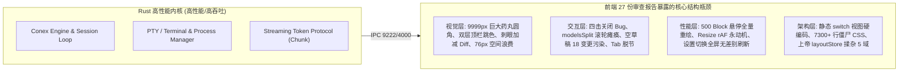
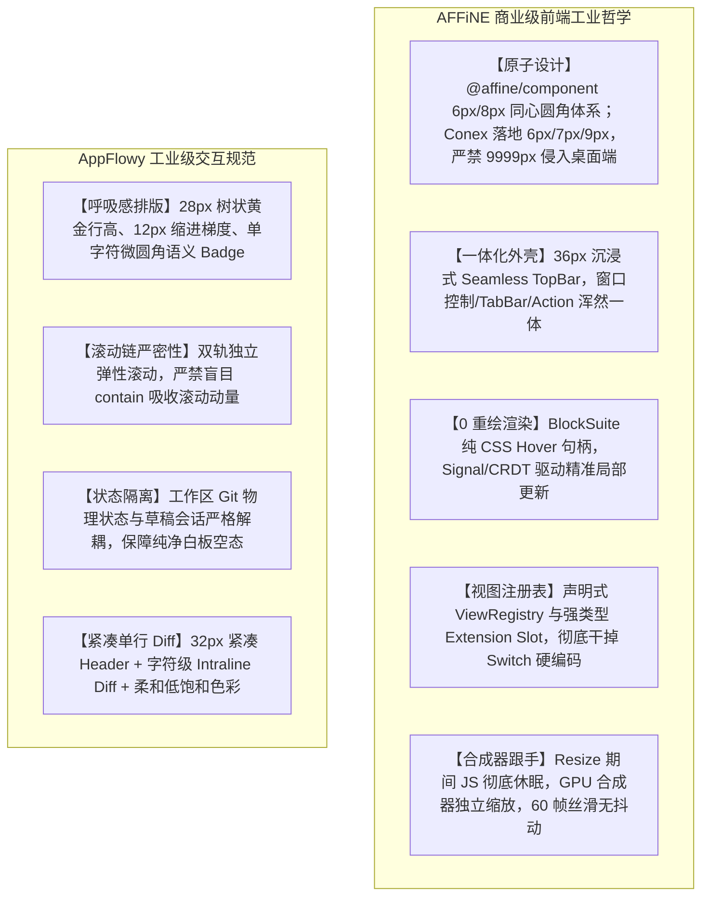
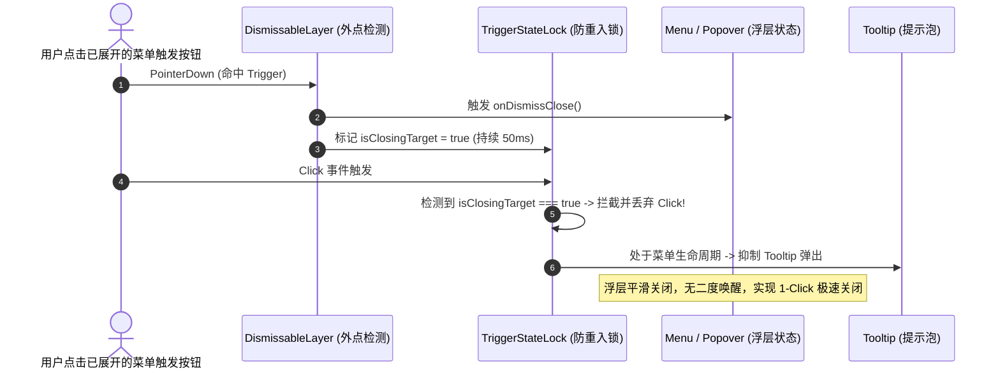
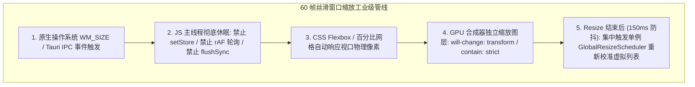

# 对标 AFFiNE 与 AppFlowy 商业级 UI/UX 借鉴与落地指南 综合提炼

> **文档定位**：Conex / Crish 前端架构重构与商业级 UI/UX 演进权威指南
> **对标标杆**：AFFiNE (ToEverything / BlockSuite / @affine/component / Workspace Shell) & AppFlowy (Flutter / Rust 内核 / 现代分栏与网格系统)
> **数据支撑**：基于 `docs/frontend-architecture-review/` 目录下全部 27 份深度审查报告（根目录 01~~05、full-sweep 01~~16、deep-dives 01~06）的全量实证提炼
> **生效原则**：UTF-8 无 BOM，纯源码事实驱动，严禁退避，坚持反过度设计红线，追求工业级卓越质感。

---

## 目录

- [一、 战略综述与标杆对标全景](#一-战略综述与标杆对标全景)
  - [1.1 现状诊断与核心瓶颈概括](#11-现状诊断与核心瓶颈概括)
  - [1.2 工业级标杆（AFFiNE & AppFlowy）设计哲学解密](#12-工业级标杆affine--appflowy设计哲学解密)
  - [1.3 Conex 前端演进三维目标矩阵](#13-conex-前端演进三维目标矩阵)
- [二、 问题与标杆精准对标矩阵（12 大痛点点对点攻坚）](#二-问题与标杆精准对标矩阵12-大痛点点对点攻坚)
  - [2.1 核心痛点与标杆解决方案 1 对 1 映射表](#21-核心痛点与标杆解决方案-1-对-1-映射表)
  - [2.2 痛点 1：四击关闭恶性 Bug 与浮层事件争抢](#22-痛点-1四击关闭恶性-bug-与浮层事件争抢)
  - [2.3 痛点 2：9999px 巨大药丸圆角与几何阶梯畸变](#23-痛点-29999px-巨大药丸圆角与几何阶梯畸变)
  - [2.4 痛点 3：双层 Chrome 顶栏硬堆叠与左右跳色割裂](#24-痛点-3双层-chrome-顶栏硬堆叠与左右跳色割裂)
  - [2.5 痛点 4：500 Block 鼠标悬停级联重绘雪崩](#25-痛点-4500-block-鼠标悬停级联重绘雪崩)
  - [2.6 痛点 5：全窗体拖拽缩放卡顿与 rAF 永动机消耗](#26-痛点-5全窗体拖拽缩放卡顿与-raf-永动机消耗)
  - [2.7 痛点 6：总览面板 36 改动列表拥挤窒息与上下文抹杀](#27-痛点-6总览面板-36-改动列表拥挤窒息与上下文抹杀)
  - [2.8 痛点 7：Diff 面板 76px 双行 Header 浪费与刺眼黄色警告](#28-痛点-7diff-面板-76px-双行-header-浪费与刺眼黄色警告)
  - [2.9 痛点 8：modelsSplit 滚轮彻底死锁与事件拦截黑洞](#29-痛点-8modelssplit-滚轮彻底死锁与事件拦截黑洞)
  - [2.10 痛点 9：设置项操作引发全屏无差别重刷风暴](#210-痛点-9设置项操作引发全屏无差别重刷风暴)
  - [2.11 痛点 10：空白新会话状态污染与未提交变更动态胶囊](#211-痛点-10空白新会话状态污染与未提交变更动态胶囊)
  - [2.12 痛点 11：原子组件库极低覆盖率与广泛自造轮子](#212-痛点-11原子组件库极低覆盖率与广泛自造轮子)
  - [2.13 痛点 12：7,300+ 行巨型全局 CSS 地层沉积与特异性军备竞赛](#213-痛点-127300-行巨型全局-css-地层沉积与特异性军备竞赛)
- [三、 AFFiNE 五大杀手级核心机制深度借鉴指引](#三-affine-五大杀手级核心机制深度借鉴指引)
  - [3.1 机制一：`@affine/component` 原子设计系统与统一浮层栈](#31-机制一affinecomponent-原子设计系统与统一浮层栈)
  - [3.2 机制二：Workspace Shell 36px 一体化沉浸式顶栏与 ViewRegistry](#32-机制二workspace-shell-36px-一体化沉浸式顶栏与-viewregistry)
  - [3.3 机制三：BlockSuite 编辑器纯 CSS 悬浮句柄与 0-Re-render 渲染模型](#33-机制三blocksuite-编辑器纯-css-悬浮句柄与-0-re-render-渲染模型)
  - [3.4 机制四：Doc Tree 与变更历史树的呼吸感排版与状态 Badge](#34-机制四doc-tree-与变更历史树的呼吸感排版与状态-badge)
  - [3.5 机制五：窗口拖拽缩放 60 帧丝滑跟手与硬件加速隔离](#35-机制五窗口拖拽缩放-60-帧丝滑跟手与硬件加速隔离)
- [四、 防过度设计与取舍准则（Keep vs Discard）](#四-防过度设计与取舍准则keep-vs-discard)
  - [4.1 必须借鉴吸收的工业级精髓（Must Adopt）](#41-必须借鉴吸收的工业级精髓must-adopt)
  - [4.2 坚决不盲目照搬的过度复杂机制（Must Avoid）](#42-坚决不盲目照搬的过度复杂机制must-avoid)
  - [4.3 架构决策平衡点：桌面 IDE 工具 vs 协同知识库](#43-架构决策平衡点桌面-ide-工具-vs-协同知识库)
- [五、 Conex 前端全仓落地重构演进路线图](#五-conex-前端全仓落地重构演进路线图)
  - [5.1 阶段一：样式体系净化与原子组件库收敛（Week 1-2）](#51-阶段一样式体系净化与原子组件库收敛week-1-2)
  - [5.2 阶段二：Workspace Shell 一体化与动态 ViewRegistry（Week 3-4）](#52-阶段二workspace-shell-一体化与动态-viewregistryweek-3-4)
  - [5.3 阶段三：渲染性能与状态隔离极致优化（Week 5-6）](#53-阶段三渲染性能与状态隔离极致优化week-5-6)
  - [5.4 阶段四：核心业务面板商业级质感升级与验收（Week 7-8）](#54-阶段四核心业务面板商业级质感升级与验收week-7-8)

---

## 一、 战略综述与标杆对标全景

### 1.1 现状诊断与核心瓶颈概括

通过对 Conex 前端 27 份深度架构审查报告（覆盖 170+ 组件、22 个全局样式表、11 个 Zustand Store 与数十个核心交互链路）的全面扫描，Conex（Crish）前端呈现出**「卓越的 Rust 内核算力与高响应 IPC 底座」与「粗糙、割裂、充满历史包袱的 Web UI 外壳」之间的尖锐矛盾**。



#### 典型病灶归纳：

1. **视觉失真与非专业感**：在桌面专业 IDE 场景中大面积滥用 `border-radius: 9999px` 移动端药丸；同一视口出现双层生硬 Header；左右分屏出现浅白与深灰的不对称跳色。
2. **交互阻断与事件死锁**：Radix Popover、DismissableLayer 与 Tooltip 争夺 Pointer 事件导致「四击才能关闭面板」；`overscroll-behavior: contain` 造成滚轮事件黑洞吸收。
3. **渲染雪崩与主线程过载**：鼠标划过一个 Block 触发 500 个块重新 VDOM Diff（单次移动触发 10,000 次渲染）；窗口尺寸调整时 rAF 每帧轮询跨进程 IPC，并在解冻时动用 `flushSync` 冻结主线程。
4. **扩展僵化与历史沉积**：二叉树面板挂载写死在 `switch (panelId)` 之中；设置模块散落 5 个目录；五代 CSS 地层堆叠达 14,200+ 行，伴随 660+ 处 `!important`。

---

### 1.2 工业级标杆（AFFiNE & AppFlowy）设计哲学解密

在国际顶尖的开源现代化桌面工作台与协同工具中，**AFFiNE**（基于 Web 技术的现代一体化工作台）与 **AppFlowy**（基于 Flutter/Rust 的模块化知识库）代表了当今商业级软件的最高工程水准。



---

### 1.3 Conex 前端演进三维目标矩阵

```
               [ 视觉美学 (Aesthetics) ]
               - 6px/7px/9px 极简同心圆角
               - 36px 沉浸式一体化顶栏
               - 柔和低反差色板与呼吸感排版
                      /         \
                     /           \
                    /             \
[ 极致性能 (Performance) ] ─── [ 稳健架构 (Architecture) ]
- 0-Re-render 悬浮句柄        - 声明式 ViewRegistry
- 60 帧丝滑窗口缩放           - 统一强类型 Slot 插槽
- 细粒度原子 Store 隔离       - 纯净 CSS Modules + 0 !important
```

---

## 二、 问题与标杆精准对标矩阵（12 大痛点点对点攻坚）

### 2.1 核心痛点与标杆解决方案 1 对 1 映射表

| 序号   | 报告来源                        | Conex 现状真实代码痛点                                                                                                        | AFFiNE / AppFlowy 工业级标杆方案                                                                                                         | 落地预期收益                                          |
| :----- | :------------------------------ | :---------------------------------------------------------------------------------------------------------------------------- | :--------------------------------------------------------------------------------------------------------------------------------------- | :---------------------------------------------------- |
| **01** | `full-sweep/04`, `deep-dive/06` | **四击关闭 Bug**：`PermissionModeMenu` 与 `Menu` 在 Radix `DismissableLayer`、`Tooltip` 与自管 Pointer 竞争下无法单次点击关闭 | **AFFiNE 统一浮层栈 (LayerStackManager)**：解耦 Trigger 点击与外点关闭，使用 `Floating-UI` 独立事件层，阻止 Tooltip 在菜单激活态争抢焦点 | **单次点击必开关 (1-Click Toggle)**，彻底根治四击 Bug |
| **02** | `full-sweep/12`, `deep-dive/06` | **9999px 巨大药丸圆角**：`Button.module.css` 与工具栏滥用 `radius-full`，大胶囊与 6px 输入框剧烈冲突                          | **Conex 同心圆角规范**：微型项 6px / 控件 7px / 浮层 9px；AFFiNE 6px/8px 仅作对标参考；`9999px` 仅限 Switch 轨道与 Avatar                | 恢复 IDE 严谨工程美学，消除锯齿与视觉重心漂移         |
| **03** | `full-sweep/06`, `root/01`      | **双层顶栏与左右跳色**：44px `AppTopBar` 叠加 30px `LeafToolTabStrip`，左屏浅白右屏深灰，两道 Header 生硬并列                 | **AFFiNE Seamless Shell**：36px 沉浸式单层顶栏，窗口控制、平嵌 Tab 与动作区无缝合一；分屏采用统一低反差淡染底色                          | 节省 38px 垂直高度，界面整体感与高级感倍增            |
| **04** | `full-sweep/13`, `root/04`      | **500 Block 悬停重绘灾难**：鼠标划过长文档触发 `setChromeTick`，导致 500 个块重新执行 VDOM Diff（单次移动 10,000 次调用）     | **AFFiNE BlockSuite 0-Re-render**：悬浮工具句柄通过纯 CSS `:hover` 与绝对定位 DOM 直写，彻底脱离 React State                             | **0 次 React 重绘**，长文档滑动维持满帧 60/120fps     |
| **05** | `deep-dive/02`                  | **全窗体拖拽缩放极其卡顿**：`WindowResizeBridge` 每帧 rAF 轮询 `screenX/Y`，解冻时 `flushSync` 导致主线程瞬间冻结 200ms       | **AFFiNE 合成器接管缩放**：JS 在 Resize 期间彻底休眠，GPU 合成图层接管几何拉伸，统一单源事件与 CSS 容器查询                              | 拖拽窗口跟手度达 60 帧，彻底消除 UI 冻结与回流风暴    |
| **06** | `full-sweep/01`                 | **总览 36 改动列表拥挤窒息**：280px 限高滚动盒内塞入 36+ 文件，扁平化 `basename` 丢失目录层级，无状态 Badge                   | **AppFlowy 树状折叠 + 状态 Badge**：支持树状折叠与平铺双模，微圆角单字符 Badge（`M`/`A`/`D`）与 3 色增删比例条                           | 改动上下文一目了然，彻底消除列表窒息感                |
| **07** | `full-sweep/02`                 | **Diff 面板 76px 浪费与刺眼黄条**：双行 Header 独占 76px，15% 高饱和度增删背景，刺眼黄色警告横幅破坏沉浸                      | **Cursor / AFFiNE 紧凑 Diff**：32px 单行 Header，3%~6% 低饱和度增删底色，字符级 Intraline Diff，非侵入式应用指示                         | 节省 44px 空间，长时间代码审阅眼部无疲劳              |
| **08** | `deep-dive/03`                  | **modelsSplit 滚轮彻底失效**：`overscroll-behavior: contain` 吸收滚轮动量，配合 `max(480px, 100vh-220px)` 导致外层滚动死锁    | **AFFiNE 双轨弹性独立滚动**：去除盲目 contain，采用弹性视口计算与外层动量穿透代理                                                        | 任何区域鼠标滚轮 100% 灵敏平滑响应                    |
| **09** | `deep-dive/05`                  | **设置项操作全屏无差别重刷**：根组件 `App.tsx` 粗粒度订阅 `uiSize`/`settingsActiveTab`，切换 Tab 触发全站重绘                 | **AFFiNE 原子状态订阅**：状态下沉至局部组件，主题/密度由 `documentElement.setAttribute` 直写 CSS 变量                                    | 设置面板操作 0-App-Re-render，零闪烁零卡顿            |
| **10** | `deep-dive/04`                  | **空白草稿新会话状态污染**：新建草稿对话突兀悬浮「🌿 18 个文件变更」动态胶囊，工作区 Git 状态穿透空态                         | **AppFlowy 严格会话边界**：会话专属 Diff 派生，草稿态与空态设立门闩（`emptyKind === 'session-empty'` 阻断胶囊）                          | 空白对话保持极致禅意与纯净白板状态                    |
| **11** | `root/02`, `full-sweep/12`      | **原子组件覆盖率低与自造轮子**：Input 使用率不足 10%，Button 散落 94+ 处原生标签，7 处手写 Segment 轮子                       | **@affine/component 规范**：全仓收敛为标准 `Button`、`Input`、`Segmented`、`Dialog`，强类型 Props 与原生 A11y                            | DRY 原则 100% 贯彻，全站交互体验高度一致              |
| **12** | `root/03`, `full-sweep/14`      | **7300+ 行巨型全局 CSS 地层沉积**：`settings-models.css` (2550行) 等 5 代重写堆叠，660+ 处 `!important` 恶性竞争              | **AFFiNE CSS Token 分层治理**：6 级 Z-Index 极简标尺，全面 CSS Modules 化，彻底清退全局旧样式表                                          | CSS 体积精简 70%，消除一切全局污染与样式覆盖死锁      |

---

### 2.2 痛点 1：四击关闭恶性 Bug 与浮层事件争抢

#### 代码实证与根因剖析

- **代码定位**：[`PermissionModeMenu.tsx:19-86`](file:///c:/Software/conex/apps/crish-desktop/src/components/chat-composer/PermissionModeMenu.tsx#L19-L86)、[`Menu.tsx:382-406`](file:///c:/Software/conex/apps/crish-desktop/src/components/ui/Menu/Menu.tsx#L382-L406)、[`Tooltip.tsx:88-142`](file:///c:/Software/conex/apps/crish-desktop/src/components/ui/Tooltip/Tooltip.tsx#L88-L142)。
- **时序断层追踪**：
  1. 当菜单展开时，Radix `DismissableLayer` 在 `document` 上挂载捕获阶段的 `pointerdown` 监听器；
  2. 用户点击触发器按钮尝试关闭菜单；
  3. `DismissableLayer` 首先捕获 `pointerdown` 并判定该点击发生在浮层外部，立即触发 `onOpenChange(false)` 关闭菜单；
  4. 紧接着，触发器按钮接收到冒泡的 `onClick` 事件，由于组件内部维护的 `isOpen` 闭包判定此时已被关闭（或者触发器内部逻辑触发了 `setIsOpen(!isOpen)`），又将菜单重新设置为 `true`；
  5. 与此同时，包裹在按钮外层的 `<Tooltip>` 响应 `focus`/`pointerenter`，抢夺活动元素焦点并弹出提示泡，导致下一次点击被 Tooltip 拦截；
  6. 最终用户必须连续快速点击 4 次，打破事件循环时序差，才能勉强关闭浮层。

#### AFFiNE 工业级标杆机制借鉴

AFFiNE 在 `@affine/component` 中实现了极为稳健的 **Floating-UI 浮层栈调度器**：

- **Trigger 交互防抖与状态锁**：在 Trigger 按钮上记录 `isClosingRef` 瞬时锁（50ms），当浮层因外部点击关闭且点击目标恰好为 Trigger 时，阻断 Trigger 自身的 `onClick` 重新唤醒逻辑。
- **Tooltip 智能互斥**：当 Popover / Menu 处于 `open` 状态时，自动向子树上下文广播 `popoverOpen: true`，Tooltip 组件监听到该信号后，**强制抑制（Suppress）自身的弹出与焦点捕获**，直到 Popover 完全销毁。



---

### 2.3 痛点 2：9999px 巨大药丸圆角与几何阶梯畸变

#### 代码实证与根因剖析

- **代码定位**：[`Button.module.css:32-35`](file:///c:/Software/conex/apps/crish-desktop/src/components/ui/Button/Button.module.css#L32-L35)、[`ChatComposer.module.css:320-341`](file:///c:/Software/conex/apps/crish-desktop/src/components/chat-composer/ChatComposer.module.css#L320-L341)、[`PermissionModeMenu.module.css:27`](file:///c:/Software/conex/apps/crish-desktop/src/components/chat-composer/PermissionModeMenu.module.css#L27)。
- **几何畸变原理**：
  在仅有 28px 高度的紧凑操作栏中，强行施加 `border-radius: 9999px` 会使左右两端变成完整的半圆。半圆弧度向内急速收缩，使得内部文字被迫向中心挤压；当 9999px 药丸按钮与 6px 圆角的输入框或 8px 的容器并排时，在视觉交界处产生巨大的几何空隙和重心下坠感。

#### AFFiNE 对标与 Conex 落地同心圆角规范

AFFiNE 采用数学严谨的 **Concentric Radius（同心圆角）** 体系；Conex 按现有审查军规落地为 6px / 7px / 9px：

- **同心公式**：嵌套容器的内圆角必须严格满足 $R_{inner} = \max(0, R_{outer} - Padding)$。
- **Conex 落地专业阶梯**：
  - 主面板外壳 / 页面级大卡片：`14px`（`--radius-2xl`）
  - 浮层 / 弹窗外框 / 卡片外框：`9px`（`--radius-lg`）
  - 交互控件 / 按钮 / 输入框（Button / Input / Select）：`7px`（`--radius-md`）
  - 微型选项 / 内部徽标 / 标签（Badge / Tag / Chip）：`6px`（`--radius-sm`）
  - **`9999px`（`--radius-full`）禁用红线**：全仓仅允许用于开关滑块轨道（Switch Track）、单选圆点（Radio Dot）与用户圆形头像（Avatar）。

```
+-------------------------------------------------------------------------+
| Conex 同心圆角几何体系                                                    |
|                                                                         |
|  [浮层 Outer Container] Radius = 9px, Padding = 2px                     |
|  +-------------------------------------------------------------------+  |
|  |  [内嵌操作栏 Toolbar] Radius = 7px (9px - 2px)                    |  |
|  |  +-----------------------+ +-----------------------------------+  |  |
|  |  | [按钮 Button] R = 7px | | [状态徽标 Badge] R = 6px (7px-1px)  |  |  |
|  |  +-----------------------+ +-----------------------------------+  |  |
|  +-------------------------------------------------------------------+  |
+-------------------------------------------------------------------------+
```

---

### 2.4 痛点 3：双层 Chrome 顶栏硬堆叠与左右跳色割裂

#### 代码实证与根因剖析

- **代码定位**：[`AppTopBar.tsx:88-120`](file:///c:/Software/conex/apps/crish-desktop/src/components/shell/AppTopBar.tsx#L88-L120)、[`LeafToolTabStrip.tsx:85-120`](file:///c:/Software/conex/apps/crish-desktop/src/components/binary-tree/LeafToolTabStrip.tsx#L85-L120)、[`shell-layout.css:22`](file:///c:/Software/conex/apps/crish-desktop/src/styles/shell-layout.css#L22)。
- **视觉冲突表现**：
  1. 第 1 层：窗口顶栏 `AppTopBar` 高度 44px，底色为暖深灰 `hsl(35, 12%, 91.5%)`；
  2. 第 2 层：二叉树面板顶栏 `LeafToolTabStrip` 高度 30px；
  3. 当左侧挂载 `ChatCard`（顶部为浅白底 `ChatHeader`），右侧挂载 `OverviewCard`（顶部为深灰底 `LeafToolTabStrip` 并嵌着 999px 白色大药丸）时，左右分屏在水平线上呈现出**「左白右灰、上方再压一道灰」**的破碎画面，垂直侵占高达 74px 空间。

#### AFFiNE 工业级 Seamless Workspace Shell 借鉴

AFFiNE 的 Workspace Shell 采用了统一的 **36px 沉浸式单层顶栏（Seamless Integrated Chrome）**：

1. **外壳与内容无缝融合**：顶栏背景色与主内容画布完全统一（`var(--bg-primary)`），通过 `1px solid var(--border-subtle)` 微弱分割线或无边框融合；
2. **平嵌式 Tab（Embedded Tabs）**：所有 Tab 统一为 32px 高度的平嵌矩形按钮，激活态通过 `1.5px` 底边高亮条（`Active Accent Line`）或极淡的背景色块勾勒，杜绝 999px 药丸；
3. **分屏编辑器组（Editor Group Header）**：左右分屏共享完全相同的底色与高度基线，窗口控制按钮与全局导航融为一体。

---

### 2.5 痛点 4：500 Block 鼠标悬停级联重绘雪崩

#### 代码实证与根因剖析

- **代码定位**：[`NotePaperStrictPanel.tsx:180-230`](file:///c:/Software/conex/apps/crish-desktop/src/components/note-paper/NotePaperStrictPanel.tsx#L180-L230)、[`useNotePaperStrictShell.ts:140-195`](file:///c:/Software/conex/apps/crish-desktop/src/components/note-paper/useNotePaperStrictShell.ts#L140-L195)。
- **重绘雪崩实测推导**：
  1. 当用户在一个包含 500 个 Block 的长文档中移动鼠标时，鼠标划入 Block-42；
  2. Block-42 触发 `onMouseEnter` $\rightarrow$ 调用父级 Hook 的 `onHover('block-42')`；
  3. `useNotePaperStrictShell` 内部执行 `setChromeTick(n => n + 1)` 触发 React 状态更新；
  4. 顶层组件重新渲染，导致 `blocks.map(...)` 重新执行，为 500 个 Block 创建全新的回调闭包与 React 元素，500 个子组件全部触发 Re-render；
  5. 鼠标滑动过 20 个 Block $\rightarrow 20 \times 500 = \mathbf{10,000}$ 次组件执行与 VDOM Diff，主线程彻底掉帧。

#### AFFiNE BlockSuite 0-Re-render 渲染模型借鉴

AFFiNE 的核心编辑器引擎 **BlockSuite** 彻底消除了鼠标悬停与 React/VDOM 的状态绑定：

- **纯 CSS 悬浮响应**：每一个 Block 容器挂载 `.affine-block-container`，其内部的拖拽把手（Drag Handle）与快捷菜单通过纯 CSS `:hover` 伪类控制可见性（`opacity: 0 -> opacity: 1`）；
- **浮动句柄绝对定位直写**：对于需要跟随光标定位的浮动工具栏，通过单一全局 DOM 节点的 `transform: translate3d(x, y, 0)` 直接更新物理坐标，**0 次 React 组件更新，0 次 VDOM Diff**。

---

### 2.6 痛点 5：全窗体拖拽缩放卡顿与 rAF 永动机消耗

#### 代码实证与根因剖析

- **代码定位**：[`WindowResizeBridge.ts:59-75`](file:///c:/Software/conex/apps/crish-desktop/src/services/WindowResizeBridge.ts#L59-L75)、[`layoutAnimationStore.ts:110-145`](file:///c:/Software/conex/apps/crish-desktop/src/store/layoutAnimationStore.ts#L110-L145)、[`useAutoGrowTextarea.ts:24-48`](file:///c:/Software/conex/apps/crish-desktop/src/components/chat-composer/useAutoGrowTextarea.ts#L24-L48)。
- **卡顿链条分解**：
  1. `WindowResizeBridge` 在每一帧 `requestAnimationFrame` 无条件轮询 `window.screenX/Y`，导致 CPU 唤醒率与能耗居高不下；
  2. 窗口拖拽调整大小时，向全局广播 `window-resizing` 状态并修改 `document.body` 的 classList，唤醒所有 `MutationObserver`；
  3. 全仓 6 处原生 `window.addEventListener('resize')` 与 6 个独立 `new ResizeObserver` 同时触发，在同一帧内执行 `textarea.style.height = '0px'`（强制写）和 `scrollHeight`（强制读），引发高频 **Layout Thrashing（布局颠簸）**；
  4. 200ms 防抖结束后，调用 `flushCatchupTasks()` 中的 `flushSync`，导致主线程瞬间冻结 50ms~200ms。

#### AFFiNE / VS Code 60 帧丝滑缩放机制借鉴

1. **合成器接管几何拉伸（Compositor-driven Scaling）**：拖拽期间 JS 彻底休眠，由 GPU 合成管线直接处理视口重采样；
2. **切断 React 状态广播与 `flushSync`**：坚决废除在 Resize 期间修改 Zustand 状态或调用 `flushSync`，尺寸更新完全交给 CSS 百分比与 Flexbox；
3. **单源集中式 ResizeObserver 调度器**：全应用只维护单例 `GlobalResizeScheduler`，在微任务队列中合并所有尺寸计算，禁止散落的裸 `new ResizeObserver`；
4. **全面引入 CSS Container Queries**：卡片内部响应自身容器宽度（如 `@container (max-width: 400px)`），无需 JS 监听宽度变化。

---

### 2.7 痛点 6：总览面板 36 改动列表拥挤窒息与上下文抹杀

#### 代码实证与根因剖析

- **代码定位**：[`ChangesSection.tsx:213-256`](file:///c:/Software/conex/apps/crish-desktop/src/components/overview/ChangesSection.tsx#L213-L256)、[`OverviewCard.module.css:85-140`](file:///c:/Software/conex/apps/crish-desktop/src/components/overview/OverviewCard.module.css#L85-L140)。
- **缺陷表现**：
  1. 36 个改动文件被硬塞进 280px 限高滚动盒中，行高仅 24px，文字密集无呼吸感；
  2. 采用 `basename(f.path)` 扁平化展示，丢失了所有文件夹层级（如 5 个不同目录下的 `index.ts` 无法区分）；
  3. 文件状态仅用裸斜体字符（`em`）表示，无固定宽度的状态徽标，列表产生严重的锯齿错位。

#### AppFlowy / GitHub PR 标杆方案借鉴

- **树状（Tree View）与平铺（Flat View）双模切换**：默认采用紧凑树状折叠，保留目录上下文；
- **状态徽标（Status Badge）与增删条（Diff Bar）**：
  - 采用 6px 微圆角矩形徽标，带有语义化颜色（绿色 `A` 新增、黄色 `M` 修改、红色 `D` 删除）；
  - 配套精致的 3 色增删比例微型条（`+12 -4`），右侧等宽对齐。

---

### 2.8 痛点 7：Diff 面板 76px 双行 Header 浪费与刺眼黄色警告

#### 代码实证与根因剖析

- **代码定位**：[`DiffHeaderControls.tsx:64-201`](file:///c:/Software/conex/apps/crish-desktop/src/components/diff/DiffHeaderControls.tsx#L64-L201)、[`DiffCardUnifiedView.tsx:88-120`](file:///c:/Software/conex/apps/crish-desktop/src/components/diff/DiffCardUnifiedView.tsx#L88-L120)。
- **缺陷表现**：
  1. 工具栏生硬拆为两行（`.toolbarRow1` + `.toolbarRow2`），高度达 76px，浪费 20% 可视面积；
  2. 顶部横跳出一条高饱和度黄色警告框「此 diff 无法安全自动应用」，无论用户是否正在查看 Git 历史，该警告常驻阻断沉浸感；
  3. 加减行采用 15% 高饱和度红绿底色，长时间查看引起严重视觉疲劳；且缺乏字符级（Intraline）高亮。

#### Cursor / AFFiNE 紧凑 Diff 标杆方案借鉴

1. **32px 紧凑单行 Header**：将变更来源选择（AI / Git）、文件选择与视图模式收敛至单行 Flex 工具栏；
2. **低饱和度柔和增删底色**：
   - 新增行：`hsl(142 60% 50% / 0.08)`（8% 极淡绿背景）
   - 删除行：`hsl(0 70% 50% / 0.08)`（8% 极淡红背景）
   - 字符级差异高亮：`hsl(142 65% 45% / 0.25)`（精准词级微高亮）
3. **非侵入式可应用性徽标**：将黄色大横幅弱化为操作按钮旁的微型 Tooltip 状态指示灯。

---

### 2.9 痛点 8：modelsSplit 滚轮彻底死锁与事件拦截黑洞

#### 代码实证与根因剖析

- **代码定位**：[`ModelsSettingsTab.module.css:1-12, 61-69, 170-181`](file:///c:/Software/conex/apps/crish-desktop/src/components/settings-models/ModelsSettingsTab.module.css#L1-L12)、[`SettingsPanel.module.css:178-198`](file:///c:/Software/conex/apps/crish-desktop/src/components/settings/SettingsPanel.module.css#L178-L198)。
- **物理死锁原理**：
  1. 外层主滚动容器 `.coverContent` 带有 `overflow-y: auto`，由于内容堆叠高度计算冲突，始终溢出约 76px 处于可滚动状态；
  2. 内部中央的 `.modelsSplit` 占据了 90% 视口面积，其左右两轨声明了 `overscroll-behavior: contain`；
  3. 当左轨服务商数量较少（无内部滚动条）时，根据 W3C 规范，`contain` 属性会**强制将滚轮剩余动量彻底丢弃**，阻止其向外层 `.coverContent` 冒泡传递，导致用户在中间区域滑动滚轮时，页面完全纹丝不动。

#### AFFiNE 独立视口与双轨滚动治理借鉴

1. **彻底废除 `overscroll-behavior: contain`**：全部改为默认的 `overscroll-behavior: auto`，允许滚动动量自然平滑链式传递；
2. **盒模型高度解耦**：中间分栏容器采用 `flex: 1; min-height: 0;` 纯 Flex 弹性拉伸，彻底拔除 `height: max(480px, calc(100vh - 220px))` 硬编码计算；
3. **全视口滚轮代理**：设置面板根节点统一处理滚轮事件穿透，确保光标落在任何区域都能丝滑驱动有效内容滚动。

---

### 2.10 痛点 9：设置项操作引发全屏无差别重刷风暴

#### 代码实证与根因剖析

- **代码定位**：[`App.tsx:88-97`](file:///C:/Software/conex/apps/crish-desktop/src/App.tsx#L88-L97)、[`sessionStore.ts:35`](file:///C:/Software/conex/apps/crish-desktop/src/store/sessionStore.ts#L35)、[`settingsUiStore.ts:69`](file:///C:/Software/conex/apps/crish-desktop/src/store/settingsUiStore.ts#L69)。
- **重刷风暴链路**：
  1. 根组件 `App.tsx` 直接订阅了 `uiSize`、`shellChromeMode`、`settingsActiveTab` 等状态；
  2. 当用户在设置面板侧栏点击切换 Tab 时，`setSettingsActiveTab("models")` 写入底层的 `layoutStore`；
  3. 由于 `useSettingsUiStore` 与 `layoutStore` 是同一个单例，`layoutStore` 的变更广播唤醒了 `App.tsx`；
  4. `App.tsx` 重新渲染，向下触发 `AppTopBar`、`Sidebar`、`BinaryTreeWorkspace` 及所有 `TreeLeafPanel` 的全量 VDOM 重新比对，产生肉眼可见的闪烁与焦点跳动。

#### AFFiNE 原子化状态与 CSS 变量直写模式借鉴

1. **状态物理隔离**：设置面板的活动 Tab 状态完全下沉至 `SettingsPanel` 局部状态，根组件 `App.tsx` 零订阅；
2. **外观配置 0-Re-render**：UI 密度（`uiSize`）与窗口风格切换直接通过 `document.documentElement.setAttribute('data-ui-size', size)` 更新，依靠 CSS 自定义变量级联生效，**无需触发任何 React 组件 Re-render**。

---

### 2.11 痛点 10：空白新会话状态污染与未提交变更动态胶囊

#### 代码实证与根因剖析

- **代码定位**：[`ChatStatusRibbons.tsx:292-356`](file:///c:/Software/conex/apps/crish-desktop/src/components/chat-card/ChatStatusRibbons.tsx#L292-L356)、[`useChatCardState.ts:165`](file:///c:/Software/conex/apps/crish-desktop/src/components/chat-card/useChatCardState.ts#L165)、[`terminalStore.ts:33`](file:///c:/Software/conex/apps/crish-desktop/src/store/terminalStore.ts#L33)。
- **状态越界机理**：
  1. `terminalStore` 中的 `diffFiles` 存储的是整个工作区的 Git 未提交变更（全局单例）；
  2. `useChatCardState` 无条件订阅了该字段并透传给 `ChatStatusRibbons`；
  3. `ChatStatusRibbons` 仅判断 `diffCount > 0` 即渲染动态胶囊，**完全未检查当前会话是否为刚新建的草稿白板**；
  4. 导致用户点击「新建会话」后，面对空无一字的欢迎界面，输入框上方却突兀横跳出一个「🌿 18 个文件变更」胶囊，破坏了新会话的纯净心智模型。

#### AppFlowy / AFFiNE 会话生命周期门闩借鉴

1. **会话专属 Diff 派生器**：只有当前会话实际执行工具产生的文件变更才计入该会话的局部变更计数；
2. **纯净空态铁律门闩**：在 `ChatStatusRibbons` 中增加严格的生命周期判定：
   ```typescript
   const shouldShowDynamicDiff =
     !isPendingDraft && !onEmptySurface && sessionDiffCount > 0;
   ```
   空态与草稿态下严格禁止任何全局工作区脏状态越界弹出。

---

### 2.12 痛点 11：原子组件库极低覆盖率与广泛自造轮子

#### 代码实证与数据统计

- **实测数据**：全仓 170+ 业务组件中，原子 `Input` 普及率不足 10%（40+ 处散落裸 `<input>`），`Button` 散落 94+ 处裸标签，分段控制器（Segmented Control）重复手写造轮子达 7 处（`DiffHeaderControls`、`FileActions`、`WorkflowForm`、`SettingsSecurityTab` 等）。

#### `@affine/component` 标准原子组件库设计收敛

AFFiNE 构建了一套严密的 `@affine/component` 原子基座：

- **`Button`**：收敛为 `variant="primary" | "secondary" | "ghost" | "danger"`，`size="sm" (28px) | "md" (32px)"`，圆角固定为 6px；
- **`Input`**：封装统一的 Focus 状态（0 阴影，3%~6% 低对比度柔软边框），支持前缀/后缀 Slot 与清除按钮；
- **`SegmentedControl`**：统一滑动滑块指示器与键盘 Arrow 导航，全仓替代手写的 `.sourceSeg` 与 `.filesSeg`；
- **`Dialog` / `ConfirmDialog`**：统一 Radix FocusTrap、A11y 角色与进入/退出动画。

---

### 2.13 痛点 12：7,300+ 行巨型全局 CSS 地层沉积与特异性军备竞赛

#### 代码实证与数据统计

- **实测数据**：`src/styles/settings/` 下堆积了 6 个巨型单体样式表（共计 7,300+ 行，其中 `settings-models.css` 达 2550 行，`settings-base.css` 达 2554 行）。全仓积累了 **660+ 处 `!important`** 声明与 80+ 处双重类名绑定（`className={`${styles.x} x`}`）。

#### AFFiNE 样式体系与 Token 分层治理借鉴

1. **彻底物理清退全局僵尸样式表**：将 6 个巨型全局 CSS 完整剥离并重构为组件级 CSS Modules（`*.module.css`）；
2. **拔除全部双重类名绑定**：TSX 仅绑定 `styles.myClass`，杜绝全局类名残留；
3. **严格 6 级 Z-Index 极简标尺**：废除膨胀至 100,000 的魔术数字，收敛为严格的 Token 体系（`--z-base: 0` 至 `--z-system-gate: 9000`）；
4. **消除 `!important` 军备竞赛**：依靠 CSS Modules 的局部作用域自然保证优先级，全仓清零业务 `!important`。

---

## 三、 AFFiNE 五大杀手级核心机制深度借鉴指引

### 3.1 机制一：`@affine/component` 原子设计系统与统一浮层栈

#### 1. 原子设计分层拓扑

AFFiNE 的组件库遵循极简、正交且高内聚的原子设计哲学：

```
@affine/component 原子分层架构
├── 1. Atoms (基础原子)
│   ├── Button (6px 微圆角, 28/32px 正交高度, 0 药丸)
│   ├── Input / Textarea (柔软 Focus 边框, 0 重阴影)
│   ├── Switch (9999px 仅用于轨道, 纯 CSS thumb 平移)
│   ├── Checkbox / Radio (几何同心圆角)
│   └── Badge / Tag (6px 微圆角, 语义化低饱和底色)
├── 2. Molecules (复合分子)
│   ├── SegmentedControl (滑动背景块, 键盘漫游支持)
│   ├── Select / Combobox (内嵌 Menu, 受控 ID 映射)
│   └── Breadcrumb (内嵌 Radix Menu, 0 手写 DOM 浮层)
└── 3. Overlays (统一浮层基础设施)
    ├── LayerStackManager (统一层叠与焦点优先级调度)
    ├── Popover / Menu (无冲突外点关闭, 坐标防单帧跳变)
    ├── Tooltip (宿主浮层激活时自动静默互斥)
    └── Dialog / Modal (Portal 顶层挂载, FocusTrap 守护)
```

#### 2. 无事件竞争的统一浮层层级栈（LayerStackManager）实现模式

为彻底终结 `Menu` 与 `Tooltip` 的四击关闭 Bug，借鉴 AFFiNE 构建轻量级的浮层调度器：

```typescript
// 架构参考: LayerStackManager 浮层调度核心
export interface LayerInstance {
  id: string;
  type: 'menu' | 'popover' | 'dialog' | 'tooltip';
  triggerEl: HTMLElement | null;
  onDismiss: () => void;
}

class LayerStackRegistry {
  private stack: LayerInstance[] = [];

  push(layer: LayerInstance) {
    this.stack.push(layer);
    this.syncBodyState();
  }

  pop(id: string) {
    this.stack = this.stack.filter((l) => l.id !== id);
    this.syncBodyState();
  }

  hasActiveMenuOrPopover(): boolean {
    return this.stack.some((l) => l.type === 'menu' || l.type === 'popover');
  }

  private syncBodyState() {
    const suppressTooltips = this.hasActiveMenuOrPopover();
    document.documentElement.setAttribute(
      'data-layer-suppress-tooltips',
      String(suppressTooltips)
    );
  }
}

export const layerStack = new LayerStackRegistry();
```

---

### 3.2 机制二：Workspace Shell 36px 一体化沉浸式顶栏与 ViewRegistry

#### 1. 沉浸式单层顶栏（Single Integrated Chrome）架构

彻底淘汰当前的「44px AppTopBar + 30px LeafToolTabStrip」双层堆叠，将整个桌面端顶部收敛为单一的 36px 顶栏：

```
+----------------------------------------------------------------------------------------------------+
| 36px 沉浸式一体化顶栏 (Seamless Integrated TopBar)                                                    |
|                                                                                                    |
| [侧栏切换]  [ 🌿 会话 Tab A | x ] [ ⚡ 会话 Tab B | x ] [+]       [项目路径/面包屑]      [模型] [Windows控制] |
+----------------------------------------------------------------------------------------------------+
|                                二叉树主工作区 (Binary Tree Workspace)                               |
|                                                                                                    |
```

#### 2. 声明式 ViewRegistry 动态注册表模型

彻底移除 `TreeLeafPanel.tsx` 中的静态 `switch (panelId)` 与 `file-viewer:` 字符串 hack，建立标准插件化视图注册体系：

```typescript
// 架构参考: 声明式 ViewRegistry 契约
export interface ViewDefinition<TProps = any> {
  id: string;
  title: string;
  icon: React.ComponentType<{ size?: number; className?: string }>;
  category: 'primary' | 'tool' | 'transient';
  component:
    | React.LazyExoticComponent<React.ComponentType<TProps>>
    | React.ComponentType<TProps>;
  defaultTitle?: (params?: Record<string, string>) => string;
  allowMultiple?: boolean;
}

class ViewRegistry {
  private views = new Map<string, ViewDefinition>();

  register<T>(view: ViewDefinition<T>) {
    this.views.set(view.id, view);
  }

  get(viewId: string): ViewDefinition | undefined {
    // 支持动态 URI 路由，如 file-viewer:///path/to/file.ts
    const baseType = viewId.includes(':') ? viewId.split(':')[0] : viewId;
    return this.views.get(baseType);
  }

  listByCategory(cat: 'primary' | 'tool'): ViewDefinition[] {
    return Array.from(this.views.values()).filter((v) => v.category === cat);
  }
}

export const viewRegistry = new ViewRegistry();
```

---

### 3.3 机制三：BlockSuite 编辑器纯 CSS 悬浮句柄与 0-Re-render 渲染模型

#### 1. 鼠标悬停（Hover）与 React State 彻底解耦

BlockSuite 的核心性能法则：**「鼠标移动是浏览器渲染引擎的本能，严禁在移动路径上触发任何 JS 状态调度器」**。

```css
/* BlockSuite 0-Re-render 纯 CSS 悬浮把手规范 */
.blockContainer {
  position: relative;
  display: flex;
  align-items: flex-start;
  padding: 3px 0;
}

/* 把手默认透明，使用 GPU 硬件加速图层 */
.blockHandle {
  position: absolute;
  left: -24px;
  top: 4px;
  width: 18px;
  height: 18px;
  opacity: 0;
  transform: scale(0.92);
  transition:
    opacity 0.12s ease,
    transform 0.12s ease;
  pointer-events: none;
}

/* 仅在父容器被 Hover 时通过 CSS 渲染，0 React Re-render */
.blockContainer:hover .blockHandle {
  opacity: 1;
  transform: scale(1);
  pointer-events: auto;
}
```

#### 2. 局部 Signal / CRDT 渲染管道

对于 Block 内部文本的编辑，采用细粒度订阅（Fine-grained Subscription）或非受控 ContentEditable + 本地 Model 变更广播，不再将整个 500 Block 数组作为父级 State 全量 Diff。

---

### 3.4 机制四：Doc Tree 与变更历史树的呼吸感排版与状态 Badge

#### 1. 28px 黄金行高与 12px 缩进阶梯

对标 AppFlowy 的文档导航树，重塑侧边栏与文件树排版：

- **行高**：`28px` 紧凑黄金比例；
- **缩进**：每一级层级严格缩进 `12px`，左侧带有 `1px` 浅灰辅助引导线（Guide Line）；
- **图标槽（Icon Slot）**：统一 `16px` 固定宽度槽位，杜绝图标与文件名左右晃动。

#### 2. 精致语义化状态 Badge 设计规范

```
[ A ] 绿色微圆角 (新增) : hsl(142 60% 45% / 0.12) 背景 + hsl(142 70% 35%) 文字
[ M ] 黄色微圆角 (修改) : hsl(38 90% 50% / 0.12) 背景 + hsl(38 85% 35%) 文字
[ D ] 红色微圆角 (删除) : hsl(0 75% 50% / 0.12) 背景 + hsl(0 75% 45%) 文字
[ R ] 蓝色微圆角 (重命名) : hsl(210 80% 55% / 0.12) 背景 + hsl(210 80% 45%) 文字
```

所有 Badge 尺寸收敛为 `16x16px` 正方形或 `18x14px` 紧凑圆角矩形（`border-radius: 4px`），字号 `10px` 粗体等宽字体，消除一切斜体字与文字截断乱象。

---

### 3.5 机制五：窗口拖拽缩放 60 帧丝滑跟手与硬件加速隔离

#### 1. 合成器接管（Compositor Scaling）与 JS 休眠四部曲



#### 2. 拔除 rAF 永动机与单源事件架构

- **彻底删除** `WindowResizeBridge.ts` 中的 `startRafPollingFallback()` 轮询；
- 仅保留 Tauri 原生 `win.onResized`（桌面端）或标准 `window.addEventListener('resize', handler, { passive: true })`（Web 端回落），单源事件驱动。

---

## 四、 防过度设计与取舍准则（Keep vs Discard）

严格遵照仓库根目录 `ANTI_OVERENGINEERING_GUARDRAILS.md` 与反退避协作纪律，明确划定标杆借鉴的技术边界。

### 4.1 必须借鉴吸收的工业级精髓（Must Adopt）

1. **同心圆角与 0-药丸规范**：微型项 6px / 控件 7px / 浮层 9px / 主面板 14px，彻底清除 `border-radius: 9999px` 对生产力界面的侵蚀；
2. **沉浸式单层 36px 顶栏**：消除双层 Chrome 顶栏硬堆叠，统一分屏 Header 底色与基线；
3. **声明式 ViewRegistry 与 Slot 机制**：彻底消灭 `switch (panelId)` 静态硬编码；
4. **0-Re-render 悬浮句柄**：纯 CSS `:hover` 取代 React 状态，消除 500 Block 渲染雪崩；
5. **单源 Resize 监听与 JS 缩放休眠**：拔除 rAF 永动机轮询，消除 `flushSync` 冻结；
6. **状态分层与纯净空态门闩**：工作区 Git 状态与局部会话彻底物理隔离；
7. **CSS Modules 纯净治理与 6 级 Z-Index 标尺**：清退 7,300+ 行全局僵尸样式，全仓清零 `!important`。

---

### 4.2 坚决不盲目照搬的过度复杂机制（Must Avoid）

| 坚决不照搬的机制                            | 拒绝原因与红线说明                                                                    | Conex 最佳轻量级替代方案                                          |
| :------------------------------------------ | :------------------------------------------------------------------------------------ | :---------------------------------------------------------------- |
| **❌ 复杂的 Yjs / CRDT 协同网络协议**       | Conex 是本地优先（Local-first）的 AI 桌面辅助工具，无需支持多用户实时在线协同冲突解决 | 采用轻量级不可变状态树 + 本地快照持久化，保持极致精简             |
| **❌ 重型微前端与 WASM 动态沙箱加载器**     | 过度设计，增加 10 倍以上构建与调试复杂度，严重破坏启动性能                            | 采用标准 Vite 原生动态 `React.lazy()` 配合声明式 `ViewRegistry`   |
| **❌ 自研 Canvas / WebGL 渲染管线**         | Conex 核心交互是代码、文本与分屏面板，DOM + CSS 硬件加速成熟可靠，无需自研渲染引擎    | 采用原生 DOM + `content-visibility: auto` + CSS Container Queries |
| **❌ 内核级沙箱与复杂动态多模型路由中间件** | 违反反过度设计红线，增加无谓的运行时开销与调试难度                                    | 保持 Rust 原生 IPC 管道与简单清晰的 Zustand 状态流转              |

---

### 4.3 架构决策平衡点：桌面 IDE 工具 vs 协同知识库

- **AFFiNE 的核心优势**：极致的界面质感、无缝顶栏、同心几何、Block 渲染效率。
- **AppFlowy 的核心优势**：呼吸感树状排版、紧凑状态指示、严谨滚动链。
- **Conex 的独特使命**：**面向 AI 编程与代理协作的高性能、极响应桌面终端**。
  - 我们吸纳两者的「**视觉高级感**」与「**无损性能架构**」；
  - 剔除其针对「**多云协同协同办公**」的繁琐包袱，打造一款小巧、迅猛、精致的工业级开发者神器。

---

## 五、 Conex 前端全仓落地重构演进路线图

```
+----------------------------------------------------------------------------------------------------+
| Conex 前端现代工业级重构全景实施路线图                                                                |
+----------------------------------------------------------------------------------------------------+
|                                                                                                    |
|  [Phase 1: 样式基座与原子收敛] (Week 1-2)                                                           |
|  ├── 建立 6px/7px/9px 同心圆角规范与 6 级 Z-Index Token                                            |
|  ├── 收敛 Button / Input / Select / SegmentedControl / Dialog 原子组件                             |
|  └── 彻底物理剔除 6 个全局僵尸 CSS (7300+ 行)，清退 !important                                     |
|                                                                                                    |
|  [Phase 2: Workspace Shell 一体化与 ViewRegistry] (Week 3-4)                                       |
|  ├── 重构 36px 沉浸式单层顶栏，消除 74px 双层 Header 与左右跳色                                   |
|  ├── 建立 ViewRegistry 动态注册表，彻底移除 TreeLeafPanel switch 语句                             |
|  └── 落地 LayerStackManager，彻底根除 PermissionModeMenu 四击关闭 Bug                              |
|                                                                                                    |
|  [Phase 3: 渲染性能与状态隔离极致优化] (Week 5-6)                                                   |
|  ├── 拔除 WindowResizeBridge rAF 永动机轮询与 flushSync 冻结                                        |
|  ├── 重构 NotePaper 为纯 CSS 悬浮句柄，消除 500 Block 级联重绘                                     |
|  ├── modelsSplit 拔除 contain 属性，恢复全视口 100% 滚轮灵敏度                                     |
|  └── 物理拆解 layoutStore 上帝对象，根组件 App.tsx 零粗粒度订阅                                    |
|                                                                                                    |
|  [Phase 4: 业务面板现代化蜕变与验收] (Week 7-8)                                                     |
|  ├── 总览面板: 树状折叠 + 单字符状态 Badge + 3 色增删比例条                                        |
|  ├── Diff 面板: 32px 紧凑单行 Header + 8% 低饱和增删底色 + 字符级 Diff                             |
|  ├── 空态守护: 建立会话专属 Diff 门闩，彻底消除空白草稿 18 变更污染                                |
|  └── 全面通过 CDP 9222 真机验收与全量 TypeScript 类型检查                                           |
+----------------------------------------------------------------------------------------------------+
```

### 5.1 阶段一：样式体系净化与原子组件库收敛（Week 1-2）

#### 1. 核心任务清单

- [ ] 在 `tokens.css` 中固化同心圆角梯度：
  ```css
  --radius-xs: 4px;
  --radius-sm: 6px;
  --radius-md: 7px;
  --radius-lg: 9px;
  --radius-xl: 11px;
  --radius-2xl: 14px;
  --radius-full: 9999px; /* 严格受限：仅用于 Switch 轨道、Radio 点与 Avatar */
  ```
- [ ] 改造 `Button.module.css`：删除 `.buttonSm`、`.buttonGhost` 中的 `border-radius: var(--radius-full)`，统一为 `var(--radius-md, 7px)`。
- [ ] 物理删除 `src/styles/settings/` 下的 6 个全局僵尸样式表（`settings-models.css`, `settings-base.css` 等），组件全面迁移至独立的 `*.module.css`。
- [ ] 全仓搜索并消除 `className={`${styles.xxx} xxx`}` 双重类名绑定。

---

### 5.2 阶段二：Workspace Shell 一体化与动态 ViewRegistry（Week 3-4）

#### 1. 核心任务清单

- [ ] 重构 `AppTopBar.tsx` 为 36px 沉浸式单层顶栏，集成平嵌式 Session Tab；
- [ ] 废除 `LeafToolTabStrip.tsx` 中的 999px 白色大药丸，改为统一的 32px 平嵌 Accent Tab；
- [ ] 实例化 `viewRegistry`，并将 `chat`, `diff`, `overview`, `files`, `terminal`, `browser`, `flow-dag` 声明式注册；
- [ ] 落地 `LayerStackManager`，统一管理 `Menu`、`Popover` 与 `Tooltip` 的焦点与关闭时序，彻底消灭四击关闭 Bug。

---

### 5.3 阶段三：渲染性能与状态隔离极致优化（Week 5-6）

#### 1. 核心任务清单

- [ ] 重构 `WindowResizeBridge.ts`：拔除 `startRafPollingFallback()` 死循环，采用纯事件驱动；
- [ ] 清除 `layoutAnimationStore.ts` 中的 `flushSync` 调用，窗口缩放期间 JS 状态机彻底休眠；
- [ ] 重构 `NotePaperStrictPanel.tsx`：将把手显隐改为纯 CSS `.blockContainer:hover .blockHandle`，实现划过 Block 0-Re-render；
- [ ] 移除 `ModelsSettingsTab.module.css` 中的 `overscroll-behavior: contain`，彻底恢复鼠标滚轮响应；
- [ ] 拆解 `layoutStore` 上帝 Store，将 `settingsActiveTab`、`uiSize` 等状态下沉，`App.tsx` 消除粗粒度订阅。

---

### 5.4 阶段四：核心业务面板商业级质感升级与验收（Week 7-8）

#### 1. 核心任务清单

- [ ] **总览面板（Overview）**：支持树状折叠，文件状态采用 6px 微圆角矩形 Badge（`M`/`A`/`D`），增设 3 色增删比例条；
- [ ] **Diff 面板**：收敛为 32px 单行 Header，改用 8% 低饱和度增删背景，集成字符级 Intraline Diff；
- [ ] **空态引导**：在 `ChatStatusRibbons` 增加门闩阻断，确保新草稿对话 100% 呈现纯净欢迎态；
- [ ] **真机验收**：启动 `npm run dev:workbench`，在 CDP 9222 真实 WebView2 环境下完成全链路 60 帧与零视觉断层验证。

---

> **结语**：通过系统性吸收 AFFiNE 与 AppFlowy 的工业级精髓，并坚决摒弃非必要的过度设计，Conex 前端将在视觉高级感、交互敏捷度与运行帧率上实现跨越式升级，真正蜕变为一款兼具极客性能与商业级美学的顶尖 AI 协作桌面终端。
