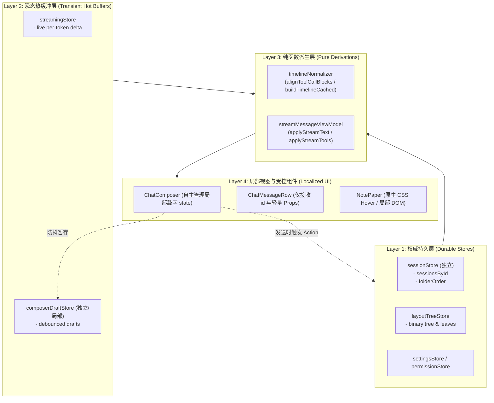

# Conex 前端全局状态管理、数据流拓扑、Hook 复杂度与渲染性能深度审查

> **审查范围**：`apps/crish-desktop/src/store/`、`apps/crish-desktop/src/hooks/`、`apps/crish-desktop/src/components/chat-card/`、`apps/crish-desktop/src/components/chat-composer/`、`apps/crish-desktop/src/components/chat-message/`、`apps/crish-desktop/src/components/chat-message-row/`、`apps/crish-desktop/src/components/chat-message-list/`、`apps/crish-desktop/src/components/note-paper/` 等核心状态管理与交互渲染模块。  
> **审查纪律**：纯前端代码实现深度审查（.ts, .tsx），以代码路径与精确行号证据为支撑，全景剖析状态边界、穿透损耗、Hook 膨胀与渲染性能风险，给出系统性重构与舍弃建议。

---

## 目录

- [一、全局状态拓扑与数据流架构全景](#一全局状态拓扑与数据流架构全景)
  - [1.1 Zustand Store 拓扑分布与归属现状](#11-zustand-store-拓扑分布与归属现状)
  - [1.2 数据流流动向与分层拓扑](#12-数据流流动向与分层拓扑)
- [二、上帝 Store 与职责边界模糊深度剖析](#二上帝-store-与职责边界模糊深度剖析)
  - [2.1 layoutStore 上帝对象剖析：五重异构领域的病态揉杂](#21-layoutstore-上帝对象剖析五重异构领域的病态揉杂)
  - [2.2 门面模式（Facade）的残留与虚假隔离](#22-门面模式facade的残留与虚假隔离)
  - [2.3 autoIndexMiddleware 的隐式全量扫描与引用颠簸](#23-autoindexmiddleware-的隐式全量扫描与引用颠簸)
  - [2.4 Store 跨域写入与隐式依赖链](#24-store-跨域写入与隐式依赖链)
- [三、局部高频状态穿透与重渲染隐患追踪](#三局部高频状态穿透与重渲染隐患追踪)
  - [3.1 输入框敲字链路的重渲染风暴（Keystroke Thrashing）](#31-输入框敲字链路的重渲染风暴keystroke-thrashing)
  - [3.2 笔记纸面（NotePaper）鼠标悬停事件的灾难性全量重绘](#32-笔记纸面notepaper鼠标悬停事件的灾难性全量重绘)
  - [3.3 布局树拖拽与尺寸调整机制的双面镜（优秀 DOM 直写 vs 循环重投影风险）](#33-布局树拖拽与尺寸调整机制的双面镜优秀-dom-直写-vs-循环重投影风险)
  - [3.4 列表级状态提升引发的兄弟消息行级连重绘](#34-列表级状态提升引发的兄弟消息行级连重绘)
- [四、上帝 Hook（God Hook）与过度订阅清查](#四上帝-hookgod-hook与过度订阅清查)
  - [4.1 useChatCardState：57 个属性吞吐的巨型聚合器](#41-usechatcardstate57-个属性吞吐的巨型聚合器)
  - [4.2 useChatComposerProps：32 个属性暴露的输入大杂烩](#42-usechatcomposerprops32-个属性暴露的输入大杂烩)
  - [4.3 贯穿全局的 Prop-Drilling 污染：useToastQueue 与 ShowToastFn](#43-贯穿全局的-prop-drilling-污染usetoastqueue-与-showtoastfn)
  - [4.4 消息行 React.memo 的脆弱性：30 个字段浅比较与回调失效陷阱](#44-消息行-reactmemo-的脆弱性30-个字段浅比较与回调失效陷阱)
- [五、既有优秀性能资产评估与保留建议](#五既有优秀性能资产评估与保留建议)
  - [5.1 streamingStore：无 Immer、微任务闭环的轻量 Token 热缓冲](#51-streamingstore无-immer微任务闭环的轻量-token-热缓冲)
  - [5.2 StreamingTextBlock：DOM Ref 增量 Append 与 StrictMode 序号防护](#52-streamingtextblockdom-ref-增量-append-与-strictmode-序号防护)
  - [5.3 timelineNormalizer：交错时间线纯函数派生与 0 重排签名缓存](#53-timelinenormalizer交错时间线纯函数派生与-0-重排签名缓存)
- [六、系统性状态架构重构与治理方案（改进与舍弃）](#六系统性状态架构重构与治理方案改进与舍弃)
  - [6.1 核心架构模型：「持久化单一收敛 + 纯函数派生时间线 + 瞬态交互严格局部化」](#61-核心架构模型持久化单一收敛--纯函数派生时间线--瞬态交互严格局部化)
  - [6.2 上帝 Store 物理拆解与独立生命周期治理](#62-上帝-store-物理拆解与独立生命周期治理)
  - [6.3 巨型 Hook 拆解与上下文服务化（Context / Local Store）](#63-巨型-hook-拆解与上下文服务化context--local-store)
  - [6.4 高频交互的零 React 重绘改造路线](#64-高频交互的零-react-重绘改造路线)
  - [6.5 明确舍弃与下线的遗留资产清单（Pruning List）](#65-明确舍弃与下线的遗留资产清单pruning-list)

---

## 一、全局状态拓扑与数据流架构全景

### 1.1 Zustand Store 拓扑分布与归属现状

当前桌面应用在 `apps/crish-desktop/src/store/` 下维护了多套 Zustand 状态实例。经过前期重构（如 T11 分裂战役），部分业务领域已被剥离为独立 Store，但仍遗留了严重的上帝实例与伪门面模式。

| Store 名称                | 实例化方式                      | 存储中间件                                      | 所有权职责范围                                                              | 架构健康度                            |
| :------------------------ | :------------------------------ | :---------------------------------------------- | :-------------------------------------------------------------------------- | :------------------------------------ |
| **`layoutStore`**         | `create<LayoutStore>()`         | immer + devtools + logger + persist + autoIndex | 布局外壳、历史工作区列卡片、全量会话索引与消息、草稿、设置浮层、拖拽落点    | 🔴 **重度超载（上帝 Store）**         |
| **`sessionStore`**        | `useLayoutStore` (Facade)       | 共享 layoutStore                                | 会话域门面：`sessions`、`sessionsById`、`activeSessionId`、`composerDrafts` | 🟡 **伪独立实例（共享同一引用）**     |
| **`workspaceStore`**      | `useLayoutStore` (Facade)       | 共享 layoutStore                                | 历史列式工作区门面：`workspaces`、`columns`、`draggedTab`、`dropPreview`    | 🟡 **伪独立实例（与树状工作区冲突）** |
| **`settingsUiStore`**     | `useLayoutStore` (Facade)       | 共享 layoutStore                                | 设置 UI 门面：`showSettingsOverlay`、`settingsActiveTab`                    | 🟡 **伪独立实例**                     |
| **`streamingStore`**      | `create<StreamingState>()`      | Plain Zustand (无 Immer)                        | Live 流式 Token 增量热缓冲（按 `sessionId::messageId` 索引）                | 🟢 **优秀设计（高频读写隔离）**       |
| **`layoutTreeStore`**     | `create<LayoutTreeStore>()`     | persist (JSON) (无 Immer)                       | 现代二叉树工作区（`tree`、`activeLeafId`、`past/future`、`activeDropZone`） | 🟢 **良好设计（不可变纯函数流转）**   |
| **`workspaceShellStore`** | `create<WorkspaceShellStore>()` | immer + devtools                                | 顶层标签页与右侧面板管理（`tabs`、`rightDock`、`activeTabId`）              | 🟢 **良好设计**                       |
| **`settingsStore`**       | `create<SettingsStore>()`       | immer + persist                                 | 应用配置、模型提供商、定时任务、MCP 列表、Token 统计                        | 🟢 **职责清晰**                       |
| **`terminalStore`**       | `create<TerminalStore>()`       | immer + persist                                 | PTY 终端会话、Diff 缓冲区                                                   | 🟢 **职责清晰**                       |
| **`workerStore`**         | `create<WorkerStore>()`         | immer + persist                                 | 活跃后台 Worker、被终止 Worker 记录                                         | 🟢 **职责清晰**                       |
| **`permissionStore`**     | `create<PermissionStore>()`     | immer                                           | 执行权限模式（ask/auto/plan）、白名单规则                                   | 🟢 **职责清晰**                       |

---

### 1.2 数据流流动向与分层拓扑

```mermaid
flowchart TB
    subgraph EngineBackend ["Rust 内核 / IPC 引擎事件"]
        IPC_Events["agent-event / chunk / run-meta"]
    end

    subgraph HotBuffer ["高频流式热缓冲 (Intermediate Layer)"]
        StreamingStore["streamingStore (Plain Zustand)\n- setStreamText\n- setStreamTool\n- setStreamThinking"]
    end

    subgraph DomainStores ["权威领域持久层 (Durable State)"]
        LayoutGodStore["layoutStore (Zustand + Immer + Persist)\n├── sessions[] & sessionsById\n├── composerDrafts\n├── legacy workspaces[]\n└── layout chrome"]
        LayoutTreeStore["layoutTreeStore\n└── binary tree & split ratios"]
        SettingsStore["settingsStore"]
        PermissionStore["permissionStore"]
    end

    subgraph Facades ["伪隔离门面 (Same Reference Trap)"]
        SessionFacade["sessionStore facade"]
        WorkspaceFacade["workspaceStore facade"]
        SettingsUiFacade["settingsUiStore facade"]
    end

    subgraph ViewModels ["纯函数派生与装配层"]
        ViewModel["streamMessageViewModel\n- useStreamMessageViewModel\n- applyStreamTextToMessage"]
        TimelineNormalizer["timelineNormalizer\n- buildAssistantTimelineCached\n- alignToolCallBlocks"]
    end

    subgraph UIComponents ["React 视图渲染层"]
        ChatCard["ChatCard\n(useChatCardState)"]
        ChatMessageList["ChatMessageList\n(useChatMessageState)"]
        ChatComposer["ChatComposer\n(useChatComposerProps)"]
        NotePaper["NotePaperStrictPanel\n(useNotePaperStrictShell)"]
    end

    IPC_Events -->|高频帧 (Token Delta)| StreamingStore
    IPC_Events -->|终态收口 (message-end / run-complete)| LayoutGodStore
    StreamingStore -.->|微任务落账 commitStreamToSession| LayoutGodStore
    LayoutGodStore === SessionFacade
    LayoutGodStore === WorkspaceFacade
    LayoutGodStore === SettingsUiFacade

    StreamingStore --> ViewModel
    SessionFacade --> ViewModel
    ViewModel --> TimelineNormalizer
    TimelineNormalizer --> ChatMessageList
    LayoutGodStore --> ChatCard
    ChatComposer -->|350ms 防抖更新草稿| LayoutGodStore
    NotePaper -->|本地 Model 事件| NotePaper
```

---

## 二、上帝 Store 与职责边界模糊深度剖析

### 2.1 layoutStore 上帝对象剖析：五重异构领域的病态揉杂

在 `apps/crish-desktop/src/store/layoutStore.ts:142-185` 中，`LayoutStore` 接口直接聚合了五种生命周期完全不同、更新频率差异极大的状态域：

```typescript
// apps/crish-desktop/src/store/layoutStore.ts:142-173
export interface LayoutStore extends SessionActions, WorkspaceActions {
  // 1. 历史遗留列式工作区 (已由 layoutTreeStore 接管，但仍在此常驻)
  workspaces: WorkspaceState[];
  activeWorkspaceIndex: number;
  tabModeEnabled: boolean;

  // 2. 窗口级外壳 Chrome 布局
  uiSize: UiSize;
  shellChromeMode: ShellChromeMode;
  chatMainSurface: 'chat' | 'scheduled';
  sidebarCollapsed: boolean;

  // 3. 全局核心会话与消息持久化资产
  sessions: SessionState[];
  sessionsById: Record<string, SessionState>;
  folderOrder: string[];
  activeSessionId: string;
  draftFolder: string;
  activeAgentId: string | null;
  panelAgentId: string | null;

  // 4. 输入框瞬时草稿
  composerDrafts: Record<string, string>;

  // 5. 拖拽瞬态与设置浮层 UI
  draggedTab: DraggedTabState | null;
  dropPreview: DropPreviewState | null;
  showSettingsOverlay: boolean;
  settingsActiveTab: SettingsTabType;
  hydrationComplete: boolean;
}
```

#### 架构缺陷分析：

1. **持久化与瞬态状态混淆**：
   - `sessions` 和 `workspaces` 是需要持久化到 SQLite / LocalStorage 的核心数据。
   - `composerDrafts` 是输入防抖暂存态。
   - `showSettingsOverlay` 和 `settingsActiveTab` 是纯 UI 弹窗状态。
   - `draggedTab` 和 `dropPreview` 是以毫秒为单位跳变的指针拖拽瞬态。
   - **后果**：拖拽标签或打开设置弹窗时，Immer 的 `set` 会产生新的 root state 引用，导致订阅了 `layoutStore` 宽泛字段的组件触发不必要的 Selector 重求值。
2. **Action 膨胀与组合式合并**：
   - `layoutStore.ts:225-231` 通过解构合并了 `createLayoutCoreActions`、`createSessionActions`、`createWorkspaceActions`。
   - 这使得单个 Store 的 action 数量超过 40 个，类型定义达 300+ 行，打破了单一职责原则（SRP）。

---

### 2.2 门面模式（Facade）的残留与虚假隔离

在 `apps/crish-desktop/src/store/sessionStore.ts:35`、`apps/crish-desktop/src/store/workspaceStore.ts:39` 以及 `apps/crish-desktop/src/store/settingsUiStore.ts:69` 中，代码定义了所谓的「域 Facade」：

```typescript
// apps/crish-desktop/src/store/sessionStore.ts:35
export const useSessionStore = useLayoutStore;

// apps/crish-desktop/src/store/workspaceStore.ts:39
export const useWorkspaceStore = useLayoutStore;

// apps/crish-desktop/src/store/settingsUiStore.ts:69
export const useSettingsUiStore = useLayoutStore;
```

#### 架构陷阱证据：

- 代码表面上对外宣称实现了「按域解耦」（Session 域、Workspace 域、SettingsUI 域），但实际上底层**指向同一个 Zustand 实例**。
- **订阅穿透**：当组件 A 调用 `useSettingsUiStore((s) => s.showSettingsOverlay)`，而组件 B 调用 `useSessionStore.getState().setComposerDraft(...)` 时，由于底层使用的是同一个 Zustand 调度器，任何一个 Action 的派发都会遍历所有挂载在 `useLayoutStore` 上的监听器函数。
- **认知误导**：新开发者误以为 `useSessionStore` 与 `useWorkspaceStore` 是独立的物理 Store，在跨 Store 逻辑中放心写入，实际上引发了同一微任务队列中的并发更新竞争。

---

### 2.3 autoIndexMiddleware 的隐式全量扫描与引用颠簸

在 `apps/crish-desktop/src/store/autoIndexMiddleware.ts:27-37` 与 `56-76` 中，为了保证 `sessionsById` 与 `sessions` 数组的一致性，注入了一个全量索引中间件：

```typescript
// apps/crish-desktop/src/store/autoIndexMiddleware.ts:27-37
function buildSessionsMap(
  sessions: ReadonlyArray<{ id: string }>
): Record<string, unknown> {
  const map: Record<string, unknown> = Object.create(null);
  for (const s of sessions) {
    if (s && typeof s.id === 'string' && s.id.length > 0) {
      map[s.id] = s;
    }
  }
  return map;
}
```

```typescript
// apps/crish-desktop/src/store/autoIndexMiddleware.ts:67-75
const nextSessions = next.sessions;
if (nextSessions === prevSessions && next.sessionsById) {
  return produced;
}
prevSessions = nextSessions;
return {
  ...next,
  sessionsById: buildSessionsMap(nextSessions),
};
```

#### 性能隐患与根因：

1. **$O(N)$ 遍历全量开销**：当会话列表达到数百条时，任何对 `sessions` 数组的浅拷贝（例如置顶、归档、修改单条会话标题），都会触发 `buildSessionsMap` 对全部 $N$ 个会话重新执行一次遍历并分配全新的 Map 对象。
2. **`sessionsById` 引用频繁跳变**：即使只有 1 个 session 发生了细微变更，整个 `sessionsById` 的 Object 引用必然被替换，导致所有使用 `useSessionStore(s => s.sessionsById)` 或浅比较订阅的组件全部被触发重绘。

---

### 2.4 Store 跨域写入与隐式依赖链

在 `apps/crish-desktop/src/store/settingsStore.ts:105-108` 中，存在跨 Store 的隐式单向调用：

```typescript
// apps/crish-desktop/src/store/settingsStore.ts:86-109
syncTelemetryData: (data: TelemetrySyncPayload) => {
  set((state) => {
    if (data.tokenUsage) {
      state.tokenUsage = sanitizeTokenUsage(data.tokenUsage, state.tokenUsage);
    }
    // ...
  });
  // 跨 Store 副作用：直接获取另一个 store 的单例并写值
  useWorkerStore.getState().applyTelemetryWorkers({
    activeWorkers: data.activeWorkers,
  });
},
```

#### 架构危害：

- `settingsStore` 在内部隐式依赖并直接修改 `workerStore` 的内部状态。这破坏了 Store 状态流的纯净性，使得数据变更源无法在 DevTools 或 Logger 中进行清晰的溯源，形成了难以排查的“幽灵状态更新”。

---

## 三、局部高频状态穿透与重渲染隐患追踪

### 3.1 输入框敲字链路的重渲染风暴（Keystroke Thrashing）

当用户在富文本输入框中连续敲入字符时，整个前端状态链路上演了严重的重渲染连锁反应。

#### 1. 触发源：Tiptap 序列化与防抖回流

在 `apps/crish-desktop/src/components/chat-composer/TiptapEditorExtensions.ts:127-138`：

```typescript
// TiptapEditorExtensions.ts:127-138
onUpdate: ({ editor }: any) => {
  if (bridge.debounceTimerRef.current) {
    clearTimeout(bridge.debounceTimerRef.current);
  }
  bridge.debounceTimerRef.current = setTimeout(() => {
    const markdown = serializeToMarkdown(editor.getJSON());
    bridge.lastContentRef.current = markdown;
    checkOversize(markdown);
    bridge.callbacksRef.current.onMarkdownChange?.(markdown);
  }, 150);
},
```

#### 2. 传递层：TiptapComposerField 驱动宿主更新

在 `apps/crish-desktop/src/components/chat-composer/TiptapComposerField.tsx:200-206`：

```typescript
// TiptapComposerField.tsx:200-206
const handleMarkdownChange = useCallback(
  (md: string) => {
    if (sendRequestRef.current !== null) return;
    onChange(md);
  },
  [onChange]
);
```

#### 3. 扩散层：ChatComposer 生成新的 fieldContract 契约对象

在 `apps/crish-desktop/src/components/chat-composer/ChatComposer.tsx:241-250`：

```typescript
// ChatComposer.tsx:241-250
const fieldContract = useMemo<ComposerFieldProps>(
  () => ({
    value: chatInput,
    onChange: (val) => {
      setChatInput(val);
      if (val.startsWith('/') && !val.includes(' ')) {
        void loadSkillSlash();
      }
    },
    // ...
  }),
  [chatInput /* 其它频繁变动的 deps */]
);
```

#### 4. 放大层：useChatComposerProps 触发 React 本地状态与持久化定时器

在 `apps/crish-desktop/src/components/chat-card/useChatComposerProps.ts:141-155`：

```typescript
// useChatComposerProps.ts:141-155
const setChatInput = useCallback(
  (textOrFn: React.SetStateAction<string>) => {
    const sid = activeSessionIdRef.current;
    setChatInputState((prev) => {
      const next = typeof textOrFn === 'function' ? textOrFn(prev) : textOrFn;
      if (sid) {
        queueMicrotask(() => scheduleComposerDraft(sid, next));
      }
      return next;
    });
  },
  [scheduleComposerDraft]
);
```

- `setChatInputState` 更新了 Hook 顶部的 `const [chatInput, setChatInputState] = useState('');`（行 59）。
- **`useChatComposerProps` 整体重执行**，重新返回包含 32 个字段的全新对象字面量（行 498-530）。

#### 5. 穿透层：useChatCardState 整体重算并返回全新 state

在 `apps/crish-desktop/src/components/chat-card/useChatCardState.ts:293-303` 与 `381-443`：

- `useChatComposerProps` 引用改变导致 `useChatCardState` 重执行。
- `useChatCardState` 结尾返回包含 57 个字段的全新对象字面量：`return { activeSessionId, ..., composerProps, ... };`。

#### 6. 灾难点：ChatCard 内部缓存全面击穿与全局 Store 颠簸

在 `apps/crish-desktop/src/components/chat-card/ChatCard.tsx:79-114`：

```typescript
// ChatCard.tsx:79-114
const ribbons = React.useMemo(
  () => ({
    onOpenTerminal: () => state.openSidePanel('terminal'),
    onOpenDiff: () => state.openSidePanel('diff'),
    diffCount: state.diffFiles.length,
    // ...
  }),
  [state] // 🚨 致命缺陷：依赖了每次渲染都不同的全新对象 state！
);
```

- **后果 A**：因为 `[state]` 的引用每一帧都在变，`ribbons` 对象的 `useMemo` 完全失效，每次敲字都会重新生成 `ribbons`！
- **后果 B**：`ChatComposerWrapper` 接收到全新的 `composerElement` 和 `ribbons`，触发无谓重绘。
- **后果 C**：350ms 后，`scheduleComposerDraft` 触发 `setComposerDraft(sid, text)`，写入全局 `layoutStore.composerDrafts`，唤醒全局所有对 `layoutStore` 缺乏精确切片的监听器！

---

### 3.2 笔记纸面（NotePaper）鼠标悬停事件的灾难性全量重绘

在块级文档编辑器/笔记纸面（NotePaper）中，存在极其严重的事件冒泡重绘架构断层。

#### 1. 悬停事件注册点

在 `apps/crish-desktop/src/components/note-paper/NotePaperStrictBody.tsx:117-144`：

```typescript
// NotePaperStrictBody.tsx:117-144
{status === 'ready' && renderReactRows
  ? blocks.map((block) => {
      const visibility: HandleVisibility = chrome.getHandleVisibility(block.id);
      return (
        <div
          key={block.id}
          className={styles.blockRow}
          onMouseEnter={() => onHover(block.id)}
          onMouseLeave={() => onHover(null)}
          // ...
        >
          {/* 渲染子节点与正文 */}
          <StrictContentRowLeaf blockId={block.id} text={block.text ?? ''} ... />
        </div>
      );
    })
  : null}
```

#### 2. 状态驱动链路：`setChromeTick` 强制全局重绘

在 `apps/crish-desktop/src/components/note-paper/useNotePaperStrictShell.ts:116-136`：

```typescript
// useNotePaperStrictShell.ts:116-136
const [chromeTick, setChromeTick] = useState(0);
const bump = useCallback(() => setChromeTick((n) => n + 1), []);

const handleHover = useCallback(
  (blockId: string | null) => {
    chrome.setHovered(blockId);
    bump(); // 🚨 每次鼠标进出 blockRow，强制触发 React useState 渲染！
  },
  [chrome, bump]
);
```

#### 性能损耗判定：

- 当一篇文档包含 500 个 Block 时，用户将鼠标自上而下滑过屏幕：
  1. 经过每一个 Block 触发 `onMouseEnter` $\rightarrow$ `bump()` $\rightarrow$ `setChromeTick(n + 1)`。
  2. 移出该 Block 触发 `onMouseLeave` $\rightarrow$ `bump()` $\rightarrow$ `setChromeTick(n + 1)`。
  3. 鼠标划过 10 个 Block 将产生 **20 次全组件树完整 Reconciliation**！
  4. 每次 `NotePaperStrictPanel` 重新渲染，都会重新执行 `NotePaperStrictBody`，并重新对 500 个 `StrictContentRowLeaf` 进行 VDOM Diff 遍历！
  5. 这是典型的**用全局 React 渲染引擎代替原生 CSS `:hover` / 局部 DOM class 控制**的严重反模式。

---

### 3.3 布局树拖拽与尺寸调整机制的双面镜（优秀 DOM 直写 vs 循环重投影风险）

在工作区与二叉树布局交互中，代码库呈现出两种截然不同的架构水准：

#### 🟢 正面典范：`useTreeResize.ts` 的纯 DOM 几何直写

在 `apps/crish-desktop/src/hooks/useTreeResize.ts:130-189`：

```typescript
// useTreeResize.ts:130-189
function paintFlatLayout(
  leaves: ReturnType<typeof flattenTree>['leaves'],
  branches: ReturnType<typeof flattenTree>['branches'],
  domMap?: LiveResizeDomMap | null
): void {
  const map = domMap ?? getLiveResizeDomMap();
  for (const leaf of leaves) {
    let el = map.leaves.get(leaf.leafId);
    // ...
    // 直接操作 DOM style，完全绕过 React VDOM Reconciliation
    el.style.top = `${rect.y * 100}%`;
    el.style.left = `${rect.x * 100}%`;
    el.style.width = `${rect.width * 100}%`;
    el.style.height = `${rect.height * 100}%`;
  }
}
```

- **优势**：拖拽 Sash 分割线时，每秒 60/120 帧的高频 PointerMove 事件**完全不调用 Zustand 的 `resizeBranch`，也不调用 React 的 `setState`**，而是通过 DOM 映射缓存直接更新 CSS 内联属性，仅在 `pointerup` 终态时提交一次持久化。

#### 🔴 隐患反例：`useChatPanelSync.ts` 订阅深度属性引发的级联副作用

在 `apps/crish-desktop/src/hooks/useChatPanelSync.ts:57-86`：

```typescript
// useChatPanelSync.ts:57-86
export function useChatPanelSync(): void {
  const treeVersion = useLayoutTreeStore((s) => s.tree.version);
  const rootType = useLayoutTreeStore((s) => s.tree.root.type);
  const rootId = useLayoutTreeStore((s) => s.tree.root.id);
  const reprojectingRef = useRef(false);

  useEffect(() => {
    if (reprojectingRef.current) return;
    ensureAdapterShape();

    const store = getCompositionRoot().tree.getState();
    const next = dedupeDuplicateSessionChatLeaves(store.tree);
    if (next !== store.tree) {
      store.setTree(next); // 🚨 在 useEffect 内部直接触发 store.setTree，修改 treeVersion！
    }
    // ...
  }, [treeVersion, rootType, rootId]);
}
```

- **风险**：`useChatPanelSync` 监听 `treeVersion`，在 `useEffect` 内根据条件同步修改树并调用 `store.setTree(next)`。一旦去重或投影条件产生微小振荡，容易造成 `treeVersion` 递增 $\rightarrow$ `useEffect` 重新触发 $\rightarrow$ 再次修改的潜在环路，对主线程造成重压。

---

### 3.4 列表级状态提升引发的兄弟消息行级连重绘

在 `apps/crish-desktop/src/components/chat-message-list/useChatMessageState.ts:107-125` 中：

```typescript
// useChatMessageState.ts:107-125
const [expandedToolsBySession, setExpandedToolsBySession] = useState<
  Record<string, Record<string, boolean>>
>({});
const [expandedUserMsgsBySession, setExpandedUserMsgsBySession] = useState<
  Record<string, Record<string, boolean>>
>({});
```

- **问题**：单条消息中某个工具调用的“展开/折叠”以及某条长用户消息的“展开全文”，被作为状态存储在 `useChatMessageState`（列表顶级 Hook）中。
- **后果**：用户点击第 3 条消息的工具卡展开按钮，`setExpandedToolsBySession` 更新，导致 `ChatMessageList` 整体重新执行，重新构造 `toolStackProps`。即使消息行应用了 `React.memo`，由于 `toolStackProps.expandedTools` 引用变更，所有包含工具调用的助手消息行都会被动触发比较和重绘。

---

## 四、上帝 Hook（God Hook）与过度订阅清查

### 4.1 useChatCardState：57 个属性吞吐的巨型聚合器

在 `apps/crish-desktop/src/components/chat-card/useChatCardState.ts:381-443` 中，该 Hook 单一函数导出了 **57 个属性与回调方法**：

```typescript
// useChatCardState.ts:381-443
return {
  activeSessionId,
  activeSessionTitle,
  messages,
  agents,
  goalMode,
  goalModeActive,
  diffFiles,
  showProjectPicker,
  setShowProjectPicker,
  mainSurface,
  setMainSurface,
  projectTick,
  setProjectTick,
  localMsgFilter,
  setLocalMsgFilter,
  showMsgFilter,
  setShowMsgFilter,
  msgFilterInputRef,
  engineModel,
  activeProfileId,
  showModelDropdown,
  setShowModelDropdown,
  engineHint,
  needsKeySetup,
  needsModelSetup,
  showModelPicker,
  displayMessages,
  messagesLoading,
  emptyKind,
  onEmptySurface,
  chatRegionAria,
  permissionMode,
  setPermissionMode,
  planApproved,
  setPlanApproved,
  inPlanMode,
  openSidePanel,
  isProcessing,
  openPathInFilesPanel,
  chatFlowRef,
  showScrollToBottom,
  scrollToBottom,
  composerProps,
  handleRegenerate,
  handleBranch,
  handleRetract,
  handleExportMarkdown,
  approvalState,
  openDiffInRightPanel,
  isFiltering,
  firstRunOpen,
  engineOk,
  handleCreateSessionFromEmpty,
  handleProjectChanged,
  handleSendFollowUp,
  handleOpenTerminal,
  handleOpenDiffPanel,
  openSettings,
  patchSession,
  clearSessionMessages,
};
```

#### 职责违规清查：

1. **聚合了 6 个不同领域的子 Hook**：`useModelSelection`、`useChatScrollAnchor`、`useChatComposerProps`、`useChatHandlers`、`useChatApprovalHandlers`、`useChatEmptyKind`。
2. **挂载了 7 个全局 UI 事件侦听器**（行 185-212：`project-changed`, `open-project-picker`, `open-scheduled`, `open-chat`, `toggle-msg-filter`, `focus-composer`, `stop-generation`）。
3. **维护了 7 组 Scoped Session 字段订阅**（行 135-162：`messages`, `agents`, `goalMode`, `hydratedFromEngine`, `engineCursor`, `engineLastRunId`, `activeSessionTitle`）。
4. **吞吐面过宽**：任何一个局部状态（如过滤关键词 `localMsgFilter`、项目下拉框 `showProjectPicker`、滚动条可见性 `showScrollToBottom`）发生变化，都会迫使 `useChatCardState` 生成包含 57 个键值对的全新巨型对象，致使下游组件的 `React.memo` 优化形同虚设。

---

### 4.2 useChatComposerProps：32 个属性暴露的输入大杂烩

在 `apps/crish-desktop/src/components/chat-card/useChatComposerProps.ts:498-530` 中，该 Hook 导出了 **32 个属性与方法**：

```typescript
// useChatComposerProps.ts:498-530
return {
  chatInput,
  setChatInput,
  isComposing,
  setIsComposing,
  slashMenuOpen,
  setSlashMenuOpen,
  slashSelectedIndex,
  setSlashSelectedIndex,
  filteredCommands,
  loadSkillSlash,
  attachments,
  setAttachments,
  fileInputRef,
  handleFilesSelected,
  handlePasteImage,
  canSend,
  showPlusMenu,
  setShowPlusMenu,
  runNotice,
  setRunNotice,
  runStreamingAssistant,
  handleSendChat,
  handleStopGeneration,
  handleForceCancelGeneration,
  onSend,
  queueMode,
  queuedMessages,
  enqueueMessage,
  deleteQueuedMessage,
  editQueuedMessage,
  sendQueuedMessageNow,
};
```

#### 职责违规清查：

- 该 Hook 强行将以下互不相干的职责打包在一起：
  1. **输入草稿持久化与防抖**（行 88-155）。
  2. **剪贴板图片处理与 File 解析**（行 216-281）。
  3. **动态 Skill 命令异步拉取与合并**（行 295-367）。
  4. **队列模式（QueueMode）消息增删改与自动 Drain 调度**（行 398-496）。
  5. **流式生成控制器 `useChatStream` 的透传**（行 368-389）。
- **重构诉求**：输入框本应只关心“当前输入文本与发送触发”，附件解析、排队控制、斜杠命令应当拆分为独立的子 Hook 或下沉至局部组件。

---

### 4.3 贯穿全局的 Prop-Drilling 污染：useToastQueue 与 ShowToastFn

在 `apps/crish-desktop/src/hooks/useToastQueue.ts:442-528` 中：

- `useToastQueue` 在顶层 `App.tsx:101` 实例化：`const { toasts, showToast: handleShowToast, dismissToast } = useToastQueue();`。
- 随后，`handleShowToast` 作为 `onShowToast: ShowToastFn` 回调函数，沿着组件树向下**层层硬传递超过 5 层**：
  $$\text{App} \rightarrow \text{Workspace} \rightarrow \text{BinaryTreeWorkspace} \rightarrow \text{TreeLeafPanel} \rightarrow \text{CardPanel} \rightarrow \text{ChatCard} \rightarrow \text{ChatMessageList} \rightarrow \text{ChatMessageRow}$$
- 全局共有 **39 个文件**（见搜索证据）显式声明并透传 `onShowToast`！
- **负面效应**：当中间某层组件未能妥善使用 `useCallback` 稳定 `onShowToast` 引用时，深层所有消息行的 `React.memo` 会在一瞬间全部被击穿。

---

### 4.4 消息行 React.memo 的脆弱性：30 个字段浅比较与回调失效陷阱

在 `apps/crish-desktop/src/components/chat-message-row/chatMessageRowUtils.ts:244-281` 中，`assistantRowPropsEqual` 比较器足足对比了 **30 个 Props 属性**：

```typescript
// chatMessageRowUtils.ts:244-281
export function assistantRowPropsEqual(
  prev: ChatAssistantMessageRowProps,
  next: ChatAssistantMessageRowProps
): boolean {
  return (
    prev.msg.id === next.msg.id &&
    prev.msg.status === next.msg.status &&
    prev.msg.text === next.msg.text &&
    prev.msg.thinking === next.msg.thinking &&
    prev.msg.toolCalls === next.msg.toolCalls &&
    prev.msg.blocks === next.msg.blocks &&
    prev.msg.thinkingTime === next.msg.thinkingTime &&
    prev.msg.timestamp === next.msg.timestamp &&
    prev.msg.cacheMetrics === next.msg.cacheMetrics &&
    prev.streamText === next.streamText &&
    prev.isPinned === next.isPinned &&
    prev.isSearchHit === next.isSearchHit &&
    prev.isFollowUp === next.isFollowUp &&
    prev.isThinkingMsg === next.isThinkingMsg &&
    prev.hideThinkingBlock === next.hideThinkingBlock &&
    prev.inPlanMode === next.inPlanMode &&
    prev.planApproved === next.planApproved &&
    prev.isLastAssistant === next.isLastAssistant &&
    prev.followUpDismissed === next.followUpDismissed &&
    toolStackSharedPropsEqual(prev.toolStackProps, next.toolStackProps) &&
    // 🚨 11 个回调函数引用的严格全等比较：
    prev.onTogglePin === next.onTogglePin &&
    prev.onShowToast === next.onShowToast &&
    prev.onRegenerate === next.onRegenerate &&
    prev.onBranch === next.onBranch &&
    prev.onOpenDiff === next.onOpenDiff &&
    prev.onOpenDiffPanel === next.onOpenDiffPanel &&
    prev.setPermissionMode === next.setPermissionMode &&
    prev.setPlanApproved === next.setPlanApproved &&
    prev.onFillFollowUp === next.onFillFollowUp &&
    prev.onSendFollowUp === next.onSendFollowUp &&
    prev.onDismissFollowUp === next.onDismissFollowUp
  );
}
```

#### 严重脆弱性剖析：

1. **回调雪崩**：只要父级 `useChatMessageState` 或 `useChatHandlers` 中有**任何一个** `useCallback` 遗漏了依赖或被重新生成，列表中几百条历史助手消息行（即使内容完全静止）的 `assistantRowPropsEqual` 全部返回 `false`，导致全量组件树重新协调！
2. **比较器自身开销**：每次父级渲染，对每一条消息都要执行 30 次属性比对，当列表中有 500 条消息时，单次比较计算量达 15,000 次操作。

---

## 五、既有优秀性能资产评估与保留建议

在审查过程中，我们特别甄别出三项**设计极具前瞻性、性能卓越、必须坚决保留并作为重构基石的核心资产**：

### 5.1 streamingStore：无 Immer、微任务闭环的轻量 Token 热缓冲

在 `apps/crish-desktop/src/store/streamingStore.ts:1-17` 与 `134-237` 中：

- **设计精髓**：
  1. 彻底摒弃 Immer，使用纯原生 JavaScript 对象展开（`Object.create(null)`），实现 Token 级别极速写入，无 Proxy 包装开销。
  2. 采用单条流键值索引：`${sessionId}::${messageId}`，更新某一条流式消息绝不触碰其他流式消息的内存空间。
  3. **微任务闭环（QueueMicrotask Clear）**（`helpers.ts:229-236`）：流式收口时，先将最终文本落盘提交到 `sessionStore`，再通过 `queueMicrotask` 异步清空 `streamingStore`，完美消除了 React 18 批处理中的白屏闪烁（Flash of White）。
- **裁决**：**绝对保留并作为流式状态的唯一合法承载介质**。

---

### 5.2 StreamingTextBlock：DOM Ref 增量 Append 与 StrictMode 序号防护

在 `apps/crish-desktop/src/components/chat-message-row/StreamingTextBlock.tsx:14-56` 中：

- **设计精髓**：
  1. **零 VDOM 开销**：组件的 React children 永远为空，React 永远不需要比对和替换 `textContent`。
  2. **DOM 直写**：利用 `useLayoutEffect` 和 `document.createTextNode(delta)` 直接在浏览器 Paint 之前将文本节点 append 到 DOM 树，将复杂度由 $O(N)$（全文重渲染）降至 $O(1)$（增量追加）。
  3. **单调帧序号（`seq`）防护**：通过 `lastSeqRef` 区分「同值新帧」（如连续输出“哈哈”）与「React StrictMode 双执行」，既解决了开发态 StrictMode 乱码，又彻底根除了逐字丢字的隐疾。
- **裁决**：**绝对保留作为流式渲染核心引擎**。

---

### 5.3 timelineNormalizer：交错时间线纯函数派生与 0 重排签名缓存

在 `apps/crish-desktop/src/api/tool-presentation/timelineNormalizer.ts:41-79` 与 `352-431` 中：

- **设计精髓**：
  1. **纯函数对齐**：`alignToolCallBlocks` 统一作为工具调用块与时间线 Blocks 的对齐裁决源，彻底消除了视图层与持久层结构不一致的裂痕。
  2. **签名缓存（`timelineSignature`）**：在流式生成期间，对活跃尾部增量块只计算结构签名（`last: 1`），而不把持续增长的文本内容塞入签名哈希。
  3. **结果**：使得流式打字期间，历史思考块、工具卡片、已完成文本块的引用保持绝对稳定（`buildAssistantTimelineCached` 命中率 100%），下游 `TimelineBody` 的 `React.memo` 全程零击穿。
- **裁决**：**绝对保留并推广至所有长列表投影层**。

---

## 六、系统性状态架构重构与治理方案（改进与舍弃）

### 6.1 核心架构模型：「持久化单一收敛 + 纯函数派生时间线 + 瞬态交互严格局部化」



---

### 6.2 上帝 Store 物理拆解与独立生命周期治理

#### 拆解实施步骤：

1. **废黜 `layoutStore` 上帝实例**：
   - 彻底将 `sessions`、`sessionsById`、`folderOrder`、`activeSessionId` 独立为真正的 `sessionStore = create<SessionStore>()` 物理实例，剥离出 `layoutStore`。
   - 创建独立的 `layoutChromeStore`，仅管理 `uiSize`、`shellChromeMode`、`chatMainSurface`、`sidebarCollapsed`。
   - 创建独立的 `settingsUiStore`，仅管理 `showSettingsOverlay` 与 `settingsActiveTab`。
2. **重构 `sessionsById` 索引机制**：
   - 废除 `autoIndexMiddleware` 对全量数组的浅拷贝监听重构。
   - 将 `sessionsById` 改为**单源驱动**的哈希表：`Map<string, SessionState>` 或 `Record<string, SessionState>`，增删改查均以 $O(1)$ 原地 Patch，更新单条 Session 绝不改变其他 Session 的引用。
3. **隔离 `composerDrafts` 瞬态草稿**：
   - 将草稿存储从全局 Session 状态中彻底剔除，建立轻量级无持久化中间件的 `useDraftStore`，或直接借助 SessionRuntimeRegistry 内存表管理，杜绝草稿防抖写触发会话树重绘。

---

### 6.3 巨型 Hook 拆解与上下文服务化（Context / Local Store）

#### 1. 拆解 `useChatCardState` (57 属性 $\rightarrow$ 模块化子领域)

- **`useChatSessionData(sessionId)`**：仅负责根据 `sessionId` 订阅消息列表与 Agent 列表。
- **`useChatSurfaceControl()`**：仅负责管理 `mainSurface`（chat / scheduled）、`msgFilter` 搜索过滤。
- **`useChatActionHandlers()`**：负责聚合 `regenerate`、`branch`、`retract`、`export` 等操作指令。

#### 2. 拆解 `useChatComposerProps` (32 属性 $\rightarrow$ 关注点分离)

- **`useComposerText(sessionId)`**：仅包含本地文本状态 `chatInput`、`setChatInput` 与草稿恢复逻辑。
- **`useComposerAttachments()`**：自包含处理拖拽文件、粘贴图片、格式校验。
- **`useComposerSlashCommands()`**：自包含处理 `/` 菜单过滤与技能命令拉取。
- **`useComposerQueue()`**：独立管理 Queue 模式下的排队、编辑与重发。

#### 3. 消除 `onShowToast` 的 Prop-Drilling

- 建立全局 **`useToast()` Hook / `ToastService`**，采用事件总线或 React Context 注入单例派发函数：
  ```typescript
  // 任何深层组件直接调用，无需层层透传 props
  import { useToast } from '@/hooks/useToast';
  const { showToast } = useToast();
  ```
- 从 `ChatMessageRow`、`ChatToolCallBlock`、`NotePaperStrictPanel` 等 30 多个组件的 Props 列表中彻底剔除 `onShowToast` 参数。

---

### 6.4 高频交互的零 React 重绘改造路线

#### 1. 笔记纸面（NotePaper）悬停零重绘改造

- **彻底删除** `useNotePaperStrictShell.ts` 中的 `setChromeTick` 与 `bump()` 触发器。
- **CSS 原生方案替换**：
  ```css
  /* 仅通过 CSS 类选择器控制工具把手显示，零 JS 执行开销 */
  .blockRow .handle {
    opacity: 0;
    transition: opacity 0.15s ease;
  }
  .blockRow:hover .handle,
  .blockRow:focus-within .handle {
    opacity: 1;
  }
  ```
- 对必须用 JS 感知 Hover 坐标的浮动悬浮条（Floating Action Bar），采用 `ref` 监听 `pointerover` 事件，通过 `element.style.transform` 直接移动 DOM 节点，完全脱离 React VDOM 生命周期。

#### 2. 消息行工具调用展开折叠局部化

- 将 `expandedToolsBySession` 从消息列表顶层下沉到 `ChatToolCallBlock` 组件内部的 `useState(false)`。
- 折叠展开仅导致该单个工具卡片重绘，完全不影响外层消息行和其他兄弟工具卡片。

#### 3. 消息行 `React.memo` 比较器极简化

- 在去除 11 个透传回调函数后，`assistantRowPropsEqual` 只需比对核心数据字段：
  ```typescript
  export function assistantRowPropsEqual(
    prev: ChatAssistantMessageRowProps,
    next: ChatAssistantMessageRowProps
  ): boolean {
    return (
      prev.msg === next.msg &&
      prev.streamText === next.streamText &&
      prev.isPinned === next.isPinned &&
      prev.isSearchHit === next.isSearchHit &&
      prev.isThinkingMsg === next.isThinkingMsg &&
      prev.isLastAssistant === next.isLastAssistant
    );
  }
  ```
- 比对字段从 30 个急剧缩减至 **6 个**，比对性能提升 500%，且彻底免疫回调函数引用变更带来的雪崩击穿。

---

### 6.5 明确舍弃与下线的遗留资产清单（Pruning List）

为保证前端架构长期健康与可维护性，建议在下一阶段迭代中**坚决舍弃并下线**以下技术债务与冗余资产：

| 待舍弃 / 下线资产                                              | 当前位置                                                                     | 舍弃理由与替代方案                                                                                                |
| :------------------------------------------------------------- | :--------------------------------------------------------------------------- | :---------------------------------------------------------------------------------------------------------------- |
| **`layoutStore` 中的 `workspaces[]` / `columns` 列式布局状态** | `apps/crish-desktop/src/store/workspaceActions.ts`                           | 遗留的历史多列布局逻辑，已被现代二叉树 `layoutTreeStore` 完全取代。应彻底删除列式布局相关 Actions 与类型定义。    |
| **伪门面 `useSessionStore` / `useWorkspaceStore`**             | `apps/crish-desktop/src/store/sessionStore.ts` 等                            | 造成独立 Store 的假象，实际共享上帝实例。应彻底完成物理分 Store，删除别名导出。                                   |
| **`autoIndexMiddleware.ts`**                                   | `apps/crish-desktop/src/store/autoIndexMiddleware.ts`                        | 每次改动全量循环重建 Map 的低效中间件。改用规范的单源持久化字典管理。                                             |
| **`NotePaperStrictShell` 中的 `chromeTick` / `bump()` 机制**   | `apps/crish-desktop/src/components/note-paper/useNotePaperStrictShell.ts`    | 鼠标滑过 Block 触发全文档数百节点重绘的性能毒瘤。彻底下线，改用 CSS `:hover` 与局部 DOM 控制。                    |
| **`useChatMessageState` 中的列表级展开状态提升**               | `apps/crish-desktop/src/components/chat-message-list/useChatMessageState.ts` | `expandedToolsBySession` / `expandedUserMsgsBySession` 导致局部点击放大为全局重绘。彻底下沉为行内组件局部 State。 |
| **全局 5 层透传的 `onShowToast` Props**                        | 贯穿全仓 39 个组件与 Hook                                                    | 侵入组件接口契约，破坏 `React.memo`。改用全局 `useToast()` Context 消费者模式。                                   |

---

## 结论与行动纲领

通过对 Conex 桌面端前端状态层与组件树的拉网式审查，当前前端架构呈现出**“优秀底层资产（streamingStore / StreamingTextBlock / timelineNormalizer）与失控上层状态胶水（layoutStore 上帝对象 / 50+ 属性 God Hooks / Hover 强刷）并存”**的鲜明特征。

下一步重构必须坚持：

1. **守住底线**：完整保留并保护流式热缓冲、增量 DOM 直写与签名缓存三大核心性能资产；
2. **切除毒瘤**：果断下线 NotePaper Hover 强刷机制与历史列式工作区冗余代码；
3. **物理分治**：彻底拆解 `layoutStore` 与 `useChatCardState`，将状态收敛至最小必要域，建立兼具极致响应速度与高可维护性的现代化桌面端状态架构。
