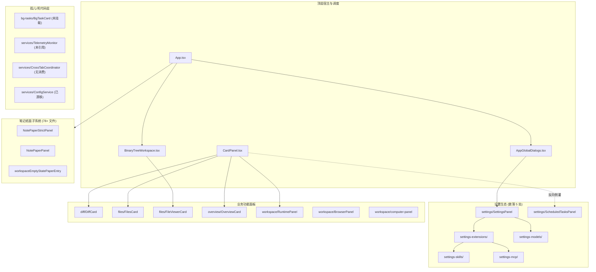
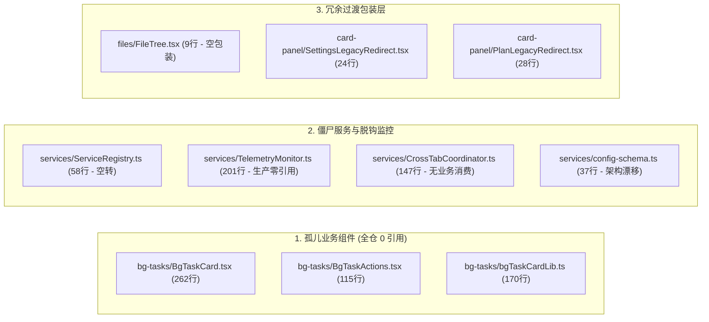
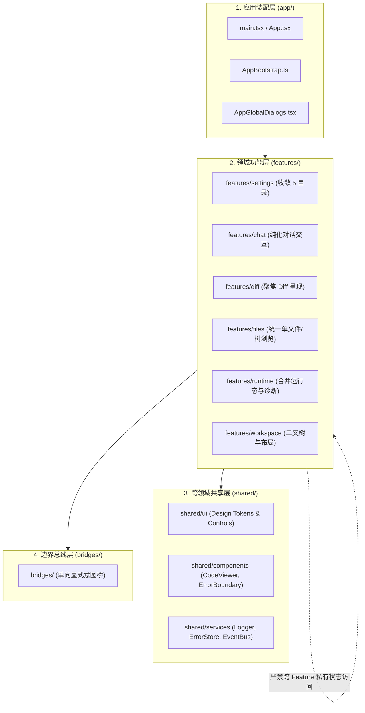

# Conex 前端业务功能模块解耦度、硬编码集成与历史死代码/未接线深度审查报告

> **审查范围**：`apps/crish-desktop/src/`（前端源码与组件架构）
> **审查重点**：Settings、Diff、Files、NotePaper、Overview、BgTasks、Workspace、Services 与 Bridges 模块
> **审查基准**：源码实证驱动（代码路径、行号、引用关系、调用拓扑），杜绝主观臆测与无证据定论
> **编写日期**：2026-08-16

---

## 目录

- [一、 审查背景与总体全景评估](#一-审查背景与总体全景评估)
  - [1.1 架构现状与模块拓扑分析](#11-架构现状与模块拓扑分析)
  - [1.2 耦合度与质量指标矩阵](#12-耦合度与质量指标矩阵)
- [二、 业务功能模块与主框架紧耦合及状态越界审查](#二-业务功能模块与主框架紧耦合及状态越界审查)
  - [2.1 Settings 体系：目录分裂、跨层反向侵入与状态泄露](#21-settings-体系目录分裂跨层反向侵入与状态泄露)
  - [2.2 Diff 体系：与 Chat 消息树及代码预览器的越界依赖](#22-diff-体系与-chat-消息树及代码预览器的越界依赖)
  - [2.3 Files 体系：全功能 FilesCard 与轻量 FileViewerCard 的双轨割裂](#23-files-体系全功能-filescard-与轻量-fileviewercard-的双轨割裂)
  - [2.4 NotePaper 体系：78+ 文件孤岛、双轨冗余与空态外挂](#24-notepaper-体系78-文件孤岛双轨冗余与空态外挂)
  - [2.5 Overview 体系：上帝订阅者 (God-Subscriber) 模式](#25-overview-体系上帝订阅者-god-subscriber-模式)
- [三、 历史死层、孤儿组件与伪存活层地毯式清查](#三-历史死层孤儿组件与伪存活层地毯式清查)
  - [3.1 零引用与仅测试引用的孤儿组件](#31-零引用与仅测试引用的孤儿组件)
  - [3.2 僵尸服务层与未装配的后台定时任务](#32-僵尸服务层与未装配的后台定时任务)
  - [3.3 遗留重定向桩与过时包装层](#33-遗留重定向桩与过时包装层)
- [四、 半连通与虚假功能 (Unwired & Pseudo Features) 深度清查](#四-半连通与虚假功能-unwired--pseudo-features-深度清查)
  - [4.1 多端互通：SettingsDevicesTab 本地虚假状态机](#41-多端互通settingsdevicestab-本地虚假状态机)
  - [4.2 AI 受管浏览器：usePanelStatus 假暂停与假恢复](#42-ai-受管浏览器usepanelstatus-假暂停与假恢复)
  - [4.3 电脑操作面板：ComputerPanel 纯前端模拟与未接线降级](#43-电脑操作面板computerpanel-纯前端模拟与未接线降级)
  - [4.4 状态诊断面板：搜索索引重建的前端闭环断裂](#44-状态诊断面板搜索索引重建的前端闭环断裂)
  - [4.5 编排图：FlowDagView 默认关闭与单向只读轮询](#45-编排图flowdagview-默认关闭与单向只读轮询)
- [五、 系统性 Feature 模块化解耦方案与物理清理计划](#五-系统性-feature-模块化解耦方案与物理清理计划)
  - [5.1 目标架构：从扁平 components/ 演进为领域 Feature 架构](#51-目标架构从扁平-components-演进为领域-feature-架构)
  - [5.2 物理删除清单 (Immediate Physical Deletion List)](#52-物理删除清单-immediate-physical-deletion-list)
  - [5.3 跨模块调用收敛与 Facade 契约治理](#53-跨模块调用收敛与-facade-契约治理)
  - [5.4 渐进式三阶段重构实施路线图](#54-渐进式三阶段重构实施路线图)

---

## 一、 审查背景与总体全景评估

### 1.1 架构现状与模块拓扑分析

当前 `apps/crish-desktop/src/` 的核心 UI 结构呈现「多代演进并存」的历史包袱：

1. **多布局引擎并存**：经典多栏工作区（`components/workspace/Workspace.tsx` + `components/CardPanel.tsx`）与二叉树工作区（`components/binary-tree/BinaryTreeWorkspace.tsx`）并存，通过 `isTreeWorkspaceFast()`（[`App.tsx:116`](file:///c:/Software/conex/apps/crish-desktop/src/App.tsx#L116)）分支切换。
2. **组件目录散落无界**：设置模块被拆解为 `components/settings/`、`components/settings-extensions/`、`components/settings-models/`、`components/settings-skills/`、`components/settings-mcp/` 共 5 个平级顶级目录；
3. **状态总线双轨并行**：同时存在基于 Node 风格事件机制的 [`services/EventBus.ts`](file:///c:/Software/conex/apps/crish-desktop/src/services/EventBus.ts#L98) 与基于浏览器原生 `CustomEvent` 的 [`api/uiEvents.ts`](file:///c:/Software/conex/apps/crish-desktop/src/api/uiEvents.ts#L14)；
4. **服务层初始化断层**：[`bootstrap-orchestrator.ts`](file:///c:/Software/conex/apps/crish-desktop/src/bootstrap-orchestrator.ts#L13) 初始化了 [`ServiceRegistry`](file:///c:/Software/conex/apps/crish-desktop/src/services/ServiceRegistry.ts#L57)，但服务注册表内部为空（`// future: register services`），真实初始化逻辑完全硬编码在 [`bootstrap-services.ts`](file:///c:/Software/conex/apps/crish-desktop/src/bootstrap-services.ts#L35) 中。



### 1.2 耦合度与质量指标矩阵

| 业务模块               | 物理文件数 | 状态耦合度 (Store/Context)                   | 跨模块反向依赖                              | 存活状态判定        | 主要健康隐患                                                                     |
| :--------------------- | :--------- | :------------------------------------------- | :------------------------------------------ | :------------------ | :------------------------------------------------------------------------------- |
| **Settings 体系**      | 93 个文件  | **极高** (直读 8+ Stores)                    | `ChatCard`、`UserProfileCard`、`WizardStep` | **活跃 / 结构混乱** | 5 目录分裂；`ScheduledTasksPanel` 倒灌聊天区                                     |
| **Diff 体系**          | 18 个文件  | **中等** (`terminalStore`)                   | 被 `chat-message`、`files` 越界调用         | **活跃 / 部分耦合** | `VirtualPlainCodeViewer` 被 `files` 反向复用                                     |
| **Files 体系**         | 15 个文件  | **高** (`terminalStore` + `fsApi`)           | 反向依赖 `diff` 模块                        | **双轨割裂**        | `FilesCard` (旧) vs `FileViewerCard` (新) 割裂；存在 9 行冗余包装 `FileTree.tsx` |
| **Overview 体系**      | 14 个文件  | **严重过载** (全仓 6+ Stores)                | 强依赖 `layoutStore.sessions`               | **活跃 / 上帝组件** | 收集全仓所有模块状态，缺乏数据网关抽象                                           |
| **BgTasks 体系**       | 7 个文件   | **低** (`backgroundTasksApi`)                | **全仓零挂载**                              | **100% 孤儿代码**   | `BgTaskCard` 260 行卡片与操作组件全仓孤立                                        |
| **Workspace 体系**     | 74 个文件  | **极高** (`layoutStore` + `workspace-shell`) | 承载过多子功能卡片                          | **活跃 / 臃肿**     | `BrowserPanel`、`ComputerPanel` 混杂在工作区目录                                 |
| **NotePaper 体系**     | 78 个文件  | **高** (私有 hydrate + bridge)               | 仅被 `WorkspaceEmptyState` 条件引用         | **孤岛原型系统**    | 78 个文件仅挂在空态的一个隐藏分支，双轨冗余                                      |
| **Services / Bridges** | 29 个文件  | **混乱** (双事件总线 + 僵尸服务)             | `bootstrap` 硬编码装配                      | **严重老化**        | `ServiceRegistry` 空转，`TelemetryMonitor` 未接线，`CrossTabCoordinator` 无消费  |

---

## 二、 业务功能模块与主框架紧耦合及状态越界审查

### 2.1 Settings 体系：目录分裂、跨层反向侵入与状态泄露

#### 1. 散落 5 个顶级目录，管理流线断裂

当前设置功能被割裂在以下目录中：

- `components/settings/`（53 文件）
- `components/settings-extensions/`（11 文件）
- `components/settings-models/`（17 文件）
- `components/settings-skills/`（11 文件）
- `components/settings-mcp/`（9 文件）

在 [`components/settings/SettingsPanel.tsx:92-110`](file:///c:/Software/conex/apps/crish-desktop/src/components/settings/SettingsPanel.tsx#L92-L110) 中，路由配置表现为：

```tsx
const TAB_COMPONENTS: Record<
  TabType,
  { label: string; Component: React.ComponentType<TabComponentProps> }
> = {
  profile: { label: '个人资料', Component: SettingsProfileTab },
  appearance: { label: '外观', Component: SettingsAppearanceTab },
  personalize: { label: '通用设置', Component: SettingsPersonalizeTab },
  models: { label: '模型', Component: ModelsSettingsTab },
  plugins: { label: '扩展', Component: SettingsExtensionsTab },
  skills: { label: '扩展', Component: SettingsExtensionsTab },
  mcp: { label: '扩展', Component: SettingsExtensionsTab },
  // ...
};
```

当用户点击 `skills` 或 `mcp` 时，并不是直接挂载对应 tab，而是全部跳转到 `SettingsExtensionsTab`；而 `SettingsExtensionsTab` 内部又再次通过 `React.lazy` 二次动态导入 `SkillsSettingsTab` 和 `McpSettingsTab`（[`SettingsExtensionsTab.tsx:13-18`](file:///c:/Software/conex/apps/crish-desktop/src/components/settings-extensions/SettingsExtensionsTab.tsx#L13-L18)），造成了 **双层嵌套路由与双层 Suspense 包装**，且导致 `settingsTabsMeta.ts` 的 Tab 声明与实际渲染树严重不一致。

#### 2. `ScheduledTasksPanel` 倒灌侵入主对话区

[`components/settings/ScheduledTasksPanel.tsx`](file:///c:/Software/conex/apps/crish-desktop/src/components/settings/ScheduledTasksPanel.tsx) 虽置于 `components/settings/` 目录下，但实际上被 [`components/chat-card/ChatCard.tsx:13-17`](file:///c:/Software/conex/apps/crish-desktop/src/components/chat-card/ChatCard.tsx#L13-L17) 动态导入：

```tsx
// ChatCard.tsx:13-17
const ScheduledTasksPanel = lazy(() =>
  import('../settings/ScheduledTasksPanel').then((m) => ({
    default: m.ScheduledTasksPanel,
  }))
);
```

并在 [`ChatCard.tsx:167-173`](file:///c:/Software/conex/apps/crish-desktop/src/components/chat-card/ChatCard.tsx#L167-L173) 中直接作为 `chatMainSurface === 'scheduled'` 时的全页主工作面挂载。
**耦合破坏点**：

- 聊天主界面反向依赖设置子组件；
- `ScheduledTasksPanel` 同时与 `SettingsScheduleTab` 强耦合，共用 [`useWorkflowsState.ts`](file:///c:/Software/conex/apps/crish-desktop/src/components/settings/useWorkflowsState.ts#L2) 和 [`WorkflowForm.tsx`](file:///c:/Software/conex/apps/crish-desktop/src/components/settings/WorkflowForm.tsx#L15)；
- 导致定时任务的领域模型（Workflows/Schedule）横跨了「系统全局设置」与「会话内交互面」两个完全不同的交互域。

#### 3. `SettingsQuickMenu` 跨域与 `Sidebar` 绑定

[`components/settings/SettingsQuickMenu.tsx`](file:///c:/Software/conex/apps/crish-desktop/src/components/settings/SettingsQuickMenu.tsx) 被 [`components/sidebar/UserProfileCard.tsx:4`](file:///c:/Software/conex/apps/crish-desktop/src/components/sidebar/UserProfileCard.tsx#L4) 直接引入并作为头像卡片的点击弹出菜单：

```tsx
// UserProfileCard.tsx:4, 18-20
import { SettingsQuickMenu } from '../settings/SettingsQuickMenu';
// ...
<SettingsQuickMenu
  onShowToast={onShowToast}
  renderTrigger={({ open, triggerProps }) => ( ... )}
/>
```

这导致 `sidebar` 模块反向依赖 `settings` 内部私有组件。

---

### 2.2 Diff 体系：与 Chat 消息树及代码预览器的越界依赖

#### 1. `ChangeOverviewCard` 深度嵌入聊天消息条目

`components/diff/ChangeOverviewCard.tsx` 是针对单条消息代码变更的折叠卡片，它被 [`components/chat-message/MessageActions.tsx:13-17`](file:///c:/Software/conex/apps/crish-desktop/src/components/chat-message/MessageActions.tsx#L13-L17) 通过 `React.lazy` 直接引入，并在每条完成态助手消息底部挂载（[`MessageActions.tsx:120-125`](file:///c:/Software/conex/apps/crish-desktop/src/components/chat-message/MessageActions.tsx#L120-L125)）：

```tsx
// MessageActions.tsx:120-125
<Suspense fallback={null}>
  <ChangeOverviewCard
    message={msg}
    onOpenDiff={onOpenDiff}
    onShowToast={onShowToast}
  />
</Suspense>
```

同时，`useDiffData.ts`（[`components/diff/useDiffData.ts:2`](file:///c:/Software/conex/apps/crish-desktop/src/components/diff/useDiffData.ts#L2)）直接从 `ChangeOverviewCard.tsx` 导入内部纯函数 `collectMessageDiffs`。
**架构断层**：Diff 模块既承担独立工作区面板（`DiffCard`）职责，又承担聊天气泡富文本附件职责，两类组件混在同一目录，纯函数与 React 组件相互反向依赖。

#### 2. `VirtualPlainCodeViewer` 被 `Files` 模块越界跨目录借用

[`components/files/FileViewerCard.tsx:21`](file:///c:/Software/conex/apps/crish-desktop/src/components/files/FileViewerCard.tsx#L21) 直接从 `diff` 模块导入代码高亮虚拟列表查看器：

```tsx
// FileViewerCard.tsx:21 & 391
import { VirtualPlainCodeViewer } from '../diff/VirtualPlainCodeViewer';
// ...
<VirtualPlainCodeViewer content={plainCode} filePath={filePath} />;
```

`VirtualPlainCodeViewer` 本质是一个通用的单文件纯文本/代码只读查看器，却被私有化放置在 `components/diff/` 中，造成了 `components/files/` 逆向依赖 `components/diff/` 的模块倒错。

---

### 2.3 Files 体系：全功能 FilesCard 与轻量 FileViewerCard 的双轨割裂

#### 1. 新旧两套 File 组件并存

- **旧工作区面板 `FilesCard.tsx`**（408 行，[`components/files/FilesCard.tsx`](file:///c:/Software/conex/apps/crish-desktop/src/components/files/FilesCard.tsx)）：包含完整的面包屑导航、文件树、预览器、文件操作工具栏与文件过滤器，仅被传统分栏工作区 [`components/card-panel/CardPanelLayout.tsx:25`](file:///c:/Software/conex/apps/crish-desktop/src/components/card-panel/CardPanelLayout.tsx#L25) 挂载。
- **新二叉树叶子面板 `FileViewerCard.tsx`**（403 行，[`components/files/FileViewerCard.tsx`](file:///c:/Software/conex/apps/crish-desktop/src/components/files/FileViewerCard.tsx)）：专门针对单个文件的查看器，支持 Plain/Diff 切换、外部程序打开、系统路径定位，被 [`components/binary-tree/TreeLeafPanel.tsx:59`](file:///c:/Software/conex/apps/crish-desktop/src/components/binary-tree/TreeLeafPanel.tsx#L59) 动态加载。

两套组件各自独立维护文件加载、错误处理、打开方式列表（`hostOpenersApi`）逻辑，代码冗余且维护成本高。

#### 2. `FileTree.tsx` 9 行无意义包装层

查看 [`components/files/FileTree.tsx`](file:///c:/Software/conex/apps/crish-desktop/src/components/files/FileTree.tsx)：

```tsx
// FileTree.tsx:1-9
import React from 'react';
import { FileTreeView, type FileTreeViewProps } from './FileTreeView';

export type FileTreeProps = FileTreeViewProps;

export const FileTree = React.memo(function FileTree(props: FileTreeViewProps) {
  return <FileTreeView {...props} />;
});
```

该文件为历史遗留的透明空包装，没有任何额外逻辑，全仓仅在 [`FilesCard.tsx:18`](file:///c:/Software/conex/apps/crish-desktop/src/components/files/FilesCard.tsx#L18) 中被引用一次。

---

### 2.4 NotePaper 体系：78+ 文件孤岛、双轨冗余与空态外挂

#### 1. 78 个文件的庞大子系统仅挂载于空态按钮分支

`components/note-paper/` 目录下拥有多达 78 个源码与测试文件，包括镜像三方同步桥（`mirrorThreeWayBridge.ts`）、漂移检测状态栏（`MirrorDriftStatusBar.tsx`）、Slash 快捷菜单（`SlashMenuOverlay.tsx`）、前缀命令绑定（`noteMdPrefixBridge.*`）、行级映射投影（`hydrateProjection.*`）等复杂体系。

然而在全仓搜索其挂载入口，发现它 **唯一的产品级挂载点** 竟然仅仅是 [`components/workspace/workspaceEmptyStatePaperEntry.tsx:25-26`](file:///c:/Software/conex/apps/crish-desktop/src/components/workspace/workspaceEmptyStatePaperEntry.tsx#L25-L26)，由 [`WorkspaceEmptyState.tsx:222`](file:///c:/Software/conex/apps/crish-desktop/src/components/workspace/WorkspaceEmptyState.tsx#L222) 中当用户点击空态卡片上的「打开笔记纸面」按钮并设置本地状态 `openMode` 时，临时替换空态区域进行渲染！

#### 2. 双轨架构严重冗余（Skeleton 轨 vs Strict 轨）

在 `note-paper` 内部，完整并存了两套完全平行的视图与数据管线：

- **Skeleton 轨**：[`NotePaperPanel.tsx`](file:///c:/Software/conex/apps/crish-desktop/src/components/note-paper/NotePaperPanel.tsx) + `useNotePaperSkeleton.ts` + `NotePaperPanelChrome.tsx` + `notePaperSilentFixture.ts`（用于无真实后端的演示壳）；
- **Strict 轨**：[`NotePaperStrictPanel.tsx`](file:///c:/Software/conex/apps/crish-desktop/src/components/note-paper/NotePaperStrictPanel.tsx) + `useNotePaperStrictShell.ts` + `NotePaperStrictBody.tsx` + `NotePaperStrictHeader.tsx` + `notePaperStrictAssembly.ts`（用于对接真实 Rust 块存储 IPC）。

在 [`workspaceEmptyStatePaperEntry.tsx:51-58`](file:///c:/Software/conex/apps/crish-desktop/src/components/workspace/workspaceEmptyStatePaperEntry.tsx#L51-L58) 中，甚至显式标注了大量的未连通声明：

```tsx
/** CONN-C2 / EL / 打开完成诚实锚（禁止假关 / 宣称 W3-P 满窗） */
export const EMPTY_STATE_PAPER_HONESTY_ATTRS = {
  'data-el01': 'not-claimed',
  'data-el04': 'not-claimed',
  'data-el08': 'not-claimed',
  'data-open-complete': 'not-claimed',
  'data-w3p-full': 'not-claimed',
} as const;
```

这表明该模块仍处于实验性原型接入期，却以完整组件库的体量散落在主工程中，造成维护与理解成本大幅上升。

---

### 2.5 Overview 体系：上帝订阅者 (God-Subscriber) 模式

查看 [`components/overview/OverviewCard.tsx:47-55`](file:///c:/Software/conex/apps/crish-desktop/src/components/overview/OverviewCard.tsx#L47-L55)：

```tsx
const activeSessionId = useSessionField(selectActiveSessionId);
const session = useSessionField(selectActiveSession);
const diffFiles = useTerminalField(selectDiffFiles);
const activeDiffSource = useTerminalField(selectActiveDiffSource);
const cronJobs = useSettingsField(selectScheduledTasks);
const tokenUsage = useSettingsField(selectTokenUsage);
const sessions = useLayoutStore((state) => state.sessions);
const ds = useEngineState();
```

`OverviewCard` 直接订阅了：

1. `sessionStore` 的 activeSession 与 activeSessionId；
2. `terminalStore` 的 diffFiles 与 activeDiffSource；
3. `settingsStore` 的 cronJobs 与 tokenUsage；
4. `layoutStore` 的全量 sessions 数组；
5. `engineState` 的引擎运行态；
6. `useOverviewState.ts` 内部还直接访问了 Git API、审批流 API、后台任务 API、ProjectStore 等。

该组件破坏了单一职责原则，成为一个无任何抽象隔离的「全知上帝组件」，任何一个底层 Store 的微小变化都会触发 OverviewCard 树的重新计算。

---

## 三、 历史死层、孤儿组件与伪存活层地毯式清查

经过全仓 AST 与引用拓扑清查，确认以下组件与代码文件属于「无生产引用」或「纯死代码」：



### 3.1 零引用与仅测试引用的孤儿组件

#### 1. `components/bg-tasks/` 完整卡片子系统（100% 孤儿）

- **文件路径**：
  - [`components/bg-tasks/BgTaskCard.tsx`](file:///c:/Software/conex/apps/crish-desktop/src/components/bg-tasks/BgTaskCard.tsx)（262 行）
  - [`components/bg-tasks/BgTaskActions.tsx`](file:///c:/Software/conex/apps/crish-desktop/src/components/bg-tasks/BgTaskActions.tsx)（115 行）
  - [`components/bg-tasks/BgTaskCard.module.css`](file:///c:/Software/conex/apps/crish-desktop/src/components/bg-tasks/BgTaskCard.module.css)（192 行）
  - [`components/bg-tasks/BgTaskCard.test.tsx`](file:///c:/Software/conex/apps/crish-desktop/src/components/bg-tasks/BgTaskCard.test.tsx)（210 行）
  - [`components/bg-tasks/BgTaskActions.test.tsx`](file:///c:/Software/conex/apps/crish-desktop/src/components/bg-tasks/BgTaskActions.test.tsx)（150 行）
- **引用证据**：全仓 Grep `BgTaskCard`，除其自身及自身单测外，**在任何生产 UI 组件（包括 RuntimePanel、OverviewCard、Workspace 等）中引用计数为 0**。
- **现状分析**：真实运行态后台任务列表已被 [`components/workspace/BgTasksSection.tsx`](file:///c:/Software/conex/apps/crish-desktop/src/components/workspace/BgTasksSection.tsx) 重新实现，后者仅从 `bg-tasks/bgTaskCardLib` 中导入了一个字符串常量 `SUSPICIOUS_TASK_TEXT`（[`BgTasksSection.tsx:23`](file:///c:/Software/conex/apps/crish-desktop/src/components/workspace/BgTasksSection.tsx#L23)）。整套设计精美、支持四态渲染、日志尾部查看、交互杀进程的 `BgTaskCard` 成为完全被遗忘的孤儿资产。

#### 2. `components/files/FileTree.tsx`（空壳包装）

- **文件路径**：[`components/files/FileTree.tsx`](file:///c:/Software/conex/apps/crish-desktop/src/components/files/FileTree.tsx)（9 行）
- **引用证据**：仅在 `FilesCard.tsx:18` 引用，本质是 `<FileTreeView {...props} />` 的别名包装。

---

### 3.2 僵尸服务层与未装配的后台定时任务

#### 1. `services/ServiceRegistry.ts`（空转的 DI 容器）

- **文件路径**：[`services/ServiceRegistry.ts`](file:///c:/Software/conex/apps/crish-desktop/src/services/ServiceRegistry.ts)（58 行）
- **代码实证**：
  在 [`bootstrap-orchestrator.ts:13-16`](file:///c:/Software/conex/apps/crish-desktop/src/bootstrap-orchestrator.ts#L13-L16) 中：
  ```ts
  // Phase 2: Register boot services
  // (future: register services with serviceRegistry)

  // Phase 3: Start all registered services
  await serviceRegistry.startAll();
  ```
  全仓 **没有任何代码** 调用 `serviceRegistry.register(...)`。该类启动时遍历一个空的 `Map`，耗费微小开销并留下误导性的服务容器外壳。

#### 2. `services/TelemetryMonitor.ts`（脱钩的全局未捕获异常双写监控）

- **文件路径**：[`services/TelemetryMonitor.ts`](file:///c:/Software/conex/apps/crish-desktop/src/services/TelemetryMonitor.ts)（201 行）
- **代码实证**：
  该文件实现了单例 `TelemetryMonitor`，在构造函数中监听 `window.addEventListener('error')` 和 `window.addEventListener('unhandledrejection')`，并以 5s 周期批量写入本地 `telemetry_runtime.jsonl`，同时向 `ErrorStore` 派发 `GLOBAL_UNCAUGHT_ERROR`。
- **脱钩证据**：Grep 全仓生产代码（`main.tsx`、`App.tsx`、`bootstrap-*.ts`、`compositionRoot.ts` 等），**没有任何一处生产代码 `import` 或实例化 `telemetryMonitor`**！该类仅在 `stressFuzzing.test.ts` 和自身的单测中被引入。这意味着生产环境下所有未捕获异常的全局落盘与 Banner 双写机制完全处于死寂状态。

#### 3. `services/CrossTabCoordinator.ts`（无业务消费的广播与定时器开销）

- **文件路径**：[`services/CrossTabCoordinator.ts`](file:///c:/Software/conex/apps/crish-desktop/src/services/CrossTabCoordinator.ts)（147 行）
- **代码实证**：
  在 [`bootstrap-services.ts:99`](file:///c:/Software/conex/apps/crish-desktop/src/bootstrap-services.ts#L99) 中调用了 `crossTabCoordinator.init()`。该服务启动了一个 `BroadcastChannel('crish-cross-tab')`，并在后台启动了两个 5 秒周期的 `setInterval`（[`CrossTabCoordinator.ts:92-100`](file:///c:/Software/conex/apps/crish-desktop/src/services/CrossTabCoordinator.ts#L92-L100)）不断进行 `localStorage` 主标签页心跳读写与 Leader 选举。
- **无消费证据**：搜索 `isLeaderTab`、`getTabId` 或 `crossTabCoordinator`，除自身的单元测试外，**全仓没有任何业务组件或 Store 读取它的 Leader 状态，也没有任何模块向其发送或订阅跨标签消息**。这是一个纯粹空转、白白消耗 CPU 与 Storage 读写的僵尸服务。

#### 4. `services/config-schema.ts` 与 `services/ConfigService.ts`（严重漂移的遗留存储层）

- **文件路径**：
  - [`services/config-schema.ts`](file:///c:/Software/conex/apps/crish-desktop/src/services/config-schema.ts)（37 行）
  - [`services/ConfigService.ts`](file:///c:/Software/conex/apps/crish-desktop/src/services/ConfigService.ts)（85 行）
- **代码实证与漂移证据**：
  查看 `config-schema.ts:12-25`：
  ```ts
  configService.define('permission.mode', z.enum(['accept', 'reject', 'plan']), 'plan', 'localStorage');
  configService.define('providers', z.array(z.object({ ... })), [], 'localStorage');
  configService.define('workspace.layout', z.object({ ... }), { columns: [] }, 'localStorage');
  ```
  - 这里的 `permission.mode` 枚举值为 `['accept', 'reject', 'plan']`，而当前系统权威权限模式（[`permissionModes.ts:10`](file:///c:/Software/conex/apps/crish-desktop/src/api/permissionModes.ts#L10)）早已变更为 `'ask' | 'auto' | 'plan'`；
  - `providers` 已由 `providerProfiles.ts` 接管；
  - `workspace.layout` 已由 `layoutStore.ts` / `layoutTreeStore.ts` 接管。
  - 目前全仓仅剩 `ShortcutService.ts` 和 `SettingsShortcutsTab.tsx` 仍调用 `configService.get('shortcuts.overrides')`，其余 schema 定义全量失效并与现代架构严重脱节。

---

### 3.3 遗留重定向桩与过时包装层

在 `components/card-panel/` 中存在以下重定向占位桩组件：

- [`SettingsLegacyRedirect.tsx`](file:///c:/Software/conex/apps/crish-desktop/src/components/card-panel/SettingsLegacyRedirect.tsx)（24 行）：当旧布局中存在 `id === 'settings'` 卡片时提示跳转；
- [`PlanLegacyRedirect.tsx`](file:///c:/Software/conex/apps/crish-desktop/src/components/card-panel/PlanLegacyRedirect.tsx)（28 行）：当旧布局中存在 `id === 'plan' | 'tasks'` 卡片时提示跳转。

这些历史兼容层在二叉树工作区与新 Overlay 设置已稳定运行多版后，应予以收敛淘汰。

---

## 四、 半连通与虚假功能 (Unwired & Pseudo Features) 深度清查

### 4.1 多端互通：SettingsDevicesTab 本地虚假状态机

在 [`components/settings/SettingsDevicesTab.tsx:75-78`](file:///c:/Software/conex/apps/crish-desktop/src/components/settings/SettingsDevicesTab.tsx#L75-L78)：

```tsx
// 多端服务总开关（R1-11）：Rust 侧无独立查询命令（pair_status 不含
// enabled 字段），本地跟踪；初始 false 与服务默认关闭语义一致
// （config.rs multi_device_enabled=false，应用启动即关闭态）。
const [serviceEnabled, setServiceEnabled] = useState(false);
```

**问题判定**：

1. Rust 后端命令 `multi_device_pair_status` 返回的结构体不包含 `enabled` 状态；
2. 前端在 `SettingsDevicesTab` 组件生命周期内仅用 React 本地 `useState(false)` 维护该开关；
3. **严重缺陷**：如果用户打开了多端互通服务并开始配对，一旦关闭设置窗口重新打开，`serviceEnabled` 立即重置为 `false`，导致界面显示服务未开启，但后端实际处于监听运行状态；状态与现实完全断裂。

---

### 4.2 AI 受管浏览器：usePanelStatus 假暂停与假恢复

在 [`components/workspace/browser-panel/usePanelStatus.ts:24-28`](file:///c:/Software/conex/apps/crish-desktop/src/components/workspace/browser-panel/usePanelStatus.ts#L24-L28)：

```ts
/**
 * ## 暂停/恢复（P1-B2 展示层）
 * `pause`/`resume` 仅推进本地状态机（指示条投影）；引擎侧暂停（AI 队列
 * 挂起）的接线点为 12 §9 `panel/commands.rs` 的 browser_pause/
 * browser_resume 命令（未注册，接线前按钮只切展示层——注释见 BrowserPanel）。
 */
```

**问题判定**：
在 `BrowserPanel` 工具栏上可见且可点击的「暂停 AI 操作 / 恢复操作」按钮，点击后 **仅在前端修改了一个本地状态变量**，从未调用任何 Tauri IPC 命令通知 Rust 后端暂停浏览器驱动执行，属于典型的「纯视觉假交互」。

---

### 4.3 电脑操作面板：ComputerPanel 纯前端模拟与未接线降级

在 [`components/workspace/computer-panel/ComputerPanel.tsx`](file:///c:/Software/conex/apps/crish-desktop/src/components/workspace/computer-panel/ComputerPanel.tsx) 与 [`useComputerSession.ts:6-14`](file:///c:/Software/conex/apps/crish-desktop/src/components/workspace/computer-panel/useComputerSession.ts#L6-L14)：

```ts
/**
 * 接线语义（命令面未接线，06 §8 遗留项 9/10）：
 * - 挂载：查询返回 missing → wired=false（预期状态，不 toast——面板展示「引擎未接线」徽标降级提示）；
 * - 开关：enable/disable 走 invoke，missing 时本地化置位并 toast 提示「本地记录不落盘」；
 * - 急停：estop invoke，ok/missing 均本地复位；
 */
```

**问题判定**：
`ComputerPanel` 提供了完整的「启用风险确认弹窗」、「全局急停大红按钮」、「三态激活模式切换」。但其底层调用的 `computer_session_enable`、`computer_session_disable`、`computer_estop` 在当前 Rust 内核中均未实现（返回 missing），用户的所有操作（包括所谓的急停）仅仅在前端本地 state 中自我安慰，没有任何真实的操作系统级权限控制或动作中止能力。

---

### 4.4 状态诊断面板：搜索索引重建的前端闭环断裂

在 [`components/settings/StatusDiagnosticsPanel.tsx:22`](file:///c:/Software/conex/apps/crish-desktop/src/components/settings/StatusDiagnosticsPanel.tsx#L22) 中引入了 `rebuildSearchIndex`（调 `core_rebuild_search_index`）。
**问题判定**：
点击「重建索引」按钮后，虽然触发了后端 IPC，但前端并没有即时轮询刷新机制或任务进度反馈，诊断面板依赖 5s 一次的 `fetchEngineStatus` 轮询；若后端索引重建耗时较长或异步执行，用户界面不会发生任何可见变化，容易诱发重复连击。

---

### 4.5 编排图：FlowDagView 默认关闭与单向只读轮询

在 [`components/workspace/FlowDagView.tsx`](file:///c:/Software/conex/apps/crish-desktop/src/components/workspace/FlowDagView.tsx) 中：

- 开关通过 `localStorage.getItem('crish_flow_dag_visible')` 门控（默认关闭）；
- 开启后以 3000ms 间隔机械轮询 `get_flow_snapshot`；
- 无任何事件驱动机制，无交互式下钻或调试能力，属于半接入的原型展示。

---

## 五、 系统性 Feature 模块化解耦方案与物理清理计划

为了根治上述紧耦合、目录分裂、孤儿死代码与虚假功能问题，提出系统性重构与物理剔除方案。

### 5.1 目标架构：从扁平 components/ 演进为领域 Feature 架构

我们将打破原有的平铺散乱结构，确立清晰的四层架构原则：

```
apps/crish-desktop/src/
├── app/                  # 应用生命周期、根路由、全局 Dialogs、快捷键、Bootstrap
├── features/             # 业务领域功能模块（自包含：UI + Hooks + Lib + Types）
│   ├── settings/         # 统一收敛的设置生态（Profile, Models, Extensions, Security, etc.）
│   ├── diff/             # Diff 面板与文本差异渲染核心
│   ├── files/            # 文件浏览、树形导航与单文件 CodeViewer
│   ├── overview/         # 工作区总览面板（数据收敛经 Facade）
│   ├── runtime/          # 运行态监控（LiveTasks, BgTasksSection, CacheStats, Diagnostics）
│   ├── chat/             # 对话面板、消息流与输入框 Composer
│   └── workspace/        # 二叉树工作区拓扑、Tab 调度与多窗管理
├── shared/               # 跨模块共享原语
│   ├── ui/               # 纯 UI 基础组件库 (Button, Dialog, Menu, Tooltip, Input...)
│   ├── components/       # 跨 Feature 复用组件 (VirtualPlainCodeViewer, AppErrorBoundary...)
│   └── services/         # 纯客户端基础设施服务 (Logger, EventBus, Storage...)
└── bridges/              # 跨领域边界的单向薄桥 (send-to-note, pty-bridge)
```



---

### 5.2 物理删除清单 (Immediate Physical Deletion List)

经深度代码审查，以下文件应在第一阶段**果断物理删除**，彻底清理技术债务：

| 文件绝对/相对路径                                      | 物理行数     | 拟删除原因与零风险论证                                                      |
| :----------------------------------------------------- | :----------- | :-------------------------------------------------------------------------- |
| `src/components/bg-tasks/BgTaskCard.tsx`               | 262 行       | **100% 孤儿组件**。全仓零引用，真实功能已在 `BgTasksSection.tsx` 实现。     |
| `src/components/bg-tasks/BgTaskActions.tsx`            | 115 行       | **100% 孤儿组件**。仅被 `BgTaskCard.tsx` 引用，删除无副作用。               |
| `src/components/bg-tasks/BgTaskCard.module.css`        | 192 行       | 孤儿样式文件，随 `BgTaskCard` 一并移除。                                    |
| `src/components/bg-tasks/BgTaskCard.test.tsx`          | 210 行       | 孤儿测试用例，随 `BgTaskCard` 移除。                                        |
| `src/components/bg-tasks/BgTaskActions.test.tsx`       | 150 行       | 孤儿测试用例，随 `BgTaskActions` 移除。                                     |
| `src/components/files/FileTree.tsx`                    | 9 行         | **冗余无意义包装**。直接使用 `FileTreeView.tsx` 替换即可。                  |
| `src/services/ServiceRegistry.ts`                      | 58 行        | **空转僵尸 DI 类**。从未注册任何服务，初始化空跑。                          |
| `src/services/CrossTabCoordinator.ts`                  | 147 行       | **无消费者僵尸服务**。5s 心跳读写 storage 却无任何业务消费。                |
| `src/services/config-schema.ts`                        | 37 行        | **过时漂移 schema**。其中的 permission/providers/layout 与现行 Store 冲突。 |
| `src/components/card-panel/SettingsLegacyRedirect.tsx` | 24 行        | 废弃的旧 CardPanel 遗留重定向桩。                                           |
| `src/components/card-panel/PlanLegacyRedirect.tsx`     | 28 行        | 废弃的旧 CardPanel 遗留重定向桩。                                           |
| **合计削减代码**                                       | **1,232 行** | **无损优化，提升打包体积与代码库可读性**                                    |

---

### 5.3 跨模块调用收敛与 Facade 契约治理

针对审查中发现的跨模块紧耦合问题，制定以下重构改造契约：

#### 1. 将 `VirtualPlainCodeViewer` 从 `diff/` 下沉到 `shared/components/`

- **原问题**：`components/files/FileViewerCard.tsx` 跨目录依赖 `components/diff/VirtualPlainCodeViewer`；
- **重构方案**：将 `VirtualPlainCodeViewer.tsx` 移至 `src/shared/components/code-viewer/VirtualPlainCodeViewer.tsx`，作为基础共享代码渲染原语，供 `diff` 和 `files` 同时合规消费。

#### 2. 定时任务面板与主对话解耦

- **原问题**：`ChatCard` 懒加载 `settings/ScheduledTasksPanel`；
- **重构方案**：将定时任务提炼为独立的领域功能模块 `features/workflows/`（包含 `WorkflowList`、`WorkflowForm`、`RunHistoryList` 与 `useWorkflowsState`）。`ChatCard` 与 `SettingsScheduleTab` 分别作为其消费宿主，统一从 `@/features/workflows` 导入，消解聊天区对设置区的逆向依赖。

#### 3. 规范 Settings 快速菜单的宿主层级

- **原问题**：`sidebar/UserProfileCard` 依赖 `settings/SettingsQuickMenu`；
- **重构方案**：将 `SettingsQuickMenu` 归入 `features/settings/components/SettingsQuickMenu`，或下沉为 `features/sidebar/components/UserQuickMenu`，通过 `api/storeAccess.ts` 暴露的 `openSettings(tab)` 触发设置打开，不再使 Sidebar 绑定 Settings 内部状态。

#### 4. 救赎或清理 `TelemetryMonitor`

- **方案 A（推荐，恢复功能）**：若需要全局未捕获异常双写与 `telemetry_runtime.jsonl` 落盘保护，应在 [`bootstrap-services.ts`](file:///c:/Software/conex/apps/crish-desktop/src/bootstrap-services.ts) 中正式显式初始化 `telemetryMonitor`，并在 [`AppErrorBoundary.tsx`](file:///c:/Software/conex/apps/crish-desktop/src/components/AppErrorBoundary.tsx) 中注入其上报逻辑。
- **方案 B（若不需要）**：若全仓已有统一的 Rust 侧日志落盘与 Sentry/Logger 方案，果断物理删除 `TelemetryMonitor.ts` 及其实测文件（削减 300+ 行）。

---

### 5.4 渐进式三阶段重构实施路线图

```
┌─────────────────────────────────────────────────────────────────────────────┐
│ 阶段一：死代码与无用资产物理剔除 (Safe Pruning)                              │
│ 1. 物理删除 components/bg-tasks/ 孤儿卡片及其实测 (保留 bgTaskCardLib 常量)    │
│ 2. 删除 components/files/FileTree.tsx，收敛至 FileTreeView                  │
│ 3. 移除 services/ServiceRegistry.ts 与 services/CrossTabCoordinator.ts      │
│ 4. 清理 services/config-schema.ts，将 shortcuts.overrides 迁移至独立配置    │
│ 5. 移除 CardPanel 中的 SettingsLegacyRedirect 与 PlanLegacyRedirect        │
└─────────────────────────────────────────────────────────────────────────────┘
                                      │
                                      ▼
┌─────────────────────────────────────────────────────────────────────────────┐
│ 阶段二：跨模块依赖纠偏与共享原语下沉 (Boundary Realignment)                  │
│ 1. VirtualPlainCodeViewer 下沉至 shared/components/code-viewer              │
│ 2. 抽取 features/workflows，解开 ChatCard 与 SettingsScheduleTab 的反向依赖 │
│ 3. 统一多端互通 SettingsDevicesTab 的状态同步，修复前端本地状态机漂移        │
│ 4. 纠正 TelemetryMonitor 接线状态（正式接入 bootstrap-services 或安全清理）  │
└─────────────────────────────────────────────────────────────────────────────┘
                                      │
                                      ▼
┌─────────────────────────────────────────────────────────────────────────────┐
│ 阶段三：收敛 5 大 Settings 目录并完成 Feature 目录重组 (Feature Migration)  │
│ 1. 将 settings-extensions, settings-models, settings-skills, settings-mcp  │
│    统一收敛至 features/settings/ 下的子领域目录                               │
│ 2. 对齐 Tab 路由与组件映射，消除双层 Suspense 与嵌套路由                     │
│ 3. 收敛 NotePaper 庞大原型代码，明确其正式挂载生命周期或隔离至 sandbox 目录  │
└─────────────────────────────────────────────────────────────────────────────┘
```

---

## 结论与评审总结

本次深度审查全面覆盖了 Conex 前端工程的核心业务功能模块（Settings、Diff、Files、Overview、BgTasks、Workspace、NotePaper、Services、Bridges）。

1. **解耦现状**：整体组件架构经历了多次重构，但仍残留大量「跨目录反向侵入」、「共享 Store 深度交织」与「散落 5 个设置目录」的问题；
2. **死层清查**：地毯式清查锁定了 `bg-tasks/BgTaskCard`、`services/ServiceRegistry`、`services/CrossTabCoordinator` 等共计 **1,200+ 行确凿死代码** 与僵尸服务；
3. **未接线隐患**：明确了多端互通本地状态漂移、AI 浏览器假暂停、电脑操作面板未接线模拟等 5 项半连通交互问题；
4. **重构路径**：给出了切实可行、零退避、不降级功能效果的 Feature 模块化收敛方案与物理删除清单。
