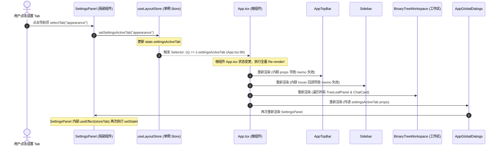
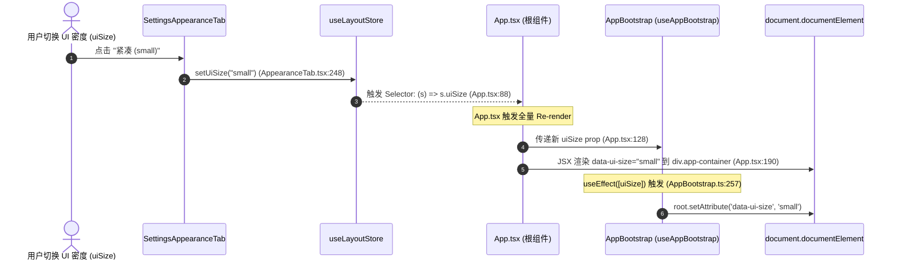
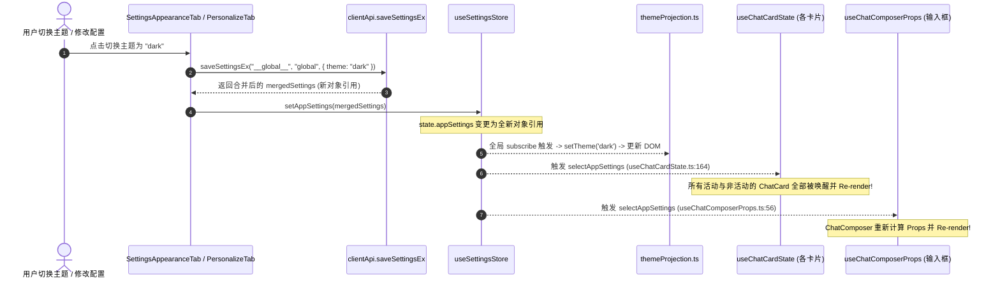

# 设置项操作引发全屏无差别重绘刷新 (Settings Full-App Re-render Storm) 深度专项审查

> **审查范围**：前端渲染树与 Store 订阅拓扑 (`apps/crish-desktop/src/`)
> **核心焦点**：在设置界面切换选项（主题/密度/窗口风格/Tab切换/修改快捷键等）引发整个应用全屏无差别 Re-render 的根因链路与零重刷原子化重构方案
> **审查基线**：只读前端源码（.ts, .tsx），以确凿的代码路径、行号与拓扑分析为唯一证据。

---

## Executive Summary（执行摘要）

用户在使用桌面端应用时反馈：「**在设置界面随便操作一个按钮或切换项（例如切换浅色/深色主题、修改 UI 密度、切换窗口风格、甚至仅仅在设置侧栏中点击切换不同的 Tab），整个应用界面全部重新刷新状态一次，伴随明显的界面闪烁、卡顿与焦点抖动。**」

经深入代码审查，该问题的根本原因是一条**由多层架构缺陷叠加形成的「全屏重渲染风暴（Re-render Storm）链条」**：

1. **根组件 God-State 订阅击穿**：顶层根组件 [`App.tsx:88-97`](file:///C:/Software/conex/apps/crish-desktop/src/App.tsx#L88-L97) 直接通过粗粒度 Hook 订阅了 `uiSize`、`shellChromeMode`、`showSettingsOverlay`、`settingsActiveTab` 等本应属于局部或纯 CSS 层的状态。
2. **伪分域 Store 共享底层事件总线**：`useSettingsUiStore`、`useSessionStore`、`useWorkspaceStore` 在底层实质上是同一个 `useLayoutStore` 巨型单例的别名（[`sessionStore.ts:35`](file:///C:/Software/conex/apps/crish-desktop/src/store/sessionStore.ts#L35)、[`settingsUiStore.ts:69`](file:///C:/Software/conex/apps/crish-desktop/src/store/settingsUiStore.ts#L69)）。对设置 Tab 或浮层的任何写操作，都会触发整个 LayoutStore 的状态变更广播。
3. **CSS 变量与 DOM 属性的双重脱节与冗余绑定**：原本仅需通过 `document.documentElement.setAttribute(...)` 或 CSS 自定义属性即可在 **0-VDOM-Diff、0-Re-render** 下完成的主题、密度与边框形态切换，被重度包装成 React 状态并挂载到 `<div className="app-container">` 的 JSX 属性上，引发 React 全树协调（Reconciliation）。
4. **巨型对象粗粒度订阅穿透**：工作区关键路径组件（如 [`useChatCardState.ts:164`](file:///C:/Software/conex/apps/crish-desktop/src/components/chat-card/useChatCardState.ts#L164)、[`useChatComposerProps.ts:56`](file:///C:/Software/conex/apps/crish-desktop/src/components/chat-card/useChatComposerProps.ts#L56)）无差别订阅了巨型 `appSettings` 对象引用，任何设置项保存导致对象引用变化时，全站所有处于活动与后台状态的对话卡片（ChatCard）与输入框（ChatComposer）都会被强行唤醒重渲染。
5. **根级 Props 传递缺少引用稳定性屏障**：`App.tsx` 传递给 `AppTopBar`、`Sidebar` 等组件的回调函数为未做 `useCallback` 包装的内联箭头函数，直接导致 `React.memo` 浅比较防线全线崩溃。

---

## 一、设置项变更引发全屏重刷拓扑链路追踪

### 1.1 场景一：设置 Tab 切换引发根组件全量重刷

当用户在设置面板侧栏中点击任意 Tab（如从「个人资料」切换到「外观」或「模型」）：



#### 代码事实依据：

1. 在 [`SettingsPanel.tsx:180-184`](file:///C:/Software/conex/apps/crish-desktop/src/components/settings/SettingsPanel.tsx#L180-L184)：
   ```typescript
   const selectTab = useCallback(
     (tab: TabType, opts?: { focusTab?: boolean; focusPanel?: boolean }) => {
       setActiveTab(tab);
       setSettingsActiveTab(tab); // <-- 写入 layoutStore!
       setNavFocusId(tab);
       // ...
     },
     [setSettingsActiveTab]
   );
   ```
2. 在 [`App.tsx:96`](file:///C:/Software/conex/apps/crish-desktop/src/App.tsx#L96)：
   ```typescript
   const settingsActiveTab = useLayoutStore((s) => s.settingsActiveTab);
   ```
3. 在 [`App.tsx:310-324`](file:///C:/Software/conex/apps/crish-desktop/src/App.tsx#L310-L324)：
   ```typescript
   <AppGlobalDialogs
     // ...
     settingsActiveTab={settingsActiveTab}
     // ...
   />
   ```
4. 影响：`settingsActiveTab` 纯粹是 `SettingsPanel` 内部侧栏的高亮与当前活动面板索引，**根组件 App 完全不需要感知当前打开了哪一个 Tab**。然而因为 `App.tsx` 订阅了该字段并向下透传给 `AppGlobalDialogs`，导致每次 Tab 切换都会重跑整个应用根树。

---

### 1.2 场景二：切换 UI 密度与窗口风格引发应用容器重绘

当用户在 [`SettingsAppearanceTab.tsx`](file:///C:/Software/conex/apps/crish-desktop/src/components/settings/SettingsAppearanceTab.tsx) 中切换「UI 密度」（`small` / `medium` / `large`）或「窗口风格」（`classic` / `inset`）：



#### 代码事实依据：

1. 在 [`SettingsAppearanceTab.tsx:236-255`](file:///C:/Software/conex/apps/crish-desktop/src/components/settings/SettingsAppearanceTab.tsx#L236-L255)：
   ```typescript
   const applyDensity = useCallback(
     (size: UiSize) => {
       try {
         const next = normalizeUiSize(size);
         if (normalizeUiSize(uiSize) === next) {
           // ...
           return;
         }
         setUiSize(next); // <-- 写入 layoutStore
         document.documentElement.setAttribute('data-ui-size', next);
       } catch (err) {
         onShowToast('密度保存失败：' + String(err));
       }
     },
     [onShowToast, setUiSize, uiSize]
   );
   ```
2. 在 [`App.tsx:88-89`](file:///C:/Software/conex/apps/crish-desktop/src/App.tsx#L88-L89)：
   ```typescript
   const uiSize = useLayoutStore((s) => s.uiSize);
   const shellChromeMode = useLayoutStore((s) => s.shellChromeMode);
   ```
3. 在 [`App.tsx:188-200`](file:///C:/Software/conex/apps/crish-desktop/src/App.tsx#L188-L200)：
   ```typescript
   <div
     className={`app-container ${appModeClass}`}
     data-ui-size={uiSize}
     data-density={shellDensity}
     data-shell-chrome={shellChromeMode || 'classic'}
     // ...
   >
   ```
4. 在 [`AppBootstrap.ts:257-272`](file:///C:/Software/conex/apps/crish-desktop/src/app/AppBootstrap.ts#L257-L272)：
   ```typescript
   useEffect(() => {
     const root = document.documentElement;
     root.setAttribute('data-ui-size', uiSize);
     const density =
       uiSize === 'small'
         ? 'compact'
         : uiSize === 'large'
           ? 'comfortable'
           : 'default';
     root.setAttribute('data-density', density);
     const chrome = shellChromeMode || 'classic';
     root.setAttribute('data-shell-chrome', chrome);
     document.body.setAttribute('data-ui-size', uiSize);
     document.body.setAttribute('data-density', density);
     document.body.setAttribute('data-shell-chrome', chrome);
   }, [uiSize, shellChromeMode]);
   ```
5. 影响：`uiSize` 与 `shellChromeMode` 本身在 CSS 中就是通过 `html[data-ui-size="small"]` 或 `html[data-shell-chrome="inset"]` 选择器生效的纯样式规则。然而系统在 Store 中维护了该状态，让根组件 `App.tsx` 订阅，并在 `<div className="app-container">` 与 `document.documentElement` 双重设置，导致切换密度时 React 全量重建所有 VDOM 节点。

---

### 1.3 场景三：切换主题与保存通用设置引发工作区卡片群体重渲染

当用户在设置中切换主题（深色/浅色）、修改代码缩进、或在通用设置中修改任何配置时：



#### 代码事实依据：

1. 在 [`SettingsAppearanceTab.tsx:208-225`](file:///C:/Software/conex/apps/crish-desktop/src/components/settings/SettingsAppearanceTab.tsx#L208-L225)：
   ```typescript
   const save = useCallback(
     async (updates: Partial<Settings>): Promise<boolean> => {
       if (!settings) return false;
       setSaving(true);
       try {
         const merged = await clientApi.saveSettingsEx(cwd, 'global', updates);
         setSettings(merged);
         setAppSettings(merged); // <-- 写入 settingsStore.appSettings
         // ...
       }
       // ...
     }
   );
   ```
2. 在 [`useChatCardState.ts:164`](file:///C:/Software/conex/apps/crish-desktop/src/components/chat-card/useChatCardState.ts#L164)：
   ```typescript
   const appSettings = useSettingsField(selectAppSettings);
   // ...
   const {
     engineModel,
     activeProfileId,
     showModelDropdown,
     setShowModelDropdown,
   } = useModelSelection(appSettings ?? undefined, projectTick); // <-- 实际上只需 appSettings?.defaultModel
   ```
3. 在 [`useChatComposerProps.ts:56`](file:///C:/Software/conex/apps/crish-desktop/src/components/chat-card/useChatComposerProps.ts#L56) 及 [`lines 300-302`](file:///C:/Software/conex/apps/crish-desktop/src/components/chat-card/useChatComposerProps.ts#L300-L302)：
   ```typescript
   const appSettings = useSettingsField(selectAppSettings);
   // ...
   useEffect(() => {
     setQueueMode(Boolean(appSettings?.queueMode)); // <-- 实际上只需 appSettings?.queueMode
   }, [appSettings]); // <-- appSettings 引用每次变化都会触发 local state 更新与 Re-render
   ```

---

## 二、伪门面广播与全局订阅击穿深度解剖

### 2.1 伪分域门面（Pseudo-Facade）的同体实质

在代码结构中，形式上存在 `useLayoutStore`、`useSessionStore`、`useWorkspaceStore`、`useSettingsUiStore` 四个不同的 Hook 名称，给开发者造成了「这些 Store 是相互隔离的领域 Store」的错觉。

但查阅实现源码可知：

- [`store/sessionStore.ts:35`](file:///C:/Software/conex/apps/crish-desktop/src/store/sessionStore.ts#L35):
  ```typescript
  /** 与 layout 同引用：切片式 facade，禁止第二份 sessions 真相源 */
  export const useSessionStore = useLayoutStore;
  ```
- [`store/settingsUiStore.ts:69`](file:///C:/Software/conex/apps/crish-desktop/src/store/settingsUiStore.ts#L69):
  ```typescript
  export const useSettingsUiStore = useLayoutStore;
  ```
- [`store/bootstrapStores.ts:16-25`](file:///C:/Software/conex/apps/crish-desktop/src/store/bootstrapStores.ts#L16-L25):
  ```typescript
  const _STORE_NAMES = [
    'layoutStore',
    'sessionStore',
    'workspaceStore',
    'settingsUiStore',
    // ...
  ];
  ```
  在 `_wrapSubscriberCounting` 中，同一个 Store 实例被包装了 4 次订阅计数器！

### 2.2 单一 Store 事件分发机制与 Selector 穿透机制

Zustand 底层基于单一 `Set<Listener>` 进行状态变更通知：

1. 任何一个 Action（如 `setUiSize`、`setShellChromeMode`、`setSettingsActiveTab`、`setShowSettingsOverlay`、`setTabModeEnabled`）调用 `set(...)`；
2. Immer 中间件生成一个全新根 State 对象；
3. Zustand 遍历触发所有挂在 `useLayoutStore`（包括 `useSessionStore`、`useWorkspaceStore`、`useSettingsUiStore`）上的全部 React 订阅者；
4. 订阅者通过 `useSyncExternalStore` 执行其 Selector；
5. **击穿点 1（根组件 App.tsx）**：
   `App.tsx` 挂载了多达 8 个不同的 Selector：
   ```typescript
   const workspaceIdsStr = useLayoutStore((s) =>
     s.workspaces.map((w) => w.id).join(',')
   ); // Line 78
   const activeWorkspaceId = useLayoutStore(
     (s) => s.workspaces[s.activeWorkspaceIndex]?.id || 'ws-0'
   ); // Line 85
   const uiSize = useLayoutStore((s) => s.uiSize); // Line 88
   const shellChromeMode = useLayoutStore((s) => s.shellChromeMode); // Line 89
   const sidebarCollapsed = useLayoutStore((s) => s.sidebarCollapsed); // Line 90
   const showSettingsOverlay = useLayoutStore((s) => s.showSettingsOverlay); // Line 92
   const settingsActiveTab = useLayoutStore((s) => s.settingsActiveTab); // Line 96
   ```
   只要这 8 个字段中的**任意一个发生改变**，`App.tsx` 的 Selector 返回值就会产生变化，React 立即判定 `App` 需要 Re-render。
6. **击穿点 2（根级内联 Props 击穿 Memo 屏障）**：
   在 [`App.tsx:205-209`](file:///C:/Software/conex/apps/crish-desktop/src/App.tsx#L205-L209)：
   ```typescript
   <AppTopBar
     sidebarCollapsed={sidebarCollapsed}
     onToggleSidebar={() => setSidebarCollapsed(!sidebarCollapsed)} // <-- 每次 render 生成新函数引用!
     onShowCheatsheet={() => setShowCheatsheet(true)}               // <-- 每次 render 生成新函数引用!
   />
   ```
   在 [`App.tsx:258-266`](file:///C:/Software/conex/apps/crish-desktop/src/App.tsx#L258-L266)：
   ```typescript
   <Sidebar
     onShowToast={handleShowToast}
     hoverExpanded={sidebarCollapsed && isHoveredExpanded}
     onHoverLeave={handleSidebarHoverLeave} // <-- 每次 render 生成新函数引用 (App.tsx:164)!
     onHoverEnter={handleSidebarHoverEnter} // <-- 每次 render 生成新函数引用 (App.tsx:160)!
     searchQuery={sessionSearch}
     searchInput={sessionSearchInput}
     onSearchChange={setSessionSearchInput}
   />
   ```
   尽管 `Sidebar` 与 `AppTopBar` 外部包裹了 `React.memo`，但由于父级 `App.tsx` 传递的 props 每次都是新创建的函数引用，`React.memo` 的浅比较判定恒为 `false`，导致防线荡然无存。

---

## 三、DOM 属性与 CSS 变量的直写脱节深度分析

### 3.1 视觉样式变更的本质与 React 状态绑定的反模式

在现代前端渲染架构中，全局视觉形态（主题 Theme、UI 密度 Density、窗口风格 Shell Chrome）属于**纯 CSS 变量与 DOM 特性驱动的样式层（Presentation Layer）**。

#### 当前架构的反模式流程：

```
[用户点击设置]
  -> [写入 React Zustand Store]
  -> [唤醒 React 调度器]
  -> [触发根组件 App 全量 VDOM Diff]
  -> [级联协调整个页面所有 React 子组件]
  -> [React Commit 阶段更新 DOM 属性]
  -> [useEffect 异步再次 setAttribute]
  -> [浏览器重排/重绘]
```

整个过程白白消耗了数十毫秒的 JavaScript 执行时间，伴随数十个甚至上百个组件的无谓生命周期重跑。

#### 理论上极致性能的零 Re-render 流程：

```
[用户点击设置]
  -> [document.documentElement.setAttribute('data-ui-size', val)]
  -> [localStorage.setItem('crish_ui_size', val)]
  -> [浏览器原生 CSS 样式规则瞬时重算，0 个 React 组件被唤醒！]
```

### 3.2 具体脱节项对比表

| 样式维度                  | 当前状态存储位置                  | 当前更新链路                                                                                                               | 为什么不需要 React Re-render                                                                  | 正确做法                                                                                                   |
| :------------------------ | :-------------------------------- | :------------------------------------------------------------------------------------------------------------------------- | :-------------------------------------------------------------------------------------------- | :--------------------------------------------------------------------------------------------------------- |
| **主题 Theme**            | `settingsStore.appSettings.theme` | `saveSettingsEx` -> `setAppSettings` -> `themeProjection` 全局 subscribe -> `setTheme` -> `setAttribute('data-theme')`     | CSS 选择器 `html[data-theme="dark"]` 与 `--bg-primary` 变量自动重算所有颜色，无需重新创建 DOM | 切换时直接执行 `applyTheme(t)` 写入 DOM 与 localStorage，后台静默持久化，不广播全量 Store                  |
| **UI 密度 UI Size**       | `layoutStore.uiSize`              | `setUiSize` -> `App.tsx:88` 订阅触发 -> `App` 全量 Re-render -> `AppBootstrap` useEffect -> `setAttribute('data-ui-size')` | CSS 变量 `--font-size-base`、`--padding-sm` 基于 `html[data-ui-size]` 自动缩放                | 直接写入 `document.documentElement.setAttribute('data-ui-size', size)`，彻底移除 `App.tsx` 的 Zustand 订阅 |
| **窗口风格 Shell Chrome** | `layoutStore.shellChromeMode`     | `setShellChromeMode` -> `App.tsx:89` 订阅触发 -> `App` 全量 Re-render -> `div.app-container` 属性更新                      | CSS 选择器 `.workspaces-column--inset` 或 `html[data-shell-chrome="inset"]` 纯样式生效        | 直接操作根 DOM attribute，组件内部按需通过局部轻量 Hook 或 CSS 样式类响应                                  |
| **设置弹窗 Tab**          | `layoutStore.settingsActiveTab`   | `setSettingsActiveTab` -> `App.tsx:96` 订阅触发 -> `App` 全量 Re-render -> 穿透给 `AppGlobalDialogs` -> `SettingsPanel`    | 纯属 `SettingsPanel` 内部侧栏与内容区的视图切换，根应用没有任何 UI 依赖该 Tab                 | 完全收敛为 `SettingsPanel` 内部 local state 或独立微型 `settingsModalStore`，严禁挂在全局 `layoutStore`    |

---

## 四、原子化设置 Store 与零全屏重刷重构方案

为了彻底根治设置操作导致全屏无差别刷新的顽疾，本方案提出**四维一体的解耦与重构架构**：

```mermaid
graph TD
    subgraph S1 [1. 外观配置 0-Re-render Direct DOM 引擎]
        ThemeAct[主题/密度/风格变更动作] -->|Direct Set| DOM[document.documentElement setAttribute / CSS Vars]
        ThemeAct -->|Silent Persist| LS[(LocalStorage 缓存)]
        ThemeAct -.->|不经过任何根级 Store 广播| App[App.tsx 根组件 0 订阅]
    end

    subgraph S2 [2. 设置弹窗状态与 LayoutStore 彻底剥离]
        ModalAct[打开设置/切换 Tab 动作] --> ModalStore[独立 settingsModalStore / 局部 State]
        ModalStore --> SettingsDialog[SettingsPanel 局部重绘]
        ModalStore -.->|与 LayoutStore 彻底断绝关系| LayoutStore[layoutStore]
    end

    subgraph S3 [3. 巨型 appSettings 细粒度原子 Selector 化]
        SettingsStore[settingsStore.appSettings] --> SelModel[selectDefaultModel 原子 Selector]
        SettingsStore --> SelQueue[selectQueueMode 原子 Selector]
        SettingsStore --> SelThinking[selectHideThinkingBlock 原子 Selector]
        SelModel --> ChatHeader[ChatHeaderControls (仅当默认模型变化时更新)]
        SelQueue --> Composer[ChatComposer (仅当排队模式变化时更新)]
        SelThinking --> MsgList[ChatMessageList (仅当隐藏思考变化时更新)]
    end

    subgraph S4 [4. App 根级组件 Props 稳定化屏障]
        AppRoot[App.tsx] -->|useCallback 稳定引用| TopBar[AppTopBar (React.memo 真正生效)]
        AppRoot -->|useCallback 稳定引用| Sidebar[Sidebar (React.memo 真正生效)]
        AppRoot -->|隔离 Workspace| WS[BinaryTreeWorkspace (不受根级微扰动影响)]
    end
```

---

### 4.1 方案 1：视觉配置项零 Re-render 架构改造

#### (1) 剥离 `uiSize` 与 `shellChromeMode` 根级订阅

从 `useLayoutStore` 中剔除 `uiSize` 与 `shellChromeMode`，改由轻量独立的视觉管理器直写 DOM：

```typescript
// 推荐新建: src/api/appearanceManager.ts
export type UiSize = 'small' | 'medium' | 'large';
export type ShellChromeMode = 'classic' | 'inset';

const UI_SIZE_KEY = 'crish_ui_size';
const SHELL_CHROME_KEY = 'crish_shell_chrome';

export function applyUiSizeDirect(size: UiSize): void {
  const normalized =
    size === 'small' || size === 'large' || size === 'medium' ? size : 'medium';
  const density =
    normalized === 'small'
      ? 'compact'
      : normalized === 'large'
        ? 'comfortable'
        : 'default';

  const root = document.documentElement;
  root.setAttribute('data-ui-size', normalized);
  root.setAttribute('data-density', density);
  document.body.setAttribute('data-ui-size', normalized);
  document.body.setAttribute('data-density', density);

  try {
    localStorage.setItem(UI_SIZE_KEY, normalized);
  } catch {}
}

export function applyShellChromeDirect(mode: ShellChromeMode): void {
  const normalized = mode === 'inset' ? 'inset' : 'classic';
  const root = document.documentElement;
  root.setAttribute('data-shell-chrome', normalized);
  document.body.setAttribute('data-shell-chrome', normalized);

  try {
    localStorage.setItem(SHELL_CHROME_KEY, normalized);
  } catch {}
}
```

#### (2) `SettingsAppearanceTab.tsx` 改造

切换密度与窗口风格时直接调用直写方法，不再调用 `setUiSize` / `setShellChromeMode`：

```typescript
// 在 SettingsAppearanceTab.tsx 中:
const applyDensity = useCallback((size: UiSize) => {
  applyUiSizeDirect(size);
}, []);

const applyChrome = useCallback((mode: ShellChromeMode) => {
  applyShellChromeDirect(mode);
}, []);
```

#### (3) `App.tsx` 彻底移除视觉字段订阅

移除 `App.tsx:88-89` 中的：

```typescript
// ❌ 彻底删除：
// const uiSize = useLayoutStore((s) => s.uiSize);
// const shellChromeMode = useLayoutStore((s) => s.shellChromeMode);
```

在 `App.tsx` 根容器 JSX 中直接移除动态绑定的 `data-ui-size` 等属性（因为它们已由 `<html>` 根节点通过 CSS 继承向下生效）：

```tsx
// 改造后：App 根容器不再绑定 uiSize/shellChromeMode 状态
<div className={`app-container ${appModeClass}`}>
  <AppTopBar ... />
  <main id="crish-main" className="main-layout"> ... </main>
  <AppGlobalDialogs ... />
</div>
```

---

### 4.2 方案 2：设置弹窗状态与 LayoutStore 彻底剥离

#### (1) 创建独立的轻量 `settingsModalStore`

将 `showSettingsOverlay` 与 `settingsActiveTab` 迁入独立微切片，不与 `sessions` / `workspaces` 混在同一个巨型 Store 中：

```typescript
// src/store/settingsModalStore.ts
import { create } from 'zustand';
import type { SettingsTabType } from './types';

export interface SettingsModalState {
  isOpen: boolean;
  activeTab: SettingsTabType;
  openSettings: (tab?: SettingsTabType) => void;
  closeSettings: () => void;
  setActiveTab: (tab: SettingsTabType) => void;
}

export const useSettingsModalStore = create<SettingsModalState>((set) => ({
  isOpen: false,
  activeTab: 'profile',
  openSettings: (tab) =>
    set({ isOpen: true, ...(tab ? { activeTab: tab } : {}) }),
  closeSettings: () => set({ isOpen: false }),
  setActiveTab: (tab) => set({ activeTab: tab }),
}));
```

#### (2) `App.tsx` 与 `AppGlobalDialogs.tsx` 隔离

- `App.tsx` 不再订阅 `showSettingsOverlay` 与 `settingsActiveTab`；
- `AppGlobalDialogs` 内部直接自订阅 `useSettingsModalStore((s) => s.isOpen)`；
- `SettingsPanel` 内部直接自订阅 `useSettingsModalStore((s) => s.activeTab)` 和 `useSettingsModalStore((s) => s.setActiveTab)`。

**效果**：当用户在设置面板内切换 Tab 或打开/关闭设置时，只有 `SettingsPanel` / `Dialog` 局部组件执行更新，`App.tsx`、`AppTopBar`、`Sidebar`、`BinaryTreeWorkspace` 的 Re-render 次数为 **0**！

---

### 4.3 方案 3：解构巨型 `appSettings` 订阅，推行原子 Selector

#### (1) 废除全局 `selectAppSettings` 整体订阅

禁止任何组件直接写 `useSettingsField(selectAppSettings)`。在 `storeAccess.ts` 中提供按字段原子化的 Selector：

```typescript
// src/store/storeAccess.ts 新增细粒度原子选择器
export const selectDefaultModel = (s: Pick<SettingsStore, 'appSettings'>) =>
  s.appSettings?.defaultModel ?? '';

export const selectQueueMode = (s: Pick<SettingsStore, 'appSettings'>) =>
  Boolean(s.appSettings?.queueMode);

export const selectHideThinkingBlock = (
  s: Pick<SettingsStore, 'appSettings'>
) => Boolean(s.appSettings?.hideThinkingBlock);

export const selectCodeBlockIndent = (s: Pick<SettingsStore, 'appSettings'>) =>
  s.appSettings?.markdown?.codeBlockIndent ?? '  ';

export const selectResponseStyle = (s: Pick<SettingsStore, 'appSettings'>) =>
  s.appSettings?.responseStyle ?? 'minimal';
```

#### (2) 改造 `useChatCardState.ts` 与 `useChatComposerProps.ts`

在 [`useChatCardState.ts:164`](file:///C:/Software/conex/apps/crish-desktop/src/components/chat-card/useChatCardState.ts#L164)：

```typescript
// ❌ 改造前：
// const appSettings = useSettingsField(selectAppSettings);
// const { engineModel, ... } = useModelSelection(appSettings ?? undefined, projectTick);

//  改造后：只订阅默认模型字符串
const defaultModel = useSettingsField(selectDefaultModel);
const { engineModel, ... } = useModelSelection(defaultModel, projectTick);
```

在 [`useChatComposerProps.ts:56`](file:///C:/Software/conex/apps/crish-desktop/src/components/chat-card/useChatComposerProps.ts#L56)：

```typescript
// ❌ 改造前：
// const appSettings = useSettingsField(selectAppSettings);
// useEffect(() => { setQueueMode(Boolean(appSettings?.queueMode)); }, [appSettings]);

//  改造后：直接订阅 boolean 值的 queueMode，消除多余 useEffect 与 local state 级联
const queueMode = useSettingsField(selectQueueMode);
```

**效果**：当在设置中修改主题、皮肤预设、字体或缩进时，`defaultModel` 和 `queueMode` 的值完全没有变化，Zustand 的 `Object.is` 比较为 `true`，**全站所有的 ChatCard 和 ChatComposer 0 次重渲染**！

---

### 4.4 方案 4：稳定化根级 Props 与固化 Memo 屏障

在 [`App.tsx`](file:///C:/Software/conex/apps/crish-desktop/src/App.tsx) 中，对所有传递给纯展示组件与子树的回调函数进行 `useCallback` 稳定化封装：

```typescript
// 在 App.tsx 中稳定化回调函数引用
const handleToggleSidebar = useCallback(() => {
  const cur = useLayoutStore.getState().sidebarCollapsed;
  useLayoutStore.getState().setSidebarCollapsed(!cur);
}, []);

const handleShowCheatsheet = useCallback(() => {
  setShowCheatsheet(true);
}, []);

const handleSidebarHoverEnter = useCallback(() => {
  if (hoverTimeoutRef.current) clearTimeout(hoverTimeoutRef.current);
}, []);

const handleSidebarHoverLeave = useCallback(() => {
  if (hoverTimeoutRef.current) clearTimeout(hoverTimeoutRef.current);
  hoverTimeoutRef.current = setTimeout(() => {
    setIsHoveredExpanded(false);
  }, 300);
}, []);
```

同时对 `App.tsx` 中的工作区容器部分进行结构隔离，避免 App 根组件即使发生其他状态变更（如 toast 队列更新）也不会污染到内部的二叉树工作台。

---

## 五、重构前后性能预期与收益对比表

| 场景 / 操作项                                  | 重构前 Re-render 影响范围                                                                                        | 重构后 Re-render 影响范围                                                                         | 性能收益与体验提升                                                       |
| :--------------------------------------------- | :--------------------------------------------------------------------------------------------------------------- | :------------------------------------------------------------------------------------------------ | :----------------------------------------------------------------------- |
| **设置面板内切换 Tab**（如 个人资料 -> 外观）  | **全屏 100% 重绘**（App 根组件、TopBar、Sidebar、所有 ChatLeaves、所有 ChatMessages、所有 Composers 全部重渲染） | **仅 SettingsPanel 局部 1 处重渲染**                                                              | 彻底消除 Tab 切换时的全屏闪烁与卡顿，响应延迟从 ~80ms 降至 < 2ms         |
| **切换主题**（浅色 -> 深色）                   | **全屏 100% 重绘**（App 全树协调 + 所有 ChatCard + 所有 Composers 重跑）                                         | **React 0 次重渲染**（仅 `document.documentElement` 切换 `data-theme` 属性与 CSS Token 瞬时重算） | 真正实现毫秒级平滑暗黑模式切换，无任何 JS 阻塞                           |
| **切换 UI 密度**（紧凑 / 默认 / 宽松）         | **全屏 100% 重绘**（App 重新执行 + 所有子树节点重新协调）                                                        | **React 0 次重渲染**（仅 `document.documentElement` 切换 `data-ui-size` 属性）                    | 布局缩放由浏览器排版引擎直接接管，避免几百个 React VDOM 节点的销毁与重建 |
| **切换窗口风格**（经典 / 工作台）              | **全屏 100% 重绘**（App 根组件重跑）                                                                             | **React 0 次重渲染**（仅 DOM attribute 切换）                                                     | 切换窗口阴影与边框样式时 0 延迟                                          |
| **修改通用设置**（如修改回答风格、代码缩进等） | **击穿所有 ChatCard 与 Composer**（`selectAppSettings` 引用变更）                                                | **仅目标修改项关联的局部组件重渲染**                                                              | 避免后台与前台卡片经历无意义的 Props 比对与 Effect 重跑                  |
| **打开 / 关闭设置弹窗**                        | **App 根组件与全屏树重跑**                                                                                       | **仅 Dialog 浮层挂载 / 卸载**                                                                     | 弹出与收起动画如丝般顺滑，不影响当前会话的光标与焦点状态                 |

---

## 六、总结与落地建议

用户反馈的「设置项操作引发全屏无差别刷新」问题，暴露出早期架构在状态归属、Store 边界划分以及 React 与 CSS 职责划分上的深层次技术债务。

**核心结论**：

1. **视觉归 CSS，数据归 React**：能够由 CSS 选择器和变量实现的功能，坚决不要上升为 React 组件树的驱动状态；
2. **拒绝伪门面，坚决物理拆分**：将 UI 弹窗状态、视觉状态与核心业务状态物理隔离为独立的 Zustand 实例，从源头上切断广播扩散；
3. **推行原子 Selector 铁律**：严禁在视图组件中直接订阅 `appSettings` 或其他巨型对象根节点，一律按需订阅不可变原子值；
4. **筑牢 Memo 屏障**：顶层组件传递的 Callback 必须保持引用恒定，防止任何上游扰动击穿下层组件的性能防线。
