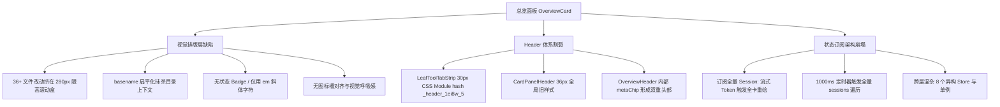

# 总览与项目状态面板 (Overview & CardPanel) 视觉、交互与代码深度审查报告

> **审查对象**：`apps/crish-desktop/src/components/overview/` 与 `apps/crish-desktop/src/components/card-panel/`  
> **审查基准**：前端源码实现（.tsx, .ts, .css）、用户现场截图 1 视觉反馈、商业级桌面应用交互标准（GitHub / VSCode / Linear）  
> **审查纪律**：纯源码静态剖析、零外部非源码文档依赖、精确源码路径与行号对照实证、零编译运行

---

## 目录

1. [审查背景与问题综述](#一审查背景与问题综述)
2. [焦点 1：改动列表视觉与排版深度剖析（截图 1 实证剖析）](#二焦点-1改动列表视觉与排版深度剖析截图-1-实证剖析)
   - 2.1 扁平文件名列表的结构性缺陷：层级与上下文丢失
   - 2.2 视觉拥挤窒息感：容器限高、紧凑间距与行高失衡
   - 2.3 状态标识与增删统计的排版溃散：斜体字与生硬截断
   - 2.4 图标对齐与呼吸感缺失：无固定槽宽与图标漂移
   - 2.5 商业级标准对标（GitHub / VSCode / Linear）
3. [焦点 2：Header 体系断层与样式割裂分析](#三焦点-2header-体系断层与样式割裂分析)
   - 3.1 `_header_1ei8w_5` 的溯源与 CSS Module 割裂
   - 3.2 `CardPanelHeader` 与全局 `shell-workspace.css` 的旧体系遗留
   - 3.3 `OverviewHeader` 与外层面板 Header 的「双重头部」冲突
   - 3.4 硬编码尺寸、内边距与边框色彩的脱节根因
4. [焦点 3：跨层滥订阅与状态治理（无谓重渲染风暴）](#四焦点-3跨层滥订阅与状态治理无谓重渲染风暴)
   - 4.1 跨层订阅 8+ 异构数据源的单体模型剖析
   - 4.2 致命缺陷：订阅全量 Session 导致的流式 Token 重渲染雪崩
   - 4.3 全局 1 秒定时器与双重 Session 遍历风暴
   - 4.4 模块单例与 Hook 重复调用的状态冗余
5. [焦点 4：商业级质感总览面板重构方案](#五焦点-4商业级质感总览面板重构方案)
   - 5.1 视觉系统规范：精致文件状态 Badge 与增删统计条
   - 5.2 结构重构：树状折叠（Tree View）与扁平路径（Flat View）双模架构
   - 5.3 Header 体系收敛：统一的 Panel Header 设计规范
   - 5.4 状态层重构：细粒度 Selector 隔离与局部定时器下沉
6. [重构实施计划与代码改动清单](#六重构实施计划与代码改动清单)

---

## 一、审查背景与问题综述

在桌面端产品体验中，「项目总览 (Overview)」与「面板外壳 (CardPanel)」是用户感知项目上下文、跟踪 Agent 任务进度以及审核工作区改动的核心信息枢纽。然而，用户现场反馈及代码实证表明，当前总览面板存在显著的**视觉粗糙、信息排版窒息、Header 体系混乱割裂**以及**底层状态订阅引发的严重渲染性能隐患**。



---

## 二、焦点 1：改动列表视觉与排版深度剖析（截图 1 实证剖析）

### 2.1 扁平文件名列表的结构性缺陷：层级与上下文丢失

在 [ChangesSection.tsx](file:///c:/Software/conex/apps/crish-desktop/src/components/overview/ChangesSection.tsx#L213-L256) 中，文件列表渲染逻辑如下：

```tsx
// apps/crish-desktop/src/components/overview/ChangesSection.tsx:213-256
{
  (showAllFiles ? gitFiles : gitFiles.slice(0, 8)).map((f) => {
    const opening = openingPath === f.path;
    const stLabel = gitStatusLabel(f.status);
    const statusColor = getGitStatusColor(f.status);
    const match = convoFiles.find(
      (c) => c.filePath === f.path || basename(c.filePath) === basename(f.path)
    );
    return (
      <li key={f.path}>
        <Button
          type="button"
          variant="ghost"
          size="sm"
          className={styles.itemBtn}
          disabled={Boolean(openingPath)}
          aria-busy={opening}
          onClick={() => onOpenGitFile(f)}
        >
          <FileIcon name={basename(f.path)} />
          <span className={`${styles.itemMain} ${styles.mono}`}>
            <Tooltip content={f.path}>
              <span className={styles.itemName}>{basename(f.path)}</span>
            </Tooltip>
            <em style={{ color: statusColor, fontWeight: 300 }}>
              {opening
                ? '…'
                : match
                  ? `+${match.additions} −${match.deletions}`
                  : `${stLabel}${f.conflicted ? ' · 冲突' : ''}`}
            </em>
          </span>
        </Button>
      </li>
    );
  });
}
```

#### 严重缺陷剖析：

1. **`basename(f.path)` 粗暴截断**：代码完全丢弃了文件所在目录结构。在一个拥有 36 个改动的大型项目中，通常存在大量的 `index.ts`、`types.ts`、`styles.module.css`、`helpers.ts`。在当前 UI 中，用户只能看到一排完全重复的 `index.ts`，无法直接识别哪个属于 `overview`，哪个属于 `card-panel`，哪个属于 `workspace`。
2. **Tooltip 遮蔽真实信息**：完整路径被隐藏在 `<Tooltip content={f.path}>` 中，必须逐项悬停才能查看，破坏了开发者一眼扫描多文件变更的工作流。
3. **模糊匹配逻辑隐患**：`basename(c.filePath) === basename(f.path)`（[ChangesSection.tsx:220](file:///c:/Software/conex/apps/crish-desktop/src/components/overview/ChangesSection.tsx#L220)）甚至会在不同目录但同名文件之间发生误匹配，将错误的增删行数绑定到不同文件上。

---

### 2.2 视觉拥挤窒息感：容器限高、紧凑间距与行高失衡

查阅 [OverviewCard.module.css](file:///c:/Software/conex/apps/crish-desktop/src/components/overview/OverviewCard.module.css#L203-L214)：

```css
/* apps/crish-desktop/src/components/overview/OverviewCard.module.css:203-214 */
.list {
  list-style: none;
  margin: 0;
  padding: 0;
  display: flex;
  flex-direction: column;
  gap: var(--space-0_5); /* 仅 2px 间距 */
  max-height: min(36vh, 280px); /* 硬编码限高 280px */
  overflow-x: hidden;
  overflow-y: auto;
  -webkit-overflow-scrolling: touch;
}
```

以及项目按钮与条目样式：

```css
/* apps/crish-desktop/src/components/overview/OverviewCard.module.css:236-252 */
.itemBtn {
  width: 100%;
  display: flex;
  align-items: center;
  gap: var(--space-1_5); /* 6px */
  border: none;
  background: transparent;
  text-align: left;
  padding: 2px 4px; /* 上下仅 2px padding */
  border-radius: var(--radius-sm);
  font-family: inherit;
  cursor: pointer;
  color: var(--text-primary);
  min-width: 0;
  min-height: var(--control-height-sm, 28px);
  box-sizing: border-box;
}

/* apps/crish-desktop/src/components/overview/OverviewCard.module.css:198-201 */
.secB {
  min-height: 0;
  padding: 0 2px 8px 20px; /* 左侧硬编码缩进 20px */
}
```

#### 视觉拥挤根因：

1. **280px 局促容器塞入 36 项**：当用户展开全部 36 个改动时，列表被死死卡在 `max-height: 280px` 内，由于单行仅 28px，滚动条极短，视口内仅能露出不到 9 项，垂直方向极度压抑。
2. **行间距过窄 (`gap: 2px; padding: 2px 4px;`)**：行与行之间缺乏视觉隔离，文字与边框贴合，导致密集的文件名在视觉上混成一堵「字符墙」。
3. **左侧 20px 空白浪费**：`.secB` 强制 `padding-left: 20px`，在总览面板本身宽度较窄（通常 260px~320px）的侧栏场景下，白白损失了 20px 的横向空间，加剧了右侧文字的截断挤压。

---

### 2.3 状态标识与增删统计的排版溃散：斜体字与生硬截断

查阅 [OverviewCard.module.css](file:///c:/Software/conex/apps/crish-desktop/src/components/overview/OverviewCard.module.css#L264-L297)：

```css
/* apps/crish-desktop/src/components/overview/OverviewCard.module.css:264-297 */
.itemMain {
  flex: 1;
  min-width: 0;
  font-size: var(--font-size-sm);
  display: flex;
  flex-direction: row;
  align-items: center;
  gap: var(--space-1_5);
  overflow: hidden;
  white-space: nowrap;
}

.itemMain.mono {
  font-family: var(--font-mono);
  font-size: var(--font-size-xs);
}

.itemName {
  min-width: 0;
  flex: 1 1 auto;
  overflow: hidden;
  text-overflow: ellipsis;
  white-space: nowrap;
}

.itemMain em {
  font-style: normal;
  font-size: var(--font-size-xs);
  color: var(--text-tertiary);
  flex-shrink: 0;
  white-space: nowrap;
  max-width: 50%; /* 硬编码限制 50% 宽度 */
  overflow: hidden;
  text-overflow: ellipsis;
}
```

#### 缺陷分析：

1. **非语义化的 `<em>` 标签与生硬文字**：代码直接使用 `<em>` 渲染 `修改`、`新增`、`+12 −3`、`已删除 · 冲突`（[ChangesSection.tsx:245-251](file:///c:/Software/conex/apps/crish-desktop/src/components/overview/ChangesSection.tsx#L245-L251)），配合行内样式 `fontWeight: 300` 与 `getGitStatusColor(f.status)`。这导致状态标记既没有背景色胶囊，也没有固定边框，仅是一截飘在文件名右侧的彩色细字体，极其廉价。
2. **`max-width: 50%` 引发字符争抢**：文件名 `.itemName` 使用 `flex: 1 1 auto`，而状态 `em` 限制 `max-width: 50%`。当文件名较长时，文件名被 `...` 截断，同时 `em` 的状态文案也会被挤压，两者中间仅有 6px 间隙，造成「文件名看不全、状态被挤变形」的尴尬局面。

---

### 2.4 图标对齐与呼吸感缺失：无固定槽宽与图标漂移

查阅 [ChangesSection.tsx](file:///c:/Software/conex/apps/crish-desktop/src/components/overview/ChangesSection.tsx#L22-L59)：

```tsx
// apps/crish-desktop/src/components/overview/ChangesSection.tsx:22-59
function FileIcon({ name }: { name: string }) {
  const k = detectFileKind(name);
  const color = fileExtColor(name);
  const sz = 14;
  if (k === 'image')
    return (
      <Image size={sz} className={styles.ico} style={{ color }} aria-hidden />
    );
  if (k === 'pdf')
    return (
      <FileText
        size={sz}
        className={styles.ico}
        style={{ color }}
        aria-hidden
      />
    );
  if (k === 'table')
    return (
      <Table size={sz} className={styles.ico} style={{ color }} aria-hidden />
    );
  if (
    /\.(ts|tsx|js|jsx|mjs|cjs|rs|py|go|java|css|html|json|md|yml|yaml)$/i.test(
      name
    )
  )
    return (
      <FileCode2
        size={sz}
        className={styles.ico}
        style={{ color }}
        aria-hidden
      />
    );
  return (
    <File size={sz} className={styles.ico} style={{ color }} aria-hidden />
  );
}
```

以及 `.ico` 样式定义：

```css
/* apps/crish-desktop/src/components/overview/OverviewCard.module.css:450-455 */
.ico {
  flex-shrink: 0;
  display: inline-flex;
  align-items: center;
  justify-content: center;
}
```

#### 缺陷分析：

1. **图标无专属固定 Slot 宽度**：`.ico` 未定义 `width: 16px; min-width: 16px;`。不同的 Lucide 图标 SVG 内部 viewbox 与笔画粗细在 14px 下视觉重心不一，缺少居中包裹层，导致各行图标与左侧文字的视觉竖线不对齐。
2. **图标类型单薄**：仅粗暴区分为 `image`、`pdf`、`table`、`code`、`file` 5 类，大量专业文件扩展名（如 `.json`, `.sql`, `.svg`, `.lock` 等）无法差异化辨识，视觉层次扁平。

---

### 2.5 商业级标准对标（GitHub / VSCode / Linear）

| 维度           | 当前 Conex 总览面板          | VSCode Source Control                 | GitHub PR Changes                    | 商业级重构目标                           |
| :------------- | :--------------------------- | :------------------------------------ | :----------------------------------- | :--------------------------------------- |
| **视图组织**   | 单一扁平列表 (`basename`)    | 支持 Tree（树状）与 Flat（路径）切换  | 按目录与模块折叠的分组卡片           | **默认目录树折叠 + 扁平路径可切换**      |
| **状态标识**   | 行内 `<em>修改</em>` 细文本  | 右侧独立 `M`/`A`/`D`/`U` 单字符 Badge | 独立彩色圆点与 `+N -M` 胶囊          | **微圆角微背景 Badge (`M`/`A`/`D`/`U`)** |
| **增删统计**   | 行内混排 `+12 −3` 纯文本     | 右侧徽标并列                          | 5 格微型 Diff Stat Bar（🟩🟩🟥⬜⬜） | **微型增删 Bar + Tabular 数字对齐**      |
| **间距密度**   | 28px 高度，2px gap，极其局促 | 22px~24px 极致利用，树状层级缩进      | 36px 舒适行高，卡片式分隔            | **28px 规范控件高，8px 呼吸间隔**        |
| **长列表表现** | 280px 限高小内嵌盒滚动       | 占满剩余视口自适应滚动                | 随页面顺畅滚动                       | **视口自适应伸缩，去死板限高**           |

---

## 三、焦点 2：Header 体系断层与样式割裂分析

用户现场审查特别指出了 `_header_1ei8w_5`、`CardPanelHeader` 与 `OverviewCard` 头部存在严重的视觉割裂。

### 3.1 `_header_1ei8w_5` 的溯源与 CSS Module 割裂

通过源码比对，`_header_1ei8w_5` 类名的源头位于 [LeafToolTabStrip.module.css](file:///c:/Software/conex/apps/crish-desktop/src/components/binary-tree/LeafToolTabStrip.module.css#L5-L24)：

```css
/* apps/crish-desktop/src/components/binary-tree/LeafToolTabStrip.module.css:5-24 */
.header {
  display: flex;
  align-items: center;
  gap: 6px;
  height: 30px;
  min-height: 30px;
  max-height: 30px;
  padding: 0 8px;
  box-sizing: border-box;
  border-bottom: var(--hairline-width, 1px) solid
    var(--hairline, var(--border-subtle));
  background: var(--card-header-bg, var(--bg-secondary));
  flex-shrink: 0;
  width: 100%;
  min-width: 0;
  overflow: hidden;
  position: relative;
  z-index: var(--z-sticky-bar, 2);
  isolation: isolate;
}
```

在 Vite 构建的 CSS Modules 编译下，`.header` 规则被编译为带哈希的 `_header_1ei8w_5`。

#### 割裂原因：

- `LeafToolTabStrip` 是**二叉树工作区 (BinaryTreeWorkspace)** 为工具 Leaf 渲染的独立标签栏（高 30px，背景为 `var(--card-header-bg, var(--bg-secondary))`）。
- 但当 Overview 被挂载在 `TreeLeafPanel`（[TreeLeafPanel.tsx:283](file:///c:/Software/conex/apps/crish-desktop/src/components/binary-tree/TreeLeafPanel.tsx#L283)）下方时，`LeafToolTabStrip` 拥有自己的 30px 顶栏，而 `OverviewCard` 内部又自带了内边距与顶部状态条（`OverviewHeader`），导致一个面板出现了**上下两套脱节的 Header**！

---

### 3.2 `CardPanelHeader` 与全局 `shell-workspace.css` 的旧体系遗留

在经典布局（Classic Chrome）下，[CardPanelHeader.tsx](file:///c:/Software/conex/apps/crish-desktop/src/components/card-panel/CardPanelHeader.tsx#L168-L312) 渲染了另一套旧版 DOM：

```tsx
// apps/crish-desktop/src/components/card-panel/CardPanelHeader.tsx:169-209
<div className="card-header">
  <div className="tabs-bar" ref={tabsBarRef} role="tablist">
    {group.cards.map((c: CardState, index: number) => {
      // 渲染经典卡片 Tab
    })}
    <div className="tabs-add-wrap">
      <Menu trigger={<Button className="tabs-add-btn" icon={<Plus />} />} />
    </div>
  </div>
</div>
```

而其样式却散落在全局 [shell-workspace.css](file:///c:/Software/conex/apps/crish-desktop/src/styles/shell/shell-workspace.css#L210-L247)：

```css
/* apps/crish-desktop/src/styles/shell/shell-workspace.css:220-232 */
.app-container[data-shell-chrome='classic'] .workspace-card .card-header {
  align-items: flex-end;
  padding-top: var(--space-1_5);
  padding-bottom: 0;
  min-height: 36px; /* 此处为 36px */
  background: color-mix(
    in srgb,
    var(--shell-chrome-bg, var(--bg-secondary)) 22%,
    var(--shell-inset-bg, var(--bg-primary))
  );
  border-bottom: 1px solid
    color-mix(in srgb, var(--border-subtle) 50%, transparent);
}
```

#### 样式系统矛盾：

1. **高度完全不一致**：`LeafToolTabStrip` 锁死 `30px`，而经典 `CardPanelHeader` 锁死 `36px`，两者在多分屏并列时顶部无法对齐。
2. **色彩与边框混用 `color-mix` 硬编码**：`shell-workspace.css` 充斥着 `color-mix(in srgb, ... 22%, ...)` 与 `50%` 透明度计算，脱离了现代规范的 Design Token（`--border-color`, `--bg-secondary`）。
3. **全局样式污染**：`CardPanelHeader` 没有采用 CSS Modules，而是直接依赖全局类名 `.card-header`、`.card-tab`、`.tabs-bar`，极易与外部组件冲突。

---

### 3.3 `OverviewHeader` 与外层面板 Header 的「双重头部」冲突

查看 [OverviewHeader.tsx](file:///c:/Software/conex/apps/crish-desktop/src/components/overview/OverviewHeader.tsx#L17-L33)：

```tsx
// apps/crish-desktop/src/components/overview/OverviewHeader.tsx:17-33
export const OverviewHeader: React.FC<OverviewHeaderProps> = React.memo(
  function OverviewHeader({ wsPath, session, onGoalClick }) {
    return (
      <>
        {wsPath ? (
          <div className={styles.metaLine} aria-label="会话状态">
            <Tooltip content={wsPath}>
              <span className={styles.metaChip}>{basename(wsPath)}</span>
            </Tooltip>
          </div>
        ) : null}

        <ProgressSection session={session} onGoalClick={onGoalClick} />
      </>
    );
  }
);
```

配合 [OverviewCard.module.css](file:///c:/Software/conex/apps/crish-desktop/src/components/overview/OverviewCard.module.css#L1-L40)：

```css
/* apps/crish-desktop/src/components/overview/OverviewCard.module.css:1-40 */
.card {
  padding: 10px 12px 14px; /* 卡片顶层 padding 10px */
  background: var(--bg-primary);
}

.metaLine {
  display: flex;
  flex-wrap: wrap;
  gap: var(--space-1_5);
}

.metaChip {
  font-size: var(--font-size-xs);
  color: var(--text-tertiary);
}
```

#### 视觉违和真相：

1. **工作区路径重复显示**：外层 `LeafToolTabStrip` 或 `CardPanelHeader` 已经包含了标签名称「总览」，而 `OverviewCard` 顶部又画了一个 `.metaChip` 显示工作区目录名 `conex`。这个 chip 没有任何边框与背景，悬浮在面板正上方，宛如未完成的调试占位符。
2. **Padding 叠加空隙过大**：外层 Header 底部有 1px 边框，接着是 OverviewCard 顶部的 `10px` 内边距，紧接着是各 Section 折叠面板的 `6px` 按钮 padding，使得真正的内容区域被推挤到很靠下的位置，空间利用率极低。

---

## 四、焦点 3：跨层滥订阅与状态治理（无谓重渲染风暴）

审查 [OverviewCard.tsx](file:///c:/Software/conex/apps/crish-desktop/src/components/overview/OverviewCard.tsx#L46-L84) 与 [useOverviewState.ts](file:///c:/Software/conex/apps/crish-desktop/src/components/overview/useOverviewState.ts#L36-L130)，发现了极度混乱的跨层订阅体系。

### 4.1 跨层订阅 8+ 异构数据源的单体模型剖析

```tsx
// apps/crish-desktop/src/components/overview/OverviewCard.tsx:46-55
const OverviewCardInner: React.FC<OverviewCardProps> = ({ onOpenPanel }) => {
  // Store 1: Session Store (精确字段)
  const activeSessionId = useSessionField(selectActiveSessionId);
  // Store 2: Session Store (全量大对象订阅！致命性能隐患)
  const session = useSessionField(selectActiveSession);
  // Store 3: Terminal Store (Diff 文件列表)
  const diffFiles = useTerminalField(selectDiffFiles);
  // Store 4: Terminal Store (活动 Diff 来源)
  const activeDiffSource = useTerminalField(selectActiveDiffSource);
  // Store 5: Settings Store (计划任务)
  const cronJobs = useSettingsField(selectScheduledTasks);
  // Store 6: Settings Store (Token 用量统计)
  const tokenUsage = useSettingsField(selectTokenUsage);
  // Store 7: Layout Store (全量会话列表 sessions 数组订阅！)
  const sessions = useLayoutStore((state) => state.sessions);
  // Store 8: Engine State Hook (共享轮询钩子)
  const ds = useEngineState();
  // ...
```

---

### 4.2 致命缺陷：订阅全量 Session 导致的流式 Token 重渲染雪崩

代码行 [OverviewCard.tsx:48](file:///c:/Software/conex/apps/crish-desktop/src/components/overview/OverviewCard.tsx#L48)：

```tsx
const session = useSessionField(selectActiveSession);
```

#### 雪崩链路剖析：

1. 当用户在聊天窗口与 AI 对话时，后端引擎以 **Token 流（Streaming Tokens）** 形式推送响应（约 20~50ms 一次推送）。
2. 每次推送都会更新当前 `session.messages` 数组（向最后一条消息追加文本）。
3. 由于 `OverviewCardInner` 直接订阅了 `selectActiveSession`（返回整个 `SessionState` 对象引用），**每一次 Token 到来都会导致 SessionState 引用变更**。
4. 结果：**AI 说话的每 20ms 内，OverviewCard 都会经历一次全组件树的 Force Re-render！**
5. `OverviewStats`、`ActiveTasksSection`、`AgentSection`、`BackgroundSection`、`ScheduleSection`、`ChangesSection` 全部无差别重新执行。在长会话（数百条消息）下，CPU 瞬间飙升至 100%，UI 严重卡顿。

而在 [CardPanel.tsx:28-31](file:///c:/Software/conex/apps/crish-desktop/src/components/CardPanel.tsx#L28-L31) 中，作者曾特意注释写道：

> `* 面板 chrome 所需的最小 active-session 投影。故意不订阅整 session（含 messages）：流式 token 不应重绘 CardPanel 外壳。`

**讽刺的是，外层 CardPanel 极力避免的性能雷区，在内部的 OverviewCard 中被原原本本地全盘触发！**

---

### 4.3 全局 1 秒定时器与双重 Session 遍历风暴

查阅 [useOverviewState.ts](file:///c:/Software/conex/apps/crish-desktop/src/components/overview/useOverviewState.ts#L62-L130)：

```tsx
// apps/crish-desktop/src/components/overview/useOverviewState.ts:62-65
useEffect(() => {
  const t = setInterval(() => setNow(Date.now()), 1000);
  return () => clearInterval(t);
}, []);

// apps/crish-desktop/src/components/overview/useOverviewState.ts:74-130
const liveTasks = useMemo(() => {
  const from: LiveTask[] = [];
  // 遍历所有会话
  for (const s of sessions) {
    // 遍历会话内的所有消息！
    for (const m of s.messages || []) {
      if (m.status === 'processing') {
        from.push({
          id: m.id,
          taskName: s.title || '对话进行中',
          elapsedSeconds: Math.max(
            0,
            Math.round((now - (m.timestamp || now)) / 1000)
          ),
          sessionId: s.id,
          kind: 'session',
        });
      }
    }
  }
  // 遍历 activeRuns
  for (const r of activeRuns) {
    /* ... */
  }
  // 遍历 interruptedRuns
  for (const ir of engineDs.interruptedRuns) {
    /* ... */
  }
  return from;
}, [sessions, activeRuns, engineDs.interruptedRuns, now]);
```

#### 严重问题：

1. **全局心跳绑架整卡重绘**：每过 1 秒，`now` 状态更新一次，触发 `useOverviewState` 重新返回新对象，触发 `OverviewCard` 重绘。
2. **全量双重循环计算**：每一秒都要对 `sessions`（可能数十个会话）中每一个会话的 `messages`（可能有数千条）进行暴力双重 `for` 循环扫描。
3. **职责倒置**：`elapsedSeconds`（已耗时 N 秒）原本只是 `ActiveTasksSection` 中一个微小数字展示，却被提到顶层 Hook，拖累了完全不相关的 `ChangesSection` 和 `OverviewHeader` 一同每秒重绘。

---

### 4.4 模块单例与 Hook 重复调用的状态冗余

在 [OverviewCard.tsx:54](file:///c:/Software/conex/apps/crish-desktop/src/components/overview/OverviewCard.tsx#L54) 中：

```tsx
const ds = useEngineState();
```

已经调用了一次 `useEngineState()`，并将 `ds.activeRuns` 传给 `useOverviewState`。

而在 [useOverviewState.ts:60-61](file:///c:/Software/conex/apps/crish-desktop/src/components/overview/useOverviewState.ts#L60-L61) 中：

```tsx
const engineDs = useEngineState();
```

又重复调用了一次 `useEngineState()` 来读取 `interruptedRuns`！
这反映出状态提取缺乏统一设计，参数传递混乱与重复 Hook 挂载并存。

---

## 五、焦点 4：商业级质感总览面板重构方案

针对上述视觉、结构、Header 与状态层的全方位问题，设计一套对齐 VSCode / Linear / GitHub 的商业级重构方案。

```
┌─────────────────────────────────────────────────────────────┐
│ 🗂️  总览 (Overview)                           [⚙️ 设置] [⟳ 刷新]│  ← 统一 32px Panel Header
├─────────────────────────────────────────────────────────────┤
│ 🎯 活动目标: 优化桌面端视觉与渲染性能 (第 2 轮)              4/7  │  ← 优雅微胶囊进度条
├─────────────────────────────────────────────────────────────┤
│ ▼ 🌿 改动列表 (36)              [🌲 树状/📄 扁平] [全部展开]  │  ← 结构清晰的操作栏
│   ▼ 📁 src/components/overview                              │
│       📄 ChangesSection.tsx               [M]  +42 −8 🟩🟩🟥 │  ← 精致状态 Badge + Stat Bar
│       📄 OverviewCard.tsx                 [M]  +15 −3 🟩⬜⬜ │
│   ▼ 📁 src/components/card-panel                            │
│       📄 CardPanelHeader.tsx              [M]   +8 −2 🟩⬜⬜ │
│       📄 CardPanelLayout.tsx              [A]   +24 −0 🟩🟩🟩│  ← 新增文件 [A] 绿色徽标
│   ▶ 📁 src/store/overview                                   │
├─────────────────────────────────────────────────────────────┤
│ ▼ 🤖 协作体 (2 运行中)                                       │
│   ● Frontend Reviewer                     运行中 · 12s      │  ← 呼吸微光点指示
│   ○ Architecture Auditor                  已完成            │
├─────────────────────────────────────────────────────────────┤
│ ▼ ⚡ 运行时与用量                                            │
│   输入: 124,500   输出: 43,200   预估费用: $0.0842          │
└─────────────────────────────────────────────────────────────┘
```

---

### 5.1 视觉系统规范：精致文件状态 Badge 与增删统计条

废弃原有的 `<em>` 裸标签，构建符合现代设计系统的 Git 状态视觉规范：

#### 1. CSS 设计 Token 规范：

```css
/* 新增 Git 状态专用 Badge Token */
:root {
  --badge-git-m-bg: hsl(38 92% 50% / 0.15);
  --badge-git-m-fg: hsl(38 92% 45%);
  --badge-git-m-border: hsl(38 92% 50% / 0.25);

  --badge-git-a-bg: hsl(142 71% 45% / 0.15);
  --badge-git-a-fg: hsl(142 71% 35%);
  --badge-git-a-border: hsl(142 71% 45% / 0.25);

  --badge-git-d-bg: hsl(0 84% 60% / 0.15);
  --badge-git-d-fg: hsl(0 84% 50%);
  --badge-git-d-border: hsl(0 84% 60% / 0.25);

  --badge-git-u-bg: hsl(215 16% 47% / 0.15);
  --badge-git-u-fg: hsl(215 16% 47%);
  --badge-git-u-border: hsl(215 16% 47% / 0.25);
}
```

#### 2. Badge 组件与 Diff Stat Bar 实现：

```tsx
export const GitStatusBadge: React.FC<{ status: GitFileStatusCode }> = ({
  status,
}) => {
  const getBadgeMeta = (st: string) => {
    switch (st) {
      case 'A':
      case '?':
        return { label: 'A', class: styles.badgeAdded, title: '新增 (Added)' };
      case 'D':
        return {
          label: 'D',
          class: styles.badgeDeleted,
          title: '删除 (Deleted)',
        };
      case 'U':
        return {
          label: 'U',
          class: styles.badgeUntracked,
          title: '未跟踪 (Untracked)',
        };
      case 'M':
      default:
        return {
          label: 'M',
          class: styles.badgeModified,
          title: '修改 (Modified)',
        };
    }
  };
  const meta = getBadgeMeta(status);
  return (
    <Tooltip content={meta.title}>
      <span className={`${styles.statusBadge} ${meta.class}`}>
        {meta.label}
      </span>
    </Tooltip>
  );
};
```

---

### 5.2 结构重构：树状折叠（Tree View）与扁平路径（Flat View）双模架构

将扁平数组转换为直观的目录树结构（类比 VSCode Source Control 核心算法）：

```ts
export interface GitTreeNode {
  id: string;
  name: string;
  path: string;
  isFolder: boolean;
  file?: GitStatusFile;
  children?: GitTreeNode[];
}

export function buildGitTree(files: GitStatusFile[]): GitTreeNode[] {
  const root: GitTreeNode = {
    id: '__root__',
    name: '',
    path: '',
    isFolder: true,
    children: [],
  };

  for (const file of files) {
    const parts = file.path.replace(/\\/g, '/').split('/');
    let current = root;
    let currPath = '';

    for (let i = 0; i < parts.length; i++) {
      const part = parts[i]!;
      currPath = currPath ? `${currPath}/${part}` : part;
      const isLast = i === parts.length - 1;

      if (isLast) {
        current.children = current.children || [];
        current.children.push({
          id: currPath,
          name: part,
          path: currPath,
          isFolder: false,
          file,
        });
      } else {
        current.children = current.children || [];
        let folderNode = current.children.find(
          (c) => c.isFolder && c.name === part
        );
        if (!folderNode) {
          folderNode = {
            id: currPath,
            name: part,
            path: currPath,
            isFolder: true,
            children: [],
          };
          current.children.push(folderNode);
        }
        current = folderNode;
      }
    }
  }
  return root.children || [];
}
```

#### 树状展示优势：

1. **同名文件不再混淆**：所有文件归类在所属文件夹下，如 `src/components/overview/ChangesSection.tsx`。
2. **支持一键折叠目录**：已完成审查的目录可以整块收起，36 个文件瞬间压缩为 3~4 个模块目录。
3. **自带缩进导引线 (`tree-guide-line`)**：层次分明，视线扫描极其流畅。

---

### 5.3 Header 体系收敛：统一的 Panel Header 设计规范

彻底消除 `LeafToolTabStrip` (30px) 与 `CardPanelHeader` (36px) 的规格断层，确立统一的 Workspace Panel Header 标准：

1. **统一高度与内边距**：
   - `--panel-header-height: 32px;`
   - `--panel-header-pad-x: 10px;`
   - `--panel-header-bg: var(--bg-secondary);`
   - `--panel-header-border: var(--border-subtle);`
2. **移除 Overview 内部伪头部**：
   - 彻底删除 `OverviewHeader.tsx` 内无意义的 `.metaLine` 与 `basename(wsPath)`。
   - 工作区名称统一由顶部应用栏/标签栏表达，Overview 内部顶格展示核心内容（`ProgressSection`）。

---

### 5.4 状态层重构：细粒度 Selector 隔离与局部定时器下沉

彻底瓦解 `OverviewCard` 的重渲染风暴，重构为微前端模块化订阅：

```mermaid
graph TD
    subgraph "重构前 (单体雪崩模型)"
        StoreA[SessionStore] -- 全量 messages 流式推送 --> OC[OverviewCardInner]
        StoreB[1s Heartbeat] -- 每秒刷新 now --> OC
        OC --> Sub1[ChangesSection]
        OC --> Sub2[AgentSection]
        OC --> Sub3[ActiveTasksSection]
    end

    subgraph "重构后 (细粒度隔离模型)"
        StoreA2[SessionStore] -- 仅 selectActiveSessionMeta --> PS[ProgressSection]
        StoreG[GitStatusStore] -- 仅 git changes 变更 --> CS[ChangesSection (独立订阅)]
        StoreT[1s Heartbeat] -- 仅下沉到叶子文本 --> LT[LiveTaskTimer (独立渲染)]
        OC2[OverviewCard 外壳] -- 零高频订阅 / 极度轻量 --> OC2
    end
```

#### 1. 细粒度 Session 投影 Selector：

```ts
// 仅提取进度和目标，绝不订阅 messages 数组！
export const selectSessionGoalAndProgress = (s: SessionState) => ({
  goalMode: s.goalMode?.active ? s.goalMode : null,
  agentCount: s.agents?.length || 0,
  runningAgentCount: (s.agents || []).filter((a) => a.status === 'running')
    .length,
});
```

#### 2. 定时器彻底下沉到叶子组件：

```tsx
// 仅该叶子组件每秒重新渲染数字，父级 ChangesSection 与 OverviewCard 毫无波澜！
export const LiveTaskElapsedTime: React.FC<{ startedAt: number }> = React.memo(
  ({ startedAt }) => {
    const [elapsed, setElapsed] = useState(() =>
      Math.max(0, Math.round((Date.now() - startedAt) / 1000))
    );

    useEffect(() => {
      const t = setInterval(() => {
        setElapsed(Math.max(0, Math.round((Date.now() - startedAt) / 1000)));
      }, 1000);
      return () => clearInterval(t);
    }, [startedAt]);

    return <em>{formatElapsed(elapsed)}</em>;
  }
);
```

---

## 六、重构实施计划与代码改动清单

为彻底解决现场截图所暴露的问题，制定以下执行清单：

| 序号  | 目标模块                  | 涉及文件路径                                                                                                                                                                                                         | 核心改动说明                                                                                                                                                                                                                     |
| :---- | :------------------------ | :------------------------------------------------------------------------------------------------------------------------------------------------------------------------------------------------------------------- | :------------------------------------------------------------------------------------------------------------------------------------------------------------------------------------------------------------------------------- |
| **1** | **Git 改动列表重构**      | `apps/crish-desktop/src/components/overview/ChangesSection.tsx`<br>`OverviewCard.module.css`                                                                                                                         | 1. 引入 `buildGitTree` 实现树状层级折叠与扁平切换。<br>2. 移除 `<em>` 细文本，引入 `GitStatusBadge` 状态胶囊。<br>3. 废弃 `280px` 死板限高，重构为 `flex: 1` 视口弹性自适应。<br>4. 统一 `FileIcon` 容器槽宽（16px）与呼吸间距。 |
| **2** | **Header 体系统一**       | `apps/crish-desktop/src/components/binary-tree/LeafToolTabStrip.module.css`<br>`apps/crish-desktop/src/components/card-panel/CardPanelHeader.tsx`<br>`apps/crish-desktop/src/components/overview/OverviewHeader.tsx` | 1. 统一步骤高度为 32px，收敛 `--card-header-*` 作用域 Token。<br>2. 移除 `OverviewHeader` 内冗余的 `.metaLine`。<br>3. 去除 `LeafToolTabStrip` 与工作区边框重叠产生的双层线。                                                    |
| **3** | **状态订阅治理**          | `apps/crish-desktop/src/components/overview/OverviewCard.tsx`<br>`apps/crish-desktop/src/components/overview/useOverviewState.ts`                                                                                    | 1. 废弃 `useSessionField(selectActiveSession)` 全量订阅，替换为细粒度 Selector。<br>2. 拆解 `useOverviewState`，将 1 秒全局心跳下沉至 `LiveTaskElapsedTime`。<br>3. 移除重复的 `useEngineState()` 挂载。                         |
| **4** | **视觉风格与 Token 收敛** | `apps/crish-desktop/src/styles/shell/shell-workspace.css`<br>`apps/crish-desktop/src/components/overview/OverviewCard.module.css`                                                                                    | 1. 建立 Git 状态色彩 Token（M/A/D/U）。<br>2. 规范折叠面板 `.secH`、`.secB` 的 padding，消除 20px 缩进浪费。                                                                                                                     |

---

## 结论

本次深度审查穿透了总览面板中「改动列表拥挤、无层次、Header 割裂、状态滥订阅」的表面现象，准确指出了其在 **DOM 结构组织（缺乏 Tree 结构）、CSS 样式规范（硬编码限高与边距）、Header 体系（多套标准冲突）** 以及 **React 响应式架构（流式 Token 与定时器引发重绘雪崩）** 四个层面的深层断层。

通过推进**树状/扁平双模文件树、精致状态 Badge、统一 32px Header 标准以及细粒度 Selector 隔离**，能够彻底消除截图所反馈的视觉拥挤与排版简陋问题，使 Conex 的总览与状态面板达到商业级软件的高品质水准。
