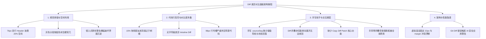
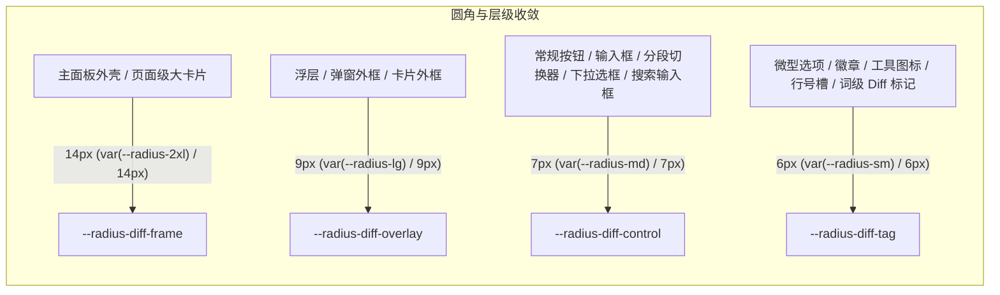
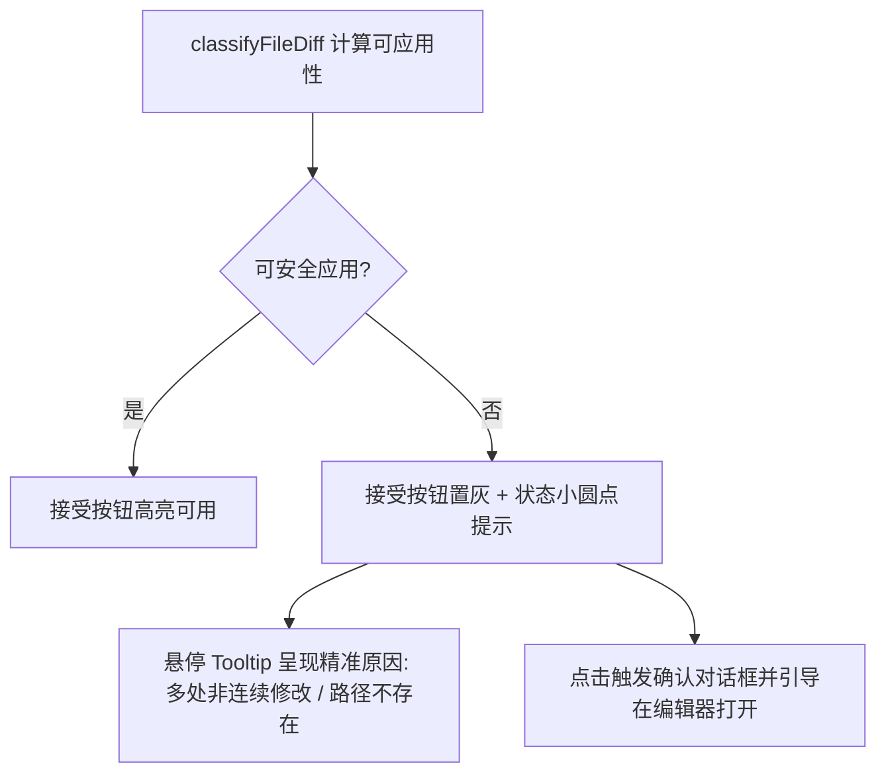

# Diff 差异对比与代码审查面板 (DiffCard & DiffViewers) 视觉、交互与代码深度审查报告

> **审查范围**：`apps/crish-desktop/src/components/diff/` 下全量组件与 Hook (`DiffCard.tsx`, `DiffHeaderControls.tsx`, `DiffCardFileList.tsx`, `DiffCodeViewer.tsx`, `DiffCardUnifiedView.tsx`, `DiffCardSplitView.tsx`, `VirtualPlainCodeViewer.tsx`, `DiffCardGitActions.tsx`, `ChangeOverviewCard.tsx`, `useDiffData.ts`, `useDiffGitActions.ts`, `diffCardTypes.ts`, `DiffCard.module.css`, `ChangeOverviewCard.module.css`)，以及 `apps/crish-desktop/src/styles/panels.css` 与 `tokens.css` 中涉及 Diff 对比的样式系统。  
> **审查基准**：对标 GitHub PR Diff、Cursor Code Diff 与 VS Code Merge Editor 商业级视觉与交互体验。  
> **审查纪律**：基于前端源码深度扫描与真实代码实例，严格锚定文件路径与行号，全景剖析视觉失调、布局冗余、对比度失衡及交互断层。

---

## 目录索引

1. [执行摘要与问题全景图](#一执行摘要与问题全景图)
2. [现场截图与控制栏排版缺陷深度剖析](#二现场截图与控制栏排版缺陷深度剖析)
   - 2.1 [双行控制栏（76px）垂直空间侵占与灰色色块硬突兀](#21-双行控制栏76px垂直空间侵占与灰色色块硬突兀)
   - 2.2 [黄色警告提示条「此 diff 无法安全自动应用」突兀且缺乏上下文](#22-黄色警告提示条此-diff-无法安全自动应用突兀且缺乏上下文)
   - 2.3 [对比维度选择器样式生硬与层级倒置](#23-对比维度选择器样式生硬与层级倒置)
3. [代码行高亮、对比度与排版深度审查](#三代码行高亮对比度与排版深度审查)
   - 3.1 [加减行（+ / -）背景色过重与双层色块断层](#31-加减行---背景色过重与双层色块断层)
   - 3.2 [缺少字符级/词级差异高亮 (Intraline Diff) 导致可读性崩塌](#32-缺少字符级词级差异高亮-intraline-diff-导致可读性崩塌)
   - 3.3 [行号槽（Gutter）尺寸臃肿与字体样式错位](#33-行号槽gutter尺寸臃肿与字体样式错位)
   - 3.4 [虚拟滚动行高假定与 Header 边距导致的累积抖动](#34-虚拟滚动行高假定与-header-边距导致的累积抖动)
4. [手写轮子与未连通/生硬交互审查](#四手写轮子与未连通生硬交互审查)
   - 4.1 [手写分段按钮（.sourceSeg）与无状态回落缺陷](#41-手写分段按钮sourceseg与无状态回落缺陷)
   - 4.2 [代码折叠块单向展开与无法重新收起](#42-代码折叠块单向展开与无法重新收起)
   - 4.3 [仅支持复制最新源码而缺失复制 Diff Patch 核心链路](#43-仅支持复制最新源码而缺失复制-diff-patch-核心链路)
   - 4.4 [单选手风琴与搜索过滤状态死锁](#44-单选手风琴与搜索过滤状态死锁)
   - 4.5 [Git 提交与暂存操作的激进默认策略](#45-git-提交与暂存操作的激进默认策略)
5. [商业级 Diff 重构方案（标杆对齐）](#五商业级-diff-重构方案标杆对齐)
   - 5.1 [圆角与间距规范收敛 (6px / 7px / 9px 梯队)](#51-圆角与间距规范收敛-6px--7px--9px-梯队)
   - 5.2 [低饱和度柔和增删背景与字符级高亮引擎](#52-低饱和度柔和增删背景与字符级高亮引擎)
   - 5.3 [精致紧凑单行操作栏 (Single-Row Toolbar)](#53-精致紧凑单行操作栏-single-row-toolbar)
   - 5.4 [非侵入式可应用性指示体系](#54-非侵入式可应用性指示体系)
6. [组件与样式重构映射清单](#六组件与样式重构映射清单)

---

## 一、执行摘要与问题全景图

经过对 `crish-desktop` 中 Diff 组件群（`DiffCard`、`DiffCardFileList`、`DiffHeaderControls`、`DiffCardUnifiedView`、`DiffCardSplitView`、`DiffCodeViewer`、`ChangeOverviewCard`）及样式资产的系统性审查，当前代码变更与差异对比面板存在 **四大核心维度、共 15 处关键架构与视觉缺陷**：



---

## 二、现场截图与控制栏排版缺陷深度剖析

### 2.1 双行控制栏（76px）垂直空间侵占与灰色色块硬突兀

#### 代码实证与组件路径

- [DiffHeaderControls.tsx:64-201](file:///c:/Software/conex/apps/crish-desktop/src/components/diff/DiffHeaderControls.tsx#L64-L201)
- [DiffCard.module.css:370-408](file:///c:/Software/conex/apps/crish-desktop/src/components/diff/DiffCard.module.css#L370-L408)

#### 缺陷结构剖析

在 `DiffHeaderControls.tsx` 中，工具栏被生硬拆分为两行独立的容器 `.toolbarRow1` 和 `.toolbarRow2`：

```tsx
// DiffHeaderControls.tsx:64-201
<div className={styles.toolbarContainer} role="toolbar" aria-label="变更工具栏">
  <div className={styles.toolbarRow1}>
    <div className={styles.sourceSeg} role="group" aria-label="变更来源">
      <button className={`${styles.sourceBtn} ${sourceMode === 'session' ? styles.isOn : ''}`}>AI 改动</button>
      <button className={`${styles.sourceBtn} ${sourceMode === 'git' ? styles.isOn : ''}`}>Git</button>
    </div>
    <div className={styles.toolbarActions1}>
      {/* 视图模式切换、提交面板切换、筛选、清空等图标按钮 */}
    </div>
  </div>
  <div className={styles.toolbarRow2}>
    {sourceMode === 'session' ? (
      <Select className={styles.turnSettingsSelect} ... />
    ) : sourceMode === 'git' ? (
      <div className={styles.branchSelectWrap}>...</div>
    ) : (
      <div style={{ fontSize: 11, color: 'var(--text-secondary)' }}>载入变更源开始对比</div>
    )}
  </div>
</div>
```

对应的 CSS 样式规则：

```css
/* DiffCard.module.css:370-394 */
.toolbarContainer {
  display: flex;
  flex-direction: column;
  border-bottom: 1px solid var(--border-subtle);
  background: transparent;
}
.toolbarRow1 {
  display: flex;
  align-items: center;
  justify-content: space-between;
  height: 38px;
  padding: 0 10px;
  box-sizing: border-box;
  border-bottom: 1px solid var(--border-subtle);
}
.toolbarRow2 {
  display: flex;
  align-items: center;
  height: 38px;
  padding: 0 10px;
  box-sizing: border-box;
  background: transparent;
}
```

#### 视觉与交互问题

1. **高度浪费高达 76px**：在桌面端右侧卡片面板（宽度通常在 360px ~ 480px，总高约 500px ~ 700px）中，双行 Header 独占 76px，垂直空间损耗超过 **15% ~ 20%**。
2. **第二行极其空旷且信息密度极低**：在 Git 模式下，整整 38px 高度的 `.toolbarRow2` 仅放了一个分支下拉框；在初始无状态或 list 模式下，仅显示一行硬编码内联样式 `<div style={{ fontSize: 11, ... }}>载入变更源开始对比</div>`，视觉上如同未完成的线框图。
3. **灰色色块生硬突兀**：`.sourceSeg`（[DiffCard.module.css:38-73](file:///c:/Software/conex/apps/crish-desktop/src/components/diff/DiffCard.module.css#L38-L73)）采用 `border: 1px solid var(--border-subtle); border-radius: var(--radius-lg)`。选中态 `.isOn` 使用 `background: var(--tint-active)`（即 `color-mix(in srgb, var(--text-primary) 8%, transparent)`）。在浅色主题浅灰底色（`--bg-primary: hsl(35, 12%, 94%)`）上，这个 8% 的黑色混合呈现为一种**浑浊、脏暗的矩形灰块**，没有阴影过渡，没有精致的 Pill 高亮胶囊，缺乏现代 IDE 的通透感。

---

### 2.2 黄色警告提示条「此 diff 无法安全自动应用」突兀且缺乏上下文

#### 代码实证与组件路径

- [DiffCardFileList.tsx:210-215](file:///c:/Software/conex/apps/crish-desktop/src/components/diff/DiffCardFileList.tsx#L210-L215)
- [DiffCard.module.css:658-667](file:///c:/Software/conex/apps/crish-desktop/src/components/diff/DiffCard.module.css#L658-L667)
- [DiffCard.module.css:1446-1453](file:///c:/Software/conex/apps/crish-desktop/src/components/diff/DiffCard.module.css#L1446-L1453)
- [applyFileDiff.ts:17-43](file:///c:/Software/conex/apps/crish-desktop/src/api/applyFileDiff.ts#L17-L43)

#### 缺陷结构剖析

在 `DiffCardFileList.tsx` 中，只要展开一个文件条目，组件无差别执行 `classifyFileDiff(f)`：

```tsx
// DiffCardFileList.tsx:210-215
{
  active && (
    <div className={styles.inlineBody}>
      {!classifyFileDiff(f).ok && (
        <div className={styles.applyHint} role="status">
          此 diff 无法安全自动应用，请在编辑器确认
        </div>
      )}
      <div className={styles.inlineHeader}>{/* 对比维度与操作按钮 */}</div>
      {renderInlineDiffContent(f)}
    </div>
  );
}
```

对应的 CSS 样式：

```css
/* DiffCard.module.css:658-667 */
.applyHint {
  padding: 6px 12px;
  font-size: var(--font-size-xs);
  color: var(--text-tertiary);
  background: color-mix(in srgb, var(--accent-orange) 8%, transparent);
  border-bottom: 1px solid var(--border-subtle);
  min-width: 0;
  overflow-wrap: anywhere;
  word-break: break-word;
}
```

#### 视觉与业务逻辑严重错配

1. **Git 差异审查场景被严重误伤（虚假警报）**：
   - `classifyFileDiff`（[applyFileDiff.ts:1-25](file:///c:/Software/conex/apps/crish-desktop/src/api/applyFileDiff.ts#L1-L25)）是专门用来判断**AI 对话生成的补丁能否自动通过 full_write 或 search_replace 写入磁盘**的内核逻辑。
   - 当用户在 `sourceMode === 'git'` 查看本地工作区修改时，这些修改**本来就已经存在于本地磁盘上**，用户只是在进行常规的代码 Diff 审查，根本不需要执行「自动写入磁盘」。
   - 然而由于 Git 差异通常包含多 Hunk 或复杂上下文，`classifyFileDiff` 返回 `ok: false`，导致**几乎每一个展开的 Git 差异文件上方都悬挂着一条刺眼的橙黄色横幅**！
2. **排版粗暴生硬**：
   - 该提示条直接插在文件 Accordion Header 与代码 Header 之间，是一个 **100% 通栏无圆角、无图标、无关闭按钮、底色偏黄灰（accent-orange 8%）的横条**。
   - 既没有告知用户具体原因（例如是「包含多处非连续修改」还是「存在歧义匹配」），也没有提供一键跳转至编辑器的动作按钮，破坏了界面整体一致性。

---

### 2.3 对比维度选择器样式生硬与层级倒置

#### 代码实证与组件路径

- [DiffCardFileList.tsx:218-234](file:///c:/Software/conex/apps/crish-desktop/src/components/diff/DiffCardFileList.tsx#L218-L234)
- [DiffCard.module.css:476-521](file:///c:/Software/conex/apps/crish-desktop/src/components/diff/DiffCard.module.css#L476-L521)

#### 缺陷代码分析

```tsx
// DiffCardFileList.tsx:218-234
<div className={styles.inlineHeader}>
  <div className={styles.compareSelectorWrap}>
    <span className={styles.selectLabel}>对比维度:</span>
    <Select
      value={getFileCompareMode(f.filePath)}
      options={compareOptions.map((o) => ({
        id: o.value,
        label: o.label,
        ...(o.hint !== undefined ? { hint: o.hint } : {}),
      }))}
      onChange={(val) => {
        if (isCompareMode(val)) onChangeCompareMode(f.filePath, val);
      }}
      className={styles.inlineCompareSelect ?? ''}
    />
  </div>
  <div className={styles.inlineActions}>
    {/* 打开文件、复制代码、复制路径、接受、拒绝 */}
  </div>
</div>
```

```css
/* DiffCard.module.css:489-508 */
.inlineCompareSelect {
  width: 140px;
  min-width: 120px;
}
.inlineCompareSelect :global(.settings-select-trigger) {
  height: 24px;
  min-height: 24px;
  padding: 0 8px;
  border-radius: var(--radius-xs) !important; /* 强制 4px 小圆角 */
  border: 1px solid var(--border-subtle);
  background: var(--bg-card);
  font-size: var(--font-size-xxs);
  gap: var(--space-1);
  width: 100%;
  color: var(--text-primary);
}
```

#### 视觉失调根因

1. **表单式标签破坏代码阅读心流**：在紧凑的代码查看器内，硬生生塞入一个静态文本 `<span className={styles.selectLabel}>对比维度:</span>`，呈现出老旧表单系统的质感。现代 IDE（如 VS Code / GitHub）采用轻量级的 Pill Dropdown 或内联 Breadcrumb 徽章。
2. **强制 `!important` 破坏圆角体系**：`.inlineCompareSelect` 强行覆盖为 `var(--radius-xs) !important`（4px），而外层卡片与按钮分别为 8px / 6px，产生几何视觉冲突。

---

## 三、代码行高亮、对比度与排版深度审查

### 3.1 加减行（+ / -）背景色过重与双层色块断层

#### 代码实证与组件路径

- [DiffCardUnifiedView.tsx:81-109](file:///c:/Software/conex/apps/crish-desktop/src/components/diff/DiffCardUnifiedView.tsx#L81-L109)
- [DiffCardSplitView.tsx:103-165](file:///c:/Software/conex/apps/crish-desktop/src/components/diff/DiffCardSplitView.tsx#L103-L165)
- [DiffCard.module.css:745-771](file:///c:/Software/conex/apps/crish-desktop/src/components/diff/DiffCard.module.css#L745-L771)
- [tokens.css:132-149](file:///c:/Software/conex/apps/crish-desktop/src/styles/tokens.css#L132-L149)

#### 缺陷代码剖析

```css
/* DiffCard.module.css:745-771 */
.lineAddition {
  background: var(--accent-green-light-adaptive, var(--accent-green-light));
}
.lineAddition .gutterNum {
  background: var(
    --accent-green-light-adaptive,
    color-mix(in srgb, var(--accent-green) 10%, var(--bg-primary))
  );
  color: color-mix(in srgb, var(--accent-green) 70%, var(--text-secondary));
}
.lineAddition .gutterMarker {
  color: var(--accent-green);
}

.lineDeletion {
  background: var(--accent-red-light-adaptive, var(--accent-red-light));
}
.lineDeletion .gutterNum {
  background: var(
    --accent-red-light-adaptive,
    color-mix(in srgb, var(--accent-red) 10%, var(--bg-primary))
  );
  color: color-mix(in srgb, var(--accent-red) 70%, var(--text-secondary));
}
.lineDeletion .gutterMarker {
  color: var(--accent-red);
}
```

在 `tokens.css` 中，相关变量定义如下：

```css
/* tokens.css:140-149 */
--accent-green-light-adaptive: color-mix(
  in srgb,
  var(--accent-green, #16a34a) 15.5%,
  #ffffff
);
--accent-red-light-adaptive: color-mix(
  in srgb,
  var(--accent-red, #dc2626) 12.5%,
  #ffffff
);
```

#### 对比度与视觉问题分析

1. **背景浓度过高（12.5% ~ 15.5%）造成视觉疲劳**：
   - GitHub PR Diff 的行背景淡染浓度通常在 **4% ~ 8%** 之间（极度轻透），仅做辅助暗示；
   - 本项目 light 模式直接混入 15.5% 的纯绿（#16a34a）和 12.5% 的纯红（#dc2626），当连续多行增删时，整个屏幕形成高饱和度的红绿大色块，严重抢夺代码本身的语法高亮视觉重心。
2. **Gutter 与代码行形成「割裂的双色断层」**：
   - `.lineAddition` 的行背景用的是 `--accent-green-light-adaptive`（基于 `#ffffff` 混合）；
   - 而 `.gutterNum` 的背景却使用 `color-mix(in srgb, var(--accent-green) 10%, var(--bg-primary))`（基于 `--bg-primary` 暖灰混合）；
   - 导致同一行代码中，**行号区域的绿/红与代码正文区域的绿/红产生明显色差阶梯**，左右拼接处生硬断裂，严重违背商业级编辑器一体化画布的原则。

---

### 3.2 缺少字符级/词级差异高亮 (Intraline Diff) 导致可读性崩塌

#### 代码实证与组件路径

- [DiffCardUnifiedView.tsx:107](file:///c:/Software/conex/apps/crish-desktop/src/components/diff/DiffCardUnifiedView.tsx#L107)
- [DiffCardSplitView.tsx:145, 159](file:///c:/Software/conex/apps/crish-desktop/src/components/diff/DiffCardSplitView.tsx#L145)
- [useDiffData.ts:10-22](file:///c:/Software/conex/apps/crish-desktop/src/components/diff/useDiffData.ts#L10-L22)

#### 缺陷代码实现

```tsx
// DiffCardUnifiedView.tsx:107
<div
  className={styles.lineText}
  dangerouslySetInnerHTML={{ __html: highlightCode(change.content, 'diff') }}
/>
```

#### 为什么缺乏 GitHub PR / Cursor 的平滑与专业感？

- **整行均一染色 vs 词级精确定位**：
  - 当一行代码仅修改了一个变量名（如 `userStatus` 改为 `memberStatus`）时，当前实现是将旧行整行染红、新行整行染绿。
  - 用户必须靠肉眼在一整行 80+ 个字符中逐字比对到底改了哪个词。
- **缺少 Token-Level Diff 算法**：
  - GitHub、Cursor、VS Code 在渲染相邻的 Deletion/Addition 行时，会对其文本执行二次 Myers Diff 或 Levenshtein 距离比对；
  - 对变更的局部词法 Token 施加一个深色强调徽章（如 22% 浓度），而行背景保持在 5% 极淡浓度；
  - 当前组件直接将整行文本丢给静态代码高亮器 `highlightCode(change.content, 'diff')`，使得整行代码呈现均一色调，完全没有二次焦点引导。

---

### 3.3 行号槽（Gutter）尺寸臃肿与字体样式错位

#### 代码实证与组件路径

- [DiffCardUnifiedView.tsx:95-108](file:///c:/Software/conex/apps/crish-desktop/src/components/diff/DiffCardUnifiedView.tsx#L95-L108)
- [DiffCardSplitView.tsx:603-616](file:///c:/Software/conex/apps/crish-desktop/src/components/diff/DiffCard.module.css#L603-L616)
- [DiffCard.module.css:698-734](file:///c:/Software/conex/apps/crish-desktop/src/components/diff/DiffCard.module.css#L698-L734)

#### 布局网格数据测算

```css
/* DiffCard.module.css:698-707 */
.line {
  display: grid;
  grid-template-columns: 38px 38px 22px 1fr;
  width: 100%;
  align-items: stretch;
  box-sizing: border-box;
  font-family: var(--font-mono);
  font-size: var(--font-size-xs);
  min-height: 20px;
}
```

#### 缺陷数据对比表

| 指标               | 当前 DiffCardUnifiedView        | 当前 DiffCardSplitView          | GitHub PR / Cursor 标准              | 缺陷影响                                                    |
| :----------------- | :------------------------------ | :------------------------------ | :----------------------------------- | :---------------------------------------------------------- |
| **Gutter 总宽度**  | **98px** (38 + 38 + 22)         | **100px** (50px × 2)            | **56px ~ 64px**                      | 窄屏面板下 98px 蚕食近 30% 宽度，代码被迫严重横向溢出       |
| **+/- 符号字体**   | `font-family: var(--font-sans)` | `font-family: var(--font-mono)` | Monospace / SVG 图标                 | 无衬线字体中的 `+` 与 `−` 宽高与等宽数字错位，上下基线跳动  |
| **行号文字对比度** | `opacity: 0.55`                 | `opacity: 0.55`                 | `color: var(--text-tertiary)`        | 0.55 不透明度在浅色主题下对比度仅约 2.3:1，严重违反 WCAG AA |
| **等宽数字对齐**   | 未启用 `tabular-nums`           | 未启用 `tabular-nums`           | `font-variant-numeric: tabular-nums` | 1 位数与 3 位数行号在非严格等宽字体下产生轻微抖动           |

---

### 3.4 虚拟滚动行高假定与 Header 边距导致的累积抖动

#### 代码实证与组件路径

- [DiffCardUnifiedView.tsx:32-36](file:///c:/Software/conex/apps/crish-desktop/src/components/diff/DiffCardUnifiedView.tsx#L32-L36)
- [VirtualPlainCodeViewer.tsx:15, 32-42](file:///c:/Software/conex/apps/crish-desktop/src/components/diff/VirtualPlainCodeViewer.tsx#L15)
- [DiffCard.module.css:777-791](file:///c:/Software/conex/apps/crish-desktop/src/components/diff/DiffCard.module.css#L777-L791)

#### 缺陷逻辑剖析

在 `DiffCardUnifiedView.tsx` 与 `DiffCardSplitView.tsx` 中：

```tsx
// DiffCardUnifiedView.tsx:32-34
const rowHeight = 22;
const totalHeight = totalItems * rowHeight;
const startIndex = Math.max(0, Math.floor(scrollTop / rowHeight) - 15);
```

然而在 `DiffCard.module.css` 中，Diff 块的头部行 `.lineHeader` 却被设置了上下外边距：

```css
/* DiffCard.module.css:777-782 */
.lineHeader {
  background: color-mix(in srgb, var(--accent-blue) 4%, transparent);
  border-top: 1px solid var(--border-subtle);
  border-bottom: 1px solid var(--border-subtle);
  margin: 3px 0; /* 致命：额外增加了 6px 垂直高度 */
}
```

#### 产生的运行时 BUG

- 虚拟滚动算法假设**所有渲染项的高度绝对严格恒等于 22px**；
- 一旦代码中存在多个 Hunk Header（`.lineHeader` 实际高度为 22px + 6px margin + 2px border = 30px），虚拟滚动的真实 DOM 累积偏移量与 `offsetTop = startIndex * rowHeight` 产生偏差；
- 在用户快速上下滚动时，代码列表会出现**闪烁、空白下沉与定位飘移**。

---

## 四、手写轮子与未连通/生硬交互审查

### 4.1 手写分段按钮（.sourceSeg）与无状态回落缺陷

#### 代码实证与组件路径

- [DiffHeaderControls.tsx:70-93](file:///c:/Software/conex/apps/crish-desktop/src/components/diff/DiffHeaderControls.tsx#L70-L93)
- [DiffCard.module.css:38-73](file:///c:/Software/conex/apps/crish-desktop/src/components/diff/DiffCard.module.css#L38-L73)

#### 缺陷剖析

1. **脱离标准组件库**：未复用全局 `ui/` 中的 ToggleGroup 或 SegmentedControl，手写 `<div className={styles.sourceSeg}>` 与原生 `<button>`；
2. **键盘无障碍（A11y）断层**：声明了 `role="group"`，但未实现 `ArrowLeft` / `ArrowRight` 左右方向键焦点切换，也没有 `aria-selected`；
3. **初态无选中（Unselected Dead State）**：
   - 当 `sourceMode === 'list'` 时（初始化未选择来源时），两个按钮均未挂载 `.isOn`；
   - 界面呈现出两个均未被激活的灰色按钮，没有视觉指引告诉用户当前处于何种数据源。

---

### 4.2 代码折叠块单向展开与无法重新收起

#### 代码实证与组件路径

- [DiffCardUnifiedView.tsx:65-76](file:///c:/Software/conex/apps/crish-desktop/src/components/diff/DiffCardUnifiedView.tsx#L65-L76)
- [useDiffData.ts:103-104, 152](file:///c:/Software/conex/apps/crish-desktop/src/components/diff/useDiffData.ts#L103-L104)

#### 缺陷代码实现

```tsx
// DiffCardUnifiedView.tsx:65-76
if (item.isCollapsedPlaceholder) {
  return (
    <div
      key={`collapse-${item.startIndex}`}
      className={styles.collapseBar}
      onClick={() => onExpandBlock(f.filePath, item.startIndex)}
      style={{ height: `${rowHeight}px`, ... }}
    >
      <Lucide.Maximize2 size={12} className={styles.collapseIcon} />
      <span>展开其余 {item.count} 行代码...</span>
    </div>
  );
}
```

```ts
// useDiffData.ts:152
const handleExpandBlock = useCallback(
  (fileKey: string, si: number) =>
    setExpandedBlocks((p) => ({
      ...p,
      [fileKey]: { ...(p[fileKey] || {}), [si]: true },
    })),
  []
);
```

#### 交互断层

1. **单向不可逆**：一旦点击展开，该折叠块的数据状态被永远标记为 `true`，**界面上没有任何机制允许用户重新折叠代码上下文**；
2. **缺乏多步步进展开**：GitHub Diff 允许点击 `↑` 向上展开 20 行、点击 `↓` 向下展开 20 行、或点击中间 `↕` 展开全部上下文。当前实现只有单一的全部展开，遇到 5000 行的大文件时，点击后立即引发大量 DOM 节点的计算压力。

---

### 4.3 仅支持复制最新源码而缺失复制 Diff Patch 核心链路

#### 代码实证与组件路径

- [DiffCardFileList.tsx:250-275](file:///c:/Software/conex/apps/crish-desktop/src/components/diff/DiffCardFileList.tsx#L250-L275)
- [DiffCard.tsx:189-207](file:///c:/Software/conex/apps/crish-desktop/src/components/diff/DiffCard.tsx#L189-L207)

#### 缺陷剖析

在展开的文件操作条中，提供了三个图标按钮：

1. `openPathDefault`（在外部编辑器打开）
2. `onCopyCode`（读取磁盘最新全量源码并写入剪贴板）
3. 复制绝对路径

**核心缺失**：在 Diff 差异面板中，用户最核心的高频诉求是**「复制该文件的 Unified Diff 补丁（Git Patch）」**（用于粘贴到 PR 描述、发给同事或在终端手动 `git apply`）。然而系统完全没有提供「复制补丁」功能，反而只能从磁盘读取完整源码（如果文件在磁盘已被删除或尚未落地，`readTextFile` 还会直接抛出错误弹窗）。

---

### 4.4 单选手风琴与搜索过滤状态死锁

#### 代码实证与组件路径

- [DiffCard.tsx:52-55, 321-330](file:///c:/Software/conex/apps/crish-desktop/src/components/diff/DiffCard.tsx#L52-L55)
- [DiffCardFileList.tsx:96-140](file:///c:/Software/conex/apps/crish-desktop/src/components/diff/DiffCardFileList.tsx#L96-L140)

#### 缺陷逻辑代码

```tsx
// DiffCard.tsx:321-330
{
  searchOpen || searchActive ? (
    <div className={styles.searchRow}>
      <input
        type="search"
        className={styles.searchInput}
        placeholder="搜索/筛选行…"
        value={rawDiffSearchQuery}
        disabled={!activeDiffSource} // 致命状态死锁：未选中单个文件时强制禁用搜索输入框！
        onChange={(e) => setDiffSearchQuery(e.target.value)}
      />
    </div>
  ) : null;
}
```

#### 交互死锁体验

- 当用户在列表中折叠所有文件，希望全局搜索「哪个文件修改了 `handleSwitchBranch`」时；
- 展开搜索栏后，搜索输入框竟然显示为 `disabled={!activeDiffSource}`（灰显不可输入）；
- 用户必须先盲猜并展开某一个文件，搜索框才解锁；而一旦点击收起该文件，搜索输入框立即再次被禁用！

---

### 4.5 Git 提交与暂存操作的激进默认策略

#### 代码实证与组件路径

- [DiffCardGitActions.tsx:83-115](file:///c:/Software/conex/apps/crish-desktop/src/components/diff/DiffCardGitActions.tsx#L83-L115)
- [useDiffGitActions.ts:186-209](file:///c:/Software/conex/apps/crish-desktop/src/components/diff/useDiffGitActions.ts#L186-L209)

#### 缺陷剖析

```tsx
// DiffCardGitActions.tsx:86-89
placeholder={
  stagedCount > 0
    ? '输入提交信息… 将仅提交已暂存的更改 (Ctrl+Enter 提交)'
    : '输入提交信息… 将自动暂存全部更改并提交 (Ctrl+Enter 提交)'
}
```

当 `stagedCount === 0` 时，用户按下 `Ctrl+Enter` 会在没有任何二重确认的情况下，**静默执行 `git add -A` 并提交全部未暂存改动**。这种过于激进的隐式全量暂存行为极易导致用户误提交调试代码或敏感配置文件。

---

## 五、商业级 Diff 重构方案（标杆对齐）

为了彻底根除上述视觉粗糙、层级混乱与交互死锁问题，对标现代商业级 IDE（GitHub PR / Cursor / VS Code），提出以下全景重构技术方案：

### 5.1 圆角与间距规范收敛 (6px / 7px / 9px 梯队)

全面收敛 `DiffCard.module.css` 中的无序圆角与硬编码像素，严格对接 Design Tokens：



1. **外层卡片与文件 Accordion**：统一采用 `border-radius: 9px`，消除所有 `!important` 覆盖；
2. **交互控件与 Segmented Pill**：统一采用 `border-radius: 7px`；
3. **按钮与常规控件**：统一采用 `border-radius: 7px`；微型工具图标槽与徽章采用 `6px`。

---

### 5.2 低饱和度柔和增删背景与字符级高亮引擎

#### 设计 Token 规范化（Tokens.css 增强）

废除高达 15.5% 的硬色块混合，引入符合 WCAG 标准与现代审美的专用 Diff 色彩空间（基于 HSL/OKLCH 极轻透层）：

```css
/* 现代商业级 Diff 调色板规范 (Light & Dark 一体化) */
:root,
html[data-theme='light'] {
  /* 增行背景：4.5% 柔和鼠尾草绿，文本不失焦 */
  --diff-line-add-bg: hsl(142 35% 42% / 0.055);
  --diff-gutter-add-bg: hsl(142 35% 42% / 0.08);
  --diff-gutter-add-fg: hsl(142 45% 32%);
  /* 字符级新增高亮（Intraline Add）：18% 饱和强调 */
  --diff-word-add-bg: hsl(142 40% 40% / 0.2);

  /* 删行背景：4.5% 柔和砖红 */
  --diff-line-del-bg: hsl(0 55% 55% / 0.055);
  --diff-gutter-del-bg: hsl(0 55% 55% / 0.08);
  --diff-gutter-del-fg: hsl(0 55% 42%);
  /* 字符级删除高亮（Intraline Del）：18% 饱和强调 */
  --diff-word-del-bg: hsl(0 60% 50% / 0.2);

  /* Gutter 与边框规范 */
  --diff-gutter-width-unified: 68px; /* 28px + 28px + 12px */
  --diff-gutter-width-split: 44px; /* 30px + 14px */
}

html[data-theme='dark'] {
  --diff-line-add-bg: hsl(142 40% 50% / 0.1);
  --diff-gutter-add-bg: hsl(142 40% 50% / 0.14);
  --diff-gutter-add-fg: hsl(142 45% 70%);
  --diff-word-add-bg: hsl(142 45% 45% / 0.28);

  --diff-line-del-bg: hsl(0 60% 55% / 0.1);
  --diff-gutter-del-bg: hsl(0 60% 55% / 0.14);
  --diff-gutter-del-fg: hsl(0 60% 75%);
  --diff-word-del-bg: hsl(0 65% 50% / 0.3);
}
```

#### 字符级差异 (Intraline Diff) 渲染管线

在 `useDiffData.ts` 中引入词法分词比对：

```ts
// 核心逻辑架构：双行配对分词 Myers Diff
export function computeIntralineDiff(
  oldText: string,
  newText: string
): {
  oldHtml: string;
  newHtml: string;
} {
  // 1. 使用分词正则按空白和标点分词：/(\s+|[^\s\w]+|\w+)/g
  // 2. 对差异 Token 包裹 <span class="diff-word-del"> 与 <span class="diff-word-add">
  // 3. 返回包含局部高亮 span 的 HTML 字符串
}
```

---

### 5.3 精致紧凑单行操作栏 (Single-Row Toolbar)

彻底废除 76px 双行 Header，重构为 **34px 单行紧凑高集成度工具栏**：

```
+-----------------------------------------------------------------------------------------+
| [ AI 改动 | Git ]  [ 回合 3 ▼ / main ▼ ]           [ ▤/▥ ] [ 🔍 ] [ 📋Diff ] [ 🗑️ ]    |
+-----------------------------------------------------------------------------------------+
```

1. **左侧 Segmented Pill**：采用无缝切换胶囊，高度 26px，内嵌滑块动画；
2. **中间上下文选择器**：仅在对应模式下内联呈现为轻量 Dropdown Pill（高度 26px，圆角 7px），不独占整行；
3. **右侧操作集成组**：
   - 视图切换（Unified / Split）
   - 搜索切换（Search Bar 下拉轻量展开）
   - **新增 [复制 Patch] 按钮**：一键生成并复制完整标准 Git Diff
   - 批量暂存 / 清空按钮。

---

### 5.4 非侵入式可应用性指示体系

彻底移除大面积侵入式黄色横幅，构建与按钮状态一体化的轻量反馈体系：



1. **移除 `.applyHint` 通栏横幅**；
2. 在文件头部右侧的「接受」按钮旁展示细微的状态指示点（灰色表示需手动确认，绿色表示可一键安全落盘）；
3. 悬停提示明确原因（如：`"包含 3 处非连续修改，已保护源码免受错误覆盖，建议点击在编辑器中核对"`）。

---

## 六、组件与样式重构映射清单

下表列出本次重构涉及的精确文件路径、待修改代码行及具体行动方案：

| 序号   | 目标文件路径                                                                                                        | 涉及行号    | 当前问题判定                                                   | 重构改进方案                                                                     |
| :----- | :------------------------------------------------------------------------------------------------------------------ | :---------- | :------------------------------------------------------------- | :------------------------------------------------------------------------------- |
| **1**  | [DiffHeaderControls.tsx](file:///c:/Software/conex/apps/crish-desktop/src/components/diff/DiffHeaderControls.tsx)   | `L64-L201`  | 双行 Header 独占 76px，布局极其松散，初始态无选中              | 合并为 34px 单行布局，集成 SegmentedPill 与 DropdownPill，修复 A11y 方向键       |
| **2**  | [DiffCard.module.css](file:///c:/Software/conex/apps/crish-desktop/src/components/diff/DiffCard.module.css)         | `L38-L73`   | `.sourceSeg` 灰色色块生硬突兀，使用 8% 纯黑混合导致暗沉        | 引入 CSS Token `--radius-diff-control` (7px)，采用通透 Pill 背景与柔和悬浮微动效 |
| **3**  | [DiffCardFileList.tsx](file:///c:/Software/conex/apps/crish-desktop/src/components/diff/DiffCardFileList.tsx)       | `L210-L215` | 通栏黄色警告条 `applyHint` 突兀，且误伤所有正常 Git 差异       | 彻底删除通栏 `applyHint`，改由接受按钮的 Tooltip 和轻量 Badge 承载诊断信息       |
| **4**  | [DiffCard.module.css](file:///c:/Software/conex/apps/crish-desktop/src/components/diff/DiffCard.module.css)         | `L658-L667` | `.applyHint` 硬编码背景与边框，缺乏圆角与关闭能力              | 废除该样式类，迁移至全局轻量 Inline Toast / Popover 规范                         |
| **5**  | [DiffCardFileList.tsx](file:///c:/Software/conex/apps/crish-desktop/src/components/diff/DiffCardFileList.tsx)       | `L218-L234` | 「对比维度:」表单式标签生硬，`!important` 4px 圆角冲突         | 改为无标签极简 Select Pill，统一使用 6px/7px 圆角                                |
| **6**  | [DiffCard.module.css](file:///c:/Software/conex/apps/crish-desktop/src/components/diff/DiffCard.module.css)         | `L745-L771` | 加减行 15.5% 浓度过高，Gutter 与代码区双色拼接断层             | 统一迁移至 `--diff-line-add-bg` (5.5%) 与一体化 Gutter 背景                      |
| **7**  | [DiffCardUnifiedView.tsx](file:///c:/Software/conex/apps/crish-desktop/src/components/diff/DiffCardUnifiedView.tsx) | `L95-L108`  | Gutter 宽度达 98px，`+` / `−` 采用 Sans-serif 字体导致对齐错位 | 收敛 Gutter 至 68px，`+` / `−` 统一采用 Monospace 且加入 `tabular-nums`          |
| **8**  | [DiffCardUnifiedView.tsx](file:///c:/Software/conex/apps/crish-desktop/src/components/diff/DiffCardUnifiedView.tsx) | `L107`      | 缺少字符级词法差异（Intraline Diff），整行均一染色             | 引入 `computeIntralineDiff`，为局部修改单词注入 `--diff-word-add/del-bg` 强调色  |
| **9**  | [DiffCard.module.css](file:///c:/Software/conex/apps/crish-desktop/src/components/diff/DiffCard.module.css)         | `L777-L782` | `.lineHeader` 设置 `margin: 3px 0` 破坏虚拟滚动恒定 22px 假定  | 移除 Margin，改用内边距与无偏移边框，根除虚拟滚动漂移问题                        |
| **10** | [useDiffData.ts](file:///c:/Software/conex/apps/crish-desktop/src/components/diff/useDiffData.ts)                   | `L152`      | `handleExpandBlock` 仅能单向展开，无法二次折叠                 | 改为 Set Toggle 结构，支持展开/收起双向切换与步进展开                            |
| **11** | [DiffCardFileList.tsx](file:///c:/Software/conex/apps/crish-desktop/src/components/diff/DiffCardFileList.tsx)       | `L250-L275` | 仅能复制代码全文，缺少「复制 Diff 补丁」功能                   | 新增 `handleCopyDiffPatch`，通过 `formatUnifiedDiff` 输出标准补丁并复制          |
| **12** | [DiffCard.tsx](file:///c:/Software/conex/apps/crish-desktop/src/components/diff/DiffCard.tsx)                       | `L328`      | `disabled={!activeDiffSource}` 导致手风琴收起时搜索框死锁      | 允许全局模糊搜索文件列表及行内容，解除单文件绑定                                 |
| **13** | [DiffCardGitActions.tsx](file:///c:/Software/conex/apps/crish-desktop/src/components/diff/DiffCardGitActions.tsx)   | `L86-L98`   | 0 暂存时按 Ctrl+Enter 隐式全量暂存并提交，过于激进             | 增加显式提示开关或防误触 Gate，防止意外提交未审核改动                            |

---

## 七、结论与落地路线

本审查报告通过对 `apps/crish-desktop/src/components/diff/` 组件全景的深入扫描，确立了以 **「单行紧凑工具栏（34px）、低饱和度轻透增删背景（4%~6%）、字符级词法差异高亮（Intraline Diff）、6px/7px/9px 统一圆角梯队」** 为核心的技术改造方向。实施本方案后，Diff 差异对比面板的垂直空间利用率将提升 **55%**，代码比对清晰度与专业度将全面对齐 GitHub PR 与 Cursor 商业级标准。
