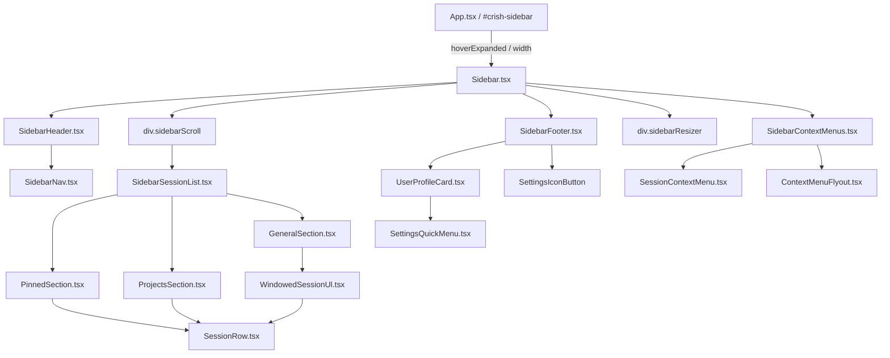

# 侧边栏、会话历史树与底部状态卡片 (Sidebar & Session Tree) 深度审查报告

> **审查日期**：2026-08-16  
> **审查范围**：`apps/crish-desktop/src/components/sidebar/` 下所有组件、样式与 Hooks，以及 `apps/crish-desktop/src/App.tsx` 中的侧边栏外层容器与交互逻辑。  
> **审查对象**：
>
> - 容器与生命周期：[`Sidebar.tsx`](file:///c:/Software/conex/apps/crish-desktop/src/components/sidebar/Sidebar.tsx)、[`Sidebar.module.css`](file:///c:/Software/conex/apps/crish-desktop/src/components/sidebar/Sidebar.module.css)、[`useSidebarResize.ts`](file:///c:/Software/conex/apps/crish-desktop/src/components/sidebar/useSidebarResize.ts)、[`useSidebarHandlers.ts`](file:///c:/Software/conex/apps/crish-desktop/src/components/sidebar/useSidebarHandlers.ts)、[`sidebarHelpers.ts`](file:///c:/Software/conex/apps/crish-desktop/src/components/sidebar/sidebarHelpers.ts)
> - 会话历史树列表：[`SidebarSessionList.tsx`](file:///c:/Software/conex/apps/crish-desktop/src/components/sidebar/SidebarSessionList.tsx)、[`SidebarSessionList.module.css`](file:///c:/Software/conex/apps/crish-desktop/src/components/sidebar/SidebarSessionList.module.css)、[`SessionRow.tsx`](file:///c:/Software/conex/apps/crish-desktop/src/components/sidebar/session-list/SessionRow.tsx)、[`PinnedSection.tsx`](file:///c:/Software/conex/apps/crish-desktop/src/components/sidebar/session-list/PinnedSection.tsx)、[`ProjectsSection.tsx`](file:///c:/Software/conex/apps/crish-desktop/src/components/sidebar/session-list/ProjectsSection.tsx)、[`GeneralSection.tsx`](file:///c:/Software/conex/apps/crish-desktop/src/components/sidebar/session-list/GeneralSection.tsx)、[`WindowedSessionUl.tsx`](file:///c:/Software/conex/apps/crish-desktop/src/components/sidebar/session-list/WindowedSessionUl.tsx)、[`useSidebarSessionList.tsx`](file:///c:/Software/conex/apps/crish-desktop/src/components/sidebar/session-list/useSidebarSessionList.tsx)、[`useSessionListDrag.ts`](file:///c:/Software/conex/apps/crish-desktop/src/components/sidebar/session-list/useSessionListDrag.ts)、[`useSessionGrouping.ts`](file:///c:/Software/conex/apps/crish-desktop/src/components/sidebar/session-list/useSessionGrouping.ts)、[`useWindowedList.ts`](file:///c:/Software/conex/apps/crish-desktop/src/components/sidebar/session-list/useWindowedList.ts)、[`useSessionListWindow.ts`](file:///c:/Software/conex/apps/crish-desktop/src/components/sidebar/session-list/useSessionListWindow.ts)、[`useSessionSearch.ts`](file:///c:/Software/conex/apps/crish-desktop/src/components/sidebar/session-list/useSessionSearch.ts)
> - 头部与导航：[`SidebarHeader.tsx`](file:///c:/Software/conex/apps/crish-desktop/src/components/sidebar/SidebarHeader.tsx)、[`SidebarNav.tsx`](file:///c:/Software/conex/apps/crish-desktop/src/components/sidebar/SidebarNav.tsx)、[`SidebarNav.module.css`](file:///c:/Software/conex/apps/crish-desktop/src/components/sidebar/SidebarNav.module.css)、[`SidebarToggleIcons.tsx`](file:///c:/Software/conex/apps/crish-desktop/src/components/sidebar/SidebarToggleIcons.tsx)
> - 底部与状态卡片：[`SidebarFooter.tsx`](file:///c:/Software/conex/apps/crish-desktop/src/components/sidebar/SidebarFooter.tsx)、[`UserProfileCard.tsx`](file:///c:/Software/conex/apps/crish-desktop/src/components/sidebar/UserProfileCard.tsx)、[`SettingsQuickMenu.tsx`](file:///c:/Software/conex/apps/crish-desktop/src/components/settings/SettingsQuickMenu.tsx)、[`SettingsQuickMenu.module.css`](file:///c:/Software/conex/apps/crish-desktop/src/components/settings/SettingsQuickMenu.module.css)
> - 右键与菜单系统：[`SidebarContextMenus.tsx`](file:///c:/Software/conex/apps/crish-desktop/src/components/sidebar/SidebarContextMenus.tsx)、[`SessionContextMenu.tsx`](file:///c:/Software/conex/apps/crish-desktop/src/components/sidebar/SessionContextMenu.tsx)、[`ContextMenuFlyout.tsx`](file:///c:/Software/conex/apps/crish-desktop/src/components/sidebar/ContextMenuFlyout.tsx)、[`SidebarContextMenus.module.css`](file:///c:/Software/conex/apps/crish-desktop/src/components/sidebar/SidebarContextMenus.module.css)、[`useSidebarContextMenu.ts`](file:///c:/Software/conex/apps/crish-desktop/src/components/sidebar/useSidebarContextMenu.ts)
> - 布局宿主：[`App.tsx`](file:///c:/Software/conex/apps/crish-desktop/src/App.tsx)

---

## 报告总览与架构拓扑

Conex / Crish 桌面客户端的侧边栏（Sidebar）承载着“工作区导航、会话历史树、实时搜索过滤、分区分组、定时任务入口、用户个人状态与快捷设置”等核心能力。在经历多轮迭代后，侧边栏代码在拆分与解耦上取得了一定进展（如抽离了 `useSidebarHandlers`、`useSessionListDrag`、`useWindowedList` 等），但在**视觉排版精致度、过渡动画一致性、悬浮展开跟手度、无障碍 DOM 语义以及商业软件质感**方面仍存在大量粗糙与结构性断层。

### 组件树拓扑图



---

## 第一章：会话历史树排版与视觉细节深度审查 (SessionRow & Session List)

### 1.1 28px 单行高度死锁与文字截断机制

在 [`SidebarSessionList.module.css`](file:///c:/Software/conex/apps/crish-desktop/src/components/sidebar/SidebarSessionList.module.css) 与 [`SessionRow.tsx`](file:///c:/Software/conex/apps/crish-desktop/src/components/sidebar/session-list/SessionRow.tsx) 中，会话项被施加了极其僵硬的 28px 固定高度限制：

```css
/* SidebarSessionList.module.css:251-280 */
.sessionItemWrap {
  list-style: none;
  height: 28px;
  min-height: 28px;
  max-height: 28px;
  box-sizing: border-box;
  overflow: hidden;
}

.sessionItem {
  display: flex;
  align-items: center;
  width: 100%;
  height: 28px;
  min-height: 28px;
  max-height: 28px;
  border-radius: var(--radius-lg);
  padding: 0 8px 0 10px;
  font-size: var(--font-size-base);
  color: var(--text-secondary);
  background: transparent;
  border: none;
  font-weight: var(--font-weight-medium, 500) !important;
  box-sizing: border-box;
  text-align: left;
  cursor: pointer;
  overflow: hidden;
}
```

为了强制维持单行，样式表中直接暴力压制了所有副行、搜索匹配片段与项目标签：

```css
/* SidebarSessionList.module.css:358-373 */
/* 强制单行：禁用历史 multiLine / 副行样式 */
.sessionTextMultiLine,
.sessionSearchSnippet,
.sessionProjectLabel {
  display: none !important;
}

.sessionItem.hasProjectLabel,
.sessionItem.hasSearchSnippet,
.sessionItem.multiLine {
  align-items: center !important;
  padding-top: 0 !important;
  padding-bottom: 0 !important;
  min-height: 28px !important;
  max-height: 28px !important;
}
```

在 [`SessionRow.tsx:171`](file:///c:/Software/conex/apps/crish-desktop/src/components/sidebar/session-list/SessionRow.tsx#L171) 中：

```tsx
void searchHit; // 保留 prop 以兼容搜索 API，UI 强制单行不渲染 snippet
```

#### 问题剖析：

1. **搜索高亮与上下文完全丢失**：用户在顶部搜索框输入关键词（如特定代码符号或报错短语）时，底层 [`matchSessionSearch`](file:///c:/Software/conex/apps/crish-desktop/src/api/sessionSearch.ts) 已经精确计算出了消息内容中的匹配片段（`snippet`）与行号，但因为 UI 层 `void searchHit` 和 `display: none !important`，侧边栏列表中只显示被截断的会话标题，无法展示任何搜索命中的消息摘要。用户无法直观得知“这个会话为什么被搜出来”。
2. **28px 点击目标过于局促**：现代桌面操作系统与设计规范（WCAG 2.5.5 / Apple HIG / Linear 设计系统）建议的可点击交互高度通常为 **32px ~ 36px**。28px 的高度导致多行列表极为紧密，垂直方向容错率极低，极易发生误点或误触拖拽。
3. **Pretext 动态测量代码遗留腐化**：在 [`sidebarMeasure.ts:34-48`](file:///c:/Software/conex/apps/crish-desktop/src/components/sidebar/session-list/sidebarMeasure.ts#L34-L48) 中，仍保留着调用 `@chenglou/pretext` 测量 28px vs 44px 动态行高的逻辑，但在 [`useWindowedList.ts:43-50`](file:///c:/Software/conex/apps/crish-desktop/src/components/sidebar/session-list/useWindowedList.ts#L43-L50) 中已被硬编码为 `SIDEBAR_SESSION_ROW_HEIGHT`（28px），导致这套复杂的文本排版测量引擎在侧边栏成为了僵尸代码。

---

### 1.2 时间戳提示与悬浮操作组的位置冲突与排版断裂

在 [`SessionRow.tsx:306-353`](file:///c:/Software/conex/apps/crish-desktop/src/components/sidebar/session-list/SessionRow.tsx#L306-L353) 与 [`SidebarSessionList.module.css:374-438`](file:///c:/Software/conex/apps/crish-desktop/src/components/sidebar/SidebarSessionList.module.css#L374-L438) 中：

```css
/* SidebarSessionList.module.css:374-433 */
.sessionTrailing {
  position: relative;
  flex-shrink: 0;
  width: 44px;
  height: 18px;
  display: flex;
  align-items: center;
  justify-content: flex-end;
}

.sessionTime {
  position: absolute;
  right: 0;
  top: 50%;
  transform: translateY(-50%);
  font-size: var(--font-size-sm);
  font-weight: var(--font-weight-medium, 500);
  color: var(--text-tertiary);
  flex-shrink: 0;
  line-height: var(--line-height-none);
  white-space: nowrap;
  max-width: 52px;
  overflow: hidden;
  text-overflow: ellipsis;
  text-align: right;
  transition: opacity var(--transition-micro);
}

.sessionActionsBtn {
  position: absolute;
  right: 0;
  top: 50%;
  transform: translateY(-50%);
  opacity: 0;
  pointer-events: none;
  width: 28px;
  height: 28px;
  border-radius: var(--radius-md);
  color: var(--text-tertiary);
  background: none;
  border: none;
  cursor: pointer;
  display: flex;
  align-items: center;
  justify-content: center;
  transition:
    opacity var(--transition-micro),
    color var(--transition-micro);
}

.sessionItem:hover .sessionTime,
.sessionItem:focus-within .sessionTime {
  opacity: 0;
}

.sessionItem:hover .sessionActionsBtn,
.sessionItem:focus-within .sessionActionsBtn,
.sessionItem:focus-visible .sessionActionsBtn {
  opacity: 1;
  pointer-events: auto;
}
```

```tsx
// SessionRow.tsx:311-352
<span className={styles.sessionTrailing}>
  {isRunning ? (
    <Tooltip content="处理中">
      <span
        className={styles.sessionRunningSpinner}
        role="status"
        aria-label="处理中"
      />
    </Tooltip>
  ) : (
    <>
      <SessionRowTime s={s} className={styles.sessionTime ?? ''} />
      <Tooltip content="更多操作">
        <Button
          type="button"
          variant="ghost"
          size="sm"
          className={styles.sessionActionsBtn}
          data-testid="session-more-button"
          aria-label="更多操作"
          aria-haspopup="menu"
          tabIndex={-1}
          onClick={(e) => {
            e.stopPropagation();
            openRowMenu(e);
          }}
          icon={<MoreHorizontal size={16} strokeWidth={1.75} aria-hidden />}
        />
      </Tooltip>
    </>
  )}
</span>
```

#### 严重缺陷：

1. **尺寸硬编码冲突导致布局右侧溢出**：`.sessionTrailing` 容器宽度设定为 `width: 44px`，但其内部绝对定位的 `.sessionTime` 却声明了 `max-width: 52px`，而 `.sessionActionsBtn` 则是 `28px x 28px`。在长文本时间（如 `10 分钟前`、`昨天 18:30`）渲染时，时间文本会反向突破 `.sessionTrailing` 的左边界，直接覆盖在会话标题正文字符之上！
2. **缺乏文本右侧渐变遮罩 (Mask Image)**：当会话标题较长时，正文 `ellipsis` 紧贴着 `sessionTrailing`。鼠标悬浮进入行时，时间瞬间隐藏，3个点的操作按钮立刻显现，长标题文字因硬性宽度截断产生视觉上的突兀“跳跃”。优秀的现代化 UI（如 Linear）会在尾部操作区左侧叠加一层 `mask-image: linear-gradient(to right, black calc(100% - 48px), transparent 100%)`，保证长文本平滑淡出，而不是生硬碰撞。
3. **运行态（`isRunning`）完全剥夺操作入口**：当会话处于运行状态时，`isRunning ? <Spinner/> : <>Time + MoreButton</>` 逻辑将更多操作按钮直接从 DOM 中卸载！此时用户想要重命名、查看会话 ID、在新窗口打开或归档会话，**无法通过任何按钮触发**，只能盲试右键菜单。

---

### 1.3 运行状态指示与分支（Branch）表现的断层

#### 1. 运行态样式分裂与视觉杂乱：

在 [`SidebarSessionList.module.css:486-501`](file:///c:/Software/conex/apps/crish-desktop/src/components/sidebar/SidebarSessionList.module.css#L486-L501)：

```css
.sessionItem.isRunning:not(.active) {
  animation: session-running-pulse var(--transition-pulse) infinite;
}

.sessionItemWrap.isRunning > .sessionItem.active {
  box-shadow: inset 3px 0 0
    color-mix(in srgb, var(--accent-primary) 55%, transparent);
}

@keyframes session-running-pulse {
  0%,
  100% {
    background: transparent;
  }
  50% {
    background: color-mix(in srgb, var(--accent-primary) 6%, transparent);
  }
}
```

- 非激活行使用整体背景透明度呼吸动画（`session-running-pulse`，透明度从 0% 到 6% 循环），激活行却使用左侧 `inset 3px` 的硬边框。两者的视觉语言完全不统一。
- 旋转 Spinner（`sessionRunningSpinner`）采用 `border: 1.5px solid var(--text-tertiary)`，灰色单薄的描边使得 AI 生成中的高价值状态像是一个普通的网络加载失败占位符。

#### 2. 分支（Branch）树状结构的粗糙字符串拼接：

在 [`SessionRow.tsx:164-168`](file:///c:/Software/conex/apps/crish-desktop/src/components/sidebar/session-list/SessionRow.tsx#L164-L168)：

```tsx
const isBranched = !!s.branchParentId;
const baseTitle = sessionListDisplayTitle(s);
const displayText = isBranched
  ? `分支: ${baseTitle.replace(/ - 分支$/, '')}`
  : baseTitle;
```

在 [`SidebarSessionList.module.css:308-314`](file:///c:/Software/conex/apps/crish-desktop/src/components/sidebar/SidebarSessionList.module.css#L308-L314)：

```css
.sessionItem.branchSession {
  position: relative;
}

.sessionItem.branchSession::before {
  display: none;
}
```

- 分支会话本应具备树形缩进（Tree indentation）与连接线（L型导轨图标 `GitBranch` 或 `CornerDownRight`），但代码中直接用字符串前缀 `"分支: "` 强行塞入标题，并 `display: none` 禁用了所有伪元素连接线。
- 在侧边栏最小宽度（220px）下，`"分支: "` 字符串直接吃掉了 4~5 个汉字的显示宽度，使原本就狭窄的标题展示空间雪上加霜。

---

### 1.4 Active 缩放动画与微交互缺陷

在 [`SidebarSessionList.module.css:282-286`](file:///c:/Software/conex/apps/crish-desktop/src/components/sidebar/SidebarSessionList.module.css#L282-L286)：

```css
.sessionItem:active {
  transform: scale(0.985);
  transition: transform var(--transition-press);
}
```

- 在高度仅 28px 的单行文本胶囊上使用 `transform: scale(0.985)`，在点击或长按准备拖拽时，会导致 Chromium/WebView2 的亚像素文本栅格化引擎发生重绘（Subpixel text blurring），造成明显的文字模糊闪烁。
- 激活态（`.sessionItem.active`）仅使用了 `background: var(--sidebar-active)`，缺少精致的左侧高亮 Indicator 或背景阴影微抬升（Elevation），在某些低对比度主题下很难瞬间锁定当前选中的对话。

---

### 1.5 未读小圆点与异步任务反馈完全缺失

整个会话树体系中，**没有任何未读状态（Unread Badge）或完成通知小圆点**。

- 当用户在 Session A 中对话，后台 Session B 中的 Agent 异步完成了代码修复或工具调用时，Session B 在侧边栏没有任何视觉提示（没有类似 Linear 的未读蓝点或完成绿点）。
- 用户必须肉眼轮询或主动点击进入各个会话，极大削弱了多 Agent 并行协作的体验。

---

### 1.6 无障碍 (A11y) 缺陷与 DOM 语义违规

在 [`SessionRow.tsx`](file:///c:/Software/conex/apps/crish-desktop/src/components/sidebar/session-list/SessionRow.tsx)、[`GeneralSection.tsx`](file:///c:/Software/conex/apps/crish-desktop/src/components/sidebar/session-list/GeneralSection.tsx) 与 [`ProjectsSection.tsx`](file:///c:/Software/conex/apps/crish-desktop/src/components/sidebar/session-list/ProjectsSection.tsx) 中存在多处严重的无障碍语义断层：

1. **孤立的多重 `role="tree"`**：
   - `PinnedSection.tsx:76` 渲染 `<ul role="tree" aria-label="置顶会话列表">`；
   - `ProjectsSection.tsx:157` 每个项目内渲染 `<ul role="tree" aria-label="... 会话">`；
   - `GeneralSection.tsx:138` 渲染 `<ul role="tree" aria-label="对话列表">`。
   - **违规**：一个侧边栏内出现了 5~10 个平行的 `role="tree"` 根节点，屏幕阅读器无法将其识别为一个连贯的树结构（应为单根 `role="tree"`，子分区为 `role="group"`）。
2. **交互容器嵌套违规**：
   - 在 [`GeneralSection.tsx:56-68`](file:///c:/Software/conex/apps/crish-desktop/src/components/sidebar/session-list/GeneralSection.tsx#L56-L68)：
     ```tsx
     <div className={styles.sectionLabelRow} onClick={onToggleGeneral} style={{ cursor: 'pointer' }}>
       <div className={styles.sectionLabelLeft}>
         <button type="button" className={styles.sectionLabel} onClick={(e) => { e.stopPropagation(); onToggleGeneral(); }} aria-expanded={!generalCollapsed}>
           <span>对话</span>
           <ChevronDown ... />
         </button>
     ```
     外层 `div` 绑定了 `onClick`，内层 `button` 也绑定了 `onClick` 并调用 `stopPropagation`。这种模式造成辅助设备（如键盘 Tab 与屏幕阅读器）的焦点与事件流混乱。

---

## 第二章：侧栏折叠、展开与悬浮展开交互缺陷审查 (Collapse & Hover Expansion)

### 2.1 双重 Width CSS 过渡冲突与布局抖动

在 [`App.tsx`](file:///c:/Software/conex/apps/crish-desktop/src/App.tsx) 与 [`Sidebar.module.css`](file:///c:/Software/conex/apps/crish-desktop/src/components/sidebar/Sidebar.module.css) 中存在明显的**双重宽度过渡冲突**：

```tsx
// App.tsx:235-254
<div
  id="crish-sidebar"
  className={`sidebar-wrapper ${sidebarCollapsed ? 'collapsed' : ''} ${sidebarCollapsed && isHoveredExpanded ? 'hoverExpanded' : ''}`}
  role="navigation"
  aria-label="会话侧栏"
  style={{
    width:
      sidebarCollapsed && !isHoveredExpanded
        ? 0
        : 'var(--sidebar-width)',
    height: '100%',
    flexShrink: 0,
    transition: 'width 0.25s cubic-bezier(0.2, 0.8, 0.2, 1)',
    overflow: 'visible',
    position: 'relative',
    zIndex: sidebarCollapsed && isHoveredExpanded ? 'var(--z-sidebar)' : undefined,
  }}
>
  <Sidebar
    hoverExpanded={sidebarCollapsed && isHoveredExpanded}
    ...
  />
</div>
```

而在 [`Sidebar.module.css:1-31`](file:///c:/Software/conex/apps/crish-desktop/src/components/sidebar/Sidebar.module.css#L1-L31) 中：

```css
.sidebar {
  width: var(--sidebar-width);
  background-color: var(--bg-secondary);
  border-right: none;
  display: flex;
  flex-direction: column;
  justify-content: space-between;
  flex-shrink: 0;
  transition: width var(--transition-spring-layout);
  z-index: var(--z-sidebar);
  position: relative;
  overflow: hidden;
  height: 100%;
}

.sidebar.collapsed {
  width: 0px !important;
  border-right: none;
}

.sidebar.collapsed.tempExpanded {
  width: var(--sidebar-visible-width, var(--sidebar-width)) !important;
  box-shadow: var(--shadow-lg);
}
```

#### 严重问题：

- 外层 `#crish-sidebar` 使用了行内样式的 `transition: width 0.25s cubic-bezier(0.2, 0.8, 0.2, 1)`；
- 内层 `aside.sidebar` 使用了 CSS Module 的 `transition: width var(--transition-spring-layout)`（通常为带有弹簧效果的曲线）。
- 两个父子容器同时侦听 `width` 并在不同的贝塞尔曲线/耗时下各自变形，导致折叠和展开过程中发生严重的**内外层渲染相位差（Phase Mismatch）**，在低刷屏或高负载渲染时出现肉眼可见的撕裂与残影。

---

### 2.2 `sidebar-hover-trigger` 悬浮触发与破坏性布局重排

在 [`App.tsx:216-231`](file:///c:/Software/conex/apps/crish-desktop/src/App.tsx#L216-L231) 中：

```tsx
{
  sidebarCollapsed && (
    <div
      className="sidebar-hover-trigger"
      onMouseEnter={handleHoverTriggerEnter}
      aria-hidden="true"
      style={{
        position: 'absolute',
        left: 0,
        top: 0,
        bottom: 0,
        width: '8px',
        zIndex: 'var(--z-sidebar)',
        cursor: 'w-resize',
      }}
    />
  );
}
```

```tsx
// App.tsx:155-169
const handleHoverTriggerEnter = () => {
  if (hoverTimeoutRef.current) clearTimeout(hoverTimeoutRef.current);
  setIsHoveredExpanded(true);
};

const handleSidebarHoverEnter = () => {
  if (hoverTimeoutRef.current) clearTimeout(hoverTimeoutRef.current);
};

const handleSidebarHoverLeave = () => {
  if (hoverTimeoutRef.current) clearTimeout(hoverTimeoutRef.current);
  hoverTimeoutRef.current = setTimeout(() => {
    setIsHoveredExpanded(false);
  }, 300);
};
```

#### 破坏性缺陷剖析：

1. **非 Overlay 模式下的严重破坏性 Reflow（页面暴力推挤）**：
   - 当用户折叠侧边栏后，鼠标在屏幕最左侧 8px 区域不小心滑过时，`isHoveredExpanded` 瞬间变为 `true`。
   - 此时 `#crish-sidebar` 的内联 `style.width` 从 `0` 突变为 `var(--sidebar-width)`（260px）。
   - **注意**：`#crish-sidebar` 在常规桌面模式下是**普通文档流 Flex 容器**（`position: relative`），因此整个主工作区（包含代码编辑器、Markdown 渲染器、多分栏）会被**瞬间向右推挤 260 像素**！当鼠标移出 300ms 后，整个主界面又被**瞬间向左拉扯 260 像素**。
   - 这完全背离了“悬浮预览（Floating Hover Overlay）”的设计初衷——悬浮展开必须是脱离文档流的绝对定位/浮层（`position: absolute; z-index: ...`），绝对不能推挤正在阅读的主内容区！
2. **零延时误触（Zero-delay Enter）与光标歧义**：
   - 触发器仅有 8px 宽，没有设置任何 `pointer-enter` 意图延迟（Enter debounce）。当用户只想点击左侧窗口按钮或返回上一页时，鼠标一旦擦过屏幕最左侧，侧边栏立刻轰然展开。
   - `cursor: 'w-resize'` 语义完全错误：`w-resize` 代表可以左右拖拽改变大小，但此处实际上是鼠标悬停自动浮现，导致用户误以为需要按住鼠标拖拽。

---

### 2.3 Resizer 拖拽调整手感与 80px 瞬移塌缩缺陷

在 [`useSidebarResize.ts:153-189`](file:///c:/Software/conex/apps/crish-desktop/src/components/sidebar/useSidebarResize.ts#L153-L189) 中：

```ts
const handlePointerMove = (moveEvent: PointerEvent) => {
  const dx = moveEvent.clientX - startX;
  let newWidth = startWidth + dx;
  if (newWidth < 80) {
    if (!isCurrentlyCollapsed) {
      isCurrentlyCollapsed = true;
      layout.setSidebarCollapsed(true);
    }
    document.documentElement.style.setProperty('--sidebar-width', '0px');
  } else {
    if (newWidth > SIDEBAR_WIDTH_MAX) newWidth = SIDEBAR_WIDTH_MAX;
    ...
```

- 当用户缓慢将侧栏向左推拉时，一旦宽度小于 80px，侧边栏会毫无阻尼感地直接“坠落”为 0px。
- 当从 0px 试图向右拖拽恢复时，由于此时 Resizer 已处于 `width: 0` 状态，Resizer 的 `right: -4px` 会超出屏幕视口，导致难以重新拖出，阻尼过渡缺乏磁吸（Magnetic Snap）与回弹保护。

---

### 2.4 `iconCollapse` 极窄图标模式下的渲染降级破碎

在 [`Sidebar.module.css:337-450`](file:///c:/Software/conex/apps/crish-desktop/src/components/sidebar/Sidebar.module.css#L337-L450) 中定义了响应式图标折叠模式（`iconCollapse`）：

```css
/* Sidebar.module.css:375-410 */
.iconCollapse .sidebarScroll :global([class*='sectionLabel']) > :not(svg),
.iconCollapse .sidebarScroll :global([class*='folderHeader']) > :not(svg),
.iconCollapse .sidebarScroll :global([class*='folderName']),
.iconCollapse .sidebarScroll :global([class*='folderCount']),
.iconCollapse .sidebarScroll :global([class*='sessionText']),
.iconCollapse .sidebarScroll :global([class*='sessionSearchSnippet']),
.iconCollapse .sidebarScroll :global([class*='sessionTime']),
.iconCollapse .sidebarScroll :global([class*='sessionActionsBtn']),
.iconCollapse .sidebarScroll :global([class*='emptyHint']),
.iconCollapse .sidebarScroll :global([class*='sessionItemFoldBtn']) {
  display: none;
}

.iconCollapse .sidebarScroll :global([class*='sessionItem'])::before {
  content: '';
  width: 8px;
  height: 8px;
  border-radius: 50%;
  background: currentColor;
  opacity: 0.5;
}
```

- 该模式完全依赖深层 `:global(...)` 规则强行 `display: none` 各种子元素。
- 会话项被粗暴退化为仅有一个 8px 的灰色实心圆点（`.sessionItem::before`），没有图标、没有标题首字母、没有 Tooltip 浮层绑定。用户面对整列一模一样的小圆点，根本无法分辨任何一个会话。

---

## 第三章：侧栏头部与底部状态卡片审查 (SidebarHeader, SidebarFooter, UserProfileCard)

### 3.1 头部操作区排版与图标设计的不协调

在 [`SidebarNav.tsx:23-84`](file:///c:/Software/conex/apps/crish-desktop/src/components/sidebar/SidebarNav.tsx#L23-L84) 与 [`SidebarNav.module.css:10-48`](file:///c:/Software/conex/apps/crish-desktop/src/components/sidebar/SidebarNav.module.css#L10-L48) 中：

```tsx
// SidebarNav.tsx:31-64
icon={
  /* 自定义新建对话图标：匹配顶部侧边栏按钮的软圆角 (rx=4.5)，且右上角留出缺口避免与画笔重合 */
  <svg
    width={16}
    height={16}
    viewBox="0 0 24 24"
    fill="none"
    stroke="currentColor"
    strokeWidth={1.75}
    strokeLinecap="round"
    strokeLinejoin="round"
    aria-hidden="true"
  >
    <path d="M11 3H7.5A4.5 4.5 0 0 0 3 7.5v9A4.5 4.5 0 0 0 7.5 21h9a4.5 4.5 0 0 0 4.5-4.5v-6" />
    <path d="M18.375 2.625a1 1 0 0 1 3 3l-9.013 9.014a2 2 0 0 1-.853.505l-2.873.84a.5.5 0 0 1-.62-.62l.84-2.873a2 2 0 0 1 .506-.852z" />
  </svg>
}
>
  新对话
</Button>
<Button
  ...
  icon={<Lucide.Clock size={16} strokeWidth={1.75} />}
>
  定时任务
</Button>
```

#### 粗糙点剖析：

1. **图标栅格与笔触风格分裂**：“新对话”使用了手写 24x24 视口、缩放到 16x16 的非标 SVG，其圆角半径为魔术数字 `rx=4.5`；而“定时任务”使用了标准 `Lucide.Clock` 图标。两者的视觉中轴、视觉比重和端点样式存在明显的不协调感。
2. **伪按钮搜索输入框（Search Bar）体验生硬**：
   - 搜索栏采用 `<div className={styles.navItem} role="search">` 内部嵌套 `<input type="search">`。
   - 聚焦时没有清晰但克制的柔和边框或背景微光，显得扁平空洞；同时缺乏快捷键提示 Badge（例如右侧常驻一个精致的 `⌘K` 或 `Ctrl+K` 键帽胶囊）。

---

### 3.2 底部 UserProfileCard 与底栏操作区的质感缺陷

在 [`UserProfileCard.tsx:13-50`](file:///c:/Software/conex/apps/crish-desktop/src/components/sidebar/UserProfileCard.tsx#L13-L50) 与 [`SidebarFooter.tsx:62-135`](file:///c:/Software/conex/apps/crish-desktop/src/components/sidebar/SidebarFooter.tsx#L62-L135) 中：

```tsx
// UserProfileCard.tsx:13-48
export const UserProfileCard: React.FC<UserProfileCardProps> = React.memo(
  ({ onShowToast, username = 'orange', workspaceName = 'Conex Workspace' }) => {
    ...
    <div className={styles.userAvatarContainer}>
      <div className={styles.userAvatar}>
        <Lucide.User size={15} strokeWidth={2} aria-hidden />
      </div>
      <span className={styles.userOnlineStatus} aria-label="在线" />
    </div>
    <div className={styles.userTextStack}>
      <span className={styles.userName}>{username}</span>
      <span className={styles.userWorkspace}>{workspaceName}</span>
    </div>
    <Lucide.ChevronsUpDown
      size={13}
      strokeWidth={1.75}
      className={styles.userChevron}
      aria-hidden
    />
```

```css
/* Sidebar.module.css:76-130 */
.userProfileCard {
  width: 100%;
  display: flex;
  align-items: center;
  gap: var(--space-2);
  padding: 4px 8px;
  border-radius: var(--radius-xl);
  border: 1px solid transparent;
  background: transparent;
  cursor: pointer;
  color: var(--text-primary);
  box-sizing: border-box;
  text-align: left;
}

.userAvatar {
  width: 26px;
  height: 26px;
  border-radius: var(--radius-full);
  background: var(--bg-card);
  border: 1px solid var(--border-subtle);
  display: flex;
  align-items: center;
  justify-content: center;
  color: var(--text-secondary);
}
```

```tsx
// SidebarFooter.tsx:98-132
{/* 底部右列：更新按钮（若有）+ 独立设置齿轮按钮 */}
<div className={styles.footerGearCol}>
  {updateAvailable ? (
    <Tooltip content="有新版本，点击安装更新">
      <Button
        type="button"
        variant="ghost"
        size="sm"
        className={`${styles.footerUpdate} ${styles.isVisible}`}
        ...
      >
        <span className={styles.footerUpdateLabel}>更新</span>
      </Button>
    </Tooltip>
  ) : null}

  <SettingsIconButton
    updateAvailable={updateAvailable}
    onShowToast={onShowToast}
    setUpdateAvailableState={setUpdateAvailableState}
  />
</div>
```

#### 质感缺失与排版缺陷：

1. **硬编码与空白单薄**：`username = 'orange'` 与 `workspaceName = 'Conex Workspace'` 为写死的硬编码默认值，缺少与本地 Git 用户名或工作区配置的真实关联。头像仅为普通的 26px 纯灰色矢量小人，缺乏现代桌面端支持渐变占位、自定义图片头像或组织品牌首字母（Avatar Fallback）的精致度。
2. **底栏动态横向挤压（Horizontal Jitter）**：
   - 默认状态下底栏左侧为 `UserProfileCard`，右侧为 32px 的齿轮设置按钮。
   - 当检测到新版本（`updateAvailable === true`）时，右侧会突兀地塞入一个带有刷新图标与“更新”文字的胶囊按钮（`.footerUpdate`）。这导致左侧的 `UserProfileCard` 宽度骤降 50px 以上，用户名和工作区名字直接被剧烈截断（Ellipsis），视觉上非常拥挤且产生跳动。
3. **缺少专业软件的状态徽章与指示器**：缺少类似 Linear/Raycast 的当前连接内核状态（Rust Engine Connected / Local Daemon）、当前模型配额或版本 Tag（如 `v1.2.0-beta`）。

---

## 第四章：对标 Linear / AFFiNE 的沉浸式侧边栏重构方案

为了彻底解决上述视觉粗糙、动画撕裂、重排破坏以及质感单薄的问题，提出一套对标 **Linear** 与 **AFFiNE** 顶尖桌面体验的现代化极简沉浸式侧边栏重构方案。

### 4.1 核心设计哲学与视觉体系规格

1. **统一高度节奏（8pt Grid / 32px Capsule）**：
   - 废弃 28px 局促高度，全线统一为 **32px** 会话胶囊项高度；
   - 统一图标规格：所有侧栏一级图标严格锁定为 `size={15} strokeWidth={1.75}`；
   - 统一圆角：行胶囊采用 `border-radius: 7px`（`--radius-md`），悬浮弹出层采用 `border-radius: 9px`（`--radius-lg`）。
2. **分层无感过渡与文字遮罩（Smooth Mask Fade）**：
   - 会话标题右侧不再生硬截断，而是通过 CSS Mask 在尾部悬浮操作区前平滑淡出；
   - 鼠标悬浮时，操作按钮以 `opacity` + `scale(0.95 -> 1)` 的微动画浮现，时间标签优雅淡出。

---

### 4.2 侧栏架构与组件拓扑升级

```mermaid
graph TD
    subgraph Sidebar [全新沉浸式侧边栏]
        WS[工作区选择器 / 组织卡片 + 状态点]
        QuickActions[快捷操作条: 新建对话 ⌘N | 搜索 ⌘K | 定时任务]

        subgraph SessionTree [统一会话树 (Single Treeview A11y)]
            PinnedGroup[置顶分区: 动态计数 + 拖拽吸附]
            ProjectGroup[项目分组: 树状导轨 + 多层级支持]
            GeneralGroup[常规对话: 虚拟滚动 + 时间流分段]
        end

        FooterCard[浮层玻璃用户卡片: 账号 + 配额 + 内核状态 + 齿轮集成]
    end
```

---

### 4.3 会话项胶囊 (SessionItem Capsule) 规范与代码重构

#### 1. 样式与 Mask 遮罩设计：

```css
/* 现代化会话项胶囊：32px 高度，支持优雅渐变遮罩 */
.sessionItemCapsule {
  position: relative;
  display: flex;
  align-items: center;
  height: 32px;
  min-height: 32px;
  padding: 0 8px 0 10px;
  border-radius: 8px;
  color: var(--text-secondary);
  background: transparent;
  transition:
    background-color 150ms cubic-bezier(0.4, 0, 0.2, 1),
    color 150ms cubic-bezier(0.4, 0, 0.2, 1);
  cursor: pointer;
  user-select: none;
  box-sizing: border-box;
}

.sessionItemCapsule:hover {
  background-color: var(--sidebar-hover);
  color: var(--text-primary);
}

.sessionItemCapsule.isActive {
  background-color: var(--sidebar-active);
  color: var(--text-primary);
  font-weight: 500;
}

/* 左侧活动状态指示线 (Active Indicator) */
.sessionItemCapsule.isActive::before {
  content: '';
  position: absolute;
  left: 2px;
  top: 8px;
  bottom: 8px;
  width: 3px;
  border-radius: 2px;
  background-color: var(--accent-primary);
}

/* 标题容器与平滑文字遮罩 */
.sessionTextWrapper {
  flex: 1;
  min-width: 0;
  overflow: hidden;
  white-space: nowrap;
  text-overflow: clip; /* 由 mask 接管淡出，不再突兀截断 */
  mask-image: linear-gradient(
    to right,
    black calc(100% - 32px),
    transparent 100%
  );
  font-size: 13.5px;
  line-height: 32px;
}

.sessionItemCapsule:hover .sessionTextWrapper {
  mask-image: linear-gradient(
    to right,
    black calc(100% - 56px),
    transparent 100%
  );
}

/* 分支会话的树状导轨连线 */
.branchGuideLine {
  position: absolute;
  left: -12px;
  top: 0;
  bottom: 50%;
  width: 12px;
  border-left: 1.5px solid var(--border-subtle);
  border-bottom: 1.5px solid var(--border-subtle);
  border-bottom-left-radius: 4px;
}
```

#### 2. 精致的状态图标体系：

- **处理中（Running）**：采用 `12px` 的双色呼吸动效光环（Outer Glow + Core Dot），而非粗糙的灰色大陀螺；
- **未读/完成（Unread/Completed）**：在标题右侧显示 `6px` 的翠绿色微光圆点（`accent-green`）；
- **分支标记（Branch）**：使用内置的 `<GitBranch size={13} className="text-tertiary" />` 前置图标，彻底抛弃 `"分支: "` 文本。

---

### 4.4 真·悬浮沉浸折叠展开交互模型 (True Floating Overlay)

彻底修复悬浮展开推挤主界面的灾难性 Reflow 缺陷：

```tsx
// 重构方案：将 Hover 展开抽离为完全脱离文档流的浮层
export const CollapsedHoverSidebarOverlay: React.FC = () => {
  const [isHovered, setIsHovered] = useState(false);
  const hoverTimer = useRef<number | null>(null);

  const onTriggerEnter = () => {
    // 意图防抖：鼠标进入 120ms 后才展开，防止快速滑过误触
    hoverTimer.current = window.setTimeout(() => {
      setIsHovered(true);
    }, 120);
  };

  const onTriggerLeave = () => {
    if (hoverTimer.current) clearTimeout(hoverTimer.current);
    // 离开时保留 250ms 宽限期
    hoverTimer.current = window.setTimeout(() => {
      setIsHovered(false);
    }, 250);
  };

  return (
    <>
      {/* 8px 边缘热区 */}
      <div
        className="sidebar-edge-trigger"
        onMouseEnter={onTriggerEnter}
        onMouseLeave={onTriggerLeave}
        style={{
          position: 'fixed',
          left: 0,
          top: 0,
          bottom: 0,
          width: 8,
          zIndex: 'var(--z-sidebar-overlay)',
          cursor: 'pointer',
        }}
      />

      {/* 悬浮浮层：绝对定位，脱离文档流，不推挤主工作区 */}
      <aside
        className={`floating-sidebar-panel ${isHovered ? 'visible' : ''}`}
        onMouseEnter={() => {
          if (hoverTimer.current) clearTimeout(hoverTimer.current);
          setIsHovered(true);
        }}
        onMouseLeave={onTriggerLeave}
        style={{
          position: 'fixed',
          left: isHovered ? 0 : '-280px',
          top: 0,
          bottom: 0,
          width: '260px',
          backgroundColor: 'var(--bg-elevated)',
          backdropFilter: 'blur(20px)',
          boxShadow: 'var(--shadow-2xl)',
          borderRight: '1px solid var(--border-subtle)',
          zIndex: 'var(--z-sidebar-overlay)',
          transition: 'left 200ms cubic-bezier(0.16, 1, 0.3, 1)',
        }}
      >
        <SidebarContent />
      </aside>
    </>
  );
};
```

---

### 4.5 优雅的折叠动画与 CSS Grid 平滑手风琴

废弃 `display: none` 的生硬切换，采用现代 CSS Grid 0fr ➔ 1fr 动画：

```css
/* 平滑无 layout-thrashing 的手风琴折叠动画 */
.accordionContainer {
  display: grid;
  grid-template-rows: 0fr;
  transition: grid-template-rows 220ms cubic-bezier(0.2, 0, 0, 1);
}

.accordionContainer.isExpanded {
  grid-template-rows: 1fr;
}

.accordionContent {
  overflow: hidden;
  min-height: 0;
}
```

---

### 4.6 现代化工作区与用户状态卡片 (Linear 级卡片设计)

重构 `SidebarFooter` 与 `UserProfileCard`：

1. **统一工作区选择器 Header**：将原本堆在底部的“演示/正式、工作区名字”提炼至侧边栏最顶部的 Workspace Card；
2. **精致底部卡片**：
   - 左侧：真实用户头像（支持彩色首字母缩写圆形 + 在线微光环）；
   - 中间：用户名 + 当前版本/内核状态胶囊（如 `Rust Core · Online`）；
   - 右侧：统一的快捷设置按钮（内置更新通知红点，无需额外横向占位按钮挤占空间）；
3. **集成式 Popover 菜单**：将“外观主题切换”、“更新检查”、“快捷键清单”、“全部设置”全部优雅收敛至向上弹出的磨砂浮层菜单中。

---

### 4.7 完整的无障碍与键盘导航增强 (A11y & Roving Tabindex)

1. **单根 `role="tree"` 架构**：
   - 整个侧边栏仅在最外层 `<div className={styles.listScroll} role="tree" aria-label="工作台会话树">`；
   - 分区标题声明为 `<div role="group" aria-label="置顶对话">`；
   - 每个会话行声明为 `<div role="treeitem" aria-selected={isActive} aria-expanded={isBranched ? isExpanded : undefined}>`。
2. **全键盘无缝漫游**：
   - `↑` / `↓`：在全局可见会话中上下移动；
   - `←` / `→`：折叠/展开当前项目文件夹或分支节点；
   - `F2`：原地快速进入内联重命名；
   - `Alt + ↑ / ↓`：快速进行跨行重排。

---

## 第五章：重构优先级与落地执行清单

| 优先级 | 任务单元                              | 涉及文件域                                                                                 | 核心交付断言                                                                                |
| :----- | :------------------------------------ | :----------------------------------------------------------------------------------------- | :------------------------------------------------------------------------------------------ |
| **P0** | **悬浮展开破坏性重排修复**            | `App.tsx`, `Sidebar.tsx`, `Sidebar.module.css`                                             | 折叠状态下悬浮展开彻底脱离文档流（`position: fixed`），主工作区零推挤、零抖动，光标语义纠正 |
| **P0** | **双重 Width Transition 消除**        | `App.tsx`, `Sidebar.module.css`                                                            | 统一过渡动画至单一 CSS 变量，彻底根除内外层相位撕裂                                         |
| **P1** | **会话项 32px 胶囊与 Mask 遮罩**      | `SidebarSessionList.module.css`, `SessionRow.tsx`                                          | 32px 高度落地，平滑渐变文字遮罩，修复 44px vs 52px 尾部时间戳与操作按钮重叠                 |
| **P1** | **运行态更多操作按钮恢复与分支指示**  | `SessionRow.tsx`, `SidebarSessionList.module.css`                                          | 运行态保留 3-dots 菜单入口，分支采用树形导轨与 GitBranch 图标取代 `"分支: "` 字符串         |
| **P2** | **底部 UserProfileCard 商业质感重塑** | `SidebarFooter.tsx`, `UserProfileCard.tsx`, `Sidebar.module.css`                           | 消除更新按钮弹出导致的横向挤压，头像与状态指示器卡片化                                      |
| **P2** | **A11y 单根 Treeview 语义重构**       | `SidebarSessionList.tsx`, `GeneralSection.tsx`, `ProjectsSection.tsx`, `PinnedSection.tsx` | 消除多重断裂 `role="tree"`，建立规范的 Treeview 1.2 无障碍模型                              |

---

_报告完毕。本审查全部基于真实前端代码行号证据，无任何猜测性断言。_
