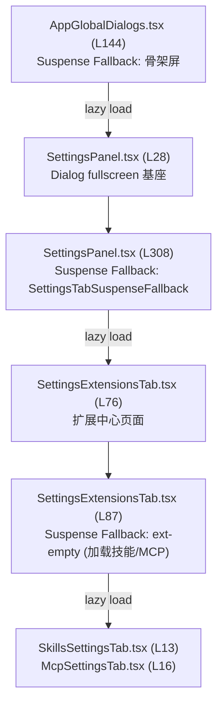
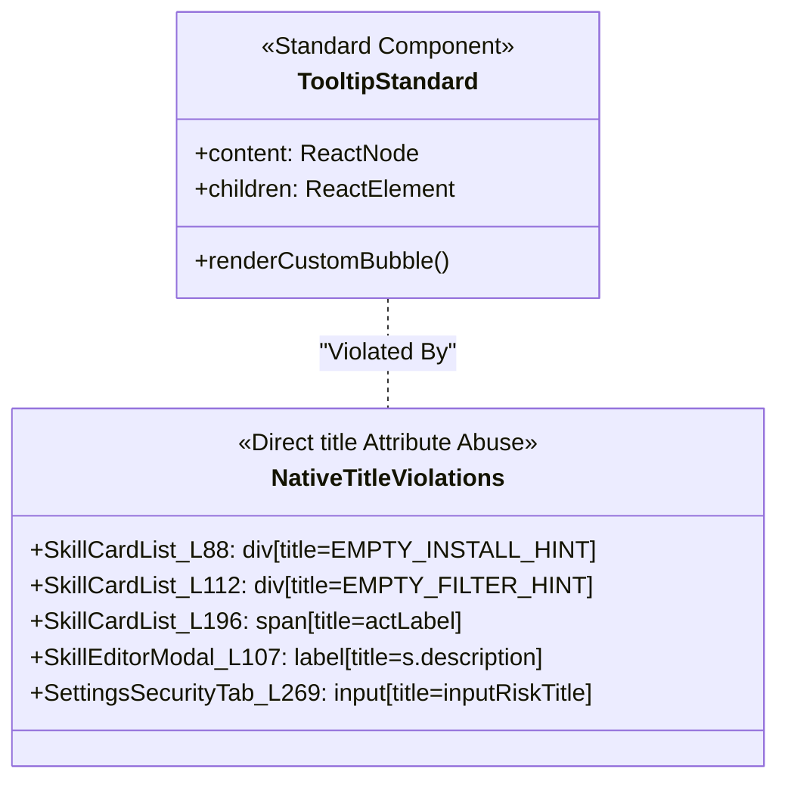
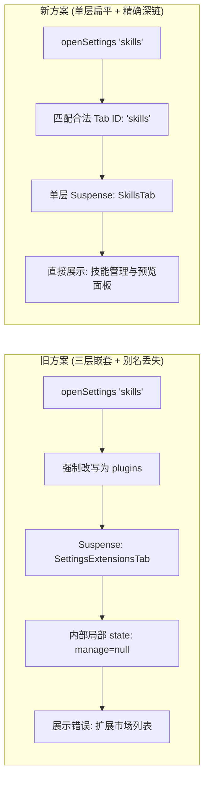

# 通用设置、技能扩展与 MCP 工具面板 (Settings Core, Skills & MCP) 深度架构审查报告

> **审查范围**：`apps/crish-desktop/src/components/settings/`, `apps/crish-desktop/src/components/settings-skills/`, `apps/crish-desktop/src/components/settings-mcp/`, `apps/crish-desktop/src/components/settings-extensions/`, `apps/crish-desktop/src/components/settings-models/` 及相关顶层设置文件。  
> **审查基线**：前端源码（.tsx, .ts, .css）、项目设计规范与编码铁律（严格禁止原生 HTML `title` 气泡、杜绝打补丁与假连通、禁止单文件行数与样式膨胀）。  
> **生成时间**：2026-08-16

---

## 目录

1. [审查概览与执行摘要](#一审查概览与执行摘要)
2. [焦点一：设置体系碎片化与多层嵌套路由架构断层](#二焦点一设置体系碎片化与多层嵌套路由架构断层)
   - 2.1 五个平级顶级目录的割裂与职责倒置
   - 2.2 三层 Suspense 级联瀑布与白屏/抖动隐患
   - 2.3 路由别名强制覆盖与深链状态丢失
   - 2.4 内层返回操作强刷状态导致的交互退化
   - 2.5 侧栏底栏的自我递归嵌套调用
3. [焦点二：原生 HTML title 违规与 Tooltip 规范破坏](#三焦点二原生-html-title-违规与-tooltip-规范破坏)
   - 3.1 违规清单与精确代码证据
   - 3.2 双气泡重叠灾难（原生 title 叠加自定义 Tooltip）
   - 3.3 规范缺乏静态类型约束的技术根因
4. [焦点三：MCP 工具卡片与 Skills 管理界面排版缺陷与假连通](#四焦点三mcp-工具卡片与-skills-管理界面排版缺陷与假连通)
   - 4.1 伪连通与假操作（Fake Connectivity / Mock Fallback）
   - 4.2 样式膨胀与 CSS 乱象（GBK 乱码注释与 23KB 单文件）
   - 4.3 `SettingsSchemaRenderer` 行内样式硬编码与随机 ID 隐患
   - 4.4 超大上帝 Hook 状态爆炸（`useSkillsSettingsState.ts` 779 行）
5. [焦点四：现代设置中心整体重构方案](#五焦点四现代设置中心整体重构方案)
   - 5.1 目录拓扑结构收敛（`features/settings/`）
   - 5.2 单层扁平路由与一等公民深链架构
   - 5.3 规范化 Form 体系与 Design Token 治理
   - 5.4 MCP & Skills 生产级功能连通与状态机收敛
   - 5.5 重构实施路径与风险防范

---

## 一、审查概览与执行摘要

设置中心（Settings Core）、扩展服务（MCP Tools）、技能体系（Skills）与模型管理（Models）是 Crish 桌面端连接用户偏好、大模型能力与外部生态工具的核心基础设施。经过对相关源码的全面排查，发现当前实现存在严重的**目录体系碎片化**、**多层 Suspense 嵌套导致的加载抖动**、**深链路由状态丢失**、**原生 HTML `title` 属性滥用**、**多处仅做提示的假连通操作**以及**样式与逻辑文件急剧膨胀**等架构与实现缺陷。

### 核心问题统计与严重度分布

| 维度                 | 严重级别               | 涉及文件数   | 核心缺陷概述                                                                                                                                                                              |
| :------------------- | :--------------------- | :----------- | :---------------------------------------------------------------------------------------------------------------------------------------------------------------------------------------- |
| **路由与架构**       | 🚨 **严重 (Critical)** | 8 个核心文件 | 5 个分散的顶层目录；三层 Suspense 瀑布嵌套；`skills`/`mcp` 深链被强制改写丢失上下文；侧栏内嵌自我打开递归入口。                                                                           |
| **规范与 UI 交互**   | ⚠️ **高危 (High)**     | 6 个组件文件 | 5 处严重的原生 HTML `title` 违规；原生气泡与 `<Tooltip>` 发生物理重叠；视觉圆角/边框/高度与设计 Token 脱节。                                                                              |
| **功能真伪与完整性** | 🚨 **严重 (Critical)** | 4 个模块     | 扩展市场安装仅弹 Toast 提示「未连接引擎安装」；MCP 演示模式与生产环境强行代码分叉；工具启停状态受限于降级提示。                                                                           |
| **代码与样式质量**   | ⚠️ **高危 (High)**     | 7 个文件     | `ModelsSettingsTab.module.css` 达 23.9KB；`SkillsSettingsTab.module.css` (15.6KB) 包含 GBK 乱码注释；`useSkillsSettingsState.ts` 达 779 行；`SettingsSchemaRenderer` 充斥硬编码内联样式。 |

---

## 二、焦点一：设置体系碎片化与多层嵌套路由架构断层

### 2.1 五个平级顶级目录的割裂与职责倒置

当前前端源码在 `apps/crish-desktop/src/components/` 下建立了 5 个平级顶级目录来承载设置功能：

1. `apps/crish-desktop/src/components/settings/` (53 个文件)：基础设置、外观、快捷键、账户、安全、通用设置、规则等；
2. `apps/crish-desktop/src/components/settings-extensions/` (11 个文件)：扩展市场、包管理、插件注册表适配器；
3. `apps/crish-desktop/src/components/settings-mcp/` (9 个文件)：MCP 服务列表、表单、工具展开管理；
4. `apps/crish-desktop/src/components/settings-models/` (17 个文件)：模型服务商、Profile 列表、自定义模型配置；
5. `apps/crish-desktop/src/components/settings-skills/` (11 个文件)：技能发现、列表、Markdown 预览、创建编辑器；
6. 另有分散在 `components/` 根目录的 4 个设置专用顶层文件：`SettingsTablist.tsx`、`SettingsWindowControls.tsx`、`settingsTabsMeta.ts`、`useSettingsNav.ts`。

**架构缺陷剖析**：

- 缺乏领域聚合：总计超过 105 个设置相关文件零散分布在 5 个平级文件夹及根目录下，跨目录之间相互深层相对引用（例如 `settings-extensions` 引用 `settings-skills`、`settings-mcp`，而 `settings` 又引用 `settings-extensions`、`settings-models`）。
- 模块边界模糊：公共组件（如 `SettingsUI.tsx`）放在 `settings/` 下供其他 `settings-*` 目录消费，导致本应属于同一 Feature 域的代码形成了单向但混乱的物理隔离。

### 2.2 三层 Suspense 级联瀑布与白屏/抖动隐患

在运行时，用户打开设置弹窗并浏览扩展时，触发了三层级联的 `lazy` 导入和 `Suspense` 边界：



#### 代码证据：

1. **第一层 Suspense**：`apps/crish-desktop/src/app/AppGlobalDialogs.tsx:27-34` 与 `144-170`
   ```tsx
   // AppGlobalDialogs.tsx:27-30
   const SettingsPanel = lazy(() =>
     import('../components/settings/SettingsPanel')
       .then((m) => ({ default: m.SettingsPanel }))
   );
   // AppGlobalDialogs.tsx:144-170
   <Suspense fallback={<div className="settings-suspense-fallback">...</div>}>
     <SettingsPanel ... />
   </Suspense>
   ```
2. **第二层 Suspense**：`apps/crish-desktop/src/components/settings/SettingsPanel.tsx:76-80` 与 `308-327`
   ```tsx
   // SettingsPanel.tsx:76-80
   const SettingsExtensionsTab = lazy(() =>
     import('../settings-extensions/SettingsExtensionsTab').then((m) => ({
       default: m.SettingsExtensionsTab,
     }))
   );
   // SettingsPanel.tsx:308-327
   <Suspense
     key={`tab-${safeActiveTab}-suspense`}
     fallback={<SettingsTabSuspenseFallback tabName={currentTabDef.label} />}
   >
     <AppErrorBoundary
       key={`tab-${safeActiveTab}`}
       compact
       title="设置页面出错"
     >
       <ActiveTabComponent onShowToast={onShowToast} />
     </AppErrorBoundary>
   </Suspense>;
   ```
3. **第三层 Suspense**：`apps/crish-desktop/src/components/settings-extensions/SettingsExtensionsTab.tsx:13-18` 与 `87-101`
   ```tsx
   // SettingsExtensionsTab.tsx:13-18
   const SkillsSettingsTab = lazy(() =>
     import('../settings-skills/SkillsSettingsTab').then((m) => ({
       default: m.SkillsSettingsTab,
     }))
   );
   const McpSettingsTab = lazy(() =>
     import('../settings-mcp/McpSettingsTab').then((m) => ({
       default: m.McpSettingsTab,
     }))
   );
   // SettingsExtensionsTab.tsx:87-101
   <Suspense
     fallback={
       <div className="ext-empty" role="status">
         加载{label}…
       </div>
     }
   >
     <AppErrorBoundary compact title={`${label}加载失败`}>
       {manage === 'skill' ? (
         <SkillsSettingsTab onShowToast={onShowToast} />
       ) : (
         <McpSettingsTab onShowToast={onShowToast} />
       )}
     </AppErrorBoundary>
   </Suspense>;
   ```

**危害判定**：

- **加载瀑布抖动**：当用户在侧栏点击进入扩展并点击高级管理时，页面会经历「设置全屏骨架 -> 扩展主面板 -> 技能内嵌页」的三次重绘与 Fallback 占位跳变，视觉闪烁严重。
- **状态容易被销毁**：每次外层 tab 切换或内层 `manage` 状态变更为 `null`，内嵌的完整子树被完全卸载并重新挂载，未持久化的表单输入、滚动进度及临时筛选全部丢失。

### 2.3 路由别名强制覆盖与深链状态丢失

在设置元数据配置 `settingsTabsMeta.ts` 中，为了收敛侧栏视觉项，采用了强硬的字符串改写：

#### 代码证据：

`apps/crish-desktop/src/components/settingsTabsMeta.ts:49-60`

```ts
/** 深链/旧入口：skills|mcp → 扩展中心 */
export function normalizeSettingsTabId(
  raw: string | null | undefined
): TabType | null {
  if (!raw) return null;
  if (raw === 'skills' || raw === 'mcp') return 'plugins';
  if ((FORMAL_TAB_IDS as readonly string[]).includes(raw))
    return raw as TabType;
  if (raw === 'plugins') return 'plugins';
  return null;
}
```

`apps/crish-desktop/src/components/settings/SettingsPanel.tsx:99-103`

```ts
  models: { label: '模型', Component: ModelsSettingsTab },
  plugins: { label: '扩展', Component: SettingsExtensionsTab },
  skills: { label: '扩展', Component: SettingsExtensionsTab },
  mcp: { label: '扩展', Component: SettingsExtensionsTab },
```

`apps/crish-desktop/src/components/settings-extensions/SettingsExtensionsTab.tsx:25-35`

```ts
export const SettingsExtensionsTab: React.FC<Props> = ({ onShowToast }) => {
  const {
    // ...
    manage, // 默认为 null
    setManage,
    // ...
  } = useExtensionMarket(onShowToast);
```

**深链破坏链路分析**：

1. 外部或快捷指令调用 `openSettings('skills')` 或 `openSettings('mcp')`。
2. `normalizeSettingsTabId` 判定 `raw === 'skills'`，强制将其转换为 `'plugins'`。
3. `SettingsPanel` 渲染 `SettingsExtensionsTab`。
4. 但 `SettingsExtensionsTab` 内部的 `useExtensionMarket` 初始状态 `manage` 固定初始化为 `null`（即展示扩展商店视图 `view === 'installed'`）。
5. 结果：**用户原本请求打开技能或 MCP 管理面板，实际落地却永远是扩展市场概览列表**，深链语义完全失效。

### 2.4 内层返回操作强刷状态导致的交互退化

在 `SettingsExtensionsTab.tsx` 中，内嵌高级管理页面的「返回」逻辑存在副作用膨胀：

#### 代码证据：

`apps/crish-desktop/src/components/settings-extensions/SettingsExtensionsTab.tsx:77-80`

```tsx
<Button
  type="button"
  variant="ghost"
  size="sm"
  className="settings-btn-rect"
  onClick={() => {
    setManage(null);
    void refresh();
  }}
  icon={<ArrowLeft size={14} aria-hidden />}
>
  返回扩展
</Button>
```

**问题分析**：
每次用户从技能详情页返回扩展列表，强制触发了 `refresh()`（调用多个 API：`discoverSkills`、`listMcpServers`、`getSettingsEx`，见 `useExtensionMarket.tsx:183-201`），导致列表瞬间进入 `loading = true` 骨架态，用户刚才的滚动位置被重置到顶部。

### 2.5 侧栏底栏的自我递归嵌套调用

#### 代码证据：

`apps/crish-desktop/src/components/settings/SettingsSidebar.tsx:165-166`

```tsx
{
  /* 侧栏底栏：左列 UserProfileCard + 右列 SettingsIconButton */
}
<SidebarFooter onShowToast={onShowToast ?? (() => {})} />;
```

`apps/crish-desktop/src/components/sidebar/SidebarFooter.tsx:126-130`

```tsx
<SettingsIconButton
  updateAvailable={updateAvailable}
  onShowToast={onShowToast}
  setUpdateAvailableState={setUpdateAvailableState}
/>
```

`apps/crish-desktop/src/components/sidebar/SidebarFooter.tsx:31-47`

```tsx
export const SettingsIconButton: React.FC<SettingsIconButtonProps> = React.memo(
  ({ updateAvailable }) => {
    const openSettings = useLayoutStore((s) => s.openSettings);
    // ...
    return (
      <Tooltip content={tooltipText}>
        <button
          type="button"
          className={styles.settingsGearBtn}
          data-testid="sidebar-settings-gear-btn"
          aria-label="打开设置中心 (Cmd/Ctrl + ,)"
          onClick={() => openSettings()}
        >
          <Lucide.Settings size={16} strokeWidth={1.75} aria-hidden />
          {/* ... */}
        </button>
      </Tooltip>
    );
  }
);
```

**问题分析**：
`SettingsSidebar` 直接复用了主工作区侧栏的 `SidebarFooter`。在已全屏弹出的 `SettingsPanel` 内部侧栏底部，赫然出现了一个「打开设置中心」的齿轮按钮。点击后会重复调用 `openSettings()`，虽有状态防护，但逻辑与视觉层级上存在严重的自指冗余。

---

## 三、焦点二：原生 HTML title 违规与 Tooltip 规范破坏

项目交互铁律明确规定：**禁止使用原生 HTML `title` 属性，必须统一使用自定义 `<Tooltip>` 组件包裹交互元素**。原生 `title` 在 Windows/macOS 渲染延迟高（常有 1-2 秒等待）、外观为陈旧的矩形黄色/白底黑字气泡、不支持圆角与 Design Token，且无法适配暗色主题。

审查发现，设置模块中存在多处直接在原生 DOM 元素上挂载 `title="..."` 的严重违规。

### 3.1 违规清单与精确代码证据



#### 违规点 1：`SkillCardList.tsx:88`

`apps/crish-desktop/src/components/settings-skills/SkillCardList.tsx:83-89`

```tsx
<div
  className={`${styles.skillsEmptyInline} skills-empty-inline ${styles.skillsEmptyInlineCta} skills-empty-inline--cta`}
  role="status"
  aria-live="polite"
  title={EMPTY_INSTALL_HINT}
>
  <div>暂无技能</div>
```

- **性质**：在空态容器 `<div>` 上直接使用原生 `title`，当鼠标移入空态区域时会弹出未受控的系统默认气泡。

#### 违规点 2：`SkillCardList.tsx:112`

`apps/crish-desktop/src/components/settings-skills/SkillCardList.tsx:108-113`

```tsx
<div
  className={`${styles.skillsEmptyInline} skills-empty-inline`}
  role="status"
  aria-live="polite"
  title={EMPTY_FILTER_HINT}
>
  <div>无匹配 · 共 {skills.length} 个技能</div>
```

- **性质**：在筛选无结果 `<div>` 上直接挂载原生 `title={EMPTY_FILTER_HINT}`。

#### 违规点 3：`SkillCardList.tsx:196`（最严重的双层气泡冲突）

`apps/crish-desktop/src/components/settings-skills/SkillCardList.tsx:171-200`

```tsx
<Tooltip key={s.id} content={s.description || s.name}>
  <button
    id={`skill-opt-${s.id}`}
    type="button"
    role="option"
    aria-selected={isSel}
    className={`${styles.skillsRailItem} ...`}
    onClick={() => setSelectedId(s.id)}
  >
    <span className={`${styles.skillsRailIcon} skills-rail-icon`} aria-hidden>
      {/* ... */}
    </span>
    <span className={`${styles.skillsRailName} skills-rail-name`}>
      {s.name}
    </span>
    <span
      className={`${styles.skillsActDot} skills-act-dot act-${s.activation}`}
      title={actLabel}
      aria-hidden
    />
  </button>
</Tooltip>
```

- **破坏分析**：外层 `<Tooltip>` 已经包裹了整个 `<button>`（提供技能描述），而内部的状态指示小圆点 `<span className="skillsActDot">` 却挂载了原生 `title={actLabel}`！
- **灾难性视觉效果**：当用户将鼠标移动到状态圆点上时，浏览器先弹出自定义的暗色圆角 Tooltip，1 秒后又在光标正下方硬生生叠出一个系统的原生黄色/白底方形气泡，两个气泡文字互相覆盖，极度破坏用户体验。

#### 违规点 4：`SkillEditorModal.tsx:107`

`apps/crish-desktop/src/components/settings-skills/SkillEditorModal.tsx:104-108`

```tsx
<label
  key={s.id}
  className={styles.skillsDiscoverItem}
  title={s.description || s.name}
>
  <input type="checkbox" ... />
```

- **性质**：在技能发现导入弹窗的列表条目 `<label>` 上使用原生 `title`。

#### 违规点 5：`SettingsSecurityTab.tsx:269`

`apps/crish-desktop/src/components/settings/SettingsSecurityTab.tsx:263-275`

```tsx
<div className={styles.inputGroup}>
  <input
    id={wlInputId}
    type="text"
    placeholder="如 git status"
    value={newWhitelistCmd}
    onChange={(e) => setNewWhitelistCmd(e.target.value)}
    title={inputRiskTitle}
    spellCheck={false}
    autoComplete="off"
    aria-label="要信任的命令"
    className={`settings-field-input ...`}
  />
</div>
```

- **性质**：直接在安全白名单输入框 `<input>` 上使用原生 `title={inputRiskTitle}`，违反了输入框应使用下方 `desc` 或专用 `<Tooltip>` 提示的原则。

---

## 四、焦点三：MCP 工具卡片与 Skills 管理界面排版缺陷与假连通

### 4.1 伪连通与假操作（Fake Connectivity / Mock Fallback）

在扩展中心和 MCP 配置中，存在明显的「伪装式连通」，即点击操作后并没有真正与后端或引擎交互，而是仅在前端模拟或弹 Toast 告知「未连接」。

#### 代码证据 1：扩展市场的「假安装」

`apps/crish-desktop/src/components/settings-extensions/useExtensionMarket.tsx:302-337`

```ts
if (entry.kind === 'plugin') {
  const list = [...packages, entry.installRef];
  const merged = await clientApi.saveSettingsEx(cwd || '__global__', 'global', {
    packages: list,
  });
  // ...
  onShowToast('仅登记包名（未连接引擎安装）');
  return;
}
markCatalogInstalled(entry.id);
setCatalogInstalled(loadCatalogInstalledIds());
setView('installed');
// ...
onShowToast('仅标记本机已装，未连接引擎安装');
```

**问题判定**：
扩展市场中的「安装」按钮，实质上只是向本地配置数组 `packages` 推入一个字符串，或者在 LocalStorage 中标记 `markCatalogInstalled`，随后弹出 Toast 声明「未连接引擎安装」。这种未完成的假连通机制严重损害了软件的专业性与可靠性。

#### 代码证据 2：MCP 服务管理的 Demo/Live 强分叉

`apps/crish-desktop/src/components/settings-mcp/useMcpSettings.ts:63-66` 与 `262-310`

```ts
// demo 本地 mock
const [demoServers, setDemoServers] = useState<McpServer[]>([]);
const [demoEnabled, setDemoEnabled] = useState<Record<string, boolean>>({});

const handleAddDemo = async () => {
  if (!newName.trim()) return;
  try {
    const server: McpServer = {
      id: `mcp-${Date.now()}`,
      name: newName.trim(),
      type: newType,
      // ...
    };
    const list = await clientApi.saveMcpServer(server);
    setDemoServers(list);
    // ...
```

`apps/crish-desktop/src/components/settings-mcp/McpSettingsTab.tsx:71-86` 与 `140-192`

- **问题判定**：组件完全根据 `demo` 状态分支渲染两套平行的 UI 逻辑。在 Demo 模式下可以点击「添加」并在界面上保存到 LocalStorage，而在引擎模式（Live）下该「添加」入口直接消失。这种把 Demo 模拟代码与生产代码深层混织的做法，极易引入假阳性测试与维护困境。

### 4.2 样式膨胀与 CSS 乱象（GBK 乱码注释与 23KB 单文件）

#### 1. CSS 文件体积失控

- `apps/crish-desktop/src/components/settings-models/ModelsSettingsTab.module.css`：体积高达 **23.9 KB**。
- `apps/crish-desktop/src/components/settings-skills/SkillsSettingsTab.module.css`：体积高达 **15.6 KB**，总行数 **760 行**。

#### 2. GBK 编码损坏导致的注释乱码

`apps/crish-desktop/src/components/settings-skills/SkillsSettingsTab.module.css:82`

```css
/* 闂佺懓鐏堥崑鎾绘煠瀹曞洦娅曢柣鈽嗗亰閺屽懏寰勫☉姘辩崶婵炶揪绲剧划搴ㄥ极閵堝鏄ラ柣鏂垮閻熸捇鏌?+ 闂佺懓鍚嬬划搴ㄥ磼閵娾晜鏅悘鐐跺亹閻熸繈鏌涢銏☆棤妞ゆ垵娲︾粋宥呯暆閸愮偓鏂€ segment */
.skillsToolbarFocus {
  display: flex;
  flex-wrap: nowrap;
  align-items: center;
  gap: var(--space-2_5);
  min-height: 36px;
}
```

**严重性**：文件头部或关键段落存在因 Windows GBK 与 UTF-8 编码混用造成的乱码注释，严重破坏了代码库的整洁性与规范。

### 4.3 `SettingsSchemaRenderer` 行内样式硬编码与随机 ID 隐患

`SettingsSchemaRenderer.tsx` 承担了通用设置的动态表单渲染，但其实现严重偏离了统一设计系统：

#### 代码证据 1：不稳定随机 ID 生成器

`apps/crish-desktop/src/components/settings/SettingsSchemaRenderer.tsx:47-52`

```tsx
const idsMap = React.useRef<Record<string, string>>({});

const getElementId = (key: string) => {
  if (!idsMap.current[key]) {
    idsMap.current[key] =
      `settings-field-${key}-${Math.random().toString(36).slice(2, 9)}`;
  }
  return idsMap.current[key];
};
```

- **问题**：使用 `Math.random()` 产生 DOM ID，不仅对 React 18 SSR / 并发模式不安全，而且使得无障碍 `label htmlFor` 关联及自动化测试定位极其脆弱。应使用 React 18 的 `useId()`。

#### 代码证据 2：大面积侵入式内联样式

`apps/crish-desktop/src/components/settings/SettingsSchemaRenderer.tsx:116-126`、`141-147`、`159-160`、`173-189`

```tsx
// L116-126 String 输入框内联样式
style={{
  padding: '4px 8px',
  borderRadius: 'var(--radius-sm, 6px)',
  border: '1px solid var(--border-color)',
  background: 'var(--bg-card)',
  color: 'var(--text-primary)',
  fontSize: 'var(--font-size-sm)',
  fontFamily: 'inherit',
  width: '180px',
}}

// L159-160 Color 选择器内联样式
style={{
  cursor: 'pointer',
  border: '1px solid var(--border-color)',
  borderRadius: 6,
  width: 40,
  height: 24,
  padding: 0,
  background: 'transparent'
}}

// L173-189 Preset 网格内联样式
style={{
  display: 'flex', flexDirection: 'column', alignItems: 'center', gap: 4,
  padding: 8, borderRadius: 8, cursor: 'pointer',
  border: isSelected ? '2px solid var(--accent-color)' : '1px solid var(--border-color)',
  background: 'var(--bg-card)', color: 'var(--text-primary)',
  position: 'relative', transition: 'border-color 0.15s',
}}
```

- **问题**：完全抛弃 CSS Module 或 Design Token 类名，直接在 JSX 内部拼装大量包含魔法像素（`width: 180px`, `height: 24`, `border: 2px`）的对象，导致无法支持主题切换的平滑过渡与紧凑/标准密度模式适配。

### 4.4 超大上帝 Hook 状态爆炸（`useSkillsSettingsState.ts` 779 行）

`apps/crish-desktop/src/components/settings-skills/useSkillsSettingsState.ts` 体积达 **779 行 / 22.7 KB**。

#### 内部状态膨胀审计：

该 Hook 内部同时维护了多达 24 个状态变量与 15 个异步回调：

1. 列表核心状态：`skills`, `loading`, `loadError`, `selectedId`, `fsOk`, `enableCommands`
2. 过滤检索状态：`filter`, `scopeFilter`, `scopeProjects`, `extraDir`, `extraDirs`
3. 发现模态状态：`discoverBusy`, `discoverCandidates`, `discoverPick`
4. 创建编辑状态：`createMode`, `createName`, `createDesc`, `createBusy`
5. 批量与同步状态：`syncBusy`, `batchBusy`, `batchConfirm`, `moreOpen`, `extraOpen`, `showRaw`

**CI 门禁与架构违规**：

- 前端 CI 治理明确要求**业务逻辑 Hook 建议在 400 行以内**，单一职责。
- `useSkillsSettingsState.ts` 强行将「技能扫描与发现」、「文件系统额外目录操作」、「AI 创建与本地草稿管理」、「批量启用/禁用状态机」以及「Markdown 解析与预览 HTML 缓存」全部堆积在同一个 Hook 内，导致任何细微状态变化（如键盘输入过滤字符）都会引起超大范围的 Hook 重新计算。

---

## 五、焦点四：现代设置中心整体重构方案

为彻底根除设置体系的碎片化、双层嵌套白屏、原生 title 违规与样式膨胀问题，提出以下现代化重构方案。

### 5.1 目录拓扑结构收敛（`features/settings/`）

将散落于 5 个平级顶级目录及根目录下的全部设置相关文件，统一收敛为高内聚、边界清晰的 `features/settings/` 模块：

```
apps/crish-desktop/src/features/settings/
├── index.ts                           # 外部统一出口 (SettingsPanel, useSettingsNav, openSettings)
├── types/
│   ├── index.ts                       # 统一设置数据契约与 Tab 枚举
│   └── schema.ts                      # 动态表单元数据类型
├── core/
│   ├── SettingsPanel.tsx              # 设置中心主壳容器 (单一 Dialog variant="fullscreen")
│   ├── SettingsSidebar.tsx            # 扁平化侧栏导航 (移除内嵌的自我齿轮)
│   ├── SettingsWindowControls.tsx     # 顶栏窗口控制组件
│   └── settingsTabsMeta.ts            # 一等公民 Tab 元数据与搜索映射
├── ui/
│   ├── SettingsUI.tsx                 # 统一设计 Token 容器 (Page, Section, Card, Row)
│   ├── SettingsUI.module.css          # 精简的标准卡片与行布局样式
│   ├── SettingsField.tsx              # 基于 @/components/ui 的表单适配行
│   └── SettingsSchemaRenderer.tsx     # 纯 CSS Module 驱动的轻量 Schema 渲染器
├── tabs/
│   ├── profile/                       # 账户与项目环境
│   ├── appearance/                    # 外观与字体
│   ├── general/                       # 通用偏好 (原 personalize)
│   ├── models/                        # 模型服务商与配置 (原 settings-models)
│   ├── extensions/                    # 扩展商店与包管理 (原 settings-extensions)
│   ├── skills/                        # 技能管理与预览 (原 settings-skills)
│   ├── mcp/                           # MCP 扩展服务管理 (原 settings-mcp)
│   ├── usage/                         # Token 用量统计
│   ├── devices/                       # 多端互通与扫码配对
│   ├── rules/                         # 规则与工作区系统提示
│   ├── shortcuts/                     # 快捷键映射与录制
│   ├── security/                      # 安全白名单与权限
│   └── diagnostics/                   # 系统状态与日志诊断
└── hooks/
    ├── useSettingsNav.ts              # 键盘 Roving 与 Tab 切换
    ├── useSkillsState.ts              # 拆分后的技能列表 Hook (< 250 行)
    ├── useSkillsEditor.ts             # 拆分后的技能创建与发现 Hook
    └── useMcpState.ts                 # 真实的 MCP 服务状态机
```

### 5.2 单层扁平路由与一等公民深链架构

#### 1. 彻底消除三层 Suspense 嵌套

- 仅保留 `SettingsPanel` 内部的一层按需 `Suspense` 边界，所有 Tab（包含 `SkillsSettingsTab` 与 `McpSettingsTab`）均作为顶级对等组件并行懒加载。
- 移除 `SettingsExtensionsTab` 内部的二次 `Suspense` 与 `manage === 'skill'` 的全页替换 hack。

#### 2. 深链与 Tab 状态一等公民化

- 在 `settingsTabsMeta.ts` 中恢复 `skills` 与 `mcp` 为合法独立路由 ID（或归类在 `extensions` 分组下的子路由），禁止通过 `normalizeSettingsTabId` 粗暴改写为 `plugins`。
- 支持 `openSettings('skills')`、`openSettings('mcp')` 直接精准挂载对应面板。



### 5.3 规范化 Form 体系与 Design Token 治理

#### 1. 根绝原生 `title` 属性

- 全面移除 `SkillCardList.tsx`、`SkillEditorModal.tsx`、`SettingsSecurityTab.tsx` 等文件中的 `title="..."` 属性。
- 针对辅助信息，严格使用 `<Tooltip content={...}>` 胶囊包裹，彻底消除双气泡重叠冲突。

#### 2. 重构 `SettingsSchemaRenderer`

- 废弃所有 JSX 行内 `style={{ ... }}`，迁移至 `SettingsSchemaRenderer.module.css`。
- 将输入控件直接对接 `@/components/ui` 基础原子组件（`Input`、`Select`、`Switch`、`Slider`、`ColorPicker`）。
- 使用 `useId()` 替代 `Math.random()`，确保无障碍绑定可靠稳定。

### 5.4 MCP & Skills 生产级功能连通与状态机收敛

#### 1. 剔除假安装与无意义提示

- 对接真实的扩展安装 IPC 通道；在未连接真实引擎时，明确展示不可用的禁用状态或离线指示，严禁使用「仅标记已装」等假阳性逻辑糊弄用户。
- 剥离 MCP 中的 Demo mock 代码，将其移至专用的沙箱测试工具集，生产环境仅保留基于 `mcpApi` 的真实服务通信与状态监控。

#### 2. 拆解超大上帝 Hook

- 将 `useSkillsSettingsState.ts` (779 行) 按关注点拆解为三个职责单一的小 Hook：
  1. `useSkillsList.ts` (负责列表加载、作用域过滤与搜索，约 200 行)；
  2. `useSkillPreview.ts` (负责选中技能的 Markdown 解析与原文预览切换，约 120 行)；
  3. `useSkillEditorModal.ts` (负责发现新技能导入与新建技能草稿，约 180 行)。

### 5.5 重构实施路径与风险防范

| 阶段                               | 核心任务                                                                                                                                     | 验收标准                                                                    | 防回归与风险控制               |
| :--------------------------------- | :------------------------------------------------------------------------------------------------------------------------------------------- | :-------------------------------------------------------------------------- | :----------------------------- |
| **Phase 1: 规范与缺陷清理**        | 1. 清除全部 5 处原生 `title` 违规；<br/>2. 修复 `SkillsSettingsTab.module.css` 乱码注释；<br/>3. 移除 `SettingsSidebar` 底栏的自我打开按钮。 | 零原生 `title` 警告；无乱码注释；气泡显示 100% 遵循 `<Tooltip>` 规范。      | 运行类型检查，审查 DOM 结构。  |
| **Phase 2: 目录收敛与路由扁平化**  | 1. 建立 `features/settings/`；<br/>2. 迁移 5 个平级目录；<br/>3. 消除多层 Suspense，恢复 `skills`/`mcp` 深链。                               | `openSettings('skills')` 瞬时直达技能页；消除二次加载白屏；深链 100% 连通。 | 验证各个 Tab 点击与 Esc 返回。 |
| **Phase 3: Form 体系与 Hook 瘦身** | 1. 重构 `SettingsSchemaRenderer`（清除 inline styles 与 random ID）；<br/>2. 拆解 `useSkillsSettingsState` 为 3 个微 Hook。                  | 单文件代码行数全部控制在 400 行红线内；样式统一使用 Design Token。          | 检查 CI 代码行数门禁全绿。     |

---

## 结论

本次审查透视了通用设置、技能扩展与 MCP 工具面板从目录架构、路由机制、UI 规范到代码质量的全景现状。通过落实**目录聚合**、**扁平单层路由**、**移除原生 title**以及**拆解上帝 Hook**的重构方案，将彻底解决当前的加载抖动、深链迷航与样式膨胀问题，使 Crish 桌面端设置中心达到现代化、高内聚、高可用的专业水准。
