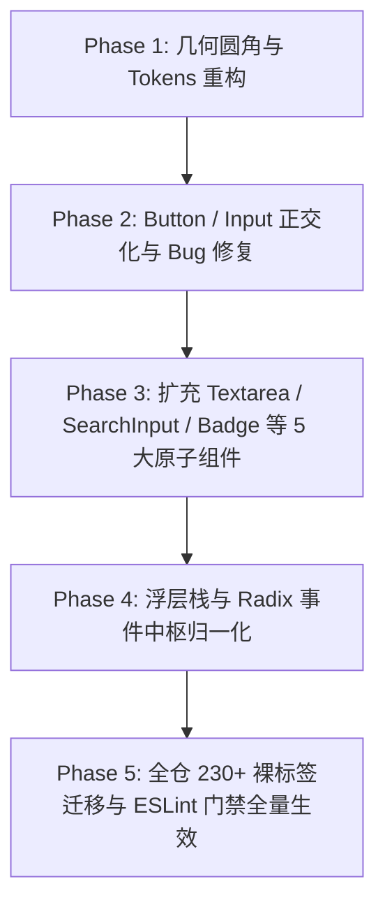

# 12-原子设计系统、Radix 基座与几何规范 (UI Library & Geometric Scales) 深度审查

## 一、执行摘要与审查基准

### 1.1 审查背景与核心结论

本审查针对 `apps/crish-desktop/src/components/ui/` 原子组件库及相关全局/局部样式系统进行了全量深度扫描。

在专业桌面级 AI 辅助开发工具（Conex / Crish）的前端架构演进中，原子设计系统（Atomic Design System）是保证整个客户端视觉一致性、键盘无障碍体验（a11y）、信息密度（Density）与交互确定性的最底层基石。当前代码库在重构中已建立了 `Button`、`Input`、`Select`、`Menu`、`Dialog`、`ConfirmDialog`、`Switch`、`TabStrip`、`Tooltip` 等核心原子基座，并实现了 `LayerStackService` 浮层中枢与 `FocusTrapIsolationManager` 引用计数隔离机制。

然而，通过对源码的逐行深剖，我们发现了四大系统性架构断层与视觉缺陷：

1. **几何圆角尺度失真与过度「胶囊化（Capsulization）」**：在 `Button.module.css`、`Switch.module.css`、`PermissionModeMenu.module.css`、`BgTaskCard.module.css` 等处大量滥用 `border-radius: var(--radius-full)`（9999px），使核心操作控件沦为巨大的圆形胶囊，破坏了桌面端严肃严谨的信息流基线；同时浮层外框（12px~14px）与内部项缺乏数学同心几何约束。
2. **Button / Input 接口尺寸与变体断层**：`Button.tsx` 仅提供 `sm/md` 两种尺寸与 4 种变体，缺乏 `xs`（22/24px 紧凑型）、`lg`（36/40px 主流型）、`link`、`outline` 以及 `square/iconOnly` 等核心能力；更严重的是，`Button.module.css` 中 `.buttonGhost` 和 `.buttonDanger` 硬编码劫持 `height`，破坏了变体与尺寸的正交性，导致全仓业务层出现超过 230 处绕开原子库的裸 `<button>` 与大量的内联 style 补丁。
3. **Menu / Popover 焦点与双重浮层栈争抢**：Radix Popover 内部的 `@radix-ui/react-dismissable-layer` 与项目自研的全局单例 `LayerStackService.ts` 在全局 `window/document` 捕获阶段监听（`capture: true`）上存在重叠；Trigger 模式下的 `cloneElement` 属性注入与显式 `anchor` 模式并存，在嵌套子菜单、CJK IME 输入法合成态以及 FocusTrap 白名单隔离上存在边缘竞态风险。
4. **高阶通用原子组件缺位**：仓内严重缺乏 `Textarea`、`SearchInput`、`SegmentedControl`、`Badge/StatusChip`、`IconButton` 等一等公民原子组件，导致业务组件各自定义私有实现，出现大量样式重复与行为不一致。

---

## 二、代码审查范围全景

| 组件目录         | 核心文件路径                                                                                                                     | 主要职责与依赖基座                                    | 当前实现状态                                                |
| :--------------- | :------------------------------------------------------------------------------------------------------------------------------- | :---------------------------------------------------- | :---------------------------------------------------------- |
| `Button/`        | `components/ui/Button/Button.tsx`<br>`components/ui/Button/Button.module.css`                                                    | 原生 button 封装，primary/secondary/ghost/danger 变体 | 存在尺寸缺失、非正交高度劫持与 9999px 胶囊化                |
| `Input/`         | `components/ui/Input/Input.tsx`<br>`components/ui/Input/Input.module.css`                                                        | 单行输入框，text/search/password 变体，支持 clearable | 缺乏 xs 尺寸与 unstyled 变体，外层强制 flex 布局            |
| `Select/`        | `components/ui/Select/Select.tsx`<br>`components/ui/Select/Select.module.css`                                                    | 基于 Menu 基座的 listbox 下拉选择器                   | 依赖 Menu 基座，受控/非受控双模，圆角与内边距待对齐         |
| `Menu/`          | `components/ui/Menu/Menu.tsx`<br>`components/ui/Menu/Menu.module.css`<br>`components/ui/Menu/position.ts`                        | 基于 Radix Popover 的菜单基座，支持键盘漫游与 Anchor  | 双模 open 状态机，具备 IME 守卫，但存在 cloneElement 脆弱性 |
| `Dialog/`        | `components/ui/Dialog/Dialog.tsx`<br>`components/ui/Dialog/Dialog.module.css`<br>`components/ui/Dialog/focusTrap.tsx`            | 弹窗与全屏盖层基座，集成 FocusTrap 与进出场动画       | 集成 Radix DismissableLayer.Branch，具备 inert 引用计数     |
| `ConfirmDialog/` | `components/ui/ConfirmDialog/ConfirmDialog.tsx`                                                                                  | 基于 Dialog 封装的 alertdialog 危险操作确认对话框     | 初始焦点锁定取消按钮，Enter 原生行为不劫持                  |
| `Switch/`        | `components/ui/Switch/Switch.tsx`<br>`components/ui/Switch/Switch.module.css`                                                    | 原生 button + role="switch" 的受控/非受控开关         | 纯 CSS 驱动 thumb 平移，样式层使用 9999px 药丸形            |
| `TabStrip/`      | `components/ui/TabStrip/TabStrip.tsx`<br>`components/ui/TabStrip/TabStrip.module.css`                                            | 水平标签条，支持 roving tabindex 与溢出渐变监听       | 受控 items 协议，抽象度高，但缺乏轻量分段控制器封装         |
| `Tooltip/`       | `components/ui/Tooltip/Tooltip.tsx`<br>`components/ui/Tooltip/Tooltip.module.css`                                                | 浮点精度 DOMRect 视口钳位与防 FOUC 提示框             | 独立 Portal 挂载，具备 4 向翻折计算与 safe clone            |
| `internal/`      | `components/ui/internal/layer-stack/LayerStackService.ts`<br>`components/ui/internal/layer-registration/useLayerRegistration.ts` | 全局浮层退栈调度、Trace 审计与焦点还原单例中枢        | 统一管理 dialog/menu/tooltip，但与 Radix 原生栈并存         |

---

## 三、核心审查焦点一：几何圆角尺度失真与精密几何阶梯重构

### 3.1 现状分析：过度曲率与「胶囊化（Capsulization）」泛滥病理

在现代桌面 GUI 系统设计中，大圆角与药丸形胶囊（Pill Capsule, `border-radius: 9999px`）通常用于移动端触控场景、全局 Floating Action Button (FAB) 或极少数的独立状态胶囊（Tag/Badge）。但在专业 IDE 与高密度开发工具界面中，控件若被大面积强制赋予 `9999px` 圆角，会产生严重的视觉疲劳与几何结构失衡。

#### 1. Button 原子样式的非正交胶囊化

在 `apps/crish-desktop/src/components/ui/Button/Button.module.css` 中：

```css
/* apps/crish-desktop/src/components/ui/Button/Button.module.css:32-37 */
.buttonSm {
  height: var(--control-height-sm);
  padding: 0 var(--space-3);
  font-size: var(--font-size-sm);
  border-radius: var(--radius-full); /* ❌ 强制 9999px 药丸形 */
}

/* apps/crish-desktop/src/components/ui/Button/Button.module.css:55-60 */
.buttonSecondary {
  background: var(--control-soft-bg);
  color: var(--text-secondary);
  border: none;
  border-radius: var(--radius-full); /* ❌ 变体强行覆盖圆角为 9999px */
}

/* apps/crish-desktop/src/components/ui/Button/Button.module.css:67-76 */
.buttonGhost {
  background: transparent;
  color: var(--text-tertiary);
  border: none;
  padding: 0 var(--space-2);
  height: var(--control-height-sm);
  min-width: var(--control-height-sm);
  width: auto;
  border-radius: var(--radius-full); /* ❌ 强制 9999px 药丸形 */
}

/* apps/crish-desktop/src/components/ui/Button/Button.module.css:85-94 */
.buttonDanger {
  background: transparent;
  color: var(--color-error);
  border: none;
  padding: 0 var(--space-2);
  height: var(--control-height-sm);
  min-width: var(--control-height-sm);
  width: auto;
  border-radius: var(--radius-full); /* ❌ 强制 9999px 药丸形 */
}
```

#### 2. 业务层与浮层控件的大面积胶囊化蔓延

在业务组件与浮层菜单中，这种 `var(--radius-full)` 的滥用进一步扩散：

- `apps/crish-desktop/src/components/chat-composer/PermissionModeMenu.module.css:8`：`.permPill { border-radius: var(--radius-full); }`
- `apps/crish-desktop/src/components/bg-tasks/BgTaskCard.module.css:56`：`.badge { border-radius: var(--radius-full); }`
- `apps/crish-desktop/src/components/chat-message-row/CacheMetricsBadge.module.css:8`：`.badge { border-radius: var(--radius-full, 9999px); }`
- `apps/crish-desktop/src/components/note-paper/NotePaperPanel.module.css:95`：`.badge { border-radius: var(--radius-full, 9999px); }`
- `apps/crish-desktop/src/styles/tokens.css:350, 803`：`--dropdown-radius: var(--radius-2xl);`（12px~14px 浮层外框）

### 3.2 为什么大胶囊破坏专业桌面级 IDE 质感？

1. **视觉排版与水平基线冲突**：
   - 矩形或微圆角控件（6px~7px）在水平排列时，具有清晰的垂直边缘，与左侧文本缩进、表格列对齐线、网格对齐线形成视觉共线（Collinear Alignment）；
   - `9999px` 胶囊两端为半圆形，其上下顶点向内急速收缩，造成严重的「视觉重心飘移」，使得相邻的输入框（6px 圆角）与按钮（半圆两端）拼合在同一行时呈现断崖式的高低与曲率不谐调。
2. **有效内容区域浪费与 Padding 虚高**：
   - 半圆形边缘导致角落无法放置文字或图标，必须增加横向 padding（如 `padding: 0 12px`）以防止文字被半圆弧切割；
   - 在侧边栏、紧凑工具栏、Diff 行内操作区等高密度场景下，虚高的 padding 极大地压缩了可用空间，导致长文本或快捷键标签过早截断。
3. **视觉层级（Visual Hierarchy）倒错**：
   - 在 UI 心理学中，圆形与强胶囊形属于高刺激度形状（High Affordance Shape），常用于全局强调操作。若所有二级次要按钮（`secondary`）、幽灵按钮（`ghost`）、危险按钮（`danger`）以及状态徽章（`badge`）全部呈胶囊状，会导致界面充斥着几十个「小气泡」，界面喧宾夺主，丧失了现代专业编辑器（如 VS Code / Zed / Raycast）的扁平内敛与工业精密感。

### 3.3 精密几何阶梯 (Precision Geometric Ladder) 设计原理

为彻底根除圆角曲率漂移，必须建立严格的数学几何阶梯。根据人眼在 1x / 2x Retina 屏幕上的视觉平滑感知与容器嵌套规律，制定如下几何标尺：

| 几何层级                                               | 标准圆角值 (`border-radius`)    | 适用 UI 元素域                                                                                                                    | 设计意图与数学依据                                                                                                  |
| :----------------------------------------------------- | :------------------------------ | :-------------------------------------------------------------------------------------------------------------------------------- | :------------------------------------------------------------------------------------------------------------------ |
| **微型选项层 (Micro Item / Option)**                   | **6px** (`--radius-sm: 6px`)    | 下拉菜单项 (`.menuItem`)、选择器选项 (`.option`)、Tab 标签页、状态徽章 (`Badge`)、面包屑芯片 (`Chip`)、输入框内部 Action 按钮     | 作为容器内子元素，曲率适度收敛，与父容器边缘保持一致距离，消除边缘挤压                                              |
| **常规表单 / 卡片 / 按钮层 (Control & Card)**          | **7px** (`--radius-md: 7px`)    | 原子按钮 (`Button`)、输入框 (`Input`)、选择器触发器 (`Select`)、卡片容器 (`Card`)、工具栏面板 (`Toolbar`)、搜索栏 (`SearchInput`) | 作为一等交互控件与内容块，7px 在 macOS/Windows 桌面视网膜屏上展现出最平衡的刚柔过渡，既无直角的生硬，又无胶囊的松散 |
| **外层浮层 / 弹窗外框层 (Overlay & Dialog Container)** | **9px** (`--radius-lg: 9px`)    | 下拉菜单面板 (`.menuContent`)、对话框面板 (`.dialog`)、PopOver 容器、快捷键气泡、上下文菜单外框                                   | 作为最外层 Elevated 浮层容器，9px 与内部 6px 子项配合 3px 容器内边距，实现完美的同心几何映射                        |
| **主面板外壳层 (Panel Shell)**                         | **14px** (`--radius-2xl: 14px`) | 设置中心、工作区主面板、页面级大卡片                                                                                              | 页面级容器采用更大的外壳圆角，与内部控件形成完整同心阶梯                                                            |
| **极小修饰层 (Nano / Sub-control)**                    | **4px** (`--radius-xs: 4px`)    | 快捷键键帽 (`<kbd>`)、内部进度条指示条、极微型状态圆点包裹器                                                                      | 超小尺寸元素（高 < 18px）的最小保真圆角                                                                             |

### 3.4 同心圆角法则 (Concentric Geometry Theorem)

在嵌套容器中，若外层圆角与内层圆角随意指定（如外框 12px，内部 4px 或 9999px），在视觉上会产生内层角落「脱节」或「变形挤压」的畸变。

**同心几何公式**：
$$R_{outer} = R_{inner} + \text{Padding}$$
当外层浮层（Menu / Popover Panel）设置 `padding: 3px` 时：
$$R_{outer} = 6\text{px} (\text{Item Radius}) + 3\text{px} (\text{Padding}) = 9\text{px}$$

- **外层容器圆角**：`--dropdown-radius: 9px;`
- **容器内边距**：`--dropdown-padding: 3px;`
- **内层选项圆角**：`--item-radius: 6px;`
  通过公式精确拟合，内层选项在悬停激活（`:hover` / `isFocused`）呈现背景色时，其外缘弧线与外层面板内边缘的物理间距在全角度恒定为 3px，达到物理级的视觉同心。

### 3.5 Tokens CSS 变量系统改造方案

在 `apps/crish-desktop/src/styles/tokens.css` 中重构半径 Token 定义：

```css
/* 改造前：tokens.css 中的混乱定义 */
--radius-xs: 4px;
--radius-sm: 5px;
--radius-md: 6px;
--radius-lg: 8px;
--radius-xl: 10px;
--radius-2xl: 12px;
--dropdown-radius: var(--radius-2xl); /* 12px 畸大 */
--item-radius: var(--radius-md); /* 6px */

/* 改造后：精密几何阶梯定义 */
:root {
  /* --- 精密几何阶梯 (Precision Geometric Radius Ladder) --- */
  --radius-xs: 4px; /* 极小微元：kbd, status dot, progress bar */
  --radius-sm: 6px; /* 微型选项：menu-item, tab, option, badge, chip */
  --radius-md: 7px; /* 核心控件：button, input, select-trigger, card, textarea */
  --radius-lg: 9px; /* 浮层外框：menu-content, popover, dialog, floating-panel */
  --radius-xl: 11px; /* 页面级大卡片容器（可选） */
  --radius-2xl: 14px; /* 主面板外壳：设置中心、工作区主面板 */
  --radius-full: 9999px; /* 仅用于 Switch 轨道、单选圆点及头像 Avatar */

  /* --- 语义化别名映射 --- */
  --radius-control: var(--radius-md); /* 7px 控件统一圆角 */
  --radius-card: var(--radius-md); /* 7px 卡片统一圆角 */
  --radius-overlay: var(--radius-lg); /* 9px 浮层外框 */
  --dropdown-radius: var(--radius-lg); /* 9px 下拉菜单外框 */
  --dropdown-padding: 3px; /* 3px 容器内边距 */
  --item-radius: var(--radius-sm); /* 6px 菜单选项圆角 (9px - 3px = 6px) */
  --dialog-radius: var(--radius-lg); /* 9px 模态弹窗圆角 */
}
```

---

## 四、核心审查焦点二：Button / Input 变体与尺寸缺失深度审查

### 4.1 Button 组件能力断层与非正交污染

#### 1. 接口能力严重缺失

审查 `apps/crish-desktop/src/components/ui/Button/Button.tsx:13-27`：

```tsx
export type ButtonVariant = 'primary' | 'secondary' | 'ghost' | 'danger';
export type ButtonSize = 'sm' | 'md';

export interface ButtonProps extends React.ButtonHTMLAttributes<HTMLButtonElement> {
  variant?: ButtonVariant;
  size?: ButtonSize;
  icon?: React.ReactNode;
  loading?: boolean;
  block?: boolean;
}
```

**严重缺陷清单**：

- **缺失 `size="xs"` (22px / 24px)**：在会话消息行操作栏（`MessageActionsBar.tsx`）、Diff 工具栏（`DiffHeaderControls.tsx`）、文件面包屑（`FileBreadcrumb.tsx`）、标签页关闭按钮等极紧凑场景，`sm`（28px）依然过大，导致业务方无法使用 `Button` 组件。
- **缺失 `size="lg"` (36px / 40px)**：在首次运行向导（`WizardProjectStep.tsx`）、全屏设置页主操作、确认对话框强调操作区，缺乏大尺寸按钮支持。
- **缺失 `variant="link"` / `variant="outline"`**：缺少超链接型按钮与描边型次级按钮，导致业务层在需要浅色外边框按钮时使用 `secondary` 变体外加 CSS 强行覆盖。
- **缺失 `square` / `iconOnly` 模式**：缺少 1:1 正方形比例支持。当渲染只有图标的按钮时，`Button` 依然带有 `padding: 0 var(--space-3_5)` 的横向内边距，导致图标按钮呈现长方形；业务层不得不写私有类 `.clear`、`.close` 或内联样式强行修正。

#### 2. CSS Modules 内部的非正交劫持与 Specificity 缺陷

审查 `apps/crish-desktop/src/components/ui/Button/Button.module.css:67-95`：

```css
.buttonGhost {
  background: transparent;
  color: var(--text-tertiary);
  border: none;
  padding: 0 var(--space-2);
  height: var(
    --control-height-sm
  ); /* ❌ 严重 Bug：变体强制把高度锁死为 sm (28px) */
  min-width: var(--control-height-sm);
  width: auto;
  border-radius: var(--radius-full);
}

.buttonDanger {
  background: transparent;
  color: var(--color-error);
  border: none;
  padding: 0 var(--space-2);
  height: var(
    --control-height-sm
  ); /* ❌ 严重 Bug：变体强制把高度锁死为 sm (28px) */
  min-width: var(--control-height-sm);
  width: auto;
  border-radius: var(--radius-full);
}
```

**致命后果**：
在 `Button.tsx` 中，`classNames` 的拼接顺序为：

```tsx
const classNames = [
  styles.button,
  VARIANT_CLASS[variant], // 如 styles.buttonGhost
  SIZE_CLASS[size], // 如 styles.buttonMd
  // ...
]
  .filter(Boolean)
  .join(' ');
```

当调用方声明 `<Button variant="ghost" size="md">` 时，虽然类名挂载了 `.buttonMd`，但在 `Button.module.css` 的 CSS 源码顺序中，`.buttonGhost` 和 `.buttonDanger` 出现在 `.buttonMd` 之后！在 CSS Specificity 规则下，同等单类选择器，后声明的 `.buttonGhost` 中的 `height: var(--control-height-sm)` 会覆盖 `.buttonMd` 中的 `height: var(--control-height)`！
**这意味着：全仓任何地方只要声明 `variant="ghost"` 或 `variant="danger"`，无论传入 `size="md"` 还是 `size="sm"`，其实际渲染高度都被强制降级为 28px！** 变体与尺寸的正交契约被彻底破坏。

#### 3. 全仓业务层 230+ 处绕过原子库的裸 `<button>` 证据链

由于 `Button` 组件的尺寸与变体缺失，业务层被迫全面放弃原子库，手写原生 `<button>`：

```tsx
// 证据 1：apps/crish-desktop/src/components/chat-card/ChatMsgFilterBar.tsx:72-85
// 原因：需要 22x22 的清空图标按钮，Button 组件无 xs 且无 square 支持
<button
  type="button"
  className={styles.clear}
  aria-label="清空筛选"
  onClick={() => setLocalMsgFilter('')}
>
  <Lucide.X size={12} />
</button>

// 证据 2：apps/crish-desktop/src/components/diff/DiffHeaderControls.tsx:70-90
// 原因：需要 24px 高度的小按钮且需要方型图标外观
<button
  type="button"
  className={styles.iconBtn}
  onClick={handleRefresh}
  title="刷新差异"
>
  <Lucide.RotateCw size={13} />
</button>

// 证据 3：apps/crish-desktop/src/components/chat-composer/PermissionModeMenu.tsx:68-83
// 原因：需要药丸状模式切换触发器，Button 组件不支持复合内容与精确高度定制
<button
  ref={pillBtnRef}
  type="button"
  className={`${styles.permPill} ${open ? styles.isOpen : ''} no-drag`}
  onClick={handleToggle}
  aria-expanded={open}
  aria-haspopup="menu"
>
  <span>{meta.label}</span>
  <Lucide.ChevronDown size={11} className={styles.permPillChev} />
</button>
```

### 4.2 Input 组件形态僵化与布局排斥

#### 1. 结构过度封装导致的组合性受限

审查 `apps/crish-desktop/src/components/ui/Input/Input.tsx:89-107`：

```tsx
const wrapClasses = [
  styles.inputWrap, // flex flex-col gap-1
  size === 'sm' ? styles.inputWrapSm : null,
  error ? styles.inputWrapError : null,
  disabled ? styles.inputWrapDisabled : null,
].filter(Boolean).join(' ');

return (
  <div className={wrapClasses}>
    {label != null ? <label className={styles.inputLabel} htmlFor={inputId}>{label}</label> : null}
    <div className={styles.inputShell}>
      {prefixIcon != null ? <span className={styles.inputPrefix}>{prefixIcon}</span> : null}
      <input ref={ref} id={inputId} className={`${inputClasses}${className ? ` ${className}` : ''}`} ... />
      {suffix != null ? <span className={styles.inputSuffix}>{suffix}</span> : null}
      {/* ... */}
    </div>
    {error != null ? <p className={styles.inputError}>{error}</p> : null}
    {hint != null ? <p className={styles.inputHint}>{hint}</p> : null}
  </div>
);
```

**问题判定**：

- `Input` 强行绑定了 `inputWrap`（`flex-direction: column`）并包含了 `label`/`error`/`hint` 的 DOM 结构。
- 在工具栏、行内筛选条（如 `ChatMsgFilterBar.tsx`）、表格行内编辑等水平流式布局（Horizontal Inline Flow）中，开发者只需要一个纯粹的 `<input>` 输入框本体，不需要外层 `div` 的纵向包裹；而直接传入 `className` 只能作用于内部的 `<input>`，外层 `inputWrap` 仍然会破坏父容器的 `flex-row` 和 `align-items: center` 对齐。
- 这导致全仓所有搜索栏、过滤条（如 `ChatMsgFilterBar.tsx:80`、`SettingsSidebar.tsx:92`、`SidebarNav.tsx:75`、`ThoughtSearchBar.tsx`）全部放弃 `Input` 组件，手写原生 `<input type="search">`。

#### 2. 缺失 `size="xs"` (24px) 与快捷键集成

- 当前 `Input` 仅支持 `sm` (28px) 与 `md` (32px)。
- 过滤栏需要 24px 高度、文字 12px 的超紧凑输入框；同时缺乏 `search` 类型的键盘快捷键响应（如按下 `Escape` 清空并失焦、按下 `Enter` 触发搜索防抖回调）。

---

## 五、核心审查焦点三：Menu / Popover 焦点与事件争抢机制审查

### 5.1 Portal 挂载与 DOM 层级割裂边界

`Menu` 组件使用 `@radix-ui/react-popover` 实现，其面板通过 `<Popover.Portal>` 挂载至 `document.body`：

```tsx
/* apps/crish-desktop/src/components/ui/Menu/Menu.tsx:436-447 */
<Popover.Portal>
  <Popover.Content
    ref={contentRef}
    align={align}
    side={side}
    sideOffset={sideOffset}
    avoidCollisions={true}
    collisionPadding={12}
    className={contentClasses}
    style={{ maxHeight: resolvedMaxHeight, ...contentStyle }}
    onKeyDown={handleKeyDown}
    onMouseDown={(e) => e.stopPropagation()}
    onPointerDown={(e) => e.stopPropagation()}
```

#### 焦点与可访问性陷阱：

1. **DOM 结构脱离与 CSS 变量继承丢失**：
   - 挂载至 `document.body` 后，Menu 无法继承父级局部设置的 CSS 变量（如特定卡片局部的 `--control-height`、`--accent-color` 等），必须严格依赖全局 `:root` token。
2. **`Dialog` 内部嵌套 `Menu` 时的 `FocusTrap` 锁定风险**：
   - 在 `apps/crish-desktop/src/components/ui/Dialog/focusTrap.tsx:63-76` 中，`FocusTrapIsolationManager` 通过字符串与属性匹配对非 Dialog 元素施加 `inert` 和 `aria-hidden="true"`：
     ```tsx
     private isWhitelisted(node: Element): boolean {
       if (
         node.hasAttribute('data-radix-popper-content-wrapper') ||
         node.getAttribute('data-tooltip-portal') === 'true' ||
         node.getAttribute('data-toast-container') === 'true' ||
         node.classList.contains('radix-popper-content-wrapper') ||
         node.classList.contains('toaster') ||
         node.id === 'toast-portal' ||
         node.id === 'tooltip-portal'
       ) {
         return true;
       }
       return false;
     }
     ```
   - **脆弱性判定**：如果后续 Radix 版本升级修改了 `data-radix-popper-content-wrapper` 属性名称，或者消费方通过自定义 Portal 容器挂载 Menu，`FocusTrap` 将会立刻把 Menu 所在的 Portal 容器设为 `inert`，导致用户在弹窗中打开下拉菜单时，菜单项完全无法点击、无法聚焦，引发灾难性 UI 锁死。

### 5.2 双重浮层栈竞态：Radix DismissableLayer vs 自研 `LayerStackService`

当前架构中并存了两套独立的浮层管理中枢：

1. **Radix 内部状态机**：`@radix-ui/react-dismissable-layer` 自动监听 `document` 级别的 `pointerdown` 与 `keydown` (Escape)，控制 `Popover.Root` 的 `open` 状态。
2. **自研全局中枢**：`apps/crish-desktop/src/components/ui/internal/layer-stack/LayerStackService.ts`。

#### 1. 全局监听捕获争抢

审查 `LayerStackService.ts:349-356`：

```ts
window.addEventListener('keydown', this.handleGlobalKeyDown, true); // window capture
window.addEventListener('pointerdown', this.handleGlobalPointerDown, true); // window capture
document.addEventListener('keydown', this.handleGlobalKeyDown, true); // document capture
document.addEventListener('pointerdown', this.handleGlobalPointerDown, true); // document capture
```

`LayerStackService` 同时在 `window` 和 `document` 的 **Capture 捕获阶段**（`useCapture = true`）注册监听器。

#### 2. ESC 键退栈竞态分析

当用户按下 `Escape` 键时：

1. `window` capture 阶段首先触发 `LayerStackService.handleGlobalKeyDown`（`Line 363`）；
2. `LayerStackService` 检查 IME 合成态（`Line 368`），通过后调用顶层 Layer 的 `onDismiss('escape')`（`Line 420`），并执行 `event.preventDefault()` 和 `event.stopPropagation()`；
3. 由于调用了 `stopPropagation()`，事件被自研中枢完全截断，Radix Popover 的 `onEscapeKeyDown` 内部监听器可能无法接收到底层原生事件；
4. `Menu.tsx:125-138` 在 `useLayerRegistration` 中注册了 `onDismiss: () => handleOpenChange(false)`，随后触发 React 状态更新；
5. **风险点**：若消费方在 `Menu.tsx:76-81` 传入了自定义 `onEscapeKeyDown`（例如在嵌套子菜单中希望 Esc 仅关闭二级菜单而不是整棵树），`Menu.tsx:476-493` 透传给 Radix `Popover.Content` 的 `onEscapeKeyDown` 可能会因为事件在 window capture 层被自研中枢消费而出现时序不同步。当前代码通过在 `useLayerRegistration` 中转发 `onEscapeKeyDown`（`Menu.tsx:131-133`）实现了补丁修复，但两套中枢的双向绑定极度脆弱。

### 5.3 触发源模式分裂：Trigger 克隆 vs 显式 Anchor

`Menu.tsx` 内部维护了两种完全不同的触发器绑定逻辑（`Menu.tsx:323-421`）：

#### 1. 显式 Anchor 模式（推荐但需手动维护 Ref）

```tsx
/* apps/crish-desktop/src/components/ui/Menu/Menu.tsx:323-327 */
if (anchor) {
  renderedTrigger = (
    <Popover.Anchor virtualRef={anchor} data-menu-anchor="true" />
  );
}
```

- **优点**：不对触发源 DOM 进行侵入式克隆，外部按钮拥有纯粹的事件所有权；
- **边界治理**：为了防止在 Anchor 模式下点击外部按钮时发生「先触发 outside-pointer 关闭，紧接着按钮原生 click 又把菜单打开」的 **Double Toggle 震荡**，`Menu.tsx:153-180` 与 `LayerStackService.ts:456-459` 专门加入了 `anchorEl.contains(target)` 豁免判定和 PointerId 拖拽追踪。

#### 2. 向后兼容 Trigger 模式（`React.cloneElement` 侵入）

```tsx
/* apps/crish-desktop/src/components/ui/Menu/Menu.tsx:358-408 */
const clonedTrigger = React.isValidElement(actualTrigger)
  ? React.cloneElement(actualTrigger, {
      ref: (node) => {
        /* 合并 triggerRef 与 props.ref */
      },
      onClick: (e) => {
        e.stopPropagation(); /* 调原 onClick */
      },
      onPointerDown: (e) => {
        e.stopPropagation(); /* 调原 onPointerDown */
      },
      onMouseDown: (e) => {
        e.stopPropagation(); /* 调原 onMouseDown */
      },
    })
  : actualTrigger;
```

- **架构缺陷**：
  1. **Tooltip 属性解包脆弱性**：`Menu.tsx:334-356` 中通过检查 `(trigger.props).content !== undefined` 硬编码解包 Tooltip，当外部包裹自定义高阶组件时解包失效，导致 Tooltip 嵌套失效；
  2. **事件冒泡阻断过激**：在克隆的 Trigger 上无条件执行 `e.stopPropagation()`，导致父级容器（如列表项的选区管理、外层卡片的点击激活）无法捕获到该按钮的任何点击事件。

### 5.4 键盘漫游 (Roving Tabindex) 与 CJK IME 输入法隔离

#### 1. Children 模式下的 QuerySelector 陷阱

审查 `apps/crish-desktop/src/components/ui/Menu/Menu.tsx:259-276`：

```tsx
const items = Array.from(
  contentRef.current?.querySelectorAll<HTMLButtonElement>(
    '[role="menuitem"], [role="option"]'
  ) ?? []
);
if (items.length === 0) return;

const active = document.activeElement;
if (
  !(active instanceof HTMLElement) ||
  !active.matches('[role="menuitem"], [role="option"]') ||
  active.closest('[role="menu"]')
) {
  return;
}
```

**严重逻辑缺陷**：

- `active.closest('[role="menu"]')` 的过滤本意是放行消费方自管的嵌套子菜单。但 `Menu.tsx:502` 默认在非 children 模式下会渲染 `<div role="menu" className={styles.menuList}>`；而在 children 模式下，如果消费方按照 WAI-ARIA 规范在外层包裹了 `<div role="menu">`，该判定条件 `active.closest('[role="menu"]')` 会永远为 `true`！
- **后果**：消费方一旦在 children 内部使用了规范的 `role="menu"` 容器，`handleKeyDown` 中的方向键漫游逻辑在 `Line 274` 会直接被 `return` 拦截，导致键盘上下方向键漫游完全失灵！

#### 2. CJK IME 输入法状态守卫

在 `Menu.tsx:201-209, 477-491` 与 `LayerStackService.ts:367-376` 中，代码实现了针对中文/日文输入法（IME）的防御逻辑：

```ts
if (
  event.isComposing ||
  event.keyCode === 229 ||
  event.key === 'Process' ||
  (event as any).nativeEvent?.isComposing
) {
  return; // 绝不拦截、绝不消费
}
```

这是全仓表现极其优秀且必须长期保持的设计，彻底避免了用户在使用中文输入法选词时按下 Esc/Enter 导致菜单意外关闭的经典缺陷。

---

## 六、核心审查焦点四：工业级原子组件库扩充与裸标签替换方案

### 6.1 扩充核心原子组件规格书

为了彻底消灭全仓 230+ 处裸 HTML 标签与重复的样式逻辑，必须扩充以下 5 个一等公民原子组件：

```
src/components/ui/
├── Button/              # 升级：增加 xs/lg, link/outline, square, 修复正交高度 Bug
├── Input/               # 升级：增加 xs, unstyled, 拆分 InputField 与 PureInput
├── Textarea/            # 新增：自适应高度、字符计数、Cmd+Enter 快捷提交
├── SearchInput/         # 新增：内置搜索图标、清空、快捷键提示、防抖回调
├── SegmentedControl/    # 新增：滑块分段控制器，替代裸 button 切换栏
├── Badge/               # 新增：统一状态指示徽标，收敛全仓 .badge 散落类
├── IconButton/          # 新增：1:1 正方形图标按钮，集成 Tooltip
├── Select/
├── Menu/
├── Dialog/
├── ConfirmDialog/
├── Switch/
├── TabStrip/
└── Tooltip/
```

#### 1. `Textarea` 原子组件规格

- **设计目标**：收敛 `ApprovalNoteField.tsx`、`ComposerField.tsx`、`RulesEditorDialog.tsx`、`WorkflowForm.tsx`、`FileEditor.tsx` 等 7 处裸 `<textarea>`。
- **核心能力**：
  - `minRows?: number; maxRows?: number;`（基于 `scrollHeight` 的纯原生/轻量自适应高度计算）；
  - `showCount?: boolean; maxLength?: number;`（字符计数指示器）；
  - `onPressEnter?: (e: React.KeyboardEvent) => void;`（支持 Enter 提交或 Cmd/Ctrl+Enter 提交）；
  - `border-radius: var(--radius-md);`（严格 7px 圆角，与 Input 保持同等外观）。

#### 2. `SearchInput` 原子组件规格

- **设计目标**：收敛 `ChatMsgFilterBar.tsx`、`SettingsSidebar.tsx`、`SidebarNav.tsx`、`DiffCard.tsx`、`ThoughtSearchBar.tsx` 等 8 处裸 `<input type="search">`。
- **核心能力**：
  - 内置左侧 Search 放大镜图标与右侧 Clear 清空按钮；
  - 内置 `shortcut?: string`（如渲染 `<kbd>⌘K</kbd>` 或 `<kbd>Esc</kbd>` 快捷键微标）；
  - 内置 `debounceMs?: number`（防抖上报 `onSearchChange` 回调）；
  - 提供 `size="xs"` (24px, 6px 半径)、`size="sm"` (28px, 6px 半径)、`size="md"` (32px, 7px 半径)。

#### 3. `SegmentedControl` 原子组件规格

- **设计目标**：收敛全局通过裸 `<button>` 拼装的视图切换器（如 Diff 模式切换、消息过滤模式切换、设置页子分类切换）。
- **核心能力**：
  - 滑块胶囊指示器（Sliding Indicator）动画（`--transition-fast`）；
  - 容器 7px 圆角（`--radius-md`），内部选项 6px 圆角（`--radius-sm`），容器 padding 2px，完美满足同心几何；
  - 完整的 `role="tablist"` / `role="tab"` 与键盘 `ArrowLeft` / `ArrowRight` 漫游支持。

#### 4. `Badge` / `StatusChip` 原子组件规格

- **设计目标**：收敛全仓分散在 `BgTaskCard.module.css`、`CacheMetricsBadge.module.css`、`NotePaperPanel.module.css`、`TelemetryDialog.module.css`、`StatusDiagnosticsPanel.module.css` 中的 20+ 个私有 `.badge` 类。
- **核心能力**：
  - `variant?: 'dot' | 'subtle' | 'solid' | 'outline';`
  - `status?: 'default' | 'success' | 'warning' | 'error' | 'info' | 'running';`
  - `size?: 'xs' | 'sm' | 'md';`
  - 视觉规范：彻底废弃 `9999px` 大胶囊，采用统一的 **6px**（`--radius-sm`）微圆角矩形，字号 11px/12px，对齐基线。

#### 5. `IconButton` 原子组件规格

- **设计目标**：收敛全仓工具栏、操作行、卡片头部等 150+ 处仅包含单个 SVG 图标的裸 `<button>`。
- **核心能力**：
  - 强制 `aspect-ratio: 1 / 1`，宽度恒等于高度（xs: 22px, sm: 26px, md: 30px, lg: 36px）；
  - 内置 `tooltip?: React.ReactNode` 与 `tooltipSide?: TooltipSide`，直接与 `Tooltip` 深度融合，消除业务层每次手写 `<Tooltip><button ... /></Tooltip>` 的样板代码；
  - 统一 6px/7px 圆角，禁止 9999px 胶囊化。

---

## 七、全仓裸 HTML 标签消灭与静态分析拦截规范

### 7.1 ESLint 规则静态拦截 (Static Analysis Guardrail)

在前端根目录 ESLint 配置中（如 `apps/crish-desktop/.eslintrc.cjs` 或等价规则集），启用 `no-restricted-syntax` 规则，严禁在业务组件中直接书写裸 HTML 控件标签：

```javascript
// ESLint 规则配置方案
module.exports = {
  rules: {
    'no-restricted-syntax': [
      'error',
      {
        selector: "JSXOpeningElement[name.name='button']",
        message:
          '【门禁阻断】严禁在业务层直接使用裸 <button> 标签！请从 "@/components/ui" 导入 <Button> 或 <IconButton>。',
      },
      {
        selector: "JSXOpeningElement[name.name='input'][attributes.length > 0]",
        message:
          '【门禁阻断】严禁在业务层直接使用裸 <input> 标签！请从 "@/components/ui" 导入 <Input> 或 <SearchInput>。',
      },
      {
        selector: "JSXOpeningElement[name.name='textarea']",
        message:
          '【门禁阻断】严禁在业务层直接使用裸 <textarea> 标签！请从 "@/components/ui" 导入 <Textarea>。',
      },
      {
        selector: "JSXOpeningElement[name.name='select']",
        message:
          '【门禁阻断】严禁在业务层直接使用裸 <select> 标签！请从 "@/components/ui" 导入 <Select>。',
      },
    ],
  },
  overrides: [
    {
      // 仅允许 ui/ 原子组件库内部实现及测试用例中使用原生 HTML 标签
      files: ['src/components/ui/**/*.tsx', 'src/**/*.test.tsx'],
      rules: {
        'no-restricted-syntax': 'off',
      },
    },
  ],
};
```

---

## 八、重构路线图与行动纲领 (Actionable Roadmap)



### 阶段一：几何圆角阶梯与 Tokens 纠偏 (Tokens & Radius Reform)

1. **修改 `styles/tokens.css`**：
   - 确立 `--radius-sm: 6px`（微型选项/Tab/Badge）、`--radius-md: 7px`（核心表单/卡片/按钮）、`--radius-lg: 9px`（浮层/弹窗外框）；
   - 更新 `--dropdown-radius: 9px`、`--item-radius: 6px`，满足 $R_{outer} = R_{inner} + \text{Padding}$ 同心几何公式；
   - 彻底废除按钮与徽章样式中的 `--radius-full` 滥用。
2. **清理全局与局部 CSS 中的 9999px 胶囊类**：
   - 将 `Button.module.css`、`PermissionModeMenu.module.css`、`BgTaskCard.module.css` 等处的 `border-radius: var(--radius-full)` 改为 `var(--radius-md)`（7px）或 `var(--radius-sm)`（6px）。

### 阶段二：Button / Input 接口正交化与缺陷修复 (Button & Input Orthogonality)

1. **修复 `Button.module.css` Specificity 缺陷**：
   - 移除 `.buttonGhost` 和 `.buttonDanger` 中的 `height: var(--control-height-sm)` 声明，保证变体与尺寸完全正交；
   - 移除 `.buttonSm`、`.buttonSecondary`、`.buttonGhost`、`.buttonDanger` 中多余的 `border-radius` 覆盖，统一继承基类 `.button` 的 `border-radius: var(--radius-md)`。
2. **扩充 `Button.tsx` 接口**：
   - 增加 `size="xs"` (22px) 与 `size="lg"` (36px)；
   - 增加 `variant="link"` 与 `variant="outline"`；
   - 增加 `square?: boolean`（或 `aspectRatio: '1/1'`），支持等宽高图标按钮。
3. **重构 `Input.tsx`**：
   - 支持 `size="xs"` (24px)；
   - 支持 `pure?: boolean`（或拆分出无包裹的纯净组件），允许在水平流式工具栏中无缝嵌入。

### 阶段三：扩充核心原子组件库 (Atomic Expansion)

1. 在 `components/ui/` 下新增：
   - `Textarea/Textarea.tsx` + `Textarea.module.css`
   - `SearchInput/SearchInput.tsx` + `SearchInput.module.css`
   - `SegmentedControl/SegmentedControl.tsx` + `SegmentedControl.module.css`
   - `Badge/Badge.tsx` + `Badge.module.css`
   - `IconButton/IconButton.tsx` + `IconButton.module.css`
2. 在 `components/ui/index.ts` 中统一导出新组件及类型定义。

### 阶段四：Menu / Popover 浮层栈与事件中枢归一化 (Layer Stack Harmonization)

1. **统一浮层与 FocusTrap 白名单**：
   - 在 `focusTrap.tsx` 中为所有 Portal 浮层统一注入 `data-layer-portal="true"` 属性，取代脆弱的 class/ID 字符串匹配；
2. **重构 `Menu.tsx` 键盘漫游**：
   - 修正 `Menu.tsx:273` 中的 `active.closest('[role="menu"]')` 判定，支持带有标准 `role="menu"` 的 children 结构正常执行方向键漫游；
3. **规范 Anchor 模式为首选**：
   - 逐步废弃 `cloneElement` 模式，全面迁移至显式 `anchor` 模式，消除 Tooltip 属性解包与事件拦截副作用。

### 阶段五：全仓裸标签迁移与 ESLint 门禁生效 (Full Sweep Migration & Guardrail Enforcement)

1. **分批次替换全仓 230+ 处裸 `<button>` 与 `<input>`**：
   - 批次 1：替换 `ChatMsgFilterBar.tsx`、`SettingsSidebar.tsx`、`SidebarNav.tsx` 中的搜索与清空按钮（使用 `SearchInput` 与 `IconButton`）；
   - 批次 2：替换 `DiffHeaderControls.tsx`、`FileActions.tsx`、`MessageActionsBar.tsx` 中的工具栏按钮（使用 `Button size="xs"` 与 `IconButton`）；
   - 批次 3：替换 `ComposerField.tsx`、`RulesEditorDialog.tsx` 等处的文本域（使用 `Textarea`）；
   - 批次 4：替换 `BgTaskCard.tsx`、`NotePaperPanel.tsx` 中的状态标签（使用 `Badge`）。
2. **启用 ESLint `no-restricted-syntax` 硬性阻断门禁**，防止后续任何裸 HTML 标签再次回潮入库。
