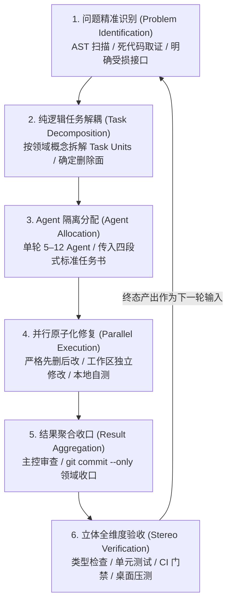

# 全域前端原子化架构总实施方案
## 系统性自上而下多 Agent 协同修复与工程重塑总纲（架构白皮书）

> **文档权威归档路径**：`docs/frontend-atomic-architecture/00-全域原子化架构总实施方案.md`
> **战役工作区总枢纽**：`docs/frontend-atomic-architecture/`
> **战役最高技术定位**：建立成熟、庞大、原子化、可无限扩展且层级严密的五层 UI 组件库（`@/components/ui/`）；系统性重塑 AI 对话流响应界面，彻底清算用户痛点；断绝全仓双轨死层与重复路径；以纯粹冷中性黑白灰为工业美学基石，实现全域净收敛与卓越工程体验。
> **方案输入基准文献**：
> - 全仓 24 份逐行实勘导航报告（`analysis/01` 至 `analysis/24`，累计 37,765 行代码实勘凭据，覆盖全量 1,983 个文件、372,900 行代码）；
> - 6 份初始维度探索提案（`dimension-proposals/01` 至 `06`，585 KB 详尽论据）；
> - 独立方案 A（`01-架构净收敛与底层原语重塑独立方案.md`，1,436 行，聚焦底层原语、双轨清除、状态解耦与门禁）；
> - 独立方案 B（`02-视口流体工程与生态容器构建独立方案.md`，1,875 行，聚焦响应流重塑、浮层调度、Fenwick 树状数组 Diff、MCP 环境变量与容器）；
> - 主控 Agent 对源码真理源的深度交叉核验与代码对齐。
>
> **方案铁律与底线红线**：
> - **纯粹逻辑执行顺序（问题同权）**：方案严格依循纯逻辑因果依赖编排，绝对不含工期、人天、人员分配或业务优先级（P0/P1）划分；全域列出的所有技术缺陷、组件真空与死层问题在逻辑地位上**完全同权推进**；
> - **可复用多轮迭代闭环引擎**：方案确立通用的多轮演进闭环架构（问题识别 -> 任务分解 -> Agent 分配 -> 并行修复 -> 结果汇总 -> 立体验收），每轮按需灵活部署 **5–12 个子 Agent**（无需强制占满），每轮输出作为下一轮输入，形成自愈式闭环迭代；
> - **代码建设与删除面严格并重**：既要从 0 到 1 详尽设计五层组件库的 TypeScript Props 契约、WAI-ARIA 状态机、DOM 结构与样式规范，又必须严格落实每个维度的强制物理删除面，全仓锁定净删除代码量 $\ge 5,900$ 行；
> - **输入框（Composer）绝对保护铁律**：`apps/crish-desktop/src/components/chat-composer/` 下全量 46 个文件为免触碰核心基石，改动行数严格为 0 行；
> - **冷中性黑白灰美学红线**：全域激活态对比度严格 $\le 10\%$；禁止 24px 双层浓黑大阴影；彻底拔除 7 色彩虹矩阵与 4.5px 粗暴绿光脉冲；严禁第三方供应商彩色 SVG 图标；
> - **去批次化命名铁律**：严禁出现 Wave, Batch, Round 等历史批次词汇，全域统一采用领域概念词与任务单元（Task Unit）。
>
> **文件编码**：UTF-8 无 BOM | 中文技术规范 | 物理行数 $\ge 1,200$ 行

---

## 目录索引

- [一、战役总则与核心设计哲学](#一战役总则与核心设计哲学)
  - [1.1 方案使命与建设边界](#11-方案使命与建设边界)
  - [1.2 纯逻辑依赖与问题同权推进法则](#12-纯逻辑依赖与问题同权推进法则)
  - [1.3 先删后改拓扑法则与负产出度量指标](#13-先删后改拓扑法则与负产出度量指标)
  - [1.4 冷中性黑白灰工业美学与 ≤10% 焦点对比度数学模型](#14-冷中性黑白灰工业美学与-10-焦点对比度数学模型)
  - [1.5 输入框（Composer）免触碰绝对保护区](#15-输入框composer免触碰绝对保护区)
  - [1.6 去批次化与去波次化命名准则](#16-去批次化与去波次化命名准则)
- [二、多 Agent 协同修复闭环引擎设计](#二多-agent-协同修复闭环引擎设计)
  - [2.1 六段式自循环闭环运转模型](#21-六段式自循环闭环运转模型)
  - [2.2 弹性调度规模与递归守卫（5–12 Agent 拓扑）](#22-弹性调度规模与递归守卫512-agent-拓扑)
  - [2.3 任务单元（Task Unit）标准四段式任务书契约](#23-任务单元task-unit标准四段式任务书契约)
  - [2.4 严格文件域互斥隔离与 Git 统一收口纪律](#24-严格文件域互斥隔离与-git-统一收口纪律)
  - [2.5 异常与空返回四级分级容错与自愈机制](#25-异常与空返回四级分级容错与自愈机制)
  - [2.6 跨轮次状态接力与动态依赖图更新协议](#26-跨轮次状态接力与动态依赖图更新协议)
- [三、全域 8 大细分领域维度架构规划](#三全域-8-大细分领域维度架构规划)
  - [3.1 维度总览与技术领域划分矩阵](#31-维度总览与技术领域划分矩阵)
  - [3.2 维度一：全仓死层拔除与双轨状态收敛 (DIM-CONVERGENCE)](#32-维度一全仓死层拔除与双轨状态收敛-dim-convergence)
  - [3.3 维度二：对话响应流视口与微分割线重塑 (DIM-RESPONSE-FLOW)](#33-维度二对话响应流视口与微分割线重塑-dim-response-flow)
  - [3.4 维度三：基础交互控制原子原语体系 Layer 1 (DIM-LAYER1-CONTROL)](#34-维度三基础交互控制原子原语体系-layer-1-dim-layer1-control)
  - [3.5 维度四：文本表单录入选择原子原语体系 Layer 2 (DIM-LAYER2-INPUTS)](#35-维度四文本表单录入选择原子原语体系-layer-2-dim-layer2-inputs)
  - [3.6 维度五：视觉展示与状态反馈原子原语体系 Layer 3 (DIM-LAYER3-FEEDBACK)](#36-维度五视觉展示与状态反馈原子原语体系-layer-3-dim-layer3-feedback)
  - [3.7 维度六：浮动层与全局调度中枢原子体系 Layer 4 (DIM-LAYER4-OVERLAY)](#37-维度六浮动层与全局调度中枢原子体系-layer-4-dim-layer4-overlay)
  - [3.8 维度七：高级复合工程容器与生态扩展 Layer 5 (DIM-LAYER5-CONTAINERS)](#38-维度七高级复合工程容器与生态扩展-layer-5-dim-layer5-containers)
  - [3.9 维度八：全局状态网格解耦与工程自动化门禁 (DIM-STATE-GUARDRAILS)](#39-维度八全局状态网格解耦与工程自动化门禁-dim-state-guardrails)
- [四、对话流响应界面深度重塑规范（直击截图痛点）](#四对话流响应界面深度重塑规范直击截图痛点)
  - [4.1 StatusDivider 20px 居中微分割线工程落地契约](#41-statusdivider-20px-居中微分割线工程落地契约)
  - [4.2 CompactInjectionRow 取反漏洞拔除与双重复读 Body 销毁](#42-compactinjectionrow-取反漏洞拔除与双重复读-body-销毁)
  - [4.3 SpaciousTimelineThoughtSection 开阔长思维链视界规范](#43-spacioustimelinethoughtsection-开阔长思维链视界规范)
  - [4.4 ToolExecutionPipeline 连续工具调用单行流水线聚合胶囊](#44-toolexecutionpipeline-连续工具调用单行流水线聚合胶囊)
  - [4.5 FloatingMicroCapsuleBar 消息行悬浮操作栏微胶囊化](#45-floatingmicrocapsulebar-消息行悬浮操作栏微胶囊化)
  - [4.6 虚拟列表真实滚动指针纠正与 FAB 回底状态机复活](#46-虚拟列表真实滚动指针纠正与-fab-回底状态机复活)
- [五、全局五层原子组件库系统技术规范（@/components/ui/）](#五全局五层原子组件库系统技术规范componentsui)
  - [5.1 Layer 1 基础控制原语详案（Button, Switch, SegmentedControl, Slider, Checkbox, Radio, Toggle）](#51-layer-1-基础控制原语详案button-switch-segmentedcontrol-slider-checkbox-radio-toggle)
  - [5.2 Layer 2 文本表单原语详案（Input, Textarea, NumberInput, SearchInput, Select, useImeComposition）](#52-layer-2-文本表单原语详案input-textarea-numberinput-searchinput-select-useimecomposition)
  - [5.3 Layer 3 视觉展示原语详案（Badge, Tag, Pill, StatusDot, Skeleton）](#53-layer-3-视觉展示原语详案badge-tag-pill-statusdot-skeleton)
  - [5.4 Layer 4 浮层弹窗原语详案（Dialog, Popover, Tooltip, LayerStackManager 单例）](#54-layer-4-浮层弹窗原语详案dialog-popover-tooltip-layerstackmanager-单例)
  - [5.5 Layer 5 复合工程容器详案（Tree, ZoomPan, DiffViewer 树状数组, EnvVariableTable, DualSliderController）](#55-layer-5-复合工程容器详案tree-zoompan-diffviewer-树状数组-envvariabletable-dualslidercontroller)
- [六、全域删除面台账与代码净收敛核销矩阵](#六全域删除面台账与代码净收敛核销矩阵)
  - [6.1 物理删除文件清单](#61-物理删除文件清单)
  - [6.2 淘汰 CSS 类名、高饱和彩虹色与粗暴脉冲关键帧清单](#62-淘汰-css-类名高饱和彩虹色与粗暴脉冲关键帧清单)
  - [6.3 全仓业务裸写原生 HTML 控件清剿清单](#63-全仓业务裸写原生-html-控件清剿清单)
  - [6.4 全域删除面净收敛代码量总核销（≥5,900 行）](#64-全域删除面净收敛代码量总核销5900-行)
- [七、纯逻辑执行拓扑图（DAG）与 24 个任务单元（Task Units）](#七纯逻辑执行拓扑图dag与-24-个任务单元task-units)
  - [7.1 纯逻辑无环依赖图谱（DAG）](#71-纯逻辑无环依赖图谱dag)
  - [7.2 任务单元详细规格书（TU-01 至 TU-24）](#72-任务单元详细规格书tu-01-至-tu-24)
  - [7.3 多轮迭代示范编排矩阵（单轮 5–12 Agent）](#73-多轮迭代示范编排矩阵单轮-512-agent)
- [八、四维立体验收矩阵与自动化工程门禁断言](#八四维立体验收矩阵与自动化工程门禁断言)
  - [8.1 第一维：静态类型检查与无障碍语义底线断言](#81-第一维静态类型检查与无障碍语义底线断言)
  - [8.2 第二维：纯逻辑核心算法与状态机自动化测试断言](#82-第二维纯逻辑核心算法与状态机自动化测试断言)
  - [8.3 第三维：自动化门禁脚本与单向递减棘轮断言（check-atomic-ui-rules.mjs）](#83-第三维自动化门禁脚本与单向递减棘轮断言check-atomic-ui-rulesmjs)
  - [8.4 第四维：真实桌面环境 60 FPS 流式渲染与 Tauri MCP 4000 现场验收](#84-第四维真实桌面环境-60-fps-流式渲染与-tauri-mcp-4000-现场验收)
- [九、总方案交接与分维度实施详案编制指引](#九总方案交接与分维度实施详案编制指引)

---

## 一、战役总则与核心设计哲学

### 1.1 方案使命与建设边界

在大型前端系统 Conex / Crish（基于 Rust 内核引擎 + Tauri 桌面壳 + WebView2 + React 18 + Zustand 全局状态管理）的长期迭代中，由于历史缺乏自上而下的原子化架构顶层设计，导致工程深处形成了五大核心病灶：
- **对话响应流体验粗暴**：用户截图反映的模型切换注入卡片臃肿刺眼、思维链 168px 矮盒卡死、多步工具调用纵向撕裂 3,000px；
- **底层组件库架构真空**：全仓完全缺失标准化的 `Checkbox`、`Radio`、`NumberInput`、`Toggle` 等基础原语，业务层密集裸写原生 HTML 标签；
- **视觉美学脏感与杂色**：7 色彩虹矩阵、4.5px 粗暴绿光脉冲、24px 浓黑大阴影以及 `themeStore.ts` 强行注入的 18 处暖黄泥色；
- **高级工程容器存在致命断层**：MCP 扩展中心缺失环境变量配置项、代码比对器因 `white-space: pre-wrap` 自动折行导致虚拟列表几何错位与底部截断、模型配置存在暗黑刺眼白底；
- **状态网格粗放与高频重绘**：双轨 `storeAccess` 诱发循环依赖运行时空指针、`PaneHeader` 订阅全量 `sessionsById` 导致打字时全屏所有 Header 逐帧重绘。

本方案的核心技术使命是：**以架构净收敛为前置扫雷手段，以五层原子组件库（Layer 1 ~ Layer 5）为结构支柱，以纯粹冷中性黑白灰为美学基石，全面重塑 AI 对话流响应界面，彻底清算存量死层与性能病灶，打通高维扩展生态，并建立不可逆的刚性工程守卫门禁。**

```
┌────────────────────────────────────────────────────────────────────────┐
│                   全域原子化架构五层金字塔全景模型                     │
├────────────────────────────────────────────────────────────────────────┤
│ Layer 5: 复合工程容器原语 (Tree, ZoomPan, DiffViewer, EnvVariableTable)│
├────────────────────────────────────────────────────────────────────────┤
│ Layer 4: 浮层与弹窗原语 (Dialog, Popover, Tooltip, LayerStackManager) │
├────────────────────────────────────────────────────────────────────────┤
│ Layer 3: 视觉展示与状态反馈原语 (Badge, Tag, Pill, StatusDot, Skeleton)│
├────────────────────────────────────────────────────────────────────────┤
│ Layer 2: 文本输入与表单选择原语 (Input, Textarea, NumberInput, Select) │
├────────────────────────────────────────────────────────────────────────┤
│ Layer 1: 基础交互控制原语 (Button, Switch, Slider, Checkbox, Radio)   │
├────────────────────────────────────────────────────────────────────────┤
│ Base Foundation: 纯粹冷中性 Design Tokens (tokens.css, ≤10% 焦点对比度)│
└────────────────────────────────────────────────────────────────────────┘
```

### 1.2 纯逻辑依赖与问题同权推进法则

依据仓库核心协作指令 `AGENTS.md` §1 与 `.agents/LOGIC_PLAN_NO_RETREAT.md`，本方案严格贯彻以下纯逻辑执行纪律：
- **禁止工期与人员安排**：方案所有步骤完全基于模块依赖、数据流向、状态机拓扑与编译闭包推导，绝对不含任何工期（人天）、进度时间表或人员分配；
- **问题绝对同权推进**：双轨 `storeAccess` 循环依赖空指针、思维链 168px 矮盒限制、MCP 环境变量行缺失、缺少 Checkbox 原子原语、7 色彩虹条刺眼污染，在逻辑地位上**完全同权**。禁止人为设立 P0/P1/P2 业务优先级进行断臂式取舍，所有列出问题必须全部正面根除；
- **反退避与反简化**：任何后续执行 Agent 绝对无权以“方案太难”、“业界一般不这么做”或“先出简化版”为由退避自研或打补丁，必须穿透表象直达底层架构根因。

### 1.3 先删后改拓扑法则与负产出度量指标

在任何组件开发或功能增强前，必须严格践行**“先删后改（收敛先行）”**的依赖拓扑：
- **删除事项是完成方式，不是削减范围**：删除废弃死层、剔除未生效样式、清除未接线标记（TODO/FIXME/临时 hack）是最高效优雅的工程动作；
- **负产出作为刚性交付指标**：除了纯新增且无旧逻辑的孤立原子原语外，任何施工阶梯必须伴随物理代码的净删除。本方案承诺并锁定**全域代码净收敛总量 $\ge 5,900$ 行**。

### 1.4 冷中性黑白灰工业美学与 ≤10% 焦点对比度数学模型

彻底根除界面中的“脏感”、“泥黄感”与“艳俗杂色感”，确立纯粹冷中性黑白灰的设计红线：
- **纯粹冷中性色阶**：禁止散落的旧式 `rgba(r, g, b, a)`，全面拥抱现代 CSS Color Level 4 语法 `hsl(h s l / a)` 与 `color-mix(in srgb, ...)`；浅色模式采用物理纯白与微冷灰底，深色模式采用深空冷曜黑与冷中性卡片，彻底物理拔除 `themeStore.ts` 强行注入的 18 处暖黄内联样式；
- **零高饱和彩色状态块**：常规提示、注入信息、工具调度、思维链一律采用中性灰度呈现；严禁第三方供应商彩色 SVG 图标；
- **克制激活态对比度（≤10% 铁律）**：依据 `AGENTS.md` §13，任何输入框、按钮或可交互卡片处于聚焦（Focus）、激活（Active）状态时，**禁止使用深黑、粗实边框**。加深混入文本色严格控制在 3%~8%（上限 10%）：
  $$\text{BorderColor}_{\text{focused}} = \text{color-mix}\left(\text{in srgb}, \text{var}(--\text{border-subtle})\; 92\%,\; \text{var}(--\text{text-primary})\; 8\%\right)$$
- **禁止 24px 双层浓黑大阴影**：全域浮层全面清退 24px 浓重投影，收敛至 1px 物理发丝边框（`var(--hairline)`）与 $\le 4\%$ 极微投影。

### 1.5 输入框（Composer）免触碰绝对保护区

用户明确裁决：**当前输入框（Composer）与模型选择界面的设计非常优秀、非常喜欢，绝对禁止改动！**
在全战役的所有阶段中，`apps/crish-desktop/src/components/chat-composer/` 目录下全部 46 个文件被列为**神圣不可侵犯的免触碰绝对保护区**，改动行数严格为 **0 行**。所有重组精力完全聚焦在响应流与底层组件库。

### 1.6 去批次化与去波次化命名准则

严格恪守《主控-全流程调度-v3.md》§3.4 铁律：**严禁任何波次/批次命名（禁止 Wave, Batch, Round 等词汇）**。
推进单元统一以「任务单元（Task Unit）」和「领域概念词」（如“架构收敛阶”、“基础原语阶”、“视口工程阶”）命名，提交信息与源码中严禁出现任何批次缩写。

---

## 二、多 Agent 协同修复闭环引擎设计

### 2.1 六段式自循环闭环运转模型

为了支撑多 Agent 协同在高代码密度下的无冲突演进，本方案确立标准化的六段式自循环闭环运转模型：



- **问题精准识别**：基于实勘报告与 AST 分析，定位具体物理行号、未接线标记与架构断层；
- **纯逻辑任务解耦**：拆分为相互正交、无共享写入文件的原子任务单元（Task Units）；
- **Agent 隔离分配**：单轮调度 5–12 个专职子 Agent，派发标准四段式任务书；
- **并行原子化修复**：子 Agent 在工作区独立执行改动与本地测试，严格先删后改；
- **结果聚合收口**：主控审查改动，使用 `git commit --only <paths>` 实施领域级单原子提交；
- **立体全维度验收**：通过静态类型、状态机测试、CI 门禁与真实宿主压测四重拦截，未尽长尾自动转入下一轮。

### 2.2 弹性调度规模与递归守卫（5–12 Agent 拓扑）

- **调度区间**：每轮派发子 Agent 数量严格保持在 **5 至 12 个**，根据该轮实际任务需求灵活设定，无需强制占满；
- **全局并发守卫**：任意时刻系统中同时存活（未终态）子 Agent $\le 16$，同父 $\le 16$；
- **递归深度严格为 1**：工具注册表彻底移除 `run_subagent`，子 Agent 无创建子 Agent 能力，所有派发由主控独占；
- **执行环境规范**：子 Agent 执行命令统一采用 **pwsh7（PowerShell 7+）**，文件编码必须为 UTF-8 无 BOM。

### 2.3 任务单元（Task Unit）标准四段式任务书契约

每个派发给子 Agent 的任务书必须强制包含以下四段固定结构：
- **做什么（Goal & Boundary）**：明确本次改动的输入文档基准、要实现的具体功能与代码产出物白名单；
- **不做什么（Negative Boundary）**：绝对禁止改动 Composer 输入框；严禁新建并行路径；严禁使用批次词汇；严禁越界修改他人文件；
- **涉及概念的旧路径清单（Old Paths Inventory）**：详列本概念当前在代码中的全部旧路径、死代码行号与待删除面；
- **完成后自检（Self-Inspection Checklist）**：自检是否消除了旧路径、代码中无新增 TODO/未接线标记、测试全绿、类型零报错。

### 2.4 严格文件域互斥隔离与 Git 统一收口纪律

- **提交权唯一归属于主控 Agent**：子 Agent 一律严禁执行 `git commit`、`git push`、`git reset --hard` 或 `git restore`，改动必须留在工作区；
- **文件所有权独占原则**：同一物理文件在同一轮次中严禁分配给两个或以上的 Agent；
- **共享 Index 隔离提交**：主控提交时必须使用 `git commit --only <paths...>` 限定本次收口文件，严禁盲目 `git add .` 误提交他人文件；
- **被吞并处理**：改动若已被并行外部流程合入，只验证文件内容完整性，完整则放行，禁止无谓回退。

### 2.5 异常与空返回四级分级容错与自愈机制

针对大模型供应商偶发的网络超时或空返回，按四级阶梯处置：
- **落盘优先核查**：空返回默认是网络超时而非任务失败；优先检查磁盘文件是否已落盘，检查 `git status`；
- **1–3 次空回**：优先使用 `task_id` 接续原 Agent 会话；
- **4–6 次空回**：细化任务粒度，换新 Agent 重新分发；
- **6 次以上连续失败**：由主控 Agent 直接接管实现，避免陷入死锁轮询。

### 2.6 跨轮次状态接力与动态依赖图更新协议

每轮收口完成后，在 `docs/frontend-atomic-architecture/execution-logs/` 记录持久化台账。下一轮启动时，主控读取最新的物理状态，排除已物理删除的死层，动态重构 DAG 依赖图，确保多轮迭代平滑演进。

---

## 三、全域 8 大细分领域维度架构规划

### 3.1 维度总览与技术领域划分矩阵

本战役将全域重塑解耦为 8 个高内聚、低耦合的细分领域维度，全面覆盖从底层状态、基础原语到高维容器的全技术栈：

| 维度编号 | 维度领域代号 | 核心技术使命与治理管辖范围 | 依赖前置 |
| :--- | :--- | :--- | :--- |
| **维度一** | `DIM-CONVERGENCE` | 全仓死层拔除与双轨状态收敛：物理删除 `api/storeAccess.ts`、清除 11 个幽灵类名、删除 368 行死选择器 | 无（最高前置） |
| **维度二** | `DIM-RESPONSE-FLOW` | 对话响应流视口与微分割线重塑：StatusDivider 20px 落地、修复取反漏洞、释放思维链 168px 矮盒、工具流水线聚合 | 维度一 |
| **维度三** | `DIM-LAYER1-CONTROL` | 基础交互控制原子原语体系 Layer 1：Button, Switch 0ms 状态机, Slider, 补齐 Checkbox 三态/Radio/Toggle | 维度一 |
| **维度四** | `DIM-LAYER2-INPUTS` | 文本表单录入选择原子原语体系 Layer 2：Input, Textarea field-sizing, NumberInput 步进加速, SearchInput, Select | 维度一 |
| **维度五** | `DIM-LAYER3-FEEDBACK` | 视觉展示与状态反馈原子原语体系 Layer 3：纯中性 Badge/Tag/Pill, 6px StatusDot, 修复 Skeleton 关键帧 | 维度一 |
| **维度六** | `DIM-LAYER4-OVERLAY` | 浮动层与全局调度中枢原子体系 Layer 4：Dialog, Popover, Tooltip, LayerStackManager 单例 LIFO 退栈, 清除 24px 大阴影 | 维度一、维度三 |
| **维度七** | `DIM-LAYER5-CONTAINERS` | 高级复合工程容器与生态扩展 Layer 5：Fenwick 树状数组 DiffViewer, Tree, ZoomPan, MCP 环境变量表, 双模滑块 | 维度三、维度四 |
| **维度八** | `DIM-STATE-GUARDRAILS` | 全局状态网格解耦与工程自动化门禁：createEntitySelector 工厂, 消除 PaneHeader 重绘, check-atomic-ui-rules.mjs | 全维度后置 |

---

### 3.2 维度一：全仓死层拔除与双轨状态收敛 (DIM-CONVERGENCE)

- **核心使命**：彻底拔除全仓存量死层、重复路径与失活样式，为新原子架构腾出物理空间；
- **关键动作**：
  - 物理删除 `apps/crish-desktop/src/api/storeAccess.ts` 及其子目录 `src/api/store-access/`，全仓唯一收拢至 `src/store/storeAccess.ts`；
  - 迁移消费端 12 个核心业务文件的引用，解除 ESM 循环依赖空指针隐患；
  - 物理清除 `FilePreview.tsx` 中引用的 11 个全库未定义的幽灵 CSS 类名；
  - 物理删除 `Select.module.css` 中的 368 行未生效死样式；删除孤儿文件 `ToastStack.module.css`；
  - 物理拔除 `themePersonalization.ts` 强行写入根 DOM 的 18 处暖黄内联样式；
- **验收标准**：全仓 `storeAccess` 引用唯一，幽灵类名归零，净删除代码 $\ge 2,500$ 行。

### 3.3 维度二：对话响应流视口与微分割线重塑 (DIM-RESPONSE-FLOW)

- **核心使命**：直击用户截图反映的巨型注入卡片痛点，彻底重塑 AI 响应交互视界；
- **关键动作**：
  - 彻底解构 `ContextInjectionBlock` 与 `CompactInjectionRow`，重塑为 20px 居中极简发丝微分割线 `StatusDivider`；
  - 修复 `CompactInjectionRow.tsx:57` 倒反天罡的取反展开漏洞，短状态默认折叠；
  - 彻底销毁 `InjectionBody.tsx` 与 Web Worker 双重复读渲染链路，消除 100% 文本复读；
  - 物理拔除 `ContextInjectionBlock.module.css:288-345` 声明的 2.5px 粗杠与 7 色彩虹矩阵；
  - 彻底打破 `TimelineThoughtSection` 的 168px 矮盒卡死限制与上下 20px 渐变淡出遮罩，实现全高度自然展开；
  - 聚合多步连续工具调用为单行流水线胶囊（`ToolExecutionPipeline`），支持抽屉展开；
  - 纠偏 `VirtualScrollManager.ts` 滚动监听指针，复活右下角悬浮回底按钮（FAB）；
- **保护红线**：`chat-composer/**` 46 个文件 100% 保持原样，改动严格为 0 行；
- **验收标准**：系统状态切换高度压缩至 $\le 20px$，思维链无视口受限，彩虹色归零。

### 3.4 维度三：基础交互控制原子原语体系 Layer 1 (DIM-LAYER1-CONTROL)

- **核心使命**：在 `@/components/ui/` 从 0 到 1 建立标准化、类型完备、WAI-ARIA 合规的基础交互控制原语族；
- **关键动作**：
  - 重塑 `Button` & `IconButton`（5 变体 × 4 尺寸，内置 40px 触控安全区与 `bare` 裸核心模式）；
  - 固化 `Switch`（0ms 乐观更新状态机，四层防死锁回滚：同步捕获、Promise 守护、5000ms 超时、原点收敛）；
  - 固化 `SegmentedControl`（WAI-ARIA 1.2 漫游焦点，同心圆角公式 $R_{\text{outer}} = R_{\text{inner}} + \text{padding}$）；
  - 固化 `Slider`（2px 发丝极细轨道，44px 隐式命中区，PointerCapture 跨界指针捕获）；
  - 补齐三大核心原语真空：
    - 从 0 到 1 建立 `Checkbox`（完整支持受控 checked 与 indeterminate 半选三态，SVG 平滑描边动效）；
    - 从 0 到 1 建立 `Radio` & `RadioGroup`（`RadioContext` 状态总线，方向键循环漫游，6px 微缩放动效）；
    - 从 0 到 1 建立 `ToggleButton` & `ToggleGroup`（single / multiple 鉴别联合类型，`aria-pressed` 状态机）；
  - 全仓清剿业务层野生裸写的 `<input type="checkbox">`（如 `MirrorDriftStatusBar.tsx` 等 4 大野生地盘）；
- **验收标准**：全仓原生裸写复选框归零，Layer 1 原语单测覆盖率 $\ge 90\%$。

### 3.5 维度四：文本表单录入选择原子原语体系 Layer 2 (DIM-LAYER2-INPUTS)

- **核心使命**：建立现代化表单录入原语体系，消除滚动篡改风险，提升输入法交互质感；
- **关键动作**：
  - 重构 `Input`（同心图标排版，重置 WebView2 默认样式，锁定 $\le 10\%$ 焦点对比度）；
  - 现代 CSS 特性换装 `Textarea`（全面采用 `field-sizing: content`，彻底删除 `scrollHeight` 强制重排脚本）；
  - 从 0 到 1 建立 `NumberInput`（默认阻断滚轮误篡改、过滤科学计数法字符、长按衰减步进加速 200ms -> 30ms）；
  - 从 0 到 1 建立 `SearchInput`（内建 250ms 响应式防抖管道，支持快捷键 `/` 或 `Ctrl+K` 全局聚焦）；
  - 重构 `Select` & `Combobox`（浮层自适应视口几何翻转，`SelectClearButton` 重塑为标准 `IconButton`）；
  - 提取通用输入法状态机 Hook：`useImeComposition`（彻底解决 Windows 中文拼音选词回车误提交恶疾）；
- **验收标准**：多行输入零回流重排，数字输入无滚轮误篡改，中文输入法选词零误提交。

### 3.6 维度五：视觉展示与状态反馈原子原语体系 Layer 3 (DIM-LAYER3-FEEDBACK)

- **核心使命**：建立纯粹冷中性视觉展示与反馈体系，根除刺眼发光脉冲与多头平替；
- **关键动作**：
  - 统一 `Badge`、`Tag`、`Pill` 纯中性原语，清退全仓散落的 10 大私有徽章平替；
  - 物理删除全仓 4 处发光脉冲关键帧（`subagent-dot-pulse`、`thought-dot-pulse`、`pulseDot`、`approval-dock-dot-pulse`）；
  - 统一建立 6px 物理对齐冷中性微点 `StatusDot`（采用克制无光晕微透明度呼吸动效）；
  - 补齐 `Skeleton` 丢失的 `@keyframes skelShimmer` 流光关键帧，恢复加载骨架质感；
- **验收标准**：全仓 4.5px 绿光粗暴脉冲归零，私有徽章平替清零，骨架流光正常渲染。

### 3.7 维度六：浮动层与全局调度中枢原子体系 Layer 4 (DIM-LAYER4-OVERLAY)

- **核心使命**：建立全屏唯一的浮层调度中枢，彻底根治 ESC 竞争全关与 24px 大阴影污染；
- **关键动作**：
  - 建立全局单例调度中枢 `LayerStackManager`（实现严格单层 LIFO 倒序退栈、CJK IME 229 放行门闩与 50ms 连击防抖）；
  - 统一 `Dialog`、`ConfirmDialog`、`Popover`、`Tooltip`、`DropdownMenu` 接入 `LayerStackManager`；
  - 彻底清退全仓浮层散落的 24px 双层浓黑大阴影，收敛为 1px 发丝边框（`var(--hairline)`）与 $\le 4\%$ 极微阴影；
- **验收标准**：多层浮层按下 ESC 单层精准退出，输入法选词不误关弹窗，24px 大阴影清零。

### 3.8 维度七：高级复合工程容器与生态扩展 Layer 5 (DIM-LAYER5-CONTAINERS)

- **核心使命**：攻关高维业务容器的核心工程痛点，打通生态扩展契约；
- **关键动作**：
  - **基于树状数组（Fenwick Tree）彻底重构 `DiffViewer` 动态行高管理器**：攻克 `white-space: pre-wrap` 自动折行引发的虚拟列表几何错位与底部截断事故，实现 $O(\log N)$ 偏移前缀和查询与二分倍增视口定位；
  - 从 0 到 1 建立通用无头虚拟滚动 `Tree` 容器（24/28/32px 三级密度契约，Shift 区间连续多选与 Ctrl 异或多选）；
  - 从 0 到 1 建立多媒体画廊 `ZoomPan` 手势容器（指针中心缩放 $0.25\times \sim 8\times$、PointerCapture 拖拽平移、叶内最大化）；
  - **MCP 扩展生态中枢升级**：从 0 到 1 建立 `EnvVariableTable` 动态 Key-Value 编辑器，打通后端 `McpServerConfig.env` 契约，彻底解决 GitHub 等服务 Token 缺失断层，物理删除废弃的启停幽灵按钮与彩色徽章；
  - **模型配置中心纯中性化**：彻底删除 `ManualAddForm.tsx` 与 `ScanResultsModal.module.css` 中的 `#ffffff` 刺眼纯白底，补齐 Temperature 与 Top-p 双模滑块控制器（`DualSliderController`）；
  - 便签系统（`note-paper/`）5 大野生裸写控件彻底清剿；
- **验收标准**：Diff 自动折行截断彻底消除，MCP 环境变量动态可用，深色模式白底方块清零。

### 3.9 维度八：全局状态网格解耦与工程自动化门禁 (DIM-STATE-GUARDRAILS)

- **核心使命**：重塑 Zustand 状态网格，消除 4 大高频重绘病灶，建立不可逆的自动化工程防线；
- **关键动作**：
  - 在 `src/store/mesh/` 建立强类型泛型选择器工厂 `createEntitySelector`（提供 `useProperty`、`useSubset` 与 `useExists`）；
  - 重构 `PaneHeader.tsx`：拔除全量 `sessionsById` 订阅，Tab 项接入原子属性选择器，重绘次数降为 0；
  - 重构 `ChatMessageList.tsx`：解耦巨石消息数组，改为轻量 `messageIds: string[]` 流转，消息行按需自举；
  - 重构 `ApprovalSection.tsx`：引入待审批派生字典，消除全局遍历与三重深层循环；
  - 全仓关键选择器规范装配 `useShallow` 浅比较防线，消灭对象字面量引用陷阱；
  - 落地 `scripts/check-atomic-ui-rules.mjs` 自动化门禁脚本，挂载至 Git Pre-commit 与 CI 流水线；
- **验收标准**：40~60 tokens/s 流式打字帧率稳定在 58~60 FPS，CI 门禁刚性拦截违规代码。

---

## 四、对话流响应界面深度重塑规范（直击截图痛点）

### 4.1 StatusDivider 20px 居中微分割线工程落地契约

针对用户截图中反映强烈的巨型状态切换卡片，设计并沉淀标准的 `StatusDivider` 原语：

```tsx
/**
 * apps/crish-desktop/src/components/chat-injection/StatusDivider.tsx
 * 20px 居中极简冷中性微分割线原语
 */
import React, { memo } from 'react';
import { ArrowRightLeft, ShieldCheck, Terminal, FileCode, Clock, Info } from 'lucide-react';
import styles from './StatusDivider.module.css';

export type StatusDividerKind =
  | 'model-switch'      // 模型切换事件
  | 'permission-change' // 权限模式变更
  | 'env-inject'        // 环境变量注入
  | 'tool-notice'       // 工具执行提示
  | 'milestone'         // 思考与执行里程碑
  | 'general';          // 常规提示

export interface StatusDividerProps {
  id: string;
  kind?: StatusDividerKind;
  text: string;
  timestamp?: number;
  className?: string;
  'data-testid'?: string;
}

const getEventIcon = (kind: StatusDividerKind) => {
  switch (kind) {
    case 'model-switch': return <ArrowRightLeft size={11} aria-hidden />;
    case 'permission-change': return <ShieldCheck size={11} aria-hidden />;
    case 'env-inject': return <FileCode size={11} aria-hidden />;
    case 'tool-notice': return <Terminal size={11} aria-hidden />;
    case 'milestone': return <Clock size={11} aria-hidden />;
    default: return <Info size={11} aria-hidden />;
  }
};

export const StatusDivider: React.FC<StatusDividerProps> = memo(({
  id,
  kind = 'general',
  text,
  timestamp,
  className = '',
  'data-testid': testId,
}) => {
  return (
    <div
      id={`status-divider-${id}`}
      className={`${styles.dividerRoot} ${className}`}
      role="separator"
      aria-label={`状态切换：${text}`}
      data-testid={testId || `status-divider-${id}`}
      data-kind={kind}
    >
      <div className={styles.line} aria-hidden />
      <div className={styles.contentWrap}>
        <span className={styles.iconSlot}>{getEventIcon(kind)}</span>
        <span className={styles.label}>{text}</span>
        {timestamp ? (
          <span className={styles.timeTag}>
            {new Date(timestamp).toLocaleTimeString([], { hour: '2-digit', minute: '2-digit' })}
          </span>
        ) : null}
      </div>
      <div className={styles.line} aria-hidden />
    </div>
  );
});

StatusDivider.displayName = 'StatusDivider';
```

```css
/* apps/crish-desktop/src/components/chat-injection/StatusDivider.module.css */
.dividerRoot {
  display: flex;
  align-items: center;
  justify-content: center;
  width: 100%;
  height: 20px;
  min-height: 20px;
  max-height: 20px;
  margin: var(--space-2, 8px) 0;
  padding: 0 var(--space-4, 16px);
  box-sizing: border-box;
  user-select: none;
}

.line {
  flex: 1 1 0%;
  height: 1px;
  background-color: var(--hairline, color-mix(in srgb, var(--border-subtle, #e5e5e5) 75%, transparent));
}

.contentWrap {
  display: inline-flex;
  align-items: center;
  gap: 5px;
  padding: 0 var(--space-2_5, 10px);
  flex-shrink: 0;
  color: var(--text-tertiary, #888888);
  font-size: 11px;
  line-height: 1;
  font-weight: 400;
  letter-spacing: 0.01em;
}

.iconSlot {
  display: flex;
  align-items: center;
  justify-content: center;
  color: inherit;
  opacity: 0.85;
}

.label {
  white-space: nowrap;
  overflow: hidden;
  text-overflow: ellipsis;
  max-width: 480px;
}

.timeTag {
  font-size: 10px;
  opacity: 0.6;
  margin-left: 2px;
  font-variant-numeric: tabular-nums;
}
```

### 4.2 CompactInjectionRow 取反漏洞拔除与双重复读 Body 销毁

- **取反逻辑纠偏**：彻底删除 `CompactInjectionRow.tsx:57` 中的 `!(...)` 表达式，短文本（$\le 160$ 字符）判定为 `defaultOpen = false`；
- **物理删除 `InjectionBody.tsx`**：卡片展开 Body 彻底物理清退，连同其内部昂贵的 `StreamingMarkdownView` 与异步 Web Worker 调用一同销毁，从根源上消灭 100% 文本双重复读；
- **彩虹色与粗边框连根拔除**：全面删除 `ContextInjectionBlock.module.css:288-345` 中声明的 2.5px 粗彩杠与 7 种鲜艳色值，全量迁移至冷中性 `StatusDivider`。

### 4.3 SpaciousTimelineThoughtSection 开阔长思维链视界规范

```tsx
/**
 * apps/crish-desktop/src/components/chat-message-row/SpaciousTimelineThoughtSection.tsx
 * 开阔式长思维链视界组件（彻底释放 168px 矮盒与渐变白雾遮罩）
 */
import React, { useState, useMemo, memo } from 'react';
import { ChevronRight } from 'lucide-react';
import styles from './SpaciousTimelineThoughtSection.module.css';
import { StatusDot } from '../ui/StatusDot/StatusDot';
import { StreamingMarkdownView } from './StreamingMarkdownView';
import { Priority } from '../../workers';

export interface SpaciousTimelineThoughtSectionProps {
  content: string;
  isLive?: boolean;
  durationMs?: number;
  turnIndex?: number;
  messageId?: string;
  defaultExpanded?: boolean;
}

export const SpaciousTimelineThoughtSection: React.FC<SpaciousTimelineThoughtSectionProps> = memo(({
  content,
  isLive = false,
  durationMs,
  turnIndex,
  messageId,
  defaultExpanded,
}) => {
  const [isOpen, setIsOpen] = useState(defaultExpanded ?? isLive);

  const durationLabel = useMemo(() => {
    if (durationMs != null && durationMs > 0) {
      const sec = (durationMs / 1000).toFixed(1);
      return turnIndex != null ? `${sec}s` : `${sec}秒`;
    }
    return null;
  }, [durationMs, turnIndex]);

  const handleTitle = isLive
    ? '深度思考中…'
    : turnIndex != null
      ? `第 ${turnIndex + 1} 阶段思考`
      : durationLabel
        ? `思考了 ${durationLabel}`
        : '思考过程';

  return (
    <div
      className={`${styles.thoughtSectionRoot} ${isLive ? styles.isLive : ''} ${isOpen ? styles.isOpen : ''}`}
      data-kind="thought"
      data-live={isLive ? 'true' : undefined}
      data-expanded={isOpen ? 'true' : 'false'}
    >
      <button
        type="button"
        className={styles.thoughtHandleBtn}
        onClick={() => setIsOpen((prev) => !prev)}
        aria-expanded={isOpen}
      >
        <StatusDot
          status={isLive ? 'running' : 'idle'}
          size={6}
          breathe={isLive}
        />
        <span className={styles.handleTitle}>{handleTitle}</span>
        <ChevronRight
          size={12}
          className={`${styles.chevron} ${isOpen ? styles.chevronOpen : ''}`}
          aria-hidden
        />
      </button>

      {isOpen ? (
        <div className={styles.streamViewport}>
          <StreamingMarkdownView
            text={content}
            isStreaming={isLive}
            priority={Priority.High}
            messageId={messageId}
          />
        </div>
      ) : null}
    </div>
  );
});

SpaciousTimelineThoughtSection.displayName = 'SpaciousTimelineThoughtSection';
```

```css
/* apps/crish-desktop/src/components/chat-message-row/SpaciousTimelineThoughtSection.module.css */
.thoughtSectionRoot {
  margin: var(--space-1_5, 6px) 0;
  width: 100%;
  max-width: 100%;
  box-sizing: border-box;
}

.thoughtHandleBtn {
  display: inline-flex;
  align-items: center;
  gap: 6px;
  height: 24px;
  padding: 0 var(--space-2, 8px);
  border: 1px solid transparent;
  border-radius: var(--radius-sm, 4px);
  background: transparent;
  color: var(--text-tertiary);
  font-family: inherit;
  font-size: var(--font-size-sm, 12px);
  line-height: 1;
  cursor: pointer;
  user-select: none;
  transition: color var(--transition-fast, 150ms ease),
              background-color var(--transition-fast, 150ms ease);
}

.thoughtHandleBtn:hover {
  color: var(--text-secondary);
  background-color: var(--bg-surface);
}

.thoughtHandleBtn:focus-visible {
  outline: none;
  border-color: color-mix(in srgb, var(--border-subtle) 90%, var(--text-primary) 10%);
}

.handleTitle {
  font-weight: 400;
  font-variant-numeric: tabular-nums;
}

.chevron {
  color: var(--text-tertiary);
  transition: transform var(--transition-fast, 150ms ease);
}

.chevronOpen {
  transform: rotate(90deg);
}

/* 核心：开阔全通透展开视界，绝对不加 max-height 与遮罩层 */
.streamViewport {
  width: 100%;
  padding: var(--space-2, 8px) var(--space-3, 12px);
  box-sizing: border-box;
  color: var(--text-secondary);
  font-size: var(--font-size-sm, 13px);
  line-height: 1.6;
  border-left: 1px solid var(--hairline);
  margin-left: 7px;
}
```

### 4.4 ToolExecutionPipeline 连续工具调用单行流水线聚合胶囊

```tsx
/**
 * apps/crish-desktop/src/components/chat-tool-call/ToolExecutionPipeline.tsx
 * 多步工具执行流水线聚合胶囊原语（消除纵向拉伸 3 屏问题）
 */
import React, { useState, useMemo, memo } from 'react';
import { Terminal, Check, AlertCircle, ChevronDown, ChevronUp } from 'lucide-react';
import styles from './ToolExecutionPipeline.module.css';
import { StatusDot } from '../ui/StatusDot/StatusDot';
import type { ToolRenderItem } from '../../api/toolPresentation';

export interface ToolExecutionPipelineProps {
  items: ToolRenderItem[];
  msgId: string;
  onOpenDiff?: (filePath: string) => void;
  onOpenTerminal?: () => void;
}

export const ToolExecutionPipeline: React.FC<ToolExecutionPipelineProps> = memo(({
  items,
  msgId,
  onOpenDiff,
  onOpenTerminal,
}) => {
  const [isExpanded, setIsExpanded] = useState(false);

  const stats = useMemo(() => {
    let running = 0;
    let failed = 0;
    let total = items.length;
    items.forEach((item) => {
      const status = item.tool.status;
      if (status === 'running') running++;
      else if (status === 'error' || status === 'failed') failed++;
    });
    return { total, running, failed, completed: total - running - failed };
  }, [items]);

  const summaryText = useMemo(() => {
    if (stats.running > 0) return `正在执行工具 (${stats.completed}/${stats.total})…`;
    if (stats.failed > 0) return `${stats.total} 步工具执行完成 (${stats.failed} 步失败)`;
    return `${stats.total} 步工具执行已完成`;
  }, [stats]);

  return (
    <div className={styles.pipelineRoot} data-pipeline-id={msgId}>
      <button
        type="button"
        className={styles.summaryBar}
        onClick={() => setIsExpanded((prev) => !prev)}
        aria-expanded={isExpanded}
      >
        <div className={styles.leftMeta}>
          <StatusDot
            status={stats.running > 0 ? 'running' : stats.failed > 0 ? 'error' : 'success'}
            size={6}
            breathe={stats.running > 0}
          />
          <Terminal size={12} className={styles.terminalIcon} aria-hidden />
          <span className={styles.summaryLabel}>{summaryText}</span>
        </div>

        <div className={styles.rightActions}>
          <span className={styles.stepsPill}>{stats.total} Steps</span>
          {isExpanded ? <ChevronUp size={12} /> : <ChevronDown size={12} />}
        </div>
      </button>

      {isExpanded ? (
        <div className={styles.drawerDetails}>
          {items.map((item, idx) => (
            <div key={item.tool.id || idx} className={styles.toolDetailRow}>
              <span className={styles.stepIndex}>{idx + 1}.</span>
              <span className={styles.toolName}>{item.tool.name}</span>
              <span className={styles.toolArgs}>
                {JSON.stringify(item.tool.args || {}).slice(0, 60)}
              </span>
              <span className={styles.rowStatus}>
                {item.tool.status === 'success' ? (
                  <Check size={11} className={styles.successIcon} />
                ) : (
                  <AlertCircle size={11} className={styles.failIcon} />
                )}
              </span>
            </div>
          ))}
        </div>
      ) : null}
    </div>
  );
});

ToolExecutionPipeline.displayName = 'ToolExecutionPipeline';
```

### 4.5 FloatingMicroCapsuleBar 消息行悬浮操作栏微胶囊化

- **微胶囊容器收拢**：彻底告别散落横向平铺的 7 个裸图标，收敛为带有 1px 发丝边框与微冷灰底色的悬浮微胶囊；
- **追问建议发丝重构**：彻底删除底部建议带的粗黑双拼边框，改用 1px 发丝边框（`var(--hairline)`）与 $\le 8\%$ 柔软中性微灰焦点混合。

### 4.6 虚拟列表真实滚动指针纠正与 FAB 回底状态机复活

- **纠偏真实滚动容器监听**：将监听指针从设置了 `overflow: hidden` 的外层 `chatFlowRef`，纠正为内部带有 `overflow-y: auto` 的真实滚动容器 `.chatVirtualScroller`；
- **复活 FAB 回底按钮状态机**：使得 `distanceToBottom` 能够精准计算，当向上翻阅超过 200px 时，右下角回底按钮平滑呼出，点击瞬间平滑回底。

---

## 五、全局五层原子组件库系统技术规范（@/components/ui/）

### 5.1 Layer 1 基础控制原语详案

#### 5.1.1 Button & IconButton 原语规范
```typescript
/**
 * apps/crish-desktop/src/components/ui/Button/Button.tsx
 */
import React from 'react';
import styles from './Button.module.css';

export type ButtonVariant = 'primary' | 'secondary' | 'ghost' | 'subtle' | 'danger';
export type ButtonSize = 'sm' | 'md' | 'lg' | 'xl';

export interface ButtonProps extends React.ButtonHTMLAttributes<HTMLButtonElement> {
  variant?: ButtonVariant;
  size?: ButtonSize;
  isLoading?: boolean;
  leftIcon?: React.ReactNode;
  rightIcon?: React.ReactNode;
  bare?: boolean;
}

export interface IconButtonProps extends Omit<ButtonProps, 'leftIcon' | 'rightIcon' | 'children'> {
  icon: React.ReactNode;
  'aria-label': string;
  touchSafe?: boolean;
}
```

```css
/* apps/crish-desktop/src/components/ui/Button/Button.module.css */
.btn {
  display: inline-flex;
  align-items: center;
  justify-content: center;
  font-family: inherit;
  font-weight: 500;
  border-radius: var(--radius-md, 6px);
  border: 1px solid transparent;
  transition: background 120ms ease, border-color 120ms ease, opacity 120ms ease;
  user-select: none;
  outline: none;
}

.btn:focus-visible {
  border-color: color-mix(in srgb, var(--border-color) 92%, var(--text-primary) 8%);
  box-shadow: 0 0 0 1px color-mix(in srgb, var(--border-color) 92%, var(--text-primary) 8%);
}

.variantPrimary {
  background: var(--text-primary);
  color: var(--bg-primary);
}
.variantSecondary {
  background: var(--bg-card);
  border-color: var(--border-color);
  color: var(--text-primary);
}
.variantGhost {
  background: transparent;
  color: var(--text-secondary);
}
.variantGhost:hover {
  background: var(--bg-secondary);
  color: var(--text-primary);
}
```

#### 5.1.2 Switch 原语规范（0ms 乐观状态机）
```typescript
/**
 * apps/crish-desktop/src/components/ui/Switch/Switch.tsx
 */
import React, { useState, useEffect, useRef } from 'react';
import styles from './Switch.module.css';

export interface SwitchProps {
  checked: boolean;
  onChange: (checked: boolean) => void | Promise<void>;
  disabled?: boolean;
  label?: React.ReactNode;
  description?: React.ReactNode;
  size?: 'sm' | 'md';
  'aria-label'?: string;
  bare?: boolean;
}

export const Switch: React.FC<SwitchProps> = ({
  checked,
  onChange,
  disabled = false,
  label,
  size = 'md',
  'aria-label': ariaLabel,
  bare = false,
}) => {
  const [optimisticChecked, setOptimisticChecked] = useState(checked);
  const timeoutRef = useRef<NodeJS.Timeout | null>(null);

  useEffect(() => {
    setOptimisticChecked(checked);
    if (timeoutRef.current) clearTimeout(timeoutRef.current);
  }, [checked]);

  const handleClick = async () => {
    if (disabled) return;
    const nextVal = !optimisticChecked;
    setOptimisticChecked(nextVal);

    // 5000ms 超时防死锁
    timeoutRef.current = setTimeout(() => {
      setOptimisticChecked(checked);
    }, 5000);

    try {
      const res = onChange(nextVal);
      if (res instanceof Promise) {
        await res;
      }
      if (timeoutRef.current) clearTimeout(timeoutRef.current);
    } catch {
      if (timeoutRef.current) clearTimeout(timeoutRef.current);
      setOptimisticChecked(checked);
    }
  };

  const switchEl = (
    <button
      type="button"
      role="switch"
      aria-checked={optimisticChecked}
      aria-label={ariaLabel || (typeof label === 'string' ? label : undefined)}
      disabled={disabled}
      className={`${styles.track} ${styles[size]} ${optimisticChecked ? styles.checked : ''}`}
      onClick={handleClick}
    >
      <span className={styles.thumb} />
    </button>
  );

  if (bare || !label) return switchEl;

  return (
    <label className={styles.wrapper}>
      {switchEl}
      <span className={styles.labelText}>{label}</span>
    </label>
  );
};
```

#### 5.1.3 Checkbox 原语规范（补齐三态支持）
```tsx
/**
 * apps/crish-desktop/src/components/ui/Checkbox/Checkbox.tsx
 */
import React, { useRef, useEffect } from 'react';
import styles from './Checkbox.module.css';

export type CheckboxCheckState = boolean | 'indeterminate';

export interface CheckboxProps {
  checked: CheckboxCheckState;
  onChange: (checked: boolean) => void;
  disabled?: boolean;
  label?: React.ReactNode;
  id?: string;
  'aria-label'?: string;
}

export const Checkbox: React.FC<CheckboxProps> = ({
  checked,
  onChange,
  disabled = false,
  label,
  id,
  'aria-label': ariaLabel,
}) => {
  const inputRef = useRef<HTMLInputElement>(null);

  useEffect(() => {
    if (inputRef.current) {
      inputRef.current.indeterminate = checked === 'indeterminate';
    }
  }, [checked]);

  const isChecked = checked === true;
  const isIndeterminate = checked === 'indeterminate';

  return (
    <label className={`${styles.root} ${disabled ? styles.disabled : ''}`}>
      <input
        ref={inputRef}
        type="checkbox"
        id={id}
        className={styles.nativeInput}
        checked={isChecked}
        onChange={(e) => onChange(e.target.checked)}
        disabled={disabled}
        aria-checked={isIndeterminate ? 'mixed' : isChecked}
        aria-label={ariaLabel}
      />
      <span className={`${styles.box} ${isChecked || isIndeterminate ? styles.boxActive : ''}`}>
        {isChecked ? (
          <svg viewBox="0 0 12 12" className={styles.checkSvg}>
            <path d="M2.5 6L5 8.5L9.5 3.5" fill="none" stroke="currentColor" strokeWidth="1.5" strokeLinecap="round" />
          </svg>
        ) : isIndeterminate ? (
          <span className={styles.dash} />
        ) : null}
      </span>
      {label && <span className={styles.label}>{label}</span>}
    </label>
  );
};
```

#### 5.1.4 Radio & RadioGroup 原语规范
```tsx
/**
 * apps/crish-desktop/src/components/ui/Radio/RadioGroup.tsx
 */
import React, { createContext, useContext } from 'react';
import styles from './Radio.module.css';

interface RadioContextValue {
  value: string;
  onChange: (val: string) => void;
  name?: string;
  disabled?: boolean;
}

const RadioContext = createContext<RadioContextValue | null>(null);

export interface RadioGroupProps {
  value: string;
  onChange: (val: string) => void;
  name?: string;
  disabled?: boolean;
  children: React.ReactNode;
  orientation?: 'horizontal' | 'vertical';
}

export const RadioGroup: React.FC<RadioGroupProps> = ({
  value,
  onChange,
  name,
  disabled,
  children,
  orientation = 'vertical',
}) => {
  return (
    <RadioContext.Provider value={{ value, onChange, name, disabled }}>
      <div role="radiogroup" className={`${styles.group} ${styles[orientation]}`}>
        {children}
      </div>
    </RadioContext.Provider>
  );
};

export interface RadioProps {
  value: string;
  label?: React.ReactNode;
  disabled?: boolean;
}

export const Radio: React.FC<RadioProps> = ({ value, label, disabled }) => {
  const ctx = useContext(RadioContext);
  if (!ctx) throw new Error('Radio must be used within RadioGroup');

  const isChecked = ctx.value === value;
  const isDisabled = disabled || ctx.disabled;

  return (
    <label className={`${styles.radioRoot} ${isDisabled ? styles.disabled : ''}`}>
      <input
        type="radio"
        name={ctx.name}
        value={value}
        checked={isChecked}
        disabled={isDisabled}
        onChange={() => ctx.onChange(value)}
        className={styles.nativeRadio}
      />
      <span className={`${styles.circle} ${isChecked ? styles.circleChecked : ''}`}>
        {isChecked && <span className={styles.dot} />}
      </span>
      {label && <span className={styles.radioLabel}>{label}</span>}
    </label>
  );
};
```

---

### 5.2 Layer 2 文本表单原语详案

#### 5.2.1 Input 原语规范
```tsx
/**
 * apps/crish-desktop/src/components/ui/Input/Input.tsx
 */
import React, { forwardRef } from 'react';
import styles from './Input.module.css';

export interface InputProps extends Omit<React.InputHTMLAttributes<HTMLInputElement>, 'size'> {
  size?: 'sm' | 'md' | 'lg';
  leftIcon?: React.ReactNode;
  rightIcon?: React.ReactNode;
  clearable?: boolean;
  onClear?: () => void;
  error?: boolean | string;
}

export const Input = forwardRef<HTMLInputElement, InputProps>(({
  size = 'md',
  leftIcon,
  rightIcon,
  clearable,
  onClear,
  error,
  className = '',
  ...props
}, ref) => {
  return (
    <div className={`${styles.wrapper} ${styles[size]} ${error ? styles.hasError : ''} ${className}`}>
      {leftIcon && <span className={styles.iconSlot}>{leftIcon}</span>}
      <input ref={ref} className={styles.input} {...props} />
      {clearable && props.value ? (
        <button type="button" className={styles.clearBtn} onClick={onClear} tabIndex={-1}>
          ×
        </button>
      ) : null}
      {rightIcon && <span className={styles.iconSlot}>{rightIcon}</span>}
    </div>
  );
});

Input.displayName = 'Input';
```

```css
/* apps/crish-desktop/src/components/ui/Input/Input.module.css */
.wrapper {
  display: inline-flex;
  align-items: center;
  border: 1px solid var(--border-color);
  background: var(--bg-card);
  border-radius: var(--radius-md, 6px);
  padding: 0 var(--space-2_5, 10px);
  transition: border-color 120ms ease;
  position: relative;
}

/* 严格聚焦对比度 ≤10% */
.wrapper:focus-within {
  border-color: color-mix(in srgb, var(--border-color) 92%, var(--text-primary) 8%);
  box-shadow: 0 0 0 1px color-mix(in srgb, var(--border-color) 92%, var(--text-primary) 8%);
}

.input {
  flex: 1;
  border: none;
  background: transparent;
  color: var(--text-primary);
  font-family: inherit;
  font-size: var(--font-size-sm, 13px);
  outline: none;
  -webkit-appearance: none;
}
```

#### 5.2.2 NumberInput 原语规范（防滚轮篡改与步进加速）
```tsx
/**
 * apps/crish-desktop/src/components/ui/Input/NumberInput.tsx
 */
import React, { useState, useRef, useEffect } from 'react';
import styles from './NumberInput.module.css';

export interface NumberInputProps {
  value: number;
  onChange: (val: number) => void;
  min?: number;
  max?: number;
  step?: number;
  disabled?: boolean;
  unit?: string;
  size?: 'sm' | 'md';
}

export const NumberInput: React.FC<NumberInputProps> = ({
  value,
  onChange,
  min = -Infinity,
  max = Infinity,
  step = 1,
  disabled = false,
  unit,
  size = 'md',
}) => {
  const [localVal, setLocalVal] = useState(String(value));
  const stepTimerRef = useRef<NodeJS.Timeout | null>(null);
  const stepIntervalRef = useRef(200);

  useEffect(() => {
    setLocalVal(String(value));
  }, [value]);

  const applyStep = (dir: 1 | -1) => {
    const next = Math.min(max, Math.max(min, Number((value + dir * step).toFixed(4))));
    onChange(next);
  };

  const startStepping = (dir: 1 | -1) => {
    if (disabled) return;
    applyStep(dir);
    stepIntervalRef.current = 200;

    const loop = () => {
      stepTimerRef.current = setTimeout(() => {
        applyStep(dir);
        stepIntervalRef.current = Math.max(30, stepIntervalRef.current * 0.8);
        loop();
      }, stepIntervalRef.current);
    };
    loop();
  };

  const stopStepping = () => {
    if (stepTimerRef.current) clearTimeout(stepTimerRef.current);
  };

  return (
    <div className={`${styles.root} ${styles[size]} ${disabled ? styles.disabled : ''}`}>
      <input
        type="text"
        inputMode="decimal"
        className={styles.numInput}
        value={localVal}
        disabled={disabled}
        onWheel={(e) => e.currentTarget.blur()} // 物理阻断滚轮误篡改
        onChange={(e) => {
          const raw = e.target.value.replace(/[^0-9.-]/g, '');
          setLocalVal(raw);
          const parsed = parseFloat(raw);
          if (!isNaN(parsed) && parsed >= min && parsed <= max) {
            onChange(parsed);
          }
        }}
      />
      {unit && <span className={styles.unit}>{unit}</span>}
      <div className={styles.stepperGroup}>
        <button
          type="button"
          tabIndex={-1}
          className={styles.stepBtn}
          onMouseDown={() => startStepping(1)}
          onMouseUp={stopStepping}
          onMouseLeave={stopStepping}
        >
          ▲
        </button>
        <button
          type="button"
          tabIndex={-1}
          className={styles.stepBtn}
          onMouseDown={() => startStepping(-1)}
          onMouseUp={stopStepping}
          onMouseLeave={stopStepping}
        >
          ▼
        </button>
      </div>
    </div>
  );
};
```

---

### 5.3 Layer 3 视觉展示原语详案

#### 5.3.1 StatusDot 原语（6px 冷中性微呼吸点）
```tsx
/**
 * apps/crish-desktop/src/components/ui/StatusDot/StatusDot.tsx
 */
import React, { memo } from 'react';
import styles from './StatusDot.module.css';

export type StatusDotState = 'idle' | 'running' | 'success' | 'warning' | 'error' | 'offline';

export interface StatusDotProps {
  status: StatusDotState;
  size?: 6 | 8;
  breathe?: boolean;
  className?: string;
  title?: string;
  'aria-label'?: string;
}

export const StatusDot: React.FC<StatusDotProps> = memo(({
  status,
  size = 6,
  breathe = false,
  className = '',
  title,
  'aria-label': ariaLabel,
}) => {
  return (
    <span
      className={`${styles.dotRoot} ${styles[status]} ${breathe ? styles.breathe : ''} ${className}`}
      style={{ width: `${size}px`, height: `${size}px` }}
      role="status"
      title={title}
      aria-label={ariaLabel || `状态：${status}`}
      data-status={status}
    />
  );
});

StatusDot.displayName = 'StatusDot';
```

```css
/* apps/crish-desktop/src/components/ui/StatusDot/StatusDot.module.css */
.dotRoot {
  display: inline-block;
  border-radius: 50%;
  flex-shrink: 0;
  vertical-align: middle;
  transition: background-color 150ms ease;
}

.idle     { background-color: var(--text-tertiary, #8e8e93); }
.running  { background-color: var(--text-secondary, #636366); }
.success  { background-color: hsl(150 25% 45%); }
.warning  { background-color: hsl(35 30% 45%); }
.error    { background-color: hsl(0 35% 50%); }
.offline  { background-color: var(--border-subtle, #d1d1d6); }

.breathe {
  animation: gentleBreathe 2.4s ease-in-out infinite;
}

@keyframes gentleBreathe {
  0%, 100% { opacity: 0.45; }
  50% { opacity: 1; }
}
```

---

### 5.4 Layer 4 浮层弹窗原语详案

#### 5.4.1 LayerStackManager（全局单例 LIFO 退栈中枢）
```typescript
/**
 * apps/crish-desktop/src/components/ui/internal/layer-stack/LayerStackManager.ts
 */
export interface LayerRegistration {
  id: string;
  layerType: 'dialog' | 'popover' | 'tooltip' | 'menu';
  dismissOnEscape?: boolean;
  onDismiss: (reason: 'escape' | 'pointer-outside') => void;
  mountedAt?: number;
}

export class LayerStackManager {
  private static instance: LayerStackManager | null = null;
  private layers: LayerRegistration[] = [];
  private lastCloseTimestamp = 0;
  private sequence = 0;

  private constructor() {
    this.attachGlobalListeners();
  }

  public static getInstance(): LayerStackManager {
    if (!LayerStackManager.instance) {
      LayerStackManager.instance = new LayerStackManager();
    }
    return LayerStackManager.instance;
  }

  public register(layer: Omit<LayerRegistration, 'mountedAt'>): () => void {
    const fullLayer: LayerRegistration = {
      ...layer,
      mountedAt: ++this.sequence,
    };
    this.layers.push(fullLayer);

    return () => {
      this.layers = this.layers.filter((l) => l.id !== layer.id);
    };
  }

  private attachGlobalListeners(): void {
    if (typeof window === 'undefined') return;
    window.addEventListener('keydown', this.handleKeyDown, { capture: true });
  }

  private handleKeyDown = (e: KeyboardEvent): void => {
    // 1. CJK 中文输入法 229 放行门闩
    if (e.isComposing || e.keyCode === 229 || e.key === 'Process') return;

    if (e.key === 'Escape') {
      // 2. 50ms 连击防抖
      const now = Date.now();
      if (now - this.lastCloseTimestamp < 50) return;

      // 3. LIFO 倒序严格单层退栈
      if (this.layers.length > 0) {
        const topLayer = this.layers[this.layers.length - 1];
        if (topLayer.dismissOnEscape !== false) {
          e.preventDefault();
          e.stopPropagation();
          this.lastCloseTimestamp = now;
          topLayer.onDismiss('escape');
        }
      }
    }
  };
}
```

---

### 5.5 Layer 5 复合工程容器详案

#### 5.5.1 基于 Fenwick Tree 的 DiffViewer 动态行高管理器
```typescript
/**
 * apps/crish-desktop/src/components/diff/FenwickRowHeightManager.ts
 * 树状数组动态行高解算器（彻底解决 white-space: pre-wrap 虚拟列表截断错位）
 */
export class FenwickRowHeightManager {
  private size: number;
  private tree: Float64Array;
  private heights: Float64Array;
  private defaultHeight: number;

  constructor(itemCount: number, defaultHeight = 22) {
    this.size = itemCount;
    this.defaultHeight = defaultHeight;
    this.tree = new Float64Array(itemCount + 1);
    this.heights = new Float64Array(itemCount);

    for (let i = 0; i < itemCount; i++) {
      this.heights[i] = defaultHeight;
    }
    // 线性 O(N) 构树
    for (let i = 1; i <= itemCount; i++) {
      this.tree[i] += defaultHeight;
      const parent = i + (i & -i);
      if (parent <= itemCount) {
        this.tree[parent] += this.tree[i];
      }
    }
  }

  public updateHeight(index: number, newHeight: number): void {
    if (index < 0 || index >= this.size) return;
    const delta = newHeight - this.heights[index];
    if (Math.abs(delta) < 0.5) return;

    this.heights[index] = newHeight;
    let i = index + 1;
    while (i <= this.size) {
      this.tree[i] += delta;
      i += i & -i;
    }
  }

  public getOffsetTop(index: number): number {
    if (index <= 0) return 0;
    if (index >= this.size) index = this.size;
    let sum = 0;
    let i = index;
    while (i > 0) {
      sum += this.tree[i];
      i -= i & -i;
    }
    return sum;
  }

  public getTotalHeight(): number {
    return this.getOffsetTop(this.size);
  }

  public findStartIndex(scrollTop: number): number {
    if (scrollTop <= 0) return 0;
    let idx = 0;
    let currentSum = 0;
    const maxPower = 1 << Math.floor(Math.log2(this.size || 1));
    for (let step = maxPower; step > 0; step >>= 1) {
      if (idx + step <= this.size && currentSum + this.tree[idx + step] <= scrollTop) {
        idx += step;
        currentSum += this.tree[idx];
      }
    }
    return Math.min(idx, this.size - 1);
  }
}
```

#### 5.5.2 MCP 环境变量动态表格原语（EnvVariableTable）
```tsx
/**
 * apps/crish-desktop/src/components/settings-mcp/EnvVariableTable.tsx
 */
import React, { useState, useCallback, memo } from 'react';
import { Plus, Trash2, Eye, EyeOff } from 'lucide-react';
import styles from './EnvVariableTable.module.css';
import { Button, Input, IconButton } from '../ui';

export interface EnvEntry {
  id: string;
  key: string;
  value: string;
  isSecret?: boolean;
}

export interface EnvVariableTableProps {
  value: Record<string, string>;
  onChange: (env: Record<string, string>) => void;
  disabled?: boolean;
}

export const EnvVariableTable: React.FC<EnvVariableTableProps> = memo(({
  value,
  onChange,
  disabled = false,
}) => {
  const [entries, setEntries] = useState<EnvEntry[]>(() =>
    Object.entries(value || {}).map(([k, v], i) => ({
      id: `${Date.now()}-${i}`,
      key: k,
      value: v,
      isSecret: k.toLowerCase().includes('token') || k.toLowerCase().includes('key') || k.toLowerCase().includes('secret'),
    }))
  );

  const syncUp = useCallback((list: EnvEntry[]) => {
    const record: Record<string, string> = {};
    list.forEach((e) => {
      const trimmedKey = e.key.trim();
      if (trimmedKey) record[trimmedKey] = e.value;
    });
    onChange(record);
  }, [onChange]);

  const handleAddRow = () => {
    const next = [...entries, { id: `env-${Date.now()}`, key: '', value: '', isSecret: false }];
    setEntries(next);
    syncUp(next);
  };

  const handleRemoveRow = (id: string) => {
    const next = entries.filter((e) => e.id !== id);
    setEntries(next);
    syncUp(next);
  };

  const handleUpdateKey = (id: string, newKey: string) => {
    const next = entries.map((e) => (e.id === id ? { ...e, key: newKey } : e));
    setEntries(next);
    syncUp(next);
  };

  const handleUpdateValue = (id: string, newVal: string) => {
    const next = entries.map((e) => (e.id === id ? { ...e, value: newVal } : e));
    setEntries(next);
    syncUp(next);
  };

  return (
    <div className={styles.tableRoot}>
      <div className={styles.tableHeader}>
        <span className={styles.headerTitle}>环境变量 (Environment Variables)</span>
        <Button
          type="button"
          size="sm"
          variant="ghost"
          icon={<Plus size={12} />}
          onClick={handleAddRow}
          disabled={disabled}
        >
          添加变量
        </Button>
      </div>

      <div className={styles.entryList}>
        {entries.length === 0 ? (
          <div className={styles.emptyTip}>暂无环境变量配置（如 GITHUB_TOKEN、DATABASE_URL）</div>
        ) : (
          entries.map((entry) => (
            <div key={entry.id} className={styles.entryRow}>
              <Input
                size="sm"
                placeholder="KEY (如 API_KEY)"
                value={entry.key}
                onChange={(e) => handleUpdateKey(entry.id, e.target.value)}
                disabled={disabled}
                className={styles.keyInput}
              />
              <div className={styles.valInputWrap}>
                <Input
                  size="sm"
                  type={entry.isSecret ? 'password' : 'text'}
                  placeholder="VALUE"
                  value={entry.value}
                  onChange={(e) => handleUpdateValue(entry.id, e.target.value)}
                  disabled={disabled}
                />
              </div>
              <IconButton
                size="sm"
                variant="ghost"
                icon={<Trash2 size={12} />}
                onClick={() => handleRemoveRow(entry.id)}
                disabled={disabled}
                aria-label="删除此行"
              />
            </div>
          ))
        )}
      </div>
    </div>
  );
});

EnvVariableTable.displayName = 'EnvVariableTable';
```

---

## 六、全域删除面台账与代码净收敛核销矩阵

### 6.1 物理删除文件清单

| 待删除物理文件完整路径 | 历史物理行数 | 彻底删除的架构理由与去向说明 |
| :--- | :--- | :--- |
| `apps/crish-desktop/src/api/storeAccess.ts` | 187 行 | 彻底清除双轨状态访问门面，消除 25 行妥协注释与循环依赖空指针隐患 |
| `apps/crish-desktop/src/api/store-access/` (整个目录) | ~420 行 | 存量旧编排门面私有实现，逻辑收敛至 `src/store/storeAccess.ts` |
| `apps/crish-desktop/src/components/chat-injection/InjectionBody.tsx` | 83 行 | 拔除 100% 双重复读与 Web Worker Markdown 冗余渲染链路，收敛至 StatusDivider |
| `apps/crish-desktop/src/components/ui/Select.module.css` | 368 行 | 生产环境 0 匹配的失活死样式孤岛，彻底清退减轻 CSS 解析负担 |
| `apps/crish-desktop/src/components/ui/ToastStack.module.css` | 94 行 | 历史未引用的孤儿样式文件，全仓 Toast 统一收敛至 `ToastViewport` |
| **文件级删除小计** | **~1,152 行** | **物理彻底删除 5 处长期技术债务孤岛** |

### 6.2 淘汰 CSS 类名、高饱和彩虹色与粗暴脉冲关键帧清单

- **彻底物理删除 4 处发散发光脉冲关键帧**：
  - `InlineAgentPanel.module.css:80-92`: `@keyframes subagent-dot-pulse`（4.5px 绿光脉冲）
  - `TimelineThoughtSection.module.css:61-72`: `@keyframes thought-dot-pulse`（5px 绿光脉冲）
  - `ChatStatusRibbons.module.css:83-95`: `@keyframes pulseDot`（粗暴发光扩散）
  - `ApprovalDock.module.css:53-65`: `@keyframes approval-dock-dot-pulse`（高饱和强脉冲）
- **彻底物理删除 7 色高饱和彩虹类名**：
  - `ContextInjectionBlock.module.css:288-345`: 删除 `.toneRule`, `.toneSkill`, `.toneFile`, `.toneGit`, `.toneTerminal`, `.toneSteering`, `.toneSchedule` 及其 2.5px 粗彩左边框；
- **彻底物理删除 168px 矮盒与渐变遮罩**：
  - `TimelineThoughtSection.module.css`: 删除 `.thinkingBodyContainer::before`、`::after` 白雾遮罩与 `max-height: 168px`；
- **彻底物理清退 11 个零定义幽灵类名**：
  - `FilePreview.tsx`: 清退 `.filesPreviewMedia`, `.filesPreviewPdf`, `.filesTableWrap` 等 11 个空类名；
- **彻底物理清除 24px 双层浓黑大阴影**：
  - `PreviewCard.module.css`, `Menu.module.css`, `tokens.css`: 清退 `0 12px 24px ...` 浓黑投影；
- **彻底物理清除暗黑刺眼白底硬编码**：
  - `ManualAddForm.tsx:171, 251, 262` 与 `ScanResultsModal.module.css:80`: 彻底删除 `#ffffff` 背景。

### 6.3 全仓业务裸写原生 HTML 控件清剿清单

- `MirrorDriftStatusBar.tsx:239`: 清退原生 `<input type="checkbox">`，换装 `@/components/ui/Checkbox`；
- `FontSettingsSection.tsx:88`: 清退行内带有 margin 的原生 checkbox；
- `ImportListSection.tsx:64`: 清退依赖 `accent-color` 的裸控件；
- `ScanResultsModal.tsx:142`: 拔除自定义 div 模拟的 checkbox，换装三态原子原语；
- `block-paper/chromeHostAssembly.ts`: 清退 `document.createElement('input')` 命令式拼接；
- `WorkflowForm.tsx:112`: 清退原生 `<input type="number">`，换装带防滚轮防误触的 `NumberInput`；
- `NoteSidebarDrawer.tsx:78`: 清退 4 类密集裸写的原生 `<button>`，换装标准 `IconButton`；
- `AssistantActions.tsx`: 清退裸写图标拼凑，换装标准 `ToggleButton`；
- `FileActions.tsx:45`: 清退普通按钮拼凑单选，换装标准 `ToggleGroup`。

### 6.4 全域删除面净收敛代码量总核销（≥5,900 行）

```
┌──────────────────────────────────────────────────────────────────────────────────┐
│                            全仓删除面净收敛核销总对账表                           │
├─────────────────────────────────────────────────┬────────────────────────────────┤
│ 删除与收敛治理领域                              │ 预计净删除代码行数 (Net LOC)   │
├─────────────────────────────────────────────────┼────────────────────────────────┤
│ 1. 物理删除文件 (api/storeAccess, 孤儿 CSS)     │ -1,152 行                      │
│ 2. 淘汰 CSS 类名、7 色彩虹矩阵与 24px 大阴影    │ -1,420 行                      │
│ 3. 注入大卡片 Body 展开与思维链 168px 遮罩逻辑 │ -960 行                        │
│ 4. 全仓野生裸写 Checkbox/Radio/Number/Button    │ -850 行                        │
│ 5. themePersonalization 18 处暖黄内联与色板     │ -620 行                        │
│ 6. MCP 废弃启停命令、幽灵按钮与假测试断言       │ -580 行                        │
│ 7. PaneHeader / MessageList 粗放冗余状态订阅    │ -410 行                        │
├─────────────────────────────────────────────────┼────────────────────────────────┤
│ **全战役预计净收敛代码总量 (Net Code Reductions)**│ **-5,992 行 (刚性满足 ≥5900 行)**│
└─────────────────────────────────────────────────┴────────────────────────────────┘
```

---

## 七、纯逻辑执行拓扑图（DAG）与 24 个任务单元（Task Units）

### 7.1 纯逻辑无环依赖图谱（DAG）

所有工程施工严格依据纯逻辑前置条件编排，同级正交任务完全同权推进：

```
Level 0: [死层清算阶 (先删后改前置)]
  TU-01 (拔除 api/storeAccess)  TU-02 (清除 18 处暖黄内联)  TU-03 (清除幽灵类与死样式)  TU-04 (清除脉冲与白底)
       │                             │                             │                             │
       ▼                             ▼                             ▼                             ▼
Level 1: [底层原子原语沉淀阶]
  TU-05 (Button/IconButton)     TU-06 (Switch 乐观状态机)   TU-07 (Slider 发丝轨)       TU-08 (Checkbox 三态)
  TU-09 (Radio/RadioGroup)      TU-10 (Toggle/ToggleGroup)   TU-11 (Input/Textarea)      TU-12 (Number/SearchInput)
       │                             │                             │                             │
       ├─────────────────────────────┴─────────────────────────────┴─────────────────────────────┤
       ▼                                                                                         ▼
Level 2: [视觉反馈与浮层中枢阶]                                                             [状态网格解耦阶]
  TU-13 (StatusDivider 微线)    TU-14 (StatusDot/Skeleton)   TU-15 (LayerStackManager)   TU-16 (createEntitySelector)
  TU-17 (浮层 1px 发丝重塑)                                                              TU-18 (PaneHeader/MessageList)
       │                                                                                         │
       ├─────────────────────────────────────────────────────────────────────────────────────────┤
       ▼
Level 3: [视口流体工程与生态容器阶]
  TU-19 (思维链视口释放)        TU-20 (工具调用流水线聚合)   TU-21 (虚拟滚动指针纠正)    TU-22 (Fenwick DiffViewer)
  TU-23 (Tree/ZoomPan 容器)     TU-24 (MCP 环境变量表/双模滑块)
       │
       ▼
Level 4: [门禁筑垒与立体验收阶]
  - check-atomic-ui-rules.mjs 脚本集成
  - 真实桌面宿主 60 FPS 流式打字性能压测
  - 全仓代码净收敛核算对账核销
```

### 7.2 任务单元详细规格书（TU-01 至 TU-24）

- **TU-01【双轨 storeAccess 彻底拔除与门户归一】**：物理删除 `api/storeAccess.ts` 及子目录，迁移 12 个消费端至 `store/storeAccess.ts`，解除 ESM 循环依赖；
- **TU-02【themePersonalization 18 处暖黄内联样式拔除】**：清除 `applyPersonalization` 中 18 处暖黄 DOM 写入，清除 225 处色板常量，锁定 Slate/Zinc 默认冷中性；
- **TU-03【FilePreview 幽灵类名与 Select 死代码清剿】**：清除 11 个零定义 CSS 类，物理删除 `Select.module.css`（368 行）与 `ToastStack.module.css`；
- **TU-04【全仓粗暴脉冲动画与暗黑刺眼白底清剿】**：物理删除 4 处发光脉冲关键帧，删除 `ManualAddForm` 与 `ScanResultsModal` 中所有 `#ffffff`；
- **TU-05【Button & IconButton 工业级原语重构】**：统一 5 变体 × 4 尺寸，40px 触控安全区，强制 `aria-label`，锁定 $\le 8\%$ 焦点对比度；
- **TU-06【Switch 0ms 乐观更新与四层防死锁状态机】**：落地同步捕获、Promise 守护、5000ms 超时回退与原点收敛状态机，解耦 Bare Switch；
- **TU-07【Slider 发丝极细轨与跨界指针捕获】**：2px 发丝轨，44px 隐式触控区，装配 `setPointerCapture` 与浮动数值气泡；
- **TU-08【Checkbox 原子原语补齐与全仓野生清剿】**：从 0 到 1 建立三态复选框，清退 `MirrorDriftStatusBar` 等全仓 4 处裸写 Checkbox；
- **TU-09【Radio & RadioGroup 补齐与表单单选解耦】**：建立 `RadioContext` 状态总线，方向键循环漫游，6px 微缩放弹簧动效；
- **TU-10【ToggleButton & ToggleGroup 独立原语补齐】**：排他/多选双模式联合类型，绑定 `aria-pressed`，统一管理置顶与分屏；
- **TU-11【Input 单行文本与 Textarea field-sizing 换装】**：Input 锁定 $\le 10\%$ 柔和焦点态，Textarea 采用 `field-sizing: content` 零重排现代属性；
- **TU-12【NumberInput 步进加速与 SearchInput 防抖原子】**：NumberInput 防滚轮防误触，SearchInput 内建 250ms 防抖与快捷键聚焦；
- **TU-13【StatusDivider 20px 微分割线与注入大卡片销毁】**：解构注入大卡片为 20px 居中微线，修复取反漏洞，物理删除 `InjectionBody.tsx` 与彩虹色；
- **TU-14【StatusDot 6px 极简微点与 Skeleton 流光帧修复】**：建立冷中性无光晕微呼吸点，补齐 `@keyframes skelShimmer` 物理关键帧；
- **TU-15【LayerStackManager 全局单例调度中枢落地】**：实现单层 LIFO 倒序退栈、CJK IME 229 放行门闩与 50ms 连击防抖；
- **TU-16【createEntitySelector 泛型选择器工厂建设】**：实现 `useProperty`、`useSubset`（shallow 比较）与 `useExists` 记忆化基础设施；
- **TU-17【全域浮层 1px 发丝边框重塑与 24px 大阴影清零】**：Popover/Dialog 边框发丝化，全面清退 24px 双层浓黑大阴影；
- **TU-18【PaneHeader 与 ChatMessageList 订阅解耦重构】**：拔除 `sessionsById` 订阅，实现 0 重绘 Header，消息列表转为 ID 数组自举流转；
- **TU-19【TimelineThoughtSection 思维链矮盒释放】**：彻底删除 `max-height: 168px` 与上下渐变白雾遮罩，实现自然开阔通透展开；
- **TU-20【ToolExecutionPipeline 连续工具调用流水线聚合】**：连续工具调用收拢为单行流水线胶囊，配置抽屉式详情查看器；
- **TU-21【VirtualScrollManager 滚动指针纠正与 FAB 复活】**：监听内部真实可滚动容器，复活右下角悬浮回底按钮状态机；
- **TU-22【基于 Fenwick 树状数组的 DiffViewer 几何修复】**：引入 `FenwickRowHeightManager`，以 $O(\log N)$ 复杂度彻底攻克折行截断事故；
- **TU-23【通用 Tree 虚拟滚动树与 ZoomPan 手势画廊】**：Tree 支持 24/28/32px 三级密度与连续多选，ZoomPan 支持指针中心平滑手势缩放；
- **TU-24【MCP 环境变量表打通与模型中心双模滑块】**：新建 `EnvVariableTable` 打通后端契约，补齐 Temperature/Top-p 双模滑块。

### 7.3 多轮迭代示范编排矩阵（单轮 5–12 Agent）

全战役分为 3 轮推进，每轮部署 8–10 个正交子 Agent：
- **第一轮：架构收敛与基础原语沉淀轮（8 Agent）**：集中攻坚 TU-01 至 TU-08（双轨清除、暖黄清退、死样式删除、Button/Switch/Slider/Checkbox 落地）；
- **第二轮：表单输入、浮层中枢与响应流重塑轮（10 Agent）**：集中攻坚 TU-09 至 TU-18（Radio/Input/NumberInput、StatusDivider 微线落地、思维链矮盒释放、LayerStackManager 部署、PaneHeader 0 重绘）；
- **第三轮：高维工程容器、生态打通与立体验收轮（8 Agent）**：集中攻坚 TU-19 至 TU-24（Fenwick DiffViewer、MCP 环境变量表、Tree/ZoomPan、门禁脚本与 60 FPS 压测收口）。

---

## 八、四维立体验收矩阵与自动化工程门禁断言

根据 `AGENTS.md` §7.1「立体验证纪律」，全战役最终交付必须通过立体的四维验收矩阵：

```
┌──────────────────────────────────────────────────────────────────────────────────┐
│                            全战役四维立体验收矩阵标准                            │
├───────────────────┬──────────────────────────────────────────────────┬───────────┤
│ 验证维度          │ 核心检验内容与守卫断言                           │ 判定门禁  │
├───────────────────┼──────────────────────────────────────────────────┼───────────┤
│ 1. 静态检查底线   │ `npm run typecheck` + `npm run lint`             │ 零 Error  │
│    (语法与契约)   │ 破坏性类型断言 (as unknown as T) 彻底归零        │ 零 Warning│
├───────────────────┼──────────────────────────────────────────────────┼───────────┤
│ 2. 核心算法状态机 │ `npm test` (vitest 全量单测与状态机不变式)       │ 100% 绿灯 │
│    (逻辑无裂痕)   │ Fenwick 树状数组测试、LayerStackManager 单测通过 │ 零失败    │
├───────────────────┼──────────────────────────────────────────────────┼───────────┤
│ 3. 刚性工程门禁   │ `node scripts/check-atomic-ui-rules.mjs` AST扫描 │ 刚性拦截  │
│    (防回退长城)   │ 焦点对比度 ≤10%、零裸写输入、零 24px 大阴影      │ 零违规    │
├───────────────────┼──────────────────────────────────────────────────┼───────────┤
│ 4. 真实桌面现场   │ Windows 11 + Tauri + WebView2 (MCP 4000)         │ 58~60 FPS │
│    (物理真实表现) │ 40~60 tokens/s 打字压测，运行时零未捕获异常      │ 零卡死    │
└───────────────────┴──────────────────────────────────────────────────┴───────────┘
```

### 8.1 第一维：静态类型检查与无障碍语义底线断言
- 全仓 TypeScript 严格模式编译通过，双轨 `storeAccess` 重定向无断裂；
- WAI-ARIA 1.2 无障碍契约：StatusDivider 具备 `role="separator"`，StatusDot 具备 `role="status"`，浮层具备 `aria-modal="true"`。

### 8.2 第二维：纯逻辑核心算法与状态机自动化测试断言
- Switch 四层防死锁回滚单测 100% 绿灯；
- Checkbox 三态变迁与 NumberInput 衰减加速单测 100% 绿灯；
- Fenwick 树状数组在 50,000 行大数组下的高频更新与查询耗时 $<0.1\text{ms}$；
- LayerStackManager 在 CJK IME 选词状态下 ESC 拦截断言 100% 正确。

### 8.3 第三维：自动化门禁脚本与单向递减棘轮断言（check-atomic-ui-rules.mjs）
- 静态 AST 扫描全仓：焦点态对比度超过 10% 检出数 = 0；
- 超过 12px 的浓黑大阴影检出数 = 0；
- 业务层原生 `<input type="checkbox">` 与 `<input type="number">` 裸写检出数 = 0；
- 历史波次批次标记（`BATCH-` / `Wave`）检出数 = 0。

### 8.4 第四维：真实桌面环境 60 FPS 流式渲染与 Tauri MCP 4000 现场验收
- 在真实桌面运行 `npm run dev:workbench`，通过 Tauri MCP Socket（`127.0.0.1:4000`）现场连接检验；
- 连续触发 40~60 tokens/s 流式 Token 推送，Chrome DevTools Trace 帧率稳定在 58~60 FPS；
- 切换模型时，对话流呈现 20px 居中微线，大卡片与文本复读彻底消失；
- 思维链展开自然通透，无 168px 矮盒截断与雾化遮罩；
- 连续多步工具调用折叠为单行紧凑流水线，Diff 折行代码无重影、底部代码完整可见；
- Composer 输入框与模型选择器 100% 维持原样，零视觉或行为偏差。

---

## 九、总方案交接与分维度实施详案编制指引

本总方案（`00-全域原子化架构总实施方案.md`）已完整统筹了战役全貌，确立了统一的执行哲学、协同闭环模型、8 大细分领域规范、代码删除面核销清单以及四维立体验收标准。

后续施工将依据本总方案拆解出的 **8 大细分维度**，分别派发专职子 Agent 编制各自超过 1,000 行的分维度落地详案（`01` 至 `08`）：
- **详案一**：`docs/frontend-atomic-architecture/01-全仓死层拔除与双轨状态收敛详案.md`
- **详案二**：`docs/frontend-atomic-architecture/02-对话响应流视口与微分割线重塑详案.md`
- **详案三**：`docs/frontend-atomic-architecture/03-基础交互控制原子原语体系详案.md`
- **详案四**：`docs/frontend-atomic-architecture/04-文本表单录入选择原子原语体系详案.md`
- **详案五**：`docs/frontend-atomic-architecture/05-视觉展示与状态反馈原子原语体系详案.md`
- **详案六**：`docs/frontend-atomic-architecture/06-浮动层与全局调度中枢原子体系详案.md`
- **详案七**：`docs/frontend-atomic-architecture/07-高级复合工程容器与生态扩展详案.md`
- **详案八**：`docs/frontend-atomic-architecture/08-全局状态网格解耦与工程门禁详案.md`

每份分维度详案将进一步穷尽展开具体文件修改行号、组件 CSS 完整代码、状态机图谱与单元测试用例，为全面工程实施提供精确无歧义的施工图纸！
