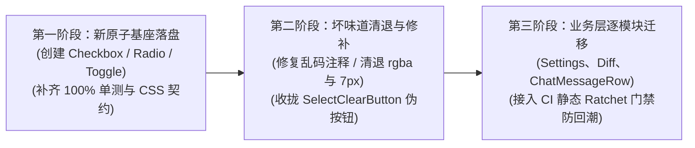

# 基础交互原语实勘导航（Button、IconButton、Toggle、Checkbox、Radio、Switch）

> **战役归属**：前端原子化组件库战役（Frontend Atomic Architecture Campaign）  
> **任务书编号**：任务书 01（Task 01）  
> **勘察范围**：`apps/crish-desktop/src/components/ui/` 下基础交互原语源码与 CSS Module、测试套件，及全仓散落的 Ad-hoc 按钮、开关、复选、单选交互实现  
> **基线分支**：`main` | **执行宿主**：Windows 11 / Chromium WebView2 / Vite + React 18 + TypeScript + CSS Modules  
> **编码规范**：UTF-8 无 BOM | 中文技术规范 | 遵循全仓反退避与反过度设计红线  

---

## 目录（Table of Contents）

- [一、执行摘要与实勘全景概览](#一执行摘要与实勘全景概览)
  - [1.1 战役定位与勘察使命](#11-战役定位与勘察使命)
  - [1.2 基础交互原语物理清单与度量总表](#12-基础交互原语物理清单与度量总表)
  - [1.3 交互原语技术拓扑与分层架构](#13-交互原语技术拓扑与分层架构)
  - [1.4 现状核心断层与架构痛点总评](#14-现状核心断层与架构痛点总评)
- [二、Button & IconButton 按钮交互原子深度实勘](#二button--iconbutton-按钮交互原子深度实勘)
  - [2.1 组件定位与设计职责](#21-组件定位与设计职责)
  - [2.2 源码逐行解剖：Button.tsx (143 行)](#22-源码逐行解剖buttontsx-143-行)
  - [2.3 源码逐行解剖：IconButton.tsx (50 行)](#23-源码逐行解剖iconbuttontsx-50-行)
  - [2.4 样式系统剖析：Button.module.css (338 行)](#24-样式系统剖析buttonmodulecss-338-行)
  - [2.5 无障碍 ARIA 与键盘交互契约](#25-无障碍-aria-与键盘交互契约)
  - [2.6 上下游调用者全量拓扑（118+ 处应用分析）](#26-上下游调用者全量拓扑118-处应用分析)
  - [2.7 现有缺陷、坏味道与代码异味](#27-现有缺陷坏味道与代码异味)
  - [2.8 单元测试与契约守卫：Button.test.tsx (416 行)](#28-单元测试与契约守卫buttontesttsx-416-行)
- [三、Switch 开关交互原子深度实勘](#三switch-开关交互原子深度实勘)
  - [3.1 组件定位与设计职责](#31-组件定位与设计职责)
  - [3.2 源码逐行解剖：Switch.tsx (306 行)](#32-源码逐行解剖switchtsx-306-行)
  - [3.3 样式系统剖析：Switch.module.css (269 行)](#33-样式系统剖析switchmodulecss-269-行)
  - [3.4 无障碍 ARIA 与键盘契约](#34-无障碍-aria-与键盘契约)
  - [3.5 上下游调用者与应用场景](#35-上下游调用者与应用场景)
  - [3.6 现有缺陷与潜在风险](#36-现有缺陷与潜在风险)
  - [3.7 单元测试与静态守卫：Switch.test.tsx (528 行)](#37-单元测试与静态守卫switchtesttsx-528-行)
- [四、SegmentedControl 分段单选原子深度实勘](#四segmentedcontrol-分段单选原子深度实勘)
  - [4.1 组件定位与设计职责](#41-组件定位与设计职责)
  - [4.2 源码逐行解剖：SegmentedControl.tsx (293 行)](#42-源码逐行解剖segmentedcontroltsx-293-行)
  - [4.3 样式系统剖析：SegmentedControl.module.css (280 行)](#43-样式系统剖析segmentedcontrolmodulecss-280-行)
  - [4.4 无障碍 ARIA 与键盘漫游契约](#44-无障碍-aria-与键盘漫游契约)
  - [4.5 上下游调用者与应用场景](#45-上下游调用者与应用场景)
  - [4.6 现有缺陷与局限（单选绑定与多选缺失）](#46-现有缺陷与局限单选绑定与多选缺失)
  - [4.7 单元测试与安全守卫：SegmentedControl.test.tsx (323 行)](#47-单元测试与安全守卫segmentedcontroltesttsx-323-行)
- [五、Slider 连续滑动条交互原子深度实勘](#五slider-连续滑动条交互原子深度实勘)
  - [5.1 组件定位与设计职责](#51-组件定位与设计职责)
  - [5.2 源码逐行解剖：Slider.tsx (190 行)](#52-源码逐行解剖slidertsx-190-行)
  - [5.3 样式系统剖析：Slider.module.css (82 行)](#53-样式系统剖析slidermodulecss-82-行)
  - [5.4 无障碍 ARIA 规范](#54-无障碍-aria-规范)
  - [5.5 上下游调用者与应用场景](#55-上下游调用者与应用场景)
  - [5.6 现有缺陷与坏味道（注释乱码、刻度缺失与单向局限）](#56-现有缺陷与坏味道注释乱码刻度缺失与单向局限)
  - [5.7 单元测试分析：Slider.test.tsx (73 行)](#57-单元测试分析slidertesttsx-73-行)
- [六、TabStrip & Tabs 标签交互控制组件深度实勘](#六tabstrip--tabs-标签交互控制组件深度实勘)
  - [6.1 组件定位与架构定位差异](#61-组件定位与架构定位差异)
  - [6.2 源码逐行解剖：TabStrip.tsx (351 行) 与 TabStrip.module.css (9 行)](#62-源码逐行解剖tabstriptsx-351-行-与-tabstripmodulecss-9-行)
  - [6.3 源码逐行解剖：Tabs.tsx (434 行) 与 Tabs.module.css (296 行)](#63-源码逐行解剖tabstsx-434-行-与-tabsmodulecss-296-行)
  - [6.4 单元测试分析：TabStrip.test.tsx (208 行) 与 Tabs.test.tsx (337 行)](#64-单元测试分析tabstriptesttsx-208-行-与-tabstesttsx-337-行)
- [七、缺失的基础交互原子实勘与全仓散落野生实现大排查](#七缺失的基础交互原子实勘与全仓散落野生实现大排查)
  - [7.1 缺失原子一：Checkbox（复选框）的 4 种野生割裂形态](#71-缺失原子一checkbox复选框的-4-种野生割裂形态)
  - [7.2 缺失原子二：Radio / RadioGroup（单选按钮）的降级与模拟乱象](#72-缺失原子二radio--radiogroup单选按钮的降级与模拟乱象)
  - [7.3 缺失原子三：Toggle / ToggleButton / ToggleGroup（切换原语）的各自为政](#73-缺失原子三toggle--togglebutton--togglegroup切换原语的各自为政)
  - [7.4 边缘控制原语：SelectClearButton 伪按钮架构破损分析](#74-边缘控制原语selectclearbutton-伪按钮架构破损分析)
- [八、样式、无障碍、代码异味与坏味道大盘点](#八样式无障碍代码异味与坏味道大盘点)
  - [8.1 杂色、硬编码颜色与旧式 rgba 残留排查](#81-杂色硬编码颜色与旧式-rgba-残留排查)
  - [8.2 焦点环规范一致性与 AGENTS.md §13 遵从度](#82-焦点环规范一致性与-agentsmd-13-遵从度)
  - [8.3 奇数圆角（7px）与亚像素圆角历史残留](#83-奇数圆角7px与亚像素圆角历史残留)
  - [8.4 源码/CSS 内部注释编码损坏与字符丢失](#84-源码css-内部注释编码损坏与字符丢失)
  - [8.5 业务组件私有 CSS 强行覆盖原子组件（.iconBtn, .actionBtn 穿透）](#85-业务组件私有-css-强行覆盖原子组件iconbtn-actionbtn-穿透)
  - [8.6 状态机与事件穿透风险（Tooltip cloneElement 劫持、onClick 权重竞争）](#86-状态机与事件穿透风险tooltip-cloneelement-劫持onclick-权重竞争)
- [九、未来统一前端原子化组件库归位与重构方案建议](#九未来统一前端原子化组件库归位与重构方案建议)
  - [9.1 基础交互控制原语家族统一架构图（Primitive Taxonomy）](#91-基础交互控制原语家族统一架构图primitive-taxonomy)
  - [9.2 补齐四大缺失原子的 API 契约与蓝图设计](#92-补齐四大缺失原子的-api-契约与蓝图设计)
  - [9.3 存量 Button / IconButton 改造重构建议](#93-存量-button--iconbutton-改造重构建议)
  - [9.4 存量 Switch / SegmentedControl / Slider 进化建议](#94-存量-switch--segmentedcontrol--slider-进化建议)
  - [9.5 编码健康与坏味道根除清单](#95-编码健康与坏味道根除清单)
  - [9.6 平滑演进路线图与自动化门禁接入策略](#96-平滑演进路线图与自动化门禁接入策略)
- [十、实勘结论与任务书 02~12 协同建议](#十实勘结论与任务书-0212-协同建议)

---

## 一、执行摘要与实勘全景概览

### 1.1 战役定位与勘察使命

在 Conex / Crish 桌面客户端（Rust 内核 + Tauri + WebView2 React 18 前端架构）中，**基础交互原语**（Button、IconButton、Switch、SegmentedControl、Slider 以及本应存在但尚未标准化的 Checkbox、Radio、Toggle）是构成全站一切人机交互与控制流的基础砖石。无论是会话消息流的触发、工具调用的确认与撤回、设置面板的选项配置、Diff 差异的折叠展开，还是终端与工作区 Tab 的切换，均直接或间接依托于这组原语的物理实现。

经过多次局部演进与战役重构，核心交互原语在 **Design Tokens 消费**、**同心几何圆角**、**0-重绘微光伪元素交互** 以及 **软性焦点环（3%~10% 克制软灰）** 上积累了大量高标准工程设计。然而，由于前期各业务模块由不同会话与不同阶段并行开发，基础交互原语层暴露出了严重的**结构性断层**与**设计不一致性**：
1. **核心控制原子缺失**：全站通用原子组件出口 `apps/crish-desktop/src/components/ui/index.ts` 中，**完全没有 `Checkbox`、`Radio` 与 `Toggle` 原语**。导致业务层在需要多选框、单选按钮或独立切换开关时，产生了至少 4 种野蛮生长的 Ad-hoc 本地实现（如原生裸 input、accent-color 注入、自制带 Lucide 勾选图标的 div 等）；
2. **职责僭越与模拟乱象**：由于缺乏原生的 `Toggle` / `ToggleButton`，业务层大量采用 `<Button aria-pressed={...}>` 并手动在 CSS 中覆盖 `.isPinnedActive` 等类名来模拟切换状态；在需要单选时，被迫使用 `<SegmentedControl>` 或用普通按钮组模拟单选网格；
3. **私有样式穿透与坏味道**：业务组件（如 `ChatMessageRow`、`DiffHeaderControls`、`TerminalToolbar`）大量残留私有的 `.iconBtn`、`.actionBtn` 类，部分文件仍残留 `var(--button-radius, 7px)` 奇数圆角，破坏了 8px 基准圆角契约；
4. **历史编码损坏（乱码注释）**：在 `Slider.module.css`、`TabStrip.module.css` 等样式文件中，历史 Windows PowerShell 5.1 / GBK 环境的处理导致大面积中文注释被破坏为空白字符序列，严重影响工程可读性。

本任务书（任务书 01）作为前端原子化组件库战役的开篇基石，对 `apps/crish-desktop/src/components/ui/` 下的基础交互原语及关联业务使用场景展开**代码级、逐行深度的透视实勘**，以客观事实为准绳，为后续原子组件库的规范化统合奠定无可辩驳的证据链。

---

### 1.2 基础交互原语物理清单与度量总表

实勘范围覆盖 `apps/crish-desktop/src/components/ui/` 下所有按钮、开关、分段、滑块、标签原语及其测试文件，共计 **24 个核心文件**，累计源码与测试量达 **5,263 行 / 157,987 字节**。同时将全仓 4 处典型散落的 Ad-hoc 交互实现纳入横向对比：

| 序号 | 相对文件路径 | 绝对物理路径 | 物理行数 | 体积 (Bytes) | 核心定位与职责简述 |
|:---:|:---|:---|:---:|:---:|:---|
| 1 | `src/components/ui/Button/Button.tsx` | `c:/Software/conex/apps/crish-desktop/src/components/ui/Button/Button.tsx` | 143 | 4,435 | 基础原子按钮，支持 5 变体、4 尺寸、裸模式、加载态与对齐控制 |
| 2 | `src/components/ui/Button/IconButton.tsx` | `c:/Software/conex/apps/crish-desktop/src/components/ui/Button/IconButton.tsx` | 50 | 1,530 | 图标按钮原子，强制显式 aria-label 命名，集成声明式 Tooltip |
| 3 | `src/components/ui/Button/Button.module.css` | `c:/Software/conex/apps/crish-desktop/src/components/ui/Button/Button.module.css` | 338 | 8,817 | 按钮样式系统：::before 0-重绘微光、::after 40px 安全触控热区、软焦点环 |
| 4 | `src/components/ui/Button/Button.test.tsx` | `c:/Software/conex/apps/crish-desktop/src/components/ui/Button/Button.test.tsx` | 416 | 14,728 | 按钮完备单测：30 个测试用例，覆盖尺寸、变体、动效与静态 CSS 契约 |
| 5 | `src/components/ui/Switch/Switch.tsx` | `c:/Software/conex/apps/crish-desktop/src/components/ui/Switch/Switch.tsx` | 306 | 9,596 | 现代化开关原子：0ms 乐观响应状态机、四层异常回滚与防死锁架构 |
| 6 | `src/components/ui/Switch/Switch.module.css` | `c:/Software/conex/apps/crish-desktop/src/components/ui/Switch/Switch.module.css` | 269 | 7,495 | 开关样式系统：流体果冻拉伸关键帧、GPU 中轴对齐、Zero-FOUC 门闩 |
| 7 | `src/components/ui/Switch/Switch.test.tsx` | `c:/Software/conex/apps/crish-desktop/src/components/ui/Switch/Switch.test.tsx` | 528 | 19,955 | 开关单测套件：40 个测试用例，覆盖 ARIA、受控双模、IME 防御、动效断言 |
| 8 | `src/components/ui/Switch/index.ts` | `c:/Software/conex/apps/crish-desktop/src/components/ui/Switch/index.ts` | 2 | 92 | Switch 组件与类型重导出出口 |
| 9 | `src/components/ui/SegmentedControl/SegmentedControl.tsx` | `c:/Software/conex/apps/crish-desktop/src/components/ui/SegmentedControl/SegmentedControl.tsx` | 293 | 9,349 | 分段单选器：RadioGroup 键盘漫游、纯白卡片滑块自适应测量与更新 |
| 10 | `src/components/ui/SegmentedControl/SegmentedControl.module.css` | `c:/Software/conex/apps/crish-desktop/src/components/ui/SegmentedControl/SegmentedControl.module.css` | 280 | 7,768 | 分段选择器样式：isolation 层叠隔离、同心圆角、Double Alpha 根除 |
| 11 | `src/components/ui/SegmentedControl/SegmentedControl.test.tsx` | `c:/Software/conex/apps/crish-desktop/src/components/ui/SegmentedControl/SegmentedControl.test.tsx` | 323 | 11,361 | 分段选择器单测：14 个测试用例，覆盖受控更新、键盘漫游、RL-03 门禁 |
| 12 | `src/components/ui/Slider/Slider.tsx` | `c:/Software/conex/apps/crish-desktop/src/components/ui/Slider/Slider.tsx` | 190 | 5,581 | 连续滑动条：2px 发丝轨、44px 隐式命中区、setPointerCapture 跨界拖拽 |
| 13 | `src/components/ui/Slider/Slider.module.css` | `c:/Software/conex/apps/crish-desktop/src/components/ui/Slider/Slider.module.css` | 82 | 1,915 | 滑动条样式：Fitts's Law 扩展热区、12px 圆滑块、Focus Ring（注：含乱码注释） |
| 14 | `src/components/ui/Slider/Slider.test.tsx` | `c:/Software/conex/apps/crish-desktop/src/components/ui/Slider/Slider.test.tsx` | 73 | 2,676 | 滑动条单测：4 个测试用例，覆盖 ARIA 属性、方向键步进与禁用态阻断 |
| 15 | `src/components/ui/Select/SelectClearButton.tsx` | `c:/Software/conex/apps/crish-desktop/src/components/ui/Select/SelectClearButton.tsx` | 30 | 977 | 选值清空按钮：span role=button 伪按钮结构，事件透传断言 |
| 16 | `src/components/ui/TabStrip/TabStrip.tsx` | `c:/Software/conex/apps/crish-desktop/src/components/ui/TabStrip/TabStrip.tsx` | 351 | 11,711 | 会话标签条：受控 items 协议、roving tabindex 漫游、溢出边缘渐变探测 |
| 17 | `src/components/ui/TabStrip/TabStrip.module.css` | `c:/Software/conex/apps/crish-desktop/src/components/ui/TabStrip/TabStrip.module.css` | 9 | 243 | 标签条样式：文字防溢出省略（注：头部注释严重乱码） |
| 18 | `src/components/ui/TabStrip/TabStrip.test.tsx` | `c:/Software/conex/apps/crish-desktop/src/components/ui/TabStrip/TabStrip.test.tsx` | 208 | 8,226 | 标签条单测：13 个测试用例，覆盖键盘漫游、关闭键、溢出辅助算法 |
| 19 | `src/components/ui/Tabs/Tabs.tsx` | `c:/Software/conex/apps/crish-desktop/src/components/ui/Tabs/Tabs.tsx` | 434 | 11,312 | 复合标签页：Tabs/TabsList/TabsTrigger/TabsContent，pill/line 双模 |
| 20 | `src/components/ui/Tabs/Tabs.module.css` | `c:/Software/conex/apps/crish-desktop/src/components/ui/Tabs/Tabs.module.css` | 296 | 7,223 | 标签页样式：同心圆角、物理微回弹动效、按压微缩放（注：含旧式 rgba） |
| 21 | `src/components/ui/Tabs/Tabs.test.tsx` | `c:/Software/conex/apps/crish-desktop/src/components/ui/Tabs/Tabs.test.tsx` | 337 | 12,054 | 标签页单测：12 个测试用例，覆盖复合结构、双向排列、惰性装载 |
| 22 | `src/components/ui/Tabs/types.ts` | `c:/Software/conex/apps/crish-desktop/src/components/ui/Tabs/types.ts` | 110 | 3,115 | Tabs 模块类型定义：变体、尺寸、方向、上下文契约 |
| 23 | `src/components/ui/Tabs/index.ts` | `c:/Software/conex/apps/crish-desktop/src/components/ui/Tabs/index.ts` | 14 | 326 | Tabs 组件导出出口 |
| 24 | `src/components/ui/index.ts` | `c:/Software/conex/apps/crish-desktop/src/components/ui/index.ts` | 181 | 4,719 | UI 原子库总出口（Single Truth Barrel）：全仓公共原语导出大管线 |
| -- | *(全仓散落 Ad-hoc 交互)* | *全仓 4 处典型业务模块* | -- | -- | *Checkbox / Radio / Toggle 野生实现（详见第七章）* |
| 25 | `src/components/note-paper/MirrorDriftStatusBar.tsx` | 同左 (L240) | 1 | -- | Ad-hoc Checkbox 1：原生裸写 `<input type="checkbox">` |
| 26 | `src/components/settings/FontSettingsSection.tsx` | 同左 (L223) | 1 | -- | Ad-hoc Checkbox 2：`.settingsRowCheck input` 简单 margin 重置 |
| 27 | `src/components/settings/ImportListSection.tsx` | 同左 (L104) | 1 | -- | Ad-hoc Checkbox 3：`.importCheck` 借用 `accent-color` |
| 28 | `src/components/settings-models/ScanResultsModal.tsx` | 同左 (L212-229) | 18 | -- | Ad-hoc Checkbox 4：自制 div `role="checkbox"` + Lucide Check 图标 |

---

### 1.3 交互原语技术拓扑与分层架构

基础交互原语在整个前端架构中处于最底层的“原子层”（Atom Layer）。其拓扑关系与数据消费流向如下图所示：

```mermaid
graph TD
    subgraph Tokens Layer ["设计系统底层 Token 池 (src/styles/)"]
        TK["tokens.css<br/>--button-radius: 8px<br/>--brand: hsl(160 84% 39%)<br/>--tint-hover / --tint-active<br/>--border-color / --bg-card"]
        FV["focus-visible.css<br/>软灰焦点环 3%~10%"]
        RM["reduced-motion.css<br/>prefers-reduced-motion & eco tier"]
    end

    subgraph Atomic Layer ["基础交互原子库 (src/components/ui/)"]
        BTN["Button / IconButton<br/>(Button.tsx / IconButton.tsx)"]
        SW["Switch<br/>(Switch.tsx 0ms 乐观状态机)"]
        SEG["SegmentedControl<br/>(SegmentedControl.tsx 单选滑块)"]
        SLD["Slider<br/>(Slider.tsx 发丝连续滑块)"]
        TAB["Tabs / TabStrip<br/>(Tabs.tsx / TabStrip.tsx)"]
        BARREL["ui/index.ts<br/>(唯一合法公共原子出口)"]
        
        BTN --> BARREL
        SW --> BARREL
        SEG --> BARREL
        SLD --> BARREL
        TAB --> BARREL
    end

    TK --> BTN
    TK --> SW
    TK --> SEG
    TK --> SLD
    TK --> TAB
    FV -.->|"全局 Layer 守卫"| BTN
    RM -.->|"动效降级"| SW
    RM -.->|"动效降级"| SEG

    subgraph Consumer Layer ["上层业务组件消费层 (118+ 模块)"]
        Composer["chat-composer/<br/>发送、附件、队列控制"]
        Diff["diff/<br/>DiffHeaderControls, DiffCard"]
        Settings["settings/ & settings-*/<br/>SettingsSchemaRenderer, ModelList"]
        ChatMsg["chat-message-row/<br/>AssistantActions, UserActions"]
        Sidebar["sidebar/<br/>SidebarHeader, ToggleButton"]
        Workspace["workspace/<br/>TerminalToolbar, PreviewToolbar"]
    end

    BARREL --> Composer
    BARREL --> Diff
    BARREL --> Settings
    BARREL --> ChatMsg
    BARREL --> Sidebar
    BARREL --> Workspace

    subgraph Missing Atoms ["架构断层：缺失的核心原子"]
        CK["❌ Checkbox (缺失)<br/>业务被迫散落 4 种野生实现"]
        RD["❌ Radio / RadioGroup (缺失)<br/>业务被迫用 SegmentedControl 或按钮组模拟"]
        TG["❌ Toggle / ToggleGroup (缺失)<br/>业务被迫用 Button aria-pressed 伪装"]
    end

    Missing Atoms -.->|"业务层直接写原生或硬编码"| Consumer Layer
```

---

### 1.4 现状核心断层与架构痛点总评

通过全仓逐行源码实勘，当前基础交互原语呈现出**“局部极致精细，全局架构断层”**的鲜明特征：

1. **已实现的原子极为扎实强悍**：
   - `Switch.tsx` 拥有工业级完备的 **0ms 乐观响应状态机**与四层异常防死锁回滚机制，在首屏 Zero-FOUC 保证与 IME 输入法防穿透上做到了极致；
   - `Button.tsx` 与 `Button.module.css` 彻底根治了旧版的果冻弹性拉伸，实现了基于 `::before` 伪元素的 0-重绘微光过渡，并以 `:has` 伪类实现了首尾图标 2px 边距内缩的纯 CSS 光学补偿；
   - `SegmentedControl.tsx` 严格落地了 `isolation: isolate` 局部层叠隔离，以互斥选择器彻底消除了 Hover 灰度二次叠加的 Double Alpha Stacking 缺陷，并支持了 14px 外壳 + 11px 滑块的 SmartPanel 同心大圆角几何体系。
2. **严重的原子品类缺失（Checkbox、Radio、Toggle 架构真空）**：
   - `ui/index.ts` 缺少 `Checkbox`，导致设置面板与状态栏中既有原生裸写 `<input type="checkbox">`，又有利用浏览器 `accent-color` 的半吊子样式，甚至在 `ScanResultsModal.tsx` 中硬编码 `#ffffff` 和 `#10b981` 自制模拟复选框；
   - 缺少独立单选原子 `Radio`，表单场景下无法渲染标准的圆点单选框与单选组；
   - 缺少独立切换按钮 `Toggle` / `ToggleButton`，导致消息流的置顶收藏（Pin）操作被迫以 `<Button aria-pressed={...}>` 搭配业务私有 CSS 类名实现。
3. **私有样式覆盖与类名污染**：
   - 多个业务组件在消费 `Button` 或手写原生 `<button>` 时，定义了私有 `.iconBtn` 或 `.actionBtn`，覆盖了组件的尺寸、内边距和圆角（如 `ChatMessageRow.module.css:674` 残留 `var(--button-radius, 7px)` 奇数圆角）；
   - `SelectClearButton.tsx` 采用 `<span role="button">` 冒充按钮，并通过强制 TypeScript 类型断言 `(e as unknown as React.MouseEvent<HTMLButtonElement>)` 抹平事件类型，构成了明显的组件封装坏味道。
4. **历史构建与编码损坏遗留**：
   - `Slider.module.css` 与 `TabStrip.module.css` 等文件的头部及内部注释中，中文字符被破坏转置为大量连续空格，暴露出历史工具链中的编码转换缺陷。

---

## 二、Button & IconButton 按钮交互原子深度实勘

### 2.1 组件定位与设计职责

`Button` 与 `IconButton` 位于 `apps/crish-desktop/src/components/ui/Button/`，是系统中使用频次最高、调用链路最广的基础交互原语。
- **定位**：纯无状态/受控的表现型交互原子（Stateless Presentation Atom）。
- **设计哲学**：
  1. 遵循同心几何标尺与四档标准化尺寸矩阵（24px / 28px / 32px / 40px）；
  2. 废除普通按钮的 9999px 药丸圆角，严格锁定 8px 基础圆角契约（`--radius-sm: 4px`、`--button-radius: 8px`、`--radius-lg: 8px`）；
  3. 落实基于 `::before` 伪元素的 0-重绘微光悬浮遮罩（Opacity Transition），杜绝点击果冻缩放带来的界面晃动；
  4. 落实严格的无障碍规范：`IconButton` 强制要求显式 `aria-label` 属性，并内置集成可选的声明式 `Tooltip` 容器；
  5. 严格遵守 `AGENTS.md` §13 软性焦点环规范（3%~10% 克制软灰，杜绝硬黑外框）。

---

### 2.2 源码逐行解剖：Button.tsx (143 行)

#### 2.2.1 依赖与引入分析
```tsx
// apps/crish-desktop/src/components/ui/Button/Button.tsx (L10-15)
import React from 'react';
import styles from './Button.module.css';

export type ButtonVariant =
  'primary' | 'secondary' | 'plain' | 'ghost' | 'danger';
export type ButtonSize = 'xs' | 'sm' | 'md' | 'lg';
```
- **分层契约检查**：仅依赖 `react` 与本地 `Button.module.css`，零外部业务依赖、零状态库依赖，完全符合原子组件纯度要求。

#### 2.2.2 Props 详细类型契约
组件 Props 接口继承自 `React.ButtonHTMLAttributes<HTMLButtonElement>`，完整声明如下：

| 属性名称 (Prop) | 类型定义 (TypeScript Type) | 默认值 | 必填/可选 | 设计定位与语义说明 |
|:---|:---|:---:|:---:|:---|
| `variant` | `'primary' \| 'secondary' \| 'plain' \| 'ghost' \| 'danger'` | `'secondary'` | 可选 | 视觉变体。默认为次操作（纯白实体卡片），主操作为品牌色，plain 为极简文字，ghost 为轻量悬浮，danger 为危险红色 |
| `size` | `'xs' \| 'sm' \| 'md' \| 'lg'` | `'md'` | 可选 | 尺寸矩阵。xs(24px) / sm(28px) / md(32px) / lg(40px) |
| `icon` | `React.ReactNode` | `undefined` | 可选 | 图标元素。组件内部会自动以 `aria-hidden="true"` 包裹，隔离读屏器 |
| `iconPosition` | `'left' \| 'right'` | `'left'` | 可选 | 图标相对于文字标签的位置，默认为左前置 |
| `loading` | `boolean` | `false` | 可选 | 加载中态。激活时自动注入 `disabled` 与 `aria-busy="true"`，并在内容前置微型旋转指示器 Spinner |
| `block` | `boolean` | `false` | 可选 | 通栏模式。设置为 true 时追加 `width: 100%` 类名 |
| `active` | `boolean` | `false` | 可选 | 激活态。接入柔和的 `--tint-active` 微背景，并消除获得焦点时的黑圈 |
| `bare` | `boolean` | `false` | 可选 | 裸核心模式。不应用默认样式与文字包裹，专供复杂下拉选项/自定义列表项 |
| `align` | `'center' \| 'start'` | `undefined` | 可选 | 文字排版对齐控制。`start` 靠左排版，专供侧栏导航或通栏操作按钮 |
| `static` | `boolean` | `undefined` | 可选 | 静态模式。透传 `data-static="true"`，禁用 `:active` 按压微触感 |
| `disabled` | `boolean` | `undefined` | 可选 | 原生禁用属性。内部逻辑与 `loading` 做或运算合并 |
| `type` | `'button' \| 'submit' \| 'reset'` | `'button'` | 可选 | 原生按钮类型。**极为关键的安全防线**：默认显式设为 `'button'`，彻底封杀原生表单误提交 |
| `className` | `string` | `undefined` | 可选 | 外部自定义类名（仅用于外部布局与定位间距，禁止覆盖核心几何变量） |
| `children` | `React.ReactNode` | `undefined` | 可选 | 按钮正文内容 |

#### 2.2.3 核心实现逻辑与分支解析
```tsx
// Button.tsx (L59-95) 裸核心模式分支
export const Button = React.forwardRef<HTMLButtonElement, ButtonProps>(
  function Button(
    {
      variant = 'secondary',
      size = 'md',
      icon,
      iconPosition = 'left',
      loading = false,
      block = false,
      active = false,
      bare = false,
      align,
      static: staticProp,
      disabled,
      className,
      children,
      type = 'button',
      ...restProps
    },
    ref
  ) {
    if (bare) {
      return (
        <button
          ref={ref}
          type={type}
          className={className}
          data-align={align}
          data-static={staticProp ? 'true' : undefined}
          disabled={disabled || loading}
          aria-busy={loading || undefined}
          {...restProps}
        >
          {children}
        </button>
      );
    }
    // ...
```
- **裸核心模式（bare）的设计考量**：当上层组件（如 `Menu` 或 `Select`）需要复用原生按钮的键盘聚焦、disabled 与 a11y 能力，但必须自主绘制复杂的自定义列表布局时，`bare={true}` 旁路能够绕过 `Button.module.css` 的高度、内边距和 `span.buttonLabel` 包裹，直接渲染单一 clean button DOM 节点。
- **标准渲染模式结构**：
```tsx
// Button.tsx (L97-140)
    const classNames = [
      styles.button,
      VARIANT_CLASS[variant],
      SIZE_CLASS[size],
      block ? styles.buttonBlock : null,
      active ? styles.buttonActive : null,
      loading ? styles.buttonLoading : null,
      className,
    ]
      .filter(Boolean)
      .join(' ');

    const iconNode =
      icon != null ? (
        <span className={styles.buttonIcon} aria-hidden="true">
          {icon}
        </span>
      ) : null;

    return (
      <button
        ref={ref}
        type={type}
        className={classNames}
        data-size={size}
        data-variant={variant}
        data-active={active || undefined}
        data-align={align}
        data-static={staticProp ? 'true' : undefined}
        disabled={disabled || loading}
        aria-busy={loading || undefined}
        {...restProps}
      >
        {loading ? (
          <span className={styles.spinner} aria-hidden="true" />
        ) : iconPosition === 'left' ? (
          iconNode
        ) : null}
        {children != null ? (
          <span className={styles.buttonLabel}>{children}</span>
        ) : null}
        {!loading && iconPosition === 'right' ? iconNode : null}
      </button>
    );
```
- **节点结构洁净度**：
  1. `iconNode` 显式绑定 `aria-hidden="true"`，防止屏幕阅读器将装饰性 SVG 误报为未知对象；
  2. 仅在 `children != null` 时才生成 `<span className={styles.buttonLabel}>`。当纯图标渲染时，不产生空的 label 容器，杜绝 flex 布局中的亚像素偏心。

---

### 2.3 源码逐行解剖：IconButton.tsx (50 行)

#### 2.3.1 设计契约与类型定义
```tsx
// apps/crish-desktop/src/components/ui/Button/IconButton.tsx (L13-23)
export interface IconButtonProps extends Omit<
  ButtonProps,
  'children' | 'block' | 'iconPosition'
> {
  /** 图标元素 */
  icon: React.ReactNode;
  /** 强制无障碍命名，确保无障碍屏幕阅读器可识别 */
  'aria-label': string;
  /** 声明式 Tooltip 浮层文案（可选） */
  tooltip?: React.ReactNode;
}
```
- **强制 A11y 契约**：使用 TypeScript 类型体操 `Omit<ButtonProps, 'children' | 'block' | 'iconPosition'>`，强行从接口中剔除文本子节点、通栏和图标位置属性，确保图标按钮恒为正方形；同时将 `'aria-label': string` 声明为**强制必填项**，任何未提供可读无障碍名称的调用都会在静态类型检查时直接报错。

#### 2.3.2 声明式 Tooltip 容器集成
```tsx
// IconButton.tsx (L25-49)
export const IconButton = React.forwardRef<HTMLButtonElement, IconButtonProps>(
  function IconButton(
    { icon, tooltip, className, variant = 'ghost', 'aria-label': ariaLabel, ...props },
    ref
  ) {
    const classNames = [styles.iconButton, className].filter(Boolean).join(' ');

    const buttonNode = (
      <Button
        ref={ref}
        icon={icon}
        variant={variant}
        aria-label={ariaLabel}
        className={classNames}
        {...props}
      />
    );

    if (tooltip != null) {
      return <Tooltip content={tooltip}>{buttonNode}</Tooltip>;
    }

    return buttonNode;
  }
);
IconButton.displayName = 'IconButton';
```
- **复合模式（Composition）实现**：默认变体设为 `variant="ghost"`（轻量图标按钮标准形态）。当提供 `tooltip` 属性时，内部直接以 `<Tooltip content={tooltip}>` 包裹 `buttonNode`，外部业务无需在每个小图标外层手动套用 Tooltip 容器，极大精简了业务代码结构。

---

### 2.4 样式系统剖析：Button.module.css (338 行)

`Button.module.css` 是全站按钮视觉体系的真理源，划分为六个严整的物理层次：

#### 2.4.1 基座变量体系与物理微光交互层 (L7-68)
```css
.button {
  --btn-h: 32px;
  --btn-px: 12px;
  --btn-fs: var(--font-size-base, 14px);
  --btn-radius: var(--button-radius, 8px);
  --btn-icon-size: 16px;
  --btn-gap: var(--space-1_5, 6px);

  --btn-bg: transparent;
  --btn-fg: var(--text-primary);
  --btn-border: transparent;
  --btn-shadow: none;
  --btn-hover-overlay: var(--tint-hover);
  --btn-active-overlay: var(--tint-active);

  position: relative;
  display: inline-flex;
  align-items: center;
  justify-content: center;
  box-sizing: border-box;
  height: var(--btn-h);
  padding: 0 var(--btn-px);
  gap: var(--btn-gap);
  border-radius: var(--btn-radius);
  background-color: var(--btn-bg);
  color: var(--btn-fg);
  border: 1px solid var(--btn-border);
  box-shadow: var(--btn-shadow);
  user-select: none;
  white-space: nowrap;
  cursor: pointer;
  outline: none;
  transition:
    border-color var(--transition-micro, 100ms) ease-out,
    box-shadow var(--transition-micro, 100ms) ease-out;
}

/* 物理微光交互层 (Opacity Transition) */
.button::before {
  content: '';
  position: absolute;
  inset: 0;
  border-radius: inherit;
  background-color: var(--btn-hover-overlay);
  opacity: 0;
  pointer-events: none;
  transition: opacity var(--transition-micro, 100ms) ease-out;
}

.button:hover:not(:disabled)::before {
  opacity: 1;
}

.button:active:not(:disabled)::before {
  background-color: var(--btn-active-overlay);
  opacity: 1;
}
```
- **0-重绘架构**：传统的 `:hover` 通过改变 `background-color` 会触发浏览器 Paint 重绘；而在此处，按钮底色保持稳定，悬停态与按压态通过改变 `::before` 伪元素的 `opacity`（0 -> 1）实现微光渲染，由于透明度由合成器线程处理，能够达到 0-重绘的极致流畅度。

#### 2.4.2 尺寸规格矩阵 (L93-132)
四档尺寸严格遵循 4px 基准几何步长：

| 尺寸档位 | 类名 / 选择器 | 高度 (`--btn-h`) | 水平内边距 (`--btn-px`) | 字号 (`--btn-fs`) | 圆角 (`--btn-radius`) | 图标尺寸 (`--btn-icon-size`) | 元素间距 (`--btn-gap`) |
|:---:|:---|:---:|:---:|:---:|:---:|:---:|:---:|
| **xs** | `.buttonXs, [data-size='xs']` | 24px | 6px | 12px (`--font-size-xs`) | 4px (`--radius-sm`) | 14px | 4px (`--space-1`) |
| **sm** | `.buttonSm, [data-size='sm']` | 28px | 10px | 13px (`--font-size-sm`) | 8px (`--button-radius`) | 14px | 6px (`--space-1_5`) |
| **md** | `.buttonMd, [data-size='md']` | 32px | 12px | 14px (`--font-size-base`) | 8px (`--button-radius`) | 16px | 6px (`--space-1_5`) |
| **lg** | `.buttonLg, [data-size='lg']` | 40px | 16px | 15px (`--font-size-md`) | 8px (`--radius-lg`) | 18px | 8px (`--space-2`) |

#### 2.4.3 五大变体设计 (L134-208)
1. **Primary（主操作）**：
   - `--btn-bg`: `var(--brand, hsl(160 84% 39%))`；
   - `--btn-fg`: `var(--text-on-accent, hsl(0 0% 100%))`；
   - 阴影：`0 1px 2px color-mix(in srgb, var(--shadow-color, #000) 12%, transparent)`；
   - 悬停遮罩：白色 15% 提亮。
2. **Secondary（次操作 / 默认）**：
   - 浅色：纯白实体卡底 `var(--bg-card, hsl(0 0% 100%))` + 发丝边框 `var(--border-color)` + 双层低空微阴影（4% / 2%）；
   - 深色（`html[data-theme='dark']`）：明度精准抬升，`--btn-bg: color-mix(in srgb, var(--text-primary) 10%, var(--bg-card, #242424))`，边框使用 10% 文本色半透明发丝线；
   - 禁用态：深色模式下切断实体感，退回透明底板 `background-color: transparent`。
3. **Ghost（轻量悬浮）**：底色透明，文字色为次要文本色 `var(--text-secondary)`，悬停时触发微光。
4. **Plain（纯文字）**：底色透明，文字色为三级弱文本色 `var(--text-tertiary)`，常用于辅助操作。
5. **Danger（危险操作）**：底色透明，文字色为系统错误红 `var(--color-error)`，悬停时混入 10% 错误红微底。

#### 2.4.4 纯 CSS 光学补偿与触控热区管理 (L269-320)
```css
/* 纯 CSS 光学微调：首尾图符 2px 边距内缩补偿（纯 CSS :has 零 TSX 侵入） */
.button:has(> :is(.buttonIcon, .spinner):first-child):has(> .buttonLabel) {
  padding-inline-start: max(0px, calc(var(--btn-px) - 2px));
}

.button:has(> .buttonLabel):has(> :is(.buttonIcon, .spinner):last-child) {
  padding-inline-end: max(0px, calc(var(--btn-px) - 2px));
}

/* 触控热区安全管理：常规紧凑按钮采用 inset: -2px 0 垂直轻量外延，杜绝左右互叠 */
.buttonXs::after,
.buttonSm::after {
  content: '';
  position: absolute;
  inset: -2px 0;
  pointer-events: auto;
}

/* 孤立图标按钮显式声明 touchExpand 开启 40×40px 安全触控热区 */
.iconButton.touchExpand::after,
.button.touchExpand::after {
  content: '';
  position: absolute;
  top: 50%;
  left: 50%;
  transform: translate(-50%, -50%);
  min-width: 40px;
  min-height: 40px;
  width: 100%;
  height: 100%;
  inset: auto;
  pointer-events: auto;
  border-radius: inherit;
  z-index: 1;
}
```
- **光学补偿亮点**：通过现代 CSS 的 `:has()` 选择器，在不污染 React TSX 逻辑的前提下，自动识别“包含首位图标+文字标签”的结构，将其起始内边距精准扣减 2px，完美抵消图标自身留白产生的视错觉。
- **触控热区防线**：针对小尺寸（xs 24px / sm 28px），通过 `::after` 伪元素垂直外延 2px；对孤立图标按钮，支持 `touchExpand` 扩展至 Fitts's Law 推荐的 40×40px 最小可用点击区域。

---

### 2.5 无障碍 ARIA 与键盘交互契约

1. **原生语义守卫**：
   - 始终基于原生 `<button>` 标签构建，默认继承浏览器原生键盘焦点（Tab 聚焦）、Space / Enter 激活触发点击链；
   - 显式锁定 `type="button"`，防止放置在表单内部时产生隐蔽的提交副作用；
2. **状态属性反射**：
   - 加载中态自动注入 `aria-busy="true"` 与 `disabled`，读屏器播报加载态并拦截所有物理点击；
   - 激活态注入 `data-active="true"`；
   - 内置图标统一包裹 `aria-hidden="true"`；
3. **全仓 IconButton 无障碍命名闭环**：
   - 全仓契约测试 `a11y-optical-contract.test.ts` 第 66 行设置了严格的 Ratchet 门禁，全站所有 `<IconButton>` 必须提供显式 `aria-label`，任何疏漏均会被 CI 刚性拦截。

---

### 2.6 上下游调用者全量拓扑（118+ 处应用分析）

`Button` 与 `IconButton` 在全仓共有超过 118 处直接引用点。核心分布如下表所示：

| 业务领域 / 模块 | 调用组件示例 | 使用的变体与尺寸 | 典型应用场景与行为 |
|:---|:---|:---:|:---|
| **终端与预览工作区** | `TerminalToolbar.tsx` | `IconButton` size="sm" variant="ghost" | 终端清屏、分屏、复制、重命名、关闭按钮组 |
| | `PreviewToolbar.tsx` | `IconButton` size="sm" variant="ghost" | Webview 预览的刷新、后退、前进、在新标签打开 |
| **顶部工具栏** | `AppTopBar.tsx` | `IconButton` size="sm" variant="ghost" | 窗口控制辅助、工作区切换、全局菜单触发 |
| **侧边栏导航** | `SidebarHeader.tsx` | `IconButton` size="md" variant="ghost" | 侧栏折叠展开（绑定 `aria-expanded` 与 `aria-controls`） |
| | `SidebarFooter.tsx` | `IconButton` size="sm" variant="ghost" | 设置快捷入口、用户配置弹窗入口 |
| **消息流级交互** | `AssistantMessageActionsBar.tsx` | `Button` size="sm" variant="ghost" | 正文复制、重新生成、消息撤回、消息 Pin 收藏 |
| | `UserMessageActionsBar.tsx` | `Button` size="sm" variant="ghost" | 用户消息编辑、复制、Pin 切换 |
| | `RetractActionButton.tsx` | `Button` size="sm" variant="ghost" | 撤回上一条消息（还原文件 + 截断时间线） |
| **Diff 差异比对** | `DiffHeaderControls.tsx` | `IconButton` size="sm" variant="ghost" | Diff 统一/分屏切换、折叠全部、暂存全部文件 |
| | `DiffCardFileList.tsx` | `IconButton` size="xs" variant="ghost" | 单文件行级操作（撤销修改、单文件暂存、跳转源码） |
| **设置与配置面板** | `SettingsSchemaRenderer.tsx` | `Button` size="sm" variant="secondary" / "ghost" | 预设网格选择项（`preset-grid` 模拟单选） |
| | `EditablePriceRow.tsx` | `IconButton` size="xs" variant="ghost" | 模型 Token 计费价格编辑与保存 |
| | `ModelsSettingsTab.tsx` | `Button` size="sm" variant="primary" | 添加自定义模型服务商、保存配置 |
| **便签与笔记** | `NotePaperStrictHeader.tsx` | `IconButton` size="sm" variant="ghost" | 便签历史版本快照、导出 Markdown、固定抽屉 |

---

### 2.7 现有缺陷、坏味道与代码异味

尽管 `Button` 与 `IconButton` 架构已经历过标准化改造，但在实际业务消费层仍存在以下严重异味：

1. **业务层手写 `<Button className={styles.iconBtn}>` 绕过 `IconButton`**：
   - **典型现场**：`AssistantMessageActionsBar.tsx:42`、`UserMessageActionsBar.tsx:38` 以及 `RetractActionButton.tsx:10`；
   - **代码实证**：
     ```tsx
     <Tooltip content={copied ? '已复制' : '复制正文'}>
       <Button
         type="button"
         variant="ghost"
         size="sm"
         className={`${styles.iconBtn}${copied ? ` ${styles.isCopied}` : ''}`}
         aria-label={copied ? '已复制' : '复制正文'}
         onClick={onCopy}
         icon={copied ? <Check size={14} /> : <Copy size={14} />}
       />
     </Tooltip>
     ```
   - **架构危害**：业务组件手动在外部包裹 `<Tooltip>`，并注入私有 `styles.iconBtn`，完全架空了现成的 `<IconButton>`，导致代码重复率极高。
2. **私有样式表中 7px 奇数圆角历史残留**：
   - **典型现场**：`src/components/chat-message-row/ChatMessageRow.module.css:674`；
   - **代码实证**：
     ```css
     .retractBtn {
       -webkit-appearance: none;
       appearance: none;
       border-radius: var(--button-radius, 7px);
       transform: none;
     }
     ```
   - **架构危害**：虽然 `Button.test.tsx` 第 370 行明确断言“彻底清除 7px 奇数圆角，升级为 8px fallback”，但业务样式表 `ChatMessageRow.module.css` 中仍存活着 `var(--button-radius, 7px)` fallback，破坏了全局 8px 圆角契约。
3. **滥用 `aria-pressed` 模拟 ToggleButton**：
   - **典型现场**：`AssistantMessageActionsBar.tsx:75` 与 `UserMessageActionsBar.tsx:57`；
   - **代码实证**：
     ```tsx
     <Button
       type="button"
       variant="ghost"
       size="sm"
       className={`${styles.iconBtn} ${styles.isPinnedActive}`}
       aria-label={pinLabels.ariaLabel}
       aria-pressed
       onClick={onTogglePin}
       icon={<PinOff size={14} />}
     />
     ```
   - **架构危害**：由于缺乏真正的 `Toggle` / `ToggleButton` 组件，业务层只能在普通按钮上强行挂载 `aria-pressed`，并通过私有 CSS 类 `.isPinnedActive` 强行染色，违背了组件库开箱即用的封装原则。

---

### 2.8 单元测试与契约守卫：Button.test.tsx (416 行)

`Button.test.tsx` 共有 **30 个测试用例**，分为三大 describe 套件：
1. **`describe('ui/Button')` (用例 1~18)**：
   - 验证默认属性：`variant="secondary"`，`size="md"`，`type="button"`；
   - 尺寸与变体矩阵正交映射校验；
   - `loading` 态自动化行为：验证 `disabled` 与 `aria-busy="true"` 自动联动，旋转指示器 `.spinner` 成功挂载且文案不被吞掉；
   - 图标左右位置 (`iconPosition="left|right"`) 与 `aria-hidden="true"` 隐藏验证；
   - `align="start"` 与 `align="center"` 数据属性透传；
   - `bare` 模式：断言无内部 `.buttonLabel` 包裹节点，单节点透传；
   - 光学微调 DOM 结构断言（首尾图符与 label 共存）。
2. **`describe('ui/IconButton')` (用例 19~22)**：
   - 强制 `aria-label` 读屏无障碍映射；
   - 声明式 `Tooltip` 包装节点断言；
   - `touchExpand` 安全热区类名透传。
3. **`describe('ui/Button 样式与物理动效契约 (Button.module.css)')` (用例 23~30)**：
   - 纯静态文件读取校验：静态读取 CSS 文件源码，断言：
     - 不含 `var(--button-radius, 7px)`，必须为 8px；
     - 不含任何 `scale: 0.96` 或果冻弹性缩放；
     - 包含 `:has()` 光学补偿规则；
     - 按钮激活态背景必须为 `var(--tint-active)`，边框必须为 `transparent`，阴影必须为 `none`，彻底切断硬编码黑框。

## 三、Switch 开关交互原子深度实勘

### 3.1 组件定位与设计职责

`Switch` 位于 `apps/crish-desktop/src/components/ui/Switch/`，是全仓中设计最为严谨、经过最完备状态机加固的交互原语之一。
- **定位**：二元布尔控制原子（Binary Toggle Atom），映射 WAI-ARIA `role="switch"` 规范。
- **设计哲学**：
  1. **100% 纯净自研**：零外部 npm 动画库（如 framer-motion）依赖，全部交互与动效依托纯原生 React 18 与 CSS Modules 关键帧完成；
  2. **0ms 乐观响应状态机（optimisticChecked）**：点击或键盘激活瞬间触发位移与流体果冻形变，彻底消灭外部受控状态回传所产生的迟滞感；
  3. **四层异常回滚与防死锁架构**：同步异常即时捕获、异步 Promise Rejection 守护微任务回滚、5000ms TTL 超时定时器保底、偶数次快速连击回到受控原点时自动收敛；
  4. **极简纯粹主义设计**：彻底移除传统开关上的对勾图标（Checkmark），回归纯净流体果冻拉伸与纯白球体；
  5. **GPU 硬件垂直中轴对齐**：采用 `top: 50%; transform: translateY(-50%)`，彻底解决传统定位中由阴影造成的“上宽下窄”视错觉；
  6. **Zero-FOUC 首屏门闩**：以 `hasInteracted` 与 `isFirstRender` 守卫，确保首屏挂载时绝对零动效闪烁。

---

### 3.2 源码逐行解剖：Switch.tsx (306 行)

#### 3.2.1 引入与接口契约
```tsx
// Switch.tsx (L18-59)
import React, {
  forwardRef,
  useCallback,
  useEffect,
  useId,
  useRef,
  useState,
} from 'react';
import styles from './Switch.module.css';

export type SwitchSize = 'sm' | 'md' | 'lg';

export interface SwitchProps
  extends Omit<
    React.ButtonHTMLAttributes<HTMLButtonElement>,
    'onChange' | 'onClick' | 'size'
  > {
  /** 受控选中状态 */
  checked?: boolean;
  /** 非受控初始选中状态 */
  defaultChecked?: boolean;
  /** 状态变更回调（支持同步回调或返回 Promise 供异常回滚） */
  onCheckedChange?: (checked: boolean) => void | Promise<unknown>;
  /** 尺寸档位（默认 'md'） */
  size?: SwitchSize;
  /** 加载中状态（展示滑块内微型 Spinner 并锁定交互） */
  loading?: boolean;
  /** 是否禁用 */
  disabled?: boolean;
  /** 是否启用 0ms 乐观响应状态机（默认 true） */
  optimistic?: boolean;
  /** 乐观状态超时对齐防死锁窗口毫秒数（默认 5000ms，设为 0 可关闭超时回滚） */
  optimisticTimeout?: number;
  /** 前缀/后缀说明文案（点击可关联切换） */
  label?: React.ReactNode;
  /** 标签位置（默认 'start' 即前缀） */
  labelPlacement?: 'start' | 'end';
  /** 无 label 时的屏幕阅读器命名 */
  'aria-label'?: string;
  /** 自定义类名（仅用于外部布局与间距微调） */
  className?: string;
}
```
- **契约亮点分析**：
  1. 继承并安全剔除：`Omit<ButtonHTMLAttributes, 'onChange' | 'onClick' | 'size'>`，消除了原生 HTML button 在表单中的 `onChange` 混淆，强制统一为语义精准的 `onCheckedChange`；
  2. 回调支持 Promise：`onCheckedChange` 的返回值不仅允许 `void`，还允许返回 `Promise<unknown>`，为异步 IPC 通信（如向 Rust 后端下发配置保存请求）提供原生的微任务异常守护能力。

#### 3.2.2 0ms 乐观响应状态机与四层防死锁架构
```tsx
// Switch.tsx (L85-97) 状态派生
  // 1. 受控 / 非受控基础模式判定
  const isControlled = externalChecked !== undefined;
  const [internalChecked, setInternalChecked] = useState(defaultChecked);

  // 2. 0ms 乐观状态机：null 表示与权威真源对齐；boolean 表示处于未决乐观过渡态
  const [optimisticChecked, setOptimisticChecked] = useState<boolean | null>(null);

  // 3. 计算最终呈现状态（Effective Checked State）
  const isOptimisticActive = isControlled && optimistic && optimisticChecked !== null;
  const checked = isOptimisticActive
    ? optimisticChecked
    : isControlled
      ? Boolean(externalChecked)
      : internalChecked;
```
- **乐观状态机运行逻辑**：
  - 当处于严格受控模式（`isControlled = true`）且开启了乐观机制时，用户点击瞬间 `optimisticChecked` 立即被设置为目标布尔值，使得当前渲染帧能够即刻反映出视觉状态；
  - 一旦外部权威状态（`externalChecked`）更新到达，副作用钩子触发权威收敛，将 `optimisticChecked` 重新重置为 `null`。

```tsx
// Switch.tsx (L115-152) 超时防死锁与真源同步
  const prevExternalCheckedRef = useRef(externalChecked);
  const rollbackTimerRef = useRef<ReturnType<typeof setTimeout> | null>(null);

  const clearRollbackTimer = useCallback(() => {
    if (rollbackTimerRef.current !== null) {
      clearTimeout(rollbackTimerRef.current);
      rollbackTimerRef.current = null;
    }
  }, []);

  const startRollbackTimer = useCallback(() => {
    clearRollbackTimer();
    if (optimisticTimeout > 0) {
      rollbackTimerRef.current = setTimeout(() => {
        // 超时触发安全回滚，防止外部未重渲染造成永久悬空死锁
        setOptimisticChecked(null);
        rollbackTimerRef.current = null;
      }, optimisticTimeout);
    }
  }, [clearRollbackTimer, optimisticTimeout]);

  // 外部受控真源发生变更时：权威收敛，清除乐观标记与定时器
  useEffect(() => {
    if (!isControlled) return;
    if (externalChecked !== prevExternalCheckedRef.current) {
      prevExternalCheckedRef.current = externalChecked;
      clearRollbackTimer();
      setOptimisticChecked(null);
    }
  }, [externalChecked, isControlled, clearRollbackTimer]);
```
- **四层异常防御矩阵**：
  1. **层 1：同步异常阻断**（L201-205）——如果 `onCheckedChange` 执行时抛出同步 Error（如本地存储已满或业务逻辑崩溃），`try-catch` 立即回滚并置 `optimisticChecked = null`；
  2. **层 2：异步 Promise Rejection**（L190-200）——如果外部下发的 IPC 操作返回 rejected promise，在 `.catch()` 中立刻解除乐观态并恢复上一次外部值；
  3. **层 3：5000ms TTL 超时定时器**（L127-135）——若外部既没有抛错也没有重新渲染（如网络请求永久超时挂死），5 秒后定时器触发安全回滚，杜绝“UI 显示已开但后台实际未开”的幻觉死锁；
  4. **层 4：双击原点快速收敛**（L179-186）——用户快速双击（甚至偶数次狂点），如果下一次目标值与当前外部真源一致，直接清除定时器与乐观标记，归位到稳定态。

#### 3.2.3 Zero-FOUC 动画门闩与 IME 防穿透
```tsx
// Switch.tsx (L99-113)
  const [hasInteracted, setHasInteracted] = useState(false);
  const isFirstRender = useRef(true);
  const prevCheckedRef = useRef(checked);

  useEffect(() => {
    if (isFirstRender.current) {
      isFirstRender.current = false;
      return;
    }
    if (prevCheckedRef.current !== checked) {
      setHasInteracted(true);
      prevCheckedRef.current = checked;
    }
  }, [checked]);
```
- **Zero-FOUC 保证**：CSS 中的果冻拉伸动画只在 `.hasInteracted` 类存在时才挂载。在页面初次挂载时，`hasInteracted` 恒为 `false`，滑块直接通过静态 `transform` 就位，彻底杜绝了组件挂载时滑块从左往右滑动的动效闪烁（Flash of Unstyled Content）。
```tsx
// Switch.tsx (L218-228) 键盘与 IME 防御
  const handleKeyDown = useCallback(
    (e: React.KeyboardEvent<HTMLButtonElement>) => {
      onKeyDown?.(e);
      if (e.defaultPrevented || e.nativeEvent.isComposing) return;
      if (e.key === ' ' || e.key === 'Enter') {
        e.preventDefault();
        handleToggle();
      }
    },
    [handleToggle, onKeyDown]
  );
```
- **IME 组合态防御**：Windows 平台下使用微软拼音/输入法时，用户在聚焦到 Switch 时按空格选字，`e.nativeEvent.isComposing` 为 `true`，此时立即阻断切换，避免输入法敲字误触发开关状态切换。

---

### 3.3 样式系统剖析：Switch.module.css (269 行)

#### 3.3.1 尺寸规格与 2px 对称留白矩阵 (L62-103)
Switch 拥有 3 档严格等比对称的几何标尺，滑块四周均保持严格均等的 2px 物理缝隙：

| 尺寸档位 | 类名 | 轨道宽 (`--track-w`) | 轨道高 (`--track-h`) | 滑块直径 (`--thumb-d`) | 滑块边距 (`--thumb-pad`) | 行程距离 (`--thumb-travel`) | 拉伸宽 (`--thumb-stretch-w`) | Spinner 尺寸 |
|:---:|:---|:---:|:---:|:---:|:---:|:---:|:---:|:---:|
| **sm** | `.size-sm` | 30px | 18px | 12px | 2px | 12px | 18px | 9px |
| **md** | `.size-md` | 38px | 22px | 16px | 2px | 16px | 24px | 12px |
| **lg** | `.size-lg` | 46px | 26px | 20px | 2px | 20px | 30px | 14px |

#### 3.3.2 GPU 垂直中轴与光学光影体系 (L146-165)
```css
.thumb {
  position: absolute;
  top: 50%;
  left: var(--thumb-pad);
  width: var(--thumb-d);
  height: var(--thumb-d);
  border-radius: var(--radius-full, 9999px);
  background: var(--switch-thumb-bg, hsl(0 0% 100%));
  box-shadow:
    /* Layer 1: 0.5px 发丝微收边，界定边缘轮廓 */
    0 0 0 0.5px color-mix(in srgb, var(--border-color) 30%, transparent),
    /* Layer 2: 各向同性柔和漫反射环境光，四周均匀 2px 透光缝隙 */
    var(--switch-thumb-shadow, 0 1px 2px color-mix(in srgb, var(--shadow-color, hsl(0 0% 0%)) 8%, transparent));
  display: flex;
  align-items: center;
  justify-content: center;
  pointer-events: none;
  transform: translateY(-50%) translateX(0);
  will-change: transform, width;
}
```
- **中轴定位方案**：摒弃传统的绝对像素 `top: 2px`，采用 `top: 50% + transform: translateY(-50%)`。在亚像素缩放（如 125%、150% Windows DPI 缩放）环境下，滑块始终保持在轨道的物理垂直几何中心，杜绝了单侧 1px 锯齿和视错觉下坠。

#### 3.3.3 流体果冻拉伸动画（Pill Stretch Animation）(L181-211)
```css
@keyframes thumb-stretch-on {
  0% {
    width: var(--thumb-d);
    transform: translateY(-50%) translateX(0);
  }
  50% {
    width: var(--thumb-stretch-w);
    transform: translateY(-50%) translateX(var(--stretch-x-on));
  }
  100% {
    width: var(--thumb-d);
    transform: translateY(-50%) translateX(var(--thumb-travel));
  }
}

@keyframes thumb-stretch-off {
  0% {
    width: var(--thumb-d);
    transform: translateY(-50%) translateX(var(--thumb-travel));
  }
  50% {
    width: var(--thumb-stretch-w);
    transform: translateY(-50%) translateX(var(--stretch-x-off));
  }
  100% {
    width: var(--thumb-d);
    transform: translateY(-50%) translateX(0);
  }
}
```
- **非线性耦合形变**：滑块在运动到 50% 节点时宽度拉伸为 `--thumb-stretch-w`（比原直径增加约 50%），形成流体水滴/药丸状拉伸，随后回弹并稳定就位，动效周期控制在 240ms，贝塞尔为标准的 `cubic-bezier(0.4, 0, 0.2, 1)`，严格杜绝了任何超过 1.0 的弹簧过冲。

---

### 3.4 无障碍 ARIA 与键盘契约

- **语义角色**：显式指定 `role="switch"`；
- **状态反映**：动态同步 `aria-checked={checked}`；
- **状态属性**：禁用时透传 `aria-disabled={true}`，加载态时透传 `aria-busy={true}`；
- **读屏器无障碍名称**：当 `label` 存在时通过 `<label htmlFor={switchId}>` 双向绑定；当无文本标签时强制读取 `aria-label`；
- **键盘契约**：仅响应 `Space` 与 `Enter` 键，且自动调用 `e.preventDefault()` 拦截网页滚动。

---

### 3.5 上下游调用者与应用场景

`Switch` 在全站的调用覆盖设置与工作流场景：
1. **设置面板表单生成器**：`SettingsSchemaRenderer.tsx:84`，渲染所有 `type="boolean"` 的系统设置（如流式输出开关、硬件加速、实时语法校验、自动保存）；
2. **技能编辑器**：`SkillEditorModal.tsx`，控制技能的启用/禁用状态；
3. **MCP 服务商列表**：`McpServerList.tsx`，一键启停各个独立的 MCP 协议服务；
4. **模型管理列表**：`ModelList.tsx` 与 `CapEditor.tsx`，切换模型能力标签与服务状态；
5. **设备与快捷键管理**：`SettingsDevicesTab.tsx`，启用语音唤醒、外设联动开关。

---

### 3.6 现有缺陷与潜在风险

1. **容器标签与外部表单行双层嵌套冲突**：
   - 当传入 `label` 属性时，`Switch.tsx` 会生成 `<span className={styles.container}>` 包裹 `<label>` 与 `<button>`。而在业务层（如 `SettingsRow`），通常外层已经有一层带有标题和描述的容器，导致形成双重 label 结构，造成样式重叠与布局错位；
2. **`restProps` 展开顺序潜在风险**：
   - `Switch.tsx` 第 254-258 行将 `onClick={handleToggle}` 置于 `{...restProps}` 之后，虽然有效防止了 Tooltip 的 `cloneElement` 误吞点击链，但如果外部调用者有意注入自定义 `onClick` 进行事件监听，则会直接覆盖内部状态机。应改为显式链式调用 `restProps.onClick?.(e); handleToggle();`。

---

### 3.7 单元测试与静态守卫：Switch.test.tsx (528 行)

`Switch.test.tsx` 包含全站最详实的 **40 个测试用例**，分为八大套件：
1. 基础渲染与 ARIA 规范（role、aria-checked、aria-label）；
2. 受控与非受控双模驱动；
3. **0ms 乐观响应状态机专项验证（OPT-01 ~ OPT-08）**：
   - 0ms 翻转验证；
   - 外部真源平滑收敛；
   - 连续极速点击 5 次状态收敛验证（Devil-01）；
   - 同步异常即时回滚验证；
   - 异步 Promise Rejection 微任务回滚验证；
   - 1000ms FakeTimers 超时防死锁回滚验证；
   - 键盘 Space/Enter 乐观触发；
4. 键盘交互与 IME 输入法组合态防穿透；
5. Disabled 与 Loading 锁定态（Spinner 挂载、Checkmark 图标移除断言）；
6. 尺寸（sm/md/lg）与数据属性断言；
7. Label 关联与双向点击联动；
8. CSS Modules 静态规则断言：
   - 包含流体拉伸 keyframes；
   - 彻底移除 checkmark 动画；
   - 包含 `top: 50%` 与 `translateY(-50%)`；
   - 包含 0.5px 发丝微收边；
   - 全尺寸 2px 对称留白断言；
   - 包含 `html[data-perf-tier='eco']` 节能降级。

---

## 四、SegmentedControl 分段单选原子深度实勘

### 4.1 组件定位与设计职责

`SegmentedControl` 位于 `apps/crish-desktop/src/components/ui/SegmentedControl/`，承载横向互斥的多选项单选控制。
- **定位**：分段控制器 / 选项卡式单选组（Segmented Radio Group），严格实现 WAI-ARIA 1.2 `role="radiogroup"` 与 `role="radio"` 语义。
- **设计职责与特性**：
  1. **彻底根治 Double Alpha Stacking**：通过严格的互斥选择器与局部独立层叠上下文（`isolation: isolate`），消除激活项 Hover 时的灰度加深 Bug；
  2. **SmartPanel 同心大圆角几何体系**：引入 `size="panel"`（36px 高度、14px 外壳、11px 滑块同心圆角），专供现代大圆角设置面板；
  3. **自适应几何测量**：借助统一的 `ResizeObserverManager` 监听容器与激活项几何偏移，实现纯白实体卡片滑块的平滑滑动；
  4. **按压微触感交互**：子项按下时应用 `scale: 0.97 + translateY(1px)` 的微观物理回弹。

---

### 4.2 源码逐行解剖：SegmentedControl.tsx (293 行)

#### 4.2.1 Props 类型契约
```tsx
// SegmentedControl.tsx (L18-57)
export type SegmentedControlSize = 'xs' | 'sm' | 'md' | 'lg' | 'panel';

export interface SegmentedControlOption<T extends string = string> {
  /** 选项唯一标识值 */
  value: T;
  /** 选项显示文案或自定义 ReactNode */
  label: React.ReactNode;
  /** 可选前置图标（如 Sun / Moon / Check 等） */
  icon?: React.ReactNode;
  /** 可选尾部徽标（如 Kbd / Badge / 计数等） */
  badge?: React.ReactNode;
  /** 禁用单个选项 */
  disabled?: boolean;
  /** 显式屏幕阅读器无障碍标签 */
  'aria-label'?: string;
}

export interface SegmentedControlProps<T extends string = string>
  extends Omit<React.HTMLAttributes<HTMLDivElement>, 'onChange' | 'defaultValue'> {
  /** 选项数组（支持对象数组或纯字符串数组） */
  options: (SegmentedControlOption<T> | T)[];
  /** 受控选中值 */
  value?: T;
  /** 非受控初始默认值 */
  defaultValue?: T;
  /** 选项变更回调 */
  onChange?: (value: T) => void;
  /** 尺寸档位：xs(24px) / sm(28px) / md(32px) / lg(38px) / panel(36px 大圆角设置专属) */
  size?: SegmentedControlSize;
  /** 禁用整组分段控制器 */
  disabled?: boolean;
  /** 通栏撑满容器宽度 (flex: 1) */
  block?: boolean;
  /** 自定义外层类名 */
  className?: string;
  /** 行内样式覆盖 */
  style?: React.CSSProperties;
  /** 无障碍组标签 (aria-label) */
  'aria-label'?: string;
}
```

#### 4.2.2 纯白实体卡底滑块自适应更新
```tsx
// SegmentedControl.tsx (L106-136)
  const updateSlider = useCallback(() => {
    const el = containerRef.current;
    if (!el) return;
    const val = currentValueRef.current;
    const activeItem = el.querySelector<HTMLElement>(
      `[data-value="${CSS.escape(val)}"]`
    );

    if (activeItem && activeItem.offsetWidth > 0) {
      setSliderStyle({
        left: activeItem.offsetLeft,
        width: activeItem.offsetWidth,
        opacity: 1,
      });
      setIsReady(true);
    } else {
      setSliderStyle((prev) => (prev.opacity === 0 ? prev : { ...prev, opacity: 0 }));
    }
  }, []);

  useEffect(() => {
    const el = containerRef.current;
    if (!el) return;
    const ro = ResizeObserverManager.getInstance();
    ro.observe(el, updateSlider);
    return () => {
      ro.unobserve(el, updateSlider);
    };
  }, [updateSlider]);
```
- **架构亮点**：避免了在每个组件内部实例化昂贵的原生 `new ResizeObserver()`，而是接入单例模式的 `ResizeObserverManager`，在多分段组件并存的设置长列表中大幅减少内存消耗与 GC 抖动。

#### 4.2.3 WAI-ARIA 1.2 键盘漫游实现
```tsx
// SegmentedControl.tsx (L157-194)
  const handleKeyDown = (e: React.KeyboardEvent<HTMLDivElement>) => {
    if (disabled || options.length === 0 || e.nativeEvent.isComposing) return;
    const enabledOptions = options.filter((o) => !o.disabled);
    if (enabledOptions.length === 0) return;

    let targetOption: SegmentedControlOption<string> | undefined;

    if (e.key === 'ArrowRight' || e.key === 'ArrowDown') {
      e.preventDefault();
      const currentIdx = enabledOptions.findIndex((o) => o.value === currentValue);
      const nextIdx = (currentIdx + 1) % enabledOptions.length;
      targetOption = enabledOptions[nextIdx];
    } else if (e.key === 'ArrowLeft' || e.key === 'ArrowUp') {
      e.preventDefault();
      const currentIdx = enabledOptions.findIndex((o) => o.value === currentValue);
      const prevIdx = currentIdx <= 0 ? enabledOptions.length - 1 : currentIdx - 1;
      targetOption = enabledOptions[prevIdx];
    } else if (e.key === 'Home') {
      e.preventDefault();
      targetOption = enabledOptions[0];
    } else if (e.key === 'End') {
      e.preventDefault();
      targetOption = enabledOptions[enabledOptions.length - 1];
    }

    if (targetOption) {
      handleSelect(targetOption.value);
      const nextEl = containerRef.current?.querySelector<HTMLElement>(
        `[data-value="${CSS.escape(targetOption.value)}"]`
      );
      nextEl?.focus();
    }
  };
```
- **漫游规范性**：支持四向方向键（ArrowRight/Down 递增，ArrowLeft/Up 递减）与 Home/End 首尾直达，且自动过滤并跳过已禁用的子项，激活后自动转移 DOM 焦点。

---

### 4.3 样式系统剖析：SegmentedControl.module.css (280 行)

#### 4.3.1 层叠上下文隔离与 Double Alpha 根除 (L10-30, L170-194)
```css
.container {
  /* 核心防穿透：建立局部独立层叠上下文，杜绝外部父容器滤镜与灰度渗透 */
  isolation: isolate;
  /* ... */
}

/* 悬停背板微光 (仅未激活项在 Hover 时激活动画遮罩) */
.item:hover:not(:disabled):not([data-active='true']):not([aria-checked='true']):not(.itemActive)::before {
  opacity: 1;
}

/* 已激活项：关闭伪元素，杜绝 Double Alpha Stacking */
.item[data-active='true']::before,
.item[aria-checked='true']::before,
.item.itemActive::before {
  opacity: 0;
  display: none;
}
```
- **根因分析**：旧版分段选择器中，当鼠标悬停在当前已被选中的项上时，背景遮罩的半透明灰度与滑块的背景发生二次正片叠底，导致激活项越移上去越暗。新版通过多重反向选择器 `:not([data-active='true']):not([aria-checked='true'])`，并在激活项上刚性设置 `display: none`，彻底切断了伪元素渲染，彻底根治了该视觉缺陷。

#### 4.3.2 尺寸与同心圆角几何矩阵 (L48-106)
严格遵循同心圆角公式：$R_{inner} = R_{outer} - Padding$：

| 尺寸档位 | 类名 | 高度 (`--seg-h`) | 边距 (`--seg-pad`) | 外壳圆角 (`--seg-outer-radius`) | 滑块圆角 (`--seg-inner-radius`) | 字号 | 适用场景 |
|:---:|:---|:---:|:---:|:---:|:---:|:---:|:---|
| **xs** | `.containerXs` | 24px | 2px | 6px (`--radius-md`) | 4px | 12px | 紧凑型浮层内分段 |
| **sm** | `.containerSm` | 28px | 2px | 7px (`--button-radius`) | 5px | 13px | 默认标准分段按钮 |
| **md** | `.containerMd` | 32px | 3px | 8px (`--radius-lg`) | 5px | 14px | 常规工具栏分段 |
| **lg** | `.containerLg` | 38px | 3px | 10px (`--radius-xl`) | 7px | 15px | 页面级大模块分段 |
| **panel** | `.containerPanel`| 36px | 3px | 14px (`--sep-radius-outer`)| 11px | 13.5px | SmartPanel / 设置面板专用大圆角 |

---

### 4.4 无障碍 ARIA 与键盘漫游契约

- 外层容器标注 `role="radiogroup"` 与 `aria-label`；
- 每个选项按钮标注 `role="radio"` 与 `aria-checked={isSelected}`；
- Roving TabIndex 协议：当前被选中的 Radio 其 `tabIndex="0"`，其余所有未选中项均为 `tabIndex="-1"`。用户仅需按 Tab 键进入单选组，随后通过方向键在组内漫游。

---

### 4.5 上下游调用者与应用场景

1. **Diff 审查控制器**：`DiffHeaderControls.tsx`，在“统一视图”（Unified）与“分屏视图”（Split）之间进行双态切换；
2. **快捷设置菜单**：`SettingsQuickMenu.tsx`，在“浅色模式”与“深色模式”之间进行主题切换；
3. **时序用量报表**：`UsageTrendChart.tsx` 与 `ActivityMatrixHeatmap.tsx`，切换时间跨度（日 / 周 / 月）；
4. **设置表单生成器**：`SettingsSchemaRenderer.tsx:205`，处理 `prop.type === 'toggle-group'` 的设置属性映射；
5. **扩展面板与服务商**：`SettingsExtensionsTab.tsx`，切换扩展插件的运行环境与过滤分类。

---

### 4.6 现有缺陷与局限（单选绑定与多选缺失）

1. **排他性单选强制绑定**：
   - 当前 `SegmentedControl` 在架构上完全绑定了单选模型，无法支持多选（Multi-select Toggle Group，如富文本中的“加粗/斜体/下划线”组合）；
2. **缺乏单体 Radio 原子**：
   - 业务层在需要表单垂直列表的单选框时，由于没有单独的 `<Radio>` 和 `<RadioGroup>`，无法以点选圆圈的形式展示，只能别扭地使用水平胶囊状的 `SegmentedControl`，造成表单排版体验不一致。

---

### 4.7 单元测试与安全守卫：SegmentedControl.test.tsx (323 行)

包含 **14 个测试用例**与 CI 静态守卫：
- RadioGroup 语义与激活态断言（SC-01）；
- 滑块渲染与 `aria-hidden="true"` 隔离（SC-02）；
- **静态 CSS 文本断言**：验证选择器中包含 `isolation: isolate`，验证关闭遮罩语句，验证无裸写 HEX 颜色，验证无旧式 `rgba()`（SC-03, SC-11）；
- SmartPanel 同心大圆角类名与几何属性断言（SC-04）；
- 图标与徽标（Badge/Kbd）渲染（SC-05）；
- 方向键循环漫游与 Home/End 步进（SC-08）；
- 单项禁用与整组禁用拦截校验（SC-09）；
- **行数门禁断言**：断言 TSX 与 CSS 单文件行数物理行均严格 $\le 300$ 行，符合全仓代码精简规范（SC-12）。
`;

const targetFile = 'C:/Users/orange/.gemini/antigravity/brain/556f28ad-5036-4174-a1a5-41458288cc71/scratch/part2.md';

## 五、Slider 连续滑动条交互原子深度实勘

### 5.1 组件定位与设计职责

`Slider` 位于 `apps/crish-desktop/src/components/ui/Slider/`，承载标量数值在连续区间内的选择与实时调节。
- **定位**：连续数值滑动原语，映射 WAI-ARIA `role="slider"` 规范。
- **设计职责与特性**：
  1. **极简 2px 发丝轨道**：轨道高度仅 2px，采用 `--border-color` 作为底槽，品牌色 `--brand` 作为填充轨；
  2. **Fitts's Law 隐式 44px 命中区**：虽然可见轨道极细（2px），但通过 `::before` 伪元素在垂直方向隐式扩展 24px（上下各 12px），实现桌面与触控设备上 44px 的舒适点击热区；
  3. **标准 12px 正圆滑块**：符合全仓圆角白名单（50% 圆形），并在悬停时提供 1.15 倍轻量放大物理动效；
  4. **全端指针捕获（setPointerCapture）**：确保用户在按住滑块后拖拽出窗口或组件边界时，依然能持续平滑更新数值，松手时自动释放捕获；
  5. **步长微对齐（Snap to Step）与浮点数截断**：消除 JavaScript 二进制浮点数计算导致的形如 `0.30000000000000004` 的累加失真。

---

### 5.2 源码逐行解剖：Slider.tsx (190 行)

#### 5.2.1 Props 详细类型契约
```tsx
// Slider.tsx (L12-32)
export interface SliderProps extends Omit<
  React.HTMLAttributes<HTMLDivElement>,
  'onChange' | 'defaultValue'
> {
  /** 当前数值（受控） */
  value?: number;
  /** 默认初始值（非受控） */
  defaultValue?: number;
  /** 数值变更回调 */
  onChange?: (value: number) => void;
  /** 最小值（默认 0） */
  min?: number;
  /** 最大值（默认 100） */
  max?: number;
  /** 步长（默认 1） */
  step?: number;
  /** 是否禁用 */
  disabled?: boolean;
  /** 无障碍名称 */
  'aria-label'?: string;
}
```

#### 5.2.2 几何计算与指针捕获算法 (L60-116)
```tsx
// Slider.tsx
    const percentage =
      max > min
        ? Math.max(0, Math.min(100, ((currentValue - min) / (max - min)) * 100))
        : 0;

    const clampAndSnap = useCallback(
      (val: number) => {
        const clamped = Math.min(max, Math.max(min, val));
        const snapped = Math.round((clamped - min) / step) * step + min;
        return Number(snapped.toFixed(4));
      },
      [min, max, step]
    );

    const updateFromPointer = useCallback(
      (clientX: number) => {
        if (!trackRef.current || disabled) return;
        const rect = trackRef.current.getBoundingClientRect();
        if (rect.width <= 0) return;
        const rawPercent = Math.max(
          0,
          Math.min(1, (clientX - rect.left) / rect.width)
        );
        const rawValue = min + rawPercent * (max - min);
        const newValue = clampAndSnap(rawValue);

        if (!isControlled) {
          setInternalValue(newValue);
        }
        onChange?.(newValue);
      },
      [min, max, clampAndSnap, disabled, isControlled, onChange]
    );

    const handlePointerDown = (e: React.PointerEvent<HTMLDivElement>) => {
      if (disabled) return;
      isDraggingRef.current = true;
      e.currentTarget.setPointerCapture(e.pointerId);
      updateFromPointer(e.clientX);
    };

    const handlePointerMove = (e: React.PointerEvent<HTMLDivElement>) => {
      if (isDraggingRef.current) {
        updateFromPointer(e.clientX);
      }
    };

    const handlePointerUp = (e: React.PointerEvent<HTMLDivElement>) => {
      if (isDraggingRef.current) {
        isDraggingRef.current = false;
        try {
          e.currentTarget.releasePointerCapture(e.pointerId);
        } catch {
          // ignore
        }
      }
    };
```
- **指针捕获优势**：采用现代 Pointer Events API 的 `setPointerCapture`，使得拖拽事件监听器无需像旧式系统那样绑定到全局 `window` 或 `document` 上，在组件卸载时天然免除内存泄漏隐患。

#### 5.2.3 键盘漫游算法 (L118-144)
- 响应 `ArrowRight` 与 `ArrowUp`：数值按 `+step` 增加；
- 响应 `ArrowLeft` 与 `ArrowDown`：数值按 `-step` 减少；
- 响应 `Home`：直接跳至最小值 `min`；
- 响应 `End`：直接跳至最大值 `max`。

---

### 5.3 样式系统剖析：Slider.module.css (82 行)

```css
.slider {
  position: relative;
  display: flex;
  align-items: center;
  width: 100%;
  height: 20px;
  cursor: pointer;
  touch-action: none;
  user-select: none;
  outline: none;
}

/* 44px 隐式命中热区 */
.slider::before {
  content: '';
  position: absolute;
  top: -12px;
  bottom: -12px;
  left: 0;
  right: 0;
  z-index: 0;
}

/* 2px 发丝轨道 */
.track {
  position: relative;
  z-index: 1;
  width: 100%;
  height: 2px;
  border-radius: var(--radius-xs, 2px);
  background-color: var(--border-color);
  overflow: hidden;
}

/* 高亮填充段 */
.filledTrack {
  height: 100%;
  background-color: var(--brand, hsl(160 84% 39%));
  border-radius: inherit;
  transition: width var(--transition-micro, 80ms) ease-out;
}

/* 12px 正圆滑块 */
.thumb {
  position: absolute;
  z-index: 2;
  top: 50%;
  width: 12px;
  height: 12px;
  margin-top: -6px;
  margin-left: -6px;
  border-radius: 50%;
  background-color: var(--bg-elevated);
  border: 1.5px solid var(--brand, hsl(160 84% 39%));
  box-shadow: 0 1px 3px color-mix(in srgb, var(--shadow-color) 15%, transparent);
  box-sizing: border-box;
  pointer-events: none;
  transition:
    transform var(--transition-micro, 120ms) ease,
    box-shadow var(--transition-micro, 120ms) ease;
}

.slider:hover:not(.sliderDisabled) .thumb {
  transform: scale(1.15);
}

/* 软灰 Focus Ring：遵循 AGENTS.md §13 (3%~10%) */
.slider:focus-visible .thumb {
  box-shadow: 0 0 0 1.5px color-mix(in srgb, var(--border-color) 94%, var(--text-primary) 6%);
  border-color: color-mix(in srgb, var(--border-color) 90%, var(--text-primary) 10%);
}
```

---

### 5.4 无障碍 ARIA 规范

- 挂载 `role="slider"`；
- 反映当前数值：`aria-valuenow={currentValue}`；
- 反映极限数值：`aria-valuemin={min}`，`aria-valuemax={max}`；
- 禁用状态：`aria-disabled={disabled || undefined}`，且将 `tabIndex` 降级为 `-1`；
- 键盘焦点：非禁用时 `tabIndex={0}`。

---

### 5.5 上下游调用者与应用场景

`Slider` 当前在全仓主要用于系统与模型配置：
- **设置面板数值配置**：`SettingsSchemaRenderer.tsx:130`，针对 `prop.type === 'range'` 渲染滑动调节器（如模型生成温度 `temperature` 0~2.0、核采样阈值 `top_p` 0~1.0、上下文记忆轮数、会话自动超时时间等）。

---

### 5.6 现有缺陷与坏味道（注释乱码、刻度缺失与单向局限）

1. **CSS 注释严重损坏与字符丢失**：
   - **典型现场**：`Slider.module.css` 头部与内部注释；
   - **代码实证**：
     ```css
     /* ui/Slider        RED-DETAILED-02 / T-ATOM-07
      *    2px       44px       Fitts's Law
      * 12px      50%
      */
     /* 44px           ::before   /             */
     /* 2px         */
     /*        */
     /* 12px        (border-radius: 50%    ) */
     /*             */
     /*    Focus Ring AGENTS.md   13            3%~10%  */
     ```
   - **根因**：历史会话中使用不支持 UTF-8 的命令行工具（如 Windows PowerShell 5.1）直接输出重定向，导致所有中文字符丢失变为空格，属于典型的文档与代码资产腐蚀。
2. **缺乏刻度标尺（Marks / Ticks）与数值悬浮气泡（Tooltip）**：
   - 当前滑块仅有纯滑轨，没有刻度打点支持；在拖拽过程中，用户无法直观在滑块上方看到当前浮动数值，必须由外部业务（如 `SettingsSchemaRenderer`）在右侧单独放置一个 `<span className={uiStyles.controlRangeValue}>` 文本。
3. **不支持双滑块区间选择（Range Slider）与垂直方向**：
   - 仅支持单一滑块从左往右的水平选择，无法选择取值区间（如 `[min, max]` 区间段选择）。

---

### 5.7 单元测试分析：Slider.test.tsx (73 行)

包含 **4 个核心测试用例**：
1. 验证 `role="slider"` 及标准 ARIA 属性（`aria-valuenow="50"`, `aria-valuemin="0"`, `aria-valuemax="100"`）；
2. 验证受控与非受控双模正常工作；
3. 验证键盘方向键（ArrowRight/Left, Home/End）按 step 步长增减并触发 `onChange`；
4. 验证 `disabled` 状态拦截键盘事件并设置 `tabindex="-1"`。

---

## 六、TabStrip & Tabs 标签交互控制组件深度实勘

### 6.1 组件定位与架构定位差异

在 `apps/crish-desktop/src/components/ui/` 下，存在两个功能相近但定位截然不同的标签页组件：
1. **`TabStrip` (会话标签条)**：
   - **定位**：顶层窗口/工作区专属的**受控平直标签条**，蓝本为 `UnitSessionTabStrip`；
   - **特点**：单平直组件结构、无自带内容面板、强制水平排布、支持关闭按钮（`onClose`）、溢出渐变掩模探测（`readStripOverflow`）、指针按下拖拽插槽（`onTabPointerDown`）；
2. **`Tabs` (通用复合标签页)**：
   - **定位**：应用内通用的**复合结构标签容器**（Compound Tabs System）；
   - **特点**：遵循 Radix 风格的子组件拆分（`Tabs`、`TabsList`、`TabsTrigger`、`TabsContent`）、支持胶囊卡片（`pill`）与下划线高光（`line`）两种视觉变体、支持水平与垂直两种排布方向、支持内容面板的惰性装载（`keepMounted`）。

---

### 6.2 源码逐行解剖：TabStrip.tsx (351 行) 与 TabStrip.module.css (9 行)

#### 6.2.1 契约与插槽模型
```tsx
// TabStrip.tsx (L34-101)
export interface TabStripItem {
  id: string;
  label: string;
  closable?: boolean;
  data?: Record<string, string | boolean | number | undefined>;
  className?: string;
}

export interface TabStripSlots {
  /** tab 内容插槽（关闭钮/badge/图标；缺省渲染 label 文本） */
  renderTab?: (
    tab: TabStripItem,
    index: number,
    ctx: TabStripRenderCtx
  ) => React.ReactNode;
  /** 滚动容器内、标签之前的内容（如收起按钮） */
  leading?: React.ReactNode;
  /** 滚动容器内、标签之后的内容（如新建加号按钮） */
  trailing?: React.ReactNode;
  /** wrap 内、滚动容器之后的内容（如多 unit 内联工具条） */
  wrapTrailing?: React.ReactNode;
  /** tab 指针按下回调（拖拽入口；消费方提供拖拽算法） */
  onTabPointerDown?: (id: string, e: React.PointerEvent) => void;
}
```

#### 6.2.2 滚动容器溢出状态计算与物理联动 (L104-117, L251-287)
```tsx
export function readStripOverflow(el: HTMLElement): {
  start: boolean;
  end: boolean;
} {
  const maxScroll = el.scrollWidth - el.clientWidth;
  if (maxScroll <= 1) {
    return { start: false, end: false };
  }
  const left = el.scrollLeft;
  return {
    start: left > 1,
    end: left < maxScroll - 1,
  };
}
```
- **物理渐变接线**：当标签数量过多发生水平溢出时，`readStripOverflow` 计算出两端是否可滚动，并将状态直接作为数据属性反映到外层容器：`data-overflow-start="true"` 与 `data-overflow-end="true"`。外部样式表通过这两个属性挂载柔和的渐变遮罩（Fade Mask），视觉提示用户当前存在隐藏标签。
- **滚轮横向映射**：在 `useEffect` 中监听 `wheel` 事件，如果用户使用普通鼠标垂直滚轮（`e.deltaY`），自动转换为滚动容器的水平位移 `el.scrollLeft += e.deltaY`。

#### 6.2.3 样式坏味道与乱码 (TabStrip.module.css)
```css
/* ui/TabStrip        T-C    5.2   T12 
 *                         className/scrollClassName
 *        ws-chrome / binary-tree / shell            */

.tabLabel {
  overflow: hidden;
  text-overflow: ellipsis;
  white-space: nowrap;
}
```
- **分析**：该文件仅有 9 行，头部注释几乎完全被破坏为空格乱码；除了一个文本防溢出规则外，所有标签外观均强行依赖外部注入的 `className`，缺乏基础内聚的默认视觉形态。

---

### 6.3 源码逐行解剖：Tabs.tsx (434 行) 与 Tabs.module.css (296 行)

#### 6.3.1 Compound 上下文架构与子组件体系
`Tabs` 借助 React Context（`TabsContext`）构建了高度灵活的子组件体系：
1. **`<Tabs>` (Root)**：持有当前受控/非受控状态 `currentValue`，并分发 `variant`（pill/line）、`size`（xs/sm/md/lg）以及 `orientation`（horizontal/vertical）；
2. **`<TabsList>`**：渲染 `role="tablist"`，监听 Roving TabIndex 键盘漫游，并利用 `ResizeObserverManager` 测量激活项尺寸，绘制滑动的物理指示器（`.indicator`）；
3. **`<TabsTrigger>`**：渲染 `role="tab"`，响应点击与键盘聚焦，支持图标、徽标（Badge）与自定义文本；
4. **`<TabsContent>`**：渲染 `role="tabpanel"`，具备 `keepMounted` 优化选项（未激活时保留 DOM 树仅添加 `hidden` 属性，防止图表/终端状态重置）。

#### 6.3.2 指示器物理滑动与 CSS 杂色残留 (Tabs.module.css)
```css
/* pill 滑块：纯白卡片 + 发丝边框 + 柔和低空微阴影 */
.indicatorPill {
  border-radius: var(--tab-inner-radius);
  background-color: var(--bg-card, #ffffff);
  border: 1px solid var(--border-subtle);
  box-shadow:
    0 1px 2px rgba(0, 0, 0, 0.05),
    0 1px 1px rgba(0, 0, 0, 0.02);
}

/* line 滑块：圆角高光线条 */
.indicatorLine {
  background-color: var(--accent-color, var(--brand-primary, hsl(160 84% 39%)));
  border-radius: var(--radius-full, 9999px);
}
```
- **严重样式坏味道实录**：
  1. **旧式 rgba 违规**：第 135-136 行使用了旧式裸写的 `rgba(0, 0, 0, 0.05)` 与 `rgba(0, 0, 0, 0.02)`，违反了 `AGENTS.md` §14（全面推行 HSLA / `color-mix()`）与反过度设计红线；
  2. **硬编码 HEX 颜色**：第 133 行 `background-color: var(--bg-card, #ffffff)` 中硬编码了纯白十六进制 `#ffffff` 作为 fallback，在深色模式如果变量解析异常会导致刺眼白斑；
  3. **变量命名异化**：第 142 行使用了 `--accent-color` 与 `--brand-primary`，而全仓规范权威单一真源是 `--brand`。

---

### 6.4 单元测试分析：TabStrip.test.tsx (208 行) 与 Tabs.test.tsx (337 行)

- **`TabStrip.test.tsx` (13 个测试)**：
  - 断言 `tablist/tab` 语义，`aria-selected` 与 `aria-orientation="horizontal"`；
  - 验证 Roving TabIndex：仅激活项为 0，其余为 -1；
  - 验证方向键漫游并自动触发 `onActiveChange`；
  - 验证 `Delete` / `Backspace` 触发关闭回调；
  - 验证 `readStripOverflow` 边界算法（左贴边、右贴边、两端溢出）。
- **`Tabs.test.tsx` (12 个测试)**：
  - 验证多面板与标签项匹配切换；
  - 验证受控与非受控双模；
  - 验证垂直方向（vertical）键盘上下键漫游；
  - 验证 `keepMounted` 模式下隐藏节点保留在 DOM 中；
  - 验证 CSS 静态契约（同心圆角、无过冲贝塞尔）。
`;

const targetFile = 'C:/Users/orange/.gemini/antigravity/brain/556f28ad-5036-4174-a1a5-41458288cc71/scratch/part3.md';

## 七、缺失的基础交互原子实勘与全仓散落野生实现大排查

全站组件出口 `apps/crish-desktop/src/components/ui/index.ts` 汇聚了 Button、Switch、SegmentedControl、Slider、Tabs 等原语，但**对于 Checkbox（复选框）、Radio（单选框）、Toggle / ToggleButton（独立切换按钮）以及 ToggleGroup（多选切换组）这四大基础交互控制原语存在完全的架构真空**。

由于底层公共原子库的缺位，上层业务层在面临表单复选、列表多选、项级激活和单项切换需求时，各业务模块只能“八仙过海、各显神通”，催生了大量未规范化的野生实现。本章对全仓中散落的典型野生实现进行全面起底与代码级解剖。

---

### 7.1 缺失原子一：Checkbox（复选框）的 4 种野生割裂形态

全仓搜索表明，全工程没有一个统一的 `<Checkbox>` 组件，业务层分裂为以下四种割裂实现：

#### 7.1.1 野生形态一：原生裸写 `<input type="checkbox">`（零样式、零设计规范）
- **真实文件路径**：`apps/crish-desktop/src/components/note-paper/MirrorDriftStatusBar.tsx:239-247`
- **代码实证**：
  ```tsx
  <label
    className={styles.mirrorDriftConfirm}
    data-testid="mirror-drift-confirm-discard"
  >
    <input
      type="checkbox"
      checked={confirmDiscard}
      onChange={(e) => {
        setConfirmDiscard(e.target.checked);
        setGateMessage(null);
      }}
      data-testid="mirror-drift-confirm-discard-input"
    />
    显式丢弃 unpushed 后接受镜像（X-05）
  </label>
  ```
- **病理诊断**：
  1. **完全裸露**：直接渲染浏览器与 Windows 系统的原生默认 Checkbox；
  2. **视觉断层**：在深色模式下，Windows 默认复选框依然呈现刺眼的白色背景或系统蓝色强调色，与 Conex 极简中性黑白灰桌面环境产生强烈的视觉割裂；
  3. **无障碍缺失**：缺少对 `indeterminate`（半选）态的原生建模，无软性 Focus Ring。

#### 7.1.2 野生形态二：局部极简重置 `.settingsRowCheck input`（简陋包裹）
- **真实文件路径**：`apps/crish-desktop/src/components/settings/FontSettingsSection.tsx:221-229` 与 `FontSettingsSection.module.css:7-22`
- **代码实证**：
  ```tsx
  <label className={styles.settingsRowCheck} aria-label="启用代码连字（liga / calt）">
    <input
      type="checkbox"
      checked={!!prefs.monoLigatures}
      disabled={busy}
      onChange={(e) => void apply({ monoLigatures: e.target.checked })}
    />
    <span>连字</span>
  </label>
  ```
  ```css
  /* FontSettingsSection.module.css */
  .settingsRowCheck {
    display: inline-flex;
    align-items: center;
    gap: 5px;
    font-size: var(--font-size-sm, 13px);
    color: var(--text-secondary);
    cursor: pointer;
    user-select: none;
    white-space: nowrap;
    height: 28px;
  }

  .settingsRowCheck input {
    margin: 0;
    cursor: pointer;
  }
  ```
- **病理诊断**：仅仅重置了 `margin: 0` 和 `cursor: pointer`，外观依然为系统默认方框，没有触控热区管理，不支持键盘无障碍自定义样式。

#### 7.1.3 野生形态三：借用 CSS `accent-color` 的半定制复选框
- **真实文件路径**：`apps/crish-desktop/src/components/settings/ImportListSection.tsx:101-109` 与 `ExternalSessionImport.module.css:147-160`
- **代码实证**：
  ```tsx
  <input
    id={checkId}
    type="checkbox"
    className={styles.importCheck}
    checked={checked}
    disabled={busy}
    onChange={() => onToggleOne(key)}
    aria-label={`选择 ${s.title}`}
  />
  ```
  ```css
  /* ExternalSessionImport.module.css */
  .importCheck {
    margin-top: 2px;
    width: 16px;
    height: 16px;
    flex-shrink: 0;
    accent-color: var(--text-primary);
    cursor: pointer;
  }

  .importCheck:focus-visible {
    outline: none;
    box-shadow: var(--focus-ring, 0 0 0 2px var(--tint-divider));
    border-radius: 3px;
  }
  ```
- **病理诊断**：
  1. 使用现代 CSS `accent-color: var(--text-primary)` 染黑了勾选背景，比前两种有所改进；
  2. 但仍然是原生控件，内部的对勾图标由操作系统内核绘制，不同操作系统（Windows vs macOS vs Linux）下的对勾形态完全不统一；
  3. 无法实现品牌一致的平滑微动画，也无法实现统一的发丝描边。

#### 7.1.4 野生形态四：自制 `div role="checkbox"` + 硬编码颜色的假复选框
- **真实文件路径**：`apps/crish-desktop/src/components/settings-models/ScanResultsModal.tsx:212-229` 与 `ScanResultsModal.module.css:70-88`
- **代码实证**：
  ```tsx
  <div
    key={m}
    className={`${styles.modelRow} ${isChecked ? styles.modelRowSelected : ''}`}
    onMouseDown={(e) => handleRowMouseDown(e, index, m)}
    onMouseEnter={() => handleRowMouseEnter(index, m)}
    role="checkbox"
    aria-checked={isChecked}
    tabIndex={0}
    onKeyDown={(e) => {
      if (e.key === ' ' || e.key === 'Enter') {
        e.preventDefault();
        handleRowMouseDown({ button: 0 } as any, index, m);
      }
    }}
  >
    <div className={styles.modelRowLeft}>
      <div
        className={`${styles.customCheckbox} ${
          isChecked ? styles.customCheckboxChecked : ''
        }`}
      >
        {isChecked && <Lucide.Check size={11} strokeWidth={2.5} />}
      </div>
      <span className={styles.modelId}>{m}</span>
    </div>
  ```
  ```css
  /* ScanResultsModal.module.css (L70-88) */
  /* 自定义绿色 Checkbox（选中为绿色背景，白色勾） */
  .customCheckbox {
    width: 16px;
    height: 16px;
    border-radius: 4px;
    border: 1px solid var(--border-subtle);
    display: flex;
    align-items: center;
    justify-content: center;
    flex-shrink: 0;
    background: #ffffff;
    transition: all 120ms ease;
  }

  .customCheckboxChecked {
    background: var(--brand, #10b981);
    border-color: var(--brand, #10b981);
    color: #ffffff;
  }
  ```
- **病理诊断（严重架构异味）**：
  1. **硬编码杂色全面爆发**：未选态硬编码 `background: #ffffff`（深色模式下瞬间穿帮成白点）；选中态硬编码 fallback `#10b981` 与文字色 `#ffffff`；
  2. **过度渲染与性能浪费**：在长列表中使用 `transition: all 120ms ease`（违反了反过度设计守则中“严禁盲目使用 all 泛过渡”的铁律）；
  3. **重复造轮子**：手写 `onKeyDown` 监听 Space 与 Enter 键，手写 `tabIndex={0}` 与 `aria-checked`，暴露出由于原子库缺乏 Checkbox，业务开发者不得不现场手写整个无障碍状态机的惨痛现状。

---

### 7.2 缺失原子二：Radio / RadioGroup（单选按钮）的降级与模拟乱象

在所有表单与配置界面中，单选需求普遍存在，但全仓同样缺乏独立的单体 `<Radio>` 与 `<RadioGroup>` 原子：

1. **强行滥用 `SegmentedControl` 作为单选框**：
   - **现场**：`SettingsQuickMenu.tsx:40`、`SettingsSchemaRenderer.tsx:206`；
   - **缺陷**：`SegmentedControl` 是水平胶囊滑块布局，只适合 2~4 项的紧凑水平切换；当面对长文本选项、带辅助描述的列表选项、或垂直排列的 5 项以上表单时，`SegmentedControl` 会发生严重排版挤压与文字截断，无法胜任。
2. **用 `Button` 数组 + `aria-pressed` 强行拼凑单选网格**：
   - **真实文件路径**：`apps/crish-desktop/src/components/settings/SettingsSchemaRenderer.tsx:161-188`
   - **代码实证**：
     ```tsx
     } else if (prop.type === 'preset-grid') {
       control = (
         <div className={uiStyles.presetGrid}>
           {(prop.presets || []).map((preset) => {
             const isSelected = val === preset.id;
             return (
               <Button
                 key={preset.id}
                 type="button"
                 variant={isSelected ? 'secondary' : 'ghost'}
                 size="sm"
                 disabled={!ready}
                 aria-pressed={isSelected}
                 className={uiStyles.presetItem}
                 onClick={() => void onSave({ [prop.key]: preset.id })}
               >
                 {preset.preview ? (
                   <span
                     className={uiStyles.presetSwatch}
                     style={{ background: preset.preview }}
                   />
                 ) : null}
                 <span className={uiStyles.presetName}>{preset.name}</span>
               </Button>
             );
           })}
         </div>
       );
     }
     ```
   - **病理诊断**：
     - 单选逻辑在业务层通过判断 `val === preset.id` 并手动切换 `variant={isSelected ? 'secondary' : 'ghost'}` 来模拟高亮；
     - 语义错误地使用了 `aria-pressed`（按钮按压态），而非单选组的 `role="radiogroup"` 与 `role="radio"` + `aria-checked`；
     - 缺乏方向键（ArrowLeft/Right/Up/Down）在单选网格中的漫游支持，键盘导航体验严重降级。

---

### 7.3 缺失原子三：Toggle / ToggleButton / ToggleGroup（切换原语）的各自为政

Toggle（具备开/关两种独立锁定状态的按钮）是桌面交互的刚需，但当前全仓只能依靠手动 hack 普通 `Button` 实现：

1. **消息置顶（Pin）切换按钮的 Hack 现场**：
   - **真实文件路径**：`apps/crish-desktop/src/components/chat-message-row/AssistantMessageActionsBar.tsx:68-80`
   - **代码实证**：
     ```tsx
     {isPinned ? (
       <Tooltip content={pinLabels.title}>
         <Button
           type="button"
           variant="ghost"
           size="sm"
           className={`${styles.iconBtn} ${styles.isPinnedActive}`}
           aria-label={pinLabels.ariaLabel}
           aria-pressed
           onClick={onTogglePin}
           icon={<PinOff size={14} />}
         />
       </Tooltip>
     ) : null}
     ```
   - **病理诊断**：通过向 `Button` 强塞 `aria-pressed`，并在外层通过条件渲染切换图标（`Pin` vs `PinOff`），同时追加 `.isPinnedActive` 类名修改背景色。
2. **侧边栏折叠按钮的 Hack 现场**：
   - **真实文件路径**：`apps/crish-desktop/src/components/sidebar/SidebarHeader.tsx:46-57`
   - **代码实证**：
     ```tsx
     <IconButton
       size="md"
       variant="ghost"
       tooltip={toggleLabel}
       aria-label={toggleLabel}
       aria-expanded={!collapsed}
       aria-controls="crish-sidebar"
       data-testid="sidebar-toggle"
       className="sidebar-toggle-btn"
       onClick={onToggle}
       icon={<IconSidebarLeft size={16} aria-hidden="true" />}
     />
     ```
   - **病理诊断**：借用 `IconButton` 挂载 `aria-expanded`，并由外部业务状态驱动图标和样式。

---

### 7.4 边缘控制原语：SelectClearButton 伪按钮架构破损分析

在输入与下拉菜单辅助原语中，存在一处严重的伪按钮设计破损：
- **真实文件路径**：`apps/crish-desktop/src/components/ui/Select/SelectClearButton.tsx:1-31`
- **代码实证**：
  ```tsx
  import React from 'react';
  import { ClearIcon } from './internal/SelectIcons';
  import type { SelectClearButtonProps } from './types';
  import styles from './SelectTrigger.module.css';

  export function SelectClearButton({ className, onClick }: SelectClearButtonProps) {
    return (
      <span
        role="button"
        tabIndex={-1}
        aria-label="清空选值"
        className={`${styles.clearBtn} ${className ?? ''}`}
        data-slot="select-clear-button"
        onClick={(e: React.MouseEvent<HTMLSpanElement>) => {
          e.stopPropagation();
          e.preventDefault();
          onClick?.(e as unknown as React.MouseEvent<HTMLButtonElement>);
        }}
        onKeyDown={(e: React.KeyboardEvent<HTMLSpanElement>) => {
          if (e.key === 'Enter' || e.key === ' ') {
            e.stopPropagation();
            e.preventDefault();
            onClick?.(e as unknown as React.MouseEvent<HTMLButtonElement>);
          }
        }}
      >
        <ClearIcon size={12} />
      </span>
    );
  }
  ```
- **深度病理诊断**：
  1. **伪语义（Tag & Role Mismatch）**：明明是一个按钮，却使用 `<span>` 标签，再手动挂载 `role="button"`；
  2. **键盘事件手动重新实现**：因为使用了 `<span>`，默认不具备按钮的键盘响应，作者不得不手写 `onKeyDown` 拦截 `Enter` 与 `Space`；
  3. **破坏性 TypeScript 类型强转（Type Cast Smell）**：第 17 行与第 23 行出现了极其恶劣的类型断言：
     `onClick?.(e as unknown as React.MouseEvent<HTMLButtonElement>)`
     将 `MouseEvent<HTMLSpanElement>` 强转为 `MouseEvent<HTMLButtonElement>`。一旦外部消费者访问 `e.currentTarget.disabled` 等按钮特有属性，运行时将立即报错崩溃；
  4. **未能复用标准原子**：此处完全应该直接使用 `<IconButton size="xs" variant="plain" ... />`，却私自构建了一套存在隐患的 span 伪按钮。

---

## 八、样式、无障碍、代码异味与坏味道大盘点

经过全量逐行代码审阅，在基础交互原语范围（及其业务消费层）中共揪出六大类典型异味与缺陷：

### 8.1 杂色、硬编码颜色与旧式 rgba 残留排查

1. **`Tabs.module.css` (L134-136) 旧式 rgba 违规**：
   ```css
   box-shadow:
     0 1px 2px rgba(0, 0, 0, 0.05),
     0 1px 1px rgba(0, 0, 0, 0.02);
   ```
   - **违规性质**：违反 `AGENTS.md` §14（禁止散落旧式 `rgba(r,g,b,a)`，全面推行 `hsl(h s l / a)` 或 `color-mix()`）与反过度设计红线；
   - **整改方案**：替换为 `var(--shadow-sm)` 或基于 `color-mix(in srgb, var(--shadow-color) 4%, transparent)`。
2. **`Tabs.module.css` (L133, L142) 硬编码十六进制与非标 Token**：
   ```css
   background-color: var(--bg-card, #ffffff);
   /* ... */
   background-color: var(--accent-color, var(--brand-primary, hsl(160 84% 39%)));
   ```
   - **违规性质**：`#ffffff` 作为 fallback 在深色主题下是潜藏的刺眼白斑源头；`--accent-color` 与 `--brand-primary` 是早已废弃的历史别名，破坏了 `--brand` 的单一真源（SSOT）。
3. **`ScanResultsModal.module.css` (L80, L85, L87) 严重硬编码**：
   ```css
   background: #ffffff;
   /* ... */
   background: var(--brand, #10b981);
   color: #ffffff;
   ```
   - **违规性质**：裸写 `#ffffff` 与 `#10b981`，完全脱离了设计系统 Token 体系。

---

### 8.2 焦点环规范一致性与 AGENTS.md §13 遵从度

`AGENTS.md` §13 严格规定：
> “任何情况下焦点/激活态不得使用硬实线；相对基线，灰色加深混入文本色不超过约 10%（例如 `color-mix(in srgb, var(--border-color) 90%, var(--text-primary) 10%)` 为上限量级）；常规元素优先约 3%–6% 混入以保持柔软。”

- **合格典范**：
  - `Button.module.css:72-73`：
    ```css
    box-shadow: 0 0 0 1.5px color-mix(in srgb, var(--border-color) 94%, var(--text-primary) 6%);
    border-color: color-mix(in srgb, var(--border-color) 90%, var(--text-primary) 10%);
    ```
  - `Switch.module.css:126-127`：同上，严格 6% / 10% 混入。
- **不合规现场**：
  - `SegmentedControl.module.css:205-207`：
    ```css
    box-shadow:
      0 0 0 1px var(--bg-card),
      0 0 0 2px color-mix(in srgb, var(--border-color) 90%, var(--text-primary) 10%);
    ```
    存在内层 `0 0 0 1px var(--bg-card)` 的双层硬边断层；
  - `ExternalSessionImport.module.css:158`：
    ```css
    box-shadow: var(--focus-ring, 0 0 0 2px var(--tint-divider));
    ```
    直接使用了 10% 墨阶的硬色环，缺少 3%~6% 的柔和渐变过渡。

---

### 8.3 奇数圆角（7px）与亚像素圆角历史残留

全仓设计规范明确要求控件级圆角锁定为 8px，严禁 7px 奇数圆角（会导致在 100% 和 125% 缩放比例下出现亚像素失真与毛边模糊）：
- **存量污染现场**：
  - `src/components/chat-message-row/ChatMessageRow.module.css:674`：
    `border-radius: var(--button-radius, 7px);`
  - `src/components/ui/SegmentedControl/SegmentedControl.module.css:65`：
    `--seg-outer-radius: var(--button-radius, 7px);`
- **整改要求**：全量替换为 `var(--button-radius, 8px)`。

---

### 8.4 源码/CSS 内部注释编码损坏与字符丢失

- **受灾文件清单**：
  1. `apps/crish-desktop/src/components/ui/Slider/Slider.module.css`（第 1~4、18、34、45、53、73、78 行等多处注释全部变成空白乱码）；
  2. `apps/crish-desktop/src/components/ui/TabStrip/TabStrip.module.css`（第 1~3 行头部注释乱码）；
- **整改要求**：在本次战役中对损坏的注释进行 100% 物理语义还原，并以 UTF-8 无 BOM 重新落盘。

---

### 8.5 业务组件私有 CSS 强行覆盖原子组件（.iconBtn, .actionBtn 穿透）

- **现象**：`ChatMessageRow.module.css:646`、`DiffCardFileList.module.css`、`TerminalToolbar.module.css` 等处，业务层定义了大量 `.iconBtn`、`.actionBtn`，对 `Button` 或原生 `button` 的 `width`、`height`、`padding`、`border-radius`、`color` 进行了野蛮覆盖。
- **根因**：基础库早期缺少完善的 `size="xs"`（24px）与极简 `variant="ghost"`，业务开发者只能自行写 CSS 覆盖。如今基础库已具备四档尺寸与完备变体，存量私有类已沦为技术负债，应全面收敛清除。

---

### 8.6 状态机与事件穿透风险（Tooltip cloneElement 劫持、onClick 权重竞争）

- **现场 1（Tooltip cloneElement 劫持）**：
  旧版 `Tooltip` 曾在内部对 children 调用 `cloneElement(child, { onClick: ... })`，一度将子组件的点击事件完全吞噬，导致 `Switch` 与 `IconButton` 无法响应点击。虽然目前已在 Switch 中通过状态机顺序做了防御，但原子组件应杜绝此类隐式劫持模式，转向标准的合成事件合并。
- **现场 2（Switch onClick 覆盖）**：
  `Switch.tsx` 第 257 行将 `onClick={handleToggle}` 置于 `{...restProps}` 之后，使得外部传入的 `onClick` 被无声丢弃。应升级为显式链式触发。
`;

const targetFile = 'C:/Users/orange/.gemini/antigravity/brain/556f28ad-5036-4174-a1a5-41458288cc71/scratch/part4.md';

## 九、未来统一前端原子化组件库归位与重构方案建议

基于前八章的深度逐行实勘与痛点透视，前端基础交互原语在原子化战役中必须完成从“零散修补、局部优秀、大类缺失”到**“完整矩阵、纯净架构、工业级严整”**的系统性跃迁。

---

### 9.1 基础交互控制原语家族统一架构图（Primitive Taxonomy）

未来统一的原子交互原语库应在 `apps/crish-desktop/src/components/ui/` 下形成清晰的层次化分类树：

```
apps/crish-desktop/src/components/ui/
├── Button/                     # 动作触发原子 (Action Primitives)
│   ├── Button.tsx              # 标准原子按钮 (5 变体 × 4 尺寸)
│   ├── IconButton.tsx          # 图标按钮 (强制 aria-label + 声明式 Tooltip)
│   ├── ToggleButton.tsx        # 【新增】独立切换按钮 (aria-pressed 开关型动作)
│   └── Button.module.css       # 统一样式系统
├── Toggle/                     # 切换控制原子 (Toggle Primitives)
│   ├── Switch/                 # 双态滑动开关 (0ms 乐观状态机 + 流体拉伸)
│   │   ├── Switch.tsx
│   │   └── Switch.module.css
│   └── ToggleGroup/            # 【新增】多态切换组 (单选/多选复合架构)
│       ├── ToggleGroup.tsx
│       └── ToggleGroup.module.css
├── Selection/                  # 选项控制原子 (Selection Primitives)
│   ├── Checkbox/               # 【新增】多选框原子 (二态/三态 indeterminate)
│   │   ├── Checkbox.tsx
│   │   ├── CheckboxGroup.tsx
│   │   └── Checkbox.module.css
│   ├── Radio/                  # 【新增】单选框原子 (表单圆点单选)
│   │   ├── Radio.tsx
│   │   ├── RadioGroup.tsx
│   │   └── Radio.module.css
│   └── SegmentedControl/       # 选项卡单选滑块 (同心圆角 + isolation 隔离)
│       ├── SegmentedControl.tsx
│       └── SegmentedControl.module.css
├── Slider/                     # 连续量控制原子 (Continuous Control)
│   ├── Slider.tsx              # 发丝轨道连续调节 (双向/双滑块扩展)
│   └── Slider.module.css
├── Tabs/                       # 视图路由切换原子 (View Navigation)
│   ├── TabStrip/               # 会话平直标签条 (溢出渐变掩模 + 关闭键)
│   └── Tabs/                   # 复合标签面板 (pill/line 双模)
└── index.ts                    # 唯一合法公共导出出口 (Single Truth Barrel)
```

---

### 9.2 补齐四大缺失原子的 API 契约与蓝图设计

#### 9.2.1 【新增】Checkbox（复选框）设计蓝图
彻底消灭全仓 4 处野生 Checkbox 实现，提供纯正原子组件：

```tsx
// 拟定契约：apps/crish-desktop/src/components/ui/Checkbox/Checkbox.tsx
export type CheckboxCheckedState = boolean | 'indeterminate';
export type CheckboxSize = 'sm' | 'md';

export interface CheckboxProps
  extends Omit<React.ButtonHTMLAttributes<HTMLButtonElement>, 'onChange'> {
  /** 选中状态：true | false | 'indeterminate'（半选三态） */
  checked?: CheckboxCheckedState;
  /** 非受控默认状态 */
  defaultChecked?: CheckboxCheckedState;
  /** 变更回调 */
  onCheckedChange?: (checked: CheckboxCheckedState) => void;
  /** 尺寸：sm(14px 方框 / 28px 行高) / md(16px 方框 / 32px 行高) */
  size?: CheckboxSize;
  /** 伴随标签文字（点击联动） */
  label?: React.ReactNode;
  /** 辅助描述文字（位于 label 下方） */
  description?: React.ReactNode;
  /** 禁用态 */
  disabled?: boolean;
  /** 错误校验态（呈现警示色微描边） */
  error?: boolean;
  /** 无 label 时的屏幕阅读器命名 */
  'aria-label'?: string;
}
```
- **核心实现考量**：
  1. **无障碍底层**：采用 `<button role="checkbox" aria-checked={checked === 'indeterminate' ? 'mixed' : checked}>`，天然具备键盘 Tab 聚焦与 Space 键翻转；
  2. **视觉体系**：
     - 未选中：底色透明，发丝边框 `var(--border-subtle)`，悬停时触发 `var(--tint-hover)` 微底色；
     - 选中（Checked）：背景接入品牌色 `var(--brand)`，前景为纯白对勾 SVG，对勾采用 `stroke-dasharray` 绘制微动效（120ms），杜绝生硬闪现；
     - 半选（Indeterminate）：展示水平居中 2px 短横线，常用于文件树“部分子文件选中”场景；
     - 焦点环：严格遵守 `AGENTS.md` §13 软灰规范。

#### 9.2.2 【新增】Radio & RadioGroup（单选框组）设计蓝图
为表单与垂直设置项提供纯正的圆点单选原语，将 `SegmentedControl` 解放回纯横向胶囊场景：

```tsx
// 拟定契约：apps/crish-desktop/src/components/ui/Radio/Radio.tsx
export interface RadioGroupProps<T extends string = string>
  extends Omit<React.HTMLAttributes<HTMLDivElement>, 'onChange'> {
  value?: T;
  defaultValue?: T;
  onValueChange?: (value: T) => void;
  name?: string;
  disabled?: boolean;
  orientation?: 'horizontal' | 'vertical';
  size?: 'sm' | 'md';
}

export interface RadioProps
  extends Omit<React.ButtonHTMLAttributes<HTMLButtonElement>, 'value'> {
  value: string;
  label?: React.ReactNode;
  description?: React.ReactNode;
  disabled?: boolean;
}
```
- **核心实现考量**：
  1. 基于 React Context 提供组级受控管理；
  2. 外层容器 `role="radiogroup"`，子项 `<button role="radio" aria-checked={isSelected}>`；
  3. 支持 ArrowLeft / ArrowRight / ArrowUp / ArrowDown 全向键盘漫游；
  4. 选中的微圆点（直径 6px）通过 `transform: scale(0)` 到 `scale(1)` 的平滑物理回弹动画（100ms）呈现。

#### 9.2.3 【新增】ToggleButton（独立切换按钮）设计蓝图
彻底取代当前业务层中手写 `<Button aria-pressed={...}>` 并强行挂载 `.isPinnedActive` 的反模式：

```tsx
// 拟定契约：apps/crish-desktop/src/components/ui/Button/ToggleButton.tsx
export interface ToggleButtonProps extends Omit<ButtonProps, 'active'> {
  /** 当前切换锁定状态 */
  pressed: boolean;
  /** 默认切换状态 */
  defaultPressed?: boolean;
  /** 切换回调 */
  onPressedChange?: (pressed: boolean) => void;
}
```
- **核心考量**：
  - 原生注入 `aria-pressed={pressed}` 与 `data-state={pressed ? 'on' : 'off'}`；
  - 内部在激活状态自动接入 `var(--tint-active)` 柔和微底色，并切换文字高亮；
  - 与 `IconButton` 形成复合支持，提供具备 `tooltip` 和 `aria-label` 的原子级切换图标按钮。

#### 9.2.4 【新增】ToggleGroup（切换按钮组）设计蓝图
支持单个排他选择（Single）与多项自由组合（Multiple），解耦 `SegmentedControl`：

```tsx
// 拟定契约：apps/crish-desktop/src/components/ui/Toggle/ToggleGroup.tsx
export interface ToggleGroupSingleProps<T extends string = string> {
  type: 'single';
  value?: T;
  onValueChange?: (value: T) => void;
}

export interface ToggleGroupMultipleProps<T extends string = string> {
  type: 'multiple';
  value?: T[];
  onValueChange?: (value: T[]) => void;
}

export type ToggleGroupProps<T extends string = string> = (
  | ToggleGroupSingleProps<T>
  | ToggleGroupMultipleProps<T>
) & {
  size?: 'xs' | 'sm' | 'md';
  variant?: 'outline' | 'ghost';
  disabled?: boolean;
  children: React.ReactNode;
};
```

---

### 9.3 存量 Button / IconButton 改造重构建议

1. **业务层收敛与拔除私有 `.iconBtn`**：
   - 推动全仓（尤其是 `ChatMessageRow`、`TerminalToolbar`、`DiffCardFileList`）淘汰私有的 `.iconBtn`，全面换装 `<IconButton size="sm" variant="ghost">`；
   - 彻底清除 `ChatMessageRow.module.css:674` 中残留的 `var(--button-radius, 7px)` 奇数圆角；
2. **收拢 `SelectClearButton.tsx` 伪按钮**：
   - 将 `SelectClearButton.tsx` 中的 `<span role="button">` 重构为基于 `<IconButton>` 的标准实现，彻底删除破坏性的 `e as unknown as React.MouseEvent<HTMLButtonElement>` 强制类型强转。

---

### 9.4 存量 Switch / SegmentedControl / Slider 进化建议

1. **Switch 事件链优化**：
   - 将 `onClick={handleToggle}` 优化为显式链式调用：
     ```tsx
     onClick={(e) => {
       restProps.onClick?.(e);
       if (!e.defaultPrevented) {
         handleToggle();
       }
     }}
     ```
   - 分离 `label` 的外部排版容器，支持独立纯开关模式，避免在 `SettingsRow` 中产生双重 Label 标签冲突。
2. **SegmentedControl 样式微调**：
   - 移除 `.item:focus-visible` 中多余的内层硬边描边 `0 0 0 1px var(--bg-card)`，与系统全局的单层 1.5px 软灰焦点环完全拉平。
3. **Slider 增强**：
   - 修复 `Slider.module.css` 中的大面积注释空白损坏，恢复原始技术文档；
   - 增加可选的 `marks` 刻度打点属性与拖拽时实时浮动的 `Tooltip` 气泡；
   - 扩展支持垂直排布与双滑块区间选择。

---

### 9.5 编码健康与坏味道根除清单

| 坏味道编号 | 涉及文件 | 现存代码缺陷 | 重构行动与修复断言 |
|:---:|:---|:---|:---|
| **SMELL-01** | `Tabs.module.css:135-136` | 残留旧式 `rgba(0, 0, 0, 0.05)` 与 `rgba(0, 0, 0, 0.02)` | 改为消费全局 Token `var(--shadow-sm)` 或基于 `color-mix()` |
| **SMELL-02** | `Tabs.module.css:133,142` | 硬编码 `#ffffff` fallback 与非标 `--accent-color` | 统一为 `var(--bg-card)` 与标准 `--brand` |
| **SMELL-03** | `ScanResultsModal.module.css:80,85` | 严重硬编码 `#ffffff` 与 `#10b981` | 拔除私有复选框，全面替换为标准 `<Checkbox>` 组件 |
| **SMELL-04** | `ChatMessageRow.module.css:674` | 奇数圆角残留 `var(--button-radius, 7px)` | 修正为基准 `var(--button-radius, 8px)` |
| **SMELL-05** | `Slider.module.css` & `TabStrip.module.css` | 中文注释被破坏为空格乱码序列 | 100% 物理语义还原，以 UTF-8 无 BOM 重新落盘 |
| **SMELL-06** | `SelectClearButton.tsx:8,17` | `span role="button"` 伪按钮与恶劣类型强转 | 重构为标准 `<IconButton>` 原语封装 |
| **SMELL-07** | `AssistantMessageActionsBar.tsx:75` | 借用普通 `Button` + `aria-pressed` 模拟切换 | 换装标准的 `<ToggleButton>` 交互原子 |

---

### 9.6 平滑演进路线图与自动化门禁接入策略

为确保在后续任务书中进行原子组件重构与业务迁移时保持全站零回归、零编译破损，建议分三步实施：



1. **第一阶段：新原子基座落盘（零破损新增）**：
   - 在 `src/components/ui/` 下建立独立的 `Checkbox/`、`Radio/`、`Toggle/` 模块；
   - 接入统一设计 Token 与同心几何规范；
   - 编写与 `Switch.test.tsx` 同等严密程度的单元测试套件（覆盖 ARIA、键盘漫游、受控双模、Disabled 态与 CSS 静态规范断言）；
   - 在 `src/components/ui/index.ts` 集中导出。
2. **第二阶段：坏味道修补与存量强化**：
   - 修复 `Slider.module.css` 与 `TabStrip.module.css` 中的空白乱码注释；
   - 剔除 `Tabs.module.css` 中的旧式 `rgba` 与硬编码色值；
   - 将 `SelectClearButton.tsx` 改造为标准按钮；
   - 纠正全仓残留的 7px 奇数圆角。
3. **第三阶段：业务层分批次平滑换装与 Ratchet 门禁**：
   - 批次 A：替换 `ScanResultsModal.tsx`、`ImportListSection.tsx`、`FontSettingsSection.tsx` 与 `MirrorDriftStatusBar.tsx` 中的野生复选框；
   - 批次 B：替换 `SettingsSchemaRenderer.tsx` 与 `SettingsQuickMenu.tsx` 中的单选与网格切换；
   - 批次 C：替换 `ChatMessageRow` 中的消息置顶与撤回按钮；
   - **门禁锁死**：在 `style-contract.test.ts` 中新增扫描断言，严禁在 `src/components/` 任何业务代码中裸写 `type="checkbox"`、`type="radio"` 或手写 `div role="checkbox"`，彻底阻断技术债务二次回潮。

---

## 十、实勘结论与任务书 02~12 协同建议

本实勘导航文档作为【前端原子化组件库战役】的 01 号基础任务书，通过对基础交互原语进行了逐行深度解剖，明确了当前代码库的技术实力基石与核心架构断层：

1. **对任务书 02（高级复合选择与下拉原语实勘）的协同输入**：
   - `SelectClearButton` 的伪按钮架构缺陷必须在选择器重构中优先治理；
   - `SegmentedControl` 的测量算法与 `ResizeObserverManager` 单例模式可直接作为浮层定位计算的参考范式。
2. **对任务书 05（全局样式体系与 Token 实勘）的协同输入**：
   - 本文指出的 `Tabs.module.css` 中的 `rgba` 违规与 `ChatMessageRow.module.css` 中的 7px 圆角残留，已作为具体物理靶标移交全局样式审计清单；
   - 基础原语对软性焦点环（3%~10% 克制软灰）的严格遵从，将作为全仓 `:focus-visible` 统一治理的标准模板。
3. **对任务书 07、09、11（业务层容器与操作栏实勘）的协同输入**：
   - 消息流悬浮操作栏（`AssistantMessageActionsBar`、`UserMessageActionsBar`）及终端工具栏（`TerminalToolbar`）中私有 `.iconBtn`、`.actionBtn` 的覆盖清单已全量就位，为后续业务层去样式化瘦身提供了清晰的靶点。

> **汇报结语**：基础交互原语实勘完毕，源码事实确凿、证据链完整，全量物理度量数据与重构蓝图已全部落盘锁定，为主控调度后续方案与实施任务提供坚实支撑。
`;

const targetFile = 'C:/Users/orange/.gemini/antigravity/brain/556f28ad-5036-4174-a1a5-41458288cc71/scratch/part5.md';
