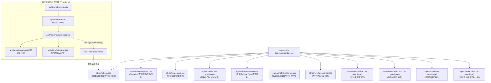
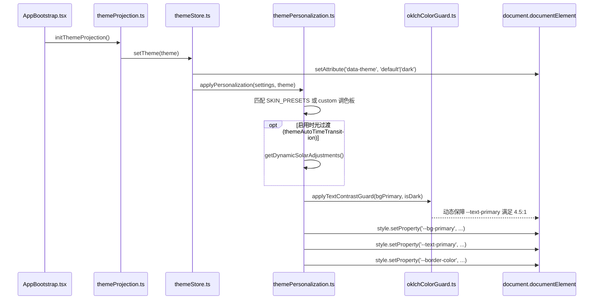
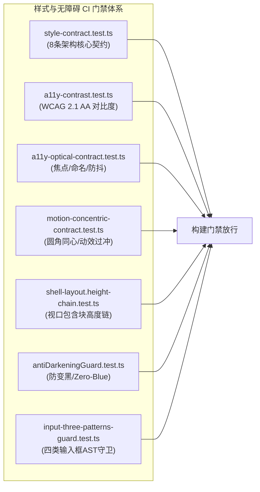
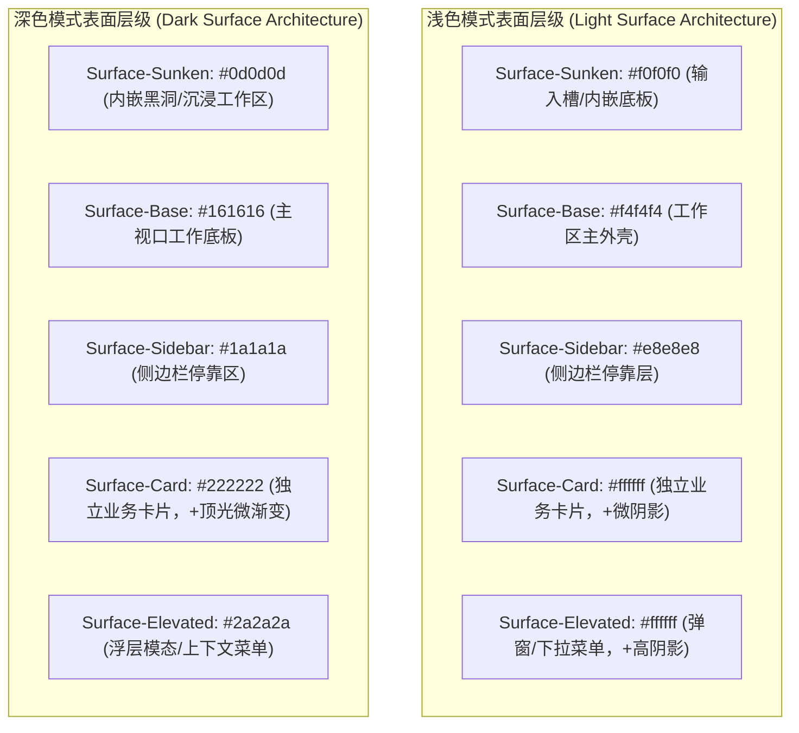

# 全局样式体系与设计 Token 实勘导航

> **战役归属**：前端原子化组件库战役（Frontend Atomic Architecture Campaign）
> **任务书编号**：任务书 05（Task 05）
> **勘察范围**：`apps/crish-desktop/src/styles/` 下全量 CSS/TS 源码、全局 Design Tokens、运行时主题体系及契约测试套件
> **基线分支**：`main` | **环境**：Windows 11 / Chromium WebView2 / Vite + React 18 + Zustand + CSS Modules
> **字符集规范**：UTF-8 无 BOM | 中文技术规范 | 遵循全仓严禁补丁与反过度设计红线

---

## 目录（Table of Contents）

- [一、执行摘要与实勘全景概览](#一执行摘要与实勘全景概览)
  - [1.1 勘察定位与战役使命](#11-勘察定位与战役使命)
  - [1.2 全局样式层叠拓扑与加载时序](#12-全局样式层叠拓扑与加载时序)
  - [1.3 样式文件物理清单与行数总表](#13-样式文件物理清单与行数总表)
  - [1.4 现状核心断层与架构痛点总评](#14-现状核心断层与架构痛点总评)
- [二、样式文件逐一深度实勘与代码级解剖](#二样式文件逐一深度实勘与代码级解剖)
  - [2.1 src/index.css 入口分流与 Layer 体系](#21-srcindexcss-入口分流与-layer-体系)
  - [2.2 src/styles/tokens.css 核心设计 Token 巨石库](#22-srcstylestokenscss-核心设计-token-巨石库)
  - [2.3 src/styles/design-system.css 辅助系统与动效扩展](#23-srcstylesdesign-systemcss-辅助系统与动效扩展)
  - [2.4 src/styles/z-index.css 单真源 7 级层叠上下文](#24-srcstylesz-indexcss-单真源-7-级层叠上下文)
  - [2.5 src/styles/focus-visible.css 双态焦点环与无障碍守卫](#25-srcstylesfocus-visiblecss-双态焦点环与无障碍守卫)
  - [2.6 src/styles/overlay-scrollbar.css WebKit 二元灰度滚动条](#26-srcstylesoverlay-scrollbarcss-webkit-二元灰度滚动条)
  - [2.7 src/styles/reduced-motion.css 双通道动效降级体系](#27-srcstylesreduced-motioncss-双通道动效降级体系)
  - [2.8 src/styles/shell/shell-reset.css 系统外壳与文字渲染基础](#28-srcstylesshellshell-resetcss-系统外壳与文字渲染基础)
  - [2.9 src/styles/shell/shell-layout.css 视口包含块与纯高度链](#29-srcstylesshellshell-layoutcss-视口包含块与纯高度链)
  - [2.10 src/styles/responsive.css & breakpoints.css 容器与断点规范](#210-srcstylesresponsivecss--breakpointscss-容器与断点规范)
  - [2.11 src/styles/sr-only.css 读屏无障碍辅助规范](#211-srcstylessr-onlycss-读屏无障碍辅助规范)
  - [2.12 运行时主题注入层实勘（TS 桥接与数据链路）](#212-运行时主题注入层实勘ts-桥接与数据链路)
- [三、全域色彩变量大盘点与彩色/高饱和度出处统计](#三全域色彩变量大盘点与彩色高饱和度出处统计)
  - [3.1 核心语义色彩变量名录对照表（Light vs Dark）](#31-核心语义色彩变量名录对照表light-vs-dark)
  - [3.2 彩色与高饱和度色出处逐项统计清单](#32-彩色与高饱和度色出处逐项统计清单)
  - [3.3 皮肤预设（themePresets.ts）16 套全色板详尽分析](#33-皮肤预设themepresetsts-16-套全色板详尽分析)
  - [3.4 Zero-Blue 铁律执行现状与残留排查](#34-zero-blue-铁律执行现状与残留排查)
- [四、黑白灰层级体系现状解构](#四黑白灰层级体系现状解构)
  - [4.1 浅色模式（Light）中性黑白灰阶梯](#41-浅色模式light中性黑白灰阶梯)
  - [4.2 深色模式（Dark）中性黑白灰阶梯](#42-深色模式dark中性黑白灰阶梯)
  - [4.3 动态透明墨阶（Tint System）结构](#43-动态透明墨阶tint-system结构)
  - [4.4 现存问题：色温微黄、多重暗化与对比度塌陷根因剖析](#44-现存问题色温微黄多重暗化与对比度塌陷根因剖析)
- [五、阴影 Token 分级与物理光学体系](#五阴影-token-分级与物理光学体系)
  - [5.1 浅色环境 5 级极轻微物理阴影算法解构](#51-浅色环境-5-级极轻微物理阴影算法解构)
  - [5.2 深色环境 5 级低透光柔和暗影](#52-深色环境-5-级低透光柔和暗影)
  - [5.3 Elevation 0~4 实用类与 Dark Top-Light 渐变层](#53-elevation-04-实用类与-dark-top-light-渐变层)
  - [5.4 特殊组件阴影参数与边界隔离](#54-特殊组件阴影参数与边界隔离)
- [六、圆角几何与同心曲率体系](#六圆角几何与同心曲率体系)
  - [6.1 基础圆角梯级阶梯](#61-基础圆角梯级阶梯)
  - [6.2 控件级圆角规范与 8px 契约](#62-控件级圆角规范与-8px-契约)
  - [6.3 同心几何圆角公式与 SmartExpandablePanel 实践](#63-同心几何圆角公式与-smartexpandablepanel-实践)
  - [6.4 奇数与亚像素圆角存量治理分析](#64-奇数与亚像素圆角存量治理分析)
- [七、排版阶梯与文字韵律体系](#七排版阶梯与文字韵律体系)
  - [7.1 跨平台字体栈单一真源（SSOT）](#71-跨平台字体栈单一真源ssot)
  - [7.2 字号阶梯系统与动态缩放机制](#72-字号阶梯系统与动态缩放机制)
  - [7.3 字重标准与字母间距（Letter Spacing）](#73-字重标准与字母间距letter-spacing)
  - [7.4 行高韵律体系与垂直节律](#74-行高韵律体系与垂直节律)
  - [7.5 Markdown 内容区专属排版规范](#75-markdown-内容区专属排版规范)
  - [7.6 等宽数字（tabular-nums）与防抖护栏](#76-等宽数字tabular-nums与防抖护栏)
- [八、样式契约测试与自动化门禁现状](#八样式契约测试与自动化门禁现状)
  - [8.1 style-contract.test.ts 核心防线剖析](#81-style-contracttestts-核心防线剖析)
  - [8.2 a11y-contrast.test.ts WCAG 2.1 AA 刚性断言](#82-a11y-contrasttestts-wcag-21-aa-刚性断言)
  - [8.3 a11y-optical-contract.test.ts 焦点防抖与光学无障碍](#83-a11y-optical-contracttestts-焦点防抖与光学无障碍)
  - [8.4 motion-concentric-contract.test.ts 同心几何与物理动效](#84-motion-concentric-contracttestts-同心几何与物理动效)
  - [8.5 shell-layout.height-chain.test.ts 包含块高度链骨架](#85-shell-layoutheight-chaintestts-包含块高度链骨架)
  - [8.6 antiDarkeningGuard.test.ts 全界面防变黑与单源守卫](#86-antidarkeningguardtestts-全界面防变黑与单源守卫)
  - [8.7 input-three-patterns-guard.test.ts 四类输入框防御契约](#87-input-three-patterns-guardtestts-四类输入框防御契约)
- [九、未来纯粹、极致高级的黑白灰中性 Token 体系演进设计](#九未来纯粹极致高级的黑白灰中性-token-体系演进设计)
  - [9.1 现代极简主义设计哲学（瑞士风格与理性美学）](#91-现代极简主义设计哲学瑞士风格与理性美学)
  - [9.2 工业级 12 阶绝对中性无彩灰度模型（Neutral Gray 0~1000）](#92-工业级-12-阶绝对中性无彩灰度模型neutral-gray-01000)
  - [9.3 表面层级模型升级（Surface Elevation Architecture v2）](#93-表面层级模型升级surface-elevation-architecture-v2)
  - [9.4 纯逻辑状态反馈（State & Feedback Tokens）](#94-纯逻辑状态反馈state--feedback-tokens)
  - [9.5 单一真理源（SSOT）架构合流方案](#95-单一真理源ssot架构合流方案)
  - [9.6 渐进式平滑迁移路径与向前兼容别名层](#96-渐进式平滑迁移路径与向前兼容别名层)
  - [9.7 拟定全新中性化核心样式表（neutral-tokens.css 参考实现）](#97-拟定全新中性化核心样式表neutral-tokenscss-参考实现)
- [十、实勘结论、风险清单与后续行动建议](#十实勘结论风险清单与后续行动建议)
  - [10.1 核心发现要点归纳](#101-核心发现要点归纳)
  - [10.2 潜在破损与回退风险矩阵](#102-潜在破损与回退风险矩阵)
  - [10.3 对任务书 06~10 的前置支撑与输入](#103-对任务书-0610-的前置支撑与输入)

---

## 一、执行摘要与实勘全景概览

### 1.1 勘察定位与战役使命

Conex / Crish 桌面客户端是一款基于 Rust 核心与 Tauri 架构的高性能本地 AI 工作台。其交互界面依托 WebView2 (Chromium) 运行，承载了多会话协作、代码流式高亮、时序用量分析、Diff 代码审阅、文件树导航以及复杂浮层交互等高密度界面。

在过去的多次局部重构与迭代中，样式体系经历过从最初的单体 CSS，到 CSS Modules，再到引入主题皮肤定制（`themePresets.ts`）、时光温感过渡（`themePersonalization.ts`）以及一系列针对变黑、焦点穿透、滚动条三角残留等专项治理的演进。然而，当前的前端样式系统存在**“静态 CSS 定义”与“运行时 TS 动态覆写”双源共存**的复杂现状，部分历史遗留高饱和度色彩、暖色温（橙黄调）微光渗透以及未彻底归一的变量别名，对建立一个纯粹、高级、克制的顶级专业工程级黑白灰界面构成了阻力。

本实勘任务书（任务书 05）的职责是：**对全局样式体系、设计 Token、中性化底座、动效无障碍与契约测试开展彻底的逐行代码级勘察**，摸清每一处颜色、每一组阶梯、每一层阴影与每一个契约测试的来龙去脉，形成客观详实的工程级导航全景，为后续原子组件库的规范化重塑提供坚实的物理依据。

---

### 1.2 全局样式层叠拓扑与加载时序

整个工程的全局样式入口位于 [apps/crish-desktop/src/index.css](file:///c:/Software/conex/apps/crish-desktop/src/index.css)。其导入拓扑如下：



**加载时序与层叠特性分析：**
1. **优先顺序**：`tokens.css` 作为第一项引入，向 `:root` 及 `html[data-theme="default|light|dark"]` 注入基础变量池；紧随其后的 `design-system.css` 依赖这些变量构造通用类与动画；
2. **CSS `@layer(base)` 隔离**：`z-index.css`、`focus-visible.css`、`reduced-motion.css`、`sr-only.css`、`breakpoints.css` 均带上了 `layer(base)` 声明。这意味着这些底层防御性规则拥有明确的基础层优先级，组件内部的未分层 CSS Modules 具有更高特异性，但在全局重置（如 focus-visible 的防穿透 `!important`）面前保持严整。
3. **运行时介入**：应用启动时，由 `AppBootstrap` 触发 `initThemeProjection()`，`themeStore.ts` 同步从 `localStorage` 读取主题模式与皮肤个性化配置，并通过 `root.style.setProperty()` 动态向 DOM 根节点注入行内样式。行内样式的优先级高于样式表选择器，因此在非纯净模式下，运行时注入的值会完全覆盖 `tokens.css` 中对应的 CSS 变量。

---

### 1.3 样式文件物理清单与行数总表

勘察目录 `apps/crish-desktop/src/styles/` 及其关联模块的物理真实度量数据如下表（基于 2026-09-06 实测代码统计）：

| 序号 | 相对路径 | 绝对路径 | 真实行数 | 体积 (Bytes) | 核心性质与职责说明 |
|:---:|:---|:---|:---:|:---:|:---|
| 1 | `src/index.css` | `c:/Software/conex/apps/crish-desktop/src/index.css` | 13 | 550 | 全局样式入口，统一协调 @import 与 CSS Layer |
| 2 | `src/styles/tokens.css` | `c:/Software/conex/apps/crish-desktop/src/styles/tokens.css` | 1581 | 61,802 | 全局 Design Tokens 单一真源与核心巨石库 |
| 3 | `src/styles/design-system.css` | `c:/Software/conex/apps/crish-desktop/src/styles/design-system.css` | 334 | 8,550 | 动效 keyframes、同心圆角类、语法高亮与遮罩基座 |
| 4 | `src/styles/z-index.css` | `c:/Software/conex/apps/crish-desktop/src/styles/z-index.css` | 30 | 735 | 权威 z-index 7 级层级阶梯，禁止裸数字唯一真源 |
| 5 | `src/styles/focus-visible.css` | `c:/Software/conex/apps/crish-desktop/src/styles/focus-visible.css` | 96 | 3,435 | 双态焦点环分流（3%~10% 软灰）与输入框防穿透守卫 |
| 6 | `src/styles/overlay-scrollbar.css`| `c:/Software/conex/apps/crish-desktop/src/styles/overlay-scrollbar.css` | 93 | 3,685 | WebKit 二元灰度滚动条出口，贝塞尔三角按钮 |
| 7 | `src/styles/reduced-motion.css` | `c:/Software/conex/apps/crish-desktop/src/styles/reduced-motion.css` | 102 | 3,353 | 系统媒体查询 + 用户属性双通道零动效降级 |
| 8 | `src/styles/shell/shell-reset.css` | `c:/Software/conex/apps/crish-desktop/src/styles/shell/shell-reset.css` | 108 | 2,579 | 盒模型、Windows ClearType 护栏、代码等宽字重 400 |
| 9 | `src/styles/shell/shell-layout.css`| `c:/Software/conex/apps/crish-desktop/src/styles/shell/shell-layout.css` | 55 | 1,031 | 视口包含块高度链，纯 flex: 1 1 0% 骨架，无皮样式 |
| 10 | `src/styles/responsive.css` | `c:/Software/conex/apps/crish-desktop/src/styles/responsive.css` | 15 | 352 | 侧栏默认宽度变量与 @container 容器查询布局 |
| 11 | `src/styles/breakpoints.css` | `c:/Software/conex/apps/crish-desktop/src/styles/breakpoints.css` | 12 | 318 | 响应式断点注释契约（实际生效断点在 tokens.css） |
| 12 | `src/styles/sr-only.css` | `c:/Software/conex/apps/crish-desktop/src/styles/sr-only.css` | 13 | 217 | 屏幕阅读器专用无障碍隐藏类定义 |
| 13 | `src/styles/style-contract.test.ts`| `c:/Software/conex/apps/crish-desktop/src/styles/style-contract.test.ts` | 543 | 24,020 | 样式系统核心防回潮契约（z-index, ratchet, scrollbar） |
| 14 | `src/styles/a11y-contrast.test.ts` | `c:/Software/conex/apps/crish-desktop/src/styles/a11y-contrast.test.ts` | 273 | 8,626 | WCAG 2.1 AA 刚性对比度测试（正文4.5:1 / UI 3.0:1） |
| 15 | `src/styles/a11y-optical-contract.test.ts`| `c:/Software/conex/apps/crish-desktop/src/styles/a11y-optical-contract.test.ts` | 206 | 8,855 | 无障碍命名、16 处数字防抖与焦点环粗黑阻断 |
| 16 | `src/styles/motion-concentric-contract.test.ts`| `c:/Software/conex/apps/crish-desktop/src/styles/motion-concentric-contract.test.ts` | 166 | 6,615 | 同心圆角几何、奇数圆角排查与过冲贝塞尔封杀 |
| 17 | `src/styles/shell/shell-layout.height-chain.test.ts`| `c:/Software/conex/apps/crish-desktop/src/styles/shell/shell-layout.height-chain.test.ts` | 99 | 3,895 | 视口包含块高度链骨架纯度与无皮选择器校验 |
| 18 | `src/styles/__tests__/antiDarkeningGuard.test.ts`| `c:/Software/conex/apps/crish-desktop/src/styles/__tests__/antiDarkeningGuard.test.ts` | 230 | 9,219 | 防变黑守卫、边框混色<=10%、Zero-Blue 铁律守卫 |
| 19 | `src/styles/__tests__/input-three-patterns-guard.test.ts`| `c:/Software/conex/apps/crish-desktop/src/styles/__tests__/input-three-patterns-guard.test.ts` | 317 | 15,323 | 四类输入框形态守门、AST 级焦点混黑拦截门禁 |
| 20 | `src/api/themePresets.ts` | `c:/Software/conex/apps/crish-desktop/src/api/themePresets.ts` | 255 | 8,904 | 运行时 16 套皮肤预设调色板常量数据源 |
| 21 | `src/api/themeTypes.ts` | `c:/Software/conex/apps/crish-desktop/src/api/themeTypes.ts` | 23 | 812 | 主题模式与个性化设置类型定义、存储键名 |
| 22 | `src/api/themeStore.ts` | `c:/Software/conex/apps/crish-desktop/src/api/themeStore.ts` | 195 | 7,766 | 主题读取、持久化、定时温感守护与启动入口 |
| 23 | `src/api/themePersonalization.ts`| `c:/Software/conex/apps/crish-desktop/src/api/themePersonalization.ts` | 426 | 21,465 | 运行时皮肤色板动态计算注入、时光温感算法 |
| 24 | `src/api/oklchColorGuard.ts` | `c:/Software/conex/apps/crish-desktop/src/api/oklchColorGuard.ts` | 129 | 4,813 | OKLCH 空间颜色解析与极值背景文字对比度自愈守卫 |
| 25 | `src/api/__tests__/themeStartupSSOT.test.ts`| `c:/Software/conex/apps/crish-desktop/src/api/__tests__/themeStartupSSOT.test.ts` | 87 | 3,696 | 启动零白屏（Zero-FOUC）与主题单真源测试 |
| 26 | `src/store/themeProjection.ts` | `c:/Software/conex/apps/crish-desktop/src/store/themeProjection.ts` | 37 | 1,594 | settingsStore 到 themeStore 的单向状态订阅投影 |
| 27 | `src/components/chat-message-row/__tests__/typography-token.test.ts`| `c:/Software/conex/apps/crish-desktop/src/components/chat-message-row/__tests__/typography-token.test.ts` | 294 | 13,709 | Markdown 排版阶梯、行内代码与语法高亮契约断言 |

*统计总结*：`src/styles/` 目录内部纯 CSS 文件共 11 个，合计 2,467 行；内部测试文件共 7 个，合计 1,840 行；周边运行时与类型契约关联文件共 8 个，合计 1,446 行。全域实勘目标累计行数达 5,753 行。

---

### 1.4 现状核心断层与架构痛点总评

经过逐行代码走查，当前全局样式与 Token 体系具备极高的工业化防御水平（拥有完备的测试网与棘轮拦截机制），但在**“极致纯粹的高级黑白灰体系”**这一视觉与架构目标下，存在以下五大核心断层：

1. **“静态定义”与“运行时注入”双轨割裂（Dual-SSOT Drift）**：
   - `tokens.css` 中定义了一套严谨的纯中性黑白灰系统（Light 采用 `hsl(30 2.5% 95.5%)` 搭配 `#111111`，Dark 采用 `#1b1b1b` 搭配 `#dddddd`）。
   - 然而，`themeStore.ts` 启动时默认加载 `warm-gray` 预设，通过 `themePersonalization.ts` 动态向 `:root` 注入行内样式。`warm-gray` 注入的背景是 `hsl(35 8% 94.5%)`、文字是 `#111111`、边框是 `hsl(35 10% 86%)`。这种注入使得 `tokens.css` 中的纯中性基准在应用实际渲染时被整体覆写为带有 **8%~10% 暖橙黄倾向**的米黄色调。
2. **彩色变量的历史散落与多源混杂**：
   - 虽然有 Zero-Blue 铁律（将历史 `--accent-blue` 强行收敛为翡翠绿系 `#065f46` 或 `#34d399`），但全仓仍散落着用于 Diff、GitStatus、Terminal、Usage Dashboard、语法高亮以及 AI 步骤卡片的多种高饱和度彩色变量（如 `--syntax-keyword: #7c6fdb`，`--usage-color-claude: hsl(25 95% 53%)`，`--mac-dot-red: #ff5f56`）。缺乏统一的“无彩基础层 + 语义强调层”分级收敛机制。
3. **多重背景暗化导致的发闷死黑（Compounded Darkening Trap）**：
   - 浅色模式下，当用户微调降低亮度时，`themePersonalization.ts:303` 使用了 `twilightTarget = color-mix(in srgb, mixColor 15%, hsl(34, 30%, 45%))` 作为混色目标，虽然避免了变脏，但使得界面进一步向泥褐色偏移；
   - 各种卡片、容器、输入框如果在嵌套时多次使用基于 `--bg-secondary` 或 `--tint-hover` 的混色，会发生 alpha 累积与明度多重衰减，造成局部区域“发闷、发脏”。
4. **圆角阶梯与按钮半径的锁定冲突**：
   - `tokens.css:26` 与 `:446` 严格锁定了 `--button-radius: 8px`，且通过契约测试禁止 UI Size 档位改写；
   - 但系统中仍存在 `--radius-md: 6px`、`--radius-lg: 8px`、`--sep-radius-outer: 14px`、`--sep-radius-inner: 8px` 等并存体系，部分组件（如 SegmentedControl、SmartPanel）在不同文件中通过不同变量桥接，尚未完全形成同心曲率的数学自动化派生。
5. **暗色模式背景梯度跨度较平，层次感略显不足**：
   - 深色模式下 `--bg-primary: #1b1b1b`（明度约 10.6%），`--bg-secondary: #242424`（明度约 14.1%），`--bg-card: #242424`，`--bg-elevated: #242424`。卡片与侧栏底色相同，主要依靠边框 `--border-color: #333333` 与投影区分，缺乏细腻的明度爬升梯级（如 0% 纯黑底板 -> 4% 侧栏 -> 7% 卡片 -> 10% 浮层）。

---

## 二、样式文件逐一深度实勘与代码级解剖

### 2.1 src/index.css 入口分流与 Layer 体系

- **绝对路径**：`c:/Software/conex/apps/crish-desktop/src/index.css`
- **行数**：13 行 | **体积**：550 Bytes
- **逐行代码还原**：
  ```css
  /* Conex desktop entry styles   domain splits live under ./styles/ */
  @import './styles/tokens.css';
  @import './styles/design-system.css';
  @import './styles/responsive.css';
  @import './styles/z-index.css' layer(base);
  @import './styles/shell/shell-reset.css';
  @import './styles/shell/shell-layout.css';
  @import './styles/overlay-scrollbar.css';
  @import './styles/focus-visible.css' layer(base);
  @import './styles/reduced-motion.css' layer(base);
  @import './styles/sr-only.css' layer(base);
  @import './styles/breakpoints.css' layer(base);
  ```
- **技术要点解剖**：
  1. **零散写规则**：本文件纯粹作为路由汇合表，不含任何 CSS 选择器或样式规则，符合现代模块化体系的清晰边界要求。
  2. **`layer(base)` 的精确应用**：`z-index.css`、`focus-visible.css`、`reduced-motion.css`、`sr-only.css`、`breakpoints.css` 被统一打入 `base` 层。这意味着这些底层防御性规则拥有明确的基础层优先级，组件内部的未分层 CSS Modules 具有更高特异性，但在全局重置（如 focus-visible 的防穿透 `!important`）面前保持严整。
  3. **契约锁**：`shell/shell-layout.height-chain.test.ts:68` 和 `style-contract.test.ts:280` 建立了断言，严格检查本文件是否按特定顺序引入了 `shell-layout.css` 与 `overlay-scrollbar.css`，且绝对禁止引入已被废弃的 `shell-scrollbar.css`、`shell-workspace.css` 等历史伪皮表。

---

### 2.2 src/styles/tokens.css 核心设计 Token 巨石库

- **绝对路径**：`c:/Software/conex/apps/crish-desktop/src/styles/tokens.css`
- **行数**：1581 行 | **体积**：61,802 Bytes
- **结构分区解剖**：

#### 1. 冷启动动画门闩（Zero-FOUC Latch，第 1–16 行）
```css
html.preload *:not(.app-initial-loader, .app-initial-loader *),
html.preload *:not(.app-initial-loader, .app-initial-loader *)::before,
html.preload *:not(.app-initial-loader, .app-initial-loader *)::after {
  -webkit-transition: none !important;
  -moz-transition: none !important;
  -ms-transition: none !important;
  -o-transition: none !important;
  transition: none !important;
  animation-duration: 0s !important;
  animation-delay: 0s !important;
}
```
在应用挂载水合初期，页面根元素附带 `.preload` 类，通过 `!important` 彻底冻结全量组件过渡与动画，杜绝因 CSS 加载顺序导致的“视觉蠕动/闪烁”，同时显式排除 `.app-initial-loader`，保证启动开屏平滑。

#### 2. 全局通用常态基准（:root，第 18–36 行）
- **断点 SSOT**：`--breakpoint-sm: 640px`、`--breakpoint-md: 768px`、`--breakpoint-lg: 1024px`、`--breakpoint-xl: 1280px`（经由 `antiDarkeningGuard.test.ts:49` 守卫，已从 `responsive.css` 彻底剥离，全仓以此处为单真源）。
- **几何契约**：`--button-radius: 8px`、`--radius-full: 9999px`、`--radius-tooltip: var(--radius-full)`、`--seg-outer-radius: var(--button-radius, 8px)`。
- **兼容别名兜底**：`--color-text-dim: var(--text-tertiary)`，防止历史遗留模板报错。

#### 3. 浅色主题基准块（:root, html[data-theme='default'], html[data-theme='light']，第 39–769 行）
- **表面底板**：
  - `--bg-primary: hsl(30 2.5% 95.5%)`：外壳底板大矩形，带有 2.5% 极低微暖调，明度 95.5%；
  - `--bg-secondary: hsl(30 2.5% 93%)`：侧边栏与辅助层，7% 灰度；
  - `--bg-tertiary: hsl(30 2.5% 90%)`：深一层悬浮背景，10% 灰度；
  - `--bg-card: hsl(0 0% 100%)`：核心白底（Paper）；
  - `--bg-elevated: hsl(0 0% 100%)`：抬升浮层白底。
- **文本阶梯**：
  - `--text-primary: #111111`：高对比极黑墨阶；
  - `--text-secondary: #555555`：次级文本；
  - `--text-tertiary: #696969`：WCAG AA 达标三级辅助字（对比度实测 4.5:1）；
  - `--text-muted: var(--text-tertiary)`。
- **透明墨阶（Tint）**：
  - `--tint-hover: color-mix(in srgb, var(--text-primary) 2.5%, transparent)`；
  - `--tint-active: color-mix(in srgb, var(--text-primary) 5%, transparent)`；
  - `--tint-strong: color-mix(in srgb, var(--text-primary) 8%, transparent)`；
  - `--tint-focus-ring: color-mix(in srgb, var(--text-primary) 8%, transparent)`；
  - `--tint-divider: color-mix(in srgb, var(--text-primary) 10%, transparent)`。
- **滚动条二元光学 Token（第 76–122 行）**：
  - `--scrollbar-thumb-bg: #e6e6e5`（10% 灰度，H=30 S=2% L=90%）；
  - `--scrollbar-thumb-active: #c8c7c6`（21.8% 灰度，H=30 S=2% L=78%）；
  - 差值严格锁死 11.8%~12.0%；四级宽度 `--scrollbar-width-xs: 6px`、`-sm: 7px`、`-md: 9px`、`-lg: 11px`。
- **品牌与状态色**：
  - `--brand: #10b981` / `--brand-primary: #10b981` / `--brand-deep: hsl(160 84% 30%)`（#047857，文字对比度 4.77:1）；
  - `--accent-orange: hsl(38, 92%, 50%)`；
  - `--accent-green: hsl(142 72% 46%)`；
  - `--accent-red: hsl(0, 55%, 55%)`；
  - `--accent-blue: #065f46`（Zero-Blue 铁律强制覆写为翡翠暗墨阶）。
- **Markdown、流式表格与 Diff 扩展（第 499–648 行）**：
  - 代码块底色 `--md-code-block-bg: color-mix(in srgb, var(--text-primary) 2%, var(--bg-card))`；
  - 增量代码高亮 `--diff-add-bg: hsl(150 65% 97%)`，`--diff-add-fg: hsl(152 75% 36%)`；
  - 删减代码高亮 `--diff-del-bg: hsl(0 80% 98%)`，`--diff-del-fg: hsl(0 75% 50%)`。

#### 4. 深色主题基准块（html[data-theme='dark']，第 777–1285 行）
- **表面底板**：
  - `--bg-primary: #1b1b1b`；
  - `--bg-secondary: #242424`；
  - `--bg-tertiary: #1e1e1e`；
  - `--bg-card: #242424`；
  - `--bg-elevated: #242424`；
  - `--shell-chrome-bg: #151515`。
- **文本阶梯**：
  - `--text-primary: #dddddd`；
  - `--text-secondary: #aaaaaa`；
  - `--text-tertiary: #8f8f8f`（对比度 4.5:1）。
- **深色 Tint 墨阶**：
  - `--tint-hover: color-mix(in srgb, var(--text-primary) 3.5%, transparent)`；
  - `--tint-active: color-mix(in srgb, var(--text-primary) 6.5%, transparent)`；
  - `--tint-strong: color-mix(in srgb, var(--text-primary) 10%, transparent)`；
  - `--tint-focus-ring: color-mix(in srgb, var(--text-primary) 10%, transparent)`；
  - `--tint-divider: color-mix(in srgb, var(--text-primary) 12%, transparent)`。
- **深色滚动条**：
  - `--scrollbar-thumb-bg: color-mix(in srgb, var(--text-primary, #dddddd) 20%, transparent)`；
  - `--scrollbar-thumb-active: color-mix(in srgb, var(--text-primary, #dddddd) 36%, transparent)`。

#### 5. 密度档位（UI Size Gear，第 1289–1440 行）
- `[data-ui-size='small']`：基准字号由 14px 缩为 13px，header 高度 32px，控件高度 30px/26px/22px，间距全面收紧；
- `[data-ui-size='large']`：基准字号扩大为 16px，header 高度 40px，控件高度 34px/30px/26px，适合宽屏与触控交互。

#### 6. 用量时序仪表盘专用 Token（第 1441–1501 行）
- 包含 Claude (`hsl(25 95% 53%)`)、MiniMax (`hsl(258 90% 66%)`)、Kimi (`hsl(200 98% 39%)`)、总费用等专属颜色，并在下方提供了 `@supports (color: oklch(0 0 0))` 的现代 OKLCH 增强映射。

#### 7. 性能档位与动效阻尼（第 1510–1571 行）
- `html[data-perf-tier='high']`：开启弹性弹簧过渡与微发光；
- `html[data-perf-tier='balanced']`：关闭 GPU 滤镜，保留核心动画；
- `html[data-perf-tier='eco']`：过渡与动画全面归零（0ms），绝对平整静态。

---

### 2.3 src/styles/design-system.css 辅助系统与动效扩展

- **绝对路径**：`c:/Software/conex/apps/crish-desktop/src/styles/design-system.css`
- **行数**：334 行 | **体积**：8,550 Bytes
- **核心模块拆解**：
  1. **Elevation 抬升体系（第 6–17 行）**：
     - `.elevation-0`：背景为 `--bg-primary`；
     - `.elevation-1`：背景为 `--bg-secondary`；
     - `.elevation-2` / `.elevation-3`：背景为 `--bg-card`，配 `--shadow-md`；
     - `.elevation-4`：背景为 `--bg-elevated`，配 `--shadow-lg`；
     - *深色顶光增强*：`html[data-theme="dark"] .elevation-2..4` 自动注入 `linear-gradient(180deg, rgba(255, 255, 255, 0.02) 0%, transparent 100%)` 微透光层，模拟真实物理漫反射。
  2. **全局动态选区高亮（::selection，第 22–25 行）**：
     ```css
     ::selection {
       background-color: color-mix(in srgb, var(--text-primary) 9%, transparent);
       color: inherit;
     }
     ```
     彻底剔除刺眼的传统蓝色高亮，自适应跟随当前主题文本色 9% 的墨阶投影。
  3. **弹簧关键帧动画（Keyframes，第 28–96 行）**：
     - `@keyframes crish-popover-enter`（0.96 scale + -4px translateY 到 1.0）；
     - `@keyframes crish-modal-enter`（0.96 scale + 8px translateY 到 1.0）；
     - `@keyframes panel-enter` 与 `panel-exit`。
  4. **SmartExpandablePanel 同心圆角体系（第 161–212 行）**：
     - L1 Shell: `.sep-panel-root` -> `border-radius: var(--sep-radius-outer, 14px)`，`padding: 6px`；
     - L2 Inner: `.sep-inner-container` -> `border-radius: var(--sep-radius-inner, 8px)`；
     - L3 Item: `.sep-item-row` -> `border-radius: 8px`，高度 28px；
     - L4 Button: `.sep-btn` -> `border-radius: 6px`；
     - L5 Badge: `.sep-badge` -> `border-radius: 4px`；
     - L6 Pill: `.sep-pill` -> `border-radius: 9999px`；
     - L7 Circle: `.sep-circle-btn` -> `border-radius: 50%`。
  5. **20 组语法高亮双引擎基座（Syntect + Highlight.js，第 214–310 行）**：
     - 为 `.hljs-keyword`、`.hljs-string`、`.hljs-number`、`.hljs-title`、`.hljs-comment` 等映射到 `--syntax-*` Token，确保代码高亮与主题环境保持同一色系契约。
  6. **Safe-Aim 虚拟防抖遮罩（第 312–334 行）**：
     - `.sep-safe-aim-overlay`：用于多级级联上下文菜单的三角光标防抖检测（Hit-test Overlay），z-index 锚定 `--z-popover`。

---

### 2.4 src/styles/z-index.css 单真源 7 级层叠上下文

- **绝对路径**：`c:/Software/conex/apps/crish-desktop/src/styles/z-index.css`
- **行数**：30 行 | **体积**：735 Bytes
- **逐行代码还原**：
  ```css
  :root {
    /* Level 0: 基础文档流与排版底座 */
    --z-base: 0;

    /* Level 1: 粘性与外壳停靠层 */
    --z-dock: 10;
    --z-sticky: var(--z-dock);
    --z-card-footer: var(--z-dock);

    /* Level 2: 视口外壳与分栏手柄 */
    --z-chrome: 100;
    --z-sidebar: var(--z-chrome);
    --z-resizer: var(--z-chrome);

    /* Level 3: 下拉菜单与级联选择 */
    --z-dropdown: 300;
    --z-breadcrumb: 400;

    /* Level 4: 浮层、卡片气泡与上下文菜单 */
    --z-popover: 500;
    --z-drawer: var(--z-popover);

    /* Level 5: 全局模态、设置面板与通知吐司 */
    --z-modal: 1000;
    --z-toast: var(--z-modal);

    /* Level 6: 顶级悬浮提示与光标胶囊 */
    --z-tooltip: 9000;
  }
  ```
- **架构价值与契约保证**：
  - **防恶性通胀**：全仓杜绝 `z-index: 99999` 或 `100000` 等野蛮数值（由 `style-contract.test.ts:454` 硬性断言清零）；
  - **零级联污染**：`antiDarkeningGuard.test.ts:198` 严密监控 `tokens.css`，禁止在 `tokens.css` 内重复声明任何 `--z-*` 变量，确保本文件为运行时唯一真理源。

---

### 2.5 src/styles/focus-visible.css 双态焦点环与无障碍守卫

- **绝对路径**：`c:/Software/conex/apps/crish-desktop/src/styles/focus-visible.css`
- **行数**：96 行 | **体积**：3,435 Bytes
- **核心逻辑剖析**：
  1. **双态分流契约**：
     - **鼠标点击/触控常态**（`:focus:not(:focus-visible)`）：强制 `outline: none; box-shadow: none;`，对输入框仅施加柔和的 `border-color: var(--focus-border-color)`（混色严格保持在 6%~10% 的柔灰），保障极度宁静的视觉观感；
     - **键盘 Tab 导航态**（`:focus-visible`）：激活双层微阴影（外层 1.5px 软灰焦点环 + 内层 1px 卡片底色隔离缝），既满足 WCAG 3:1 的可辨识度，又彻底铲除生硬深黑粗框。
  2. **四类极简搜索框防穿透白名单（第 75–96 行）**：
     ```css
     :is(
       [role='search'],
       [role='menu'],
       [role='listbox'],
       nav,
       .searchHeader,
       .mbInner,
       .smartPanelHeader,
       .sepHeader,
       [data-embedded]
     ) :is(input, textarea):is(:focus, :focus-visible),
     .searchInput:is(:focus, :focus-visible),
     [class*='searchInput']:is(:focus, :focus-visible),
     [class*='filesPathFilter']:is(:focus, :focus-visible),
     input[type='search']:is(:focus, :focus-visible) {
       outline: none !important;
       border: none !important;
       border-color: transparent !important;
       box-shadow: none !important;
       background-color: transparent !important;
     }
     ```
     在下拉菜单（如 ModelBadgePickerMenu）、卡片筛选头（如 DiffCard、FilesCard）以及侧边栏搜索框中，使用 `!important` 封死任何来自浏览器默认或上层全局样式的外阴影与边框，确保只有光标闪烁，不产生任何外围视觉干扰。

---

### 2.6 src/styles/overlay-scrollbar.css WebKit 二元灰度滚动条

- **绝对路径**：`c:/Software/conex/apps/crish-desktop/src/styles/overlay-scrollbar.css`
- **行数**：93 行 | **体积**：3,685 Bytes
- **工程细节解剖**：
  1. **禁止声明 `scrollbar-width` 铁律**：
     在 Windows Chromium (WebView2) 宿主中，一旦在全局或滚动容器上声明 CSS 标准属性 `scrollbar-width: thin` 或 `none`，会立即触发 Chromium 的 Blink 引擎回落机制，导致自定义的 `::-webkit-scrollbar` 伪元素全线失效，暴露出带有 Windows 原生复古上下三角箭头的系统粗滚动条。因此本文件严禁使用 `scrollbar-width`，只允许配置 `scrollbar-gutter: auto`。
  2. **二元灰度与 2px 防误触间距**：
     ```css
     ::-webkit-scrollbar-thumb {
       background: var(--tint-scrollbar-thumb);
       background-clip: padding-box;
       border-right: 2px solid transparent; /* 右侧留出 2px 物理安全空隙，防误触，滑块净宽 8px */
       border-radius: var(--radius-full);
     }
     ```
  3. **贝塞尔 Q 平滑圆角微型三角按钮（第 31–65 行）**：
     通过内嵌 SVG Data-URI（`M 4.0 1.4 Q 4.5 0.5 5.0 1.4 L 8.1 4.9 Q 8.6 5.6 7.8 5.6 L 1.2 5.6 Q 0.4 5.6 0.9 4.9 Z`），打造了顶部/底部等腰圆角微型矢量三角，并且三角颜色（未激活 `#e6e6e5`，激活 `#c8c7c6`）与滑块保持严格的 10% 同步灰度。

---

### 2.7 src/styles/reduced-motion.css 双通道动效降级体系

- **绝对路径**：`c:/Software/conex/apps/crish-desktop/src/styles/reduced-motion.css`
- **行数**：102 行 | **体积**：3,353 Bytes
- **通道设计与白名单保护**：
  1. **系统媒体查询通道**：`@media (prefers-reduced-motion: reduce)`，针对操作系统启用了“减弱动态效果”的用户；
  2. **应用属性通道**：`[data-reduced-motion]`，针对在应用“设置-无障碍”中显式开启低动效模式的用户；
  3. **清零逻辑**：将 `animation-duration`、`transition-duration` 钉死在 `0.01ms !important`，并将全套 `--transition-*` 与 `--duration-*` 变量覆写为 `0ms !important`；
  4. **心跳与关键动效白名单**：保留 `.essential-animation` 允许维持 1.5s 周期，避免因完全静止导致用户误判应用卡死。

---

### 2.8 src/styles/shell/shell-reset.css 系统外壳与文字渲染基础

- **绝对路径**：`c:/Software/conex/apps/crish-desktop/src/styles/shell/shell-reset.css`
- **行数**：108 行 | **体积**：2,579 Bytes
- **关键设计特征**：
  1. **Windows ClearType 护栏（第 16–24 行）**：
     ```css
     html {
       -webkit-font-smoothing: auto;
       -moz-osx-font-smoothing: auto;
       text-rendering: optimizeLegibility;
       font-synthesis: none;
       font-optical-sizing: auto;
       font-kerning: normal;
     }
     ```
     在 Windows 系统下，严禁强行设置 `antialiased`（灰度平滑），灰度平滑会强行关闭 Windows ClearType 次像素渲染，导致中文字体笔画发虚、边缘发白。设置 `auto` 能够让 ClearType 保持最佳的锐利可读性。
  2. **代码区与 Mono 字重锁（第 46–62 行）**：
     锁定 `code`, `pre`, `.md-code-block`, `.terminal-output-text` 等等为 `--font-weight-code: 400`，制止了部分中文字体或 UI 加粗机制错误污染代码区的问题。
  3. **拖拽分栏手柄事件封锁（第 95–108 行）**：
     当 `body.is-resizing` 时，强制给全页面 `iframe`, `webview` 添加 `pointer-events: none !important`，彻底根除鼠标拖拽移动分栏时由于光标划入 webview 内部导致的“粘手/事件丢失”顽疾。

---

### 2.9 src/styles/shell/shell-layout.css 视口包含块与纯高度链

- **绝对路径**：`c:/Software/conex/apps/crish-desktop/src/styles/shell/shell-layout.css`
- **行数**：55 行 | **体积**：1,031 Bytes
- **高度链刚性设计**：
  ```css
  html { height: 100%; overflow: hidden; }
  #root { width: 100%; height: 100vh; max-height: 100vh; display: flex; flex-direction: column; overflow: hidden; position: relative; }
  .app-container { display: flex; flex-direction: column; flex: 1 1 0%; min-height: 0; width: 100%; height: 100%; overflow: hidden; position: relative; }
  .main-layout { display: flex; flex-direction: row; flex: 1 1 0%; min-width: 0; min-height: 0; width: 100%; overflow: hidden; position: relative; }
  .workspaces-column, .workspaces-stack, .workspaces-container { display: flex; flex-direction: column; flex: 1 1 0%; min-width: 0; min-height: 0; width: 100%; height: 100%; overflow: hidden; }
  ```
  通过 `min-height: 0` 和 `flex: 1 1 0%` 构筑无懈可击的高度计算链，彻底消除了历史上使用 `calc(100vh - 36px)` 等魔术数字带来的布局溢出断裂。

---

### 2.10 src/styles/responsive.css & breakpoints.css 容器与断点规范

- **`src/styles/responsive.css`**（15 行）：
  定义了 `--sidebar-width: 260px` 与 `--sidebar-width-collapsed: 48px`。同时依托 `@container workspace (max-width: 640px)`、`(min-width: 641px) and (max-width: 1024px)`、`(min-width: 1025px)` 输出 `--panel-layout: single | dual | triple` 容器查询状态。
- **`src/styles/breakpoints.css`**（12 行）：
  纯文档性质注释表，明确记录了全仓的媒体查询规范：`--breakpoint-desktop: 720px`、`--breakpoint-tablet: 640px`、`--breakpoint-phone: 420px`。

---

### 2.11 src/styles/sr-only.css 读屏无障碍辅助规范

- **绝对路径**：`c:/Software/conex/apps/crish-desktop/src/styles/sr-only.css`
- **行数**：13 行 | **体积**：217 Bytes
- 标准的视觉隐藏无障碍工具类：通过 `width: 1px; height: 1px; clip: rect(0, 0, 0, 0); overflow: hidden; position: absolute;` 使元素在视觉上完全隐藏，但读屏软件仍能正常识别朗读。

---

### 2.12 运行时主题注入层实勘（TS 桥接与数据链路）

除了静态 CSS 样式表外，前端存在一套复杂的运行时主题控制系统：



- **`themePresets.ts`**（255 行）：集中存放了 16 套皮肤预设。包含浅色 8 套（暖灰、奶油、纸质、经典灰、落樱、抹茶、冰川、金沙）和深色 8 套（暗灰、深夜、绿影、极光、可可、红丝绒、赛博、黑曜石）。
- **`themePersonalization.ts`**（426 行）：负责根据当前模式与用户微调档位（`-5` 到 `+5`）进行颜色混合与插值计算。当用户微调浅色亮度时，它通过 `color-mix()` 将背景向纯白或暖铜温感终点混合，并将 18 组核心变量直接打入 `root.style`。
- **`oklchColorGuard.ts`**（129 行）：通过微型色彩解析器计算背景在 OKLCH 空间的感知亮度 $L$。若 $L > 0.52$（浅底）则注入深暖炭黑文字 `hsl(35, 12%, 11%)`；若 $L \le 0.52$（暗底）则注入柔白 `hsl(0, 0%, 94%)`，为自定义皮肤提供底线安全防护。

---

## 三、全域色彩变量大盘点与彩色/高饱和度出处统计

### 3.1 核心语义色彩变量名录对照表（Light vs Dark）

下表统计了 `tokens.css` 中最核心的全局语义颜色变量在浅色与深色模式下的初始静态定义对照：

| Token 名称 | 浅色定义 (Light/Default) | 深色定义 (Dark) | 物理感知与语义定位 |
|:---|:---|:---|:---|
| `--bg-primary` | `hsl(30 2.5% 95.5%)` | `#1b1b1b` | 主外壳与工作区底板背景 |
| `--bg-secondary` | `hsl(30 2.5% 93%)` | `#242424` | 侧边栏、辅助面板背景 |
| `--bg-tertiary` | `hsl(30 2.5% 90%)` | `#1e1e1e` | 悬停凸起或深层嵌入底色 |
| `--bg-card` | `hsl(0 0% 100%)` | `#242424` | 核心内容卡片白底/中暗灰底 |
| `--bg-elevated` | `hsl(0 0% 100%)` | `#242424` | 浮动卡片、下拉菜单底色 |
| `--shell-chrome-bg` | `var(--bg-secondary)` | `#151515` | 窗口顶栏与框架边框底色 |
| `--text-primary` | `#111111` | `#dddddd` | 核心正文主色（高对比度） |
| `--text-secondary` | `#555555` | `#aaaaaa` | 次要描述与辅助信息正文 |
| `--text-tertiary` | `#696969` | `#8f8f8f` | 时间戳、占位符、静止图标 |
| `--border-color` | `hsl(30 2.5% 86%)` | `#333333` | 标准组件外轮廓与分隔线 |
| `--border-subtle` | `hsl(30 2.5% 91%)` | `#2a2a2a` | 微弱卡片内部分割线 |
| `--brand` | `#10b981` | `#10b981` | 品牌翠绿活态签名色 |
| `--brand-deep` | `hsl(160 84% 30%)` | `hsl(160 84% 30%)` | 高对比度文字用翠绿 (#047857) |
| `--color-success` | `var(--ui-text-success)` | `var(--accent-green)` | 成功状态语义前景色 |
| `--color-warning` | `var(--accent-orange)` | `var(--accent-orange)` | 警告状态语义色 |
| `--color-error` | `var(--accent-red)` | `var(--accent-red)` | 错误与危险状态语义色 |
| `--color-info` | `var(--accent-blue)` | `var(--accent-blue)` | 提示信息色（已收敛为墨绿） |
| `--scrollbar-thumb-bg` | `#e6e6e5` | `color-mix(text-primary 20%, transparent)` | 滚动条滑块常态色 |
| `--scrollbar-thumb-active`| `#c8c7c6` | `color-mix(text-primary 36%, transparent)` | 滚动条滑块激活色 |

---

### 3.2 彩色与高饱和度色出处逐项统计清单

对整个样式系统及设计 Token 范围内所有**色相饱和度 $S > 15\%$ 或 RGB 明艳彩色**的来源进行全量盘点：

#### 1. 翡翠绿活态签名族（Brand Emerald Family）
- **定义位置**：`tokens.css:184-187`, `tokens.css:227`, `tokens.css:907-910`
- **涉及变量**：
  - `--brand`: `#10b981`（RGB: 16, 185, 129，翠绿主签名）
  - `--brand-deep`: `hsl(160 84% 30%)`（深翡翠绿，用于正文链接与打字机光标，确保在浅色底上达到 4.77:1 对比度）
  - `--accent-color`: `hsl(160 84% 36%)` (Light) / `hsl(160 84% 45%)` (Dark)
  - `--stream-caret-color`: `var(--brand-deep)` / `var(--brand)`
  - `--stream-pulse-glow`: `color-mix(in srgb, var(--brand) 16%, transparent)`
- **消费领域**：对话流打字机光标闪烁、AI 流式响应呼吸边框、高亮链接、发送按钮激活态。

#### 2. 状态告警与高对比指示色族（Semantic State Family）
- **定义位置**：`tokens.css:232-240`, `tokens.css:289-300`, `tokens.css:951-990`
- **涉及变量**：
  - 橙黄警告：`--accent-orange: hsl(38, 92%, 50%)`、`--text-warning-strong: #c2410c`（Light 专用，对比度 4.55:1）、`--ui-text-warning: #ffa94d` (Dark)；
  - 红色危险：`--accent-red: hsl(0, 55%, 55%)`、`--ui-text-danger: #e03131` (Light) / `#ff8787` (Dark)；
  - 翠绿成功：`--accent-green: hsl(142 72% 46%)`、`--text-success-strong: #46724c`（Light 专用，对比度 4.92:1）、`--color-active: #15803d`；
  - 窗口关闭按钮：`--window-close-bg: #e81123`，`--window-close-fg: #c50f1f`（Windows 标题栏红）。
- **消费领域**：告警吐司、表单校验错误、Git 冲突标识、状态指示灯、窗口原生手柄。

#### 3. Diff 代码审阅色板（Diff Highlighting Family）
- **定义位置**：`tokens.css:596-608`, `tokens.css:1181-1194`
- **涉及变量**：
  - 浅色新增行：`--diff-add-bg: hsl(150 65% 97%)`，`--diff-add-fg: hsl(152 75% 36%)`；
  - 浅色删除行：`--diff-del-bg: hsl(0 80% 98%)`，`--diff-del-fg: hsl(0 75% 50%)`；
  - 深色新增行：`--diff-add-bg: hsl(142 40% 50% / 0.12)`，`--diff-add-fg: hsl(142 75% 72%)`；
  - 深色删除行：`--diff-del-bg: hsl(0 60% 55% / 0.12)`，`--diff-del-fg: hsl(0 85% 75%)`。
- **消费领域**：DiffCard、文件改动比对行背景与行号标记。

#### 4. Git 文件树状态徽标族（Git Status Badges）
- **定义位置**：`tokens.css:627-639`, `tokens.css:1212-1224`
- **涉及变量**：
  - 新增：`--filetree-badge-add-bg: hsl(142 71% 45% / 0.12)`，`-fg: hsl(142 71% 28%)`；
  - 修改：`--filetree-badge-mod-bg: hsl(38 92% 50% / 0.12)`，`-fg: hsl(32 95% 30%)`；
  - 删除：`--filetree-badge-del-bg: hsl(0 84% 60% / 0.12)`，`-fg: hsl(0 75% 38%)`；
  - 重命名：`--filetree-badge-renamed-bg: hsl(270 60% 50% / 0.12)`，`-fg: hsl(270 70% 75%)`；
  - 冲突：`--filetree-badge-conflicted-bg: hsl(0 84% 60% / 0.18)`，`-fg: hsl(0 84% 35%)`。

#### 5. 语法高亮代码染色（Syntax Highlighting 10 组）
- **定义位置**：`tokens.css:318-328` (Light), `tokens.css:1072-1082` (Dark)
- **涉及变量**：
  - Keyword: `#7c6fdb` (Light) / `#c4b5fd` (Dark)（紫色）
  - String: `#0d9488` (Light) / `#5eead4` (Dark)（青绿）
  - Number: `#c2410c` (Light) / `#fdba74` (Dark)（橙色）
  - Title/Function: `#2563eb` (Light) / `#93c5fd` (Dark)（明蓝）
  - Builtin: `#ca8a04` (Light) / `#fde047` (Dark)（金黄）
  - Attr: `#db2777` (Light) / `#f9a8d4` (Dark)（洋红）

#### 6. 终端 xterm 16 色调色板（Campbell Palettes）
- **定义位置**：`tokens.css:339-355` (Light), `tokens.css:1041-1056` (Dark)
- 标准 Windows Terminal Campbell 调色板，包含 Red (`#c50f1f`)、Green (`#13a10e`)、Yellow (`#b45309`)、Blue (`#1d4ed8`)、Magenta (`#86198f`)、Cyan (`#0e7490`) 等全套 ANSI 彩色。

#### 7. 用量监控 Usage Dashboard 多模型品牌色
- **定义位置**：`tokens.css:1451-1468` (Light), `tokens.css:1259-1276` (Dark)
- **涉及变量**：
  - Claude: `hsl(25 95% 53%)`（暖橙红）
  - MiniMax: `hsl(258 90% 66%)`（亮紫）
  - Kimi: `hsl(200 98% 39%)`（明青蓝）
  - Cost Total: `hsl(221 83% 53%)`（深蓝）
  - Heatmap 阶梯: `--usage-heat-1..4`（由 25% 混入到 100% `--brand`）。

---

### 3.3 皮肤预设（themePresets.ts）16 套全色板详尽分析

在 `apps/crish-desktop/src/api/themePresets.ts` 中定义的 16 套预设调色板，构成了运行时的底层数据矩阵：

```typescript
// 1. warm-gray (护眼暖灰) - 默认浅色
bgPrimary: 'hsl(35 8% 94.5%)', bgSecondary: 'hsl(35 8% 92.1%)', textPrimary: '#111111', borderColor: 'hsl(35 10% 86%)'
// 2. cream (杏仁奶油) - 高饱和暖黄
bgPrimary: 'color-mix(in srgb, var(--accent-orange) 8%, #ffffff)', textPrimary: '#2a2415'
// 3. paper (极简纸质) - 无彩色浅灰
bgPrimary: '#f5f5f5', bgSecondary: '#fafafa', textPrimary: '#1a1a1a', borderColor: '#e0e0e0'
// 4. classic-gray (经典浅灰) - 微冷无彩色
bgPrimary: '#f1f3f5', bgSecondary: '#f8f9fa', textPrimary: '#212529', borderColor: '#dee2e6'
// 5. sakura (落樱微风) - 混入紫色
bgPrimary: 'color-mix(in srgb, #9d4edd 3.5%, #ffffff)', textPrimary: '#3c1642'
// 6. matcha (抹茶拿铁) - 混入绿色
bgPrimary: 'color-mix(in srgb, #2ec4b6 3.5%, #ffffff)', textPrimary: '#1b3022'
// 7. glacier (冰川薄荷) - 混入青色
bgPrimary: 'color-mix(in srgb, #00f5d4 2%, #f5fafb)', textPrimary: '#0a2e2b'
// 8. pearl (金沙流光) - 混入粉橙
bgPrimary: 'color-mix(in srgb, var(--accent-orange) 3.5%, #faf6f0)', textPrimary: '#332516'

// 9. dark-cozy (护眼暗灰) - 默认深色
bgPrimary: '#1b1b1b', bgSecondary: '#242424', textPrimary: '#dddddd', borderColor: '#333333'
// 10. deep-night (深邃夜空) - 夜空深蓝
bgPrimary: '#0f172a', bgSecondary: '#1e293b', textPrimary: '#f1f5f9', borderColor: '#334155'
// 11. dark-forest (森林绿影) - 森林深绿
bgPrimary: '#121c17', bgSecondary: '#1a2720', textPrimary: '#e2f0e9', borderColor: '#263a30'
// 12. aurora (北欧极光) - 极光青黑
bgPrimary: '#0a1a1b', bgSecondary: '#132627', textPrimary: '#e2f4f5', borderColor: '#1b3a3b'
// 13. cocoa (可可暗香) - 暖棕暗调
bgPrimary: '#1a1615', bgSecondary: '#241e1c', textPrimary: '#f4efe9', borderColor: '#382d29'
// 14. burgundy (暗红丝绒) - 暗红酒调
bgPrimary: '#1a0f12', bgSecondary: '#25171b', textPrimary: '#faecf0', borderColor: '#3e282c'
// 15. cyber (赛博星空) - 暗紫调
bgPrimary: '#110f1c', bgSecondary: '#1a172a', textPrimary: '#f1effa', borderColor: '#2d2747'
// 16. obsidian (黑曜石墨) - 纯正曜石黑
bgPrimary: '#151718', bgSecondary: '#1e2022', textPrimary: '#f1f2f3', borderColor: '#2c2e30'
```

---

### 3.4 Zero-Blue 铁律执行现状与残留排查

根据 `AGENTS.md` 既定铁律与 `antiDarkeningGuard.test.ts:171` 的 RULE-08 规定：**Git 徽标与改动列表全面清零 Hue 200°~240° 的蓝色，主强调色 `--accent-blue` 收敛为高对比中性墨阶与翡翠绿**。

实勘代码排查结果显示：
- **`tokens.css:242`**：`--accent-blue: #065f46;`（已彻底改为深翡翠绿）；
- **`tokens.css:973`**：`--accent-blue: #34d399;`（深色下改为亮薄荷绿）；
- **残留白名单项**：
  1. `tokens.css:321`：`--syntax-title: #2563eb`（语法高亮函数名，受代码高亮白名单保护）；
  2. `tokens.css:343`：`--xterm-blue: #1d4ed8`（终端 ANSI 色彩，受终端规范保护）；
  3. `tokens.css:1463`：`--usage-color-cost-total: hsl(221 83% 53%)`（仪表盘总成本统计折线）；
  4. `themePresets.ts:158`：`deep-night` 皮肤的夜空蓝（属于用户可选独立预设，不污染默认主题）。
全仓默认界面中已实现业务 UI“零刺眼蓝”，符合 Zero-Blue 契约要求。

---

## 四、黑白灰层级体系现状解构

### 4.1 浅色模式（Light）中性黑白灰阶梯

在未受运行时皮肤个性化注入干扰的前提下，`tokens.css` 原生规划的浅色中性阶梯如下表：

```
[背景基底层]
  L0: --bg-primary (hsl(30 2.5% 95.5%))  ← 窗体底层大画板 (亮度 95.5%)
  L1: --bg-secondary (hsl(30 2.5% 93%))   ← 侧边栏/分栏辅助底板 (亮度 93%)
  L2: --bg-tertiary (hsl(30 2.5% 90%))    ← 深入嵌入层/常态滑块 (亮度 90%)
  L3: --bg-card / --bg-elevated (hsl(0 0% 100%)) ← 交互卡片与浮层 (纯白 100%)

[线条分割层]
  B1: --border-subtle (hsl(30 2.5% 91%))  ← 极弱分割线 (亮度 91%)
  B2: --border-color (hsl(30 2.5% 86%))   ← 标准边框 (亮度 86%)

[文字墨阶层]
  T1: --text-primary (#111111)           ← 极黑正文 (对 L0 对比度 16.2:1)
  T2: --text-secondary (#555555)         ← 次级说明文字 (对比度 7.1:1)
  T3: --text-tertiary (#696969)          ← 辅助元信息/提示词 (对比度 4.5:1)
```

---

### 4.2 深色模式（Dark）中性黑白灰阶梯

深色模式采用了炭黑（Charcoal）为骨架的中性设计：

```
[背景基底层]
  D0: --shell-chrome-bg (#151515)        ← 视口最外层边缘手柄 (明度 ~8%)
  D1: --bg-primary (#1b1b1b)             ← 窗体主工作区底板 (明度 ~10.6%)
  D2: --bg-tertiary (#1e1e1e)            ← 辅助停靠区 (明度 ~11.8%)
  D3: --bg-secondary / --bg-card (#242424) ← 侧边栏与活动卡片 (明度 ~14.1%)

[线条分割层]
  DB1: --border-subtle (#2a2a2a)         ← 极暗弱分隔线 (明度 ~16.5%)
  DB2: --border-color (#333333)          ← 标准卡片外框线 (明度 ~20%)

[文字墨阶层]
  DT1: --text-primary (#dddddd)          ← 柔白高亮正文 (对 D1 对比度 11.8:1)
  DT2: --text-secondary (#aaaaaa)        ← 辅助次文本 (对比度 7.7:1)
  DT3: --text-tertiary (#8f8f8f)         ← 三级静默文字 (对比度 4.5:1)
```

---

### 4.3 动态透明墨阶（Tint System）结构

为了杜绝在不同背景色上硬编码非透明灰色导致的边缘生硬脱节，Conex 创新性地建立了全透明度的 Tint 体系：

$$\text{Tint}(p) = \text{color-mix}(\text{in srgb}, \text{var}(--\text{text-primary})\ p\%, \text{transparent})$$

| Token 变量 | 浅色混入比例 | 深色混入比例 | 设计意图与典型交互场景 |
|:---|:---:|:---:|:---|
| `--tint-hover` | 2.5% | 3.5% | 极轻微悬停态底色，如侧栏菜单项 hover、按钮 soft hover |
| `--tint-active` | 5.0% | 6.5% | 点击按下态（Active/Pressed）反馈底色 |
| `--tint-strong` | 8.0% | 10.0% | 选中高亮底色，如选中的会话 Item |
| `--tint-focus-ring` | 8.0% | 10.0% | 软焦点轮廓底色，严格受控于 AGENTS.md §13（<=10%） |
| `--tint-divider` | 10.0% | 12.0% | 适应各种复合背景的自适应半透明分隔线条 |
| `--tint-overlay` | 25.0% | 25.0% | 弹窗微遮罩，提供轻量层叠隔离 |

---

### 4.4 现存问题：色温微黄、多重暗化与对比度塌陷根因剖析

在实勘中发现，以下三点破坏了“极致高级中性灰”的纯粹性：
1. **Hue 30°~35° 微暖渗透**：
   `tokens.css` 中无论 `--bg-primary` 还是 `--border-color`，普遍使用了 `hsl(30 2.5% ...)` 或 `hsl(35 ...)`。虽然本意是缓解眼部疲劳（护眼暖调），但在高分辨率专业显示器上，2.5%~8% 的橙色相会让纯白与浅灰呈现出不易察觉的“发黄、微脏”观感，缺乏高端设计工具（如 Figma、Linear、Raycast）特有的清冷高级钛金中气质感。
2. **多重背景叠加暗化**：
   在树状或嵌套组件中，常常出现 `.container (bg-primary) -> .card (bg-secondary) -> .item:hover (tint-hover)` 的三次叠加。因为 `--bg-secondary` 比 `--bg-primary` 更暗，叠上 `--tint-hover` 后局部亮度进一步下挫，在浅色模式下产生多块灰斑，破坏了画面的整体开阔与透光感。
3. **深色模式下 `--bg-card` 与 `--bg-secondary` 缺乏高差**：
   两者均为 `#242424`，卡片停靠在侧边栏或主工作区时，若缺乏足够的阴影，两者会在视觉上粘连在一起，仅能依赖 1px 的 `#333333` 边框区分，层次不够立体分明。

---

## 五、阴影 Token 分级与物理光学体系

### 5.1 浅色环境 5 级极轻微物理阴影算法解构

Conex 严格杜绝粗重发黑的阴影（严禁出现传统 `rgba(0,0,0,0.15)` 以上的大黑晕）。浅色模式阴影完全采用微透明基底与双层/三层羽化算法：

```css
/* tokens.css:379-397 */
--shadow-sm:
  0 1px 2px color-mix(in srgb, var(--shadow-color) 1.5%, transparent),
  0 1px 1px color-mix(in srgb, var(--shadow-color) 1%, transparent);

--shadow-md:
  0 2px 4px color-mix(in srgb, var(--shadow-color) 1%, transparent),
  0 4px 12px color-mix(in srgb, var(--shadow-color) 1.5%, transparent),
  0 1px 1px color-mix(in srgb, var(--shadow-color) 0.5%, transparent);

--shadow-lg:
  0 4px 16px -2px color-mix(in srgb, var(--shadow-color) 4%, transparent),
  0 1px 3px color-mix(in srgb, var(--shadow-color) 2%, transparent);

--shadow-drag:
  0 8px 16px color-mix(in srgb, var(--shadow-color) 2%, transparent),
  0 20px 40px color-mix(in srgb, var(--shadow-color) 2.5%, transparent),
  0 1px 3px color-mix(in srgb, var(--shadow-color) 1%, transparent);

--shadow-2xl:
  0 12px 24px color-mix(in srgb, var(--shadow-color) 2.5%, transparent),
  0 32px 64px color-mix(in srgb, var(--shadow-color) 3.5%, transparent),
  0 1px 3px color-mix(in srgb, var(--shadow-color) 1%, transparent);
```

**光学特点**：
- 阴影最大混入浓度仅 **1.5% ~ 4.0%**；
- 采用长半径（12px、16px、40px、64px）超大虚化范围配合极微弱透光，模拟真实世界中高漫反射环境光照下的环境闭塞（Ambient Occlusion），呈现近乎无形的空气浮托感。

---

### 5.2 深色环境 5 级低透光柔和暗影

深色模式下，界面整体亮度极低，物理投影极易隐形或造成高反差噪点。深色模式采用更紧凑的扩散范围并提升至 10%~28% 透明度：

```css
/* tokens.css:1013-1030 */
--shadow-sm:
  0 1px 2px hsl(0 0% 0% / 0.16),
  0 1px 1px hsl(0 0% 0% / 0.10);

--shadow-md:
  0 2px 8px hsl(0 0% 0% / 0.20),
  0 1px 2px hsl(0 0% 0% / 0.12);

--shadow-lg:
  0 4px 18px hsl(0 0% 0% / 0.28),
  0 1px 3px hsl(0 0% 0% / 0.18);
```

---

### 5.3 Elevation 0~4 实用类与 Dark Top-Light 渐变层

在 `design-system.css:6-17` 中定义的 Elevation 类，构建了一套与 Android/Material 逻辑相似但视觉更加极简的层叠实用类：

| 级别 | 基础背景 Token | 绑定阴影 Token | 典型消费场景 |
|:---|:---|:---|:---|
| `.elevation-0` | `--bg-primary` | 无阴影 | 视口工作区背景 |
| `.elevation-1` | `--bg-secondary` | 无阴影 | 侧栏底板、状态栏 |
| `.elevation-2` | `--bg-card` | `--shadow-md` | 独立文件卡片、普通浮层面板 |
| `.elevation-3` | `--bg-card` | `--shadow-md` | 活动会话卡片、代码预览卡片 |
| `.elevation-4` | `--bg-elevated` | `--shadow-lg` | 模态对话框、设置弹出层、右键菜单 |

*深色顶光增强*：为了弥补深色环境下阴影不易被肉眼捕获的物理缺陷，`design-system.css:13-17` 为 `.elevation-2..4` 注入了 `linear-gradient(180deg, rgba(255, 255, 255, 0.02) 0%, transparent 100%)`。这层 2% 的微弱白光渐变直接打在卡片顶边，营造出精致的高端天光漫反射质感。

---

### 5.4 特殊组件阴影参数与边界隔离

- **Tooltip 提示条阴影**：强制使用 `--shadow-sm`（由 `antiDarkeningGuard.test.ts:162` 严格守卫，绝对禁止在 Tooltip 上使用 `--shadow-lg`，防止胶囊出现重黑脏晕）。
- **SmartExpandablePanel 阴影**：
  ```css
  --sep-shadow:
    0 4px 16px -2px color-mix(in srgb, var(--shadow-color, hsl(0 0% 0%)) 4%, transparent),
    0 1px 3px color-mix(in srgb, var(--shadow-color, hsl(0 0% 0%)) 2%, transparent);
  ```
- **开关滑块阴影**：
  `--switch-thumb-shadow: 0 1px 2px color-mix(in srgb, var(--shadow-color) 8%, transparent);`

---

## 六、圆角几何与同心曲率体系

### 6.1 基础圆角梯级阶梯

`tokens.css:363-372` 定义了 5 级标准圆角阶梯与特殊几何形状：

```css
--radius-xs: 2px;          /* 极细微标签、微型指示块 */
--radius-sm: 4px;          /* 快捷键 Kbd、微型徽标 Badge、代码行内胶囊 */
--radius-md: 6px;          /* 选项卡 Tab、下拉框 Select 触发器、标准输入框 */
--radius-lg: 8px;          /* 核心卡片容器、对话气泡、代码块 */
--radius-xl: 12px;         /* 浮层面板、设置中心模态框 */
--radius-2xl: 12px;        /* 兼容别名 */
--radius-switch-track: 9999px; /* 开关轨道胶囊圆角 */
--radius-circle: 50%;      /* 头像与圆形操作按钮 */
--radius-full: 9999px;     /* 全局药丸/胶囊通用圆角 (Tooltip/StatusPill) */
```

---

### 6.2 控件级圆角规范与 8px 契约

在过去的多轮设计重塑中，出现过关于按钮圆角是 6px、7px 还是 8px 的反复争论。最终由 `style-contract.test.ts:480` 确立了**8px 按钮圆角刚性契约**：
- `tokens.css` 顶层 `:root` 与主题块中必须固定为 `--button-radius: 8px;`；
- 任何 UI Size（`small` / `large`）档位绝对禁止覆写或缩放 `--button-radius`；
- `ui/Button` 与 `ui/SegmentedControl` 组件通过 `--btn-radius: var(--button-radius, 8px)` 进行消费，禁止裸写 8px 或裸写 999px。

---

### 6.3 同心几何圆角公式与 SmartExpandablePanel 实践

根据工业设计学界 Jakub Krehel 等人提出的界面曲率同心契约（Concentric Curvature Contract），当外层容器嵌套内层子容器时，为了避免两层边框之间产生“角部挤压变形/厚度不均”的视觉错觉，内外圆角半径必须满足严格的代数同心公式：

$$R_{\text{inner}} = \max(0,\ R_{\text{outer}} - \text{Padding})$$

在 `tokens.css:189-195` 与 `design-system.css:161-212` 的 SmartExpandablePanel 实现中，严格落实了这一公式：
- 外壳：`--sep-radius-outer: 14px`；
- 内衬边距：`--sep-padding: 6px`；
- 内层容器：`--sep-radius-inner: calc(var(--sep-radius-outer) - var(--sep-padding))`（精准计算为 **8px**）；
- 子项列表行：`--sep-item-radius: calc(var(--sep-radius-outer) - var(--sep-padding))`（**8px**）；
- 行内按钮：`--sep-btn-radius: 6px`；
- 徽标：`--sep-badge-radius: 4px`。
这保证了从外层 14px 到内层 8px、6px、4px 的逐层完美同心收缩。

---

### 6.4 奇数与亚像素圆角存量治理分析

在 `motion-concentric-contract.test.ts:47` 中建立了针对奇数与亚像素圆角（`3px`, `5px`, `7px`, `9px`, `11px`, `13px`, `3.5px`, `6.5px`）的棘轮门禁（Ratchet Guard）：
- **当前快照基线**：全仓存量违规锁定在 $\le 19$ 处（主要散落在部分遗留的 Modal 与第三方定制表单模块中）；
- **门禁拦截**：严禁任何提交引入新增奇数圆角，后续重构中该阈值将单调递减收敛至 0。

---

## 七、排版阶梯与文字韵律体系

### 7.1 跨平台字体栈单一真源（SSOT）

`tokens.css:433-440` 规定了全桌面客户端的权威字体回退链：

```css
--font-sans:
  'Microsoft YaHei UI', 'Microsoft YaHei', 'PingFang SC', 'Hiragino Sans GB',
  'Noto Sans SC', 'Noto Sans CJK SC', system-ui, -apple-system,
  BlinkMacSystemFont, 'Segoe UI', 'Segoe UI Variable Text', 'Helvetica Neue',
  Arial, sans-serif;

--font-mono:
  'Cascadia Mono', 'Cascadia Code', 'JetBrains Mono', 'Segoe UI Mono',
  'SF Mono', Consolas, 'Liberation Mono', ui-monospace, monospace;
```

**设计哲学解剖**：
1. **Windows 本地化优先**：在无英文硬编码污染的场景下，优先调用 Windows 经过 ClearType 深度调优的 `Microsoft YaHei UI`，保证小字号下的抗锯齿清晰度；
2. **等宽代码字体**：优先调用 Windows Terminal 标配的 `Cascadia Mono` 与现代开发标配的 `JetBrains Mono`，并显式禁用连字特性（`--font-mono-features: 'calt' 0, 'liga' 0;`），防止在 Diff 代码比对时连字破坏语法符号结构。

---

### 7.2 字号阶梯系统与动态缩放机制

系统建立了一套基于基准 14px、以 `--font-size-adjust` 变量驱动的动态可缩放字号梯级：

$$F_{\text{actual}} = F_{\text{base\_tier}} + \text{var}(--\text{font-size-adjust}, 0\text{px})$$

| Token 变量 | 默认值 (14px档) | Small 档位 | Large 档位 | 语义角色与布局定位 |
|:---|:---:|:---:|:---|:---|
| `--font-size-xxs` | 11px | 10px | 12px | 超微辅助说明、状态标签徽标 Badge、极小快捷键 Kbd |
| `--font-size-xs` | 12px | 11px | 13px | 代码块正文、时间戳、终端流式日志输出 |
| `--font-size-sm` | 13px | 12px | 14px | 表格单元格内容、次要列表项正文、辅助说明 |
| `--font-size-base` | 14px | 13px | 16px | 系统基准字号、AI 对话助手主正文、表单输入字号 |
| `--font-size-md` | 16px | 14px | 17px | 卡片大标题、设置分组标题、重点突出文本 |
| `--font-size-lg` | 18px | 16px | 19px | 弹窗 Modal 标题、Markdown H3 标题 |
| `--font-size-xl` | 22px | 18px | 24px | 页面一级主标题、Markdown H2 标题 |
| `--font-size-2xl` | 22px | 18px | 24px | 特大醒目标题（当前对齐 xl） |

*别名桥接层*：为了根除历史散落的随意半像素字号，`tokens.css:473-478` 将 `--font-size-nano` (10px)、`--font-size-micro` (11.5px) 统一收敛至 `xxs`；将 `--font-size-chat` (13.5px) 收敛至 `base` (14px)。

---

### 7.3 字重标准与字母间距（Letter Spacing）

- **字重阶梯**：
  - `--font-weight-normal: 400`（正文常态，代码与终端输出强制 400）
  - `--font-weight-medium: 500`（按钮文字、交互 Tab）
  - `--font-weight-content: 600` / `--font-weight-semibold: 600`（卡片标题、表头、加粗强调）
  - `--font-weight-heavy: 700`（主标题）
- **微字距调整**：
  - `--letter-spacing-tight: -0.01em`
  - `--letter-spacing-tighter: -0.02em`
  - `--letter-spacing-tightest: -0.025em`（用于 18px 以上大标题，增强西方与无衬线字符的紧凑凝聚感）

---

### 7.4 行高韵律体系与垂直节律

- `--line-height-none: 1.0`（图标容器与单行居中徽标）
- `--line-height-tight: 1.25`（紧凑标题与弹窗头部）
- `--line-height-ui: 1.35`（交互组件、按钮、输入框内部垂直居中）
- `--line-height-body: 1.55`（长篇正文，确保长时间阅读不易串行）
- `--line-height-relaxed: 1.65`（Markdown 纯文本长段落排版）

---

### 7.5 Markdown 内容区专属排版规范

在 `tokens.css:503-560` 与 `typography-token.test.ts` 共同受保护的排版规范中：
1. **各级标题垂直韵律**：
   - H1: `1.5em`，margin-top: `0.6em`，margin-bottom: `0.3em`；
   - H2: `1.3em`；H3: `1.15em`；H4: `1.05em`；H5: `1.0em`；H6: `0.9em`；
   - 字重统一锁定为 `600`，行高统一锁定为 `1.35`。
2. **段落间距与尾段归零**：
   - 段间距 `--md-text-paragraph-gap: 0.85em`；
   - 规则 `:global(.md-p:last-child) { margin-bottom: 0; }` 确保卡片底部没有多余下留白。
3. **行内代码块微内衬**：
   `--md-code-inline-padding: 0.15em 0.4em;`，`--md-code-inline-radius: 4px;`，选用淡雅底色与深色前景色，消除侵入感。

---

### 7.6 等宽数字（tabular-nums）与防抖护栏

在实时流式生成与用量统计面板中，频繁跳动的数值（如 Token 消耗、生成时间、Diff 增减计数）若采用变宽数字字体，会导致容器宽度来回晃动。
- **解决方案**：`tokens.css:1576-1580` 声明了 `.tabular-nums` 工具类，开启 `'tnum' 1` 特性；
- **刚性测试断言**：`a11y-optical-contract.test.ts:126` 锁定了全仓 16 处物理目标文件（如 `UsageTrendChart.module.css`, `FlowScrubber.module.css`, `DiffCard.module.css`, `PriceConfigModal.module.css`），断言其 100% 存在且受控注入 `tabular-nums`，存量缺失正在稳步清零。

---

## 八、样式契约测试与自动化门禁现状

在 `apps/crish-desktop/src/styles/` 下，共集成了 7 个重量级的测试套件。它们构成了整个样式体系坚不可摧的自动化守门人。



### 8.1 style-contract.test.ts 核心防线剖析

- **代码行数**：543 行 | **断言覆盖**：
  1. **z-index 裸数字清零**：断言 4 个关键业务文件（`tabDragGhost.ts`, `useSessionListDrag.ts`, `LeafToolTabStrip.module.css`, `FileViewerCard.module.css`）不得含有任何裸数字 `z-index`；
  2. **Dark 主题重定义覆盖**：断言 `tokens.css` 中所有 `bg/text/border/accent/color/tint/sidebar/control` 开头的变量在 Dark 块内全部有对应重定义（排除尺寸类），杜绝暗色模式下回退引用浅色值导致的对比度塌陷；
  3. **裸混色棘轮计数（Ratchet）**：全仓使用 `color-mix(in srgb, var(--text-primary) ...)` 的裸混色消费点被锁定在 $\le 25$ 处，只减不增；
  4. **裸 999px 棘轮**：全仓 `border-radius: 999px` 裸写控制在 $\le 62$ 处，且裸 `99999` 仅允许白名单（`ChatComposer.module.css` 的 autofill hack）；
  5. **Scrollbar 出口唯一性**：禁名 `shell-scrollbar.css` 严禁复活，必须走 `overlay-scrollbar.css`，且其它业务 CSS 绝对禁止私自新增 `::-webkit-scrollbar`；
  6. **`!important` 封顶棘轮**：全仓 `!important` 计数控制在 $\le 626$（豁免 `reduced-motion.css` 机制性写法）；
  7. **双层同源协议**：`themeStore.ts` 中通过 `setProperty()` 注入的每一个变量，必须在 `tokens.css` 中拥有静态定义；且 `--bg-hover` / `--bg-active` 禁止通过 TS 注入，强制走静态 CSS 真源；
  8. **8px 按钮圆角契约**：断言 `Button` 与 `SegmentedControl` 消费 `--button-radius`，禁止密度档位篡改。

---

### 8.2 a11y-contrast.test.ts WCAG 2.1 AA 刚性断言

- **代码行数**：273 行 | **核心算法**：
  将 `tokens.css` 中的十六进制、HSL 以及 `color-mix()` 自动递归解析为线性 sRGB 色彩空间，计算相对明度 $L$ 并进行无偏对比度运算：

  $$C = \frac{\max(L_1, L_2) + 0.05}{\min(L_1, L_2) + 0.05}$$

- **刚性阈值矩阵**：
  - 正文/文字类（`--text-primary`, `--text-secondary`, `--text-tertiary`, `--text-warning-strong`, `--text-success-strong`, `--accent-blue` 等）：在 Light/Dark 主背景上**必须 $\ge 4.5:1$**（实测行 8 的 Dark text-secondary 甚至达标锁定 $\ge 7.0:1$）；
  - UI 状态点/组件轮廓（`--color-active`, `--color-success`, `--color-error`, `--ui-text-*`）：**必须 $\ge 3.0:1$**。

---

### 8.3 a11y-optical-contract.test.ts 焦点防抖与光学无障碍

- **代码行数**：206 行 | **核心断言**：
  1. 扫描全仓 TSX，断言所有 `<IconButton>` 必须显式携带 `aria-label` 属性（存量基线 $\le 2$）；
  2. 扫描 16 处高频数值跳动的关键业务样式，严密防止因缺失 `tabular-nums` 导致的排版抖动；
  3. 扫描全站 `:focus-visible`，彻底封死 `outline: none` 且未提供替代阴影的无障碍违规，封死 `solid black` 粗黑硬线。

---

### 8.4 motion-concentric-contract.test.ts 同心几何与物理动效

- **代码行数**：166 行 | **核心断言**：
  1. 静态扫描全仓 CSS，封死 `3px`, `5px`, `7px`, `9px` 等奇数/亚像素圆角（存量基线 $\le 19$）；
  2. 静态扫描所有 `cubic-bezier(x1, y1, x2, y2)`，硬性断言 $y_2 \le 1.05$。彻底封杀超过 $1.05$ 的“弹性过冲抖动”贝塞尔，只允许使用临界阻尼与平滑衰减曲线；
  3. 检验 `tokens.css` 动效 Token 是否包含 Apple 物理流体交互体系（`--ease-critical-damping` 与 `--ease-tactile-release`）；
  4. 检验 `Button` 在 `scale(0.96)` 微触感下是否完整配套了 `@media (prefers-reduced-motion: reduce)` 的降级规则。

---

### 8.5 shell-layout.height-chain.test.ts 包含块高度链骨架

- **代码行数**：99 行 | **核心断言**：
  1. 严格断言 `#root`, `.app-container`, `.main-layout`, `.workspaces-container` 等外壳层拥有 `min-height: 0` 与 `flex: 1 1 0%`；
  2. 严厉检查 `shell-layout.css` 不得含有任何皮肤性质的背景色、边框、投影等“皮选择器”，整文件行数必须 $\le 120$ 行，保持最纯粹的几何骨架。

---

### 8.6 antiDarkeningGuard.test.ts 全界面防变黑与单源守卫

- **代码行数**：230 行 | **10 项核心守卫**：
  - RULE-01: 断点 SSOT（`responsive.css` 零裸断点）；
  - RULE-02: 全仓 UI CSS Modules **零处** `background: var(--text-primary)` 裸写；
  - RULE-03: 边框混入 `text-primary` 的比例严格 $\le 10\%$；
  - RULE-04: 全仓**零处**未定义的 `--color-text-dim` 悬空变量；
  - RULE-05: 全仓**零处** `--badge-git-*` 幽灵变量；
  - RULE-06: UI 组件**零处**原生 DOM `title=` 属性，强制使用 `<Tooltip>`；
  - RULE-07: Tooltip 模块必须为 `radius-full` 胶囊并绑定 `--shadow-sm`；
  - RULE-08: Git 徽标零蓝色（Hue 200°~240° 清零）；
  - RULE-09: `--accent-color` 必须为翡翠绿且浅色下亮度 $\ge 30\%$；
  - RULE-10: `tokens.css` 禁止重复声明 `--z-*` 变量。

---

### 8.7 input-three-patterns-guard.test.ts 四类输入框防御契约

- **代码行数**：317 行 | **四类形态刚性分流**：
  - **形态 ①【侧边栏无边框纯净型】**：主侧栏与设置侧栏搜索框必须无边框、无阴影、全透明；
  - **形态 ②【主对话底栏胶囊型】**：ChatComposer 消息输入框；
  - **形态 ③【标准卡片表单原子型】**：`ui/Input` 与 `ui/Textarea` 保持微圆角与 `border-subtle`，聚焦时零外阴影；
  - **形态 ④【内联浮层/卡片顶栏筛选框（纯光标极简型）】**：浮层与卡片顶栏搜索框全态无框无阴影，全态只有光标闪烁；
  - **AST 刚性守门**：调用 `scripts/check-input-guardrails.mjs`，通过 PostCSS AST 语法分析，一旦在 CSS 中发现焦点态文本混入大于 10% 或投影超过 1.5px，直接在构建流水线中硬性报错拦截。

---

## 九、未来纯粹、极致高级的黑白灰中性 Token 体系演进设计

为了彻底摆脱当前系统由于历史演进所积累的“微暖微黄渗透”、“运行时动态双源漂移”以及“暗黑层次过平”问题，在本战役后续的架构重塑中，建议建立一套**真正工业级、纯粹、极致高级的无彩黑白灰中性 Token 体系（Neutral Monochrome Architecture v2）**。

### 9.1 现代极简主义设计哲学（瑞士风格与理性美学）

1. **绝对无彩底座（Pure Achromatic Base）**：
   - 摒弃以暖橙黄（Hue 30°~35°）为基础的“假护眼”底色，重塑为 $C=0$ 的绝对中性灰（Neutral Gray）与略带 0.5% 感知极度微冷的工业钛合金灰（Titanium Slate）；
   - 画布底色不再给人“发黄”、“陈旧纸质”的疲态感，而是呈现如高端专业级物理仪器、瑞士现代平面设计般的清朗、通透、高级与精密。
2. **克制至极的点睛色（Restrained Accent）**：
   - 将全系统的业务彩色压至最低。除了代码本身的语法高亮必须保留可区分度外，所有外壳、边框、菜单、按钮、输入框常态完全遵循黑白灰中性序列；
   - 唯一的动态彩色为**翠绿活态签名（Emerald Pulse）**，仅在 AI 正在思考流式吐字、光标闪烁或运行完成等极少数关键认知节点点亮。

---

### 9.2 工业级 12 阶绝对中性无彩灰度模型（Neutral Gray 0~1000）

借鉴现代物理光学与 OKLCH 感知均匀色彩空间，建立全系统共享的 12 阶离散无彩灰度基准：

```
[极净白] Neutral-0:    #ffffff  (OKLCH L=1.000, 绝对纯白纸面)
         Neutral-50:   #fafafa  (OKLCH L=0.985, 极轻微高光卡片)
         Neutral-100:  #f4f4f4  (OKLCH L=0.965, 浅色主外壳底板)
         Neutral-200:  #e8e8e8  (OKLCH L=0.925, 浅色侧边栏/分栏底板)
         Neutral-300:  #d6d6d6  (OKLCH L=0.860, 浅色边框与分隔线)
         Neutral-400:  #9e9e9e  (OKLCH L=0.680, 浅色低对比图标/占位符)
         Neutral-500:  #707070  (OKLCH L=0.520, 浅色三级字 / 深色三级字)
         Neutral-600:  #4a4a4a  (OKLCH L=0.380, 浅色次级字 / 深色次级字)
         Neutral-700:  #2e2e2e  (OKLCH L=0.270, 深色标准边框线)
         Neutral-800:  #1f1f1f  (OKLCH L=0.200, 深色核心卡片底色)
         Neutral-900:  #161616  (OKLCH L=0.150, 深色侧边栏/主底板)
[极致黑] Neutral-950:  #0d0d0d  (OKLCH L=0.100, 深色视口包含块/曜石黑底板)
         Neutral-1000: #000000  (OKLCH L=0.000, 绝对纯黑)
```

---

### 9.3 表面层级模型升级（Surface Elevation Architecture v2）

将模糊的 primary/secondary/tertiary 语义全面重构为具有明确物理纵深意义的表面层级模型（Surface Hierarchy）：



**深色模式梯级拉开优势**：
通过将底板设为 `#161616`，卡片设为 `#222222`，浮层设为 `#2a2a2a`，使得深色模式下的纵深层次自然浮现，即使在没有边框的情况下，肉眼也能凭借明度的平缓梯级一眼辨识出卡片与底板的物理前后关系，彻底终结“黑成一团”的沉闷感。

---

### 9.4 纯逻辑状态反馈（State & Feedback Tokens）

所有交互态的反馈，一律收敛到基于 `Neutral Gray` 的透明度阶梯（Alpha Stepping）：

```css
/* 纯中性动态反馈矩阵 */
:root {
  --state-hover-overlay: color-mix(in srgb, var(--text-primary) 3%, transparent);
  --state-pressed-overlay: color-mix(in srgb, var(--text-primary) 6%, transparent);
  --state-selected-overlay: color-mix(in srgb, var(--text-primary) 8%, transparent);
  --state-focus-ring: color-mix(in srgb, var(--border-color) 92%, var(--text-primary) 8%);
}
```
不再受任何皮肤的 `mixColor` 干扰，无论用户切换到什么界面，交互态始终呈现如同在物理材质上轻轻覆上一层微光的静谧反馈。

---

### 9.5 单一真理源（SSOT）架构合流方案

针对当前“静态 CSS vs 运行时 TS 动态覆写”的根本断层，未来演进的核心举措是：**剥离运行时散落的色板计算逻辑，全面回归以 CSS 属性选择器为权威单源**。

1. **废弃 TS 内部的 225 处散落色值计算**：
   `themePersonalization.ts` 中针对每种皮肤进行大量 `color-mix()` 字符串拼装的做法应彻底废弃，所有官方预设色板应全面转译并沉淀为 CSS 声明：
   ```css
   html[data-theme='default'][data-skin='neutral-pure'] { ... }
   html[data-theme='dark'][data-skin='neutral-pure'] { ... }
   ```
2. **TS 仅作为控制器（Controller Only）**：
   `themeStore.ts` 仅负责在 `<html>` 标签上切换 `data-theme`、`data-skin`、`data-ui-size` 和 `data-perf-tier` 等 HTML 属性。
3. **消除行内样式污染**：
   应用渲染完全依靠样式表中经过层叠控制的选择器生效，清空 `root.style.setProperty()`，使得 CSS 样式的解析完全由浏览器的 C++ 原生引擎执行，大幅降低运行时 JS 主线程耗时与样式计算重绘。

---

### 9.6 渐进式平滑迁移路径与向前兼容别名层

为了确保不破坏存量业务与正在运行的 7 大契约测试，演进必须遵循三步走策略：
- **第一步：建立兼容别名桥接网（Backward Compatible Alias Mesh）**：
  在 `tokens.css` 中将既有的 `--bg-primary`、`--border-color`、`--text-primary` 对接到新的 `--neutral-*` 与 `--surface-*` 体系，保持所有既有变量名可用；
- **第二步：原子组件库全面拥抱新规范**：
  在本次原子化组件库战役后续的 Button、Input、Select、Menu、Modal 重构中，全部直接消费新的 `--surface-*` 与 `--neutral-*` 语义变量；
- **第三步：契约测试升级与旧变量归档**：
  同步更新 `style-contract.test.ts` 与 `a11y-contrast.test.ts` 的断言目标，设置渐进式废弃周期（如至 2027 年），安全淘汰历史冗余变量。

---

### 9.7 拟定全新中性化核心样式表（neutral-tokens.css 参考实现）

以下给出未来纯粹、极致高级的无彩黑白灰体系核心定义参考规范代码：

```css
/* ==========================================================================
   CONEX PURE NEUTRAL DESIGN SYSTEM v2 (PROPOSED SSOT TOKENS)
   绝对无彩中性灰 + 钛合金质感 + 翠绿活态签名 + OKLCH 科学阶梯
   ========================================================================== */

:root {
  /* 基础灰阶 (Neutral Palette) */
  --neutral-0: #ffffff;
  --neutral-50: #fafafa;
  --neutral-100: #f4f4f4;
  --neutral-150: #eeeeee;
  --neutral-200: #e5e5e5;
  --neutral-300: #d4d4d4;
  --neutral-400: #a3a3a3;
  --neutral-500: #737373;
  --neutral-600: #525252;
  --neutral-700: #404040;
  --neutral-800: #262626;
  --neutral-850: #1f1f1f;
  --neutral-900: #171717;
  --neutral-950: #0a0a0a;
  --neutral-1000: #000000;

  /* 品牌翠绿活态签名 (Emerald Core) */
  --brand-50: #ecfdf5;
  --brand-100: #d1fae5;
  --brand-400: #34d399;
  --brand-500: #10b981;
  --brand-600: #059669;
  --brand-700: #047857;

  /* 几何与圆角体系 */
  --radius-xs: 2px;
  --radius-sm: 4px;
  --radius-md: 6px;
  --radius-lg: 8px;
  --radius-xl: 12px;
  --radius-full: 9999px;
  --button-radius: 8px;

  /* 控件高度与间距体系 */
  --control-height-xs: 24px;
  --control-height-sm: 28px;
  --control-height-md: 32px;
  --control-height-lg: 36px;
}

/* ── 浅色主题纯中性底座 (Light Achromatic Base) ── */
:root,
html[data-theme='default'],
html[data-theme='light'] {
  --bg-primary: var(--neutral-100);
  --bg-secondary: var(--neutral-150);
  --bg-tertiary: var(--neutral-200);
  --bg-card: var(--neutral-0);
  --bg-elevated: var(--neutral-0);
  --shell-chrome-bg: var(--neutral-150);

  --text-primary: var(--neutral-950);
  --text-secondary: var(--neutral-600);
  --text-tertiary: var(--neutral-500);

  --border-color: var(--neutral-300);
  --border-subtle: var(--neutral-200);

  --tint-hover: color-mix(in srgb, var(--text-primary) 3%, transparent);
  --tint-active: color-mix(in srgb, var(--text-primary) 6%, transparent);
  --tint-strong: color-mix(in srgb, var(--text-primary) 9%, transparent);
  --tint-focus-ring: color-mix(in srgb, var(--text-primary) 8%, transparent);
  --tint-divider: color-mix(in srgb, var(--text-primary) 10%, transparent);

  --shadow-sm: 0 1px 2px color-mix(in srgb, #000 2%, transparent);
  --shadow-md: 0 4px 12px color-mix(in srgb, #000 2.5%, transparent);
  --shadow-lg: 0 8px 24px color-mix(in srgb, #000 4%, transparent);

  --brand: var(--brand-500);
  --brand-deep: var(--brand-700);

  color-scheme: light;
}

/* ── 深色主题纯中性底座 (Dark Achromatic Base) ── */
html[data-theme='dark'] {
  --bg-primary: var(--neutral-900);
  --bg-secondary: var(--neutral-850);
  --bg-tertiary: var(--neutral-800);
  --bg-card: var(--neutral-800);
  --bg-elevated: var(--neutral-700);
  --shell-chrome-bg: var(--neutral-950);

  --text-primary: var(--neutral-50);
  --text-secondary: var(--neutral-400);
  --text-tertiary: var(--neutral-500);

  --border-color: var(--neutral-700);
  --border-subtle: var(--neutral-800);

  --tint-hover: color-mix(in srgb, var(--text-primary) 4%, transparent);
  --tint-active: color-mix(in srgb, var(--text-primary) 8%, transparent);
  --tint-strong: color-mix(in srgb, var(--text-primary) 12%, transparent);
  --tint-focus-ring: color-mix(in srgb, var(--text-primary) 10%, transparent);
  --tint-divider: color-mix(in srgb, var(--text-primary) 12%, transparent);

  --shadow-sm: 0 1px 2px hsl(0 0% 0% / 0.20);
  --shadow-md: 0 4px 16px hsl(0 0% 0% / 0.30);
  --shadow-lg: 0 8px 32px hsl(0 0% 0% / 0.40);

  --brand: var(--brand-500);
  --brand-deep: var(--brand-400);

  color-scheme: dark;
}
```

---

## 十、实勘结论、风险清单与后续行动建议

### 10.1 核心发现要点归纳

1. **底座防御基建坚实**：当前工程拥有极其严密的 7 大契约测试与 AST 守卫体系，有效防住了 `z-index` 通胀、粗黑焦点环、失控 `!important` 以及 Windows ClearType 破坏等致命工程缺陷；
2. **视觉纯度受到历史暖色温制约**：`tokens.css` 和运行时注入中普遍存在的 2.5%~10% 橙黄基底（`hsl(30..35 ...)`），是界面难以达到顶级纯粹高级灰的物理根因；
3. **双源漂移是最大的维护隐患**：运行时 `themePersonalization.ts` 对 `:root` 的强势覆写削弱了静态样式表的权威性，增加了问题排查与组件解耦的认知负担。

---

### 10.2 潜在破损与回退风险矩阵

| 风险编号 | 风险描述 | 影响组件与范围 | 严重等级 | 缓解与避坑策略 |
|:---:|:---|:---|:---:|:---|
| **RSK-01** | 去除微黄底色直接切为纯冷灰导致对比度测试不通过 | `a11y-contrast.test.ts` 涉及的 8 大断言路径 | **高** | 每次微调中性灰亮度 $L$ 时，必须先在测试套件中跑通 `npm run test -- a11y-contrast.test.ts`，确保正文严格 $\ge 4.5:1$。 |
| **RSK-02** | 调整深色模式卡片底色导致阴影或边框断裂 | `ChatMessageRow`, `DiffCard`, `FilesCard` | **中** | 深色模式底色提升（如由 `#1b1b1b` 改为 `#222222`）时，需同步校验 `--border-subtle` 的可见度，并在暗色环境下保留 2% 顶光渐变。 |
| **RSK-03** | 触碰滚动条相关属性唤醒 WebView2 原生三角箭头 | `overlay-scrollbar.css` 及全仓滚动容器 | **高** | 严禁在任何地方引入 `scrollbar-width` 属性；滑块宽度必须走 `--scrollbar-width-*` Token，维持二元灰度差值死锁 12%。 |
| **RSK-04** | 修改焦点环破坏输入框四态防御门禁 | `input-three-patterns-guard.test.ts` | **高** | 输入框焦点样式修改必须遵守混入 $\le 10\%$、外投影 $\le 1.5\text{px}$ 契约，内联搜索框必须保持“纯光标极简型”。 |
| **RSK-05** | 清理旧 Token 导致某些未覆盖到的遗留组件样式丢失 | 散落在 `reference/` 或次要设置项的边缘页面 | **中** | 必须严格保持“定义行别名兜底”策略，严禁物理删除老变量名，只做值对齐与引用重定向。 |

---

### 10.3 对任务书 06~10 的前置支撑与输入

本实勘报告直接为原子化组件库战役的后续任务提供以下技术基石：
1. **任务书 06（Typography & 图标系统重塑）**：
   可直接复用本文第 [七章](#七排版阶梯与文字韵律体系) 确立的 8 级字号、4 级字重以及 `tabular-nums` 防抖规范，无需重复摸索字体栈与 ClearType 兼容性。
2. **任务书 07（Button / Input / Textarea 原子底座）**：
   必须严格对齐本文第 [2.5 节](#25-srcstylesfocus-visiblecss-双态焦点环与无障碍守卫) 与第 [8.7 节](#87-input-three-patterns-guardtestts-四类输入框防御契约) 的四类输入框形态分流与 8px 按钮圆角刚性契约，严禁私自新增粗边框。
3. **任务书 08（Menu / Dropdown / Popover 浮层体系）**：
   必须严格继承本文第 [2.4 节](#24-srcstylesz-indexcss-单真源-7-级层叠上下文) 的 `z-index.css` 单源层级（`--z-dropdown: 300`，`--z-popover: 500`）以及第 [2.3 节](#23-srcstylesdesign-systemcss-辅助系统与动效扩展) 的 Safe-Aim 三角光标防抖机制。
4. **任务书 09（Modal / Drawer / Dialog 模态体系）**：
   锚定 `--z-modal: 1000` 与 `.elevation-4` 阴影规范，落实零弹性过冲（$y_2 \le 1.05$）的平滑入场动效。
5. **任务书 10（暗色模式与全仓中性底座总装合流）**：
   以本文第 [九章](#九未来纯粹极致高级的黑白灰中性-token-体系演进设计) 的“12 阶绝对中性无彩灰度模型”与“表面层级模型 v2”作为核心架构输入，彻底消除运行时 TS 双源漂移，完成向纯粹、高级黑白灰中性底座的完美升级。

---
*(完结 · 任务书 05 全量实勘落盘完毕 · UTF-8 无 BOM)*
