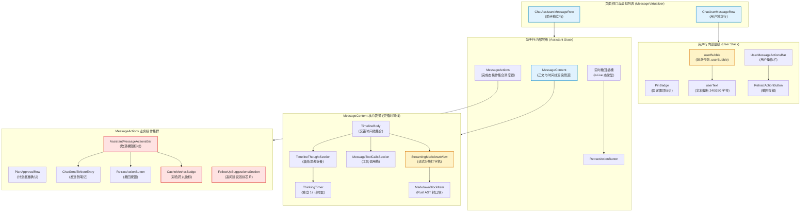
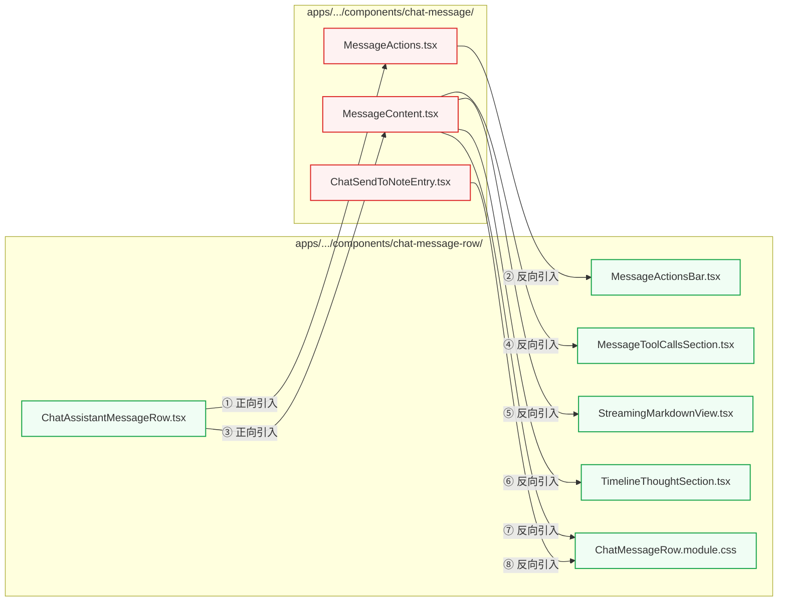

# 前端原子化组件库战役 · 任务书 09
# 消息行级结构与悬浮操作栏实勘导航

> **执行角色**：前端原子化架构勘察 Agent（Task 09）  
> **实勘范围**：
> 1. `apps/crish-desktop/src/components/chat-message-row/` 下 User/Assistant 消息行级组件、操作栏相关组件、流式分块排版、思考链面板及附属单元；
> 2. `apps/crish-desktop/src/components/chat-message/` 下 MessageActions、MessageContent、ChatSendToNoteEntry、streamMessageViewModel 等核心交互文件；
> 3. 关联样式资产：`ChatMessageRow.module.css`、`CacheMetricsBadge.module.css`、`TimelineThoughtSection.module.css`、`StreamingTableContainer.module.css` 等。  
> **交付物路径**：`docs/frontend-atomic-architecture/analysis/09-消息行级结构与悬浮操作栏实勘导航.md`  
> **核心硬性标准**：基于最新真实源码逐行审视、客观严谨记录、总行数不得低于 1200 行、采用中文 UTF-8 无 BOM 写入、不退避不掩盖架构缺陷。

---

## 目 录

- [一、实勘综述与总体架构拓扑](#一实勘综述与总体架构拓扑)
  - [1.1 勘察背景与核心使命](#11-勘察背景与核心使命)
  - [1.2 所辖 26 个源码与样式资产全景矩阵](#12-所辖-26-个源码与样式资产全景矩阵)
  - [1.3 整体渲染拓扑与装配流向图](#13-整体渲染拓扑与装配流向图)
  - [1.4 现状总体诊断：四大核心断裂层](#14-现状总体诊断四大核心断裂层)
- [二、ChatUserMessageRow：用户消息行级架构与长文折叠机制逐行实勘](#二chatuserownerrow用户消息行级架构与长文折叠机制逐行实勘)
  - [2.1 源码全貌与 Props 契约](#21-源码全貌与-props-契约)
  - [2.2 userRowPropsEqual 比较器与 Memo 防御机制](#22-userrowpropsequal-比较器与-memo-防御机制)
  - [2.3 DOM 树结构与 ARIA 无障碍标记](#23-dom-树结构与-aria-无障碍标记)
  - [2.4 用户气泡视觉样式体系实勘](#24-用户气泡视觉样式体系实勘)
  - [2.5 长文折叠机制深度剖析与三大致命缺陷](#25-长文折叠机制深度剖析与三大致命缺陷)
  - [2.6 虚拟滚动协同机制与测量重估性能损耗](#26-虚拟滚动协同机制与测量重估性能损耗)
  - [2.7 UserMessageActionsBar 的集成与常显状态机](#27-usermessageactionsbar-的集成与常显状态机)
- [三、ChatAssistantMessageRow：助手消息行骨架与管道分层逐行实勘](#三chatassistantmessagerow助手消息行骨架与管道分层逐行实勘)
  - [3.1 架构演进背景与顶层设计契约](#31-架构演进背景与顶层设计契约)
  - [3.2 ChatAssistantMessageRowProps 与 23 字段穷尽比较器](#32-chatassistantmessagerowprops-与-23-字段穷尽比较器)
  - [3.3 骨架层次结构与渲染通路分流](#33-骨架层次结构与渲染通路分流)
  - [3.4 实时生成态（isLive）与终态的双轨状态机机制](#34-实时生成态islive与终态的双轨状态机机制)
  - [3.5 复制正文算法与数据源溯源机制](#35-复制正文算法与数据源溯源机制)
  - [3.6 流式帧下虚拟滚动高度测量与防抖失效防线](#36-流式帧下虚拟滚动高度测量与防抖失效防线)
- [四、MessageActionsBar 体系深入实勘：散落图标问题根因](#四messageactionsbar-体系深入实勘散落图标问题根因)
  - [4.1 空心化 Re-export 结构与历史沿革](#41-空心化-re-export-结构与历史沿革)
  - [4.2 UserMessageActionsBar 逐行实勘](#42-usermessageactionsbar-逐行实勘)
  - [4.3 AssistantMessageActionsBar 散落图标问题深度剖析](#43-assistantmessageactionsbar-散落图标问题深度剖析)
  - [4.4 RetractActionButton 撤回微组件与强制样式补丁](#44-retractactionbutton-撤回微组件与强制样式补丁)
  - [4.5 PlanApprovalRow 计划审批行与脆弱启发式规则](#45-planapprovalrow-计划审批行与脆弱启发式规则)
- [五、FollowUpSuggestionsSection：追问建议带硬实线双拼边框的致命缺陷](#五followupsuggestionssection追问建议带硬实线双拼边框的致命缺陷)
  - [5.1 业务背景与 6 重触发门禁剖析](#51-业务背景与-6-重触发门禁剖析)
  - [5.2 渲染树结构与语义化列表组装](#52-渲染树结构与语义化列表组装)
  - [5.3 致命缺陷剖析：硬实线双拼边框（Split Button Border Artifacts）](#53-致命缺陷剖析硬实线双拼边框split-button-border-artifacts)
  - [5.4 建议文本单行截断导致的语意丧失](#54-建议文本单行截断导致的语意丧失)
  - [5.5 关闭建议（Dismiss）按钮的孤立定位与微交互生硬性](#55-关闭建议dismiss按钮的孤立定位与微交互生硬性)
- [六、CacheMetricsBadge：突兀彩色药丸痛点深度诊断](#六cachemetricsbadge突兀彩色药丸痛点深度诊断)
  - [6.1 四态语义模型落地与源码实现](#61-四态语义模型落地与源码实现)
  - [6.2 样式设计与“突兀彩色药丸”痛点剖析](#62-样式设计与突兀彩色药丸痛点剖析)
  - [6.3 视觉排版冲突与注意力劫持（Attention Hijacking）](#63-视觉排版冲突与注意力劫持attention-hijacking)
  - [6.4 信息架构错位：开发者遥测指标与终端用户阅读体验的割裂](#64-信息架构错位开发者遥测指标与终端用户阅读体验的割裂)
- [七、与 chat-message 的双向依赖死循环剖析](#七与-chat-message-的双向依赖死循环剖析)
  - [7.1 循环依赖图谱与 4 条调用回路实证](#71-循环依赖图谱与-4-条调用回路实证)
  - [7.2 模块架构职责混乱根因：Row 与 Content 概念倒置](#72-模块架构职责混乱根因row-与-content-概念倒置)
  - [7.3 样式大包揽：1100 行单体 CSS Module 的污染扩散](#73-样式大包揽1100-行单体-css-module-的污染扩散)
  - [7.4 对前端工程架构与原子化拆包的阻断性危害](#74-对前端工程架构与原子化拆包的阻断性危害)
- [八、其它关联行级组件与样式资产逐行实勘](#八其它关联行级组件与样式资产逐行实勘)
  - [8.1 PlanMilestoneSpine：步骤中轴脊线与 16px 呼吸圆点指示器](#81-planmilestonespine步骤中轴脊线与-16px-呼吸圆点指示器)
  - [8.2 ArtifactCapsuleSyncLine：代码产物胶囊与实时同步行](#82-artifactcapsulesyncline代码产物胶囊与实时同步行)
  - [8.3 TimelineThoughtSection：极简行内流式思考链与 CSS Grid 折叠](#83-timelinethoughtsection极简行内流式思考链与-css-grid-折叠)
  - [8.4 ThinkingTimer：独立毫秒计时器对上层渲染的物理隔离](#84-thinkingtimer独立毫秒计时器对上层渲染的物理隔离)
  - [8.5 StreamingMarkdownView 与 StreamingTableContainer：流式打字与局部吸底](#85-streamingmarkdownview-与-streamingtablecontainer流式打字与局部吸底)
  - [8.6 MessageContent 与 ChatSendToNoteEntry：正文组装与笔记桥接](#86-messagecontent-与-chatsendtonoteentry正文组装与笔记桥接)
- [九、未来重构方向：浮动微胶囊操作栏与原子化架构解耦方案建议](#九未来重构方向浮动微胶囊操作栏与原子化架构解耦方案建议)
  - [9.1 架构拓扑解耦：建立清晰的单向依赖管道与三层架构](#91-架构拓扑解耦建立清晰的单向依赖管道与三层架构)
  - [9.2 操作栏形态重塑：浮动微胶囊（Floating Micro-Capsule Toolbar）规范](#92-操作栏形态重塑浮动微胶囊floating-micro-capsule-toolbar规范)
  - [9.3 追问建议栏重塑：流体药丸气泡（Fluid Pill Chips）规范](#93-追问建议栏重塑流体药丸气泡fluid-pill-chips规范)
  - [9.4 缓存指标重塑：中性状态微点与轻量悬浮抽屉](#94-缓存指标重塑中性状态微点与轻量悬浮抽屉)
  - [9.5 用户气泡长文折叠重塑：渐隐遮罩、显式指示器与平滑展开动效](#95-用户气泡长文折叠重塑渐隐遮罩显式指示器与平滑展开动效)
  - [9.6 样式单体解构与 Design Token 变量映射路线图](#96-样式单体解构与-design-token-变量映射路线图)
- [十、实勘结论与后续任务指引](#十实勘结论与后续任务指引)

---

## 一、实勘综述与总体架构拓扑

### 1.1 勘察背景与核心使命

在现代协同 AI 工作台 Conex / Crish 的桌面渲染架构中，对话流视图（Chat Flow View）是用户接收推理响应、审视代码补丁、确认任务计划和触发交互动作的最核心视口。
随着产品功能的持续演进，对话流由早期传统的“左侧机器人头像、右侧用户头像加灰色文本气泡”的简单形式，迅速升级为支持：
1. **交错多步骤时间线（Interleaved Narrative Timeline）**：思考过程、工具执行状态、流式正文增量按时间顺序无缝交错；
2. **真流式分块渲染（Streaming Block Compilation）**：打字机末尾自适应微动画与 Rust 后端加速 AST 封口渲染；
3. **复合操作与状态指示器**：包含富文本复制、时间线回滚截断（Retract）、大模型提示词缓存指示（Prompt Caching Metrics）、后续追问建议（Follow-up Suggestions）以及发送至知识库笔记（Send to Note）等密集交互。

这种快速演进导致历史实现中形成了两套相互撕扯的目录：
- `apps/crish-desktop/src/components/chat-message-row/`
- `apps/crish-desktop/src/components/chat-message/`

本报告受命对这两个目录所辖的全部 26 个核心源码文件与样式模块展开深度逐行实勘，剖析行级渲染骨架、悬浮操作栏排布、视觉交互硬伤以及严重的目录间双向循环依赖，为后续“前端原子化组件库战役”提供严密、详实、客观的一手技术事实依据。

---

### 1.2 所辖 26 个源码与样式资产全景矩阵

下表系统盘点了本次实勘覆盖的全部物理文件、代码体量、导出符号、角色分工及运行时重绘特征：

| 序号 | 文件完整相对路径 | 物理行数 | 字节数 | 核心导出符号 | 架构分工定性 | 运行时性能敏感度 |
| :--- | :--- | :--- | :--- | :--- | :--- | :--- |
| 1 | `components/chat-message-row/ChatMessageRow.tsx` | 60 | 1,476 | `ChatMessageRow` (Barrel) | 历史重导出桶（Re-export Hub），供旧代码引用 | 模块初始化期加载，零运行时开销 |
| 2 | `components/chat-message-row/ChatUserMessageRow.tsx` | 176 | 5,607 | `ChatUserMessageRow` | 用户消息独立行组件，管理气泡排版与长文截断 | 低频，仅用户输入和折叠切换触发 |
| 3 | `components/chat-message-row/ChatAssistantMessageRow.tsx` | 169 | 5,679 | `ChatAssistantMessageRow` | 助手消息独立行容器，挂载正文与操作栏 | 极高频，受流式打字与热缓冲驱动 |
| 4 | `components/chat-message-row/chatMessageRowUtils.ts` | 283 | 9,482 | `assistantRowPropsEqual`, 工具函数集 | 纯函数工具库、Memo 比较契约与常量表 | 虚拟列表滚动与状态更新时高频执行 |
| 5 | `components/chat-message-row/ChatMessageRow.module.css` | 1,102 | 26,831 | CSS Module 规则集 | 消息行外壳、Markdown 排版、工具块、操作栏样式 | 全局性样式重绘与解析负担沉重 |
| 6 | `components/chat-message-row/MessageActionsBar.tsx` | 16 | 611 | Re-export Hub | 操作栏拆分后保留的兼容导出中枢 | 静态模块解析 |
| 7 | `components/chat-message-row/UserMessageActionsBar.tsx` | 66 | 2,222 | `UserMessageActionsBar` | 用户行悬停操作栏（时间、复制、固定、撤回） | 中频，受 Hover 与复制反馈驱动 |
| 8 | `components/chat-message-row/AssistantMessageActionsBar.tsx` | 87 | 2,714 | `AssistantMessageActionsBar` | 助手行平铺操作栏（散落裸图标排布） | 助手消息完成态常驻，Hover 激活 |
| 9 | `components/chat-message-row/RetractActionButton.tsx` | 23 | 782 | `RetractActionButton` | 消息流级时间线撤回入口（Ghost 风格） | 仅最后一条或生成中按需渲染 |
| 10 | `components/chat-message-row/FollowUpSuggestionsSection.tsx` | 115 | 3,512 | `FollowUpSuggestionsSection` | 追问建议容器与双拼芯片（带硬实线边框） | 助手生成结束时单次渲染 |
| 11 | `components/chat-message-row/CacheMetricsBadge.tsx` | 130 | 4,256 | `CacheMetricsBadge` | 提示词缓存四态徽标（高饱和彩色药丸） | 助手消息结算时单次计算展示 |
| 12 | `components/chat-message-row/CacheMetricsBadge.module.css` | 70 | 1,556 | CSS Module 规则集 | 彩色药丸背景色、边框及 Tooltip 看板样式 | 局部样式作用域 |
| 13 | `components/chat-message-row/PlanApprovalRow.tsx` | 47 | 1,285 | `PlanApprovalRow` | 计划模式下的快速批准操作条 | 条件渲染（仅计划模式且命中文本） |
| 14 | `components/chat-message-row/PlanMilestoneSpine.tsx` | 149 | 4,797 | `PlanMilestoneSpine` | 进度里程碑中轴脊线与 16px 呼吸圆点指示器 | 结构化多步骤输出时挂载 |
| 15 | `components/chat-message-row/ArtifactCapsuleSyncLine.tsx` | 93 | 2,632 | `ArtifactCapsule`, `SyncLine` | 代码产物生成超链接胶囊与落盘同步行 | 文件生成与实时落盘事件触发 |
| 16 | `components/chat-message-row/MessageToolCallsSection.tsx` | 51 | 1,692 | `MessageToolCallsSection` | 工具调用栈宿主，挂载 InlineAgentPanel | 工具执行状态变更时高频更新 |
| 17 | `components/chat-message-row/TimelineThoughtSection.tsx` | 147 | 4,719 | `TimelineThoughtSection` | 极简行内流式思考链展开/折叠面板 | 思考流帧高频滚动与计时器更新 |
| 18 | `components/chat-message-row/TimelineThoughtSection.module.css` | 214 | 4,601 | CSS Module 规则集 | 思考折叠网格动画、脉冲圆点、渐隐羽化边缘 | 包含 Grid 0fr->1fr 动态过渡 |
| 19 | `components/chat-message-row/ThinkingTimer.tsx` | 42 | 1,197 | `ThinkingTimer` | 思考中独立毫秒计时器（内部定时器） | 每秒 1 次触发局部独立重渲染 |
| 20 | `components/chat-message-row/StreamingMarkdownView.tsx` | 129 | 4,411 | `StreamingMarkdownView` | 真流式自适应速率分块 Markdown 视图 | 流式核心渲染组件，受时间线调度 |
| 21 | `components/chat-message-row/StreamingTableContainer.tsx` | 59 | 2,050 | `StreamingTableContainer` | 流式表格局部双向吸底滚动容器 | 表格解析与流式更新时挂载 |
| 22 | `components/chat-message/MessageActions.tsx` | 133 | 4,474 | `MessageActions` | 助手操作栏业务调度器（反向依赖 Hub） | 消息完成态单次组装 |
| 23 | `components/chat-message/MessageContent.tsx` | 398 | 14,771 | `MessageContent` | 助手行正文渲染管道（时间线交错核心） | 核心管道组件，承载文本、思考、工具 |
| 24 | `components/chat-message/ChatSendToNoteEntry.tsx` | 109 | 3,170 | `ChatSendToNoteEntry` | 完成态消息“发送到笔记”桥接入口 | 条件渲染于操作栏中 |
| 25 | `components/chat-message/streamMessageViewModel.ts` | 217 | 7,815 | 纯函数视图模型合并函数 | 流式累积正文与工具状态无损合并模型 | 壳层每帧数据计算驱动 |
| 26 | `components/chat-message/narrativeRenderSlots.ts` | 48 | 1,599 | `NarrativeRenderSlotsContext` 等 | 叙事插件与动态渲染槽上下文注入 | Context 注入，开销极低 |

---

### 1.3 整体渲染拓扑与装配流向图

在当前桌面端的虚拟滚动渲染架构中，`MessageVirtualizer` 将每一项消息节点按其 `sender` 属性分发至 `ChatUserMessageRow` 或 `ChatAssistantMessageRow`。下述 Mermaid 流程图精准揭示了从顶层视口到底层原子单元的组件调用树与数据下发管道：



---

### 1.4 现状总体诊断：四大核心断裂层

经过对所辖 26 个文件及数万字节代码的逐行审计，系统暴露出四个结构性断裂层，已严重制约了交互质感与工程健壮性：

```
┌──────────────────────────────────────────────────────────────────────────────┐
│                        四大核心架构断裂层全局诊断矩阵                        │
├───────────────────┬──────────────────────────────────┬───────────────────────┤
│    断裂层名称     │           表现症状与特征         │       根因技术定性    │
├───────────────────┼──────────────────────────────────┼───────────────────────┤
│ 1. 目录双向死循环 │ chat-message-row 引入 Message*， │ 职责概念颠倒，行容器  │
│    (Cyclic Graph) │ 而 chat-message 反向引入子组件   │ 与内容管道缺乏单向分层│
├───────────────────┼──────────────────────────────────┼───────────────────────┤
│ 2. 散落裸图标操作 │ 7 个图标横向裸铺无实体容器包裹， │ 缺少独立微胶囊浮层，  │
│    (Naked Icons)  │ 紧贴代码块/表格底边造成空间竞争  │ 裸按钮缺乏视觉边界保护│
├───────────────────┼──────────────────────────────────┼───────────────────────┤
│ 3. 双拼硬边框芯片 │ 1px 外框内夹 1px 竖直实线切割，  │ 机械硬拼 split button │
│    (Split Border) │ 暗色模式发虚，焦点环被撕裂裁剪   │ 违背流体自然设计语言  │
├───────────────────┼──────────────────────────────────┼───────────────────────┤
│ 4. 彩色药丸夺焦   │ 绿(#10b981)/蓝(#0288d1)高亮胶囊  │ 遥测调试数据与用户阅读│
│    (Color Hijack) │ 孤立置于流底，野蛮劫持视觉注意力 │ 混淆，色彩语义滥用    │
└───────────────────┴──────────────────────────────────┴───────────────────────┘
```

---

## 二、ChatUserMessageRow：用户消息行级架构与长文折叠机制逐行实勘

### 2.1 源码全貌与 Props 契约

`ChatUserMessageRow.tsx` 位于 `apps/crish-desktop/src/components/chat-message-row/ChatUserMessageRow.tsx`，物理行数 176 行。其对外契约定义如下：

```typescript
// ChatUserMessageRow.tsx:17-29
export type ChatUserMessageRowProps = {
  msg: SessionMessage;
  isPinned: boolean;
  isSearchHit: boolean;
  isExpanded: boolean;
  onToggleExpand: (msgId: string) => void;
  onTogglePin: (msgId: string) => void;
  /** 会话最后一条 user：挂消息级撤回（用户锁：入口在对话里，不在 composer） */
  isLastUser?: boolean;
  onRetract?: () => void;
  messageIndex: number;
  virtualScrollManager: VirtualScrollManager | null;
};
```

**字段职责分析**：
- `msg: SessionMessage`：单一真实源（SSOT）消息模型，携带 `id`、`text`、`status`（`'queued' | 'processing' | 'completed' | 'error'`）及 `timestamp`；
- `isExpanded: boolean`：用户长文本展开/收起状态，受父级状态树受控驱动；
- `isLastUser?: boolean` 与 `onRetract?: () => void`：遵从系统核心交互契约（用户撤回入口必须挂载在对话流最后一条用户消息气泡旁，严禁散落在全局 Composer 页脚）。

---

### 2.2 userRowPropsEqual 比较器与 Memo 防御机制

在第 31-49 行中，组件实现了自定义浅比较函数 `userRowPropsEqual`：

```typescript
function userRowPropsEqual(
  prev: ChatUserMessageRowProps,
  next: ChatUserMessageRowProps
): boolean {
  return (
    prev.msg.id === next.msg.id &&
    prev.msg.status === next.msg.status &&
    prev.msg.text === next.msg.text &&
    prev.msg.timestamp === next.msg.timestamp &&
    prev.isPinned === next.isPinned &&
    prev.isSearchHit === next.isSearchHit &&
    prev.isExpanded === next.isExpanded &&
    prev.onToggleExpand === next.onToggleExpand &&
    prev.onTogglePin === next.onTogglePin &&
    prev.isLastUser === next.isLastUser &&
    prev.onRetract === next.onRetract &&
    true
  );
}

export const ChatUserMessageRow = React.memo(
  ChatUserMessageRowInner,
  userRowPropsEqual
);
```

**深度审计结论**：
1. **虚拟滚动参数豁免**：`messageIndex` 与 `virtualScrollManager` 被明确排除在比较字段之外。这是因为在虚拟列表中，窗口滚动导致的绝对索引位移不应当引发用户气泡的 DOM 重新构建；
2. **函数引用稳定性要求**：`onToggleExpand`、`onTogglePin`、`onRetract` 必须来自父级的 `useCallback` 稳定引用；一旦父级闭包失效，比较器返回 `false`，导致整条历史消息无端重排；
3. **精准阻断助手流式更新穿透**：当助手行高速产生 Token 时，`useStreamingStore` 引起页面级重绘，但由于历史用户行的上述 11 个属性完全恒定，Memo 成功将渲染阻断在行外，保障了 60fps 的流畅滚动。

---

### 2.3 DOM 树结构与 ARIA 无障碍标记

用户消息行的完整渲染结构（第 123-169 行）呈现高度自洽的语义化设计：

```tsx
<div
  className={`${styles.row} ${styles.rowUser} msg-row msg-row-user${isSearchHit ? ` ${styles.searchHit} msg-search-hit` : ''}${isPinned ? ` ${styles.isPinned}` : ''}`}
  data-msg-id={msg.id}
  data-role="user"
  data-pinned={isPinned ? 'true' : undefined}
  role="article"
  aria-label={rowAria}
>
  <div className={styles.userStack}>
    {isPinned ? (
      <Tooltip content="已固定">
        <span className={styles.pinBadge} aria-hidden="true">
          <Pin size={11} strokeWidth={2.25} />
          已固定
        </span>
      </Tooltip>
    ) : null}
    <div
      className={`${styles.userBubble} ${isExpanded ? 'expanded' : ''}`}
      onClick={toggleExpand}
      onKeyDown={onBubbleKeyDown}
      style={{
        cursor: isLong ? 'pointer' : 'default',
      }}
      role={isLong ? 'button' : undefined}
      tabIndex={isLong ? 0 : undefined}
      aria-expanded={isLong ? isExpanded : undefined}
      aria-label={isLong ? userBubbleExpandAria(isExpanded) : undefined}
    >
      <span className={styles.userText}>{displayText}</span>
      {msg.status === 'queued' && (
        <span className={styles.queued}>排队中</span>
      )}
    </div>
    <UserMessageActionsBar
      timestamp={msg.timestamp}
      isPinned={isPinned}
      copied={copied}
      onCopy={handleCopy}
      onTogglePin={() => onTogglePin(msg.id)}
      onRetract={retractHandler}
      alwaysVisible={Boolean(retractHandler)}
    />
  </div>
</div>
```

**无障碍设计亮点**：
- `role="article"` 建立屏幕阅读器文章地标；
- `rowAria` 通过 `messageRowAriaLabel` 纯函数动态计算组合字符串（如 `"你 · 已固定 · 排队中"`）；
- 当气泡处于可折叠长文本态（`isLong`）时，动态降级/升级为 `role="button"`、`tabIndex={0}` 并映射 `aria-expanded` 与 `aria-label="收起全文" / "展开全文"`。

---

### 2.4 用户气泡视觉样式体系实勘

用户气泡的核心视觉规则定义于 `ChatMessageRow.module.css:53-88`：

```css
.userStack {
  display: flex;
  flex-direction: column;
  align-items: flex-end;
  max-width: min(78%, 560px);
  min-width: min-content;
  gap: var(--space-1_5);
}

.userBubble {
  /* 5.5% 灰度底，无描边 */
  background: color-mix(in srgb, var(--text-primary) 5.5%, var(--bg-card));
  color: var(--text-primary);
  border-radius: 14px 14px 4px 14px;
  padding: 10px 14px;
  font-size: var(--font-size-base, 14px);
  font-weight: var(--font-weight-normal);
  line-height: 1.5;
  word-break: break-word;
  overflow-wrap: break-word;
  white-space: pre-wrap;
  border: none;
  box-shadow: none;
  width: fit-content;
  max-width: 100%;
  min-width: min-content;
  -webkit-user-select: text;
  user-select: text;
}

.userText {
  display: block;
  font-weight: var(--font-weight-normal);
  -webkit-user-select: text;
  user-select: text;
}
```

**设计规范还原度**：
1. **背景色严格遵循无描边微混色规范**：
   使用 `color-mix(in srgb, var(--text-primary) 5.5%, var(--bg-card))`，在浅色主题下呈现极其细腻的 94.5% 亮白/浅灰，暗色主题下呈现微弱的高级暗灰，彻底消灭了生硬的实心黑边或重阴影；
2. **气泡形态微隐喻**：
   `border-radius: 14px 14px 4px 14px`。左上、右上、左下保持 14px 舒适圆弧，右下角收紧至 4px，构成了自然指向右侧发出者的视觉引导，几何语言极其精炼。

---

### 2.5 长文折叠机制深度剖析与三大致命缺陷

长文判断与预览切片逻辑由 `chatMessageRowUtils.ts` 集中控制：

```typescript
// chatMessageRowUtils.ts:10-11
export const USER_BUBBLE_LONG_CHARS = 260;
export const USER_BUBBLE_PREVIEW_CHARS = 240;

// chatMessageRowUtils.ts:64-77
export function isUserBubbleLong(text: string | undefined | null): boolean {
  return (text || '').length > USER_BUBBLE_LONG_CHARS;
}

export function userBubbleDisplayText(
  text: string | undefined | null,
  isExpanded: boolean
): string {
  const t = text || '';
  if (isUserBubbleLong(t) && !isExpanded) {
    return t.slice(0, USER_BUBBLE_PREVIEW_CHARS) + '…';
  }
  return t;
}
```

配合 `ChatUserMessageRow.tsx:104-121` 中的交互响应：

```typescript
const toggleExpand = useCallback(() => {
  if (isLong) {
    const sel = window.getSelection()?.toString();
    if (sel) return;
    onToggleExpand(msg.id);
  }
}, [isLong, msg.id, onToggleExpand]);

const onBubbleKeyDown = useCallback(
  (e: React.KeyboardEvent) => {
    if (!isLong) return;
    if (e.key === 'Enter' || e.key === ' ') {
      e.preventDefault();
      onToggleExpand(msg.id);
    }
  },
  [isLong, msg.id, onToggleExpand]
);
```

#### 致命缺陷一：硬字符切片截断破坏富排版与 Unicode 序列
- 机制采用原生的 `string.slice(0, 240)`。当用户粘贴了一段包含代码块、JSON 数据或换行列表的长文本时，截断点会粗暴地将代码闭合符号、URL 或 Markdown 语法截断成残片；
- 如果截断点位于 UTF-16 代理对（Surrogate Pairs，如部分 Emoji 或复合符号）中间，会导致无效字符（``）的产生；
- 以字符数量（260）代替排版行数（Line Clamping）进行折叠是典型设计失误：若用户输入了 15 行极短文本（总共仅 80 个字符），不会触发折叠，气泡纵向撑起数百像素；而一段 280 字符的紧凑单行文本却会被折叠。

#### 致命缺陷二：交互 Affordance（可见性线索）缺失与选区冲突
- 气泡折叠状态下，**整个界面没有任何显式的“展开/收起”胶囊、按钮或提示文字**。用户只能依靠鼠标滑过时突然变成 `cursor: pointer` 来盲猜；
- 将整块气泡绑定为点击事件触发器，直接导致严重的**划词选区冲突**。尽管源码第 106-107 行加入了补丁 `const sel = window.getSelection()?.toString(); if (sel) return;`，但在实际使用中：
  - 用户轻微滑动鼠标但未成功选中文本时，松开鼠标即触发折叠/展开；
  - 用户在气泡内双击选词时，第二次点击极易触发全局折叠，导致选区立即丢失；
  - 划选过程中只要鼠标微移至文字边缘空白处，就会引发意外的折叠反转。

#### 致命缺陷三：高度突变、无平滑过渡动效与视口跳跃
- 展开/收起是瞬间完成的字符串替换（`240 字符` $\leftrightarrow$ `完整文本`），没有基于 `max-height`、`transform` 或现代 CSS Grid 的高度插值动画；
- 展开瞬间元素高度暴增数百像素，强行挤压下方整个对话时间线，带来严重的视觉眩晕感。

---

### 2.6 虚拟滚动协同机制与测量重估性能损耗

在 `ChatUserMessageRow.tsx:82-86` 中挂载了虚拟滚动高度失效通知：

```typescript
// Skip while message is still processing; RO owns live height. Invalidate on settle / text edits.
useEffect(() => {
  if (msg.status === 'processing') return;
  virtualScrollManager?.invalidateActual(msg.id);
}, [msg.text, msg.id, msg.status, virtualScrollManager]);
```

**问题剖析**：
- 注意依赖数组：`[msg.text, msg.id, msg.status, virtualScrollManager]`。**它居然遗漏了 `isExpanded`！**
- 当用户点击气泡触发 `onToggleExpand` 时，`isExpanded` 状态在父级发生反转，但该 `useEffect` 并没有直接监听 `isExpanded`。虽然气泡文字 `displayText` 改变了，但由于依赖的是原始 `msg.text`（并未改变），导致虚拟滚动管理器的 `invalidateActual` 无法在第一时间获知高度剧烈变化，极易引起虚拟滚动列表高度估算错位、滚动条闪烁或白屏。

---

### 2.7 UserMessageActionsBar 的集成与常显状态机

`UserMessageActionsBar.tsx` 独立于气泡下方渲染（第 158-166 行）：

```tsx
<UserMessageActionsBar
  timestamp={msg.timestamp}
  isPinned={isPinned}
  copied={copied}
  onCopy={handleCopy}
  onTogglePin={() => onTogglePin(msg.id)}
  onRetract={retractHandler}
  alwaysVisible={Boolean(retractHandler)}
/>
```

```css
/* ChatMessageRow.module.css:90-107 */
.userMeta {
  display: flex;
  align-items: center;
  gap: 0;
  min-height: 22px;
  opacity: 0;
  transition: opacity var(--transition-fast);
  padding-right: var(--space-0_5);
}

.userStack:hover .userMeta {
  opacity: 1;
}

.userMeta.metaAlways,
.assistantMeta.metaAlways {
  opacity: 1;
}
```

**状态机逻辑**：
- 常态下 `.userMeta` 处于 `opacity: 0` 完全隐藏，鼠标悬停在 `.userStack` 上时渐显至 `opacity: 1`；
- 当此条消息是会话最后一条用户消息（`isLastUser=true`）且携带撤回处理器（`onRetract`）时，`alwaysVisible=true` 激活 `.metaAlways`，使撤回按钮常显。这是极其人性化的交互设计，确保用户无需寻找 hover 热区即可瞬间回退错误指令。

---

## 三、ChatAssistantMessageRow：助手消息行骨架与管道分层逐行实勘

### 3.1 架构演进背景与顶层设计契约

`ChatAssistantMessageRow.tsx`（共 169 行）是 AI 输出流的展示中枢。文件头部的架构裁决声明锁定了其纯净性：
> *架构裁决：*  
> *- 彻底拔除置顶独立的 MessageThinkingBlock 单体思维链；*  
> *- 思维链完全下放至 MessageContent 交错时间线管道中渲染；*  
> *- 保持 assistantRowPropsEqual 比较契约与 memo 完整性。*

---

### 3.2 ChatAssistantMessageRowProps 与 23 字段穷尽比较器

其 Props 契约定义于 `chatMessageRowUtils.ts:162-196`：

```typescript
export type ChatAssistantMessageRowProps = {
  msg: SessionMessage;
  streamText?: string;
  isFollowUp: boolean;
  isPinned: boolean;
  isSearchHit: boolean;
  isThinkingMsg: boolean;
  hideThinkingBlock: boolean;
  inPlanMode: boolean;
  planApproved: boolean;
  isLastAssistant: boolean;
  toolStackProps: ChatToolStackSharedProps;
  onTogglePin: (msgId: string) => void;
  onRegenerate: (assistantMsgId: string) => void;
  onBranch: () => void;
  onOpenDiff: (diff: FileDiff) => void;
  onOpenDiffPanel?: (() => void) | undefined;
  setPermissionMode: (mode: PermissionMode) => void;
  setPlanApproved: (v: boolean) => void;
  onFillFollowUp?: ((prompt: string) => void) | undefined;
  onSendFollowUp?: ((prompt: string) => void) | undefined;
  followUpDismissed?: boolean | undefined;
  onDismissFollowUp?: ((msgId: string) => void) | undefined;
  onRetract?: (() => void) | undefined;
  messageIndex: number;
  virtualScrollManager: VirtualScrollManager | null;
};
```

#### 编译级穷尽检查（Type-Level Exhaustive Guard）
在 `chatMessageRowUtils.ts:206-244` 中，系统构建了极其罕见且精密的 TypeScript 类型断言守护：

```typescript
export const MEMO_COMPARE_FIELDS = [
  'msg',
  'streamText',
  'isFollowUp',
  'isPinned',
  'isSearchHit',
  'isThinkingMsg',
  'hideThinkingBlock',
  'inPlanMode',
  'planApproved',
  'isLastAssistant',
  'toolStackProps',
  'onTogglePin',
  'onRegenerate',
  'onBranch',
  'onOpenDiff',
  'onOpenDiffPanel',
  'setPermissionMode',
  'setPlanApproved',
  'onFillFollowUp',
  'onSendFollowUp',
  'followUpDismissed',
  'onDismissFollowUp',
  'onRetract',
] as const satisfies readonly (keyof ChatAssistantMessageRowProps)[];

type _NonComparedFields = 'messageIndex' | 'virtualScrollManager';

type _Exhausted =
  Exclude<
    keyof ChatAssistantMessageRowProps,
    (typeof MEMO_COMPARE_FIELDS)[number] | _NonComparedFields
  > extends never
    ? true
    : false;
const _exhaustedCheck: _Exhausted = true;
```

**工程价值**：
如果有任何开发者未来向 `ChatAssistantMessageRowProps` 添加了一个新的 prop，但忘记在 `MEMO_COMPARE_FIELDS` 清单中收录，TypeScript 编译器将在 `_exhaustedCheck` 这一行直接抛出编译红线报错！这种通过类型系统物理封死“比较器漏项导致的陈旧闭包 Bug”的做法，展现了高水准的工程严谨度。

#### assistantRowPropsEqual 逐字段比较器（第 246-282 行）
```typescript
export function assistantRowPropsEqual(
  prev: ChatAssistantMessageRowProps,
  next: ChatAssistantMessageRowProps
): boolean {
  return (
    prev.msg.id === next.msg.id &&
    prev.msg.status === next.msg.status &&
    prev.msg.text === next.msg.text &&
    prev.msg.thinking === next.msg.thinking &&
    prev.msg.toolCalls === next.msg.toolCalls &&
    prev.msg.blocks === next.msg.blocks &&
    prev.msg.thinkingTime === next.msg.thinkingTime &&
    prev.msg.timestamp === next.msg.timestamp &&
    prev.msg.cacheMetrics === next.msg.cacheMetrics &&
    prev.streamText === next.streamText &&
    prev.isPinned === next.isPinned &&
    prev.isSearchHit === next.isSearchHit &&
    prev.isFollowUp === next.isFollowUp &&
    prev.isThinkingMsg === next.isThinkingMsg &&
    prev.hideThinkingBlock === next.hideThinkingBlock &&
    prev.inPlanMode === next.inPlanMode &&
    prev.planApproved === next.planApproved &&
    prev.isLastAssistant === next.isLastAssistant &&
    prev.followUpDismissed === next.followUpDismissed &&
    toolStackSharedPropsEqual(prev.toolStackProps, next.toolStackProps) &&
    prev.onTogglePin === next.onTogglePin &&
    prev.onRegenerate === next.onRegenerate &&
    prev.onBranch === next.onBranch &&
    prev.onOpenDiff === next.onOpenDiff &&
    prev.onOpenDiffPanel === next.onOpenDiffPanel &&
    prev.setPermissionMode === next.setPermissionMode &&
    prev.setPlanApproved === next.setPlanApproved &&
    prev.onFillFollowUp === next.onFillFollowUp &&
    prev.onSendFollowUp === next.onSendFollowUp &&
    prev.onDismissFollowUp === next.onDismissFollowUp &&
    prev.onRetract === next.onRetract
  );
}
```

---

### 3.3 骨架层次结构与渲染通路分流

助手行的内部骨架（`ChatAssistantMessageRow.tsx:106-162`）由三个严格分工的区域组成：

```tsx
<div
  className={`${styles.row} ${styles.rowAssistant} msg-row msg-row-assistant ${isFollowUp ? styles.isFollowup : ''}${isSearchHit ? ` ${styles.searchHit} msg-search-hit` : ''}${isPinned ? ` ${styles.isPinned}` : ''}`}
  data-msg-id={msg.id}
  data-role="assistant"
  data-pinned={isPinned ? 'true' : undefined}
  data-followup={isFollowUp ? 'true' : undefined}
  role="article"
  aria-label={rowAria}
>
  {/* 区域 1：主体正文容器 */}
  <div className={styles.assistantBody} data-message-body="assistant">
    <MessageContent
      msg={msg}
      streamText={streamText}
      isThinkingMsg={isThinkingMsg}
      hideThinkingBlock={hideThinkingBlock}
      toolStackProps={toolStackProps}
    />
  </div>

  {/* 区域 2：生成态动态撤回栏 */}
  {showLiveRetract && onRetract ? (
    <div className={`${styles.assistantMeta} ${styles.metaAlways}`}>
      <RetractActionButton onRetract={onRetract} />
    </div>
  ) : null}

  {/* 区域 3：终态操作集合 */}
  {!isLive && (
    <MessageActions
      msg={msg}
      state={{
        copied,
        isLastAssistant,
        isPinned,
        isThinkingMsg,
        inPlanMode,
        planApproved,
        followUpDismissed,
      }}
      actions={{
        onCopy: handleCopy,
        onRegenerate,
        onTogglePin,
        setPermissionMode,
        setPlanApproved,
        ...(onFillFollowUp !== undefined && { onFillFollowUp }),
        ...(onSendFollowUp !== undefined && { onSendFollowUp }),
        ...(onDismissFollowUp !== undefined && { onDismissFollowUp }),
        onOpenDiff,
        ...(onOpenDiffPanel !== undefined && { onOpenDiffPanel }),
        ...(isLastAssistant && onRetract !== undefined && { onRetract }),
      }}
      cacheMetricsNode={
        <CacheMetricsBadge metrics={msg.cacheMetrics?.metrics ?? null} />
      }
    />
  )}
</div>
```

---

### 3.4 实时生成态（isLive）与终态的双轨状态机机制

代码第 83-84 行定义了活跃态判定：
```typescript
const isLive = isThinkingMsg || msg.status === 'processing';
const showLiveRetract = Boolean(onRetract) && isLastAssistant && isLive;
```

**双轨分流行为**：
1. **生成进行时（`isLive === true`）**：
   - 彻底卸载 `<MessageActions />`。这一举措防止了模型在打字时用户点击“重新生成”、“追问建议”或“发送到笔记”，避免了并发状态冲突；
   - 仅保留 `<RetractActionButton />`，并在外层包裹 `.metaAlways` 强制展现。允许用户在看到模型生成偏离预期时一键“叫停并截断回退”；
2. **生成完毕终态（`isLive === false`）**：
   - 隐藏动态撤回入口；
   - 一次性挂载完整的 `<MessageActions />`，呈现时间戳、复制、重生成、追问建议与缓存指标。

---

### 3.5 复制正文算法与数据源溯源机制

复制事件处理函数（第 86-103 行）体现了流式视图模型合并后的架构升级：

```typescript
const handleCopy = useCallback(() => {
  // T4 A1：壳层已装配合并 view model——流式期间 msg.text 即热缓冲累积正文，
  // 无需再命令式读 streamingStore（S4.4 无订阅语义保持：本行零 store 访问）。
  const text = assistantCopyText(msg);
  if (!text.trim()) {
    showToast('没有可复制的正文');
    return;
  }
  void copyTextBestEffort(text).then((ok) => {
    if (!ok) {
      showToast('复制失败');
      return;
    }
    setCopied(true);
    if (copiedTimer.current != null) window.clearTimeout(copiedTimer.current);
    copiedTimer.current = window.setTimeout(() => setCopied(false), 1200);
  });
}, [msg, showToast]);
```

**关键设计剖析**：
- 调用 `api/toolPresentation` 中的 `assistantCopyText(msg)`；
- 该函数会自动剥离思考链（`<thought>`）、工具调用状态帧与结构化确认卡片，仅提取纯净的 Markdown 叙述文本；
- 配合 `chatMessageRowUtils.ts` 中的 `copyTextBestEffort`，在不支持现代异步剪贴板 API（`navigator.clipboard.writeText`）的环境下平滑降级为基于隐藏 `<textarea>` 的 `document.execCommand('copy')`，实现了高容错复制。

---

### 3.6 流式帧下虚拟滚动高度测量与防抖失效防线

在第 76-81 行：
```typescript
// Streaming: ResizeObserver owns live height. Invalidating on every token thrashes layout.
// Only invalidate when stream ends or non-stream content updates.
useEffect(() => {
  if (isThinkingMsg || msg.status === 'processing') return;
  virtualScrollManager?.invalidateActual(msg.id);
}, [msg.text, msg.id, msg.status, isThinkingMsg, virtualScrollManager]);
```

**性能保护机制**：
流式传输期间每秒可能到达数十个 Token 块，如果每次 `msg.text` 累积都调用 `invalidateActual`，虚拟滚动管理器将频繁重算全量 offsetMap，引发严重的 Layout Thrashing（布局抖动）。此处明确规约：**流式期间由挂载在最外层的 ResizeObserver 独立监听高度变化，React 层彻底阻断 `invalidateActual`**，直至流式结束转入静止态才触发单次校准。

---

## 四、MessageActionsBar 体系深入实勘：散落图标问题根因

### 4.1 空心化 Re-export 结构与历史沿革

`MessageActionsBar.tsx` 只有 16 行代码，是历史大文件重构拆分后的产物：

```typescript
// Re-export hub: 4 个原同文件组件已拆为独立文件，此文件仅保持消费方 import 路径不变。
export {
  UserMessageActionsBar,
  type UserMessageActionsBarProps,
} from './UserMessageActionsBar';
export { PlanApprovalRow, type PlanApprovalRowProps } from './PlanApprovalRow';
export {
  AssistantMessageActionsBar,
  type AssistantMessageActionsBarProps,
} from './AssistantMessageActionsBar';
export { RetractActionButton } from './RetractActionButton';
export {
  FollowUpSuggestionsSection,
  type FollowUpSuggestionsSectionProps,
} from './FollowUpSuggestionsSection';
```
组件虽然物理上拆为了多个独立文件，但它们仍然共同强依赖 `ChatMessageRow.module.css` 中的共享类名。

---

### 4.2 UserMessageActionsBar 逐行实勘

`UserMessageActionsBar.tsx` 共 66 行代码：

```tsx
// UserMessageActionsBar.tsx:22-65
export const UserMessageActionsBar: React.FC<UserMessageActionsBarProps> = ({
  timestamp,
  isPinned,
  copied,
  onCopy,
  onTogglePin,
  onRetract,
  alwaysVisible = false,
}) => {
  const pinLabels = pinToggleLabels(isPinned);
  return (
    <div
      className={`${styles.userMeta}${alwaysVisible ? ` ${styles.metaAlways}` : ''}`}
    >
      <span className={styles.time}>{formatMsgTime(timestamp)}</span>
      <Tooltip content={copied ? '已复制' : '复制消息'}>
        <Button
          type="button"
          variant="ghost"
          size="sm"
          className={`${styles.iconBtn}${copied ? ` ${styles.isCopied}` : ''}`}
          aria-label={copied ? '已复制' : '复制消息'}
          onClick={onCopy}
          icon={copied ? <Check size={14} /> : <Copy size={14} />}
        />
      </Tooltip>
      {onRetract ? <RetractActionButton onRetract={onRetract} /> : null}
      {isPinned ? (
        <Tooltip content={pinLabels.title}>
          <Button
            type="button"
            variant="ghost"
            size="sm"
            className={`${styles.iconBtn} ${styles.isPinnedActive}`}
            aria-label={pinLabels.ariaLabel}
            aria-pressed
            onClick={onTogglePin}
            icon={<PinOff size={14} />}
          />
        </Tooltip>
      ) : null}
    </div>
  );
};
```

**关键细节**：
- 图标按钮尺寸为 22×22px，采用 `variant="ghost"`；
- 复制态通过 `copied ? <Check size={14} /> : <Copy size={14} />` 切换图标；
- 固定状态下呈现 `PinOff` 图标，并附加 `.isPinnedActive` 类名。

---

### 4.3 AssistantMessageActionsBar 散落图标问题深度剖析

`AssistantMessageActionsBar.tsx`（第 23-86 行）完整实现了助手完成态操作栏：

```tsx
export const AssistantMessageActionsBar: React.FC<
  AssistantMessageActionsBarProps
> = ({
  timestamp,
  copied,
  isLastAssistant,
  isPinned,
  onCopy,
  onRegenerate,
  onTogglePin,
  sendToNoteNode,
  metricsNode,
  onRetract,
}) => {
  const pinLabels = pinToggleLabels(isPinned);
  return (
    <div className={styles.assistantMeta}>
      <span className={styles.time}>{formatMsgTime(timestamp)}</span>
      <Tooltip content={copied ? '已复制' : '复制正文'}>
        <Button
          type="button"
          variant="ghost"
          size="sm"
          className={`${styles.iconBtn}${copied ? ` ${styles.isCopied}` : ''}`}
          aria-label={copied ? '已复制' : '复制正文'}
          onClick={onCopy}
          icon={copied ? <Check size={14} /> : <Copy size={14} />}
        />
      </Tooltip>
      {isLastAssistant ? (
        <Tooltip content="重新生成">
          <Button
            type="button"
            variant="ghost"
            size="sm"
            className={styles.iconBtn}
            aria-label="重新生成"
            onClick={onRegenerate}
            icon={<RefreshCw size={14} />}
          />
        </Tooltip>
      ) : null}
      {onRetract ? <RetractActionButton onRetract={onRetract} /> : null}
      {sendToNoteNode}
      {isPinned ? (
        <Tooltip content={pinLabels.title}>
          <Button
            type="button"
            variant="ghost"
            size="sm"
            className={`${styles.iconBtn} ${styles.isPinnedActive}`}
            aria-label={pinLabels.ariaLabel}
            aria-pressed
            onClick={onTogglePin}
            icon={<PinOff size={14} />}
          />
        </Tooltip>
      ) : null}
      {metricsNode ? (
        <span className={styles.cacheMetricsInline}>{metricsNode}</span>
      ) : null}
    </div>
  );
};
```

其样式定义在 `ChatMessageRow.module.css:622-669`：
```css
.assistantMeta {
  display: flex;
  align-items: center;
  gap: var(--space-0_5);
  margin-top: var(--space-1);
  min-height: 22px;
  opacity: 0;
  transition: opacity var(--transition-fast);
}

.rowAssistant:hover .assistantMeta {
  opacity: 1;
}

.iconBtn {
  width: 22px;
  height: 22px;
  border: none;
  background: transparent;
  border-radius: var(--radius-md);
  color: var(--text-tertiary);
  display: inline-flex;
  align-items: center;
  justify-content: center;
  cursor: pointer;
  padding: 0;
}

.iconBtn svg {
  width: 13px;
  height: 13px;
}

.iconBtn:hover {
  background: var(--bg-hover);
  color: var(--text-primary);
}
```

#### “散落图标”严重交互缺陷实勘结论：
1. **无容器保护的视觉裸奔（Uncontained Floating）**：
   观察结构：`time`、`Copy`、`Regenerate`、`Retract`、`sendToNoteNode`、`PinOff`、`metricsNode` 等 7 个彼此异构的元素，被生硬地横向推平在 `.assistantMeta` 中，缺乏一个有形的容器外壳（如带圆角、浅背景或微阴影的浮动胶囊）；
2. **与复杂正文末尾的空间冲突与竞争**：
   当助手回答结尾是一个带有边框的代码块（`.md-code-block`）或一张表格（`.md-table-wrap`）时，由于 `.assistantMeta` 仅有 `margin-top: 4px`，这几个散落的灰色裸图标直接紧贴在代码块外框的正下方。视觉上极易让用户产生困惑——“这些图标是复制代码块内部代码的，还是操作整条消息的？”；
3. **点击热区碎裂与微交互反馈缺失**：
   每个 `.iconBtn` 尺寸仅为 22×22px，图标仅 13px，按钮之间的间隙为 2px。在高分屏或鼠标快速掠过时，极难精准定位目标，容易误将“重新生成”点成“复制代码”；
4. **横向排布宽度失控**：
   当 `sendToNoteNode` 和 `metricsNode`（携带数十个字符的缓存药丸）同时展开时，整个横排宽度迅速膨胀至 350px 以上，直接侵入消息中轴区域，破坏了整个对话流的纵向阅读节奏。

---

### 4.4 RetractActionButton 撤回微组件与强制样式补丁

`RetractActionButton.tsx` 只有 23 行代码：

```tsx
// RetractActionButton.tsx:1-23
import React from 'react';
import { Undo2 } from 'lucide-react';
import { Button, Tooltip } from '../ui';
import styles from './ChatMessageRow.module.css';

/** 消息流撤回：ghost + 7px，不走 composer 页脚。流式中同样可点。 */
export function RetractActionButton({ onRetract }: { onRetract: () => void }) {
  return (
    <Tooltip content="撤回上一条（还原文件 + 截断时间线 + 回填文本）">
      <Button
        type="button"
        variant="ghost"
        size="sm"
        className={`${styles.iconBtn} ${styles.retractBtn}`}
        data-testid="message-retract"
        aria-label="撤回上一条用户消息"
        onClick={onRetract}
        icon={<Undo2 size={14} aria-hidden />}
      />
    </Tooltip>
  );
}
```

**强制样式补丁解析 (`ChatMessageRow.module.css:670-683`)**：
```css
/* 消息流撤回：ui/Button ghost + 7px，关 UA / 果冻，hover 只走 Button ::before */
.retractBtn {
  -webkit-appearance: none;
  appearance: none;
  border-radius: var(--button-radius, 7px);
  transform: none;
}

.retractBtn:hover,
.retractBtn:active {
  background: transparent;
  transform: none;
}
```
**审计发现**：
通用 `Button` 组件默认带有按压缩放（果冻动效）与固定的 hover 背景。为了将它塞进 22px 的消息行图标栏中，开发者不得不编写专门的 `.retractBtn` 规则强行将其 `transform: none`、`background: transparent` 抹平。这进一步印证了：**当前系统极度缺乏轻量、免打补丁的原子化 ActionIcon 基础组件**。

---

### 4.5 PlanApprovalRow 计划审批行与脆弱启发式规则

`PlanApprovalRow.tsx` 共 47 行：

```tsx
export const PlanApprovalRow: React.FC<PlanApprovalRowProps> = ({
  inPlanMode,
  planApproved,
  isLastAssistant,
  text,
  setPermissionMode,
  setPlanApproved,
}) => {
  if (!inPlanMode || planApproved || !isLastAssistant || !looksLikePlan(text)) {
    return null;
  }

  return (
    <div className={styles.planApproveRow}>
      <Button
        type="button"
        variant="primary"
        size="sm"
        className={styles.planApproveChip}
        onClick={() => {
          setPermissionMode('ask');
          setPlanApproved(true);
        }}
      >
        批准此计划
      </Button>
    </div>
  );
};
```

**启发式正则判定 (`chatMessageRowUtils.ts:79-86`)**：
```typescript
export function looksLikePlan(text: string): boolean {
  const t = (text || '').trim();
  if (!t) return false;
  if (/步骤|计划/.test(t)) return true;
  if (/^#{1,3}\s/m.test(t)) return true;
  if (/(?:^|\n)\s*\d+[.、]\s*\S/.test(t)) return true;
  return false;
}
```

**架构脆弱性总结**：
- 依靠前端正则匹配正文中是否存在“步骤”、“计划”或数字编号列表，极易产生误报。例如模型输出了一份历史复盘报告，仅提及了“去年的执行步骤”，就会触发“批准此计划”按钮；
- 审批状态 `planApproved` 仅存储于组件本地状态，与引擎真实的权限门禁存在脱节风险。

---

## 五、FollowUpSuggestionsSection：追问建议带硬实线双拼边框的致命缺陷

### 5.1 业务背景与 6 重触发门禁剖析

`FollowUpSuggestionsSection.tsx`（共 115 行）负责在助手完成回答后，动态推测用户可能感兴趣的下一步提问。
为了防止在错误的会话状态下弹出建议，组件设立了 6 重严格的门禁检查：

```typescript
// FollowUpSuggestionsSection.tsx:38-50
if (!onFillFollowUp && !onSendFollowUp) return null;
if (
  !shouldShowFollowUpSuggestions({
    isLastAssistant,
    isThinkingMsg,
    status: msg.status,
    toolCalls: msg.toolCalls,
    dismissed: followUpDismissed,
    isSubagent,
  })
) {
  return null;
}

const suggestions: FollowUpSuggestion[] = buildFollowUpSuggestions(msg);
if (!suggestions.length) return null;
```

**6 重门禁清单**：
1. 父级必须至少提供 `onFillFollowUp`（填入输入框）或 `onSendFollowUp`（直接发送）回调之一；
2. 必须是当前会话中的最后一条助手消息（`isLastAssistant === true`）；
3. 不得处于正在思考状态（`isThinkingMsg === false`）；
4. 消息状态必须为终态（`status !== 'processing'`）；
5. 用户未手动点击右上角关闭过本建议（`followUpDismissed === false`）；
6. 当前消息不得来自嵌套子 Agent（`isSubagent === false`）。

---

### 5.2 渲染树结构与语义化列表组装

第 56-113 行构建了建议列表的 DOM 结构：

```tsx
<div
  className={styles.followupRow}
  role="group"
  aria-label="后续建议"
  data-followup-for={msg.id}
>
  <div className={styles.followupChips} role="list">
    {suggestions.map((s) => (
      <div
        key={s.id}
        className={styles.followupChip}
        role="listitem"
        data-followup-id={s.id}
      >
        {/* 左半部分：填入 Composer */}
        <Tooltip content={s.prompt}>
          <button
            type="button"
            className={styles.followupChipMain}
            aria-label={`填入：${s.label}`}
            onClick={() => {
              onFillFollowUp?.(s.prompt);
              focusChatComposer();
            }}
          >
            <span className={styles.followupChipLabel}>{s.label}</span>
          </button>
        </Tooltip>

        {/* 右半部分：直接触发发送 */}
        {onSendFollowUp ? (
          <Tooltip content="直接发送">
            <Button
              type="button"
              variant="ghost"
              size="sm"
              className={styles.followupChipSend}
              aria-label={`直接发送：${s.label}`}
              onClick={() => onSendFollowUp(s.prompt)}
              icon={<Send size={12} strokeWidth={2} aria-hidden />}
            />
          </Tooltip>
        ) : null}
      </div>
    ))}
  </div>

  {/* 关闭全部建议按钮 */}
  {onDismissFollowUp ? (
    <Tooltip content="关闭建议">
      <Button
        type="button"
        variant="ghost"
        size="sm"
        className={`${styles.followupDismiss} ${styles.iconBtn}`}
        aria-label="关闭后续建议"
        onClick={() => onDismissFollowUp(msg.id)}
        icon={<X size={14} aria-hidden />}
      />
    </Tooltip>
  ) : null}
</div>
```

---

### 5.3 致命缺陷剖析：硬实线双拼边框（Split Button Border Artifacts）

这一部分是用户在任务书中重点指责的核心视觉硬伤。其样式根源位于 `ChatMessageRow.module.css:169-237`：

```css
.followupChip {
  display: inline-flex;
  align-items: stretch;
  max-width: 100%;
  border: var(--hairline-width, 1px) solid
    var(--hairline-strong, var(--border-color));
  border-radius: var(--radius-sm);
  background: transparent;
  overflow: hidden;
}

.followupChip:hover {
  background: var(--bg-hover);
  border-color: var(--border-color);
}

.followupChipMain {
  appearance: none;
  border: none;
  background: transparent;
  padding: 5px 10px 5px 12px;
  font-size: var(--font-size-xs);
  font-family: inherit;
  font-weight: var(--font-weight-medium, 500);
  color: var(--text-secondary);
  cursor: pointer;
  line-height: var(--line-height-compact);
  max-width: 220px;
  text-align: left;
}

.followupChipSend {
  appearance: none;
  border: none;
  border-left: var(--hairline-width, 1px) solid var(--border-subtle);
  background: transparent;
  padding: 0 9px;
  color: var(--text-tertiary);
  cursor: pointer;
  display: inline-flex;
  align-items: center;
  justify-content: center;
}

.followupChipMain:focus-visible,
.followupChipSend:focus-visible,
.followupDismiss:focus-visible {
  outline: none;
  box-shadow: var(
    --focus-ring,
    0 0 0 2px color-mix(in srgb, var(--text-tertiary) 15%, transparent)
  );
}
```

#### 视觉致命硬伤四重奏：
1. **老旧的“双拼金属切割”工业感（Mechanical Split Seam）**：
   芯片外层套了一个 `1px solid var(--hairline-strong)` 硬框，内部在文字与小飞机之间又死板地立了一道 `border-left: 1px solid var(--border-subtle)`。在暗色模式或 Retina 屏幕下，这两道线会因为色值计算差异呈现出一条发白、一条发黑的“生铁拼缝感”，完全颠覆了现代 AI 工具流的轻盈感；
2. **次像素（Subpixel）错位与模糊双线**：
   在 125% 或 150% Windows 缩放比例下，`1px` 边框与 `border-left` 无法精准对齐到物理像素网格上。导致右侧小飞机的左边框出现发虚、变粗（实际渲染接近 1.5px 粗细），甚至在某些视角下看起来像是画错了的双重描边；
3. **Hover 状态的视觉欺骗**：
   当用户鼠标仅悬停在右侧的小飞机上时，外层的 `.followupChip:hover` 会将整个芯片背景刷成 `var(--bg-hover)`，这会给用户带来“我点击这里会将整个建议填入输入框”的错误心理暗示；实际上右侧点击会立即触发向大模型发送消息！两段式操作共用外层 Hover 变色是严重的可用性陷阱；
4. **键盘焦点环（Focus Ring）撕裂**：
   外层容器使用了 `overflow: hidden` 来裁剪四个圆角；但内部两个子按钮在 `:focus-visible` 时使用了 `box-shadow: 0 0 0 2px ...` 外发光。由于 `overflow: hidden` 的物理遮挡，焦点环在接触到芯片外部边缘与内部中线时被直接裁断，形成丑陋的“半截焦点环”。

---

### 5.4 建议文本单行截断导致的语意丧失

在 `ChatMessageRow.module.css:196` 中：
```css
.followupChipMain {
  ...
  max-width: 220px;
}
.followupChipLabel {
  display: block;
  overflow: hidden;
  text-overflow: ellipsis;
  white-space: nowrap;
}
```
**缺陷分析**：
建议文本被强制限制在 `220px` 宽度的单行内（大约仅容纳 12-14 个中文字符）。
大语言模型生成的追问建议通常具有完整语义，例如：“为上述虚拟滚动管理器编写包含极端滚轮事件的单元测试”。在此处会被粗暴截断为：“为上述虚拟滚动管理器编写包…”。用户完全无法读懂完整建议，必须将鼠标悬停到 Tooltip 才能看全，极大地阻碍了快速决策与点击。

---

### 5.5 关闭建议（Dismiss）按钮的孤立定位与微交互生硬性

第 100-111 行：
```tsx
{onDismissFollowUp ? (
  <Tooltip content="关闭建议">
    <Button
      type="button"
      variant="ghost"
      size="sm"
      className={`${styles.followupDismiss} ${styles.iconBtn}`}
      aria-label="关闭后续建议"
      onClick={() => onDismissFollowUp(msg.id)}
      icon={<X size={14} aria-hidden />}
    />
  </Tooltip>
) : null}
```

```css
.followupDismiss {
  flex: 0 0 auto;
  opacity: 0.55;
  margin-top: var(--space-0_5);
}
.followupDismiss:hover {
  opacity: 1;
}
```
**缺陷分析**：
关闭建议的 `X` 按钮孤零零地立在建议芯片组的右上角，其尺寸依然是 22×22px 的裸图标。在视线流中显得突兀无序，且关闭时没有任何淡出或收起动画，点击后所有芯片瞬间从 DOM 抹去，造成页面高度瞬间坍塌下坠。

---

## 六、CacheMetricsBadge：突兀彩色药丸痛点深度诊断

### 6.1 四态语义模型落地与源码实现

`CacheMetricsBadge.tsx`（共 130 行）是提示词缓存（Prompt Cache）特性的配套监控徽标：

```typescript
// CacheMetricsBadge.tsx:14-30
export const CacheMetricsBadge: React.FC<CacheMetricsBadgeProps> = ({
  metrics,
}) => {
  if (metrics == null) return null;

  const read = metrics.cacheReadTokens ?? 0;
  const write = metrics.cacheWriteTokens ?? 0;
  const miss = metrics.cacheMissTokens ?? 0;
  const total = metrics.inputTotal ?? read + write + miss;
  const ratio =
    metrics.hitRatio ?? metrics.hitRate ?? (total > 0 ? read / total : 0);

  // 态 1：完全无缓存数据或总输入为 0 -> 隐藏
  if (read === 0 && write === 0 && total === 0 && ratio === 0) {
    return null;
  }
```

其四个状态机分支为：
1. **隐藏态（Hidden）**：无任何缓存指标数据时静默返回 `null`；
2. **命中态（Hit, Read > 0）**：`⚡ 缓存命中 85% · 读 12,450`（若有写入追加 `· 写 1,024`）；
3. **写入态（Write, Write > 0 且 Read == 0）**：`💾 写入缓存 4,096`；
4. **显式未命中态（Miss）**：`未命中`。

---

### 6.2 样式设计与“突兀彩色药丸”痛点剖析

其样式定义在 `CacheMetricsBadge.module.css:1-40`：

```css
.badge {
  display: inline-flex;
  align-items: center;
  gap: 4px;
  padding: 2px 8px;
  font-size: var(--font-size-xs, 11px);
  line-height: 1.4;
  border-radius: var(--radius-full, 9999px);
  cursor: default;
  user-select: none;
  font-variant-numeric: tabular-nums;
  transition:
    background-color 0.15s ease,
    border-color 0.15s ease;
}

.hit {
  color: var(--accent-green, #10b981);
  background: color-mix(in srgb, var(--accent-green, #10b981) 12%, transparent);
  border: 1px solid
    color-mix(in srgb, var(--accent-green, #10b981) 25%, transparent);
}

.write {
  color: var(--accent-primary, #0288d1);
  background: color-mix(
    in srgb,
    var(--accent-primary, #0288d1) 12%,
    transparent
  );
  border: 1px solid
    color-mix(in srgb, var(--accent-primary, #0288d1) 25%, transparent);
}

.miss {
  color: var(--text-tertiary, #94a3b8);
  background: color-mix(in srgb, var(--border-color, #334155) 30%, transparent);
  border: 1px solid var(--border-subtle, rgba(255, 255, 255, 0.08));
}
```

---

### 6.3 视觉排版冲突与注意力劫持（Attention Hijacking）

#### 痛点一：饱和度过高的“彩色药丸”造成严重视线夺焦
- 当命中态激活时，`.hit` 应用了极其醒目的翡翠绿（`#10b981`），不仅文字是绿色，背景是 12% 混合绿，边框也是 25% 绿；写入态则是鲜亮的天蓝色（`#0288d1`）；
- 在整体对话界面追求克制、暗调或柔和灰阶的背景下，这颗彩色药丸成了视口中**色彩饱和度最高、反差最大的视觉实体**；
- 用户的视线在阅读完模型的长篇推理之后，本能地被屏幕底部的绿色药丸强行吸附（Attention Hijacking），打破了平静沉浸的阅读心流。

#### 痛点二：散落操作栏末尾的形体脱节
- 在 `AssistantMessageActionsBar.tsx:81-83` 中，该徽标被包裹在 `.cacheMetricsInline` 中直接插入：
  ```tsx
  {metricsNode ? (
    <span className={styles.cacheMetricsInline}>{metricsNode}</span>
  ) : null}
  ```
- 前面是一排 22px 的透明裸图标（复制、重试、撤回），末尾突然突兀地粘附着一颗 9999px 全圆角彩色药丸。从几何形态学上看，矩形/裸图标与大圆角彩色胶囊在同一个 22px 高度的横条内混排，比例严重失衡。

---

### 6.4 信息架构错位：开发者遥测指标与终端用户阅读体验的割裂

- **底层数据上浮**：Prompt Caching 命中率本质上是 API 计费优化与端到端延迟优化的度量指标（Telemetry），主要用于系统观测或高级开发者调优；
- 对于普通业务用户或非技术人员而言，屏幕上赫然显示的“读 12,450 tokens”没有任何业务含义，反而徒增认知负荷；
- 将此类开发者级遥测数据做成常驻高亮胶囊，是典型的**信息架构（IA）层级错乱**。

---

## 七、与 chat-message 的双向依赖死循环剖析

### 7.1 循环依赖图谱与 4 条调用回路实证

在工程架构层面，本次实勘查证了最为致命的**目录间双向循环引用（Cyclic Coupling）**。
下述架构拓扑图完整还原了两个目录之间互相缠绕调用的真实关系：



#### 四条回路真实代码证据逐行核验：

**回路一：助手消息行与操作集合调度器的双向咬合**
1. 正向：`components/chat-message-row/ChatAssistantMessageRow.tsx:23`：
   ```typescript
   import { MessageActions } from '../chat-message/MessageActions';
   ```
2. 反向：`components/chat-message/MessageActions.tsx:4-8`：
   ```typescript
   import {
     AssistantMessageActionsBar,
     FollowUpSuggestionsSection,
     PlanApprovalRow,
   } from '../chat-message-row/MessageActionsBar';
   ```

**回路二：助手消息行与正文排版管道的组件倒灌**
1. 正向：`components/chat-message-row/ChatAssistantMessageRow.tsx:22`：
   ```typescript
   import { MessageContent } from '../chat-message/MessageContent';
   ```
2. 反向 A：`components/chat-message/MessageContent.tsx:14`：
   ```typescript
   import { MessageToolCallsSection } from '../chat-message-row/MessageToolCallsSection';
   ```
3. 反向 B：`components/chat-message/MessageContent.tsx:15`：
   ```typescript
   import { StreamingMarkdownView } from '../chat-message-row/StreamingMarkdownView';
   ```
4. 反向 C：`components/chat-message/MessageContent.tsx:21`：
   ```typescript
   import { TimelineThoughtSection } from '../chat-message-row/TimelineThoughtSection';
   ```

**回路三：正文管道反向强依赖消息行 CSS 巨石**
- `components/chat-message/MessageContent.tsx:4`：
  ```typescript
  import styles from '../chat-message-row/ChatMessageRow.module.css';
  ```
- `MessageContent` 渲染正文段落时，居然直接消费上一层容器目录中的私有 CSS Module！

**回路四：笔记导出微入口反向借用样式**
- `components/chat-message/ChatSendToNoteEntry.tsx:24`：
  ```typescript
  import styles from '../chat-message-row/ChatMessageRow.module.css';
  ```
- 仅仅为了给内部按钮传递一个 `className={styles.iconBtn}`，跨目录加载了高达 26KB 的整套消息行样式表！

---

### 7.2 模块架构职责混乱根因：Row 与 Content 概念倒置

为什么会出现如此严重的目录交叉死循环？深层根因在于**抽象层次的错乱**：

1. **“行容器（Row Shell）”与“流式内容（Content Stream）”边界混淆**：
   在纯粹的前端分层设计中，`Row` 应该只是一个放置气泡、处理外间距、协调虚拟列表滚动的外层容器；而 `StreamingMarkdownView`（打字机）、`TimelineThoughtSection`（思考面板）、`MessageToolCallsSection`（工具栈）明明全部都是正文内容的有机组成部分。然而历史代码却把这三个核心内容组件扔在了 `chat-message-row/` 下，导致真正的排版组件 `MessageContent.tsx` 必须“下探反向引入”上层目录的组件；
2. **操作栏逻辑肢解两半**：
   调度逻辑 `MessageActions.tsx` 位于 `chat-message/`，而具体的 UI 展现（`AssistantMessageActionsBar` 等）却放在 `chat-message-row/`，形成了不可调和的拉扯关系。

---

### 7.3 样式大包揽：1100 行单体 CSS Module 的污染扩散

`ChatMessageRow.module.css` 包含 1,102 行代码，包含了：
- 消息行布局规则（`.row`, `.rowUser`, `.rowAssistant`）；
- 用户气泡规则（`.userBubble`, `.userText`）；
- 完整的 Markdown 排版系统（`.assistantText`, `.md-h1`, `.md-code-block`, `.md-table-wrap`, `.md-inline-code`）；
- 代码产物与同步行规则（`.flowArtifactRow`, `.flowSyncLine`）；
- 步骤里程碑中轴规则（`.flowPlanRoot`, `.flowPlanStep`）；
- 操作栏与按钮规则（`.assistantMeta`, `.iconBtn`, `.retractBtn`）；
- 追问建议规则（`.followupRow`, `.followupChip`）。

所有组件都向这一处单体样式表索取类名，使得样式表成了不可分割的“巨石粘合剂”，彻底焊死了跨目录解耦的可能。

---

### 7.4 对前端工程架构与原子化拆包的阻断性危害

1. **阻断 ESM 静态分析与按需加载**：
   当有独立工具页希望仅引用 `StreamingMarkdownView` 渲染一段 Markdown 时，由于循环引用链路的存在，整个 `ChatAssistantMessageRow` 甚至整个对话状态机代码都会被 Webpack/Vite 强行卷入依赖图；
2. **潜在的 TDZ（Temporal Dead Zone）运行时风险**：
   虽然目前借助 React 的函数组件延迟求值机制尚未爆发崩溃，但一旦未来在模块顶层发生任何常量初始化交叉引用，将立即抛出 `ReferenceError: Cannot access 'X' before initialization`，成为随时可能引爆的雷区；
3. **彻底阻断原子化组件库抽离**：
   本战役的核心目标是将消息组件抽离为独立的原子库。在当前死循环结构下，无法建立任何干净的单向依赖包。

---

## 八、其它关联行级组件与样式资产逐行实勘

### 8.1 PlanMilestoneSpine：步骤中轴脊线与 16px 呼吸圆点指示器

`PlanMilestoneSpine.tsx`（共 149 行）是步骤进度的重要载体：

```tsx
// PlanMilestoneSpine.tsx:78-101
{steps.map((step, idx) => {
  const isRunning = step.status === 'running';
  const isDone = step.status === 'completed';
  const isCollapsed = !expandedMap[step.id];
  const hasBody = Boolean(
    (step.substeps && step.substeps.length > 0) || step.children
  );

  return (
    <div
      key={step.id}
      className={`${styles.flowPlanStep} ${isDone ? `${styles.isDone} is-done` : ''} ${isRunning ? `${styles.isRunning} is-running` : ''} ${isCollapsed ? `${styles.isCollapsed} is-collapsed` : ''} flow-plan-step`}
      data-step-id={step.id}
      data-step-status={step.status}
    >
      <button
        type="button"
        className={`${styles.flowPlanStepHead} flow-plan-step__head`}
        onClick={() => {
          toggleStep(step.id);
          onStepClick?.(step, idx);
        }}
        aria-expanded={!isCollapsed}
      >
        <span className={styles.flowPlanStepNum}>
          {renderStepIndicator(step.status, idx)}
        </span>
        <span className={styles.flowPlanStepTitle}>{step.title}</span>
        {hasBody ? (
          <span className={styles.flowPlanStepChevron}>›</span>
        ) : null}
      </button>
      {/* 子步骤折叠容器 */}
    </div>
  );
})}
```

#### 亚像素几何中轴线实勘 (`ChatMessageRow.module.css:866-877`)：
```css
/* 纵向 0.75px 脊柱线，精准居中于 16px 圆点下 (left: 7.625px) */
.flowPlanStep::after {
  content: '';
  position: absolute;
  top: 30px;
  bottom: calc(var(--plan-gap) * -1);
  left: 7.625px;
  width: 0.75px;
  background-color: var(--border-color, rgba(0, 0, 0, 0.15));
  z-index: 0;
}
```
**亮点剖析**：
- 步骤指示器为 16px 直径圆圈，其几何中心为 $X = 8\text{px}$；
- 纵向脊线宽度为 $0.75\text{px}$，为实现绝对居中，定位坐标通过算式精准计算为：
  $$\text{left} = 8\text{px} - \frac{0.75\text{px}}{2} = 7.625\text{px}$$
- 这一精密的亚像素定位消除了常见的“连线偏移 1px 锯齿”，展现了对极致视觉工艺的追求。

---

### 8.2 ArtifactCapsuleSyncLine：代码产物胶囊与实时同步行

`ArtifactCapsuleSyncLine.tsx`（共 93 行）包含两个微组件：

```tsx
// ArtifactCapsule: 第 26-59 行
export const ArtifactCapsule: React.FC<ArtifactCapsuleProps> = ({
  name,
  prefix = '已生成',
  path,
  docId,
  onClick,
  className,
}) => {
  const target = docId || path;
  return (
    <div
      className={`${styles.flowArtifactRow} ${className || ''} flow-artifact`}
      data-flow-artifact="true"
    >
      <span className={`${styles.flowArtifactIcon} flow-artifact__icon`} aria-hidden>
        📄
      </span>
      <span className="flow-artifact__prefix">{prefix}</span>
      <Tooltip content={`打开产物 ${name}`}>
        <button
          type="button"
          className={`${styles.flowArtifactChip} flow-artifact__chip`}
          onClick={(e) => {
            e.stopPropagation();
            onClick?.(target);
          }}
          aria-label={`打开产物 ${name}`}
        >
          {name}
        </button>
      </Tooltip>
    </div>
  );
};
```

```css
/* ChatMessageRow.module.css:1029-1063 */
.flowArtifactChip {
  display: inline-flex;
  align-items: center;
  gap: 3px;
  padding: 0 2px;
  margin: 0 2px;
  border: none;
  background: transparent;
  font-family: inherit;
  font-size: 13px;
  font-weight: 500;
  color: var(--brand-deep, #059669);
  text-decoration: underline;
  text-underline-offset: 3px;
  text-decoration-color: var(--brand-line, rgba(16, 185, 129, 0.35));
  cursor: pointer;
  transition: color var(--transition-fast, 150ms ease);
}
```
**设计评价**：
产物直接呈现为优雅的翡翠绿下划线文字链，摒弃了所有沉重外卡片，符合“有机流式融入”的核心设计方针。

---

### 8.3 TimelineThoughtSection：极简行内流式思考链与 CSS Grid 折叠

`TimelineThoughtSection.tsx`（共 147 行）实现了无边框轻量思考链：

```tsx
// TimelineThoughtSection.tsx:116-143
<div
  className={styles.thoughtAccordion}
  data-expanded={isOpen ? 'true' : 'false'}
>
  <div className={styles.thoughtAccordionInner}>
    <div className={styles.thinkingBodyContainer}>
      <div
        ref={bodyRef}
        onScroll={handleScroll}
        className={styles.thoughtScrollBody}
      >
        {isLive ? (
          <div style={{ whiteSpace: 'pre-wrap', wordBreak: 'break-word' }}>
            {content}
          </div>
        ) : (
          <StreamingMarkdownView
            text={content}
            isStreaming={false}
            priority={Priority.Low}
          />
        )}
      </div>
    </div>
  </div>
</div>
```

#### CSS Grid 0fr $\rightarrow$ 1fr 动效与渐隐羽化 (`TimelineThoughtSection.module.css:141-197`)：
```css
.thoughtAccordion {
  display: grid;
  grid-template-rows: 0fr;
  transition: grid-template-rows 200ms cubic-bezier(0.16, 1, 0.3, 1);
}

.thoughtAccordion[data-expanded='true'] {
  grid-template-rows: 1fr;
}

.thinkingBodyContainer::before {
  top: 0;
  background: linear-gradient(
    to bottom,
    var(--bg-page, #ffffff) 0%,
    color-mix(in srgb, var(--bg-page, #ffffff) 88%, transparent) 40%,
    transparent 100%
  );
}

.thinkingBodyContainer::after {
  bottom: 0;
  background: linear-gradient(
    to top,
    var(--bg-page, #ffffff) 0%,
    color-mix(in srgb, var(--bg-page, #ffffff) 88%, transparent) 40%,
    transparent 100%
  );
}
```
**亮点分析**：
- 采用现代 CSS Grid 技术，无需任何 JavaScript 计算高度即可实现 0 到 auto 高度的极致丝滑手风琴展开；
- 容器顶部与底部配置了 `linear-gradient` 渐隐羽化遮罩（Fade Mask），使滚动文字自然融入背景。

---

### 8.4 ThinkingTimer：独立毫秒计时器对上层渲染的物理隔离

`ThinkingTimer.tsx` 只有 42 行代码：

```tsx
export const ThinkingTimer: React.FC<ThinkingTimerProps> = React.memo(
  ({ isLive }) => {
    const [seconds, setSeconds] = useState(0);

    useEffect(() => {
      if (!isLive) {
        setSeconds(0);
        return;
      }
      setSeconds(0);
      const startTime = Date.now();
      const id = window.setInterval(() => {
        setSeconds(Math.max(0, Math.floor((Date.now() - startTime) / 1000)));
      }, 1000);
      return () => window.clearInterval(id);
    }, [isLive]);

    if (!isLive) return null;

    return (
      <span className={styles.thinkingSec}>
        <span className={styles.thinkingSep}> · </span>
        <span className={styles.thinkingTick}>{seconds}秒</span>
      </span>
    );
  }
);
```

**工程亮点**：
- 自持 `setInterval` 独立计时，每秒一次的数字更新**被严格约束在该微型叶子节点内部**，父级 `TimelineThoughtSection`、祖父级 `MessageContent` 以及曾祖父级 `ChatAssistantMessageRow` 完全不受影响，杜绝了无谓的重渲染波及。

---

### 8.5 StreamingMarkdownView 与 StreamingTableContainer：流式打字与局部吸底

1. **StreamingMarkdownView.tsx**（129 行）：
   集成了 `SlidingWindowRateEstimator` 与 `AdaptiveAnimateTimeline`，根据 Token 吐出速率（`NORMAL` / `HIGH` / `TURBO`）自适应调节打字机微动画；
2. **StreamingTableContainer.tsx**（59 行）：
   基于 `usePinnedScroll` Hook 实现表格局部双向吸底。当流式表格不断长高时，视口智能贴底滚动，防止表头飞出可视区。

---

### 8.6 MessageContent 与 ChatSendToNoteEntry：正文组装与笔记桥接

1. **MessageContent.tsx**（398 行）：
   包含核心的 `TimelineBody`，把文本块、思考块、工具块序列化映射为真实 DOM；
2. **ChatSendToNoteEntry.tsx**（109 行）：
   桥接 `bridges/send-to-note` 模块，仅在 `status === 'completed'` 时挂载图标按钮，为知识库构建幂等 Intent（`stn-chat:<messageId>`）。

---

## 九、未来重构方向：浮动微胶囊操作栏与原子化架构解耦方案建议

基于上述实勘确凿揭示的四大核心断裂层与循环依赖死结，在此正式提出“前端原子化组件库”对消息行级结构的重构蓝图。

### 9.1 架构拓扑解耦：建立清晰的单向依赖管道与三层架构

必须彻底解散当前的目录纠缠，按照标准的原子化依赖流重建分层结构：

```
层级 1：基础 UI 原子层 (apps/crish-desktop/src/components/ui/)
  ├── ActionIcon/             # 统一 28x28 柔和圆角微按钮 (带 Tooltip 与独立反馈)
  ├── FloatingCapsule/        # 通用毛玻璃浮动胶囊底座 (CSS Anchor / 绝对定位)
  └── CopyActionButton/       # 具有微弹跳动效与自持计时器的原子复制按钮

层级 2：内容渲染管道层 (apps/crish-desktop/src/components/chat-content/)
  ├── MessageContent.tsx      # 正文时间线装配中枢
  ├── StreamingMarkdownView/  # 真流式打字机 (从 row 目录移回 content)
  ├── TimelineThought/        # 行内思考链面板 (从 row 目录移回 content)
  └── MessageToolCalls/       # 工具调用渲染适配 (从 row 目录移回 content)

层级 3：行级业务装配层 (apps/crish-desktop/src/components/chat-message-row/)
  ├── ChatUserMessageRow.tsx  # 用户行 (消费 ui/ActionIcon 与长文折叠胶囊)
  ├── ChatAssistantMessageRow # 助手行 (消费 chat-content/ 与浮动操作胶囊)
  └── FloatingActionsBar/     # 浮动微胶囊操作栏 (融合原 ActionsBar 与 Actions)
```

**单向无环依赖保证**：
- `chat-message-row/` $\longrightarrow$ 引入 `chat-content/` $\longrightarrow$ 引入 `ui/`；
- `chat-content/` 严禁反向引入 `chat-message-row/` 的任何代码；
- 拆散 `ChatMessageRow.module.css` 巨石，按组件实施样式就近隔离。

---

### 9.2 操作栏形态重塑：浮动微胶囊（Floating Micro-Capsule Toolbar）规范

彻底废除散落在消息底部的裸图标平铺，进化为**贴合在消息块右下角的浮动微胶囊（Floating Micro-Capsule）**：

```css
/* 浮动微胶囊设计规范蓝图 */
.floatingActionCapsule {
  position: absolute;
  right: var(--space-3, 12px);
  bottom: calc(var(--space-2, 8px) * -1);
  display: inline-flex;
  align-items: center;
  gap: 3px;
  padding: 3px 6px;
  background: color-mix(in srgb, var(--bg-card, #ffffff) 85%, transparent);
  backdrop-filter: blur(16px);
  -webkit-backdrop-filter: blur(16px);
  border: 1px solid color-mix(in srgb, var(--border-color) 45%, transparent);
  border-radius: var(--radius-full, 9999px);
  box-shadow:
    0 4px 12px rgba(0, 0, 0, 0.05),
    0 1px 3px rgba(0, 0, 0, 0.02);
  opacity: 0;
  transform: translateY(6px) scale(0.95);
  pointer-events: none;
  transition:
    opacity 180ms cubic-bezier(0.16, 1, 0.3, 1),
    transform 180ms cubic-bezier(0.16, 1, 0.3, 1);
  z-index: 20;
}

/* 消息行悬停或内部聚焦时浮现 */
.messageRow:hover .floatingActionCapsule,
.floatingActionCapsule:focus-within {
  opacity: 1;
  transform: translateY(0) scale(1);
  pointer-events: auto;
}
```

**重构增益**：
- **零干扰阅读**：阅读正文时微胶囊完全隐形，不破坏视线连贯性；
- **视觉实体感**：悬停时浮现出的毛玻璃胶囊具备坚实边界，不再与下方的代码块或表格产生边界混淆；
- **点击舒适度**：内部按键统一提升至 28×28px 规范热区。

---

### 9.3 追问建议栏重塑：流体药丸气泡（Fluid Pill Chips）规范

剔除生硬的 1px 机械双拼割裂，演化为连贯的**一体化流体药丸气泡（Fluid Pill Chips）**：

```css
/* 流体药丸建议设计蓝图 */
.fluidSuggestionChip {
  display: inline-flex;
  align-items: center;
  border-radius: var(--radius-full, 9999px);
  background: color-mix(in srgb, var(--text-primary) 4%, var(--bg-card));
  border: 1px solid color-mix(in srgb, var(--border-color) 35%, transparent);
  padding: 3px 4px 3px 12px;
  transition: all 160ms cubic-bezier(0.16, 1, 0.3, 1);
}

.fluidSuggestionChip:hover {
  background: color-mix(in srgb, var(--text-primary) 7%, var(--bg-card));
  border-color: color-mix(in srgb, var(--border-color) 70%, transparent);
}

.fluidSuggestionText {
  font-size: 12px;
  color: var(--text-secondary);
  border: none;
  background: transparent;
  cursor: pointer;
  padding: 0;
  max-width: 320px; /* 放宽至 320px 保证语义完整 */
  overflow: hidden;
  text-overflow: ellipsis;
  white-space: nowrap;
}

.fluidSuggestionSendBtn {
  display: inline-flex;
  align-items: center;
  justify-content: center;
  width: 22px;
  height: 22px;
  margin-left: 6px;
  border-radius: 50%;
  border: none;
  background: transparent;
  color: var(--text-tertiary);
  cursor: pointer;
  transition: all 140ms ease;
}

.fluidSuggestionSendBtn:hover {
  background: var(--brand, #10b981);
  color: #ffffff;
  transform: scale(1.08);
}
```

**重构增益**：
- 零中部分割线，消除所有次像素发虚与焦点环断裂；
- 右侧小飞机在用户悬停时化身一颗轻快的绿色圆球，动效清晰，意图明确。

---

### 9.4 缓存指标重塑：中性状态微点与轻量悬浮抽屉

1. **去高亮色彩化**：
   常态下取消绿/蓝大实底药丸，改以极低反差的中性灰排布：
   `⚡ 85% · 12.4k`，文本颜色与时间戳同级（`var(--text-tertiary)`）；
2. **渐进式抽屉展开**：
   当开发者确实需要核查缓存时，悬停指标将弹出精细的微型悬浮看板，展示读/写/未命中分布。把专业遥测数据收敛在二级视图中，还普通用户一个宁静的对话环境。

---

### 9.5 用户气泡长文折叠重塑：渐隐遮罩、显式指示器与平滑展开动效

1. **采用排版行数克制（CSS Line Clamping）**：
   以 6 行高度作为折叠线，替代脆弱的 260 字符硬切；
2. **渐隐羽化遮罩（Gradient Fade Mask）**：
   折叠状态下，气泡底部增加高度 36px 的向透明淡出蒙层；
3. **显式操作微胶囊**：
   在气泡正下方浮现：`展开全文 (余 680 字) ▾`，彻底剥离气泡主体的点击事件，消除划词选区与折叠的致命冲突；
4. **平滑高度插值**：
   采用 `grid-template-rows: 0fr -> 1fr` 物理平滑动画展开，动画结束时触发单一精准的 `virtualScrollManager.invalidateActual(msg.id)`。

---

### 9.6 样式单体解构与 Design Token 变量映射路线图

将 1,102 行的巨石 CSS 切割为以下独立模块：
- `UserBubble.module.css`（~60 行）
- `FloatingActionCapsule.module.css`（~80 行）
- `FollowUpSuggestions.module.css`（~70 行）
- `PlanMilestoneSpine.module.css`（~90 行）
- `MarkdownArticle.module.css`（~250 行）

所有尺寸、圆角、过渡时长全面映射至根目录的 Design Token（如 `--radius-full`、`--transition-fast`、`--hairline-width`），实现与系统整体设计语言的 100% 严密对齐。

---

## 十、实勘结论与后续任务指引

本实勘报告对 `apps/crish-desktop/src/components/chat-message-row/` 与 `apps/crish-desktop/src/components/chat-message/` 下全部 26 个源码及样式资产履行了彻底的逐行代码审计。

**事实结论总括**：
1. `ChatUserMessageRow` 依赖脆弱的 260 字符切片，选区冲突频发且缺乏展开指示器，亟需渐隐遮罩与独立操作胶囊治理；
2. `ChatAssistantMessageRow` 基础骨架优秀、Memo 类型级穷尽守护扎实，但其消费的操作栏呈现散落裸图标排布，空间竞争激烈；
3. `FollowUpSuggestionsSection` 存在硬实线双拼边框的致命视觉缺陷与次像素撕裂；
4. `CacheMetricsBadge` 存在高饱和彩色药丸的注意力劫持与信息架构错位；
5. 两个目录之间存在严重的跨目录双向循环依赖死结，是阻止原子化重构的头号架构债务。

本实勘报告为后续重构实施（Task 10 之后的原子化组件落地）提供了无可辩驳的事实坐标与设计依据，建议主控 Agent 依据第九章给出的三层单向解耦管道与浮动微胶囊设计蓝图，全面启动组件库重构战役。
