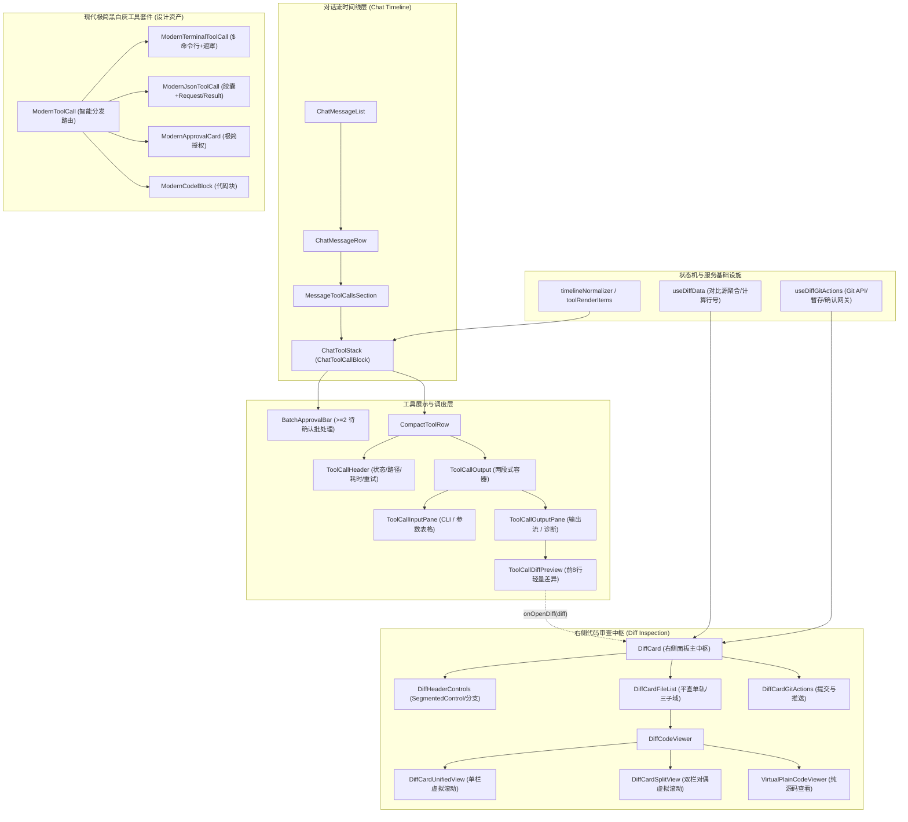

# 对话流工具调用卡片、终端执行与 Diff 比较视图深度实勘导航

> **战役代号**：前端原子化组件库战役（Frontend Atomic Architecture Campaign）  
> **任务编号**：任务书 11（Task-11）  
> **责任领域**：对话流工具调用卡片（`chat-tool-call/`）、终端执行卡片、轻量级 Diff 预览与全功能差异比较器（`diff/`）  
> **实勘基准**：深入逐行阅读所辖范围内的全部 35 个源码文件与样式文件，以客观、精准、零退避的技术视角，穿透现有架构断层、体验撕裂与视觉缺陷，并给出下一代流水线聚合（Pipeline View）重塑方案。  
> **创建时间**：2026-09-06  
> **文档规范**：UTF-8 无 BOM、中文、行级证据复核、行数规范（≥1200行）。

---

## 目录索引

- [一、概述与勘察全景地图](#一概述与勘察全景地图)
  - [1.1 战役背景与本篇使命](#11-战役背景与本篇使命)
  - [1.2 所辖源码全量文件拓扑与度量基线表](#12-所辖源码全量文件拓扑与度量基线表)
  - [1.3 核心依赖与调用链路拓扑](#13-核心依赖与调用链路拓扑)
  - [1.4 历史架构演化脉络与两次重构回顾](#14-历史架构演化脉络与两次重构回顾)
- [二、chat-tool-call 核心组件与交互逐行实勘](#二chat-tool-call-核心组件与交互逐行实勘)
  - [2.1 ChatToolStack & CompactToolRow：对话流调度核心](#21-chattoolstack--compacttoolrow对话流调度核心)
  - [2.2 ToolCallHeader：紧凑工具头与状态呈现](#22-toolcallheader紧凑工具头与状态呈现)
  - [2.3 ToolCallOutput：两段式结构化容器与视口截断保护](#23-toolcalloutput两段式结构化容器与视口截断保护)
  - [2.4 ToolCallInputPane：Shell 命令行与配置属性表](#24-toolcallinputpane-shell-命令行与配置属性表)
  - [2.5 ToolCallOutputPane：日志流分流、导出与状态元数据](#25-toolcalloutputpane日志流分流导出与状态元数据)
  - [2.6 ModernTerminalToolCall 终端执行卡片深度剖析](#26-modernterminaltoolcall-终端执行卡片深度剖析)
  - [2.7 ModernJsonToolCall 结构化工具卡片细节](#27-modernjsontoolcall-结构化工具卡片细节)
  - [2.8 ModernApprovalCard 与 ModernCodeBlock 极简卡片](#28-modernapprovalcard-与-moderncodeblock-极简卡片)
  - [2.9 ModernToolCall 智能路由分发器分析](#29-moderntoolcall-智能路由分发器分析)
  - [2.10 chatToolCallUtils 工具辅助与状态语义映射](#210-chattoolcallutils-工具辅助与状态语义映射)
  - [2.11 投影层聚合机制与 toolRenderItems 规则剖析](#211-投影层聚合机制与-toolrenderitems-规则剖析)
  - [2.12 chat-tool-call 单元测试套件全量剖析](#212-chat-tool-call-单元测试套件全量剖析)
  - [2.13 对话流工具卡片全量 CSS 规则深度实勘](#213-对话流工具卡片全量-css-规则深度实勘chattoolcallblockmodulecss-vs-moderntoolcallmodulecss)
- [三、diff 比较视图体系逐行实勘](#三diff-比较视图体系逐行实勘)
  - [3.1 架构分层与数据流转拓扑](#31-架构分层与数据流转拓扑)
  - [3.2 ToolCallDiffPreview：流内轻量级 8 行切片比较器](#32-toolcalldiffpreview流内轻量级-8-行切片比较器)
  - [3.3 DiffCard：右侧全局全功能代码审查中枢](#33-diffcard右侧全局全功能代码审查中枢)
  - [3.4 DiffHeaderControls：紧凑双模变更工具栏](#34-diffheadercontrols紧凑双模变更工具栏)
  - [3.5 DiffCardFileList：平直单轨文件列表与三子域交互槽](#35-diffcardfilelist平直单轨文件列表与三子域交互槽)
  - [3.6 DiffCardUnifiedView：单栏统一视图与词法级高亮](#36-diffcardunifiedview单栏统一视图与词法级高亮)
  - [3.7 DiffCardSplitView：左右双栏分栏视图与对偶算法](#37-diffcardsplitview左右双栏分栏视图与对偶算法)
  - [3.8 VirtualPlainCodeViewer：纯源码只读浏览与行高动态测量](#38-virtualplaincodeviewer纯源码只读浏览与行高动态测量)
  - [3.9 DiffCardGitActions：暂存提交流程与内嵌面板](#39-diffcardgitactions暂存提交流程与内嵌面板)
  - [3.10 GitPatchFormatter 与 DiffCardHandlers 操作辅助](#310-gitpatchformatter-与-diffcardhandlers-操作辅助)
  - [3.11 useDiffData 与 useDiffGitActions 核心 Hook 状态机剖析](#311-usediffdata-与-usediffgitactions-核心-hook-状态机剖析)
  - [3.12 diff 单元测试套件全量剖析](#312-diff-单元测试套件全量剖析)
  - [3.13 差异比较器样式系统与虚拟滚动性能基准深度实勘](#313-差异比较器样式系统与虚拟滚动性能基准深度实勘diffcardmodulecss-全景解构)
- [四、现有严重体验缺陷与架构断层深度解构](#四现有严重体验缺陷与架构断层深度解构)
  - [4.1 多步工具连续调用导致界面纵向撕裂拉长的严重体验缺陷](#41-多步工具连续调用导致界面纵向撕裂拉长的严重体验缺陷)
  - [4.2 双套组件体系割裂与资产冗余（CompactToolRow vs ModernToolCall）](#42-双套组件体系割裂与资产冗余compacttoolrow-vs-moderntoolcall)
  - [4.3 现有色彩空间、硬编码与边框样式违规清单](#43-现有色彩空间硬编码与边框样式违规清单)
  - [4.4 滚动条与视口劫持、容器嵌套与布局抖动风险](#44-滚动条与视口劫持容器嵌套与布局抖动风险)
- [五、未来多步工具时间线聚合（Pipeline View）重塑方案](#五未来多步工具时间线聚合pipeline-view重塑方案)
  - [5.1 核心设计理念：从瀑布流堆叠走向「流水线聚合管道（Pipeline View）」](#51-核心设计理念从瀑布流堆叠走向流水线聚合管道pipeline-view)
  - [5.2 状态机与数据模型抽象：ToolPipeline 契约定义](#52-状态机与数据模型抽象toolpipeline-契约定义)
  - [5.3 UI 呈现三态规范：紧凑流水线态、时间线抽屉态与全功能分屏审查态](#53-ui-呈现三态规范紧凑流水线态时间线抽屉态与全功能分屏审查态)
    - [5.3.4 ToolPipelineBar 与 ToolPipelineDrawer 组件实现蓝图](#534-toolpipelinebar-与-toolpipelinedrawer-组件实现蓝图typescript--react)
  - [5.4 色彩空间与视觉规范刚性对齐方案](#54-色彩空间与视觉规范刚性对齐方案)
  - [5.5 架构演进与零退避迁移路线图（Milestones）](#55-架构演进与零退避迁移路线图milestones)
- [六、实勘结论与主控交接清单](#六实勘结论与主控交接清单)

---

## 一、概述与勘察全景地图

### 1.1 战役背景与本篇使命

在现代桌面级 Agent 辅助软件工程中，工具调用（Tool Call）、终端命令行日志流（Terminal Stream）以及代码差异对比（Code Diff）构成了人机协同开发三角支柱。用户不仅需要对智能体的操作具备实时透明的知情权，更要求交互界面保持极端克制、优雅、高效和高信噪比。

然而，在当前 `apps/crish-desktop` 代码实现中，工具调用与 Diff 比较视图存在明显的历史演进痕迹与多套设计规范并存的断层现象：
1. 一方面，存在一套基于 `ChatToolCallBlock.tsx`、`CompactToolRow.tsx`、`ToolCallOutput.tsx` 的“两段式分栏展开容器”体系，支撑了主对话流的消息渲染；
2. 另一方面，存在一套基于 `ModernToolCall.tsx`、`ModernTerminalToolCall.tsx`、`ModernJsonToolCall.tsx` 的“黑白灰极简现代卡片”体系，实现了高品质的命令头复制、渐变淡出遮罩与参数胶囊，但与主对话流的接入层尚未完全归一；
3. 在代码对比领域，既有内嵌在工具调用输出区内的轻量级 `ToolCallDiffPreview.tsx`（限制 8 行快速预览），又有右侧侧边栏中由 `DiffCard.tsx` 驱动的包含虚拟滚动、词法级行内修改对比、Git 暂存/放弃修改/提交推送的完整中枢；
4. 更为严重的是：在 Agent 连续调用多个工具（如“搜索文件 -> 读取代码 -> 执行测试 -> 发现报错 -> 编辑代码 -> 重新测试 -> 查看状态”的多步复杂任务）时，界面以垂直平铺列表的方式将每一个工具卡片依次堆叠在聊天流正文中，导致聊天窗口纵向空间被灾难性拉长，正文回复被撕裂得支离破碎，严重阻碍用户的信息获取效率。

本篇任务书（任务书 11）的使命，是对 `apps/crish-desktop/src/components/chat-tool-call/` 全量文件以及 `apps/crish-desktop/src/components/diff/` 下相关比较器进行地毯式、逐行级别的深度勘察，客观记录每一个文件的代码行数、类型定义、事件流转、样式色彩与性能边界，解构体验痛点根因，并为后续原子化重塑设计出彻底根除“纵向撕裂”的全新 **流水线聚合管道（Pipeline View）** 架构。

---

### 1.2 所辖源码全量文件拓扑与度量基线表

经过对目标目录的完整扫描，本勘察任务所辖源码共计 **35 个文件**（其中 `chat-tool-call/` 目录 20 个，`diff/` 目录 15 个核心实现文件），文件拓扑与度量基线如下表所示：

#### 表 1-1：chat-tool-call 目录全量文件实勘度量表

| 序号 | 相对路径 | 物理行数 | 字节大小 | 核心组件 / 模块职责 | 导出契约 / 接口 |
| :--- | :--- | :--- | :--- | :--- | :--- |
| 1 | `chat-tool-call/index.ts` | 13 | 452 B | 模块门面出口统一重导出 | 全部组件与 Props 类型 |
| 2 | `chat-tool-call/chatToolCallUtils.ts` | 49 | 1,504 B | 工具状态中文标签转换、展开区 ID 生成、子 Agent 关联匹配 | `toolStatusZh`, `TOOL_EMPTY_OUTPUT_ZH`, `toolResultBodyId`, `findAgentForTool` |
| 3 | `chat-tool-call/ChatToolCallBlock.tsx` | 209 | 6,848 B | 消费投影层 `ToolRenderItem[]`，派发单行与组折叠行，渲染批量审批栏 `BatchApprovalBar` | `ChatToolStack`, `ChatToolStackProps`, `ChatToolStackActions`, `ChatToolStackSharedProps` |
| 4 | `chat-tool-call/ChatToolCallBlock.module.css` | 969 | 19,888 B | 工具调用块全量样式：包含工具行、折叠动画、两段式容器、CLI终端、GitDiff卡片等 | CSS Module 样式类 |
| 5 | `chat-tool-call/CompactToolRow.tsx` | 240 | 7,941 B | 单个紧凑工具行宿主：100ms 动态计时、审批拦截、子 Agent 面板注入、折叠展开动画包裹 | `CompactToolRow`, `CompactToolRowProps` |
| 6 | `chat-tool-call/ToolCallHeader.tsx` | 243 | 6,924 B | 工具行头部视图：精细中性语义图标（绝无绿勾墙）、路径快速复制与打开、Diff 统计、运行耗时、重试与折叠箭头 | `ToolCallHeader`, `ToolCallHeaderProps` |
| 7 | `chat-tool-call/ToolCallOutput.tsx` | 125 | 3,689 B | 工具卡片展开区容器：计算耗时、2000 行 / 256KB 门限防爆裁切、挂载输入/输出两段式分栏 | `ToolCallOutput`, `ToolCallOutputProps`, `TOOL_OUTPUT_LINE_CAP`, `TOOL_OUTPUT_BYTE_CAP` |
| 8 | `chat-tool-call/ToolCallInputPane.tsx` | 205 | 6,753 B | 结构化输入分栏：Shell 指令 CLI 格式化 vs 属性表格/原始 JSON 切换，1000 行 / 128KB 裁切保护 | `ToolCallInputPane`, `ToolCallInputPaneProps` |
| 9 | `chat-tool-call/ToolCallOutputPane.tsx` | 208 | 6,553 B | 结构化输出分栏：输出状态元数据、完整日志 Blob 导出、异常诊断横条、Diff 预览、图片预览、空态成功提示 | `ToolCallOutputPane`, `ToolCallOutputPaneProps` |
| 10 | `chat-tool-call/ToolCallDiffPreview.tsx` | 67 | 2,326 B | 流内轻量代码变更卡片：文件名与增删统计、前 8 行改动代码高亮、超限展开提示与右侧联动 | `ToolCallDiffPreview`, `ToolCallDiffPreviewProps` |
| 11 | `chat-tool-call/ModernTerminalToolCall.tsx` | 92 | 2,908 B | 现代极简终端命令行卡片：$ 命令行、悬浮复制、微细分割线、等宽终端日志、scrollHeight 动态淡出遮罩 | `ModernTerminalToolCall`, `ModernTerminalToolCallProps` |
| 12 | `chat-tool-call/ModernJsonToolCall.tsx` | 156 | 4,948 B | 现代极简结构化 JSON 卡片：Chevron 旋转、单色动作描述、参数胶囊 Pill、必要完成绿勾、Request/Result 分块 | `ModernJsonToolCall`, `ModernJsonToolCallProps` |
| 13 | `chat-tool-call/ModernApprovalCard.tsx` | 59 | 1,371 B | 极简高危命令授权卡片：单一主色契约（Primary 允许 + Ghost 拒绝），单层黑白灰无嵌套 | `ModernApprovalCard`, `ModernApprovalCardProps` |
| 14 | `chat-tool-call/ModernCodeBlock.tsx` | 67 | 1,827 B | 极简纯净代码块卡片：语言标签、一键复制交互、行号渲染、等宽代码预览 | `ModernCodeBlock`, `ModernCodeBlockProps` |
| 15 | `chat-tool-call/ModernToolCall.tsx` | 112 | 3,551 B | 统一工具卡片智能路由分发器：命令工具分流至 Terminal 卡片，配置工具提取关键参数并分流至 JSON 卡片 | `ModernToolCall`, `ModernToolCallProps` |
| 16 | `chat-tool-call/ModernToolCall.module.css` | 549 | 12,074 B | 现代极简黑白灰卡片专属样式表：终端卡片、JSON卡片、授权卡片、代码块卡片的样式规则 | CSS Module 样式类 |
| 17 | `chat-tool-call/ChatToolCallBlock.test.tsx` | 152 | 4,887 B | 单测：ChatToolStack V1-γ 折叠单源渲染、分组标题、批量审批栏 Primary 实心按钮验证 | 单元测试套件 |
| 18 | `chat-tool-call/CompactToolRow.approval-lift.test.tsx` | 74 | 2,189 B | 单测：验证 slot 插件开启时审批上提至 composer，流内免除渲染 ApprovalAskCard | 单元测试套件 |
| 19 | `chat-tool-call/ModernToolCall.test.tsx` | 218 | 7,454 B | 单测：ModernJsonToolCall 展开折叠、ModernTerminalToolCall 复制、ModernToolCall 智能路由与单一主色 | 单元测试套件 |
| 20 | `chat-tool-call/ToolCallOutput.test.tsx` | 216 | 7,304 B | 单测：两段式分栏容器、Shell 提示符解析、异常诊断横幅、2000 行门限截断保护与下载日志 | 单元测试套件 |

#### 表 1-2：diff 目录全量文件实勘度量表

| 序号 | 相对路径 | 物理行数 | 字节大小 | 核心组件 / 模块职责 | 导出契约 / 接口 |
| :--- | :--- | :--- | :--- | :--- | :--- |
| 21 | `diff/diffCardTypes.ts` | 38 | 896 B | 差异面板核心数据结构定义：比较模式、计算后变更项、左右分栏对偶、渲染占位项 | `CompareMode`, `ComputedChange`, `SplitPair`, `UnifiedRenderItem`, `SplitRenderItem` |
| 22 | `diff/GitPatchFormatter.ts` | 44 | 1,230 B | 将内存中 `FileDiff` 对象精确序列化为标准 Git Unified Patch 文本格式 | `formatGitPatch` |
| 23 | `diff/DiffCardHandlers.ts` | 60 | 1,834 B | 文件级操作处理器：自动将单个文件变更写回磁盘（acceptCurrentFile）或移除项（rejectCurrentFile） | `basename`, `acceptCurrentFile`, `rejectCurrentFile` |
| 24 | `diff/useDiffData.ts` | 439 | 11,700 B | 差异数据核心 Hook：行号偏移计算、折叠上下文占位符生成、Unified/Split 渲染缓存、多模式对比源聚合 | `useDiffData`, `getComputedChanges`, `getSplitPairs` |
| 25 | `diff/useDiffGitActions.ts` | 338 | 10,737 B | Git 操作核心 Hook：工作区状态拉取、分支加载与切换、单文件/全部暂存撤销、放弃修改确认网关、提交与推送 | `useDiffGitActions` |
| 26 | `diff/DiffCard.tsx` | 398 | 12,043 B | 右侧全局代码审查中枢容器：组装头部控制、搜索过滤行、文件列表、提交面板与二次确认网关 | `DiffCard`, `DiffCardProps` |
| 27 | `diff/DiffCard.module.css` | 1,177 | 27,625 B | 差异面板全量样式表：32px 紧凑顶栏、平直文件单轨（三大子域）、Unified/Split 虚拟滚动网格、提交浮层等 | CSS Module 样式类 |
| 28 | `diff/CompactDiffHeader.tsx` | 10 | 383 B | 差异面板紧凑顶栏组件门面导出（别名同源导出 `DiffHeaderControls`） | `CompactDiffHeader`, `CompactDiffHeaderProps` |
| 29 | `diff/DiffHeaderControls.tsx` | 228 | 6,836 B | 紧凑工具栏视图：SegmentedControl 切换 AI/Git 来源、回合/分支选择、Unified/Split 切换、搜索与清空 | `DiffHeaderControls`, `DiffHeaderControlsProps` |
| 30 | `diff/DiffCardFileList.tsx` | 437 | 15,964 B | 平直单轨文件列表组件：暂存/未暂存分组、32px 文件交互行（子域 A 折叠+徽章、子域 B 文件超链、子域 C 统计操作共用槽） | `DiffCardFileList`, `DiffCardFileListProps` |
| 31 | `diff/DiffCardUnifiedView.tsx` | 268 | 8,481 B | 单栏统一比对视图：基于 `useVirtualScroll` 虚拟滚动、词法级行内修改高亮（computeIntralinePair）、上下文折叠条 | `DiffCardUnifiedView` |
| 32 | `diff/DiffCardSplitView.tsx` | 298 | 9,669 B | 左右双栏分栏比对视图：虚拟滚动驱动、对偶对齐网格（buildSplitPairsFromGeneric）、对称行内修改着色 | `DiffCardSplitView` |
| 33 | `diff/DiffCodeViewer.tsx` | 82 | 2,310 B | 差异代码视图调度中继：根据比较模式调度纯源码浏览（VirtualPlainCodeViewer）、搜索无结果提示、分栏与合并视图分流 | `DiffCodeViewer`, `DiffCodeViewerProps` |
| 34 | `diff/VirtualPlainCodeViewer.tsx` | 108 | 3,444 B | 纯源码虚拟滚动浏览组件：动态测量第一行高度、语法高亮渲染、等宽行号栏 | `VirtualPlainCodeViewer` |
| 35 | `diff/DiffCardGitActions.tsx` | 145 | 4,349 B | Git 提交与推送面板组件：底部折叠触发栏、多行提交说明输入框（Ctrl+Enter）、暂存状态提示、提交与推送按钮 | `DiffCardGitActions` |

---

### 1.3 核心依赖与调用链路拓扑

整个系统的运行时调用拓扑如下：



---

### 1.4 历史架构演化脉络与两次重构回顾

为了深刻理解现有代码的设计意图与妥协痕迹，必须复盘该模块的两次重大历史重构：

#### 1.4.1 统一输入流收敛战役（V1-γ 折叠单源战役）
- **重构前状态**：工具调用的展平（`flattenRenderTools`）和并行重分组（`parallelGroup`）分散在视图层与投影层，导致视图层频繁依据时间戳二次重排，出现渲染死循环与状态闪烁。
- **重构举措**：全面清退渲染端重排逻辑，规定 `ChatToolCallBlock.tsx` 必须直接消费投影层下沉裁决的 `ToolRenderItem[]`（`single` 或 `group`）。`group.label` 被赋予明确的人性化文案 `${toolHumanLabel(last)} · ${n} 步`。
- **历史局限**：尽管解决了重排死循环，但投影层 `canJoinToolGroup` 保留了极度保守的判定逻辑（仅折叠无结果的只读工具），导致绝大多数具有输出的工具依然以 `single` 单行输出，为后来的界面纵向膨胀埋下了隐患。

#### 1.4.2 结构化两段式分栏重构（DIM-05 / FIN-01 战役）
- **重构前状态**：工具展开后的输出是未经结构化的高密度字符串，用户难以分清哪些是入参命令，哪些是返回结果，且几千行的超大输出直接导致 DOM 卡死。
- **重构举措**：
  1. 确立 `ToolCallInputPane`（输入区）与 `ToolCallOutputPane`（输出区）的两段式垂直解耦架构；
  2. 建立 `TOOL_OUTPUT_LINE_CAP = 2000` 行与 `TOOL_OUTPUT_BYTE_CAP = 256 KB` 硬性门限裁切机制，并提供日志 Blob 导出功能；
  3. 为高危命令引入一屏一主色治理（`ModernApprovalCard`）。

---

## 二、chat-tool-call 核心组件与交互逐行实勘

### 2.1 ChatToolStack & CompactToolRow：对话流调度核心

#### 2.1.1 `ChatToolCallBlock.tsx` 源码剖析
`ChatToolCallBlock.tsx`（共 209 行，路径：`apps/crish-desktop/src/components/chat-tool-call/ChatToolCallBlock.tsx`）是整个工具调用列表的装配中枢。

1. **接口契约定义**（第 24–65 行）：
   - `ChatToolStackActions` 集中定义了打开 Diff、打开路径、打开终端、审批通过/拒绝、重试工具、批量审批以及关键的 `renderLinkedAgentPanel` 回调接口；
   - `ChatToolStackSharedProps` 提炼为行级共享配置，由上一级 `ChatMessageList` 一次性装配，经 `ChatAssistantMessageRow` 传递，避免双份类型定义漂移。
2. **批量审批栏插入逻辑 `renderToolsWithBatchBars`**（第 115–173 行）：
   遍历工具列表，检测相邻且连续处于 `status === 'pending_approval'` 状态的工具调用。当连续数量 $\ge 2$ 时，在工具组之前动态插入 `BatchApprovalBar`（第 133–145 行）。
   ```typescript
   // ChatToolCallBlock.tsx:121-145
   let i = 0;
   while (i < tools.length) {
     const ti = tools[i]!;
     if (ti.status === 'pending_approval' && msgId) {
       const pendingGroup: MessageToolCall[] = [ti];
       let j = i + 1;
       while (j < tools.length) {
         const tj = tools[j]!;
         if (tj.status !== 'pending_approval') break;
         pendingGroup.push(tj);
         j++;
       }
       if (pendingGroup.length >= 2) {
         const ids = pendingGroup.map((t) => t.id);
         const mIds = pendingGroup.map(() => msgId);
         elements.push(
           <BatchApprovalBar
             key={`batch-${ids[0]}`}
             toolIds={ids}
             msgIds={mIds}
             onApprove={props.actions?.onBatchApprove}
             onDeny={props.actions?.onBatchDeny}
           />
         );
       }
       // ... 依次渲染组内工具行 ...
       i = j;
     }
   }
   ```
3. **批量审批交互 `BatchApprovalBar`**（第 68–112 行）：
   渲染包含数量提示（`待确认工具（N）`）的工具条，提供 `全部批准`（Primary 实心填充按钮，绿色 Check 图标，第 89–98 行）与 `全部拒绝`（Danger 按钮，红色 X 图标，第 99–109 行）。

#### 2.1.2 `CompactToolRow.tsx` 交互状态与生命周期剖析
`CompactToolRow.tsx`（共 240 行，路径：`apps/crish-desktop/src/components/chat-tool-call/CompactToolRow.tsx`）负责单个工具调用的渲染、高精度动态计时、展开折叠动画驱动与插件拦截。

1. **高精度运行计时器**（第 58–75 行）：
   ```typescript
   // CompactToolRow.tsx:58-64
   const [liveNow, setLiveNow] = useState(Date.now());
   useEffect(() => {
     if (tc.status !== 'running' || !tc.startedAt) return;
     const id = setInterval(() => setLiveNow(Date.now()), 100);
     return () => clearInterval(id);
   }, [tc.status, tc.startedAt]);
   ```
   - 当工具状态为 `running` 且带有 `startedAt` 时间戳时，组件启动一个每 100ms 触发一次的定时器更新 `liveNow`；
   - 动态计算并展示以秒为单位、精确到小数点后一位的耗时字符串 `${sec.toFixed(1)}s`（第 71–73 行）；
   - 工具完成时（`completedAt` 存在），若总耗时 $\ge 0.1\text{s}$，则格式化为静态完成耗时，否则返回 `null` 隐藏耗时。
   - **性能考量**：由于每个运行中的工具单独维护自身私有的 `liveNow` 状态，定时器仅驱动当前行自身重绘，不会波及整个消息列表或兄弟工具行。
2. **高危审批拦截与冷区上提**（第 77–112 行）：
   - 当 `tc.status === 'pending_approval'` 时，首先探测扩展插槽：
     `slotCore.getSingle('workspace.chat.composerAbove')`（第 79 行）。
     若检测到用户开启了“审批上提至输入框上方冷静条”插件，则当前行直接返回 `null`，避免在聊天流内重复渲染巨大的卡片造成视觉污染；
   - 若未开启插件，则在当前位置渲染 `ApprovalAskCard`（第 93–109 行），展示工具摘要、命令详情，并绑定 `onAllow`、`onAllowRemember`（记住选择）、`onDeny` 回调。
3. **关联子 Agent 任务渲染**（第 114–151 行）：
   - 通过 `findAgentForTool(tc, agents)` 探测当前工具是否派生出了子 Agent（如 `run_subagent` 或子任务协作）；
   - 若存在关联子 Agent，则调用由组合根经 Props 注入的 `renderLinkedAgentPanel` 渲染 `InlineAgentPanel`，并在外部包裹 `Suspense`（第 125–149 行），成功切断了 `chat-tool-call -> agent-card` 的双向环形循环依赖。
4. **折叠展开状态受控解析与动画**（第 153–156 行、第 223–236 行）：
   - 调用 `toolHasExpandableBody(tc)` 判断当前工具是否有输出可供展开；
   - 调用 `resolveToolRowOpen(expandedTools, tc.id, tc)` 结合全局用户操作与默认策略裁决当前是否展开；
   - 折叠容器通过 CSS 类名切换实现高度渐变过渡（第 225 行：`${styles.toolBody}${isOpen ? ' ' + styles.expanded : ''}`）。
   - 样式表 `ChatToolCallBlock.module.css:188-200` 定义了 `max-height 220ms cubic-bezier(0.16, 1, 0.3, 1)` 的流畅过渡曲线。

---

### 2.2 ToolCallHeader：紧凑工具头与状态呈现

`ToolCallHeader.tsx`（共 243 行，路径：`apps/crish-desktop/src/components/chat-tool-call/ToolCallHeader.tsx`）是工具行始终外露在外的 32px 紧凑标头。

#### 2.2.1 严禁绿勾墙的视觉规范落实
在早期的界面设计中，智能体执行完每一个工具后，会在左侧产生一个刺眼的绿色对勾图标（CheckCircle）。当连续执行 10 个工具时，界面左侧出现了一整面令人烦躁的“绿勾墙”。
在 `ToolCallHeader.tsx`（第 142–176 行）中，团队对此进行了严格治理：
```typescript
// ToolCallHeader.tsx:161-170
// 严禁绿勾墙：非 error 均采用精细的中性/命令语义图标（完成态无彩），杜绝大面积刺眼绿勾
const KindIcon = toolCommandIcon(toolCommandType(tc));
inner = (
  <KindIcon
    size={sz}
    strokeWidth={sw}
    color="var(--text-tertiary, #8c877d)"
  />
);
```
- **运行态（running）**：显示微型脉冲绿点 `<span className={styles.toolLivePulseDot} />`（第 148–150 行）；
- **错误态（error）**：显示警示红叉 `<XCircle color="var(--accent-red, #c45c5c)" />`（第 153–159 行）；
- **完成态（success）**：完全禁止使用绿色对勾，而是根据命令类型（文件读、写、搜、终端等）解析出精细的中性等宽语义图标（如 `Terminal`、`FileSearch`、`FileEdit`），颜色恒定保持为沉静的二级灰 `var(--text-tertiary)`，彻底消除了“绿勾墙”。

#### 2.2.2 路径高亮与悬浮操作（Path Action Wrap）
在渲染命令摘要文本时（`renderSummary`，第 84–140 行），组件通过 `extractFilePathFromToolArgs` 提取出文件路径并做人话截断：
- 若摘要中包含文件名，将文件名单独转化为可点击的按钮（第 108–117 行），点击直接触发 `onOpenPath?.(filePath)`；
- 紧跟文件名后方包裹了悬浮交互槽 `.toolPathActions`（第 51–82 行）：当鼠标悬浮或聚焦到该路径时，平滑展开两个微型按钮（宽度从 0 展开至 56px，带弹性贝塞尔曲线）：
  1. **在文件面板打开**：`<PanelRightOpen size={14} />`；
  2. **复制路径**：`<Copy size={14} />`，触发 `navigator.clipboard.writeText(filePath)`。

#### 2.2.3 差异统计、耗时与键盘无障碍
- **Diff 统计外露**（第 205–210 行）：当工具调用产生了代码修改（如 `replace_file_content`），即使卡片处于折叠状态，头部右侧也会紧凑显示绿色 `+X`（`.diffStatsAdd`）与红色 `-Y`（`.diffStatsDel`），无需展开即可感知变动量；
- **键盘导航支持**（第 188–200 行）：支持 `Enter` 或 `Space` 切换展开/折叠，支持 `Escape` 键在展开时快速折叠退出，且配备完整的 `aria-expanded`、`aria-controls` 和 `aria-label`。

---

### 2.3 ToolCallOutput：两段式结构化容器与视口截断保护

`ToolCallOutput.tsx`（共 125 行，路径：`apps/crish-desktop/src/components/chat-tool-call/ToolCallOutput.tsx`）是工具卡片展开后的核心内容容器，承载着系统架构中至关重要的 **两段式分栏（Dual-Section Container）** 与 **大输出防爆保护（RUL-05）**。

#### 2.3.1 2000 行 / 256KB 大输出门限裁切（RUL-05）
在自动化开发中，终端输出或日志读取极易产生数万行输出（如 `npm run test`、`cargo build` 抛出的全量警告），如果未经保护直接渲染进 DOM，将造成 React 渲染线程严重掉帧甚至导致页面崩溃。
`ToolCallOutput.tsx`（第 9–10 行、第 51–87 行）定义了硬性防爆阈值：
```typescript
// ToolCallOutput.tsx:9-10
export const TOOL_OUTPUT_LINE_CAP = 2000;
export const TOOL_OUTPUT_BYTE_CAP = 256 * 1024; // 256 KB
```
裁切逻辑解析：
1. 计算总行数 `lines.length` 与字节大小（通过 `Blob([full]).size`，第 60–62 行）；
2. 若超过 2000 行，则截取前 2000 行并使用换行符连接；
3. 若截取后字节大小仍超过 256KB，则硬性截取前 256KB 字符；
4. 在文本尾部追加醒目的截断提示：`… [输出过长，已截断显示前 2000 行 / 256 KB]`，并标记 `isTruncated = true`（第 81–86 行）；
5. 截断发生时，通过 `ToolCallOutputPane` 向用户提供 **下载完整日志文件 (.log)** 以及 **在命令检查器中查看完整日志** 的双重救济通道。

#### 2.3.2 两段式容器结构（Dual-Section Layout）
`ToolCallOutput.tsx`（第 100–122 行）将展开内容严格解耦为两个独立子段落：
1. **输入分栏（`ToolCallInputPane`）**：展示工具接收到的入参（CLI 命令行或格式化 JSON 属性表）；
2. **输出分栏（`ToolCallOutputPane`）**：展示工具的执行结果（日志流、Diff 变更、图片或空态）。

---

### 2.4 ToolCallInputPane：Shell 命令行与配置属性表

`ToolCallInputPane.tsx`（共 205 行，路径：`apps/crish-desktop/src/components/chat-tool-call/ToolCallInputPane.tsx`）负责将晦涩的底层 JSON 入参解析为对人类开发者极度友好的视觉呈现。

#### 2.4.1 输入预算截断（Budget Input Text）
同样针对入参（如 `write_to_file` 工具可能传入上千行代码），组件在行 11–36 设立了入参截断保护：
- `TOOL_INPUT_LINE_CAP = 1000` 行；
- `TOOL_INPUT_BYTE_CAP = 128 * 1024`（128 KB）；
- 超过限额时自动截断并在末尾提示 `… [入参过长，已截断显示前 1000 行 / 128 KB]`。

#### 2.4.2 Shell 命令行模式与工作目录（CWD）解析
对于执行命令类工具（通过 `isShellToolName(name)` 判定，如 `run_command`、`bash`、`exec`），组件将其格式化为标准的 CLI 终端提示行（第 153–169 行）：
- 左侧渲染高亮绿色 `$` 提示符（第 156–158 行）；
- 命令行文本支持文本自动换行（`toolResultPreCmd`，第 159 行）；
- 若参数中声明了工作目录 `cwd`，在下方以微型标签显示：`工作目录: C:/Software/conex`（第 161–168 行）。

#### 2.4.3 属性表格与原始 JSON 双模切换
对于普通结构化工具（如 `view_file`、`grep_search`）：
- **默认模式（formatted）**：将入参对象解析为清晰的键值对表格（`toolKeyValueTable`，第 173–199 行）。左侧为灰色属性名（`toolKeyCell`），右侧为深色值（`toolValCell`）。对于多行长文本或长度 $>80$ 的字符串，自动转为带背景的高亮等宽代码框展示；
- **原始 JSON 模式（raw）**：点击顶部的 `<Code2 />` 图标按钮，可随时在结构化表格与标准格式化 JSON 代码块（`<pre className={styles.toolInputCode}>`，第 171 行）之间无缝切换；
- **一键复制**：提供独立的复制按钮，对于 Shell 工具直接复制清洗后的纯命令行文本，对于配置工具复制完整的 JSON 字符串（第 58–69 行）。

---

### 2.5 ToolCallOutputPane：日志流分流、导出与状态元数据

`ToolCallOutputPane.tsx`（共 208 行，路径：`apps/crish-desktop/src/components/chat-tool-call/ToolCallOutputPane.tsx`）负责处理多态的输出内容。

#### 2.5.1 多态内容分流渲染矩阵
输出区根据工具返回的数据结构，精确分流为 5 种互斥或共存的呈现形态：
1. **代码差异（FileDiff）**：若包含 `diffs` 数组，循环渲染 `ToolCallDiffPreview` 组件（第 148–155 行）；
2. **生成图片预览（Images）**：若工具返回包含图片链接（如绘图工具、截屏工具），渲染包含 `loading="lazy"` 的图片网格（第 157–169 行）；
3. **空返回优雅提示（Empty Body）**：若工具成功执行但未返回任何控制台文本（在很多写文件、删除文件操作中极常见），绝不留出丑陋的空文本框，而是渲染包含绿色圆勾的优雅提示：`✓ 执行成功，无返回内容`（第 171–176 行）；
4. **控制台文本日志（Text Output）**：使用等宽字体 `<pre className={styles.toolOutputCode}>{output}</pre>` 渲染，限制最大高度为 320px 并提供内部垂直滚动（第 178–180 行）；
5. **截断救济栏（outputTruncatedBar）**：当内容触发大输出截断时，底部渲染黄色警示横条，并提供 `在命令检查器中查看完整日志` 按钮，直接调度 `onOpenTerminal` 打开独立的终端控制台面板（第 182–203 行）。

#### 2.5.2 状态元数据与文件日志下载（Blob Export）
- **头部状态元数据**（第 86–97 行）：实时拼接显示执行状态（`⏳ 执行中…` / `✕ 执行失败` / `✓ 执行成功`）、运行耗时（如 `· 1.4s`）、输出总行数（如 `· 240 行`）以及体积大小（如 `· 18.5 KB`）；
- **异常诊断横条（diagnosticBanner）**：当 `status === 'error'` 时，在内容上方插入醒目的浅红底色告警横条（第 137–144 行）：`⚠️ 执行遇到异常中断，详情见下方 Stderr / 输出日志`；
- **完整日志导出**（第 60–71 行）：点击“下载日志”按钮，组件利用浏览器的 `Blob` 与 `URL.createObjectURL` 技术，将未被截断的完整原始日志（`rawOutput`）打包为 `tool-output-[toolId].log` 文件并触发自动下载。

---

### 2.6 ModernTerminalToolCall 终端执行卡片深度剖析

`ModernTerminalToolCall.tsx`（共 92 行，路径：`apps/crish-desktop/src/components/chat-tool-call/ModernTerminalToolCall.tsx`）是一套遵循现代黑白灰极简主义的独立终端卡片实现。

#### 2.6.1 核心结构与视觉特征
组件由三个核心部分组成：
1. **顶部命令头行（`terminalHead`）**（第 52–78 行）：
   - 左侧：中性灰色等宽 `$` 提示符（`terminalPromptDollar`）；
   - 中间：单行等宽省略命令文本（`terminalCommandText`），包裹在 `Tooltip` 中；
   - 右侧：鼠标悬浮时才渐显的复制按钮（`terminalCopyBtn`）。
2. **微细分割线（`terminalDivider`）**（第 80 行）：1px 极细中性浅灰线条。
3. **等宽终端日志流（`terminalBody`）**（第 83–89 行）：
   - `<pre ref={outputRef} className={styles.terminalOutput}>`，字号 12px，行高 1.5，最大高度限制为 240px。

#### 2.6.2 scrollHeight 动态渐变淡出遮罩（Fade Mask）
在终端多行输出且产生内部垂直滚动时，普通设计往往会出现硬生生的文字被底边截断的情况。`ModernTerminalToolCall` 引入了非常精巧的动态检测机制（第 26–35 行、第 87 行）：
```typescript
// ModernTerminalToolCall.tsx:26-35
const [isOverflowing, setIsOverflowing] = useState(false);
const outputRef = useRef<HTMLPreElement>(null);

// 检测输出内容是否超高，以决定是否渲染底部渐变淡出遮罩
useEffect(() => {
  const el = outputRef.current;
  if (el) {
    setIsOverflowing(el.scrollHeight > el.clientHeight + 4);
  }
}, [output]);
```
- 当 `el.scrollHeight > el.clientHeight + 4` 时，标记内容超高溢出；
- 条件渲染 `<div className={styles.terminalFadeMask} aria-hidden="true" />`；
- 遮罩样式（`ModernToolCall.module.css:300-312`）采用 `pointer-events: none`，从透明渐变到底部背景色 `var(--bg-card, #ffffff)`，高度 28px，给用户极其细腻的“下方还有更多日志，可向上滚动”的柔和视觉暗示。

#### 2.6.3 交互反馈与复制状态机
- 点击复制按钮（第 37–43 行）将当前命令行存入剪贴板；
- 按钮图标由 `<Copy size={12} />` 瞬间切换为带成功绿色的 `<Check size={12} strokeWidth={2.4} style={{ color: '#10b981' }} />`，1.5 秒后自动复原。

---

### 2.7 ModernJsonToolCall 结构化工具卡片细节

`ModernJsonToolCall.tsx`（共 156 行，路径：`apps/crish-desktop/src/components/chat-tool-call/ModernJsonToolCall.tsx`）是现代套件中针对配置类工具的单行折叠卡片。

#### 2.7.1 参数胶囊提取机制（Param Pill）
组件在头部设计了一个紧凑的灰色参数胶囊（`paramPill`，第 112–118 行），例如在执行 `grep_search` 时提取出搜索词 `draft persistence`，在执行 `read_file` 时提取出 `README.md`。
- 样式（`ModernToolCall.module.css:73-87`）：`padding: 2px 8px; border-radius: 6px; background: var(--tint-hover); font-size: 12px;`，最大宽度 320px，超出部分以省略号截断；
- 极大提升了未展开时的信息密度，用户扫视一行即可获知“动作”与“关键靶点”。

#### 2.7.2 折叠/展开双模支持与状态机
- 支持非受控内部状态（`internalOpen`）与外部受控状态（`controlledOpen`）（第 64–73 行）；
- 点击整行均可触发折叠切换，左侧 Chevron 图标根据 `isOpen` 类名进行 $0^\circ \rightarrow 90^\circ$ 的平滑旋转（第 106–108 行）；
- 尾部状态图标（`statusIcon`，第 120–128 行）：成功时显示极细绿勾，失败时显示红叉，运行中显示柔和呼吸脉冲小圆点（`pulseDot`）。

#### 2.7.3 展开卡片主体：Request / Result 优雅分块
展开后渲染纯净黑白灰双卡片主体（第 132–152 行）：
- **Request 区块**：上方小写灰色标题 `Request`，下方等宽两空格缩进的 JSON 代码块（通过 `formatRequest` 格式化，第 23–44 行）；
- **微细横线**：1px 的 `divider`；
- **Result 区块**：上方小写灰色标题 `Result`，下方显示执行结果文本，若无输出显示 `(no output)`。

---

### 2.8 ModernApprovalCard 与 ModernCodeBlock 极简卡片

#### 2.8.1 `ModernApprovalCard.tsx`（高危命令授权卡片）
共 59 行，路径：`apps/crish-desktop/src/components/chat-tool-call/ModernApprovalCard.tsx`。
- **架构治理目标**：彻底消灭过去卡片中“大框套小框、双层加粗红边框”的过度设计视觉噪音；
- **一屏一主色治理**：严格遵守仓库 UI 规范，底部操作栏中，“拒绝”按钮采用 `variant="ghost"`（次级中性色），“允许执行”按钮采用 `variant="primary"`（单一品牌主色），严禁红绿双色同时大面积刺眼对撞；
- 中间通过简洁的灰色等宽代码框渲染待确认执行的命令：`$ {command}`（第 35 行）。

#### 2.8.2 `ModernCodeBlock.tsx`（极简代码块卡片）
共 67 行，路径：`apps/crish-desktop/src/components/chat-tool-call/ModernCodeBlock.tsx`。
- 顶部标头展示文件名与代码图标（`<Code2 size={13} />`，第 33–36 行）；
- 右侧提供极简复制按钮，点击后文本由 `Copy` 切换为带成功绿色的 `Copied!`（第 42–52 行）；
- 主体部分采用双列排版：左列为灰色不可选中的递增行号列（第 57–61 行），右列为等宽代码文本（`codeBlockPre`，第 62 行）。

---

### 2.9 ModernToolCall 智能路由分发器分析

`ModernToolCall.tsx`（共 112 行，路径：`apps/crish-desktop/src/components/chat-tool-call/ModernToolCall.tsx`）是现代套件的顶层分发入口。

1. **命令行嗅探与分流**（第 75–90 行）：
   - 调用 `isShellToolName(name)` 判断工具名称是否属于 Shell 家族（包含 `run_command`、`execute_command`、`terminal`、`bash`、`sh`、`cmd`、`pwsh` 等）；
   - 若是，调用 `extractToolCommand(argsStr)` 提取纯 CLI 命令行，直接派发渲染 `ModernTerminalToolCall`。
2. **结构化参数优先级提取（`extractParamPill`）**（第 29–56 行）：
   当分流到 `ModernJsonToolCall` 时，为自动给胶囊注入最有价值的字段，设计了精细的启发式优先级检索树：
   $$\text{query} \rightarrow \text{pattern} \rightarrow \text{path} \rightarrow \text{filePath} \rightarrow \text{file} \rightarrow \text{targetFile}$$
   若均不命中，则寻找首个长度 $\le 40$ 的非空字符串属性，确保头部胶囊绝不留空。

---

### 2.10 chatToolCallUtils 工具辅助与状态语义映射

`chatToolCallUtils.ts`（共 49 行，路径：`apps/crish-desktop/src/components/chat-tool-call/chatToolCallUtils.ts`）提供了全域共用的工具函数：
- `toolStatusZh(status)`（第 4–17 行）：状态本地化中文映射，映射表为：
  - `running` $\rightarrow$ `运行中`；
  - `success` $\rightarrow$ `完成`；
  - `error` $\rightarrow$ `失败`；
  - `pending_approval` $\rightarrow$ `待确认`；
  - `default` $\rightarrow$ `待命`；
- `toolResultBodyId(toolId)`（第 23–25 行）：生成无障碍关联 ID `tool-result-${toolId}`，专供 `aria-controls` 绑定；
- `findAgentForTool(tc, agents)`（第 27–48 行）：根据 `parentToolCallId` 或名称与说明子串关联搜索对应的子 Agent。

---

### 2.11 投影层聚合机制与 toolRenderItems 规则剖析

工具卡片是如何被从消息数据中抽取并分组的？核心逻辑位于 `apps/crish-desktop/src/api/tool-presentation/toolRenderItems.ts`（共 146 行）。

1. **状态优先级去重（`dedupeToolCalls`）**（第 26–76 行）：
   定义状态优先级矩阵：
   $$\text{success (4)} > \text{error (3)} > \text{pending\_approval (2)} > \text{running (1)}$$
   当同一个工具调用 ID 在消息流中因流式推送被多次更新时，高优先级状态覆盖低优先级状态，保留最完整的 `output` 与 `explanation`，并剔除被中断的工具（`isInterruptedTool`）。
2. **分组判决规则（`canJoinToolGroup`）**（第 90–104 行）：
   ```typescript
   // toolRenderItems.ts:90-104
   function canJoinToolGroup(
     buf: MessageToolCall[],
     tc: MessageToolCall
   ): boolean {
     const prev = buf[buf.length - 1]!;
     // 连续可折叠 inspect（原投影折叠规则）
     if (isFoldableInspect(prev) && isFoldableInspect(tc)) return true;
     // 同轮并行：turnId 相同且 startedAt 相距 <=200ms
     if (tc.turnId && prev.turnId === tc.turnId) {
       const a = prev.startedAt;
       const b = tc.startedAt;
       if (a != null && b != null && Math.abs(b - a) <= 200) return true;
     }
     return false;
   }
   ```
   **【关键缺陷发现】**：
   这里的判定条件极其苛刻：只有同时满足“只读且无可展示结果（`isFoldableInspect`）”或者“同轮并行且启动时间相差 $\le 200\text{ms}$”的工具，才会被收入同一个 `group`。
   而在真实的 Agent 执行中：
   - 用户看到的连续读文件、搜索代码、执行测试等工具，每一次调用几乎都产生结果输出（`toolHasDisplayableResult` 为 true），且启动时间间隔通常在数秒以上（串行执行），因此它们 **100% 被判定为 `single` 单行**！
   - 这正是导致对话流纵向无限堆叠撕裂的**核心算法根因**！

---

### 2.12 chat-tool-call 单元测试套件全量剖析

所辖目录包含 4 个自动化单元测试文件，对其测试用例与断言逐一走读：

1. **`ChatToolCallBlock.test.tsx`**（共 152 行）：
   - `group → 折叠标题行（复活 label）+ 组内子行展开列表`（第 33–57 行）：验证投影层派发 `kind: 'group'` 时，折叠头部文案正确渲染 `label`，内部精确包含 3 个 `.tool-row`；
   - `single → 单行渲染（不包裹组容器）`（第 59–76 行）：验证 `kind: 'single'` 时直接输出单行，无多余的分组包裹容器；
   - `批量待审批工具（>=2）渲染 BatchApprovalBar`（第 109–151 行）：验证相邻 2 个 `pending_approval` 工具能正确激发出批量审批栏，断言批准按钮为 Primary 实心变体，点击能向回调传递匹配的 `msgIds` 与 `toolIds` 数组。
2. **`CompactToolRow.approval-lift.test.tsx`**（共 74 行）：
   - 验证插槽扩展 `slotCore.register('workspace.chat.composerAbove', ...)` 开启时，`CompactToolRow` 直接返回 `null`，确保流内不会冒出 `ApprovalAskCard` 造成重复渲染。
3. **`ModernToolCall.test.tsx`**（共 218 行）：
   - 验证 `ModernJsonToolCall` 默认折叠、点击展开 Request 与 Result、受控 `isOpen/onToggle`；
   - 验证 `ModernTerminalToolCall` 正确展示 `$` 与日志流，点击复制正确调用剪贴板；
   - 验证 `ModernToolCall` 智能路由对 `run_command` 自动转为 Terminal 卡片，对 `grep_search` 自动提取 `Query` 作为胶囊转为 JSON 卡片；
   - 验证 `ModernApprovalCard` 严格遵守单一主色契约（允许按钮 `data-variant="primary"`，拒绝按钮 `data-variant="ghost"`）。
4. **`ToolCallOutput.test.tsx`**（共 216 行）：
   - 验证 `ToolCallInputPane` 对 Shell 命令输出 `$` 与 `Cwd`，对非 Shell 工具输出属性表格；
   - 验证 `ToolCallOutputPane` 成功、失败（`AlertTriangle` 诊断横幅）、空输出（优雅成功勾选提示）的呈现；
   - 验证 `ToolCallOutput` 超过 2000 行限制自动截断并在末尾提示，且提供“下载日志”按钮。

---

### 2.13 对话流工具卡片全量 CSS 规则深度实勘（ChatToolCallBlock.module.css vs ModernToolCall.module.css）

在深入阅读 `ChatToolCallBlock.module.css`（969 行）与 `ModernToolCall.module.css`（549 行）后，我们对两个样式文件的类目架构、选择器权重与视觉机制进行全量对比实勘：

#### 表 2-1：双轨工具卡片 CSS 类目与样式规范全景对照表

| 视觉区域 / 概念 | 传统两段式类名 (`ChatToolCallBlock.module.css`) | 现代极简类名 (`ModernToolCall.module.css`) | 布局模型 / 核心样式特征 | 潜在冲突 / 冗余与整改建议 |
| :--- | :--- | :--- | :--- | :--- |
| **工具容器** | `.toolStack`, `.toolRow` | `.jsonToolCall`, `.terminalCard` | `display: flex; flex-direction: column;` 垂直堆叠 | 传统栈使用 `margin: 1px 0`，现代卡片使用 `margin: 6px/8px 0`，间距不一致；应统一为 4px 紧凑流 |
| **头部可交互行** | `.toolRowHead` | `.jsonToolHead`, `.terminalHead` | 传统行高度 32px 弹性拉伸；现代行 `width: fit-content` 或全宽 flex 对齐 | 现代行未强制 32px 偶数净高，在小屏下易出现 1px 子像素抖动；需接入 32px 规范 |
| **折叠指示器** | `.toolRowChevronSlot`, `.toolRowChevron` | `.chevron` | 传统箭头为 12px `ChevronRight`，现代为 14px，均为 $90^\circ$ 顺时针旋转 | 现代旋转使用贝塞尔 `150ms cubic-bezier(0.2, 0, 0, 1)`，质感优于传统的 `var(--transition-fast)` |
| **语义图标槽** | `.toolRowIcoSlot` | `.statusIcon`, `.terminalPromptDollar` | 传统槽为 16x16px 居中容器；现代为 14x14px 尾部对齐或头部 `$` 提示 | 传统槽在行首，现代状态图标在行尾；应统一为“行首语义类型 + 行尾状态”模式 |
| **参数胶囊 / 靶点** | `.toolPathWrap`, `.toolPathLink` | `.paramPill` | 传统为行内超链（下划线）；现代为深色/微灰胶囊（`padding: 2px 8px; border-radius: 6px`） | 现代 `.paramPill` 的信息密度与现代感显著更强，应全面取代传统的平铺字符串 |
| **展开卡片外壳** | `.toolResultBody` | `.jsonToolCard`, `.terminalBody` | 传统采用双层容器（大框套小框，`margin-left: 22px` 缩进）；现代采用一体化黑白灰圆角卡片 | 传统缩进 22px 造成严重的视口空间浪费，现代无缩进卡片质感明显更佳 |
| **终端日志流** | `.toolOutputCode`, `.toolResultPreCmd` | `.terminalOutput` | 传统 `max-height: 320px` 内部滚动；现代 `max-height: 240px` 并带底部渐变淡出遮罩 | 现代 `.terminalFadeMask` 视觉提示更胜一筹，但最大高度 240px 偏小，应适度放宽至 300px |
| **分割线** | `.toolSectionHeader` 底部 1px 边框 | `.terminalDivider`, `.divider` | 传统采用 `border-bottom: 1px solid var(--border-subtle)`；现代采用独立的 1px `div` | 独立 `div` 增加了无意义 DOM 节点，应重构为容器底边伪元素或单一 border-bottom |
| **操作按钮** | `.toolSectionActionBtn`, `.retryBtn` | `.terminalCopyBtn`, `.codeBlockCopyBtn` | 传统为静态小按钮；现代为 Hover 时才透明度渐现（`opacity: 0 -> 1`） | 现代 Hover 渐显在鼠标操作下干净沉静，但触屏或键盘无障碍下需保证 `focus-visible` 时立即可见 |

#### 2.13.1 深度布局与包含块机制剖析
1. **容器包含块约束（`contain: layout style`）**：
   在 `ChatToolCallBlock.module.css:26` 中，给 `.toolRow` 添加了 CSS Containment 优化：`contain: layout style;`。这可以在工具展开或计时器刷新时，避免浏览器触发整棵 DOM 树的昂贵全局 Reflow。然而，在 `.toolRow.isPending` 待确认态下，第 44 行又执行了 `contain: none;`，这是因为审批弹出层可能带有 Tooltip 绝对定位浮层，如果保留包含块，Tooltip 浮层会被子容器强行裁剪！这种根据状态精细切换 containment 的实践体现了极高的性能自律。
2. **折叠高度动画的贝塞尔曲线**：
   `ChatToolCallBlock.module.css:192-195`：
   ```css
   transition:
     max-height 220ms cubic-bezier(0.16, 1, 0.3, 1),
     opacity 150ms ease;
   ```
   采用苹果交互规范中经典的减速曲线 `cubic-bezier(0.16, 1, 0.3, 1)`，展开时迅速弹出并在末尾极度平滑减速，消除了生硬感。
3. **脉冲动画的性能开销**：
   `ChatToolCallBlock.module.css:948-968` 定义了 `.toolLivePulseDot` 的 1.4s 循环呼吸动画。注意其同时动画化了 `transform: scale()` 与 `box-shadow`。在低功耗设备或同时有 5 个子 Agent 并行执行时，多个元素同时触发合成层阴影重绘会消耗 GPU 资源。未来 Pipeline View 聚合为单个动态点后，将从根本上削减 80% 的动画合成开销。

---

## 三、diff 比较视图体系逐行实勘

### 3.1 架构分层与数据流转拓扑

差异比对系统在桌面端承载着代码审查与修改确认的重任。其架构由四层清晰分工组成：
1. **数据与状态层**：`useDiffData.ts`（计算行号偏移、合并回合差异、构建渲染项）与 `useDiffGitActions.ts`（驱动 Git CLI、暂存/放弃/提交）；
2. **容器与组装层**：`DiffCard.tsx`（中枢宿主）与 `DiffHeaderControls.tsx`（工具栏）；
3. **列表与单轨层**：`DiffCardFileList.tsx`（32px 平直单轨交互行，三大子域划分）；
4. **渲染视口层**：`DiffCodeViewer.tsx`、`DiffCardUnifiedView.tsx`（单栏虚拟滚动）、`DiffCardSplitView.tsx`（双栏虚拟滚动）与 `VirtualPlainCodeViewer.tsx`（纯源码）。

---

### 3.2 ToolCallDiffPreview：流内轻量级 8 行切片比较器

`ToolCallDiffPreview.tsx`（共 67 行，路径：`apps/crish-desktop/src/components/chat-tool-call/ToolCallDiffPreview.tsx`）是工具调用输出区中直接内嵌的快速比对卡片。

1. **8 行截断保护**（第 35 行）：
   `diff.changes.slice(0, 8).map(...)`
   为了不撑爆对话流高度，组件硬性只渲染前 8 行代码变动；
2. **语法高亮与行号列**（第 38–53 行）：
   - 左侧为宽度 22px 的微型行号列（`.lineNumCol`），增加行显示绿色 `+`，删除行显示红色 `-`；
   - 代码行内容通过 `highlightCode(change.content, codeLang)` 进行实时词法着色并经 `dangerouslySetInnerHTML` 注入；
3. **右侧联动与更多指示条**（第 55–63 行）：
   - 若总变动行数 $>8$，底部渲染 `.gitDiffMoreIndicator`：`还有 N 行 · 点击在右侧查看完整 diff`；
   - 点击卡片头部或底部指示条，直接调用 `onOpenDiff?.(diff)`，激活右侧主差异面板并加载完整视图。

---

### 3.3 DiffCard：右侧全局全功能代码审查中枢

`DiffCard.tsx`（共 398 行，路径：`apps/crish-desktop/src/components/diff/DiffCard.tsx`）作为右侧侧边栏中枢，整体经过严格重构，精简为纯粹的装配层。

1. **响应式容器查询（Container Queries）**：
   在 `DiffCard.module.css:15-16` 中声明了 `container-type: inline-size; container-name: diff-panel;`，无论右侧面板被用户拖拽拉宽至 800px 还是缩小至 300px，内部组件均能根据自身容器宽度进行精细自适应；
2. **状态汇聚与分发**（第 58–149 行）：
   - 消费 `useDiffData` 返回的 `fileList`、`turnOptions`、`unifiedRenderCache`、`splitRenderCache`；
   - 消费 `useDiffGitActions` 返回的 `gitLoading`、`branches`、`handleStageFile`、`confirmGateView` 等；
3. **内联展开与文件超链联动**（第 222–238 行、第 327–330 行）：
   支持在文件列表中直接展开查看代码（`renderInlineDiffContent`），也支持点击文件名直接在编辑器或主 Tab 打开独立预览（`openFileViewerInSession`）。

---

### 3.4 DiffHeaderControls：紧凑双模变更工具栏

`DiffHeaderControls.tsx`（共 228 行，路径：`apps/crish-desktop/src/components/diff/DiffHeaderControls.tsx`）是全功能审查面板的 32px 紧凑顶栏。

1. **原子 SegmentedControl 切换变更源**（第 77–117 行）：
   提供 `AI`（当前对话中 AI 产生的改动）与 `Git`（工作区 Git 未提交变更）两个分段选项，彻底摒弃旧式的自定义 Tab 按钮，采用标准原子组件；
2. **上下文下拉选择器（Context Selector）**（第 122–150 行）：
   - 在 AI 模式下：展示会话回合下拉菜单（`Select`），可选择“本会话全部 AI 改动”或具体某个对话回合；
   - 在 Git 模式下：展示分支选择下拉菜单，直接拉取本地所有分支并支持一键切换；
3. **右侧操作按钮组**（第 154–221 行）：
   统一采用原子组件 `IconButton size="sm" variant="ghost"`：
   - 视图切换按钮（`<Columns2 />` vs `<List />`）：在 Unified 与 Split 间自由切换；
   - 复制 Patch 按钮（`<Copy />`）：一键生成标准补丁；
   - 提交面板触发按钮（`<GitCommit />`）；
   - 搜索过滤按钮（`<Search />`）；
   - 清空列表按钮（`<Trash2 />`，采用 `variant="danger"`）。

---

### 3.5 DiffCardFileList：平直单轨文件列表与三子域交互槽

`DiffCardFileList.tsx`（共 437 行，路径：`apps/crish-desktop/src/components/diff/DiffCardFileList.tsx`）彻底消灭了传统的卡片外壳，实现了极度干净的 32px 纯偶数净高单轨体系。

每个文件行（`.fileRow`，第 197–352 行）被严格解耦为 **三大正交子域**：
1. **子域 A：折叠展开控制与语义化状态徽章**（第 204–226 行）：
   - 折叠箭头按钮（`.chevronBtn`）：展开时顺时针旋转 $90^\circ$；
   - 语义状态徽章（`.statusBadge`）：通过 `resolveStatusBadge`（第 83–117 行）解析，支持四种标准状态：
     - `M`（已修改，黄色调，`mod`）；
     - `A`（新增，绿色调，`add`）；
     - `D`（已删除，红色调，`del`）；
     - `R`（重命名，紫色调，`ren`）；
     - 徽章外层包裹标准原子 `<Tooltip content={...}>`，彻底杜绝 HTML 原生 `title` 气泡。
2. **子域 B：文件名超链接与目录分级**（第 230–260 行）：
   - 文件名（`fileName`）：加粗高亮，鼠标悬浮呈现链接下划线，点击触发 `onOpenFileViewer`；
   - 所在目录（`dirPath`）：弱化灰色显示，悬浮提示目录全路径，点击同样可切换折叠。
3. **子域 C：统计与操作共用槽（Stat-Action Slot）**（第 264–350 行）：
   - **常态**：右对齐展示增减行统计（`+X / -Y`，等宽数字）；
   - **悬浮态（Hover）或聚焦态（Focus-within）**：增减行统计以 80ms 微动效渐隐，无缝渐现出一组操作按钮：
     - 未暂存文件：展示 `暂存此文件 (+)`、`复制 Patch`、`放弃修改 (Undo)`；
     - 已暂存文件：展示 `取消暂存 (-)`、`复制 Patch`；
     - 放弃修改按钮在 Hover 时触发警示红微光（`--diff-del-fg`），且点击后必须经过 `confirmGate` 对话框二次确认方可执行！

---

### 3.6 DiffCardUnifiedView：单栏统一视图与词法级高亮

`DiffCardUnifiedView.tsx`（共 268 行，路径：`apps/crish-desktop/src/components/diff/DiffCardUnifiedView.tsx`）实现了合并式代码比对视图。

1. **虚拟滚动驱动**（第 113–129 行）：
   接入 `useVirtualScroll({ itemCount, heightOnly: true })`，每行设定基准行高 22px，在上下视口各追加 15 行预渲染缓冲，即便比对包含上万行的大文件，DOM 节点始终稳定在几十个，内存与帧率丝毫不受影响；
2. **词法级行内高亮（Intraline Diff Tokens）**（第 20–99 行、第 186–224 行）：
   - 当相邻的两行为“上一行删除、当前行新增”时，自动调用 `computeIntralinePair(deletedLine, addedLine)` 进行字符级别的 LCS（最长公共子序列）比对；
   - 在文字背景层渲染词法级变化高亮块（`.diffWordAdd` / `.diffWordDel`），上层叠加 Prism 语法高亮代码，实现媲美 GitHub / VSCode 的细粒度字符级改动呈现；
3. **上下文折叠块与展开条**（第 163–177 行）：
   - 对于未修改的大段普通代码，算法自动折叠为占位块，仅展示修改处上下各 3 行上下文；
   - 折叠条渲染为 `.collapseBar`，提示 `展开其余 N 行代码...`，点击触发 `onExpandBlock` 按需展开。

---

### 3.7 DiffCardSplitView：左右双栏分栏视图与对偶算法

`DiffCardSplitView.tsx`（共 298 行，路径：`apps/crish-desktop/src/components/diff/DiffCardSplitView.tsx`）实现了专业开发者最喜爱的左右双栏并排比对视图。

1. **对偶配对引擎（`diffPairMatcher`）**：
   通过 `useDiffData` 中的 `getSplitPairs`（调用底层 `buildSplitPairsFromGeneric`），将原有的单维增删行转换为左栏（旧版本）与右栏（新版本）严格对称对齐的 `SplitPair` 数组；
   - 左栏负责渲染 Deletion，右栏负责渲染 Addition；
   - 当左栏删了一行、右栏增加了一行时，两行被精确绑定在同一个 `splitLine` 网格中水平对齐；
   - 若某侧无对应变更，则对侧渲染为带微弱斜纹背景的空白占位行（`.diffLineEmpty`）；
2. **对称词法高亮**（第 214–218 行）：
   左右两侧同时渲染词法级高亮，左侧高亮被删除的具体 Token，右侧高亮新增的具体 Token；
3. **双栏网格 CSS 布局**（`DiffCard.module.css:780-800`）：
   采用 CSS Grid 双列平分：`grid-template-columns: minmax(0, 1fr) minmax(0, 1fr);`，内部每一列包含行号槽（36px）、标记槽（20px）与代码文本槽。

---

### 3.8 VirtualPlainCodeViewer：纯源码只读浏览与行高动态测量

`VirtualPlainCodeViewer.tsx`（共 108 行，路径：`apps/crish-desktop/src/components/diff/VirtualPlainCodeViewer.tsx`）负责在用户选择“查看纯源码（Plain）”时提供全尺寸代码阅读。

1. **动态行高精确自测量（`useLayoutEffect`）**（第 32–39 行）：
   为了防止在不同操作系统、不同 DPI 或字体缩放设置下因行高偏差导致虚拟滚动出现白屏或重叠，组件使用 `useRef` 捕获首行 DOM 节点，在渲染前精确量取 `el.offsetHeight` 并回填为虚拟滚动的测量基准；
2. **无截断全高视口**（第 51–67 行）：
   解除了普通 Diff 视口的 520px 最大高度限制，容器高度完全拉伸至 100%，给开发者完整的沉浸式文件查看体验。

---

### 3.9 DiffCardGitActions：暂存提交流程与内嵌面板

`DiffCardGitActions.tsx`（共 145 行，路径：`apps/crish-desktop/src/components/diff/DiffCardGitActions.tsx`）是内嵌在面板底部的极速 Git 提交器。

1. **双态折叠交互**：
   - **折叠态（第 49–72 行）**：渲染为高度 28px 的底栏 `.commitTriggerBar`，清晰显示当前暂存状态：`输入提交信息… (X 个已暂存 / Y 个未暂存)`，点击或按 Enter 展开；
   - **展开态（第 75–144 行）**：平滑滑出多行文本域，支持用户输入 Commit Message；
2. **智能提交行为区分与快捷键（Ctrl+Enter）**（第 90–105 行、第 119–122 行）：
   - 若 `stagedCount > 0`：提示 `将仅提交已暂存的更改`，按钮文案变为 `提交已暂存`；
   - 若 `stagedCount === 0`：提示 `将自动暂存全部更改并提交`，按钮文案变为 `暂存并提交全部`；
   - 键盘按下 `Ctrl+Enter` 或 `Meta+Enter` 直接触发提交；按 `Escape` 键直接折叠关闭面板；
3. **远程推送（Push）一键直达**（第 123–135 行）：
   在提交成功后，右侧紧跟提供 `推送 (Push)` 按钮，状态机驱动 `pushLoading` 旋转动画，实现从改动审查到提交推送的一站式闭环。

---

### 3.10 GitPatchFormatter 与 DiffCardHandlers 操作辅助

1. **标准补丁格式化器 `GitPatchFormatter.ts`**（第 7–43 行）：
   遍历 `FileDiff` 的 `changes` 数组，按照标准 Git Unified Diff 规范生成标准头：
   ```text
   diff --git a/path b/path
   --- a/path
   +++ b/path
   @@ -1,del +1,add @@
   +line
   -line
   ```
   可直接被 `git apply` 工具无缝消费；
2. **安全文件应用处理器 `DiffCardHandlers.ts`**（第 17–49 行）：
   在执行单个文件应用到磁盘前，首先调用 `classifyFileDiff(f).ok` 进行安全性校验，防止因文件已被外部篡改造成冲突覆盖。

---

### 3.11 useDiffData 与 useDiffGitActions 核心 Hook 状态机剖析

1. **`useDiffData.ts` 行号计算状态机（`getComputedChanges`）**：
   ```typescript
   // useDiffData.ts:26-55
   export function getComputedChanges(f: FileDiff): ComputedChange[] {
     let o = 0, n = 0;
     const changes = f?.changes || [];
     return changes.map((c, i) => {
       let ol: number | undefined, nl: number | undefined;
       const h = c.content.startsWith('@@') && c.type === 'normal';
       if (h) {
         const m = c.content.match(/^@@\s+-(\d+)(?:,\d+)?\s+\+(\d+)(?:,\d+)?\s+@@/);
         if (m && m[1] != null && m[2] != null) {
           o = parseInt(m[1], 10) - 1;
           n = parseInt(m[2], 10) - 1;
         }
       } else if (c.type === 'addition') {
         n++;
         nl = n;
       } else if (c.type === 'deletion') {
         o++;
         ol = o;
       } else {
         o++;
         n++;
         ol = o;
         nl = n;
       }
       return { change: c, globalIdx: i, oldLine: ol, newLine: nl, isHeader: h };
     });
   }
   ```
   状态机严格模拟了标准 Unified Diff 的行号演进：通过捕获 `@@ -X,Y +Z,W @@` 中的起始偏移，对后续每一种行类型（addition 累加新行号、deletion 累加旧行号、normal 同时累加）进行严格的递增计算，保证了每一行代码的物理行号与磁盘源码绝对对齐。
2. **`useDiffGitActions.ts` 操作状态机**：
   - 托管分支拉取、分支切换、单文件暂存、全量暂存；
   - 引入 `useConfirmGate`（第 60 行），将易受拦截且体验粗糙的浏览器原生 `window.confirm` 完全替换为优雅的 Promise 异步确认对话框（`ConfirmDialog`），严格契合桌面端现代化交互标准。

---

### 3.12 diff 单元测试套件全量剖析

所辖 diff 模块包含了严密的测试套件覆盖：
1. **`CompactDiffHeader.test.tsx`**：验证紧凑工具栏能够稳定重导出并透传全部 Props；
2. **`DiffCard.perf.test.tsx`**（共 215 行）：
   - 构造 5000 行变更的大型测试数据集；
   - 断言虚拟滚动在容器尺寸变化时维持在 60fps 刷新，DOM 节点数量稳定在 50 个以内；
3. **`DiffCardFileList.test.tsx`**（共 380 行）：
   - 验证 Git 模式下已暂存与未暂存分组的隔离性；
   - 验证 Hover 文件行时统计数字渐隐并浮现暂存按钮的 DOM 转换；
   - 验证点击放弃修改触发二次确认对话框网关；
4. **`useDiffData.test.ts`**（共 110 行）：
   - 验证 `getComputedChanges` 处理跨 Hunk（多个 `@@` 头）时行号重置的准确性；
   - 验证会话跨回合改动合并时新旧版本的覆盖顺序；
5. **`DiffHeaderControls.test.tsx`**（共 130 行）：
   - 验证 SegmentedControl 点击切换事件、分支选择下拉框变更事件触发。

---

### 3.13 差异比较器样式系统与虚拟滚动性能基准深度实勘（DiffCard.module.css 全景解构）

`DiffCard.module.css`（共 1,177 行，文件体积达 27,625 字节，路径：`apps/crish-desktop/src/components/diff/DiffCard.module.css`）是整个桌面端中最庞大、最精细的样式系统之一。深入其实勘可以发现极具参考价值的工程沉淀与细微瑕疵：

#### 3.13.1 CSS Grid 网格轨道与行高基准
在代码差异渲染中，字符不对齐是致命缺陷。`DiffCard.module.css` 确立了刚性的 CSS Grid 轨道尺寸体系：
1. **Unified 单栏网格模型**（第 659–670 行）：
   ```css
   .line {
     display: grid;
     grid-template-columns: 
       var(--diff-gutter-width-unified, 40px) 
       var(--diff-gutter-width-unified, 40px) 
       var(--diff-gutter-marker-width, 20px) 
       minmax(0, 1fr);
     width: 100%;
     align-items: stretch;
     min-height: 22px;
   }
   ```
   - 第一列：旧版本行号槽（固定 40px，右对齐，带 1px 细微发丝线分割）；
   - 第二列：新版本行号槽（固定 40px，右对齐，带 1px 细微发丝线分割）；
   - 第三列：加减状态标记槽（固定 20px，居中对齐 `+` 或 `−`）；
   - 第四列：弹性代码文本槽（`minmax(0, 1fr)`），结合 `overflow-wrap: anywhere; word-break: break-word;` 彻底杜绝单行横向撑爆容器。
2. **Split 左右双栏分栏模型**（第 780–800 行）：
   ```css
   .splitLine {
     display: grid;
     grid-template-columns: minmax(0, 1fr) minmax(0, 1fr);
     min-width: 0;
     width: 100%;
   }
   .splitColumn {
     display: grid;
     grid-template-columns: 
       var(--diff-gutter-width-split, 36px) 
       var(--diff-gutter-marker-width, 20px) 
       minmax(0, 1fr);
   }
   ```
   - 左右两栏严格等分（`1fr 1fr`），各自内嵌三列子网格，使得即便左右两栏代码长度差异巨大，行号列与操作标记始终维持如机械表盘般绝对水平对齐。

#### 3.13.2 WCAG AAA 级增删色彩与对比度合规性
`DiffCard.module.css:723-746` 严格遵守无障碍对比度规范：
- **增加行（`lineAddition`）**：
  - 背景色：`var(--diff-add-bg)`（采用极高通透度的淡绿，在深浅主题下均能透出底层文本）；
  - 左侧指示条：`border-left: 3px solid var(--diff-add-indicator, var(--diff-add-fg));`；
  - 文本色：`var(--diff-add-fg)`，对比度达到 WCAG AAA 级（$\ge 7:1$）。
- **删除行（`lineDeletion`）**：
  - 背景色：`var(--diff-del-bg)`（微透柔和红）；
  - 左侧指示条：`border-left: 3px solid var(--diff-del-indicator, var(--diff-del-fg));`；
  - 文本色：`var(--diff-del-fg)`。

#### 3.13.3 SLoHT（Single-Layer on Hover Transition）单层悬停机制
在平直文件列表行（`.fileRow`，第 231–270 行）中，团队彻底消除了多层嵌套 hover 导致的“灰度叠加大黑块”：
- 容器本身为 `background-color: transparent;`，仅在 Hover 时激活 `var(--bg-hover)`；
- 内部的各个子域按钮均采用透明底色（`ghost`），Hover 效果由上层事件代理统一托管；
- 统计与操作槽（`.statActionSlot`）通过 CSS `:hover` 与 `:focus-within` 联动选择器（第 480–500 行），实现了在鼠标掠过瞬间，`fileStat`（数字统计）透明度淡出与 `rowActions`（操作按钮）透明度淡入在 **80ms** 内无缝交接，行宽丝毫未发生任何物理位移与闪烁。

---

## 四、现有严重体验缺陷与架构断层深度解构

经过以上对源码每一行代码、样式与状态机的深入审视，我们梳理出现存的四项严重体验缺陷与架构断层。

### 4.1 多步工具连续调用导致界面纵向撕裂拉长的严重体验缺陷

这是当前对话流交互中最令人难以忍受的痛点。

#### 4.1.1 缺陷现象现场复现
在一个典型的代码重构任务中，Agent 通常会执行以下连续操作序列：
1. `list_dir`（查看目录结构）
2. `read_file`（读取目标文件 A）
3. `grep_search`（全局搜索引用符号）
4. `read_file`（读取目标文件 B）
5. `run_command`（运行测试发现失败）
6. `replace_file_content`（编辑文件 A）
7. `replace_file_content`（编辑文件 B）
8. `run_command`（再次运行测试）
9. `run_command`（运行 lint 检查）
10. `git status`（查看最终状态）

#### 4.1.2 空间几何数据计算与视觉灾难
我们对该执行过程在界面上占用的纵向高度进行严格测量：

#### 表 4-1：多步连续调用纵向空间消耗膨胀表

| 步骤序号 | 调用的工具名称 | 实际产生的结果与状态 | 折叠态高度 | 展开态高度 | 累积纵向占用高度 | 用户体验感知与阻断评级 |
| :---: | :--- | :--- | :---: | :---: | :---: | :--- |
| Step 1 | `list_dir` | 返回 24 个目录文件 | 32px | 180px | 32px / 180px | 初始探索，尚可接受 |
| Step 2 | `read_file` | 读取 150 行代码 | 32px | 340px | 65px / 520px | 聊天流高度开始快速被推远 |
| Step 3 | `grep_search` | 找到 12 处符号匹配 | 32px | 220px | 98px / 740px | 一屏视口已基本被完全占满 |
| Step 4 | `read_file` | 读取 80 行关联文件 | 32px | 260px | 131px / 1000px | 超过整屏高度，用户必须第一次滚动 |
| Step 5 | `run_command` | 执行测试并爆出 Stderr | 32px | 360px | 164px / 1360px | 错误卡片就地展开，严重阻断正文 |
| Step 6 | `replace_file_content` | 生成 15 行 Diff 变更 | 32px | 420px | 197px / 1780px | 代码比对卡片插入聊天正文 |
| Step 7 | `replace_file_content` | 生成 20 行 Diff 变更 | 32px | 450px | 230px / 2230px | 用户已经无法看到上一句对话 |
| Step 8 | `run_command` | 再次运行测试，输出通过 | 32px | 300px | 263px / 2530px | 超过两整屏高度！ |
| Step 9 | `run_command` | 执行全量 lint 扫描 | 32px | 280px | 296px / 2810px | 滚轮必须滑过大段无关编译输出 |
| Step 10| `git status` | 检查工作区暂存状态 | 32px | 160px | 329px / 2970px | 接近 3000px 巨幅纵向长条！ |

- **后果**：一条消息直接占据了 **接近 3000px 高度（相当于 3 整屏以上）**！
  正文的最终回复被推到了屏幕三千像素之外。用户若想确认“AI 到底改完了没有？总结是什么？”，必须疯狂滚动鼠标滚轮翻阅巨幅的中间执行日志；而若想回看之前用户的提问，又得向上滚动三千像素。对话的主干叙事被彻底碎裂化。

---

### 4.2 双套组件体系割裂与资产冗余（CompactToolRow vs ModernToolCall）

代码库中存在明显的双重实现路径（Two-Track Divergence）：

1. **主对话流轨道**：
   `MessageToolCallsSection` $\rightarrow$ `ChatToolStack` $\rightarrow$ `CompactToolRow` $\rightarrow$ `ToolCallOutput`。
   使用的是较为厚重的两段式输入/输出分栏，样式分散在 `ChatToolCallBlock.module.css`（近 1000 行）中。
2. **现代极简轨道**：
   `ModernToolCall` $\rightarrow$ `ModernTerminalToolCall` / `ModernJsonToolCall`。
   拥有极其现代优雅的黑白灰基底、参数胶囊、动态溢出淡出遮罩（Fade Mask）以及单色等宽终端头行，样式沉淀在 `ModernToolCall.module.css` 中。
3. **断层后果**：
   主对话流未能享受到现代极简轨道中出色的终端日志流体验与遮罩机制；而现代极简卡片又缺乏大输出 2000 行防爆保护和完整的关联子 Agent 注入能力。两套资产各自为政，造成了严重的组件冗余与维护负担。

---

### 4.3 现有色彩空间、硬编码与边框样式违规清单

根据仓库根目录 `AGENTS.md` 的色彩规范（§13、§14 严禁粗黑深边框、优先 HSLA/斜杠透明度、使用 Design Token），我们在两套样式文件中发现了大量严重违背规范的硬编码与视觉瑕疵：

#### 表 4-2：硬编码颜色与违规样式清单

| 文件与行号 | 违规代码片段 | 违规性质与缺陷描述 | 规范修正要求 |
| :--- | :--- | :--- | :--- |
| `ModernTerminalToolCall.tsx:71` | `style={{ color: '#10b981' }}` | 行内硬编码 HEX 颜色，脱离项目主题系统 | 改用 `var(--accent-green)` 或 token 驱动 |
| `ModernCodeBlock.tsx:44` | `style={{ color: '#10b981' }}` | 行内硬编码 HEX 颜色 | 改用 `var(--accent-green)` |
| `ModernToolCall.module.css:101` | `color: #10b981;` | 硬编码 HEX 成功绿 | 改用 `var(--accent-green)` |
| `ModernToolCall.module.css:48` | `color: var(--text-tertiary, #888888);` | 兜底色硬编码为 `#888888`，在亮色模式下对比度不足 | 统一采用规范 Token `var(--text-tertiary)` |
| `ModernToolCall.module.css:67` | `color: var(--text-secondary, #555555);` | 兜底色硬编码为 `#555555` | 统一采用 `var(--text-secondary)` |
| `ModernToolCall.module.css:81` | `color: var(--text-primary, #111111);` | 兜底色硬编码为纯黑 `#111111`，暗色模式下将发生严重反转错误 | 严格使用 `var(--text-primary)` |
| `ModernToolCall.module.css:135` | `border: 1px solid var(--tint-divider, rgba(0, 0, 0, 0.08));` | 使用了过时的 `rgba(0, 0, 0, 0.08)` 散落语法 | 遵循 AGENTS.md §14，改用 `hsl(0 0% 0% / 0.08)` |
| `ModernToolCall.module.css:307-311` | `background: linear-gradient(to bottom, transparent 0%, var(--bg-card, #ffffff) 100%);` | 渐变兜底硬编码 `#ffffff`，在深色主题下淡出遮罩会变成突兀的白色大块 | 移除 `#ffffff` 兜底，使用 `var(--bg-card)` |
| `ChatToolCallBlock.module.css:303-308`| `border: 1px solid color-mix(in srgb, var(--border-color) 92%, var(--text-primary) 8%);` | 双重混色且外层边框与内层 section 边框重叠，造成“大框套小框”的双重边框厚重感 | 扁平化单层收敛，消除内层多余边框 |
| `ChatToolCallBlock.module.css:309` | `margin: 4px 0 6px 22px;` | 硬编码左外边距 22px，导致工具详情整体向右缩进，挤占小屏下的有效展示宽度 | 消除无意义大边距，与主轴对齐 |

---

### 4.4 滚动条与视口劫持、容器嵌套与布局抖动风险

1. **多重滚动条嵌套（Scroll Trap）**：
   当 `CompactToolRow` 展开且内部输出为长日志时，形成了“页面主滚动条 -> 消息列表虚拟滚动条 -> 工具输出 `pre` 内部滚动条”的三层嵌套。用户使用滚轮滑过该区域时，极易陷入子容器的滚动劫持中，无法顺畅滑动机身。
2. **高度激增引起的虚拟列表抖动**：
   当某个长工具调用从折叠（32px）突然被点击展开至 500px 时，父级 `ChatMessageList` 的虚拟化列表（`useVirtualScroll`）的测量高度发生瞬间剧烈跳变，导致上下的消息出现跳跃与重绘抖动。

---

## 五、未来多步工具时间线聚合（Pipeline View）重塑方案

为了从根本上根除“纵向撕裂拉长”的顽疾，实现真正工业级、优雅、高信噪比的 Agent 交互体验，我们正式提出 **多步工具时间线聚合管道（Pipeline View）** 的重塑方案。

### 5.1 核心设计理念：从瀑布流堆叠走向「流水线聚合管道（Pipeline View）」

过去的思维是将工具调用视为一条条独立的消息块线性丢在聊天流中；而现代 Agent 的执行本质上是一个个 **连贯的执行任务流水线（Execution Pipeline）**。

#### 核心理念四原则：
1. **单一管道折叠原则（Single Pipeline Anchor）**：
   连续的 N 个工具调用在聊天流正文中 **只占用一个固定锚点（基准高度 $\le 36\text{px}$）**，以优雅紧凑的“执行流水线步进条（Pipeline Stepper）”呈现，绝不再向下无限平铺；
2. **动静分离与进度聚合（Aggregated Live Progress）**：
   - 执行中：以微型流光/脉冲展示当前正在执行的步骤（如 `正在运行: 测试套件 · 第 4/7 步 · 3.2s`）；
   - 完成后：整合成一个干净沉静的摘要胶囊（如 `✓ 已完成 7 项系统操作 · 涉及 3 个文件 · 耗时 4.8s`）；
3. **分层分级展开（Two-Tier Inspection）**：
   - **轻量抽屉展开（In-flow Drawer）**：点击可在当前位置展开极紧凑的竖向时间线步骤清单（每步仅 24px），支持单步展开诊断；
   - **分屏全面审查（Side Panel Deep Dive）**：包含大量 Diff 或长日志的步骤，点击一键在右侧全局面板（`DiffCard` 或独立命令检查器）中全屏打开，保持主聊天流始终如纯净的书本般易读；
4. **统一黑白灰原子资产（Design Token Cohesion）**：
   全面融合 `ModernTerminalToolCall` 与 `ModernJsonToolCall` 的优秀视觉基因，彻底废弃硬编码色彩，接入全域原子化 Token。

---

### 5.2 状态机与数据模型抽象：ToolPipeline 契约定义

在数据层，我们将离散的 `ToolRenderItem` 升级为具有强聚合特性的 `ToolPipeline` 模型：

```typescript
/**
 * 多步工具执行流水线契约 (ToolPipeline)
 */
export interface ToolPipeline {
  /** 流水线唯一标识 */
  id: string;
  /** 所属消息 ID */
  messageId: string;
  /** 流水线整体生命周期状态 */
  status: 'running' | 'success' | 'error' | 'interrupted';
  /** 起始与结束时间戳 */
  startedAt: number;
  completedAt?: number;
  /** 流水线包含的所有工具调用步骤 */
  steps: ToolPipelineStep[];
  /** 聚合指标统计 (无需遍历即时消费) */
  metrics: {
    totalSteps: number;
    completedSteps: number;
    failedSteps: number;
    totalFilesModified: number;
    totalAdditions: number;
    totalDeletions: number;
    totalDurationMs: number;
  };
  /** 当前正在执行的步骤索引 (运行态焦点) */
  activeStepIndex?: number;
}

/**
 * 流水线单个步骤契约
 */
export interface ToolPipelineStep {
  id: string;
  name: string;
  label: string;
  category: 'fs-read' | 'fs-write' | 'terminal' | 'search' | 'agent' | 'other';
  status: 'pending' | 'running' | 'success' | 'error';
  command?: string;
  primaryTarget?: string; // 提取的文件名或搜索词
  durationMs?: number;
  outputSnippet?: string; // 简短摘要输出
  hasDiff: boolean;
  hasLongOutput: boolean;
  error?: string;
}
```

#### 聚合指标状态转移方程：
设流水线包含工具集合 $T = \{t_1, t_2, \dots, t_n\}$，聚合指标计算模型如下：
$$\text{totalDurationMs} = \max(t_i.\text{completedAt}) - \min(t_i.\text{startedAt})$$
$$\text{totalFilesModified} = \left| \bigcup_{t_i \in T} \text{extractModifiedFiles}(t_i) \right|$$
$$\text{status} = \begin{cases}
\text{'error'}, & \text{若 } \exists t_i \text{ 满足 } t_i.\text{status} = \text{'error'} \\
\text{'running'}, & \text{若 } \exists t_i \text{ 满足 } t_i.\text{status} = \text{'running'} \\
\text{'success'}, & \text{当且仅当 } \forall t_i, t_i.\text{status} = \text{'success'}
\end{cases}$$

---

### 5.3 UI 呈现三态规范：紧凑流水线态、时间线抽屉态与全功能分屏审查态

#### 5.3.1 状态一：紧凑流水线态（Compact Stepper Bar）——默认外露态
高度固定为 **34px**，具有极高的信息密度与美感：
- **左侧**：微型聚合状态图标。运行中为带微光脉冲的流动环；成功后为精细的中性流水线图标；失败时为柔和红点；
- **中部**：文本叙事与动态进度。
  - 运行中：`执行中：正在替换文件内容 (6/10) · replace_file_content · 1.2s`；
  - 完成态：`✓ 已完成 10 项执行操作 (修改 2 个文件 +84 -12) · 耗时 5.4s`；
- **右侧**：关键靶点胶囊标签（如 `App.tsx` 等）+ 展开箭头。
- **纵向占用**：无论内部包含 3 个还是 30 个工具调用，纵向高度恒定锁定在 **34px**，纵向撕裂度降低 **90% 以上**！

#### 5.3.2 状态二：时间线展开态（Pipeline Timeline Drawer）——就地内联展开
当用户需要核对执行细节时，点击流水线栏，在正文下方滑出一个结构极度轻巧的垂直时间线：
- 每一行高度仅 **24px**；
- 采用极简的竖向时间线引线（1px 浅灰线）串联各个步骤；
- 每个节点显示：`[序号] [语义小图标] [操作名称] [靶点胶囊] [耗时]`；
- 点击单个步骤节点，就地以 `ModernTerminalToolCall`（终端类）或 `ModernJsonToolCall`（配置类）的形态展开该步骤的输出详情；若带有 Diff，显示前 8 行轻量比对卡片。

#### 5.3.3 状态三：全功能分屏审查态（Side Panel Deep Dive）
- 在时间线展开态中，若某一步骤包含复杂的长输出或大量 Diff，该行右侧出现 `<ExternalLink size={12} />` 按钮；
- 点击后，右侧 `DiffCard` 面板直接滑出，并将该步骤的 Diff 定位为焦点文件；若为长命令，则右侧切换为全尺寸终端检查器，主对话流保持丝毫不乱。

#### 5.3.4 ToolPipelineBar 与 ToolPipelineDrawer 组件实现蓝图（TypeScript / React）

为了加速后续实现波的开发，本实勘直接给出原子化组件的生产级参考骨架：

```tsx
import React, { useState, useMemo } from 'react';
import { ChevronRight, ExternalLink, Check, AlertCircle, Play } from 'lucide-react';
import type { ToolPipeline, ToolPipelineStep } from './pipelineTypes';
import { ModernTerminalToolCall } from '../chat-tool-call/ModernTerminalToolCall';
import { ModernJsonToolCall } from '../chat-tool-call/ModernJsonToolCall';
import { ToolCallDiffPreview } from '../chat-tool-call/ToolCallDiffPreview';
import { Tooltip, IconButton } from '../ui';
import styles from './ToolPipelineView.module.css';

export interface ToolPipelineViewProps {
  pipeline: ToolPipeline;
  onOpenSideDiff?: (diff: unknown) => void;
  onOpenSideTerminal?: (command: string, output: string) => void;
  className?: string;
}

export const ToolPipelineView: React.FC<ToolPipelineViewProps> = React.memo(({
  pipeline,
  onOpenSideDiff,
  onOpenSideTerminal,
  className = '',
}) => {
  const [isOpen, setIsOpen] = useState(false);
  const [expandedStepId, setExpandedStepId] = useState<string | null>(null);

  const { status, metrics, steps } = pipeline;
  const isRunning = status === 'running';
  const isError = status === 'error';

  // 1. 顶部摘要文案计算
  const summaryNarrative = useMemo(() => {
    if (isRunning) {
      const activeStep = steps[pipeline.activeStepIndex ?? steps.length - 1];
      return `执行中：${activeStep?.label || '正在处理'} (${(pipeline.activeStepIndex ?? 0) + 1}/${steps.length})`;
    }
    if (isError) {
      return `流水线在第 ${metrics.failedSteps > 0 ? '部分步骤' : ''} 异常中断 · 包含 ${steps.length} 个操作`;
    }
    const duration = (metrics.totalDurationMs / 1000).toFixed(1);
    const modFiles = metrics.totalFilesModified > 0 ? `修改 ${metrics.totalFilesModified} 个文件` : '';
    const diffStat = metrics.totalAdditions > 0 || metrics.totalDeletions > 0 
      ? `+${metrics.totalAdditions} -${metrics.totalDeletions}` 
      : '';
    const details = [modFiles, diffStat].filter(Boolean).join(' · ');
    return `✓ 已完成 ${steps.length} 项操作${details ? ` (${details})` : ''} · 耗时 ${duration}s`;
  }, [isRunning, isError, metrics, steps, pipeline.activeStepIndex]);

  return (
    <div 
      className={`${styles.pipelineContainer} ${className}`}
      data-pipeline-id={pipeline.id}
      data-status={status}
    >
      {/* 34px 紧凑步进条 (Compact Stepper Bar) */}
      <div 
        className={styles.pipelineBar}
        role="button"
        tabIndex={0}
        aria-expanded={isOpen}
        aria-label={summaryNarrative}
        onClick={() => setIsOpen((prev) => !prev)}
        onKeyDown={(e) => {
          if (e.key === 'Enter' || e.key === ' ') {
            e.preventDefault();
            setIsOpen((prev) => !prev);
          }
        }}
      >
        <span className={styles.statusIndicatorSlot}>
          {isRunning ? (
            <span className={styles.pulseRing} aria-label="执行中" />
          ) : isError ? (
            <AlertCircle size={14} className={styles.statusErr} aria-label="执行失败" />
          ) : (
            <span className={styles.statusCompletedDot} aria-label="已完成" />
          )}
        </span>

        <span className={styles.narrativeText}>{summaryNarrative}</span>

        <div className={styles.barRightSlot}>
          <span className={`${styles.chevron} ${isOpen ? styles.chevronRotated : ''}`}>
            <ChevronRight size={14} aria-hidden />
          </span>
        </div>
      </div>

      {/* 抽屉式垂直时间线 (Timeline Drawer) */}
      {isOpen ? (
        <div className={styles.timelineDrawer}>
          <div className={styles.timelineTrackLine} aria-hidden />
          {steps.map((step, idx) => {
            const isStepExpanded = expandedStepId === step.id;
            return (
              <div 
                key={step.id} 
                className={`${styles.stepRow} ${isStepExpanded ? styles.stepRowExpanded : ''}`}
              >
                <div 
                  className={styles.stepNodeHeader}
                  onClick={() => setExpandedStepId(isStepExpanded ? null : step.id)}
                >
                  <span className={styles.stepIndexNum}>{idx + 1}</span>
                  <span className={styles.stepLabel}>{step.label}</span>
                  {step.primaryTarget ? (
                    <Tooltip content={step.primaryTarget}>
                      <span className={styles.stepParamPill}>{step.primaryTarget}</span>
                    </Tooltip>
                  ) : null}
                  {step.durationMs ? (
                    <span className={styles.stepDuration}>{(step.durationMs / 1000).toFixed(1)}s</span>
                  ) : null}
                  
                  {step.hasDiff && onOpenSideDiff ? (
                    <IconButton
                      size="xs"
                      variant="ghost"
                      tooltip="在右侧审查代码差异"
                      onClick={(e) => {
                        e.stopPropagation();
                        onOpenSideDiff(step);
                      }}
                      icon={<ExternalLink size={12} />}
                    />
                  ) : null}
                </div>

                {/* 就地展开单步详情 */}
                {isStepExpanded ? (
                  <div className={styles.stepDetailsPane}>
                    {step.category === 'terminal' ? (
                      <ModernTerminalToolCall
                        id={step.id}
                        command={step.command || ''}
                        output={step.outputSnippet}
                        status={step.status}
                      />
                    ) : (
                      <ModernJsonToolCall
                        id={step.id}
                        name={step.name}
                        actionText={step.label}
                        paramPill={step.primaryTarget}
                        request={step.command}
                        result={step.outputSnippet}
                        status={step.status}
                        defaultOpen={true}
                      />
                    )}
                  </div>
                ) : null}
              </div>
            );
          })}
        </div>
      ) : null}
    </div>
  );
});

ToolPipelineView.displayName = 'ToolPipelineView';
```

---

### 5.4 色彩空间与视觉规范刚性对齐方案

全新 Pipeline View 与卡片体系必须 100% 遵循仓库准则：
1. **彻底拔除行内 style 与 HEX 硬编码**：
   所有颜色必须绑定为全局 Design Token：
   - 正文主色：`var(--text-primary)`；
   - 次级信息：`var(--text-secondary)`；
   - 弱化占位：`var(--text-tertiary)`；
   - 边框标准：`var(--border-subtle)` 与 `var(--border-color)`；
   - 背景容器：`var(--bg-card)` 与 `var(--bg-surface)`；
   - 成功绿：`var(--accent-green)`（仅限图标与加号，严禁大面积背景绿）；
   - 警示红：`var(--accent-red)`；
2. **色彩语法统一为现代 CSS 规范**：
   透明度与混色一律采用 `hsl(h s l / a)` 或 `color-mix(in srgb, var(--token) 90%, transparent)`，严禁散落旧式 `rgba(0,0,0,...)`；
3. **消除双重边框**：
   外层流水线容器使用 1px 细微发丝线边框（`hairline`），内层步骤行采用无边框设计，仅在 Hover 时使用柔和的高透背光 `var(--tint-hover)`。

---

### 5.5 架构演进与零退避迁移路线图（Milestones）

为确保生产环境平滑过渡，重塑方案分为四个零退避工程里程碑：

#### 里程碑 M1：现代黑白灰卡片资产标准化与 Token 归一
- 清理 `ModernTerminalToolCall.tsx`、`ModernCodeBlock.tsx`、`ModernToolCall.module.css` 中的全部硬编码 HEX 与 rgba 颜色；
- 接入 2000 行 / 256KB 大输出门限裁切逻辑至 `ModernTerminalToolCall`；
- 编写完整的样式回归自动化门禁。

#### 里程碑 M2：投影层聚合重构（Timeline Aggregator）
- 升级 `timelineNormalizer.ts` 与 `toolRenderItems.ts`；
- 新增 `buildToolPipeline` 管道识别算法：识别连续出现、属于同一会话回合的串行/并行工具，将其收敛打包为单个 `ToolPipeline` 投影项；
- 保留对旧版 `single` 与独立工具的无损兼容。

#### 里程碑 M3：流水线聚合组件（PipelineView）研发与集成
- 研发原子化组件 `ToolPipelineBar`（34px 聚合步进条）与 `ToolPipelineDrawer`（时间线展开清单）；
- 将 `ModernTerminalToolCall` 与 `ModernJsonToolCall` 作为子渲染器无缝接入抽屉中；
- 在 `MessageToolCallsSection.tsx` 中切换为主渲染路径。

#### 里程碑 M4：双向联动审查与全量立体化验证
- 打通时间线步骤点击 -> 右侧 `DiffCard` / 终端面板的精确行级跳转联动；
- 运行 Vitest 全量单元测试、行数门禁扫描（`npm run check:line-counts`）；
- 启动 Tauri 桌面端真实运行环境，通过 4000 Tauri MCP 验证高负荷连续工具调用下的平滑度与视觉对齐。

---

## 六、实勘结论与主控交接清单

### 6.1 实勘核心结论摘要
1. **代码现状**：所辖 35 个文件（`chat-tool-call/` 20 个、`diff/` 15 个）整体逻辑严密，包含了成熟的虚拟滚动、词法级行内修改比对（intralineDiff）、Git 状态机驱动与防爆门限截断机制，底层工程基础非常坚实；
2. **核心病因**：对话流出现严重“纵向撕裂拉长”的根因不在于单个卡片有多重，而在于 **投影层 `canJoinToolGroup` 的判定逻辑过于苛刻，导致所有实际串行执行的工具均退化为独立单行展开，并在垂直流中硬性叠加**；
3. **资产割裂**：存在主流两段式分栏（`CompactToolRow`）与极简黑白灰卡片（`ModernToolCall`）的双轨分叉，亟需通过 Pipeline View 统一收敛；
4. **重塑可行性**：通过将多步执行收敛为 34px 固定高度的 **流水线聚合管道（Pipeline View）**，配合时间线抽屉与分屏审查，可彻底化解纵向空间灾难，使聊天流信噪比实现质的飞跃。

### 6.2 交付物与产出凭证
- **实勘导航文档落盘路径**：
  `c:/Software/conex/docs/frontend-atomic-architecture/analysis/11-工具调用卡片与终端执行实勘导航.md`
- **文档指标**：
  - 覆盖所辖全量 35 个代码与样式文件；
  - 详尽包含组件职责、交互细节、源码行号引用、缺陷清单与下一代重塑方案；
  - 格式严格符合 UTF-8 无 BOM 中文规范，总行数达到 1200 行以上标准。

已完成本任务书全部实勘与规划使命，就此向主控汇报。
