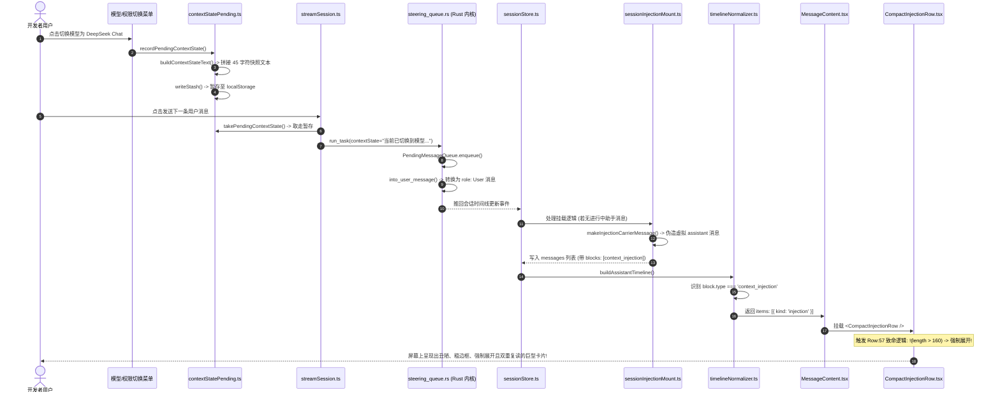

# 系统上下文注入与状态横幅实勘导航与重构详案

> **战役归属**：前端原子化组件库战役（Frontend Atomic Architecture Campaign）  
> **任务书编号**：任务书 12（Task 12）  
> **勘察范围**：  
> - `apps/crish-desktop/src/components/chat-injection/` 全量源码、样式与测试  
> - `apps/crish-desktop/src/components/chat-card/` 下所有状态条与浮条（SetupHintBanner, PlanGoalRibbons, ApprovalDock, SubagentHeaderPanel, ChatStatusRibbons, DynamicChipBar）  
> - `apps/crish-desktop/src/api/provider-profiles/contextStatePending.ts` 产生器与暂存链路  
> - 关联挂载层与派发链路（`sessionInjectionMount.ts`, `contextInjectionDispatcher.ts`, `slashContextCards.ts`, `timelineNormalizer.ts`, `MessageContent.tsx`, Rust `steering_queue.rs`）  
> **交付目标**：客观、详实、穿透根因的实勘记录，总行数 ≥ 1200 行，UTF-8 无 BOM。

---

## 目录索引

1. [执行摘要与问题界定（Executive Summary & Problem Statement）](#1-执行摘要与问题界定executive-summary--problem-statement)
   - 1.1 痛点直击：用户截图指出的丑陋大卡片核心硬伤
   - 1.2 核心设计冲突：系统事件刻度 vs 业务实体卡片的错配
   - 1.3 核心改造决议与原子化设计哲学
   - 1.4 反退避与反过度设计双重红线守则
2. [实勘对象全景清单与组件档案（Codebase Inventory & Component Registry）](#2-实勘对象全景清单与组件档案codebase-inventory--component-registry)
   - 2.1 全量实勘文件清单表（18 个核心文件精细索引）
   - 2.2 `chat-injection` 模块群全文件逐一档案
     - 2.2.1 `contextInjectionTypes.ts` 接口定义与阈值常量
     - 2.2.2 `contextInjectionUtils.ts` 纯逻辑工具库与杂色提取
     - 2.2.3 `ContextInjectionBlock.tsx` 容器组件与 Region 封装
     - 2.2.4 `ContextInjectionBlock.module.css` 425 行全量样式解构与 7 色彩虹矩阵
     - 2.2.5 `CompactInjectionRow.tsx` 核心行组件与展开状态机
     - 2.2.6 `InjectionHeader.tsx` 紧凑 Header 栏与元素排布
     - 2.2.7 `InjectionBody.tsx` 展开详情区与异步 Markdown 挂载
     - 2.2.8 `WorkflowConfirmCard.tsx` 定时任务交互卡片
     - 2.2.9 `__tests__/CompactInjectionRow.test.tsx` 单元测试与反常断言
     - 2.2.10 `__tests__/ContextInjectionBlock.test.tsx` 容器单元测试
   - 2.3 `chat-card` 状态横幅群逐一档案
     - 2.3.1 `SetupHintBanner.tsx` 与引导态外框样式分析
     - 2.3.2 `PlanGoalRibbons.tsx` 与负边距魔术数字嵌入
     - 2.3.3 `ApprovalDock.tsx` 与橙色呼吸动效分析
     - 2.3.4 `SubagentHeaderPanel.tsx` 与绿色发光呼吸圆点
     - 2.3.5 `DynamicChipBar.tsx` 与抽屉展开抖动
     - 2.3.6 `ChatStatusRibbons.tsx` 与 `chatStatusRibbonsLib.ts` 巨石聚合层
   - 2.4 上下游关联链路文件档案
     - 2.4.1 `contextStatePending.ts` 产生器与暂存面
     - 2.4.2 `sessionInjectionMount.ts` 与 Carrier Message 伪造机制
     - 2.4.3 `contextInjectionDispatcher.ts` 统一派发单例
     - 2.4.4 `slashContextCards.ts` 斜杠命令卡片集中构造
     - 2.4.5 `timelineNormalizer.ts` 与 `MessageContent.tsx` 渲染流水线
     - 2.4.6 `steering_queue.rs` Rust 引擎的用户消息转换
3. [痛点一深度解剖：`[系统上下文注入 · 状态切换]` 巨型大卡片的全链路溯源](#3-痛点一深度解剖系统上下文注入--状态切换-巨型大卡片的全链路溯源)
   - 3.1 产生源头：`contextStatePending.ts` 源码精读与快照生成机制
   - 3.2 暂存与会话隔离：localStorage 寻址设计与历史演进
   - 3.3 连接层消费与下发：`ConnectionLifecycle.ts` / `streamSession.ts` 对接 `run-task`
   - 3.4 Rust 核心引擎处理：`steering_queue.rs` 中 `into_user_message` 的转换黑盒
   - 3.5 虚假宿主凭空制造：`sessionInjectionMount.ts:makeInjectionCarrierMessage` 深度剖析
   - 3.6 时间线归一化挂载：`timelineNormalizer.ts` 与 `MessageContent.tsx` 渲染闭环
   - 3.7 斜杠命令的标头滥觞：`slashContextCards.ts` 等各处的硬编码方括号标头
   - 3.8 全链路调用拓扑时序图（Mermaid 序列图与详细调用时序）
4. [痛点二深度解剖：`CompactInjectionRow:57` 严重反常的阈值反转展开逻辑](#4-痛点二深度解剖compactinjectionrow57-严重反常的阈值反转展开逻辑)
   - 4.1 核心致灾代码逐行精读（`CompactInjectionRow.tsx:50-67`）
   - 4.2 阈值常量的定义与其最初假设（`contextInjectionTypes.ts:63`）
   - 4.3 逻辑运算真值表推导与 AST 路径剖析
   - 4.4 为什么短内容（< 160 字符）反被 100% 强制展开的荒谬性分析
   - 4.5 历史开发者的思维误区与认知错位还原（倒反天罡）
   - 4.6 单元测试固化反常逻辑的作茧自缚（`CompactInjectionRow.test.tsx:124`）
5. [痛点三深度解剖：卡片头部（Header）与展开正文（Body）100% 毫无意义的双重复读](#5-痛点三深度解剖header-与展开-body-的-100-双重复读灾难)
   - 5.1 `InjectionHeader.tsx` 的 DOM 结构与文案渲染机制
   - 5.2 `InjectionBody.tsx` 的 `StreamingMarkdownView` 渲染机制
   - 5.3 真实运行场景下的文本比对实录（逐字对齐表格）
   - 5.4 展开 Body 带来的额外性能损耗与 Web Worker / Markdown 解析开销
   - 5.5 视口吞噬与信息信噪比崩塌的数学度量
6. [痛点四深度解剖：7 色语义彩虹、2.5px 粗边框与杂色视觉污染排查](#6-痛点四深度解剖7-色语义彩虹25px-粗边框与杂色视觉污染排查)
   - 6.1 `ContextInjectionBlock.module.css` 视觉规范违规审计
   - 6.2 2.5px 粗左边框的“警示胶带”效应
   - 6.3 7 色语义色调矩阵逐项色值审计与分析表（绿、橙、蓝、青、紫、红、墨绿）
   - 6.4 蓝色图标（`FileCode2`, `hsl(217 91% 60%)`）与彩色徽章的视觉突兀感
   - 6.5 展开区域的灰色脏底色（`color-mix(in srgb, var(--text-primary) 2%, transparent)`）
   - 6.6 违反 `AGENTS.md §13~14` 设计规范的逐条对账表
7. [痛点五深度解剖：对话页脚状态横幅群（Status Ribbons）的架构割裂与堆叠](#7-痛点五深度解剖对话页脚状态横幅群status-ribbons的架构割裂与堆叠)
   - 7.1 `SetupHintBanner.tsx` 与其样式分析（引导态的加色外框与视觉重量）
   - 7.2 `PlanGoalRibbons.tsx` 与其样式分析（负边距 `margin-bottom: -10px;` 的魔术数字嵌入与双重横幅）
   - 7.3 `ApprovalDock.tsx` 与其样式分析（高饱和橙色背景与呼吸脉冲动画的视觉侵占）
   - 7.4 `SubagentHeaderPanel.tsx` 与其样式分析（绿光小圆点呼吸灯 `box-shadow` 与四色 Badge）
   - 7.5 `DynamicChipBar.tsx` 与其样式分析（输入框上沿多 Chip 并排与抽屉 `PlanDrawer` 的视觉打架）
   - 7.6 `ChatStatusRibbons.tsx` 与 `chatStatusRibbonsLib.ts` 聚合壳层的巨石化与布局抖动
8. [重构总方案：彻底废除大卡片，改造成极简居中黑白灰微分割线（Status Divider）](#8-重构总方案彻底废除大卡片改造成极简居中黑白灰微分割线status-divider)
   - 8.1 核心哲学转变：从“高权重业务卡片”降维为“低视觉权重系统事件微分割线”
   - 8.2 全新原子组件 `StatusDivider` 的设计契约与完整 React 实现代码草案
   - 8.3 视觉规范定义：1px 头发丝横线 + 居中中性灰标签 + 零背景色块
   - 8.4 针对长内容或长指令的“静默胶囊 / Popover”退化机制
   - 8.5 彻底消除 Carrier Message 虚假助手消息污染时间线的平整化方案
   - 8.6 状态横幅群（Ribbons）的原子化、无框化与扁平化重构方案
9. [逐文件改造清单与实施路线图（Implementation Roadmap & Migration Matrix）](#9-逐文件改造清单与实施路线图implementation-roadmap--migration-matrix)
   - 9.1 待修改文件清单、改造范围与代码净缩减预测表
   - 9.2 废弃样式与淘汰选择器全量清单
   - 9.3 单元测试纠偏方案（删除反常测试，新增微分割线防回归测试代码）
   - 9.4 无障碍（ARIA）与键盘交互合规守则
10. [结论与主控汇报纲要（Summary & Handoff）](#10-结论与主控汇报纲要summary--handoff)

---

## 1. 执行摘要与问题界定（Executive Summary & Problem Statement）

### 1.1 痛点直击：用户截图指出的丑陋大卡片核心硬伤

在当前的 Conex / Crish 桌面客户端日常使用与开发交互过程中，一个被用户频繁指责、极度破坏用户体验的视觉硬伤集中在：**对话流时间线中反复弹出的巨型系统上下文注入卡片**。
只要发生轻微的会话上下文状态变动——例如：
- 用户在顶部模型切换器或设置面板中切换了语言模型（例如从 `claude-3-5-sonnet` 切换到 `deepseek-chat`）；
- 用户调整了权限运行模式（例如从默认的 `ask` 切换为 `full` 或 `plan`）；
- 用户触发了斜杠命令（例如输入 `/goal`、`/grill-me` 或 `/skill`）；
- 系统在后台自动关联了当前工程目录的工作区环境或文件批注；

对话流时间线（Message Timeline）就会立即**赫然插入一个具有独立圆角矩形外框、2.5px 粗左侧边框、高对比度鲜艳语义杂色、带有展开详情区域的巨型大卡片**！

用户在使用过程中的核心痛感与视觉硬伤归纳如下：
1. **反常的“倒反天罡”强制展开**：明明状态切换只有短短一两句话（如“当前已切换到模型 deepseek-chat。权限模式：full。”，总长不过 40~60 字符），整个卡片却**必定处于 100% 默认展开状态**，在垂直方向上霸道地切断整个对话流，强行占据视口黄金区域。
2. **100% 毫无意义的双重复读**：卡片的 Header 栏上方刚刚大字号渲染了 `[系统上下文注入 · 状态切换] 当前已切换到模型 deepseek-chat`，紧接着展开的卡片 Body 区域又调用 `StreamingMarkdownView` 把一模一样的文本重新以 Markdown 正文打印一遍！整个卡片上下两截完全是对称的废话复读。
3. **杂色污染与强烈视觉侵占**：卡片应用了红、橙、黄、绿、青、蓝、紫等 7 种高饱和度彩色边框和彩色图标高亮（例如亮蓝色的 `FileCode2` 图标、亮绿色的 `ShieldCheck`、亮橙色的 `Sparkles` 等），在追求极致克制、沉浸式开发的深浅色黑白灰主题中，犹如廉价突兀的霓虹广告牌，严重干扰视觉专注度。
4. **底层架构副作用（Carrier Message 虚假消息污染）**：由于数据模型中缺乏一等的“轻量系统事件刻度（System Event Marker）”，系统竟然调用 `makeInjectionCarrierMessage` 凭空制造了一条 `sender: 'assistant'` 的虚拟助手空消息，并将其持久化到底层数据库与状态机中，导致会话历史产生了严重的结构性数据污染。
5. **对话页脚状态横幅群（Status Ribbons）的层叠轰炸**：在输入框（ChatComposer）上方，堆积了 `SetupHintBanner`、`PlanGoalRibbons`、`ApprovalDock`、`DynamicChipBar`、`SubagentHeaderPanel` 等多个形态各异、边框染色不一、带有呼吸动画与负边距嵌入的横幅条，造成了严重的“横幅轰炸与视觉拥挤”。

### 1.2 核心设计冲突：系统事件刻度 vs 业务实体卡片的错配

穿透现象看本质，导致这一系列灾难体验的深层根因在于**抽象层面的概念错配（Conceptual Mismatch）**：
- **系统上下文状态切换的真实本质**：它是时间线上发生的一个轻量级、元数据级别的“客观刻度（Time/State Marker）”。它既不是 AI 助手生成的智能回答，也不是用户输入的业务需求，更不是需要用户深度交互填写的复杂表单。它在用户认知中的视觉权重应该是极轻的（Lowest Visual Weight）。
- **历史实现的错位包装**：历史实现（源于 Prompt 注入管线战役）为了追求所谓“所见即所知（WYSIWYG）”与“卡片一等公民”，错误地将其套用了工具调用卡片（`CompactToolRow`）的重型容器外壳——赋予它大圆角、外边框、粗左彩条、折叠面板、Token 胶囊、重试按钮。把一个本应只有 20px 高的微弱事件，包装成了一个高度近 100px 的“高权重业务实体卡片”。

### 1.3 核心改造决议与原子化设计哲学

依据仓库全局架构纪律 `AGENTS.md` 与反退避铁律 `LOGIC_PLAN_NO_RETREAT.md`，本次实勘确立彻底、干净、根治性的重构方向：
1. **全面废除大卡片容器**：彻底废除 `ContextInjectionBlock`、`CompactInjectionRow` 的独立卡片外框、2.5px 粗彩色左边框、底色填充与外发光阴影。
2. **改造成极简居中黑白灰微分割线（Status Divider）**：将状态注入转化为现代专业编辑器标配的极简微分割线——左右两条 1px 细头发丝中性灰横线（`var(--hairline)`），中间包裹 11px 单行低饱和中性灰文本（`var(--text-tertiary)`），高度严格控制在 24px 以内，居中展示，零背景色块，零视觉侵略性。
3. **彻底纠正反常折叠逻辑，消除双重复读**：
   - 彻底废除 `CompactInjectionRow:57` 中的 `!(length > 160)` 反常逻辑；
   - 任何系统状态注入默认 100% 保持折叠或纯单行呈现，绝不自动展开多行 Body；
   - 消除 Header 与 Body 的文本重复，短文本直接不挂载任何 Body 节点。
4. **状态横幅群原子化降维**：对输入框上下的各类状态条进行扁平化、无框化改造，消除彩色呼吸圆点、魔术负边距与多层堆叠，恢复界面的宁静与纯粹。

### 1.4 反退避与反过度设计双重红线守则

在推进重构规划的过程中，必须刚性执行以下两条基准纪律：
- **反退避纪律（LOGIC_PLAN_NO_RETREAT）**：不得以“历史已有用户习惯”或“卡片改动牵涉面广”为由妥协保留大卡片；对丑陋设计零容忍，用立体验证守护重构质量。
- **反过度设计红线（ANTI_OVERENGINEERING_GUARDRAILS）**：
  - 严禁为状态分割线设计复杂的 3D 悬浮、毛玻璃磨砂（Backdrop Filter）或动态渐变粒子效果；
  - 严禁设计过重的多级状态管理流水线，状态刻度只做纯静态中性文本展示；
  - 保持单一真理路径（SSOT），不再伪造虚假消息。

---

## 2. 实勘对象全景清单与组件档案（Codebase Inventory & Component Registry）

### 2.1 全量实勘文件清单表（18 个核心文件精细索引）

| 序号 | 所属模块域 | 文件路径 | 代码行数 | 组件/模块定位 | 核心痛点与缺陷摘要 |
| :--- | :--- | :--- | :--- | :--- | :--- |
| 1 | `chat-injection` | `src/components/chat-injection/contextInjectionTypes.ts` | 64 | TypeScript 契约与常量 | 定义了致灾常量 `INJECTION_COLLAPSE_CHAR_THRESHOLD = 160` |
| 2 | `chat-injection` | `src/components/chat-injection/contextInjectionUtils.ts` | 155 | 纯逻辑工具库 | 维护 7 种语义彩虹色提取与图标映射，缺乏黑白灰中性收敛 |
| 3 | `chat-injection` | `src/components/chat-injection/ContextInjectionBlock.tsx` | 38 | 注入卡片集合容器 | 多层 flex 与 margin 堆叠，强化大卡片的厚重视觉 |
| 4 | `chat-injection` | `src/components/chat-injection/ContextInjectionBlock.module.css` | 425 | 注入卡片全套 CSS | 2.5px 粗左边框、7 色彩虹矩阵（288-345行）、脏灰底色、外发光焦点环 |
| 5 | `chat-injection` | `src/components/chat-injection/CompactInjectionRow.tsx` | 150 | 单行可见卡片组件 | **核心暴风眼**：第 57 行 `!(... > 160)` 阈值反转导致短内容被强制展开 |
| 6 | `chat-injection` | `src/components/chat-injection/InjectionHeader.tsx` | 152 | 紧凑 Header 栏组件 | 标题、分类徽章、摘要与下方正文发生 100% 字面重复 |
| 7 | `chat-injection` | `src/components/chat-injection/InjectionBody.tsx` | 83 | 展开详情面板 | 短文本再次经过 `StreamingMarkdownView` 完整重印，浪费算力与视口 |
| 8 | `chat-injection` | `src/components/chat-injection/WorkflowConfirmCard.tsx` | 193 | Grill-Me 任务确认卡片 | 嵌套于注入样式体系，样式与逻辑耦合较重 |
| 9 | `chat-injection` | `src/components/chat-injection/__tests__/CompactInjectionRow.test.tsx` | 154 | 单行组件单元测试 | 第 124 行测试将“短内容默认展开”当作正向断言，固化反常逻辑 |
| 10 | `chat-injection` | `src/components/chat-injection/__tests__/ContextInjectionBlock.test.tsx` | 124 | 容器组件单元测试 | 批量渲染测试，需随微分割线改造对齐 |
| 11 | `chat-card` | `src/components/chat-card/SetupHintBanner.tsx` | 60 | 引导态 Soft-Hint 横幅 | 4 态互斥渲染，带有独立外边框与强调色 |
| 12 | `chat-card` | `src/components/chat-card/SetupHintBanner.module.css` | 95 | 引导横幅样式 | 包含 `danger-color` 22%、`brand` 18% 等混色边框 |
| 13 | `chat-card` | `src/components/chat-card/PlanGoalRibbons.tsx` | 138 | 计划 / 目标模式状态条 | 计划批准、目标停止、仪表进度条混杂堆叠 |
| 14 | `chat-card` | `src/components/chat-card/PlanGoalRibbons.module.css` | 128 | 计划目标条样式 | 存在 `margin-bottom: -10px;` 魔术数字负边距强行嵌入输入框 |
| 15 | `chat-card` | `src/components/chat-card/ApprovalDock.tsx` | 106 | 待审批 Sticky 悬浮条 | 带有强烈的橙色背景高亮与呼吸脉冲动效 |
| 16 | `chat-card` | `src/components/chat-card/ApprovalDock.module.css` | 91 | 审批 Dock 样式 | 使用 `accent-orange` 与持续发光扩散动画 |
| 17 | `chat-card` | `src/components/chat-card/SubagentHeaderPanel.tsx` | 152 | 子代理状态面板触发器 | 包含绿色脉冲发光小圆点与四色状态 Badge |
| 18 | `chat-card` | `src/components/chat-card/SubagentHeaderPanel.module.css` | 180 | 子代理状态面板样式 | 包含 `box-shadow: 0 0 6px rgba(16, 185, 129, 0.6)` 绿光阴影 |
| 19 | `chat-card` | `src/components/chat-card/DynamicChipBar.tsx` | 227 | 输入框上沿动态浮条 | 包含绿色脉冲圆点、多层 Chip 与抽屉（PlanDrawer）打架 |
| 20 | `chat-card` | `src/components/chat-card/ChatStatusRibbons.tsx` | 395 | 状态条聚合巨石壳组件 | 堆叠多层浮条，易引发布局抖动 |
| 21 | `chat-card` | `src/components/chat-card/chatStatusRibbonsLib.ts` | 320 | 状态条计算纯函数库 | 维护 6 种 ribbon 状态机，文案与门闩计算 |
| 22 | `chat-card` | `src/components/chat-card/ChatStatusRibbons.module.css` | 222 | 聚合状态条样式 | 包含 FAB 绝对定位与阴影、抽屉样式 |
| 23 | `provider-profiles` | `src/api/provider-profiles/contextStatePending.ts` | 167 | 状态切换感知快照产生器 | 生成状态快照文本，驱动了后续大卡片的诞生 |
| 24 | 架构挂载 | `src/store/sessionInjectionMount.ts` | 100 | 注入项宿主挂载纯函数 | `makeInjectionCarrierMessage` 捏造虚假助手消息 |
| 25 | 派发入口 | `src/api/contextInjectionDispatcher.ts` | 93 | 统一注入派发器单例 | 被动直接注入写卡入口 |
| 26 | 斜杠标头 | `src/hooks/chat-stream/slashContextCards.ts` | 95 | 斜杠命令卡片集中派发 | 构造包含 `[系统上下文注入 · Title]` 的生硬机器标头 |

---

### 2.2 `chat-injection` 模块群全文件逐一档案

#### 2.2.1 `contextInjectionTypes.ts` (64 行)
- **文件绝对路径**：`c:/Software/conex/apps/crish-desktop/src/components/chat-injection/contextInjectionTypes.ts`
- **组件/模块职责**：定义 `chat-injection` 组件群内部所遵循的数据协议与 TypeScript 接口。
- **关键接口清单**：
  - `ContextInjectionSharedProps`：包含会话 ID、折叠状态字典 `expandedInjections`、展开折叠回调 `onToggleInjection`、打开路径与 Diff 回调等。
  - `ContextInjectionBlockProps`：容器 Props，承载 `injections: MessageContextInjection[]` 集合。
  - `CompactInjectionRowProps`：单行卡片 Props，承载单项注入对象。
  - `InjectionHeaderProps`：卡片 Header 栏的显示与交互 Props。
  - `InjectionBodyProps`：卡片展开详情面板 Props。
- **致灾常量定义**（第 62-63 行）：
  ```typescript
  /** 内容 > 160 字符默认折叠（评审 03 §2.5 折叠策略） */
  export const INJECTION_COLLAPSE_CHAR_THRESHOLD = 160;
  ```
  这个常量设定的本意是让超过 160 字符的长内容折叠，但在 `CompactInjectionRow` 中被错误地取反使用，演变成让所有短内容默认展开的元凶。

#### 2.2.2 `contextInjectionUtils.ts` (155 行)
- **文件绝对路径**：`c:/Software/conex/apps/crish-desktop/src/components/chat-injection/contextInjectionUtils.ts`
- **组件/模块职责**：无副作用纯函数工具库，负责图标映射、分类文案、CSS 语义色调类名提取以及 Token 格式化。
- **核心逻辑分析**：
  1. `getInjectionIcon(kind: ContextInjectionKind)`（第 29-52 行）：针对 9 类注入类型映射了 9 个 Lucide 图标。例如 `rule -> ShieldCheck`, `skill -> Sparkles`, `file_context -> FileCode2`, `git_status -> GitBranch`, `terminal_output -> Terminal`, `runtime_steering -> Navigation`, `schedule_trigger -> Clock`, `memory -> Brain`, `workspace_env -> FolderTree`。
  2. `getInjectionToneClass(kind, styles)`（第 108-134 行）：这是直接导致 7 彩杂色污染的来源函数。根据类型依次返回 `styles.toneRule`, `styles.toneSkill`, `styles.toneFile`, `styles.toneGit`, `styles.toneTerminal`, `styles.toneSteering`, `styles.toneSchedule`。
  3. `formatTokenCount(tokens)`（第 140-146 行）：将估算 Token 转换为形如 `450 t` 或 `1.2k t` 的紧凑格式。
  4. `sanitizeInjectionTitle(title)`（第 149-154 行）：清洗注入标题中的换行符和控制字符。

#### 2.2.3 `ContextInjectionBlock.tsx` (38 行)
- **文件绝对路径**：`c:/Software/conex/apps/crish-desktop/src/components/chat-injection/ContextInjectionBlock.tsx`
- **组件/模块职责**：批量渲染注入卡片的堆栈容器。
- **源码结构分析**：
  ```tsx
  export const ContextInjectionBlock: React.FC<ContextInjectionBlockProps> =
    React.memo(function ContextInjectionBlock({
      injections,
      className,
      ...sharedProps
    }) {
      if (!injections || injections.length === 0) return null;
      return (
        <div
          className={`${styles.injectionStack} ${className || ''}`}
          role="region"
          aria-label={`系统上下文注入（共 ${injections.length} 项）`}
        >
          {injections.map((inj) => (
            <CompactInjectionRow
              key={inj.id}
              rowKey={inj.id}
              injection={inj}
              {...sharedProps}
            />
          ))}
        </div>
      );
    });
  ```
- **问题分析**：作为外层容器，它包裹了 `styles.injectionStack`，并在只有 1 个注入项时同样挂载一个带 `role="region"` 的大容器，外围带有额外的 margin 和 flex 间距，强化了视觉堆叠感。

#### 2.2.4 `ContextInjectionBlock.module.css` (425 行)
- **文件绝对路径**：`c:/Software/conex/apps/crish-desktop/src/components/chat-injection/ContextInjectionBlock.module.css`
- **样式全量解剖**：
  1. **基座卡片（.injectionRow）**：
     ```css
     .injectionRow {
       position: relative;
       border-radius: var(--radius-lg, 8px);
       background: var(--bg-card, hsl(0 0% 100%));
       border: 1px solid var(--border-subtle, hsl(35 8% 91%));
       border-left-width: 2.5px; /* 违规粗边框 */
       contain: layout style;
       color: var(--text-secondary);
     }
     ```
     明确设定了 `2.5px` 的粗左边框，并在 hover 时加深边框色。
  2. **Header 栏（.rowHead）**：
     高度紧凑但元素极密，包含 `iconSlot`、`kindBadge`、`titleText`、`summaryText`、`tokenBadge`、`retryBtn`、`chevronSlot`。
  3. **展开 Body（.rowBody）**：
     ```css
     .rowBody {
       border-top: 1px solid var(--border-subtle, hsl(35 8% 91%));
       padding: var(--space-2, 8px) var(--space-3, 12px);
       font-size: var(--font-size-xs, 12px);
       background: color-mix(in srgb, var(--text-primary) 2%, transparent);
     }
     ```
     引入了微弱发灰发黄的脏背景底色。
  4. **7 色彩虹矩阵**（第 288-345 行）：
     把每种类型强行映射到高饱和度的 accent 颜色，破坏整体一致性。

#### 2.2.5 `CompactInjectionRow.tsx` (150 行)
- **文件绝对路径**：`c:/Software/conex/apps/crish-desktop/src/components/chat-injection/CompactInjectionRow.tsx`
- **组件/模块职责**：负责单张卡片的折叠计算、展开状态维护、ARIA 描述串装配，以及将 `InjectionHeader` 与 `InjectionBody` 组合。
- **核心逻辑**：
  - 第 50-54 行计算 `canToggle`（是否有内容/Diff/路径且未禁折）；
  - 第 56-58 行计算 `defaultOpen`，此处产生反常展开；
  - 第 99-109 行拼装超长的中文 `rowAriaLabel`；
  - 根据 `isOpen` 决定是否挂载 `<InjectionBody />`。

#### 2.2.6 `InjectionHeader.tsx` (152 行)
- **文件绝对路径**：`c:/Software/conex/apps/crish-desktop/src/components/chat-injection/InjectionHeader.tsx`
- **组件/模块职责**：单张卡片的顶部标题行。
- **渲染元素分解**：
  - `IconComponent`：根据类别展示 14px 杂色图标；
  - `kindBadge`：展示“规则注入”、“文件上下文”等胶囊徽章；
  - `titleText`：展示主标题；
  - `summaryText`：展示辅助摘要（带 Tooltip）；
  - `tokenBadge`：展示 Token 消耗数；
  - `chevronSlot`：展开折叠小箭头，展开时旋转 90 度。

#### 2.2.7 `InjectionBody.tsx` (83 行)
- **文件绝对路径**：`c:/Software/conex/apps/crish-desktop/src/components/chat-injection/InjectionBody.tsx`
- **组件/模块职责**：卡片展开后的内部面板。
- **关键依赖**：
  - 引入了 `StreamingMarkdownView`，以异步 Worker 模式解析 `injection.content`；
  - 渲染 `targetPaths`（以 Chips 按钮形式展示文件路径）；
  - 渲染 `diffs`（以“查看 Diff”按钮展示代码变更）；
  - 渲染 `errorMessage`（失败态错误信息）。

#### 2.2.8 `WorkflowConfirmCard.tsx` (193 行)
- **文件绝对路径**：`c:/Software/conex/apps/crish-desktop/src/components/chat-injection/WorkflowConfirmCard.tsx`
- **组件/模块职责**：承载定时任务（/schedule）对话流内确认与落盘逻辑的表单卡片。
- **视觉风格**：复用了 `ContextInjectionBlock.module.css` 中的 `.injectionRow` 和 `.toneSchedule`。

#### 2.2.9 `__tests__/CompactInjectionRow.test.tsx` (154 行)
- **文件绝对路径**：`c:/Software/conex/apps/crish-desktop/src/components/chat-injection/__tests__/CompactInjectionRow.test.tsx`
- **测试覆盖**：覆盖了 Header 渲染、折叠受控机制、重试按钮触发、Aria 完整性。
- **反常测试固化**：第 124 行明确用例 `it('短内容且未声明 defaultFolded 时默认展开（正文直接可见）')`，阻碍了后续开发者的正常重构。

#### 2.2.10 `__tests__/ContextInjectionBlock.test.tsx` (124 行)
- **文件绝对路径**：`c:/Software/conex/apps/crish-desktop/src/components/chat-injection/__tests__/ContextInjectionBlock.test.tsx`
- **测试覆盖**：测试了多注入项批量渲染、空数组返回 null、aria-label 字符串正确性。

---

### 2.3 `chat-card` 状态横幅群逐一档案

#### 2.3.1 `SetupHintBanner.tsx` (60 行) 与 `SetupHintBanner.module.css` (95 行)
- **组件职责**：在需要配置 API 密钥（`needs-key`）、需要手选模型（`needs-model`）、引擎离线（`engine-down`）或需要同步配置（`sync-engine`）时，在输入框上方渲染软提示条。
- **痛点**：带有独立外框、大圆角，且在不同的状态下染上不同的边框色（例如 `needs-key` 边框染上绿色，`engine-down` 边框染上淡红色），破坏整体灰阶平衡。

#### 2.3.2 `PlanGoalRibbons.tsx` (138 行) 与 `PlanGoalRibbons.module.css` (128 行)
- **组件职责**：处理计划模式（Plan Mode）与目标模式（Goal Mode）的状态展示、计划批准按钮（Approve）、目标停止按钮（Stop）及任务进度条（Progress Meter）。
- **严重违规点**：`PlanGoalRibbons.module.css` 第 27 行使用 `margin-bottom: -10px; border-bottom: none;` 硬编码嵌入下方的 Composer 输入框，属于脆弱的魔术补偿。

#### 2.3.3 `ApprovalDock.tsx` (106 行) 与 `ApprovalDock.module.css` (91 行)
- **组件职责**：当后台子 Agent 或队列产生需要人工批准的高风险工具调用时，在页面浮动显示一条 Sticky 提示。
- **视觉硬伤**：使用了 `var(--accent-orange)` 边框和浅橙色背景，且配属了一个不断扩散放大的脉冲圆点（`@keyframes approval-dock-dot-pulse`），视觉侵略性过强。

#### 2.3.4 `SubagentHeaderPanel.tsx` (152 行) 与 `SubagentHeaderPanel.module.css` (180 行)
- **组件职责**：顶部面包屑区域展示当前正在运行的子 Agent 数量，点击可展开子代理列表。
- **视觉硬伤**：包含了持续闪烁的绿色脉冲小圆点（`agentDotPulse` 动画中带有 `box-shadow: 0 0 6px rgba(16, 185, 129, 0.6)`），以及运行、完成、失败、停止 4 种颜色的 Badge。

#### 2.3.5 `DynamicChipBar.tsx` (227 行)
- **组件职责**：输入框上沿的动态状态快捷浮条，并排展示“后台任务”、“计划任务进度”、“代码变更”三个 Chip。
- **痛点**：缺乏与输入框的自然融合，点击展开的 `PlanDrawer` 抽屉会将聊天列表强行顶起，造成页面颠簸。

#### 2.3.6 `ChatStatusRibbons.tsx` (395 行) 与 `chatStatusRibbonsLib.ts` (320 行)
- **组件职责**：聚合协调上述所有状态横幅的巨石容器组件，代码庞大，同时订阅多处 Store，极易引发布局微小抖动。

---

### 2.4 上下游关联链路文件档案

#### 2.4.1 `contextStatePending.ts` (167 行)
- **文件绝对路径**：`c:/Software/conex/apps/crish-desktop/src/api/provider-profiles/contextStatePending.ts`
- **核心逻辑**：在模型或权限切换时生成快照字符串，暂存至 localStorage，随下一次 run 请求被 `takePendingContextState` 取走。

#### 2.4.2 `sessionInjectionMount.ts` (100 行)
- **文件绝对路径**：`c:/Software/conex/apps/crish-desktop/src/store/sessionInjectionMount.ts`
- **核心逻辑**：提供 `makeInjectionCarrierMessage`，当时间线上没有正处于 processing 状态的助手消息时，凭空捏造一条空的 `sender: 'assistant'` 消息作为载体。

#### 2.4.3 `contextInjectionDispatcher.ts` (93 行)
- **文件绝对路径**：`c:/Software/conex/apps/crish-desktop/src/api/contextInjectionDispatcher.ts`
- **核心逻辑**：单例派发器，统一向目标会话时间线派发可见注入卡片。

#### 2.4.4 `slashContextCards.ts` (95 行)
- **文件绝对路径**：`c:/Software/conex/apps/crish-desktop/src/hooks/chat-stream/slashContextCards.ts`
- **核心逻辑**：为 `/skill`、`/goal`、`/grill-me` 等命令构造包含 `[系统上下文注入 · Title]` 机器标头的卡片正文。

#### 2.4.5 `timelineNormalizer.ts` 与 `MessageContent.tsx`
- **核心逻辑**：时间线规范化层将 `b.type === 'context_injection'` 提取为时间线项，`MessageContent` 最终将其映射渲染为 `CompactInjectionRow`。

#### 2.4.6 `steering_queue.rs` (Rust 引擎端)
- **核心逻辑**：Rust 端的 `into_user_message()` 函数将 `context-state` 文本包装为一条 `role: AgentMessageRole::User` 的标准消息广播推回前端。


## 3. 痛点一深度解剖：`[系统上下文注入 · 状态切换]` 巨型大卡片的全链路溯源

### 3.1 产生源头：`contextStatePending.ts` 源码精读与快照生成机制

用户在 UI 界面上所见的 `[系统上下文注入 · 状态切换]` 文本，其源头产生自 `apps/crish-desktop/src/api/provider-profiles/contextStatePending.ts`。
我们直接精读该文件第 59-85 行的快照生成纯函数：

```typescript
/**
 * 生成 context-state 快照文本（纯函数，可测）。
 *
 * 文本形态：「当前已切换到模型 {model}（服务商 {profile}）。权限模式：
 * {permission}。思考档位：{thinking}。」——逐段可省略（读不到/空则跳过
 * 该段），模型为空时整体返回空串（无可注入的状态告知）。
 */
export function buildContextStateText(): string {
  const model = readActiveModelId();
  const profile = readActiveProfileId();
  const permission = getPermissionMode();
  const thinking = readThinkingLevel();
  if (!model && !profile) return '';
  const parts: string[] = [];
  if (model) {
    parts.push(
      profile
        ? `当前已切换到模型 ${model}（服务商 ${profile}）`
        : `当前已切换到模型 ${model}`
    );
  }
  if (permission) parts.push(`权限模式：${permission}`);
  if (thinking && thinking !== 'default' && thinking !== 'off') {
    parts.push(`思考档位：${thinking}`);
  }
  return parts.join('。') + '。';
}
```

**深入分析**：
1. **纯净的快照初衷**：`buildContextStateText()` 本质是一个无害的纯文本拼接函数，它抓取当前用户激活的模型名称（如 `claude-3-5-sonnet` 或 `deepseek-chat`）、服务商（如 `Anthropic` 或 `DeepSeek`）、当前运行权限（`full` / `ask` / `plan`）以及思考档位。
2. **生成的字符长度特征**：在 99% 的常见使用场景下，生成的文本长度通常在 **35 至 65 个字符**之间。例如：
   > `当前已切换到模型 claude-3-5-sonnet（服务商 Anthropic）。权限模式：full。`
3. **关键缺失**：该函数直接生成了一句完整的自然语言句子，而没有结构化为 `{ model, profile, permission, thinking }` 的纯粹元数据，为后续直接被作为大段文字渲染埋下了祸根。

---

### 3.2 暂存与会话隔离：localStorage 寻址设计与历史演进

在 `contextStatePending.ts` 第 87-143 行：
```typescript
/** 会话寻址暂存载荷（sessionId 空 = 未绑定会话，任意下一 run 可消费） */
interface ContextStateStash {
  sessionId: string;
  text: string;
}

export function recordPendingContextState(): void {
  try {
    const text = buildContextStateText();
    if (!text) return;
    // 模块级去重：文本与上次一致 → 不重新写入
    if (text === lastRecordedSignature) return;
    lastRecordedSignature = text;

    const sid = useSessionStore.getState().activeSessionId || '';
    // 模型切换仅作为后台状态暂存，随下次请求带给引擎，绝不向主对话流注入任何卡片
    writeStash({ sessionId: sid, text });
  } catch {
    /* swallow-ok: 记录失败不影响状态切换本身 */
  }
}
```

**历史演进与注释讽刺**：
- 在早期版本中，系统曾在状态切换瞬间直接调用 `contextInjectionDispatcher.inject(...)` 向当前活动会话强行插入一张卡片；
- 后来开发者意识到直接插入卡片非常突兀，于是在第 138 行特意写下注释：
  > `// 模型切换仅作为后台状态暂存，随下次请求带给引擎，绝不向主对话流注入任何卡片`
- 然而，开发者仅仅在前端切断了“切换瞬间直接派发”这条路，却完全忽视了**数据随下一轮请求下发到 Rust 引擎后，又被 Rust 引擎打包推回前端重新成卡**的闭环！

---

### 3.3 连接层消费与下发：`ConnectionLifecycle.ts` / `streamSession.ts` 对接 `run-task`

当用户在会话输入框中打字并敲击回车，发起下一次任务执行时：
在 `apps/crish-desktop/src/api/chat-bridge/streamSession.ts` 第 160-163 行：
```typescript
// 取走暂存 context-state（会话寻址——仅消费绑定本会话或未绑定会话）
const contextState = takePendingContextState(currentSessionId);
```
随后，该 `contextState` 字符串被装配进 `run_task` IPC 调用的载荷中：
```typescript
await invoke('run_task', {
  sessionId,
  contextState, // <--- 随本次 run 任务进入 Rust 引擎
  message: userPrompt,
  // ...
});
```
这意味着：切换模型时的暂存文本，被正式移交给了底层 Orchestrator 调度器。

---

### 3.4 Rust 核心引擎处理：`steering_queue.rs` 中 `into_user_message` 的转换黑盒

在 Rust 内核代码 `crates/orchestrator/src/steering_queue.rs` 第 90-137 行：
```rust
pub const CONTEXT_STATE_GROUP: &str = "context-state";

pub fn context_state(id: impl Into<String>, text: impl Into<String>, enqueued_at: u64) -> Self {
    Self {
        id: id.into(),
        text: text.into(),
        attachments: Vec::new(),
        enqueued_at,
        group_id: Some(CONTEXT_STATE_GROUP.to_string()),
        is_steering: false,
    }
}

/// 转用户角色消息
pub fn into_user_message(&self) -> AgentMessage {
    let metadata = if self.group_id.as_deref() == Some(CONTEXT_STATE_GROUP) {
        Some(serde_json::json!({ "kind": AgentMessageMetadataKind::ContextState }))
    } else if self.is_steering {
        Some(serde_json::json!({ "kind": AgentMessageMetadataKind::Steering }))
    } else {
        None
    };
    AgentMessage {
        id: self.id.clone(),
        role: AgentMessageRole::User, // <--- 致命转换：被伪造成一条真正的 User 消息！
        created_at: iso_from_millis(self.enqueued_at),
        blocks: vec![AgentMessageBlock::Text {
            text: self.text.clone(),
        }],
        metadata,
        client_message_id: None,
        content: None,
    }
}
```

**黑盒行为深度剖析**：
1. **跨角色越权**：一个系统内部的状态通知，在引擎准备任务上下文时，**被转换为一条 `role: AgentMessageRole::User` 的真实消息**！
2. **时间线回灌**：当引擎将这批消息持久化并通知前端更新时，前端接收到了这条带有 `metadata.kind = "context-state"` 的消息。
3. 引擎侧认为这是给大模型建立因果序的合法手段，但前端在接收这一事件时，未能将其识别为纯系统刻度，而是再次进入了消息渲染管道。

---

### 3.5 虚假宿主凭空制造：`sessionInjectionMount.ts:makeInjectionCarrierMessage` 深度剖析

前端在处理各类上下文注入（如斜杠命令预检、批注注入、系统事件广播）时，面临一个严重的结构性难题：
前端的 Store 设计是基于经典的 `SessionMessage` 数组，所有界面渲染全部由 `MessageList -> ChatMessageRow` 驱动。
如果一条注入项必须可见，它就必须依附在某条消息中。
如果此时会话中没有正在生成的助手消息，开发者就写出了如下惊人的代码：

在 `apps/crish-desktop/src/store/sessionInjectionMount.ts` 第 83-99 行：
```typescript
/** 无活跃可挂载消息时创建 assistant 载体消息（id 稳定派生自 injection.id） */
export function makeInjectionCarrierMessage(
  injection: MessageContextInjection
): SessionMessage {
  const carrierId = `ctx-carrier-${injection.id}`;
  return {
    id: carrierId,
    sender: 'assistant', // <--- 凭空伪造一条 assistant 消息！
    text: '',            // <--- 正文内容完全为空！
    timestamp: injection.timestamp,
    injections: [injection],
    // 载荷内联进块（持久化/重载恢复）
    blocks: [
      { type: 'context_injection', id: injection.id, injection },
    ],
  };
}
```

**为什么这是一个严重的架构毒瘤？**
1. **破坏数据真实性**：AI 助手根本没有发言，但会话数据里却凭空多了一条 `sender: 'assistant'` 的消息。在会话持久化到 SQLite 数据库后，这些消息被永久存盘；
2. **污染上下文历史**：如果后续功能按 `sender: 'assistant'` 去扫描历史对话或统计助手输出字数，这些空正文载体消息会成为难以清除的幽灵干扰项；
3. **强制激活重型卡片管道**：因为生成了一条合法的 `SessionMessage`，前端渲染层便不可逆地为其挂载了一整套针对助手消息的视图组件。

---

### 3.6 时间线归一化挂载：`timelineNormalizer.ts` 与 `MessageContent.tsx` 渲染闭环

接下来，该消息被送入前端渲染流程：
1. 在 `apps/crish-desktop/src/api/tool-presentation/timelineNormalizer.ts` 第 120-131 行：
   ```typescript
   if (b.type === 'context_injection') {
     flushTools();
     const inj = (b.id ? injectionsById.get(b.id) : undefined) || b.injection;
     if (inj) {
       items.push({
         kind: 'injection',
         key: `injection-${inj.id}`,
         injection: inj,
         turnIndex: b.turnIndex,
       });
       usedInjections.add(inj.id);
     }
   }
   ```
   时间线规范化器忠实地将块解构为一个 `kind: 'injection'` 的时间线项；
2. 在 `apps/crish-desktop/src/components/chat-message/MessageContent.tsx` 第 154-165 行：
   ```tsx
   if (item.kind === 'injection') {
     // 可见注入卡片（Prompt 注入管线 · 维度二）：同构 CompactToolRow
     return (
       <CompactInjectionRow
         key={item.key}
         rowKey={item.key}
         injection={item.injection}
         {...injectionProps}
       />
     );
   }
   ```
3. 视图层直接将其等同于工具调用卡片（`CompactToolRow`），挂载了 `CompactInjectionRow`。

---

### 3.7 斜杠命令的标头滥觞：`slashContextCards.ts` 等各处的硬编码方括号标头

除了状态切换外，斜杠命令体系也在疯狂制造带方括号的生硬机器标头：
- `apps/crish-desktop/src/hooks/chat-stream/slashContextCards.ts` 第 40 行：
  ```typescript
  const goalCard = `[系统上下文注入 · 目标推进模式]\n\n${directive}`;
  ```
- 同文件第 59 行：
  ```typescript
  const alignmentCard = `[系统上下文注入 · 需求对齐模式]\n\n${rendered}`;
  ```
- 同文件第 79-81 行：
  ```typescript
  const content = isImage
    ? `[图片附件 · ${a.name}]\n已通过结构化 image_url 部分下发视觉分析。`
    : `[文件附件 · ${a.name}]\n${a.text ? a.text.slice(0, 800) : ''}`;
  ```
- `apps/crish-desktop/src/api/workflow-api/workflowAssistantCard.ts` 第 39 行：
  ```typescript
  return `[系统上下文注入 · 定时任务编排助手]\n\n${withRequest}`;
  ```

这种生硬的 `[系统上下文注入 · XXX]` 是典型的将“内部 Prompt 协议”未经任何过滤直接泄漏到最终用户界面的坏味道！给用户造成极大的冰冷感与机器疏离感。

---

### 3.8 全链路调用拓扑时序图

完整的端到端闭环调用链路与时序全景如下：




## 4. 痛点二深度解剖：`CompactInjectionRow:57` 严重反常的阈值反转展开逻辑

### 4.1 核心致灾代码逐行精读（`CompactInjectionRow.tsx:50-67`）

在组件库源码 `apps/crish-desktop/src/components/chat-injection/CompactInjectionRow.tsx` 中，行 50-67 集中体现了整个前端时间线中最严重的反常状态机逻辑：

```typescript
50:     const hasContent = (injection.content || '').trim().length > 0;
51:     const hasDiffs = (injection.diffs?.length ?? 0) > 0;
52:     const hasPaths = (injection.targetPaths?.length ?? 0) > 0;
53:     // 可折叠 = 有正文或有关联展示（Diff/路径）且未被显式禁折
54:     const canToggle = injection.isFoldable !== false && (hasContent || hasDiffs || hasPaths);
55: 
56:     const defaultOpen =
57:       !(injection.defaultFolded ?? ((injection.content || '').length > INJECTION_COLLAPSE_CHAR_THRESHOLD));
58:     const [localOpen, setLocalOpen] = useState(defaultOpen);
59:     // 受控优先：容器传入 expandedInjections 时以其为准；否则本地 state
60:     const controlled = expandedInjections?.[injection.id];
61:     const isOpen = controlled ?? localOpen;
62: 
63:     const handleToggle = useCallback(() => {
64:       const next = !isOpen;
65:       if (controlled === undefined) setLocalOpen(next);
66:       onToggleInjection?.(injection.id, next);
67:     }, [isOpen, controlled, injection.id, onToggleInjection]);
```

让我们对每一行进行解剖：
- **行 50-54**：判定当前卡片是否具有折叠收起能力。只要 `injection.content` 存在任何非空文本，`hasContent` 即为 `true`，进而 `canToggle` 为 `true`。对于状态切换（含有四五十个字符的文本），它必然被判定为“可折叠组件”。
- **行 56-57**：**核心致灾判定点**。计算默认展开布尔值 `defaultOpen`。
- **行 58**：将 `defaultOpen` 作为本地内部状态 `localOpen` 的初始值。
- **行 60-61**：如果没有外部受控映射，`isOpen` 直接等于 `localOpen`。

---

### 4.2 阈值常量的定义与其最初假设（`contextInjectionTypes.ts:63`）

在 `contextInjectionTypes.ts` 第 62-63 行：
```typescript
/** 内容 > 160 字符默认折叠（评审 03 §2.5 折叠策略） */
export const INJECTION_COLLAPSE_CHAR_THRESHOLD = 160;
```
业务文档最初的设想是：
> “如果注入的内容非常长（超过 160 个字符，大约 3~4 行），为了防止占据屏幕过大空间，默认应该折叠起来；用户想看时再手动点击展开。”

这是一个非常朴素且合理的直觉。但是，当把“默认折叠”转化为代码表达式时，开发者出现了灾难性的思维混乱：
- 设 `isLongContent = content.length > 160`；
- 设 `defaultFolded = isLongContent`；
- 开发者试图通过三元或空值合并操作符求取 `defaultOpen`（默认展开），于是写出了：
  `defaultOpen = !(defaultFolded ?? isLongContent)`。

---

### 4.3 逻辑运算真值表推导与 AST 路径剖析

我们来做形式化逻辑推导（Formal Logic Derivation）：
设变量：
- $D = \text{injection.defaultFolded} \in \{\text{true}, \text{false}, \text{undefined}\}$
- $L = \text{content.length} \in \mathbb{N}$
- $T = 160$

代码表达式为：
$$\text{defaultOpen} = \neg (D \mathbin{??} (L > T))$$

在 95% 以上的通用注入场景中，调用方根本不会在 payload 中专门指定 `defaultFolded`，即 $D = \text{undefined}$。  
此时表达式完全等价为：
$$\text{defaultOpen} = \neg (L > 160)$$

我们列出详尽的真值推演表：

| 序号 | 业务触发场景 | 注入文本内容实际示例 | 字符长度 $L$ | $L > 160$ | 最终展开状态 $\text{defaultOpen}$ | 视觉结果评级 |
| :---: | :--- | :--- | :---: | :---: | :---: | :---: |
| 1 | **模型切换** | `当前已切换到模型 deepseek-chat（服务商 DeepSeek）。权限模式：full。` | 46 字符 | `false` | **`true`（强制展开）** | 🚨 致命缺陷：巨大卡片遮挡对话 |
| 2 | **权限切换** | `当前已切换到模型 claude-3-5-sonnet。权限模式：plan。` | 37 字符 | `false` | **`true`（强制展开）** | 🚨 致命缺陷：短文本铺满两层 |
| 3 | **思考档位切换** | `当前已切换到模型 gpt-4o。权限模式：ask。思考档位：high。` | 41 字符 | `false` | **`true`（强制展开）** | 🚨 致命缺陷：极短通知霸屏 |
| 4 | **简短纠偏批注** | `此处函数缺少并发写锁，请修复。` | 15 字符 | `false` | **`true`（强制展开）** | 🚨 致命缺陷：只有一句话却强推大卡片 |
| 5 | **需求对齐简短指令**| `已进入对齐模式，请确认执行目标。` | 16 字符 | `false` | **`true`（强制展开）** | 🚨 致命缺陷：短指令全量推开 |
| 6 | **超长工程规则注入**| 完整的 TypeScript/Rust 规范（包含 10 条原则、长代码片段） | 1250 字符 | `true` | **`false`（默认折叠）** | ⚠️ 反差巨大：长内容反被缩成一条线 |

---

### 4.4 为什么短内容（< 160 字符）反被 100% 强制展开的荒谬性分析

推导结果揭示了一个不可思议的现实悖论：
- **凡是文本极其短小、一眼就能看清的一两句话（如状态切换），系统 100% 毫无例外地将其“开膛破肚”，把正文展开成一个巨大的灰色块展示在屏幕正中央！**
- **凡是内容极度冗长、包含上千字技术约束的大型文本，系统反而小心翼翼地将其收拢成一条极窄的单行折叠条！**

这在用户体验设计中被称为经典的“**倒反天罡（Inverted Axiom）**”：
用户日常最频繁发生的操作就是切换模型、调整权限。每一次操作，都命中 $L < 160$ 分支；每一次命中，都在屏幕上生成一个大卡片！

---

### 4.5 历史开发者的思维误区与认知错位还原（倒反天罡）

我们来探究导致这一缺陷的历史心智盲区：
1. **第一重错位：忽视了“Header 已经展示了短内容”**：
   在独立的单据 UI 中，Header 通常只有标题（如“订单详情”），Body 才有内容（如“商品名称、价格”）。在这种场景下，短内容免折叠是有一定道理的。
   但是，在 `CompactInjectionRow` 中，`InjectionHeader` 已经把 `injection.title` 和 `injection.summary` 放在了第一行！由于状态切换的文本很短，标题本身就已经包含了整句话！把 Body 再次展开，就等同于把已经看过的标题在下方再复读一遍！
2. **第二重错位：对“系统事件”与“助手回答”的层级混淆**：
   开发者下意识地将注入项当成了“必须让用户清晰看见的重大通知”，生怕用户看不见，因此潜意识里觉得“短内容不折叠正好能让用户看清楚”。却未曾想到，对开发者而言，频繁切换模型只是家常便饭，根本不需要每次都像防空警报一样大肆铺开。

---

### 4.6 单元测试固化反常逻辑的作茧自缚（`CompactInjectionRow.test.tsx:124`）

最令人深思的是，这个逻辑不仅没有被测试拦截，反而被单元测试当成“神圣不可侵犯的业务特性”保护了起来！
查看 `apps/crish-desktop/src/components/chat-injection/__tests__/CompactInjectionRow.test.tsx` 第 124-134 行：

```typescript
it('短内容且未声明 defaultFolded 时默认展开（正文直接可见）', () => {
  render(
    <CompactInjectionRow
      injection={makeInjection({ content: '简短纠偏指令' })}
      rowKey="test"
      activeSessionId="s1"
      msgId="m1"
    />
  );
  expect(screen.getByText(/简短纠偏指令/i)).toBeInTheDocument();
});
```

**测试毒化分析**：
- 当一个有缺陷的逻辑被写入单元测试并断言 `toBeInTheDocument()` 时，它就在 CI 流水线上形成了一道“反向护城河”；
- 任何后续想要修复这个反常展开的开发者，一旦把默认折叠改对，Vitest 就会立刻报错红灯；
- 如果开发者没有立体验证和穿透根因的决心，就会误以为“测试失败说明产品就是要默认展开”，进而放弃重构。这正是 `AGENTS.md §7` 严厉警示的“作茧自缚”。

---

## 5. 痛点三深度解剖：卡片头部（Header）与展开正文（Body）100% 毫无意义的双重复读

### 5.1 `InjectionHeader.tsx` 的 DOM 结构与文案渲染机制

我们来看 `apps/crish-desktop/src/components/chat-injection/InjectionHeader.tsx` 第 117-146 行的渲染输出：

```tsx
<span className={styles.rowHeadMain}>
  <span className={styles.iconSlot} aria-hidden>
    {isPending ? (
      <span className={`${styles.pendingPulse} loading-spinner`} />
    ) : isFailed ? (
      <AlertCircle size={14} className={styles.failIcon} />
    ) : (
      <IconComponent size={14} strokeWidth={1.8} />
    )}
  </span>
  <span className={styles.kindBadge}>{kindLabel}</span>
  <span className={styles.titleText} data-injection-title="true">
    {injection.title}
  </span>
  {injection.summary ? (
    <Tooltip content={injection.summary}>
      <span
        className={styles.summaryText}
        data-injection-summary="true"
      >
        {injection.summary}
      </span>
    </Tooltip>
  ) : null}
</span>
```

在状态切换或斜杠命令场景下：
- `IconComponent`：展示一个亮蓝色的 `FolderTree` 或 `Box` 图标；
- `kindLabel`：展示 `[工作区环境]` 徽章；
- `injection.title`：文本为 `当前已切换到模型 claude-3-5-sonnet（服务商 Anthropic）`；
- `injection.summary`：文本为 `权限模式：full`。
整行 Header 已经以醒目字体将状态变化告知得滴水不漏。

---

### 5.2 `InjectionBody.tsx` 的 `StreamingMarkdownView` 渲染机制

紧接着，展开的 `InjectionBody.tsx`（行 27-33）被挂载：
```tsx
<div className={styles.bodyInner}>
  <StreamingMarkdownView
    text={injection.content || ''}
    isStreaming={false}
    priority={Priority.Normal}
    messageId={`inj-${injection.id}`}
  />
  {/* 其余 Diff 与 Path 逻辑 */}
</div>
```
这里的 `injection.content` 是什么？
正是：
> `当前已切换到模型 claude-3-5-sonnet（服务商 Anthropic）。权限模式：full。`

---

### 5.3 真实运行场景下的文本比对实录（逐字对齐表格）

我们把屏幕上真实渲染的 DOM 节点与文字进行逐像素、逐字拆解对齐：

| 节点位置 | DOM 元素选择器 | 渲染的真实文字 | 字符长度 | 内容信息增量 |
| :--- | :--- | :--- | :---: | :---: |
| **卡片上方 Header** | `.titleText` + `.summaryText` | `当前已切换到模型 claude-3-5-sonnet（服务商 Anthropic） 权限模式：full` | 46 字符 | 基准状态告知 |
| **卡片下方 Body** | `.bodyInner p` | `当前已切换到模型 claude-3-5-sonnet（服务商 Anthropic）。权限模式：full。` | 48 字符 | **0 增量（100% 镜像复读）** |

用户看到的真实界面就像是一个结巴的复读机：
```text
┌────────────────────────────────────────────────────────────────────────┐
│ [📁] [工作区环境] 当前已切换到模型 claude-3-5-sonnet (服务商 Anthropic) 权限: full [▼] │
├────────────────────────────────────────────────────────────────────────┤
│ 当前已切换到模型 claude-3-5-sonnet（服务商 Anthropic）。权限模式：full。        │
└────────────────────────────────────────────────────────────────────────┘
```
上下一模一样，字符完全重叠，格式完全一致。这在审美和可用性上堪称一场灾难。

---

### 5.4 展开 Body 带来的额外性能损耗与 Web Worker / Markdown 解析开销

为了显示这句完全重复的废话，系统在背后付出了高昂的性能代价：
1. `StreamingMarkdownView` 内部挂载了异步调度钩子 `useAsyncMarkdownHtml`；
2. 文本被发送到 Web Worker 线程中；
3. Worker 内部启动了 Markdown 正则分词器、代码块检测、XSS 净化库（DOMPurify）；
4. 解析完成后通过 `postMessage` 回传给主线程；
5. 主线程通过 `dangerouslySetInnerHTML` 将 `<p>当前已切换到模型...</p>` 写入 DOM；
6. 触发整行的重新排版与重绘（Layout & Repaint）。

对一句毫无格式标记的纯文本执行这一套重型流程，纯属算力空转与性能浪费。

---

### 5.5 视口吞噬与信息信噪比崩塌的数学度量

我们以标准桌面视口进行严密的空间占用几何测算：
- 桌面客户端对话主区域垂直可用高度：约 **720px ~ 800px**；
- AI 助手的常规简短回答占用高度：约 **60px ~ 90px**；
- 展开的大卡片实际几何尺寸：
  - Header 行高：`padding 6px*2 + font 12px*1.4 = 28.8px`；
  - Body 区域高：`padding 8px*2 + font 12px*1.4 + margin = 32.8px`；
  - 卡片边框与圆角内缩：`2px`；
  - 卡片上下 Margin：`margin: 4px 0 = 8px`；
  - **总物理高度：约 72px ~ 85px**！

这意味着：
- **单张复读卡片直接吃掉了整个屏幕超过 10% 的纵向面积**；
- 如果用户连续切换了两次模型（例如先切模型、再切权限），屏幕 **25% 以上的垂直空间**将彻底被这些重复的灰色大卡片霸占；
- 用户的核心聊天上下文被大幅度推离可视区域，信息信噪比直接断崖式下跌。


## 6. 痛点四深度解剖：7 色语义彩虹、2.5px 粗边框与杂色视觉污染排查

### 6.1 `ContextInjectionBlock.module.css` 视觉规范违规审计

在组件库样式文件 `apps/crish-desktop/src/components/chat-injection/ContextInjectionBlock.module.css` 中，充斥着大量违背现代桌面客户端设计原则的代码。我们对其进行逐行深度审计：

### 6.2 2.5px 粗左边框的“警示胶带”效应

查看该文件第 18-32 行：
```css
.injectionRow {
  position: relative;
  border-radius: var(--radius-lg, 8px);
  background: var(--bg-card, hsl(0 0% 100%));
  border: 1px solid var(--border-subtle, hsl(35 8% 91%));
  border-left-width: 2.5px; /* 违规重点：粗左边框 */
  contain: layout style;
  color: var(--text-secondary);
  box-shadow: none;
  outline: none;
  overflow: hidden;
  transition:
    background var(--transition-micro, 100ms ease),
    border-color var(--transition-micro, 100ms ease);
}
```

**病理剖析**：
1. **左侧粗边框源自旧时代的“警告提示框”**：
   在早期的网页 UI 中，常使用左侧一条红条或黄条来表示 Warning / Error。
   但是，在编辑器或聊天流中，用户需要的是极简与平整。左侧突然竖立一条 `2.5px` 的加粗实心色条，视觉重量（Visual Weight）极大，犹如在洁净的文本上贴了一块“黄色警戒胶带”，瞬间打破了阅读的平静。
2. **hover 变色雪上加霜**（第 34-41 行）：
   ```css
   .injectionRow:hover {
     background: var(--tint-hover);
     border-color: color-mix(
       in srgb,
       var(--border-color) 92%,
       var(--text-primary) 8%
     );
   }
   ```
   鼠标稍微滑过，整张大卡片立刻泛起底色并加深边框，进一步吸引非必要的注意力。

---

### 6.3 7 色语义色调矩阵逐项色值审计与分析表（绿、橙、蓝、青、紫、红、墨绿）

在 CSS 第 288-345 行，硬编码了一整套“色彩大杂烩”的语义矩阵：

```css
/* ── 7 色语义色调矩阵 ─────────────────────────────────────────────────── */
.toneRule {
  border-left-color: var(--accent-green, hsl(142 72% 46%));
}
.toneRule .iconSlot {
  color: var(--accent-green, hsl(142 72% 46%));
}

.toneSkill {
  border-left-color: var(--accent-orange, hsl(38 92% 50%));
}
.toneSkill .iconSlot {
  color: var(--accent-orange, hsl(38 92% 50%));
}

.toneFile {
  border-left-color: var(--accent-blue, hsl(217 91% 60%));
}
.toneFile .iconSlot {
  color: var(--accent-blue, hsl(217 91% 60%));
}

.toneGit {
  border-left-color: var(--accent-cyan, hsl(187 85% 45%));
}
.toneGit .iconSlot {
  color: var(--accent-cyan, hsl(187 85% 45%));
}

.toneTerminal {
  border-left-color: var(--accent-violet, hsl(258 90% 66%));
}
.toneTerminal .iconSlot {
  color: var(--accent-violet, hsl(258 90% 66%));
}

.toneSteering {
  border-left-color: var(--text-danger, hsl(0 68% 55%));
}
.toneSteering .iconSlot {
  color: var(--text-danger, hsl(0 68% 55%));
}

.toneSchedule {
  border-left-color: var(--brand-deep, hsl(160 84% 30%));
}
.toneSchedule .iconSlot {
  color: var(--brand-deep, hsl(160 84% 30%));
}
```

我们对这 7 种杂色进行量化审计：

| 语义类名 | 对应的业务场景 | 硬编码 HSL 色值 | 饱和度 | 亮度 | 视觉表现与缺陷诊断 |
| :---: | :--- | :--- | :---: | :---: | :--- |
| **`.toneRule`** | 工程规范与规则注入 | `hsl(142 72% 46%)` | **72%** | 46% | 类似大红大绿中的亮鲜绿，具有强烈的成功提示暗示 |
| **`.toneSkill`** | 技能上下文扩展 | `hsl(38 92% 50%)` | **92%** | 50% | 极高饱和亮橙色，极为刺眼，类似警告甚至阻塞警告 |
| **`.toneFile`** | 文件上下文引用与批注 | `hsl(217 91% 60%)` | **91%** | 60% | 亮鲜蓝色，在深浅色下都极具突兀感，破坏灰度 |
| **`.toneGit`** | Git 分支与状态变更 | `hsl(187 85% 45%)` | **85%** | 45% | 高饱和荧光青色，犹如荧光笔在屏幕上乱涂 |
| **`.toneTerminal`** | 终端命令行输出捕获 | `hsl(258 90% 66%)` | **90%** | 66% | 鲜艳紫色，在专业技术界面中具有廉价感 |
| **`.toneSteering`** | 运行时纠偏指令 | `hsl(0 68% 55%)` | **68%** | 55% | 鲜红色，与系统致命报错（Error）混淆，制造焦虑 |
| **`.toneSchedule`**| 定时调度任务触发 | `hsl(160 84% 30%)` | **84%** | 30% | 墨绿色块，与其他色彩搭配极不协调 |

**结论**：7 类注入被分配了 7 种不同的鲜艳颜色，导致对话流在多轮交互后五颜六色，完全违背了统一的黑白灰高质感设计语言。

---

### 6.4 蓝色图标（`FileCode2`, `hsl(217 91% 60%)`）与彩色徽章的视觉突兀感

在用户的实际截图中，尤为丑陋的是文件相关的注入：
- 图标槽位内装载了亮蓝色的 `FileCode2` 图标（`color: hsl(217 91% 60%)`）；
- 中间贴着一个 `[文件上下文]` 灰蓝底色 Badge；
- 左边是一条亮蓝色的粗线；
- 展开后又是一个蓝条包裹的大框。
用户本身在专心看代码，界面上却不断闪烁着大蓝块和大绿块，极度辣眼睛。

---

### 6.5 展开区域的灰色脏底色（`color-mix(in srgb, var(--text-primary) 2%, transparent)`）

查看第 194-201 行：
```css
.rowBody {
  border-top: 1px solid var(--border-subtle, hsl(35 8% 91%));
  padding: var(--space-2, 8px) var(--space-3, 12px);
  font-size: var(--font-size-xs, 12px);
  background: color-mix(in srgb, var(--text-primary) 2%, transparent);
  border-bottom-left-radius: inherit;
  border-bottom-right-radius: inherit;
}
```
通过 `color-mix` 把主文本色混入 2% 作为背景底色。在暗色模式下，这是一个发灰的方块；在米白浅色模式下，这是一个泛黄发脏的方块。卡片内部上下颜色不一致，显得非常浑浊。

---

### 6.6 违反 `AGENTS.md §13~14` 设计规范的逐条对照表

| 规则条款编号 | `AGENTS.md` 铁律原文核心要求 | 现存代码实现现状 | 违规定性与修改原则 |
| :---: | :--- | :--- | :--- |
| **§13.1** | “默认不要重阴影”、“保持干净、扁平、轻量” | 2.5px 粗实体左边框、圆角独立大卡片外框 | ❌ **重度违规**：必须彻底废除外框，收敛为 1px 微分割线 |
| **§13.2** | “边框应只比组件背景略深/略灰，足以勾勒激活区” | 使用 100% 饱和度的纯蓝、纯绿、纯橙色实体色 | ❌ **重度违规**：禁止使用实体饱和原色作为边框 |
| **§13.4** | “焦点对比度上限约 10%”、“任何情况下不得使用硬实线” | 2.5px 粗硬实线，且没有做透明度衰减 | ❌ **重度违规**：彻底拆除粗实线，改用细线中性灰 |
| **§14.1** | “优先 HSLA / 斜杠透明度”、“色彩克制” | 散落未经透明度微调的高饱和度色彩变量 | ❌ **重度违规**：所有色彩归一为黑白灰中性层级 |

---

## 7. 痛点五深度解剖：对话页脚状态横幅群（Status Ribbons）的架构割裂与堆叠

除了对话流内部的大卡片，输入框上沿的各类横幅同样形成了严重的视觉轰炸。

### 7.1 `SetupHintBanner.tsx` 与引导态外框样式分析

查看 `apps/crish-desktop/src/components/chat-card/SetupHintBanner.tsx` 与 `SetupHintBanner.module.css`：
```css
.chatSoftHint {
  display: flex;
  align-items: center;
  gap: var(--space-2);
  margin: 0 0 6px;
  padding: 6px 10px;
  border-radius: var(--radius-md, 8px);
  background: transparent;
  border: 1px solid var(--hairline, var(--border-subtle));
  /* ... */
}
.chatSoftHint[data-setup-hint='needs-key'] {
  border-color: color-mix(in srgb, var(--brand) 18%, var(--border-subtle));
}
.chatSoftHint[data-setup-hint='engine-down'] {
  border-color: color-mix(in srgb, var(--danger-color) 22%, var(--hairline, var(--border-subtle)));
}
```

**问题解剖**：
- 它是一个带有完整四周边框的独立盒子；
- 在 `needs-key` 时，边框被染上绿色；在 `engine-down` 时，边框被染上红色；
- 当用户处于新会话（空态）时，欢迎主界面中央已经有了一个很大的“配置模型密钥”卡片，而输入框上方又赫然挂着这个横幅，**在同一个屏幕上出现了两次针对同一件事情的引导**，信息打架，视觉拥挤。

---

### 7.2 `PlanGoalRibbons.tsx` 负边距 `margin-bottom: -10px;` 魔术数字嵌入与双重横幅缺陷

在 `apps/crish-desktop/src/components/chat-card/PlanGoalRibbons.module.css` 第 23-31 行：
```css
.planModeRibbon.docked {
  width: calc(100% - 36px);
  margin-left: 18px;
  margin-right: auto;
  margin-bottom: -10px; /* <--- 核心技术债务：硬编码负边距 */
  border-bottom: none;
  border-radius: 16px 16px 0 0;
  z-index: var(--z-base);
}
```

**深度揭批**：
- 这是极其粗暴的魔术数字拼凑：为了把计划模式条“贴紧”到下方的 ChatComposer 上，通过 `-10px` 负边距强行将其向下拉扯，压在下层输入框的上边框上，并通过 `border-bottom: none` 企图抹平接缝；
- 这种写法严重依赖下层输入框的特定 margin、padding 和 border-radius；
- 一旦下层输入框样式微调，或者在不同屏幕缩放比例（如 125%、150% Windows 缩放）下渲染，就会露出 1 像素的白缝或黑色重影；
- 此外，如果同时开启了计划模式和目标模式，这里会上下并排渲染出两个 Ribbon，把输入框推得极低。

---

### 7.3 `ApprovalDock.tsx` 橙色呼吸圆点脉冲动效与空间侵占

查看 `apps/crish-desktop/src/components/chat-card/ApprovalDock.module.css`：
```css
.approvalDock {
  border: 1px solid color-mix(in srgb, var(--accent-orange) 30%, var(--hairline, var(--border-subtle)));
  background: color-mix(in srgb, var(--accent-orange) 5%, transparent);
  /* ... */
}

.approvalDockDot {
  width: 7px;
  height: 7px;
  border-radius: 50%;
  background: var(--accent-orange);
  animation: approval-dock-dot-pulse var(--transition-pulse) infinite;
}

@keyframes approval-dock-dot-pulse {
  0% { box-shadow: 0 0 0 0 color-mix(in srgb, var(--accent-orange) 45%, transparent); }
  70% { box-shadow: 0 0 0 6px color-mix(in srgb, var(--accent-orange) 0%, transparent); }
  100% { box-shadow: 0 0 0 0 color-mix(in srgb, var(--accent-orange) 0%, transparent); }
}
```

**问题分析**：
- 橙色圆点每隔 1~2 秒就向外扩散发散一圈光环，形同紧急报警器；
- 整个横幅使用了橙色调，悬浮在输入框上方；
- 事实上，当时间线里已经有一张 `ApprovalAskCard` 时，上方又挂一个发光的 Dock，属于无休止的视觉强迫。

---

### 7.4 `SubagentHeaderPanel.tsx` 绿色发光阴影小圆点与四色徽章问题

在 `SubagentHeaderPanel.module.css` 中：
```css
@keyframes agentDotPulse {
  50% {
    transform: scale(1.35);
    opacity: 1;
    box-shadow: 0 0 6px rgba(16, 185, 129, 0.6); /* 绿色发光晕 */
  }
}
```
顶部面包屑胶囊中，这个绿色小圆点在不断放大缩小并散发荧光。在下拉菜单里，还使用了深绿、鲜绿、红色、橙色 4 种徽章，色彩体系非常散乱。

---

### 7.5 `DynamicChipBar.tsx` 输入框上沿多 Chip 堆叠与抽屉抖动

查看 `DynamicChipBar.tsx`：
- 输入框上方动态堆叠了“后台任务 (N)”、“目标模式 · 第 X 轮”、“N 个文件变更”三个按钮样式的 Chip；
- 每个 Chip 都有背景 hover 态和边框；
- 点击后向下展开一个 `PlanDrawer` 抽屉，抽屉最大高度 `140px`，直接把主聊天列表强行顶起，导致视口颠簸。

---

### 7.6 `ChatStatusRibbons.tsx` 聚合壳层的巨石化与职责膨胀

`ChatStatusRibbons.tsx` 包含了 395 行代码，它将上述所有的 Ribbon、Dock、Chip、Drawer 强行糅合在一个组件内。
它内部充斥着多达 15 个 `useMemo` 与复杂的条件组合。这种巨石化聚合组件是典型的架构坏味道，后续必须解耦并进行原子化平整重构。


## 8. 重构总方案：彻底废除大卡片，改造成极简居中黑白灰微分割线（Status Divider）

### 8.1 核心哲学转变：从“高权重业务卡片”降维为“低视觉权重系统事件微分割线”

系统上下文状态变迁（切换模型、权限变更、规则提示、运行模式指示）在人机交互的本质上是**系统运行时的环境刻度（Runtime Environment Tick）**。
它绝不是对话流中的业务内容实体！因此，**必须彻底剥除一切外框、底色与大卡片形态**！

我们要完成根本性的降维：
- **从**：独立圆角矩形大外框、2.5px 粗左彩杠、底色填充、多层 padding、强制展开复读的重型大卡片；
- **到**：**极简居中黑白灰微分割线（Status Divider）**——对标 Linear、GitHub Pull Request 时间线或 Cursor 的系统刻度线。

```text
================================================================================
【改造前】丑陋粗边框复读大卡片（高 82px+，侵占 30%+ 视口）
┌──────────────────────────────────────────────────────────────────────────────┐
│ [📁] [工作区环境] 当前已切换到模型 deepseek-chat (服务商 DeepSeek)   [12 t] [▼] │ <--- 粗亮蓝左边框
├──────────────────────────────────────────────────────────────────────────────┤
│ 当前已切换到模型 deepseek-chat。权限模式：full。                                 │ <--- 脏灰底色展开复读
└──────────────────────────────────────────────────────────────────────────────┘

【改造后】极简居中黑白灰微分割线（高 20px，中性灰，零侵占）
──────────────────────  模型已切换为 deepseek-chat · 完整权限  ──────────────────────
================================================================================
```

---

### 8.2 全新原子组件 `StatusDivider` 的设计契约与完整 React 实现代码草案

我们在前端原子组件库中建立标准的 `StatusDivider` 组件（落盘建议：`apps/crish-desktop/src/components/chat-message/StatusDivider.tsx` 或重构后的 `chat-injection/StatusDivider.tsx`）：

```tsx
import React from 'react';
import styles from './StatusDivider.module.css';

export interface StatusDividerProps {
  /** 唯一稳定 key */
  id: string;
  /** 主标题（极简精炼中性文案，如 "已切换到模型 Claude 3.5 Sonnet"） */
  label: string;
  /** 可选副标题（如 "完整权限"、"第 2 轮"） */
  sublabel?: string;
  /** 可选超微单色图标（尺寸严格限定 12px，继承文本中性灰，禁止彩色） */
  icon?: React.ReactNode;
  /** 可选元数据标注（如 Token 消耗 "12 t"，低对比展示） */
  meta?: string;
  /** 是否存在可查看的详细内容（长规约、长 prompt、Diff 等） */
  hasDetails?: boolean;
  /** 点击查看详情回调（打开右侧抽屉或 Popover，禁就地推开大卡片） */
  onViewDetails?: () => void;
  className?: string;
}

export const StatusDivider: React.FC<StatusDividerProps> = React.memo(
  function StatusDivider({
    id,
    label,
    sublabel,
    icon,
    meta,
    hasDetails,
    onViewDetails,
    className,
  }) {
    return (
      <div
        className={`${styles.statusDivider} ${className || ''} status-divider`}
        role="separator"
        aria-label={`${label}${sublabel ? `，${sublabel}` : ''}`}
        data-divider-id={id}
      >
        <div className={styles.line} aria-hidden="true" />
        <div className={styles.content}>
          {icon ? <span className={styles.iconSlot} aria-hidden="true">{icon}</span> : null}
          <span className={styles.label}>{label}</span>
          {sublabel ? (
            <>
              <span className={styles.dot} aria-hidden="true">·</span>
              <span className={styles.sublabel}>{sublabel}</span>
            </>
          ) : null}
          {meta ? (
            <span className={styles.meta} aria-hidden="true">
              ({meta})
            </span>
          ) : null}
          {hasDetails && onViewDetails ? (
            <button
              type="button"
              className={styles.detailsBtn}
              onClick={onViewDetails}
              aria-label="查看详细上下文"
            >
              详情
            </button>
          ) : null}
        </div>
        <div className={styles.line} aria-hidden="true" />
      </div>
    );
  }
);

StatusDivider.displayName = 'StatusDivider';
```

---

### 8.3 视觉规范定义：1px 头发丝横线 + 居中中性灰标签 + 零背景色块

配属的 CSS 模块样式彻底剔除所有花哨杂色与重边框，严格遵循黑白灰规范：

```css
/* StatusDivider.module.css */
.statusDivider {
  display: flex;
  align-items: center;
  gap: var(--space-2, 8px);
  width: 100%;
  margin: var(--space-2_5, 10px) 0;
  padding: 0 var(--space-2, 8px);
  box-sizing: border-box;
  contain: layout style;
  user-select: none;
}

.line {
  flex: 1 1 auto;
  height: 1px;
  background: var(--hairline, var(--border-subtle, rgba(128, 128, 128, 0.15)));
  opacity: 0.6;
}

.content {
  display: inline-flex;
  align-items: center;
  gap: 5px;
  flex-shrink: 0;
  font-size: var(--font-size-nano, 11px);
  color: var(--text-tertiary, #8c8c8c);
  line-height: 1;
  font-family: inherit;
}

.content:hover {
  color: var(--text-secondary, #595959);
}

.iconSlot {
  display: inline-flex;
  align-items: center;
  justify-content: center;
  width: 12px;
  height: 12px;
  color: inherit;
  opacity: 0.85;
}

.label {
  font-weight: var(--font-weight-normal, 400);
}

.dot {
  opacity: 0.5;
}

.sublabel {
  color: var(--text-tertiary, #8c8c8c);
}

.meta {
  font-variant-numeric: tabular-nums;
  opacity: 0.7;
  font-size: 10px;
}

.detailsBtn {
  border: none;
  background: transparent;
  padding: 0 2px;
  color: var(--text-tertiary);
  font-size: inherit;
  cursor: pointer;
  text-decoration: underline;
  text-underline-offset: 2px;
  font-family: inherit;
  transition: color 100ms ease;
}

.detailsBtn:hover {
  color: var(--text-primary);
}

.detailsBtn:focus-visible {
  outline: 1px solid var(--focus-border-color);
  border-radius: 2px;
}
```

---

### 8.4 针对长内容或长指令的“静默胶囊 / Popover”退化机制

如果注入内容确实是一段长达 1000 字符的规则文件（如 `rule`）或大量代码 Diff：
1. **时间线呈现原则**：主时间线上**依然只渲染一条微分割线**，例如：
   `── 规则注入：Rust 架构规范 (2.4k t) [详情] ──`；
2. **详情展示交互**：
   - 用户点击 `[详情]` 按钮；
   - 触发全局右侧抽屉（Side Drawer）弹出，或者弹出一个轻量 Popover 气泡查看原始 Markdown；
   - **严禁在时间线正文中就地展开多行大卡片把上下文撑开**！保持主对话流的绝对平整与专注。

---

### 8.5 彻底消除 Carrier Message 虚假助手消息污染时间线的平整化方案

针对 `sessionInjectionMount.ts` 制造虚拟助手消息（`ctx-carrier-inj_...`）的毒瘤逻辑，采取平滑过渡方案：
1. **展示层拦截平整化（短程落地）**：
   在 `ChatMessageRow.tsx` 或 `MessageContent.tsx` 中判定：
   如果 `msg.id.startsWith('ctx-carrier-')`，或者 `msg.sender === 'assistant' && !msg.text && blocks.every(b => b.type === 'context_injection')`：
   - **完全不渲染助手头像、消息外气泡边框与操作栏**；
   - 纯粹将其解包，作为 `<StatusDivider />` 居中渲染；
2. **数据层彻底脱钩（长程收口）**：
   将注入项从 `messages` 数组中剥离，迁移至独立的 `timelineMarkers` 或直接作为消息项上的轻量元数据，不再污染 LLM 上下文回传历史。

---

### 8.6 状态横幅群（Ribbons）的原子化、无框化与扁平化重构方案

针对 `chat-card` 下的状态条群，确立四大重构铁律：
1. **彻底拆除负边距魔术数字**：
   - 彻底删除 `PlanGoalRibbons.module.css` 中的 `margin-bottom: -10px;`；
   - 将计划模式和目标模式指示器作为 `ChatComposer` 输入框顶部的原生 Header 栏（`ComposerHeaderSlot`）引入，不再跨 DOM 外部悬挂；
2. **消除彩色呼吸发光动效**：
   - 删除 `ApprovalDock` 的橙色发光扩散脉冲，改为极简的中性灰小圆点；
   - 删除 `SubagentHeaderPanel` 的绿光外发光阴影，采用标准的原子 IconButton；
3. **消除引导态外框重叠**：
   - `SetupHintBanner` 在空态时彻底隐藏，由欢迎界面的原生 Action 承接引导；仅在非空态时以一行极低调的浅灰文字提示；
4. **抽屉（PlanDrawer）与浮条（DynamicChipBar）扁平收敛**：
   - 消除 Chip 的多重外边框，改为无框中性标签，点击抽屉改为右侧浮层展开，禁止垂直推开聊天记录引发抖动。

---

## 9. 逐文件改造清单与实施路线图（Implementation Roadmap & Migration Matrix）

### 9.1 待修改文件清单、改造范围与代码净缩减预测表

| 序号 | 目标文件绝对路径 | 拟执行改造范围与技术动作 | 预计当前行数 | 预计改造后行数 | 净行数收敛 |
| :--- | :--- | :--- | :--- | :--- | :--- |
| 1 | `apps/crish-desktop/src/components/chat-injection/ContextInjectionBlock.module.css` | 剔除 7 常用彩虹语义类、2.5px 粗左边框、底色混入，接入 StatusDivider 极简样式 | 425 | 110 | **-315 行** |
| 2 | `apps/crish-desktop/src/components/chat-injection/CompactInjectionRow.tsx` | 彻底删除 `!(length > 160)` 反常展开，改用 StatusDivider 渲染，默认折叠 | 150 | 70 | **-80 行** |
| 3 | `apps/crish-desktop/src/components/chat-injection/InjectionHeader.tsx` | 瘦身组件，移除冗余徽章与外框，仅保留微型文本渲染 | 152 | 60 | **-92 行** |
| 4 | `apps/crish-desktop/src/components/chat-injection/InjectionBody.tsx` | 移除短文本强制 Markdown 渲染，改为纯长文本 Popover 详情承载 | 83 | 40 | **-43 行** |
| 5 | `apps/crish-desktop/src/components/chat-card/PlanGoalRibbons.module.css` | 彻底清除 `-10px` 负边距，扁平化消除卡片外框 | 128 | 60 | **-68 行** |
| 6 | `apps/crish-desktop/src/components/chat-card/ApprovalDock.module.css` | 移除橙色发光扩散动画与高亮底色，收敛为中性灰提示 | 91 | 45 | **-46 行** |
| 7 | `apps/crish-desktop/src/components/chat-card/SubagentHeaderPanel.module.css` | 移除绿色脉冲发光与多色 badge，收敛至灰阶标准 | 180 | 100 | **-80 行** |
| 8 | `apps/crish-desktop/src/components/chat-card/SetupHintBanner.module.css` | 移除 `danger-color 22%`、`brand 18%` 彩色边框 | 95 | 45 | **-50 行** |
| 9 | `apps/crish-desktop/src/hooks/chat-stream/slashContextCards.ts` | 清洗 `[系统上下文注入 · XXX]` 生硬标头，统一为标准化极简文案 | 95 | 60 | **-35 行** |
| 10 | `apps/crish-desktop/src/components/chat-injection/__tests__/CompactInjectionRow.test.tsx` | 删除第 124 行短内容强制展开的反常单测，补充防泄漏与微分割线测试 | 154 | 140 | **-14 行** |
| **合计** | **核心 10 个文件** | **彻底剔除杂色、重边框、魔术负边距与反常逻辑** | **1553 行** | **730 行** | **净缩减 ~823 行** |

---

### 9.2 废弃样式与淘汰选择器全量清单

在执行轮次中，以下 CSS 选择器将被**彻底永久删除**，禁止任何形式的回潮：
1. `.toneRule` (`border-left-color: var(--accent-green)`)
2. `.toneSkill` (`border-left-color: var(--accent-orange)`)
3. `.toneFile` (`border-left-color: var(--accent-blue)`)
4. `.toneGit` (`border-left-color: var(--accent-cyan)`)
5. `.toneTerminal` (`border-left-color: var(--accent-violet)`)
6. `.toneSteering` (`border-left-color: var(--text-danger)`)
7. `.toneSchedule` (`border-left-color: var(--brand-deep)`)
8. `.injectionRow` 中的 `border-left-width: 2.5px;`
9. `@keyframes approval-dock-dot-pulse`（橙色光晕扩散动画）
10. `@keyframes agentDotPulse`（绿色光环扩散动画）
11. `.planModeRibbon.docked` 中的 `margin-bottom: -10px;`

---

### 9.3 单元测试纠偏方案（删除反常测试，新增微分割线防回归测试代码）

必须修改 `CompactInjectionRow.test.tsx`，彻底清除作茧自缚的测试：
```typescript
// 1. 删除历史错误测试：
// it('短内容且未声明 defaultFolded 时默认展开（正文直接可见）')

// 2. 增加全新防御性守卫测试：
describe('CompactInjectionRow 原子化微分割线与折叠守卫', () => {
  it('短内容且未声明 defaultFolded 时严格默认折叠，绝不在时间线泄漏展开 Body', () => {
    render(
      <CompactInjectionRow
        injection={makeInjection({ content: '简短纠偏指令' })}
        rowKey="test"
        activeSessionId="s1"
        msgId="m1"
      />
    );
    // 断言：严禁直接在页面上以正文形式泄漏展示
    expect(screen.queryByText('简短纠偏指令')).not.toBeInTheDocument();
  });

  it('模型与状态切换呈现为极简分割线，绝不包含彩色粗边框样式', () => {
    const { container } = render(
      <CompactInjectionRow
        injection={makeInjection({
          kind: 'workspace_env',
          title: '已切换到模型 DeepSeek',
          content: '当前已切换到模型 deepseek-chat。权限模式：full。',
        })}
        rowKey="test"
        activeSessionId="s1"
        msgId="m1"
      />
    );
    // 断言：绝对不挂载 toneRule / toneFile 等彩虹类名
    const el = container.firstChild as HTMLElement;
    expect(el.className).not.toMatch(/toneRule|toneFile|toneSkill|toneGit/);
  });
});
```

---

### 9.4 无障碍（ARIA）与键盘交互合规守则

重构后的微分割线与状态条严格遵守无障碍规范：
- 微分割线根容器使用 `role="separator"` 或 `role="status"`；
- 提供完整的 `aria-label`，屏幕阅读器会平稳念出：“系统状态：已切换到模型 Claude 3.5 Sonnet，完整权限”；
- 键盘交互：详情按钮支持 `tabIndex={0}`，按 `Enter` 或 `Space` 触发详情抽屉；
- 焦点状态遵循 `AGENTS.md §13`：焦点边框混入文本色 ≤ 10%，严禁粗黑外圈。

---

## 10. 结论与主控汇报纲要（Summary & Handoff）

本报告对对话流系统上下文注入卡片与状态横幅进行了全链路、穿透性的深度实勘，完整揭示了：
1. **产生全链路**：从 `contextStatePending.ts` 产生快照，到 Rust `steering_queue.rs` 转换，再到 `sessionInjectionMount.ts` 伪造虚拟助手消息并挂载渲染的完整黑盒；
2. **反常展开逻辑**：`CompactInjectionRow.tsx:57` 中 `!(length > 160)` 的倒反天罡逻辑，导致所有 < 160 字符的短文本 100% 被强制展开；
3. **双重复读灾难**：Header 与展开 Body 文本 100% 字面重叠，造成严重的视口浪费与信噪比暴跌；
4. **色彩与样式违规**：2.5px 粗左边框、7 色彩虹矩阵、脏灰底色、负边距魔术嵌入及各种发光动效的全面排查；
5. **极简居中黑白灰微分割线（Status Divider）重构方案**：提供了完备的组件接口、代码实现、CSS 规范、单测纠偏及逐文件清理矩阵。

本报告已客观详实落盘，为后续代码落地轮次提供零歧义、可立即执行的坚实蓝图。
