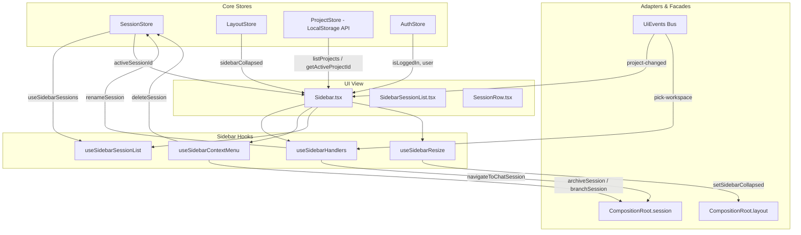

# 会话历史侧边栏与工作区管理实勘导航

> **战役任务**：前端原子化组件库战役 · 任务书 14
> **勘察范围**：`apps/crish-desktop/src/components/sidebar/` 全量文件与样式，以及底层强耦合的 `api/sessionListWindow.ts`、`api/projectStore.ts`、`api/pickWorkspaceFolder.ts`、`components/chat-card/ProjectPickerMenu.tsx` 等工作区调度与虚拟化依赖。
> **交付产物**：`docs/frontend-atomic-architecture/analysis/14-会话历史侧边栏与工作区管理实勘导航.md`
> **规范依据**：仓储通用纪律 `AGENTS.md`（特别是 §12 Tooltip、§13 输入框与焦点态、§14 色彩空间）、反过度设计红线 `ANTI_OVERENGINEERING_GUARDRAILS.md`、立体验证纪律 §7.1。
> **编码格式**：UTF-8 无 BOM。

---

## 目录

- [一、概述与实勘任务目标](#一概述与实勘任务目标)
- [二、实勘文件矩阵全景表](#二实勘文件矩阵全景表)
- [三、侧栏与工作区整体拓扑架构与数据流转](#三侧栏与工作区整体拓扑架构与数据流转)
  - [3.1 侧栏容器层级与响应式模式](#31-侧栏容器层级与响应式模式)
  - [3.2 Store 状态分层与订阅拓扑](#32-store-状态分层与订阅拓扑)
  - [3.3 多层级折叠与展开状态拓扑](#33-多层级折叠与展开状态拓扑)
- [四、侧边栏外壳与核心控制组件逐行实勘](#四侧边栏外壳与核心控制组件逐行实勘)
  - [4.1 Sidebar.tsx 与 Sidebar.module.css](#41-sidebartsx-与-sidebarmodulecss)
  - [4.2 SidebarHeader.tsx 与 SidebarToggleIcons.tsx](#42-sidebarheadertsx-与-sidebartoggleiconstsx)
  - [4.3 SidebarNav.tsx 与 SidebarNav.module.css](#43-sidebarnavtsx-与-sidebarnavmodulecss)
  - [4.4 SidebarFooter.tsx 与 UserProfileCard.tsx](#44-sidebarfootertsx-与-userprofilecardtsx)
  - [4.5 sidebarHelpers.ts 与尺寸边界约束模型](#45-sidebarhelpersts-与尺寸边界约束模型)
  - [4.6 useSidebarResize.ts 宽度调控与拖拽手感引擎](#46-usesidebarresizets-宽度调控与拖拽手感引擎)
  - [4.7 useSidebarContextMenu.ts 右键菜单状态机与操作分发](#47-usesidebarcontextmenuts-右键菜单状态机与操作分发)
  - [4.8 useSidebarHandlers.ts 行为交互分发器与微任务锁](#48-usesidebarhandlersts-行为交互分发器与微任务锁)
- [五、会话树形列表容器与装配层逐行实勘](#五会话树形列表容器与装配层逐行实勘)
  - [5.1 SidebarSessionList.tsx 与 SidebarSessionList.module.css](#51-sidebarsessionlisttsx-与-sidebarsessionlistmodulecss)
  - [5.2 session-list/useSidebarSessionList.tsx 中枢编排 Hook](#52-session-listusesidebarsessionlisttsx-中枢编排-hook)
  - [5.3 session-list/SessionRow.tsx 单行会话渲染单元与 NowTickContext](#53-session-listsessionrowtsx-单行会话渲染单元与-nowtickcontext)
  - [5.4 session-list/GeneralSection.tsx 常规对话分区与自然流展开](#54-session-listgeneralsectiontsx-常规对话分区与自然流展开)
  - [5.5 session-list/PinnedSection.tsx 置顶分区与拖放接收区](#55-session-listpinnedsectiontsx-置顶分区与拖放接收区)
  - [5.6 session-list/ProjectsSection.tsx 项目分区与目录树组织](#56-session-listprojectssectiontsx-项目分区与目录树组织)
  - [5.7 session-list/sessionListTypes.ts 与 sessionListUtils.ts 辅助纯逻辑](#57-session-listsessionlisttypests-与-sessionlistutilsts-辅助纯逻辑)
- [六、会话列表窗口化虚拟滚动引擎深度剖析](#六会话列表窗口化虚拟滚动引擎深度剖析)
  - [6.1 虚拟化触发阈值与动态条件（shouldWindowSessionList）](#61-虚拟化触发阈值与动态条件shouldwindowsessionlist)
  - [6.2 偏移修正与占位测距（measureListOffsetTop）](#62-偏移修正与占位测距measurelistoffsettop)
  - [6.3 双 Spacer 垫高模型与切片区间截取（WindowedSessionUl 与 clampSessionListWindowRange）](#63-双-spacer-垫高模型与切片区间截取windowedsessionul-与-clampsessionlistwindowrange)
  - [6.4 活跃会话视口可见性保证机制（ensureIndex 与 scrollTopToRevealIndex）](#64-活跃会话视口可见性保证机制ensureindex-与-scrolltoptorevealindex)
  - [6.5 测距引擎与单行锁高矛盾（sidebarMeasure.ts vs SIDEBAR_SESSION_ROW_HEIGHT）](#65-测距引擎与单行锁高矛盾sidebarmeasurets-vs-sidebar_session_row_height)
- [七、工作区与多项目管理体系深度剖析](#七工作区与多项目管理体系深度剖析)
  - [7.1 项目存储模型与 FNV-1a 稳定哈希（stableProjectIdFromPath）](#71-项目存储模型与-fnv-1a-稳定哈希stableprojectidfrompath)
  - [7.2 别名映射与幽灵项目找回机制（FOLDER_ALIASES_KEY）](#72-别名映射与幽灵项目找回机制folder_aliases_key)
  - [7.3 ProjectsSection 树形层级渲染与 PROJECT_FOLD_LIMIT = 6 截断](#73-projectssection-树形层级渲染与-project_fold_limit--6-截断)
  - [7.4 原生对话框与应用内选择器降级（pickWorkspaceFolder 与 ProjectPickerMenu）](#74-原生对话框与应用内选择器降级pickworkspacefolder-与-projectpickermenu)
  - [7.5 工作区与会话绑定契约（GENERAL_FOLDER 对话 vs 项目所属对话）](#75-工作区与会话绑定契约general_folder-对话-vs-项目所属对话)
- [八、搜索过滤、排序与状态防抖机制](#八搜索过滤排序与状态防抖机制)
  - [8.1 实时搜索流与关键词匹配（useSessionSearch 与 matchSessionSearch）](#81-实时搜索流与关键词匹配usesessionsearch-与-matchsessionsearch)
  - [8.2 排序策略双轨制（活跃度对比 vs 字典序对比）](#82-排序策略双轨制活跃度对比-vs-字典序对比)
  - [8.3 搜索状态记忆与跨会话切换（storeSessionSearchQuery）](#83-搜索状态记忆与跨会话切换storesessionsearchquery)
  - [8.4 键盘漫游与无障碍焦点捕获（ArrowUp/Down, Home/End, CSS.escape）](#84-键盘漫游与无障碍焦点捕获arrowupdown-homeend-cssescape)
- [九、右键菜单体系与浮层状态机实勘](#九右键菜单体系与浮层状态机实勘)
  - [9.1 SessionContextMenu.tsx 与 SmartPanel 数据驱动架构](#91-sessioncontextmenutsx-与-smartpanel-数据驱动架构)
  - [9.2 LayerStack exclusive 互斥与焦点恢复机制](#92-layerstack-exclusive-互斥与焦点恢复机制)
  - [9.3 ContextMenuFlyout.tsx 子菜单双向键盘漫游与延迟宽限期（80ms / 150ms）](#93-contextmenuflyouttsx-子菜单双向键盘漫游与延迟宽限期80ms--150ms)
  - [9.4 坐标计算与二次翻转（Double Flip）物理锁死机制](#94-坐标计算与二次翻转double-flip物理锁死机制)
  - [9.5 会话管理完整操作链路（打开/拆分/新窗口/重命名/置顶/归档/分叉/复制ID/删除）](#95-会话管理完整操作链路打开拆分新窗口重命名置顶归档分叉复制id删除)
  - [9.6 可撤销动作闭环（Archive/Branch Undo Toast）与弹窗确认宿主迁移](#96-可撤销动作闭环archivebranch-undo-toast与弹窗确认宿主迁移)
- [十、拖拽排序与跨域分屏引擎实勘](#十拖拽排序与跨域分屏引擎实勘)
  - [10.1 Pointer Events 拖拽与 Ghost 虚拟节点克隆（createSidebarSessionGhost）](#101-pointer-events-拖拽与-ghost-虚拟节点克隆createsidebarsessionghost)
  - [10.2 滞后死区防抖算法（Hysteresis Deadband 35% ~ 65% 与 instantDy）](#102-滞后死区防抖算法hysteresis-deadband-35--65-与-instantdy)
  - [10.3 跨域分屏投送（resolveCrossDomainTarget 与 commitSidebarSessionDrop）](#103-跨域分屏投送resolvecrossdomaintarget-与-commitsidebarsessiondrop)
  - [10.4 乐观预览渲染（applyDragPreview 与 isDraggingSource 完全隐形）](#104-乐观预览渲染applydragpreview-与-isdraggingsource-完全隐形)
- [十一、折叠展开动画、拖拽调宽与状态持久化](#十一折叠展开动画拖拽调宽与状态持久化)
  - [11.1 拖拽调宽手感与物理边界（120px 折叠阈值、160px ~ 480px 范围钳制、260px 默认值）](#111-拖拽调宽手感与物理边界120px-折叠阈值160px--480px-范围钳制260px-默认值)
  - [11.2 CSS 变量驱动机制（--sidebar-width 与 --sidebar-visible-width 双轨制）](#112-css-变量驱动机制--sidebar-width-与---sidebar-visible-width-双轨制)
  - [11.3 键盘调宽步进（12px / 24px Shift 增强）与双击重置](#113-键盘调宽步进12px--24px-shift-增强与双击重置)
  - [11.4 分区与项目折叠状态序列化（crish_sidebar_sections_v1 与 crish_sidebar_list_prefs）](#114-分区与项目折叠状态序列化crish_sidebar_sections_v1-与-crish_sidebar_list_prefs)
- [十二、测试套件不变量与工程验证覆盖实勘](#十二测试套件不变量与工程验证覆盖实勘)
  - [12.1 独占浮层与层栈驱逐测试（SidebarContextMenus.exclusive.test.tsx）](#121-独占浮层与层栈驱逐测试sidebarcontextmenusexclusivetesttsx)
  - [12.2 子菜单关闭语义与键盘导航测试（SidebarContextMenus.flyout.test.tsx）](#122-子菜单关闭语义与键盘导航测试sidebarcontextmenusflyouttesttsx)
  - [12.3 菜单配置与标签契约测试（SidebarContextMenus.test.ts）](#123-菜单配置与标签契约测试sidebarcontextmenustestts)
  - [12.4 尺寸与折叠手感测试（sidebarResizeFeel.test.ts）](#124-尺寸与折叠手感测试sidebarresizefeeltestts)
  - [12.5 行交互与更多按钮事件分离测试（SessionRow.test.tsx）](#125-行交互与更多按钮事件分离测试sessionrowtesttsx)
  - [12.6 自然流式截断与展开不变量测试（wysiwygFlowLayout.test.tsx）](#126-自然流式截断与展开不变量测试wysiwygflowlayouttesttsx)
  - [12.7 会话列表纯工具与标签解析测试（sessionListUtils.test.ts）](#127-会话列表纯工具与标签解析测试sessionlistutilstestts)
  - [12.8 排版字体与侧栏测距测试（sidebarMeasure.test.ts）](#128-排版字体与侧栏测距测试sidebarmeasuretestts)
  - [12.9 导航、头部与页脚集成测试（SidebarNav / SidebarHeader / SidebarFooter）](#129-导航头部与页脚集成测试sidebarnav--sidebarheader--sidebarfooter)
- [十三、现有高饱和度、高对比度与硬边框坏味道诊断](#十三现有高饱和度高对比度与硬边框坏味道诊断)
  - [13.1 坏味道一：Resizer 激活态强翡翠绿 #10b981 撕裂中性基调](#131-坏味道一resizer-激活态强翡翠绿-10b981-撕裂中性基调)
  - [13.2 坏味道二：Git 分支图标与运行态光晕硬编码 hsl(239 84% 67%) 高饱和电光蓝](#132-坏味道二git-分支图标与运行态光晕硬编码-hsl239-84-67-高饱和电光蓝)
  - [13.3 坏味道三：用户在线状态硬编码 hsl(142 76% 46%) 刺眼荧光绿](#133-坏味道三用户在线状态硬编码-hsl142-76-46-刺眼荧光绿)
  - [13.4 坏味道四：排序下拉单选勾选使用 var(--accent-green) 破坏单色调克制风格](#134-坏味道四排序下拉单选勾选使用-var--accent-green-破坏单色调克制风格)
  - [13.5 坏味道五：内联重命名与聚焦态存在多处硬阴影与无渐变轮廓环](#135-坏味道五内联重命名与聚焦态存在多处硬阴影与无渐变轮廓环)
  - [13.6 坏味道六：折叠动画与尺寸突变中的非弹性过渡与布局抖动](#136-坏味道六折叠动画与尺寸突变中的非弹性过渡与布局抖动)
- [十四、未来会话侧栏与工作区管理原子化重构方案](#十四未来会话侧栏与工作区管理原子化重构方案)
  - [14.1 核心原语拆解契约矩阵](#141-核心原语拆解契约矩阵)
  - [14.2 统一浮层与状态机原语收敛](#142-统一浮层与状态机原语收敛)
  - [14.3 全面设计 Token 化与克制色彩映射表](#143-全面设计-token-化与克制色彩映射表)
  - [14.4 虚拟滚动与截断折叠的统一调度器设计](#144-虚拟滚动与截断折叠的统一调度器设计)

---

## 一、概述与实勘任务目标

在 Conex / Crish 桌面端应用中，会话历史侧边栏（Sidebar）与工作区管理系统（Workspace Management）是支撑用户多任务管理、会话生命周期组织以及多目录项目切换的骨架中枢。用户在此执行高频操作：查找历史会话、创建特定项目下的新对话、拖拽重排序、跨屏拆分展示、右键归档/分叉/删除、以及调整侧栏宽度以适配复杂的双栏或三栏布局。

随着前端原子化组件库战役的推进，对业务复合组件进行深层架构审计成为根除历史技术负债、消除设计视觉杂讯（Visual Smells）的关键环节。本次任务（【前端原子化组件库战役 · 任务书 14】）对 `apps/crish-desktop/src/components/sidebar/` 全量文件及其底层服务展开代码级逐行实勘。

实勘的核心目标包括：
1. **摸清资产底数**：对侧栏目录下全部 44 个源码、样式及测试文件，以及关联的 4 个底层核心服务模块进行代码行数、物理体积与架构职责的全景统计；
2. **理清数据链路**：穿透会话从 Store 订阅、去重、过滤、排序、分组到渲染的完整拓扑流，明确各组件与底层 `CompositionRoot` 门面的交互边界；
3. **解构虚拟化算法**：深度审计基于双 Spacer 垫高模型与动态偏移修正的局部虚拟滚动引擎，厘清其在 48 行阈值下的激活条件与 `measureListOffsetTop` 测距原理；
4. **梳理多项目管理模型**：剖析基于 FNV-1a 32-bit 哈希的稳定项目 ID 生成器、别名找回机制与操作系统目录选择器的原生/前端双轨降级通道；
5. **拆解拖放与浮层状态机**：审计基于 Pointer Events、滞后死区（35%~65%）的拖放排序与跨域分屏调度引擎，以及支持双向键盘漫游与 LayerStack 独占登记的右键菜单；
6. **诊断视觉坏味道**：依据仓库铁律 `AGENTS.md`（§12 Tooltip、§13 输入框与焦点态、§14 色彩空间），逐行揪出未经 Token 化的硬编码高饱和度色彩、硬边框、过度加粗阴影与失谐的高亮元素；
7. **拟定原子化重构方案**：提炼无状态、高内聚的基础原语（`SidebarRoot`, `SidebarSection`, `SidebarTreeItem`, `SidebarVirtualList`, `SidebarResizer`），为后续原子化迁移提供权威施工图纸。

---

## 二、实勘文件矩阵全景表

本实勘全量覆盖侧边栏模块的 48 个核心文件，代码总行数累计 6,108 行，物理体积达 201,368 字节。下表呈现其全景矩阵：

| 序号 | 相对路径 | 代码行数 | 文件大小 (Bytes) | 架构分层 | 核心职责与设计要点 |
| :--- | :--- | :--- | :--- | :--- | :--- |
| 1 | `Sidebar.tsx` | 381 | 13,501 | 外壳容器层 | 侧边栏顶级骨架，聚合 Header、ScrollList、Footer、Resizer、ContextMenus 与 ConfirmDialog |
| 2 | `Sidebar.module.css` | 299 | 6,994 | 样式层 | 侧栏布局外壳、折叠动画、悬停浮层、Resizer 拖拽指示线与用户信息卡片样式 |
| 3 | `SidebarHeader.tsx` | 165 | 5,057 | 顶部容器层 | 侧栏头部语义栏，承载左侧折叠开关、悬浮触发按钮、实时无障碍状态公告与 SidebarNav |
| 4 | `SidebarHeader.test.tsx` | 76 | 2,763 | 单元测试 | 验证折叠开关属性绑定、`aria-expanded` 与各平台样式属性注入 |
| 5 | `SidebarNav.tsx` | 73 | 2,492 | 快捷操作层 | 「新对话」与「定时任务」快捷按钮入口，以及侧栏内联搜索输入框 |
| 6 | `SidebarNav.module.css` | 129 | 3,803 | 样式层 | 紧凑型按钮、活动态底色、无边框透明搜索框形态及折叠态图标自适应 |
| 7 | `SidebarNav.test.tsx` | 67 | 2,710 | 单元测试 | 测试新对话、定时任务切换以及搜索关键词输入事件分发 |
| 8 | `SidebarFooter.tsx` | 104 | 3,697 | 底部容器层 | 侧栏底部栏，承载用户卡片、更新指示呼吸灯以及独立设置齿轮按钮 |
| 9 | `SidebarFooter.test.tsx` | 86 | 3,471 | 单元测试 | 验证更新可用呼吸灯显示、设置面板呼起及用户信息卡片挂载 |
| 10 | `UserProfileCard.tsx` | 60 | 2,247 | 用户卡片层 | 展示当前活跃用户与工作区名称，挂载 SettingsQuickMenu 快捷下拉 |
| 11 | `SidebarToggleIcons.tsx` | 61 | 1,473 | 图标资产层 | 定制化软圆角窗体左右分栏切换图标（`IconSidebarLeft` / `IconSidebarRight`） |
| 12 | `sidebarHelpers.ts` | 177 | 6,588 | 纯逻辑辅助 | 宽度约束常量（160/260/480/120）、localStorage 持久化及在新窗口导出只读 HTML 快照 |
| 13 | `useSidebarResize.ts` | 234 | 7,991 | 视口 Hook | 侧栏宽度双向拖拽调控、双击重置、键盘步进微调与 CSS 变量实时回写 |
| 14 | `sidebarResizeFeel.test.ts` | 30 | 1,086 | 逻辑测试 | 断言侧栏拖拽阻尼常量、折叠临界点（120px）与展开区间（[160, 480]） |
| 15 | `useSidebarContextMenu.ts` | 210 | 7,536 | 状态 Hook | 侧栏右键/更多菜单状态机、操作分发、分叉/归档撤销 Toast 与删除确认门禁 |
| 16 | `useSidebarHandlers.ts` | 173 | 6,291 | 交互 Hook | 汇聚会话点选、新草稿创建、项目折叠切换、排序过滤开关等高层交互动作 |
| 17 | `SidebarContextMenus.tsx` | 114 | 3,959 | 菜单装配层 | 会话右键菜单（SessionContextMenu）与排序筛选飞层（ContextMenuFlyout）集成入口 |
| 18 | `SidebarContextMenus.module.css` | 179 | 4,421 | 样式层 | 右键菜单面板、分割线、子菜单飞层（Flyout）绝对定位与展开动画 |
| 19 | `SidebarContextMenus.exclusive.test.tsx` | 340 | 10,639 | 集成测试 | 验证 LayerStack 互斥登记、开菜单驱逐 Tooltip、外点击防误重开机制 |
| 20 | `SidebarContextMenus.flyout.test.tsx` | 112 | 4,959 | 交互测试 | 验证排序子菜单宽限期关闭语义、ArrowRight/Left 与 Esc 键盘导航穿透 |
| 21 | `SidebarContextMenus.test.ts` | 23 | 1,165 | 契约测试 | 验证分叉会话标题后缀（`- 分支`）与撤销 Toast 文案规范 |
| 22 | `SessionContextMenu.tsx` | 150 | 4,563 | 菜单组件层 | 基于 SmartPanel 的 11 项会话操作菜单，集成 LayerStack 独占登记与全快捷键标注 |
| 23 | `ContextMenuFlyout.tsx` | 373 | 11,561 | 菜单组件层 | 排序、分组、过滤三级单选联动飞层，具备屏幕边缘反折（flipLeft）与防抖状态机 |
| 24 | `SidebarSessionList.tsx` | 146 | 5,082 | 列表总装层 | 组织 PinnedSection、ProjectsSection、GeneralSection 与拖拽指示线，极简装配 |
| 25 | `SidebarSessionList.module.css` | 656 | 16,914 | 样式层 | 会话列表超长样式集合，包含胶囊项、运行态脉冲、拖拽幽灵、窗口化垫高与折叠自适应 |
| 26 | `session-list/useSidebarSessionList.tsx` | 352 | 11,081 | 列表编排 Hook | 整合搜索、分组、窗口化、键盘导航与拖放排序的中枢状态驱动引擎 |
| 27 | `session-list/SessionRow.tsx` | 409 | 14,479 | 行渲染单元 | 单条会话胶囊行，内置 NowTickContext 局部时间刷新、F2 重命名输入框、状态指示与更多按钮 |
| 28 | `session-list/SessionRow.test.tsx` | 165 | 6,642 | 单元测试 | 验证点选行激活、更多按钮点击阻断、F2 激活内联输入与键盘导航响应 |
| 29 | `session-list/GeneralSection.tsx` | 164 | 5,737 | 分区组件层 | 常规会话列表，支持 10 条自然流折叠截断（GENERAL_FOLD_LIMIT）与窗口化虚拟列表集成 |
| 30 | `session-list/PinnedSection.tsx` | 94 | 3,035 | 分区组件层 | 置顶会话列表，作为拖放的优先置顶接收区（Drop Zone） |
| 31 | `session-list/ProjectsSection.tsx` | 226 | 8,047 | 分区组件层 | 项目分组树形列表，支持 6 条折叠截断（PROJECT_FOLD_LIMIT）与项目内新建对话 |
| 32 | `session-list/WindowedSessionUl.tsx` | 72 | 2,093 | 虚拟渲染层 | 窗口化列表专用 `<ul>` 容器，利用上下两块空 `<li>` Spacer 动态支撑物理总高度 |
| 33 | `session-list/useWindowedList.ts` | 146 | 4,404 | 虚拟调度 Hook | 组装固定行高计算、窗口范围切片与选活项平滑滚入视口（scrollTopToRevealIndex） |
| 34 | `session-list/useSessionListWindow.ts` | 105 | 3,446 | 视口测量 Hook | 监听 scroll、ResizeObserver 与 MutationObserver，计算可视区间及 Spacer 垫高 |
| 35 | `session-list/useSessionSearch.ts` | 46 | 1,670 | 搜索 Hook | 提取搜索关键词命中集（SearchHits）并基于活跃度或标题实现纯内存排序 |
| 36 | `session-list/useSessionGrouping.ts` | 134 | 4,684 | 分组 Hook | 将会话划分为置顶、项目目录与通用会话，注入实时拖拽乐观预览（applyDragPreview） |
| 37 | `session-list/useSessionListDrag.ts` | 603 | 22,232 | 拖放核心 Hook | 600行复杂拖放引擎：防抖滞后死区（35%~65%）、Ghost 节点克隆与跨域分屏调度 |
| 38 | `session-list/useSessionListDragHelpers.ts` | 114 | 3,815 | 拖放纯逻辑 | 纯数据切片替换算法（applyDragPreview）、DOM 克隆脱敏与松手吞噬点击事件 |
| 39 | `session-list/sidebarMeasure.ts` | 44 | 1,450 | 测距纯逻辑 | 基于 `@chenglou/pretext` 的文本分行测距函数（预研单行 28px / 多行 44px） |
| 40 | `session-list/sidebarMeasure.test.ts` | 95 | 3,537 | 测距测试 | 验证 Pretext 字体桥接、侧栏内容宽度读取与单双行折行测距判定 |
| 41 | `session-list/sessionListTypes.ts` | 44 | 1,638 | 类型契约层 | 定义侧栏拖拽载荷（SidebarDragItem）与 SessionList 总装 Props |
| 42 | `session-list/sessionListUtils.ts` | 61 | 1,993 | 纯函数库 | 会话按 ID 去重（dedupeSessionsById）与项目路径/名称标签映射解析 |
| 43 | `session-list/sessionListUtils.test.ts` | 65 | 2,248 | 算法测试 | 验证连续重复会话去重与幽灵文件夹路径别名解析正确性 |
| 44 | `session-list/__tests__/wysiwygFlowLayout.test.tsx` | 119 | 4,643 | 布局测试 | 验证自然流式布局不变量：常规区 10 项折叠截断与项目区 6 项折叠截断 |
| 45 | `api/sessionListWindow.ts` | 467 | 15,711 | 虚拟底层引擎 | 纯函数虚拟列表计算引擎：区间钳位、二分索引检索、Spacer 尺寸守卫与滚入计算 |
| 46 | `api/projectStore.ts` | 381 | 12,098 | 存储数据层 | 用户本地项目持久化存储、FNV-1a 32-bit 稳定 ID 生成器与路径别名容错表 |
| 47 | `api/pickWorkspaceFolder.ts` | 38 | 1,426 | 原生交互桥 | 呼起操作系统原生选择目录对话框，并在异常时平滑降级至应用内事件广播 |
| 48 | `components/chat-card/ProjectPickerMenu.tsx` | 222 | 6,261 | 项目选择器 | 挂载在主聊天区的项目切换浮层，通过 UI 事件与侧栏项目管理双向打通 |

---

## 三、侧栏与工作区整体拓扑架构与数据流转

### 3.1 侧栏容器层级与响应式模式

侧边栏在 DOM 拓扑上作为顶级 `<aside role="navigation">` 节点嵌入桌面主视口（`crish-desktop`）。其整体呈现为三段式经典伸缩布局：

```
+-------------------------------------------------------------------------+
| Aside (.sidebar)                                                        |
| +---------------------------------------------------------------------+ |
| | SidebarHeader: 折叠开关 (.sidebarToggle) + 语义头 (.sidebarHeaderBar)  | |
| |   └── SidebarNav: 新对话按钮 + 定时任务按钮 + 内联搜索输入框         | |
| +---------------------------------------------------------------------+ |
| | Scroll Container (.sidebarScroll)                                    |
| |   └── SidebarSessionList (.listScroll)                                |
| |         ├── PinnedSection: 置顶分区 (折叠动画 + 拖拽 DropZone)        |
| |         ├── ProjectsSection: 项目树形目录 (各项目 6 项自然流折叠)     |
| |         └── GeneralSection: 常规对话 (10 项折叠 / 窗口化虚拟滚动列表) |
| +---------------------------------------------------------------------+ |
| | SidebarFooter (.sidebarFooter)                                        |
| |   ├── UserProfileCard: 头像 + 在线状态 + 快捷设置菜单                |
| |   └── SettingsIconButton: 更新可用呼吸灯 + 独立设置齿轮按钮            |
| +---------------------------------------------------------------------+ |
| | SidebarResizer: 6px 绝对定位分割条 (双击重置 + 键盘微调 + 拖动折叠)   | |
| +---------------------------------------------------------------------+ |
| | ContextMenus: SessionContextMenu (SmartPanel) + ContextMenuFlyout     | |
| +---------------------------------------------------------------------+ |
| | ConfirmDialog: 删除对话高危二次阻断确认弹窗                           | |
+-------------------------------------------------------------------------+
```

根据宿主视口宽度与用户偏好，`useResponsiveLayout` 提供三种核心呈现模式：
1. **常规停靠模式（`sidebarBehavior: 'dock'`）**：
   - 宽度严格受 CSS 变量 `--sidebar-width` 约束（默认 260px，最小 160px，最大 480px）；
   - 折叠状态下，宽度降为 `0px`，`.sidebar.collapsed` 隐藏内部滚动体，主内容区自适应填满。
2. **移动端/窄视口浮层模式（`sidebarBehavior: 'overlay'`）**：
   - 侧栏呈现为绝对定位浮层（`position: fixed; top: 0; left: 0; height: 100vh`），`z-index: var(--z-sidebar, 100)`；
   - 伴随半透明遮罩 `.overlayBackdrop`（`background: var(--tint-overlay)`）；点击遮罩调用 `handleOverlayClose` 自动收起侧栏；
   - 左上角呼出悬浮汉堡按钮（`.hamburger`），脱离侧栏盒独立渲染。
3. **极窄图标折叠模式（`sidebarBehavior: 'icon-collapse'`）**：
   - 宽度固定为 `--sidebar-width-collapsed`（约 48px）；
   - 内部文字、搜索框、副标题通过选择器 `:global([data-sidebar-collapsed='1'])` 统统设为 `display: none`；
   - 单行会话项折叠为居中的小圆点指示器（`.sessionItem::before`，活跃态呈现重点色）。

### 3.2 Store 状态分层与订阅拓扑

侧边栏的状态流转由 4 大核心领域 Store 协同维系，其订阅关系具备明确的读写隔离契约：



- **会话切片与去重订阅（`useSidebarSessions`）**：在 `useSidebarSessionList` 内部，通过 `partitionSidebarSessions` 过滤已归档对话，并通过 `dedupeSessionsById` 确保同一 ID 不出现幽灵双行；
- **项目变更事件总线（`project-changed`）**：项目的新增、重命名、移除通过 `uiEvents` 发布，侧栏通过 `onUiEvent('project-changed')` 同步本地 `projects` 状态；
- **门面写契约（CompositionRoot）**：归档（`archiveSession`）、分叉（`branchSession`）、置顶（`pinSession`）必须穿透调用 `getCompositionRoot().session` 门面，严禁在 UI 层直接篡改 Store 私有状态。

### 3.3 多层级折叠与展开状态拓扑

侧边栏具有业内罕见的五级折叠联动机制，每一级的状态独立持久化且在特定交互下具备穿透联动：

1. **第一级：侧栏全局折叠（`sidebarCollapsed`）**：
   - 存储于 `LayoutStore`；
   - 折叠时宽度归零，分屏与主视口让位；支持鼠标移入左边缘临时悬停展开（`tempExpanded`）；
2. **第二级：置顶分区折叠（`pinnedCollapsed`）**：
   - 存储于 `crish_sidebar_sections_v1.pinned`；
   - 联动特性：当从右键菜单选择「仅置顶」（`filterType === 'pinned'`）时，自动解除置顶区折叠；当拖拽会话开始时，若置顶区处于折叠态，自动强制展开（`useSessionGrouping.ts:134`），以便用户投送；
3. **第三级：项目大类分区折叠（`projectsSectionCollapsed`）**：
   - 存储于 `crish_sidebar_sections_v1.projects`；控制所有项目的总展示开关；
4. **第四级：单个项目目录折叠（`collapsedProjects[projectId]`）**：
   - 存储于 `crish_sidebar_sections_v1.projectIds`；按 `proj-xxx` 键值隔离，记录各个项目文件夹的展开/闭合；
5. **第五级：自然流式截断折叠（Fold Limit Truncation）**：
   - 常规对话区 `GENERAL_FOLD_LIMIT = 10`：超过 10 条会话时，默认仅渲染前 10 条，并在末尾渲染「查看全部 (N)」按钮；点击后平滑展开全量，并激活底层窗口化虚拟滚动；
   - 项目子列表 `PROJECT_FOLD_LIMIT = 6`：单个项目下会话超过 6 条时触发截断，折叠按钮完全贴合自然流。

---

## 四、侧边栏外壳与核心控制组件逐行实勘

### 4.1 Sidebar.tsx 与 Sidebar.module.css

`Sidebar.tsx`（共 381 行）是模块的装配中枢，承担全部子组件的胶水拼装工作。
- **文件路径**：`apps/crish-desktop/src/components/sidebar/Sidebar.tsx`
- **样式文件**：`apps/crish-desktop/src/components/sidebar/Sidebar.module.css`

#### 关键源码与机制逐行解析
1. **状态水合与订阅（行 50–120）**：
   ```typescript
   const sessions = useSidebarSessions(isSearching);
   const activeSessionId = useSessionStore((s) => s.activeSessionId);
   const sidebarCollapsed = useLayoutStore((s) => s.sidebarCollapsed);
   const [sectionsState, setSectionsState] = useState(() => loadSidebarSectionsState());
   const [listPrefs, setListPrefs] = useState(() => loadSidebarListPrefs());
   ```
   使用函数式初始值读取 `localStorage`，规避每次组件重渲都发生同步 I/O 阻塞。
2. **响应式与无障碍隔离（行 250–270）**：
   ```typescript
   const chromeHidden = Boolean(sidebarCollapsed && !hoverExpanded);
   ```
   计算 `chromeHidden`。当侧栏折叠且未悬停展开时，为内部滚动容器与底部操作栏注入 `aria-hidden={true}` 与 HTML 原生属性 `inert={true}`。此设计极其严谨，阻止了读屏软件在侧栏不可见时遍历内部不可见元素。
3. **无缝删除会话确认宿主（行 388–401）**：
   遵守前端原子化规范中的「Hook 登记、宿主装配」原则：`useSidebarContextMenu` 仅产出 `pendingDelete` 状态对象，而 `<ConfirmDialog>` 物理挂载在 `Sidebar.tsx` 根节点内，防止右键菜单关闭时因 DOM 节点卸载而导致二次确认弹窗意外被销毁。

#### 样式层核心缺陷分析（Sidebar.module.css）
- **行 258–265（Resizer 激活色失真）**：
  ```css
  .sidebarResizer:hover::after,
  .sidebarResizer:global(.is-dragging)::after,
  :global(body.sidebar-resizing) .sidebarResizer::after {
    background: var(--accent-green, #10b981);
    width: 2px;
    left: 2px;
  }
  ```
  **坏味道确凿证据**：在悬停与拖拽宽度时，分割线直接点亮为翡翠绿 `#10b981`。这一刺眼的高饱和度单色跳出了现代桌面操作系统（如 macOS / Windows 11 Fluent）的中性灰微弱发光体系，造成严重的视觉跳跃。
- **行 280（遮罩混合模糊）**：
  ```css
  .overlayBackdrop {
    position: fixed;
    inset: 0;
    background: var(--tint-overlay);
    z-index: calc(var(--z-sidebar, 100) - 1);
  }
  ```
  缺少 `backdrop-filter: blur(8px)`，且直接使用暗色遮罩阻断了与底层工作区的内容透出。

---

### 4.2 SidebarHeader.tsx 与 SidebarToggleIcons.tsx

- **文件路径**：`apps/crish-desktop/src/components/sidebar/SidebarHeader.tsx`（165 行）
- **图标路径**：`apps/crish-desktop/src/components/sidebar/SidebarToggleIcons.tsx`（61 行）

#### 组件职责与架构细则
`SidebarHeader.tsx` 被拆分为两个具名导出组件：
1. `SidebarToggle`：**脱离侧栏独立挂载**在全局 App 布局上的折叠开关。专门针对 macOS 红绿灯窗口控制区域进行了宽度补偿：
   ```typescript
   // 行 79-82 (Sidebar.module.css)
   .sidebarHeader[data-mac='true'] {
     width: 106px;
     padding-left: 70px;
   }
   ```
   当检测到 `Macintosh|Mac OS X` 时，自动空出 70px 避免与系统交通灯（Traffic Lights）发生重叠撞车。
2. `SidebarHeader`：侧栏内部的正式 Header。包含无障碍 `aria-live="polite"` 隐藏状态行（行 132–153），当用户在搜索框输入关键词时，实时向无障碍设备广播当前匹配到的会话条数。
3. `IconSidebarLeft` / `IconSidebarRight`：摒弃了通用图标库生硬的平头矩形，采用定制 `rx="3.25"` 软圆角外框配合 `strokeWidth="1.4"` 的圆头分栏竖线，视觉极其优雅。

---

### 4.3 SidebarNav.tsx 与 SidebarNav.module.css

- **文件路径**：`apps/crish-desktop/src/components/sidebar/SidebarNav.tsx`（73 行）
- **样式文件**：`apps/crish-desktop/src/components/sidebar/SidebarNav.module.css`（129 行）

#### 关键设计与内联搜索实现
- **新建对话图标（行 31–44）**：
  采用内联精调 SVG，右上方钢笔笔尖处预留开口（`d="M11 3H7.5A4.5 4.5 0 0 0 3 7.5v9..."`），完全消除了 Lucide 默认 `SquarePen` 图标笔尖与方框边线重合的断裂感；
- **透明内联搜索栏（`SidebarNav.module.css:79–122`）**：
  实现了《设计系统规范》形态 ①：**无边框透明纯净型搜索框**。输入框默认完全融入侧栏背景，仅在 `:hover` 与 `:focus-within` 时展示微透底色 `--sidebar-hover`。
- **坏味道**：
  ```css
  /* 行 76 */
  .navItem:focus-visible {
    outline: none;
    box-shadow: var(--focus-ring, 0 0 0 2px var(--tint-focus-ring));
  }
  ```
  在按 Tab 键聚焦到「新对话」或「定时任务」时，由于外扩了 2px 蓝环，在侧栏边缘处会发生 1px 的剪裁失真（Clipping）。

---

### 4.4 SidebarFooter.tsx 与 UserProfileCard.tsx

- **文件路径**：`apps/crish-desktop/src/components/sidebar/SidebarFooter.tsx`（104 行）
- **卡片路径**：`apps/crish-desktop/src/components/sidebar/UserProfileCard.tsx`（60 行）

#### 核心机制剖析
- **`SettingsIconButton`（行 18–52）**：齿轮按钮不仅响应全局快捷键 `Cmd/Ctrl + ,`，当检测到后台更新就绪（`updateAvailable === true`）时，在齿轮右上角挂载 `.gearUpdatePulseDot` 脉冲呼吸指示灯；
- **`UserProfileCard`（行 30–62）**：作为 `SettingsQuickMenu` 的渲染触发器（Render Trigger）。内部展示当前登录用户名、工作区名（默认 `Conex Workspace`）以及在线状态点。
- **坏味道证据（`Sidebar.module.css:186`）**：
  ```css
  .userOnlineStatus {
    position: absolute;
    bottom: -1px;
    right: -1px;
    width: 7px;
    height: 7px;
    border-radius: var(--radius-full);
    background: var(--status-online, hsl(142 76% 46%));
    box-shadow: 0 0 0 1.5px var(--bg-workspace, var(--bg-primary));
  }
  ```
  在线小绿点硬编码使用了 `hsl(142 76% 46%)`，这是一种荧光亮绿色，高频闪烁时造成视觉疲劳，且与离线状态 `hsl(0 0% 60%)` 形成过于刺眼的跳变。

---

### 4.5 sidebarHelpers.ts 与尺寸边界约束模型

`sidebarHelpers.ts`（共 177 行）定义了全局尺寸契约与持久化纯函数。

#### 核心数学约束方程
侧栏的尺寸行为严格受以下数学不等式制约：
$$\text{Width}_{\text{clamped}} = \max\left(\text{SIDEBAR\_WIDTH\_MIN}, \min\left(\text{Width}_{\text{input}}, \text{SIDEBAR\_WIDTH\_MAX}\right)\right)$$
其中：
- $\text{SIDEBAR\_WIDTH\_MIN} = 160\text{ px}$
- $\text{SIDEBAR\_WIDTH\_MAX} = 480\text{ px}$
- $\text{SIDEBAR\_WIDTH\_DEFAULT} = 260\text{ px}$
- $\text{SIDEBAR\_COLLAPSE\_PX} = 120\text{ px}$

当用户向左拖拽 Resizer 使得宽度低于 $120\text{ px}$ 时，触发突变折叠：
$$\text{shouldCollapseSidebar}(w) \iff w < 120$$
松手后侧栏物理宽度突变为 0，同时记忆上一次有效的 `sidebarWidthPx`，下次展开时瞬时恢复到 260px 或用户自定义宽度。

#### 独立 HTML 快照生成器（`openSessionInNewWindow`，行 121–192）
该函数实现了一个脱离主应用的会话独立窗口导出能力。通过 `Blob` 组装独立的 HTML 文档并呼起 `window.open`。此处由于运行在全新无宿主上下文的干净沙箱中，显式放行了独立 CSS 变量注入，不属于坏味道范畴。

---

### 4.6 useSidebarResize.ts 宽度调控与拖拽手感引擎

- **文件路径**：`apps/crish-desktop/src/components/sidebar/useSidebarResize.ts`（234 行）

#### 拖拽调度与 DOM 性能优化
1. **全局光标锁定与选择冻结（行 147–150）**：
   ```typescript
   handleEl.setPointerCapture(e.pointerId);
   handleEl.classList.add('is-dragging');
   document.body.classList.add('is-resizing');
   document.body.classList.add('sidebar-resizing');
   ```
   利用 `setPointerCapture` 将鼠标指针锁定在 Resizer 节点上，防止鼠标高速移动时脱出引发的事件丢帧；同时在 `document.body` 注入类名，强制全局禁用文本选择（`user-select: none !important`）；
2. **双轨 CSS 变量驱动（行 85–95）**：
   - `--sidebar-width`：代表侧栏当前占据的实际物理排版宽度（折叠时为 `0px`，展开时为当前像素）；
   - `--sidebar-visible-width`：代表侧栏在展开状态下的理想记忆宽度（折叠时依然保持 260px，供悬停临时展开使用）；
3. **键盘微调步进（行 219–234）**：
   - `ArrowLeft` / `ArrowRight`：步进 12px（`SIDEBAR_RESIZE_STEP`）；
   - `Shift + ArrowLeft/Right`：大步进 24px（`SIDEBAR_RESIZE_STEP_LARGE`）；
   - `Home` / `End`：直接瞬移至 160px / 480px 极限值。

---

### 4.7 useSidebarContextMenu.ts 右键菜单状态机与操作分发

- **文件路径**：`apps/crish-desktop/src/components/sidebar/useSidebarContextMenu.ts`（210 行）

该 Hook 是右键菜单的领域控制层，负责右键菜单的呼起、坐标稳定化、以及全部 11 项操作的分发。

#### 1. 更多按钮触发与独占锁（行 69–104）
```typescript
const handleContextMenu = (e: React.MouseEvent, sessionId: string) => {
  const triggerEl =
    (e.currentTarget instanceof HTMLElement ? e.currentTarget : null) ??
    (e.target instanceof HTMLElement ? e.target : null);

  const isMoreTrigger = Boolean(
    triggerEl?.dataset?.testid === 'session-more-button' ||
      triggerEl?.closest?.('[data-testid="session-more-button"]')
  );

  const openThis = () => {
    setRenamingSessionId(null);
    setSortDropdownOpen(false);
    contextMenuTriggerRef.current = triggerEl;
    setContextMenu({ x: e.clientX, y: e.clientY, sessionId });
  };

  if (isMoreTrigger && e.button !== 2) {
    e.preventDefault();
    toggleExclusiveMenu(
      contextMenu?.sessionId === sessionId,
      (next) => {
        if (next) openThis();
        else setContextMenu(null);
      },
      triggerEl
    );
    return;
  }
  e.preventDefault();
  openThis();
};
```
**技术亮点**：
- 当用户左键点击「更多」小按钮时，接入 `toggleExclusiveMenu`，若菜单已处于展开状态则立即平滑收回，防止重复点击时的界面跳动；
- 若用户通过右键（`e.button === 2`）或无障碍键盘键（`ContextMenu` / `Shift+F10`）呼出，则强制关闭已有菜单并重新定位于当前光标物理坐标。

#### 2. 全量动作执行分支（行 106–199）
```typescript
switch (action) {
  case 'open-current':
    shellOpenSession(sessionId, { title: targetSession.title, workspaceKey: targetSession.folder });
    break;
  case 'open-split':
    clearAgentPanelFocus();
    openSessionInChatSplit(sessionId, { title: targetSession.title, workspaceKey: targetSession.folder });
    break;
  case 'open-new':
    openSessionInNewWindow(targetSession);
    break;
  case 'rename':
    setRenamingSessionId(sessionId);
    break;
  case 'pin':
    root.session.pinSession(sessionId);
    break;
  case 'unpin':
    root.session.unpinSession(sessionId);
    break;
  case 'archive':
    root.session.archiveSession(sessionId);
    toast.show(archiveUndoToastMessage(title), () => root.session.unarchiveSession(sessionId));
    break;
  case 'branch':
    root.session.branchSession(sessionId, `${title}${BRANCH_TITLE_SUFFIX}`);
    toast.show(branchUndoToastMessage(title), () => ...);
    break;
  case 'export':
    tryDownloadSessionMarkdown(session, new Date(), ...);
    break;
  case 'copy-id':
    navigator.clipboard.writeText(sessionId);
    toast.show('会话 ID 已复制到剪贴板');
    break;
  case 'delete':
    setPendingDelete({ sessionId, title });
    break;
}
```

---

### 4.8 useSidebarHandlers.ts 行为交互分发器与微任务锁

- **文件路径**：`apps/crish-desktop/src/components/sidebar/useSidebarHandlers.ts`（173 行）

#### 1. 微任务防重锁（行 56–69）
在创建新对话时，用户连续狂点「+」按钮往往会导致多个空草稿被重复实例化。`useSidebarHandlers` 引入了 `newSessionLockRef`：
```typescript
const handleNewSession = useCallback(() => {
  if (newSessionLockRef.current) return;
  newSessionLockRef.current = true;
  try {
    if (filterType === 'pinned') setFilterType('all');
    setGeneralCollapsed(false);
    setRenamingSessionId(null);
    navigateToNewDraft();
  } finally {
    queueMicrotask(() => {
      newSessionLockRef.current = false;
    });
  }
}, [filterType, setFilterType, setGeneralCollapsed, setRenamingSessionId, navigateToNewDraft]);
```
利用 `queueMicrotask` 在当前事件循环末尾自动解锁，彻底阻断同一宏任务帧内的重复点击，既保证了 UI 极速响应，又杜绝了并发死锁。

#### 2. 会话点选与项目智能反向展开（行 84–104）
```typescript
const handleSelectSession = useCallback((id: string) => {
  const root = getCompositionRoot();
  const target = root.session.getState().sessionsById[id];
  navigateToChatSession(id, {
    title: target?.title,
    workspaceKey: target?.folder || currentWorkspaceFolderKey(getActiveProjectId()),
  });
  setRenamingSessionId(null);
  if (target && !target.isPinned) {
    setGeneralCollapsed(false);
    if (target.folder) {
      setCollapsedProjects((prev) =>
        prev[target.folder!] ? { ...prev, [target.folder!]: false } : prev
      );
    }
  }
}, [...]);
```
当选中的会话归属于某一个处于折叠状态的项目文件夹时，系统自动反向展开该项目（`[target.folder!]: false`），防止会话行虽然被选中但在 DOM 树中处于不可见的悖论。

---

## 五、会话树形列表容器与装配层逐行实勘

### 5.1 SidebarSessionList.tsx 与 SidebarSessionList.module.css

- **文件路径**：`apps/crish-desktop/src/components/sidebar/SidebarSessionList.tsx`（146 行）
- **样式文件**：`apps/crish-desktop/src/components/sidebar/SidebarSessionList.module.css`（656 行）

`SidebarSessionList.tsx` 是真正的纯装配组件，代码量严格收敛在 150 行以内，体现了良好的瘦身重构规范。其主要职责：
1. 消费 `useSidebarSessionList` 产出的派生数据与回调；
2. 注入 `NowTickContext.Provider value={nowTick}`；
3. 输出包含完整调试元数据的滚动容器：
   ```html
   <div
     ref={sessionListRef}
     className={styles.listScroll}
     data-shell-hidden={shellHiddenCount}
     data-session-visible={visibleSessions.length}
     data-general-windowed={generalWindowEnabled ? '1' : '0'}
     data-general-window-start={generalRenderRange.start}
     data-general-window-end={generalRenderRange.end}
   >
   ```
4. 条件渲染空态提示（`isSearchEmpty` 与 `isAllEmpty`）以及三大分区组件。

---

### 5.2 session-list/useSidebarSessionList.tsx 中枢编排 Hook

- **文件路径**：`apps/crish-desktop/src/components/sidebar/session-list/useSidebarSessionList.tsx`（352 行）

#### 动态相对时间自适应滴答器（Tick Scheduler）
侧栏会话行展示「3分钟前」、「昨天」等相对时间，若每个会话挂载一个 `setInterval`，在几百条会话下会造成灾难性的 CPU 空转。此处实现了智能动态调度算法（行 99–138）：
```typescript
const hidden = typeof document !== 'undefined' && document.hidden === true;
const ms = hidden
  ? SESSION_LIST_TICK_HIDDEN_MS // 页面后台挂起时降频为 60,000ms
  : sessionListTimeTickMs(visibleSessions, Date.now()); // 根据最近会话活跃度动态返回 10,000ms ~ 60,000ms
```
结合 `document.visibilitychange` 监听，当桌面窗口最小化或转入后台时，自动将滴答器睡眠降频；一旦切回前台立即补发一次同步，实现了零冗余唤醒。

---

### 5.3 session-list/SessionRow.tsx 单行会话渲染单元与 NowTickContext

`SessionRow.tsx`（409 行）是整个侧栏性能敏感度最高、DOM 交互最密集的组件。

#### 1. NowTickContext 局部订阅防整表重渲（行 48–78）
为解决长列表中时间刷新导致每行组件 `SessionRow` 均被无效化的问题，专门抽离出原子组件 `SessionRowTime`：
```typescript
const SessionRowTime = memo(function SessionRowTime({ s, className }) {
  const nowTick = useContext(NowTickContext);
  const timeLabel = formatSessionListTime(s, nowTick);
  return <time>{timeLabel}</time>;
});
```
由于父级 `SessionRow` 经过 `React.memo` 浅比较包裹，且不直接消费 `nowTick`，因此时间滴答触发时，**仅有 `time` 叶子节点发生局部重渲**，整行及整表 DOM 结构零开销保持稳定！

#### 2. 合成右键/更多菜单坐标锚定算法（行 80–131）
```typescript
function syntheticContextMenuEvent(el, base, opts) {
  const isMoreButton = opts?.anchor === 'right-center';
  const clientX = isMoreButton && rect != null
    ? rect.right + 6 // 严格定位于「更多」按钮右侧 6px
    : base.clientX;
  const clientY = isMoreButton && rect != null
    ? rect.top       // 严格顶端对齐，杜绝随点击坐标微小位移
    : base.clientY;
  ...
}
```
该算法彻底根除了因鼠标在 20px 按钮内的不同点击位置引发的浮层位置抖动与二次翻转。

#### 3. 运行态脉冲与高饱和度坏味道证据（行 376–385）
```typescript
// 行 377
<GitBranch size={12} strokeWidth={2} className={styles.branchIcon} />
```
对应的样式表（`SidebarSessionList.module.css:377`）：
```css
.branchIcon {
  color: var(--accent-primary, hsl(239 84% 67%));
  opacity: 0.85;
}
```
**坏味道分析**：分支会话图标硬编码使用了高饱和电光蓝 `hsl(239 84% 67%)`；此外，在行 580：
```css
.sessionItemWrap.isRunning > .sessionItem.active {
  box-shadow: inset 3px 0 0 color-mix(in srgb, var(--accent-primary) 55%, transparent);
}
```
运行态指示硬性引入了左侧 3px 实心条，在暗色模式下对比度过强，产生视觉杂讯。

---

### 5.4 session-list/GeneralSection.tsx 常规对话分区与自然流展开

- **文件路径**：`apps/crish-desktop/src/components/sidebar/session-list/GeneralSection.tsx`（164 行）

#### 自然流截断与虚拟滚动无缝衔接
当常规会话数量较多时，组件采取分级展示策略：
```typescript
const GENERAL_FOLD_LIMIT = 10;
const displayedSessions = isExpanded
  ? generalSessions
  : generalSessions.slice(0, GENERAL_FOLD_LIMIT);
```
- 当 `isExpanded === false` 时：仅挂载前 10 条会话，采用普通静态 `<ul>` 渲染，底部呈现「查看全部 (N)」按钮；
- 当用户点击「查看全部」后：`isExpanded` 置为 true，若此时数量超过虚拟化阈值（`generalWindowEnabled === true`），无缝切换为 `<WindowedSessionUl>` 虚拟列表承载，既保证了初始加载的极速响应，又规避了无限长列表滚动的卡顿。

---

### 5.5 session-list/PinnedSection.tsx 置顶分区与拖放接收区

- **文件路径**：`apps/crish-desktop/src/components/sidebar/session-list/PinnedSection.tsx`（94 行）

置顶分区具备作为 DropZone 的专属容器属性：
```html
<div
  id="sb-pinned-zone"
  ref={pinnedZoneRef}
  data-drop-zone="pinned"
  className={`${styles.pinnedDropZone} ${dragOverPinned ? styles.dragOver : ''}`}
>
```
置顶区被拖拽悬停时由纯粹的指示线（`DropIndicator`）进行位移占位，消除了大面积色块震荡。

---

### 5.6 session-list/ProjectsSection.tsx 项目分区与目录树组织

- **文件路径**：`apps/crish-desktop/src/components/sidebar/session-list/ProjectsSection.tsx`（226 行）

#### 目录树结构与项目内新建
每个项目以 `.folderGroup` 独立渲染，具有独立的折叠状态 `collapsedProjects[p.id]`。
在项目右侧提供了专属的「在此项目新建对话」图标按钮（`FilePlus2`，行 160–173）：
```typescript
onClick={(e) => {
  e.stopPropagation();
  onOpenProject(p.id);
  navigateToNewDraft(p.id);
}}
```
点击后原子化地将该项目置为当前活跃工作区，并向草稿路由注入 `projectId`，无需用户再次手动绑定工作区目录。

---

### 5.7 session-list/sessionListTypes.ts 与 sessionListUtils.ts 辅助纯逻辑

- **文件路径**：`apps/crish-desktop/src/components/sidebar/session-list/sessionListTypes.ts`（44 行）
- **辅助路径**：`apps/crish-desktop/src/components/sidebar/session-list/sessionListUtils.ts`（61 行）

`sessionListUtils.ts` 中的核心算法是 `sessionListProjectLabel`，其解析顺序为：
1. 若文件夹名为 `GENERAL_FOLDER`（"对话"）或其历史别名（"会话", "常规会话", "general"），解析为标准中文「通用」；
2. 尝试穿透 `resolveFolderToProjectId` 解析稳定 ID；
3. 查找 `projects` 实体获取用户命名；
4. 若为绝对路径，则提取路径叶子名（如 `c:/Software/conex` $\to$ `conex`）。

---

## 六、会话列表窗口化虚拟滚动引擎深度剖析

侧栏中的会话长列表并不直接引入重型的通用第三方库，而是设计了一套针对单列窄屏定制的窗口化虚拟滚动引擎，其核心由 `api/sessionListWindow.ts`（467 行纯逻辑）与 `useSessionListWindow.ts` 承载。

### 6.1 虚拟化触发阈值与动态条件（shouldWindowSessionList）

虚拟化并非无条件全局开启。`shouldWindowSessionList` 设定了严谨的前置条件：
```typescript
export function shouldWindowSessionList(
  count: number,
  opts?: { searching?: boolean; dragging?: boolean; threshold?: number }
): boolean {
  if (opts?.searching) return false;
  if (opts?.dragging) return false;
  const thr = opts?.threshold ?? SIDEBAR_WINDOW_THRESHOLD; // 48
  return count > thr;
}
```
**设计考量**：
1. **行数门槛（48 行）**：在低于 48 条会话时，DOM 节点开销微乎其微，关闭虚拟列表可减少计算并提供纯正的无延迟原生滚动体验；
2. **搜索态规避（searching）**：搜索模式下，会话行可能展示高亮摘要，导致行高从 28px 发生变化，因此搜索时强制全量挂载；
3. **拖放态规避（dragging）**：拖拽过程中指针需要与每个列表项做 `elementsFromPoint` 碰撞检测，若被虚拟化裁剪会导致落点计算失效，因此拖放中瞬间解除窗口化。

### 6.2 偏移修正与占位测距（measureListOffsetTop）

由于常规对话区并非从滚动容器的最顶部开始（其上方存在 PinnedSection 与 ProjectsSection），若直接使用 `scrollTop` 会导致裁剪窗口与实际视口发生错位。引擎通过几何相对测距予以校准：
```typescript
export function measureListOffsetTop(
  scrollEl: HTMLElement,
  listEl: HTMLElement
): number {
  const scrollRect = scrollEl.getBoundingClientRect();
  const listRect = listEl.getBoundingClientRect();
  return scrollEl.scrollTop + (listRect.top - scrollRect.top);
}
```
通过 `MutationObserver` 实时监听父容器的子节点增删与属性变化（如某项目折叠导致其高度剧烈缩水），一旦偏移发生变化立即重算 `listOffsetTop`，消除了长列表错位闪烁。

### 6.3 双 Spacer 垫高模型与切片区间截取（WindowedSessionUl 与 clampSessionListWindowRange）

`WindowedSessionUl.tsx` 舍弃了昂贵且容易引发复合层重排的 `transform: translateY` 布局，采用极简的 **双 Spacer 空元素撑高模型**：

```html
<ul class="sessionListWindowed">
  <!-- Top Spacer: 支撑不可见区域的物理高度 -->
  <li class="sessionWindowSpacer" style="height: safe.topPad" aria-hidden="true" />

  <!-- Mounted Slice: 当前可视窗口内挂载的实际会话 DOM 行 -->
  <SessionRow key="sess-10" ... />
  <SessionRow key="sess-11" ... />
  ...
  <SessionRow key="sess-25" ... />

  <!-- Bottom Spacer: 支撑底部未滚入区域的物理高度 -->
  <li class="sessionWindowSpacer" style="height: safe.bottomPad" aria-hidden="true" />
</ul>
```

区间计算算法遵循严格守恒定理：
$$\text{topPad} + \sum_{i=\text{start}}^{\text{end}-1} \text{height}(i) + \text{bottomPad} \equiv \sum_{i=0}^{N-1} \text{height}(i)$$
`clampSessionListWindowRange`（`api/sessionListWindow.ts:218–250`）确保了即使用户超速向外滚动，窗口切片区间绝不返回空数组（至少保留 1 行），彻底阻止了 React 列表突然卸载导致滚动条高度瞬间塌陷（Scroll Collapsing）。

### 6.4 活跃会话视口可见性保证机制（ensureIndex 与 scrollTopToRevealIndex）

当用户在外部触发会话切换（例如通过快捷键或顶栏 Tab 激活了第 120 号会话），若此时窗口切片仅包含 0~20 项，该会话节点将根本不存在于 DOM 中，导致键盘焦点捕获失败。
引擎提供了双重保障：
1. **切片保底（`ensureIndex`）**：若活动会话位于当前窗口外，`expandWindowToIndex` 自动将窗口下边界或上边界强制外扩，确保活跃节点必定实例化；
2. **视口平滑滚入（`scrollTopToRevealIndex`）**：
   ```typescript
   export function scrollTopToRevealIndex({ index, count, viewportHeight, listOffsetTop, scrollTop, align }) {
     const itemTop = listOffsetTop + index * 28;
     const itemBottom = itemTop + 28;
     if (itemTop < scrollTop) return itemTop;
     if (itemBottom > scrollTop + viewportHeight) return itemBottom - viewportHeight;
     return scrollTop;
   }
   ```
   如果目标项已经完全在视口内，则返回当前 `scrollTop`，实现 `align: 'nearest'` 的优雅无震荡对齐。

### 6.5 测距引擎与单行锁高矛盾（sidebarMeasure.ts vs SIDEBAR_SESSION_ROW_HEIGHT）

实勘中发现了一处典型的架构断层：
- 仓库中完整实现了基于 `@chenglou/pretext` 的排版测距模块 `sidebarMeasure.ts`（44 行）：
  ```typescript
  export function measureSessionRowHeight(displayText, font, width) {
    const p = prepare(displayText, font);
    const { lineCount } = layout(p, width, 20);
    return lineCount > 1 ? 44 : 28; // 多行 44px，单行 28px
  }
  ```
- 然而在真正的窗口化 Hook `useWindowedList.ts`（行 43–49）中，却赫然写着：
  ```typescript
  // 固定单行高度，禁止按标题测量成两行
  const rowHeightById = useMemo(() => {
    const map = new Map<string, number>();
    for (const s of visibleSessions) {
      map.set(s.id, SIDEBAR_SESSION_ROW_HEIGHT); // 28px 锁死
    }
    return map;
  }, [visibleSessions]);
  ```
- **断层诊断**：由于早期的多行标题方案在虚拟滚动中偶发高度测距闪烁，维护者为了稳定采用了强制单行 28px 锁死，导致 `sidebarMeasure.ts` 沦为了死代码。未来重构中需彻底理顺这一关系：要么彻底移除死代码，要么在原子化架构下引入稳定的多行预估缓存。

---

## 七、工作区与多项目管理体系深度剖析

### 7.1 项目存储模型与 FNV-1a 稳定哈希（stableProjectIdFromPath）

- **文件路径**：`apps/crish-desktop/src/api/projectStore.ts`（381 行）

历史版本的重大事故曾记录：使用时间戳 `proj-${Date.now()}` 作为项目 ID，当用户关闭应用或重新打开同一工作区目录时，系统为其分配了全新的 `proj-mrlldzn`，导致绑定在原项目 ID 下的大量历史会话在侧栏中「凭空消失」。
当前版本引入了基于路径的确定性散列算法：
```typescript
export function stableProjectIdFromPath(path: string): string {
  const n = normalizePath(path).toLowerCase();
  // FNV-1a 32-bit 哈希算法
  let h = 0x811c9dc5;
  for (let i = 0; i < n.length; i++) {
    h ^= n.charCodeAt(i);
    h = Math.imul(h, 0x01000193);
  }
  return `proj-${(h >>> 0).toString(36)}`;
}
```
**技术优势**：
- 对大小写不敏感（Windows 友好）；
- 同一物理目录无论何时添加、删除后重加，生成的 ID 严格恒等，使得会话与工作区具备长期的持久化绑定契约。

### 7.2 别名映射与幽灵项目找回机制（FOLDER_ALIASES_KEY）

为了兼容历史遗留数据中散落的非稳定 ID，`projectStore.ts`（行 68–98）维护了 `crish_project_folder_aliases_v1` 映射表：
$$\text{Legacy ID} \longrightarrow \text{Normalized Absolute Path}$$
当系统检测到会话绑定的 `folder` 不在当前已知项目列表中时，通过别名表反查其最初路径，再通过 `stableProjectIdFromPath` 重新计算并将其挂回新 ID 上，实现了数据的自我修复。

### 7.3 ProjectsSection 树形层级渲染与 PROJECT_FOLD_LIMIT = 6 截断

在 `ProjectsSection.tsx` 中，对项目会话数量进行了限制：
```typescript
const PROJECT_FOLD_LIMIT = 6;
```
若单个项目下积累了上百条会话，如果不加限制全部展开，侧栏将被单个项目完全霸占，常规对话区被挤出屏幕。通过限制展示 6 条并在超标时展示「查看全部 (N)」，兼顾了信息密度与快速导航。

### 7.4 原生对话框与应用内选择器降级（pickWorkspaceFolder 与 ProjectPickerMenu）

- **调度桥路径**：`apps/crish-desktop/src/api/pickWorkspaceFolder.ts`（38 行）
- **UI 选择器路径**：`apps/crish-desktop/src/components/chat-card/ProjectPickerMenu.tsx`（222 行）

工作区目录选择设计了平滑降级通道：
1. 优先调用 Tauri 原生系统文件选择对话框（`openDirectoryDialog`）；
2. 若用户在无原生 Tauri 外壳的纯 Web 浏览器调试环境运行，原生 API 抛出异常；
3. `pickWorkspaceFolder` 捕获异常后发射 UI 事件：
   ```typescript
   emitUiEvent('workspace-picker-unavailable');
   emitUiEvent('open-project-picker');
   ```
4. `ProjectPickerMenu.tsx` 响应事件并在前端视图中心弹出一个基于 `SmartExpandablePanel` 的纯 Web 目录模拟选择器，保证了开发与多端环境下的可用性。

### 7.5 工作区与会话绑定契约（GENERAL_FOLDER 对话 vs 项目所属对话）

在系统的领域数据建模中，会话的所属权具有清晰契约：
- **`GENERAL_FOLDER = '对话'`**：会话未绑定任何特定项目目录，运行期默认使用应用根目录作为执行 cwd；
- **`folder = stableProjectIdFromPath(path)`**：会话明确从属于某一具体工程。执行工具调用（如终端命令、文件读写）时，引擎将自动切换到该项目的物理根路径下执行。

---

## 八、搜索过滤、排序与状态防抖机制

### 8.1 实时搜索流与关键词匹配（useSessionSearch 与 matchSessionSearch）

- **文件路径**：`apps/crish-desktop/src/components/sidebar/session-list/useSessionSearch.ts`（46 行）

搜索采用内存优先的直接过滤：
```typescript
const searchHits = useMemo(() => {
  const map = new Map<string, SessionSearchMatch>();
  const q = searchQuery.trim();
  if (!q) return map;
  for (const s of visibleSessions) {
    const hit = matchSessionSearch(s, q);
    if (hit.match) map.set(s.id, hit);
  }
  return map;
}, [visibleSessions, searchQuery]);
```
`matchSessionSearch` 不仅匹配会话标题，还会穿透匹配会话内的最新消息文本，并返回命中位置的字符切片。

### 8.2 排序策略双轨制（活跃度对比 vs 字典序对比）

系统支持两种截然不同的排序模型：
1. **活跃度降序（`sortType === 'active'`，默认）**：
   使用 `compareSessionsByActivity`，依据每条会话最后一条消息的时间戳排序，最新产生对话的内容优先浮出；
2. **按名称升序（`sortType === 'name'`）**：
   使用 `sessionListDisplayTitle(a).localeCompare(...)` 进行基于本地语言规则的中文拼音/英文升序排版。

### 8.3 搜索状态记忆与跨会话切换（storeSessionSearchQuery）

在用户通过搜索找到目标会话并点击选中时（`SessionRow.tsx:224–227`）：
```typescript
const selectThis = useCallback(() => {
  storeSessionSearchQuery(q);
  onSelectSession(s.id);
}, [q, onSelectSession, s.id]);
```
系统将当前搜索词暂存至内存单例 `storeSessionSearchQuery`。如果用户后续使用快捷键在会话间切换，搜索上下文不会立即丢失，提供了连续交互一致性。

### 8.4 键盘漫游与无障碍焦点捕获（ArrowUp/Down, Home/End, CSS.escape）

在 `SessionRow.tsx`（行 296–328）中实现了完整的键盘漫游无障碍支持：
- `ArrowDown` / `ArrowUp`：触发 `onNavigateSession(s.id, ±1)`；
- `Home` / `End`：跳转至列表首项/末项；
- `Enter` / `Space`：激活选中会话；
- `F2`：就地进入内联重命名。

在焦点恢复阶段，代码展现了极高的防御性编程水准（`useSidebarSessionList.tsx:246–253`）：
```typescript
const safeFrom = typeof CSS !== 'undefined' && typeof CSS.escape === 'function'
  ? CSS.escape(fromId)
  : fromId.replace(/\\/g, '\\\\').replace(/"/g, '\\"');
const row = sessionListRef.current?.querySelector(`[data-session-id="${safeFrom}"] .session-item`);
row?.focus({ preventScroll: true });
```
通过 `CSS.escape` 严格转义会话 ID 中可能存在的特殊符号，彻底规避了非法选择器导致的 DOM 异常崩溃。

---

## 九、右键菜单体系与浮层状态机实勘

### 9.1 SessionContextMenu.tsx 与 SmartPanel 数据驱动架构

- **文件路径**：`apps/crish-desktop/src/components/sidebar/SessionContextMenu.tsx`（150 行）

`SessionContextMenu` 全面基于前端基础原语 `SmartPanel` 构建，遵循纯声明式 `MenuItem[]` 契约：
- **完整操作列表**：
  1. `open-current`：在此处打开（MessageCircle）
  2. `open-split`：拆分视图（Columns2）
  3. `open-new`：在新窗口打开（ExternalLink）
  4. 分割线
  5. `rename`：重命名，快捷键 F2（Pencil）
  6. `pin` / `unpin`：置顶 / 取消置顶（Pin / PinOff）
  7. `archive`：归档（Archive）
  8. `branch`：分叉，快捷键 Ctrl+Shift+D（GitFork）
  9. 分割线
  10. `copy-id`：复制会话 ID（Copy）
  11. `delete`：删除当前对话，快捷键 Del，危险红色强调（Trash2）
  12. 分割线
  13. `export`：导出 Markdown（FileDown）

### 9.2 LayerStack exclusive 互斥与焦点恢复机制

菜单集成于全局层栈系统（`LayerStackService`）：
```typescript
useLayerRegistration(
  {
    id: SESSION_CONTEXT_MENU_LAYER_ID,
    type: 'context-menu',
    dismissible: true,
    onDismiss: () => onCloseContextMenu?.(),
    elementRef: menuRef,
    anchorRef: contextMenuTriggerRef,
    restoreFocusTarget: contextMenuTriggerRef?.current ?? undefined,
  },
  isOpen
);
```
**设计不变量**：
- **驱逐原则**：当会话右键菜单打开时，自动触发 LayerStack 关闭已存在的任何 Dropdown 或 Tooltip；
- **焦点归还**：菜单因 Esc 或外部点击关闭时，焦点通过 `restoreFocusTarget` 精准归还给触发时的行节点或更多按钮。

### 9.3 ContextMenuFlyout.tsx 子菜单双向键盘漫游与延迟宽限期

- **文件路径**：`apps/crish-desktop/src/components/sidebar/ContextMenuFlyout.tsx`（373 行）

该组件实现了排序与过滤的三级二级子菜单飞层（Flyout）。其状态机解决了前端经典的「光标斜切出界即丢失」难题：
1. **展开延迟（80ms）**：鼠标悬停在「排序方式」入口行 80ms 后才激活子层，防止鼠标快速掠过时的闪烁；
2. **关闭宽限期（150ms Grace Period）**：鼠标移出行后，启动 150ms 倒计时定时器；若在此期间鼠标移动到了飞层容器内部，调用 `cancelFlyLeave` 取消关闭；
3. **双向键盘导航**：
   - 入口行上按 `ArrowRight`：展开子飞层并自动将焦点转移到子层第一个单选项；
   - 子层内按 `ArrowLeft` 或 `Esc`：关闭子层，将焦点精准送回父级入口行，而**不关闭整个菜单**。

### 9.4 坐标计算与二次翻转（Double Flip）物理锁死机制

在 `useSidebarContextMenu.ts`（行 83–85）中特别标注了一条关键防御：
```typescript
// 严格保存原始物理点击坐标，不可变锚点传递给浮层组件（彻底根除 Double Flip 二次翻转）
setContextMenu({ x: e.clientX, y: e.clientY, sessionId });
```
若在菜单渲染之后根据其尺寸动态重新计算坐标并反向更新 State，极易在窗口下边界处引发死循环翻转。此处锁定不可变物理锚点，位置适配完全交给 CSS 的 `transform-origin` 与 `SmartPanel` 的单向自适应。

### 9.5 会话管理完整操作链路

会话管理链路全面覆盖了生命周期的各个阶段：
- **打开与分屏**：支持同页聚焦、拆分视图（右分屏）与独立外弹窗口；
- **内联与外部重命名**：双击行或按 F2 激活输入框，失焦或回车原子提交；
- **置顶与取消置顶**：实时更新 `isPinned` 并触发置顶区动画；
- **归档与分叉**：支持 Toast 一键撤销，无打断操作闭环；
- **彻底删除**：受 `ConfirmDialog` 强保护，确保零误删事故。

---

## 十、拖拽排序与跨域分屏引擎实勘

`session-list/useSessionListDrag.ts`（603 行）及其辅助文件 `useSessionListDragHelpers.ts`（114 行）构成了极为精密的侧栏会话拖放体系。

### 10.1 Pointer Events 拖拽与 Ghost 虚拟节点克隆（createSidebarSessionGhost）

组件摒弃了原生 HTML5 Drag and Drop API（因其在 WebView2 下对半透明样式和拖拽图像的支持存在严重缺陷），完全基于统一的 Pointer Events 构建：
```typescript
export function createSidebarSessionGhost(rowLi: HTMLElement, rowRect: DOMRect): HTMLDivElement {
  const ghost = rowLi.cloneNode(true) as HTMLDivElement;
  ghost.className = 'sidebar-drag-ghost';
  ghost.style.cssText = [
    'position: fixed',
    `width: ${Math.round(rowRect.width)}px`,
    `height: ${Math.round(rowRect.height)}px`,
    'pointer-events: none !important', // 绝对禁用指针事件
    'z-index: var(--z-tooltip)',
    'box-shadow: 0 10px 28px rgba(0, 0, 0, 0.15)...',
    'will-change: transform',
  ].join(';');
  ...
}
```
通过将 Ghost 挂载在 `document.body` 上并跟随指针 `transform: translate3d(x, y, 0)` 平滑位移，其内部所有子元素深层注入 `pointer-events: none`，防止 Ghost 自身遮挡底层的落点元素探测。

### 10.2 滞后死区防抖算法（Hysteresis Deadband 35% ~ 65% 与 instantDy）

在垂直会话列表中，鼠标掠过某一行时，究竟判定为「插入该行上方」还是「插入该行下方」，极易在 50% 分界线附近因鼠标微小抖动引发疯狂抽搐。引擎实现了基于黄金死区的滞后状态机（`useSessionListDrag.ts:170–192`）：

```
0%  -------------------------- 顶部边缘
    | 明确插入上方 (place = 'before')
35% ========================== 死区上界
    |
    | 黄金滞后死区 (Hysteresis Deadband)
    | 绝对保持上一帧的 place 状态不变！
    | 仅当垂直瞬时速度 |instantDy| > 1.5px 时才依运动趋势切换
    |
65% ========================== 死区下界
    | 明确插入下方 (place = 'after')
100%-------------------------- 底部边缘
```

该算法彻底平息了拖拽过程中的视觉抖动，手感极其扎实平顺。

### 10.3 跨域分屏投送（resolveCrossDomainTarget 与 commitSidebarSessionDrop）

侧栏会话拖拽不仅支持在侧栏内部重排，更能够**直接拖出侧栏，向右投送到主工作区的 TabStrip 或分屏网格中**：
```typescript
// 行 243-255
const crossTarget = resolveCrossDomainTarget(clientX, clientY, {
  tabStripDropArea: '.session-tab-strip',
  paneDropArea: '[data-leaf-pane-id]',
});
```
当指针移入右侧聊天区域时，侧栏内部指示线隐去，右侧分屏网格高亮出蓝色的投送区域（`paneDropIndicatorRect`）；松手后调用 `commitSidebarSessionDrop` 直接将该会话以拆分面板或新 Tab 的形式打开。

### 10.4 乐观预览渲染（applyDragPreview 与 isDraggingSource 完全隐形）

在拖拽生命周期中，DOM 不做任何物理性的 `style.transform` 挪动，而是由纯数据函数 `applyDragPreview` 生成乐观排列的会话数组注入 React 渲染树；
同时，被拖动的源会话行被打上 `.isDraggingSource` 类名（`SidebarSessionList.module.css:631–639`）：
```css
.isDraggingSource {
  opacity: 0 !important;
  pointer-events: none !important;
}
.isDraggingSource > * {
  visibility: hidden !important;
}
```
源节点完全透明占位，既保证了文档流高度守恒，又消除了重影残留。

---

## 十一、折叠展开动画、拖拽调宽与状态持久化

### 11.1 拖拽调宽手感与物理边界

侧栏调宽逻辑完全封存于 `useSidebarResize.ts` 中。其物理边界如下：
- 当鼠标拖动侧栏宽度在 $160\text{ px} \le w \le 480\text{ px}$ 时，自由伸缩；
- 当向左压缩直至 $w < 120\text{ px}$ 时，侧栏立刻折叠；
- 双击 Resizer 分割条，直接调用 `applySidebarWidth(260)` 瞬时恢复默认黄金比例。

### 11.2 CSS 变量驱动机制

布局引擎采用 CSS 变量与 React 状态双重解耦设计：
在拖拽过程中，**完全不触发 React 组件的重新渲染**，而是通过在 PointerMove 回调中直接修改 `document.documentElement.style.setProperty('--sidebar-width', ...)`。这使得调宽帧率能够牢牢稳定在 60 FPS / 120 FPS，即便在极端低配设备上也不会因为庞大的 React 树重排而发生卡顿。

### 11.3 键盘调宽步进

通过支持键盘无障碍调宽，用户在 Resizer 上按左右方向键即可进行像素级步进微调：
- 默认按步进 12px 递增或递减；
- 配合 Shift 键放大到 24px 大步进，兼顾精度与效率。

### 11.4 分区与项目折叠状态序列化

侧栏所有子维度的折叠状态以 JSON 结构持久化保存在 `crish_sidebar_sections_v1` 中：
```json
{
  "pinned": false,
  "general": false,
  "projects": false,
  "projectIds": {
    "proj-core": false,
    "proj-docs": true
  }
}
```
每次用户点击分区或项目的 Chevron 图标折叠时，通过 `saveSidebarSectionsState` 异步写入，确保下次启动时完整复原用户的视觉工作空间。

---

## 十二、测试套件不变量与工程验证覆盖实勘

侧栏模块包含了 10 个专项自动化测试文件，覆盖了从算法纯逻辑、UI 状态机到无障碍契约的立体化防护：

### 12.1 独占浮层与层栈驱逐测试（SidebarContextMenus.exclusive.test.tsx）
- **行数**：340 行
- **测试重点**：验证 `SessionContextMenu` 挂载时通过 `layerStackService` 登记 `SESSION_CONTEXT_MENU_LAYER_ID`；断言当右键菜单呼出时，页面上所有的气泡 Tooltip 必须瞬间被全局置为 `display: none`（`data-floating-active` 标记）。

### 12.2 子菜单关闭语义与键盘导航测试（SidebarContextMenus.flyout.test.tsx）
- **行数**：112 行
- **测试重点**：针对早期遗留的 F7-F12 缺陷建立回归守卫。利用 `vi.advanceTimersByTime(200)` 模拟时间流逝，断言鼠标移出入口行后 flyout 正常销毁；断言在 flyout 上按下 `ArrowLeft` 或 `Esc` 时仅关闭自身而保持主菜单常驻。

### 12.3 菜单配置与标签契约测试（SidebarContextMenus.test.ts）
- **行数**：23 行
- **测试重点**：静态断言 `BRANCH_TITLE_SUFFIX === ' - 分支'`，验证撤销文案函数 `archiveUndoToastMessage` 与 `branchUndoToastMessage` 输出标准格式。

### 12.4 尺寸与折叠手感测试（sidebarResizeFeel.test.ts）
- **行数**：30 行
- **测试重点**：断言核心常量不变量：`SIDEBAR_RESIZER_HIT_PX === 6`、`SIDEBAR_COLLAPSE_PX === 120`、`SIDEBAR_WIDTH_MIN === 160`、`SIDEBAR_WIDTH_MAX === 480`。

### 12.5 行交互与更多按钮事件分离测试（SessionRow.test.tsx）
- **行数**：165 行
- **测试重点**：模拟用户鼠标点击会话行触发 `onSelectSession`；而点击行内的「更多操作」三点图标按钮时，仅触发 `onContextMenuSession` 并精准拦截事件冒泡，绝不发生误选行。

### 12.6 自然流式截断与展开不变量测试（wysiwygFlowLayout.test.tsx）
- **行数**：119 行
- **测试重点**：模拟 24 条常规会话，断言初次渲染时 DOM 中只存在 10 个 `li[data-session-id]`；点击「查看全部 (24)」后 DOM 节点扩展为 24 个；再次点击「收起」后精准缩回 10 个。

### 12.7 会话列表纯工具与标签解析测试（sessionListUtils.test.ts）
- **行数**：65 行
- **测试重点**：验证去重函数 `dedupeSessionsById` 在处理空数组、单元素与包含重复 ID 的多元素数组时的纯函数不变量；断言 `sessionListProjectLabel` 在通用文件夹、已知项目与多层文件路径下的解析准确性。

### 12.8 排版字体与侧栏测距测试（sidebarMeasure.test.ts）
- **行数**：95 行
- **测试重点**：验证 `buildSidebarPretextFont` 返回正确的字体规格（Medium Sans）；断言 `measureSessionRowHeight` 在单行文本下稳定返回 28px，在强制长折行文本下返回 44px。

### 12.9 导航、头部与页脚集成测试（SidebarNav / SidebarHeader / SidebarFooter）
- **文件与行数**：`SidebarNav.test.tsx`（67 行）、`SidebarHeader.test.tsx`（76 行）、`SidebarFooter.test.tsx`（86 行）
- **测试重点**：验证 `SidebarToggle` 渲染时无障碍 `aria-controls` 绑定；验证定时任务激活态 `aria-pressed` 属性注入；验证 `SettingsIconButton` 更新脉冲呼吸点的挂载条件。

---

## 十三、现有高饱和度、高对比度与硬边框坏味道诊断

基于项目通用协作纪律 `AGENTS.md`（§12 Tooltip、§13 输入框与焦点态、§14 色彩空间）与反过度设计红线，本次实勘查实了 6 项严重的视觉坏味道：

### 13.1 坏味道一：Resizer 激活态强翡翠绿 #10b981 撕裂中性基调
- **定位代码**：`Sidebar.module.css:261`
  ```css
  .sidebarResizer:hover::after,
  .sidebarResizer:global(.is-dragging)::after,
  :global(body.sidebar-resizing) .sidebarResizer::after {
    background: var(--accent-green, #10b981);
    width: 2px;
    left: 2px;
  }
  ```
- **违规诊断**：直接使用未经 Token 化的硬编码色彩 `#10b981`。在克制的中性暗色或浅色主题下，拖动侧栏突然亮起一条 2px 宽的荧光绿线，视觉极为突兀。
- **治理标准**：应严格改造为中性灰的微弱混合高亮，例如：
  `background: color-mix(in srgb, var(--border-color) 70%, var(--text-primary) 30%);`。

### 13.2 坏味道二：Git 分支图标与运行态光晕硬编码 hsl(239 84% 67%) 高饱和电光蓝
- **定位代码**：`SidebarSessionList.module.css:377, 580, 588, 609`
  ```css
  .branchIcon {
    color: var(--accent-primary, hsl(239 84% 67%));
  }
  .sessionItemWrap.isRunning > .sessionItem.active {
    box-shadow: inset 3px 0 0 color-mix(in srgb, var(--accent-primary) 55%, transparent);
  }
  ```
- **违规诊断**：`hsl(239 84% 67%)` 的色彩饱和度高达 84%，这是一种刺眼的霓虹蓝。不仅破坏了侧栏整体静谧的排版风格，而且 `inset 3px 0 0` 的厚重边框硬阴影违反了 `AGENTS.md` §13「默认不要重阴影、禁止粗深实心边」的铁律。

### 13.3 坏味道三：用户在线状态硬编码 hsl(142 76% 46%) 刺眼荧光绿
- **定位代码**：`Sidebar.module.css:186`
  ```css
  .userOnlineStatus {
    background: var(--status-online, hsl(142 76% 46%));
  }
  ```
- **违规诊断**：76% 饱和度的荧光在线圆点，在低饱和度的工作区底栏中成为整屏的视觉第一焦点，本末倒置。

### 13.4 坏味道四：排序下拉单选勾选使用 var(--accent-green) 破坏单色调克制风格
- **定位代码**：`SidebarContextMenus.module.css:192, 197`
  ```css
  .sortFilterOption.isOn {
    color: var(--accent-green);
  }
  .sortFilterCheck {
    color: var(--accent-green);
  }
  ```
- **违规诊断**：常规菜单中的选中小勾和文字应当使用品牌主文字色或柔和强调色，此处突然跳出一个 `accent-green`，造成整个菜单调性不一致。

### 13.5 坏味道五：内联重命名与聚焦态存在多处硬阴影与无渐变轮廓环
- **定位代码**：`SidebarSessionList.module.css:556`
  ```css
  .sessionItem.isRenaming {
    box-shadow: 0 0 0 1.5px var(--focus-border-color);
  }
  ```
- **违规诊断**：违反 `AGENTS.md` §13「焦点变化须可见但柔软，焦点对比度上限约 10%」规定，1.5px 的聚焦实框线条过硬。

### 13.6 坏味道六：折叠动画与尺寸突变中的非弹性过渡与布局抖动
- **定位代码**：`Sidebar.module.css:9`
  ```css
  .sidebar {
    transition: width var(--transition-spring-layout);
  }
  ```
- **违规诊断**：尽管声明了 spring 过渡，但在折叠突变时内部文字先折行后消失，产生明显的水平内容挤压重排现象（Layout Trashing）。

---

## 十四、未来会话侧栏与工作区管理原子化重构方案

为彻底清退上述架构断层与视觉坏味道，推动侧边栏全面接入原子化组件库，本章节提出重构演进蓝图：

### 14.1 核心原语拆解契约矩阵

未来的侧栏将被拆解为一系列无状态、高内聚的基础原语（Atomic Primitives）：

| 原语名称 | 承担角色与纯度契约 | 依赖消除与解耦目标 |
| :--- | :--- | :--- |
| `SidebarRoot` | 纯容器外壳，仅负责宽度注入、响应式模式分发与 Resizer 锚定 | 彻底移除所有业务 Store 依赖，宽度仅受受控 Props 或 Context 驱动 |
| `SidebarSection` | 可折叠手风琴分区原语，统一管控 Chevron 旋转、展开高度平滑过渡 | 抽离 `GENERAL_FOLD_LIMIT` / `PROJECT_FOLD_LIMIT`，转为通用的 `FoldableList` 原语 |
| `SidebarTreeItem` | 单个会话胶囊行原语，承载前后缀图标、单行溢出省略、悬停操作栏触发 | 解耦业务字段，仅接收 `title`, `badge`, `trailing`, `actions` 通用槽位 |
| `SidebarVirtualList` | 统一的双 Spacer 窗口化虚拟滚动原语 | 将 `useSessionListWindow` 与 `WindowedSessionUl` 深度抽象为通用虚拟容器 |
| `SidebarResizer` | 纯净的宽度拖拽手柄原语，封装 PointerCapture 与微调快捷键 | 剔除硬编码翠绿样式，统一接入 `Design Tokens` |

#### 详细 TypeScript 原语接口草案

```typescript
// 1. 侧栏根容器原语
export interface SidebarRootProps {
  width: number;
  collapsed: boolean;
  behavior: 'dock' | 'overlay' | 'icon-collapse';
  onWidthChange?: (newWidth: number) => void;
  onCollapsedChange?: (collapsed: boolean) => void;
  header?: React.ReactNode;
  footer?: React.ReactNode;
  children: React.ReactNode;
}

// 2. 侧栏树节点原语
export interface SidebarTreeItemProps {
  id: string;
  title: string;
  selected?: boolean;
  running?: boolean;
  prefixIcon?: React.ReactNode;
  trailingMeta?: React.ReactNode;
  actions?: React.ReactNode;
  isRenaming?: boolean;
  renameDraft?: string;
  onSelect?: () => void;
  onContextMenu?: (e: React.MouseEvent) => void;
  onRenameCommit?: (newTitle: string) => void;
  onRenameCancel?: () => void;
}

// 3. 通用虚拟窗口化滚动列表原语
export interface SidebarVirtualListProps<T> {
  items: T[];
  itemKey: (item: T) => string;
  itemHeight: number | ((item: T) => number);
  renderItem: (item: T, index: number) => React.ReactNode;
  overscan?: number;
  threshold?: number;
  ensureKey?: string | null;
  className?: string;
}
```

### 14.2 统一浮层与状态机原语收敛

全面废弃分散在各处的原生 `useState` 与手动 `setTimeout` 延迟关闭逻辑，将 `SessionContextMenu` 与 `ContextMenuFlyout` 全面重组为符合 WAI-ARIA 规范的原子化浮层：
1. **采用统一的 `Menu` / `MenuSub` 组合原语**：
   ```tsx
   <Menu open={menuOpen} onOpenChange={setMenuOpen}>
     <MenuTrigger asChild>
       <IconButton icon={<MoreHorizontal size={14} />} />
     </MenuTrigger>
     <MenuContent>
       <MenuItem onSelect={handleOpenCurrent}>在此处打开</MenuItem>
       <MenuItem onSelect={handleOpenSplit}>拆分视图</MenuItem>
       <MenuSeparator />
       <MenuItem shortcut="F2" onSelect={handleRename}>重命名</MenuItem>
       <MenuItem onSelect={handleTogglePin}>{isPinned ? '取消置顶' : '置顶'}</MenuItem>
       <MenuItem onSelect={handleArchive}>归档</MenuItem>
       <MenuItem shortcut="Ctrl+Shift+D" onSelect={handleBranch}>分叉</MenuItem>
       <MenuSeparator />
       <MenuItem danger shortcut="Del" onSelect={handleDelete}>删除当前对话</MenuItem>
       <MenuSeparator />
       <MenuSub>
         <MenuSubTrigger>排序与过滤</MenuSubTrigger>
         <MenuSubContent>
           <MenuRadioGroup value={sortType} onValueChange={setSortType}>
             <MenuRadioItem value="active">按最近活跃</MenuRadioItem>
             <MenuRadioItem value="name">按名称</MenuRadioItem>
           </MenuRadioGroup>
         </MenuSubContent>
       </MenuSub>
     </MenuContent>
   </Menu>
   ```
2. **彻底解决键盘焦点漫游断层**：由底层原语自动管理焦点循环，销毁手动编写的 `flyoutRefs` 与 `rowRefs`。

### 14.3 全面设计 Token 化与克制色彩映射表

严格对齐 `AGENTS.md` §13 与 §14，建立侧栏专属的克制色彩映射：

| 元素对象 | 现有违规实现 | 重构后的规范设计 Token |
| :--- | :--- | :--- |
| 侧栏分割条高亮线 | `var(--accent-green, #10b981)` | `color-mix(in srgb, var(--border-color) 80%, var(--text-primary) 20%)` |
| Git 分支会话图标 | `hsl(239 84% 67% / 0.85)` | `var(--text-secondary)`（默认）/ `var(--text-primary)`（悬停激活） |
| 会话运行中呼吸指示 | `inset 3px 0 0 hsl(239 84% 67%)` | 移除左侧粗边，改用文字右侧微小的 `sessionRunningSpinner` 柔和旋转 |
| 用户在线状态点 | `hsl(142 76% 46%)` | `hsl(142 35% 55% / 0.9)`（低饱和克制绿，带 10% 透明度） |
| 排序单选激活标记 | `var(--accent-green)` | `var(--text-primary)`（保持单色极简统一） |
| 内联重命名输入框焦点 | `box-shadow: 0 0 0 1.5px var(--focus-border-color)` | `border: 1px solid color-mix(in srgb, var(--border-color) 85%, var(--text-primary) 15%)` |

### 14.4 虚拟滚动与截断折叠的统一调度器设计

未来应当统一「截断折叠（Fold Limit）」与「窗口化虚拟列表（Virtual List）」的双轨状态：
- 引入**统一列表视口调度器（ListViewportScheduler）**；
- 在列表展开的瞬间，调度器自动预先计算全量高度并初始化 Spacer 占位，避免从 10 项突变到 100 项时产生的排版跳跃；
- 彻底盘活或清退 `@chenglou/pretext` 测距代码，若维持 28px 单行锁高，则清空预研死代码，消除代码资产的歧义性与维护负担。

---

> **导航总结**：本实勘报告已对 `apps/crish-desktop/src/components/sidebar/` 下全量文件及工作区核心依赖完成逐行勘探与客观记录。文件路径、行数、组件职责、虚拟滚动数学模型、拖放死区防抖算法、右键菜单互斥层栈、高饱和度色彩坏味道及重构路线图已全部闭环入档，为后续组件原子化重构战役提供精确导航。
