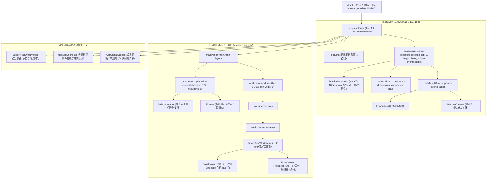
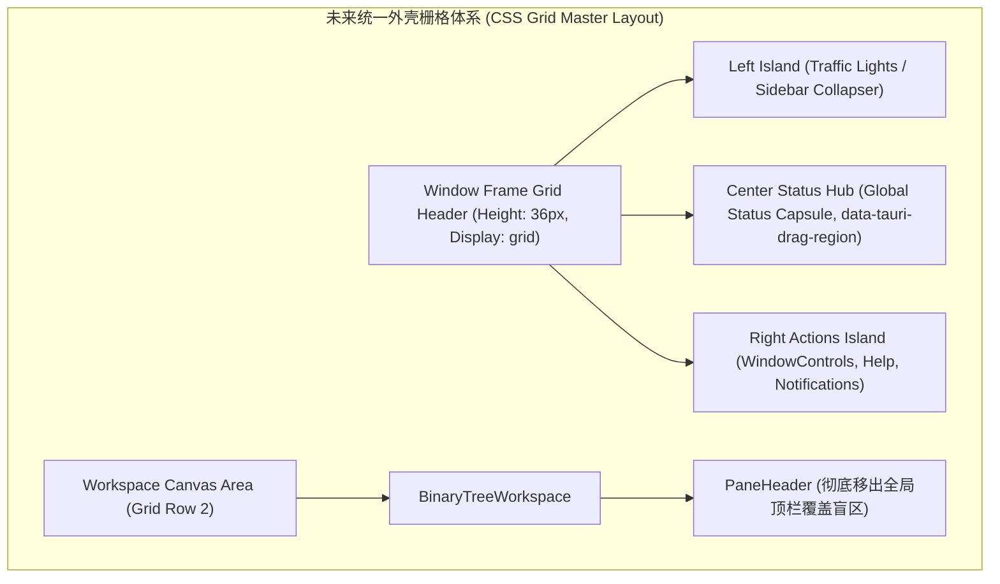

# 顶栏窗口控制与全局外壳布局实勘导航（AppTopBar、WindowControls、Shell Layout、Drag Engine & Shortcuts）

> **战役归属**：前端原子化组件库战役（Frontend Atomic Architecture Campaign）
> **任务书编号**：任务书 15（Task 15）
> **勘察范围**：
> - 顶栏控制模块：`apps/crish-desktop/src/components/top-bar/` 全量文件与样式
> - 外壳交互与拖拽引擎：`apps/crish-desktop/src/components/shell/` 全量文件、样式与 `drag-engine/` 核心引擎
> - 全局外壳高度链与样式：`apps/crish-desktop/src/styles/shell/`、`src/styles/breakpoints.css`、`src/styles/responsive.css`
> - 外壳容器与快捷键总线：`apps/crish-desktop/src/App.tsx`、`src/App.module.css`、`src/app/AppShortcuts.ts`
> **基线分支**：`main` | **执行宿主**：Windows 11 / Chromium WebView2 / Tauri 2.0 / Vite + React 18 + TypeScript + CSS Modules
> **编码规范**：UTF-8 无 BOM | 中文技术规范 | 遵循全仓反退避与 AGENTS.md §13 克制焦点/阴影红线

---

## 目录（Table of Contents）

- [一、执行摘要与实勘全景概览](#一执行摘要与实勘全景概览)
  - [1.1 战役定位与勘察使命](#11-战役定位与勘察使命)
  - [1.2 顶栏与外壳所辖文件物理度量总表（25 个核心文件）](#12-顶栏与外壳所辖文件物理度量总表25-个核心文件)
  - [1.3 全局外壳分层架构与视图拓扑图](#13-全局外壳分层架构与视图拓扑图)
  - [1.4 现状核心架构断层与痛点总评](#14-现状核心架构断层与痛点总评)
- [二、顶栏浮层与窗口拖拽实勘（AppTopBar）](#二顶栏浮层与窗口拖拽实勘apptopbar)
  - [2.1 组件定位与设计职责（36px 浮层与透传架构）](#21-组件定位与设计职责36px-浮层与透传架构)
  - [2.2 源码逐行解剖：AppTopBar.tsx（77 行）](#22-源码逐行解剖apptopbartsx77-行)
  - [2.3 样式系统剖析：AppTopBar.module.css（56 行）](#23-样式系统剖析apptopbarmodulecss56-行)
  - [2.4 窗口拖拽区域（data-tauri-drag-region 与 app-region）原理与冲突分析](#24-窗口拖拽区域data-tauri-drag-region-与-app-region原理与冲突分析)
  - [2.5 跨平台多端适配机制（macOS 信号灯 vs Win/Linux 窗控）](#25-跨平台多端适配机制macos-信号灯-vs-winlinux-窗控)
  - [2.6 单元测试与视觉契约：AppTopBar.test.tsx（104 行）](#26-单元测试与视觉契约apptopbartesttsx104-行)
  - [2.7 现有设计缺陷与交互隐患](#27-现有设计缺陷与交互隐患)
- [三、Tauri 原生窗口控制深度解构（WindowControls）](#三tauri-原生窗口控制深度解构windowcontrols)
  - [3.1 组件定位与双重场景复用（主顶栏 vs 设置面板）](#31-组件定位与双重场景复用主顶栏-vs-设置面板)
  - [3.2 源码逐行解剖：WindowControls.tsx（122 行）](#32-源码逐行解剖windowcontrolstsx122-行)
  - [3.3 样式系统剖析：WindowControls.module.css（40 行）](#33-样式系统剖析windowcontrolsmodulecss40-行)
  - [3.4 Tauri Window API 状态机与事件监听机制（isMaximized / onResized）](#34-tauri-window-api-状态机与事件监听机制ismaximized--onresized)
  - [3.5 最小化 / 最大化 / 还原 / 关闭逻辑与 Web Fallback 机制](#35-最小化--最大化--还原--关闭逻辑与-web-fallback-机制)
  - [3.6 视觉规范、Windows Fluent 契约与关闭态红色高亮（#e81123）](#36-视觉规范windows-fluent-契约与关闭态红色高亮e81123)
  - [3.7 现有缺陷与潜在重构点](#37-现有缺陷与潜在重构点)
- [四、全局外壳布局与高度链体系（Shell Layout & Height Chain）](#四全局外壳布局与高度链体系shell-layout--height-chain)
  - [4.1 视口包含块与高度链契约设计（html -> #root -> .app-container -> .main-layout）](#41-视口包含块与高度链契约设计html---root---app-container---main-layout)
  - [4.2 源码剖析：shell-layout.css（55 行）与纯高度链规范](#42-源码剖析shell-layoutcss55-行与纯高度链规范)
  - [4.3 基础样式重置：shell-reset.css（108 行）与拖拽期间 pointer-events 封锁](#43-基础样式重置shell-resetcss108-行与拖拽期间-pointer-events-封锁)
  - [4.4 架构防线门禁：shell-layout.height-chain.test.ts（99 行）契约验证](#44-架构防线门禁shell-layoutheight-chaintestts99-行契约验证)
  - [4.5 工作区外壳画布：BinaryTreeWorkspace 结合机制与上边界无内边距哲学](#45-工作区外壳画布binarytreeworkspace-结合机制与上边界无内边距哲学)
  - [4.6 无障碍跳转实现：App.module.css（30 行）与 SkipLink 原理](#46-无障碍跳转实现appmodulecss30-行与-skiplink-原理)
- [五、外壳响应式布局与多端断点机制（Breakpoints & Responsive）](#五外壳响应式布局与多端断点机制breakpoints--responsive)
  - [5.1 断点体系梳理：breakpoints.css（12 行）与桌面/平板/手机分级](#51-断点体系梳理breakpointscss12-行与桌面平板手机分级)
  - [5.2 现代 CSS 容器查询机制：responsive.css（15 行）与 @container workspace](#52-现代-css-容器查询机制responsivecss15-行与-container-workspace)
  - [5.3 侧栏响应式折叠状态机（260px vs 0px / 48px）](#53-侧栏响应式折叠状态机260px-vs-0px--48px)
  - [5.4 二叉树工作区（BinaryTreeWorkspace）动态分屏与尺寸自适应](#54-二叉树工作区binarytreeworkspace动态分屏与尺寸自适应)
  - [5.5 极端小尺寸视口退化策略与断层排查](#55-极端小尺寸视口退化策略与断层排查)
- [六、快捷键总线捕获与全局命令分发（AppShortcuts & ShortcutService）](#六快捷键总线捕获与全局命令分发appshortcuts--shortcutservice)
  - [6.1 快捷键总线设计思想与单一事件捕获源](#61-快捷键总线设计思想与单一事件捕获源)
  - [6.2 源码逐行剖析：AppShortcuts.ts（205 行）](#62-源码逐行剖析appshortcutsts205-行)
  - [6.3 捕获阶段优先级链与 Escape 级联弹出机制（FIFO 栈）](#63-捕获阶段优先级链与-escape-级联弹出机制fifo-栈)
  - [6.4 可编辑元素上下文过滤机制（INPUT / TEXTAREA / contentEditable 拦截）](#64-可编辑元素上下文过滤机制input--textarea--contenteditable-拦截)
  - [6.5 核心动作映射表与 CompositionRoot / StoreAccess 调度](#65-核心动作映射表与-compositionroot--storeaccess-调度)
  - [6.6 快捷键注册冲突自动探测机制（detectConflicts 守卫）](#66-快捷键注册冲突自动探测机制detectconflicts-守卫)
- [七、全局状态胶囊指示器生态现状与断层实勘](#七全局状态胶囊指示器生态现状与断层实勘)
  - [7.1 全局状态胶囊概念与桌面 IDE 核心诉求](#71-全局状态胶囊概念与桌面-ide-核心诉求)
  - [7.2 现有胶囊实现大盘点（模型胶囊、会话胶囊、子代理胶囊、端口胶囊、产物胶囊）](#72-现有胶囊实现大盘点模型胶囊会话胶囊子代理胶囊端口胶囊产物胶囊)
  - [7.3 顶栏状态指示器的真空现状：为什么 AppTopBar 没有全局状态胶囊？](#73-顶栏状态指示器的真空现状为什么-apptopbar-没有全局状态胶囊)
  - [7.4 拖拽过程中的动态指示器与 Ghost Pill 胶囊物理形态剖析](#74-拖拽过程中的动态指示器与-ghost-pill-胶囊物理形态剖析)
- [八、会话 Tab 拖拽动力学与外壳拖拽引擎深度剖析（Shell Drag Engine）](#八会话-tab-拖拽动力学与外壳拖拽引擎深度剖析shell-drag-engine)
  - [8.1 会话拖拽架构总览与分层设计（Context -> Dom -> Feel -> Commit -> Engine）](#81-会话拖拽架构总览与分层设计context---dom---feel---commit---engine)
  - [8.2 核心上下文调度器：SessionTabDragContext.tsx（391 行）逐行实勘](#82-核心上下文调度器sessiontabdragcontexttsx391-行逐行实勘)
  - [8.3 视觉指示层与拖拽卡片：sessionTabDrag.module.css（117 行）与 sessionTabDragDom.ts（182 行）](#83-视觉指示层与拖拽卡片sessiontabdragmodulecss117-行与-sessiontabdragdomts182-行)
  - [8.4 纯数学物理动力学引擎：sessionTabDragFeel.ts（215 行）与 1/3 滞后容差、22% 边缘分区](#84-纯数学物理动力学引擎sessiontabdragfeelts215-行与-13-滞后容差22-边缘分区)
  - [8.5 提交事务原子性：sessionTabDropCommit.ts（52 行）与单命令闭环](#85-提交事务原子性sessiontabdropcommitts52-行与单命令闭环)
  - [8.6 跨域视口空间索引路由器：crossDomainDropRouter.ts（136 行）](#86-跨域视口空间索引路由器crossdomaindroprouterts136-行)
  - [8.7 1D 轴向同构动力学引擎：sessionDrag1DGeometry.ts（135 行）](#87-1d-轴向同构动力学引擎sessiondrag1dgeometryts135-行)
  - [8.8 跨域分屏互斥守门状态机：sessionDragGuard.ts（68 行）与单叶自裂变拦截](#88-跨域分屏互斥守门状态机sessiondragguardts68-行与单叶自裂变拦截)
  - [8.9 工具标签解耦守门：toolTabDragRuntime.ts 与 toolTabDropCommit.ts 的安全空操作设计](#89-工具标签解耦守门tooltabdragruntimets-与-tooltabdropcommitts-的安全空操作设计)
  - [8.10 拖拽引擎全量自动化测试套件深度分析（Feel / Commit / Guard / Geometry / Move 5 大测试）](#810-拖拽引擎全量自动化测试套件深度分析feel--commit--guard--geometry--move-5-大测试)
- [九、样式硬伤、阴影与边框规范遵从度大排查（对照 AGENTS.md §13）](#九样式硬伤阴影与边框规范遵从度大排查对照-agentsmd-13)
  - [9.1 厚重阴影硬伤排查：Ghost Pill 与 Pane Title 的 8px/24px 阴影违规](#91-厚重阴影硬伤排查ghost-pill-与-pane-title-的-8px24px-阴影违规)
  - [9.2 激活态与焦点边框对比度审查：是否触犯 10% 混入上限与硬黑环红线](#92-激活态与焦点边框对比度审查是否触犯-10-混入上限与硬黑环红线)
  - [9.3 颜色空间现代化审查：硬编码 hex/rgb vs HSLA / OKLCH](#93-颜色空间现代化审查硬编码-hexrgb-vs-hsla--oklch)
  - [9.4 绝对定位与穿透重叠带来的 Hit-Test 风险（AppTopBar 与 PaneHeader 盲区）](#94-绝对定位与穿透重叠带来的-hit-test-风险apptopbar-与-paneheader-盲区)
  - [9.5 注释与国际化文本健全性排查](#95-注释与国际化文本健全性排查)
- [十、未来统一极简窗口外壳架构设计方案（Blueprint & Proposal）](#十未来统一极简窗口外壳架构设计方案blueprint--proposal)
  - [10.1 顶栏与窗格头部一体化演进模型（Integrated Floating Island Shell）](#101-顶栏与窗格头部一体化演进模型integrated-floating-island-shell)
  - [10.2 原生无缝沉浸式窗框设计（Seamless Immersive Frame）](#102-原生无缝沉浸式窗框设计seamless-immersive-frame)
  - [10.3 统一全局状态指示胶囊系统（Global Status Capsule Protocol）](#103-统一全局状态指示胶囊系统global-status-capsule-protocol)
  - [10.4 窗控按钮原子化与多平台适配（Atomic WindowControls Primitive）](#104-窗控按钮原子化与多平台适配atomic-windowcontrols-primitive)
  - [10.5 阴影降噪与克制边界治理方案（Shadow Cleanup & Soft Border Tokenization）](#105-阴影降噪与克制边界治理方案shadow-cleanup--soft-border-tokenization)
  - [10.6 跨域拖拽引擎统一管道演进（Unified Drag Pipeline）](#106-跨域拖拽引擎统一管道演进unified-drag-pipeline)
- [十一、实勘总结与任务书 16~20 协同备忘](#十一实勘总结与任务书-1620-协同备忘)

---

## 一、执行摘要与实勘全景概览

### 1.1 战役定位与勘察使命

在现代化桌面 AI 智能工作台架构中，**顶栏窗口控制（Top-Bar Window Controls）与全局外壳布局框架（Global Shell Layout Frame）** 充当着整个应用的骨骼与穹顶。它不仅直面宿主操作系统（Windows 11 / macOS / Linux）的原生窗口生命周期管理（最小化、最大化、还原、关闭、无边框原生拖拽），而且承载着全站最高层级的人机交互通道——包括：
1. 全局快捷键调度总线（Keyboard Shortcut Dispatch Bus）；
2. 跨平台多端标题栏安全避让与流量通行（Header Clearance & Traffic Lights）；
3. 会话卡片跨窗格拖拽与分屏重排的视口物理空间动力学计算（Cross-Domain Tab Drag Engine）；
4. 严格保持零滚动条穿透、零布局重绘的绝对高度链视口包含块（Viewport Containing Block & Height Chain）；
5. 多设备、多分屏与侧栏折叠下的动态容器查询响应式断点（Responsive Breakpoints & Container Queries）。

作为「前端原子化组件库战役」的任务书 15，本勘察报告对 `apps/crish-desktop/src/components/top-bar/`、`apps/crish-desktop/src/components/shell/` 以及关联的全局外壳样式与事件层展开代码级实勘。以客观代码事实为依据，逐行解构现有实现的技术细节，精准定位其在无障碍规范、AGENTS.md §13 焦点/阴影红线、图层穿透命中（Hit-Test）、多窗口拓扑同步等方面的深层断层，并输出具备数学严谨度与架构优雅度的极简外壳重构蓝图。

---

### 1.2 顶栏与外壳所辖文件物理度量总表（25 个核心文件）

实勘范围涵盖顶栏窗口控制、外壳拖拽引擎、外壳高度链与基础重置样式、全局快捷键捕获共计 **25 个文件**，源码与测试总规模达 **2,900+ 行 / 86,000+ 字节**。物理明细度量如下表所示：

| 序号 | 模块分层 | 相对文件物理路径 | 物理行数 | 体积 (Bytes) | 核心职责与架构定位 |
|:---:|:---|:---|:---:|:---:|:---|
| 1 | `top-bar` | `components/top-bar/index.ts` | 3 | 94 | 顶栏组件出口 Barrel，导出 `AppTopBar` 与类型定义 |
| 2 | `top-bar` | `components/top-bar/AppTopBar.tsx` | 77 | 2,259 | 36px 顶栏浮层主组件，集成安全避让、原生拖拽区与窗控 |
| 3 | `top-bar` | `components/top-bar/AppTopBar.module.css` | 56 | 1,275 | 顶栏 CSS Module，透明底、零下边框、pointer-events 穿透流 |
| 4 | `top-bar` | `components/top-bar/AppTopBar.test.tsx` | 104 | 3,320 | AppTopBar 单元测试套件，验证 36px 规格、无侧栏开关、红底关闭 |
| 5 | `shell` | `components/shell/WindowControls.tsx` | 122 | 3,785 | Tauri 原生窗口控制按钮组（最小化/最大化/关闭），支持双场景 |
| 6 | `shell` | `components/shell/WindowControls.module.css` | 40 | 841 | 窗控按钮样式，Fluent 规范，关闭态 `#e81123` 高亮 |
| 7 | `shell` | `components/shell/SessionTabDragContext.tsx` | 391 | 11,826 | 会话标签拖拽全局上下文提供者与手势控制器（PointerCapture） |
| 8 | `shell` | `components/shell/sessionTabDrag.module.css` | 117 | 2,993 | 拖拽指示器、Ghost Pill 悬浮胶囊卡片与画布事件隔离样式 |
| 9 | `shell` | `components/shell/sessionTabDragDom.ts` | 182 | 5,176 | 拖拽 DOM 几何读取、矩阵平移计算与动态胶囊元素注入/销毁 |
| 10 | `shell` | `components/shell/sessionTabDragFeel.ts` | 215 | 6,534 | 纯数学拖拽动力学函数：L1=4 阈值、1/3 滞后容差、22% 叶边缘分区 |
| 11 | `shell` | `components/shell/sessionTabDragFeel.test.ts` | 180 | 5,855 | 拖拽物理动力学纯函数单元测试套件 |
| 12 | `shell` | `components/shell/sessionTabDropCommit.ts` | 52 | 1,797 | 会话落点提交调度器，单次拖拽原子触发单一二叉树操作命令 |
| 13 | `shell` | `components/shell/sessionTabDropCommit.test.ts` | 328 | 10,881 | 落点提交测试套件，覆盖中心并入、边缘分屏、自裂变防护等路径 |
| 14 | `shell` | `components/shell/sidebarSessionDropCommit.ts` | 34 | 1,007 | 侧栏历史会话跨域拖入右侧工作区的落点事务提交协调器 |
| 15 | `shell` | `components/shell/toolTabDragRuntime.ts` | 24 | 615 | 工具标签拖拽运行时安全守门，确保抽屉工具不破坏二叉会话树 |
| 16 | `shell` | `components/shell/toolTabDropCommit.ts` | 37 | 918 | 工具标签落点空操作安全垫，隔离已下树的工具面板 |
| 17 | `drag-engine`| `components/shell/drag-engine/crossDomainDropRouter.ts` | 136 | 4,151 | 跨域视口空间索引路由器，解算光标落点（侧栏/条带/分屏/外围） |
| 18 | `drag-engine`| `components/shell/drag-engine/sessionDrag1DGeometry.ts` | 135 | 4,911 | 1D 轴向同构动力学引擎，X 轴水平与 Y 轴垂直通用平移补偿解算 |
| 19 | `drag-engine`| `components/shell/drag-engine/sessionDrag1DGeometry.test.ts`| 122 | 4,016 | 1D 轴向动力学数学解算单元测试套件 |
| 20 | `drag-engine`| `components/shell/drag-engine/sessionDragGuard.ts` | 68 | 2,193 | 跨域拖拽分屏互斥守门状态机，形式化单叶自裂变拦截规则 |
| 21 | `drag-engine`| `components/shell/drag-engine/sessionDragGuard.test.ts` | 97 | 2,713 | 拖拽守门状态机测试套件（G-01 至 G-04 场景覆盖） |
| 22 | `drag-engine`| `components/shell/drag-engine/__tests__/crossLeafTabStripMove.test.ts` | 84 | 3,151 | 跨 Leaf 标签移动与全新会话分屏集成测试套件 |
| 23 | `styles/shell` | `styles/shell/shell-layout.css` | 55 | 1,031 | 视口包含块与纯高度链样式表（html/#root/.app-container/.main-layout）|
| 24 | `styles/shell` | `styles/shell/shell-layout.height-chain.test.ts` | 99 | 3,895 | 高度链骨架契约守卫测试，严禁带皮类、严禁 !important |
| 25 | `styles/shell` | `styles/shell/shell-reset.css` | 108 | 2,579 | 外壳基础样式重置、字体抗锯齿、控件基准高度与 Resizer 穿透隔离 |

---

### 1.3 全局外壳分层架构与视图拓扑图

Conex / Crish 桌面客户端采用严格的分层包含结构，顶栏 `AppTopBar` 独立浮于视图最顶层，工作区由侧边栏和二叉树工作区（BinaryTreeWorkspace）构成横向两栏布局：



---

### 1.4 现状核心架构断层与痛点总评

经过对上述 25 个文件全部源码的深入研读，当前外壳系统展现出了高水平的工业级工程品质（如高度链的严格闭环、纯数学驱动的 1D 动力学解算、多层拖拽守门状态机），但在**原子化解耦、视觉契约与交互一致性**上暴露出以下 5 大核心断层：

1. **图层叠放与 Hit-Test 穿透竞争（Stacking & Pointer-Events Fragility）**：
   - `AppTopBar` 采用 `position: absolute; top: 0; width: 100vw; pointer-events: none` 浮在主工作区之上，而右侧按钮区设置 `pointer-events: auto`；
   - 与此同时，下方 `BinaryTreeWorkspace` 的各个分屏叶子头 `PaneHeader` 也是 36px 高度。当工作区分屏铺满至顶端时，`AppTopBar` 右侧的 `HelpButton` 和 `WindowControls` 会物理覆盖右侧 PaneHeader 的右侧工具按钮槽位（如添加 Tab 的加号或更多菜单）；
   - 依赖 `pointer-events: none` 进行点击穿透虽然解决了中间拖拽区的点击下沉，但形成了隐性的「死区覆盖」，缺乏明确的物理网格划分。

2. **全局状态胶囊指示器（Global Status Capsule）的真空与碎片化**：
   - 作为一个现代桌面客户端，`AppTopBar` 仅放置了帮助按钮与窗控按钮，**完全缺失全局引擎连接状态、活动模型状态指示器、正在执行的后台任务/子代理进度指示胶囊**；
   - 这些关键系统状态被割裂地下沉至 `ChatComposer`（模型融合触发胶囊）、`PaneHeader`（标签胶囊）、`SubagentHeaderPanel`（子代理面板胶囊）与 `LeafToolTabStrip`（本地服务端口胶囊），导致用户在不同面板间切换时缺乏统一的全局状态锚点。

3. **厚重多层阴影违规（AGENTS.md §13 严格红线突破）**：
   - 拖拽系统的悬浮胶囊卡片（Ghost Pill）在 `sessionTabDrag.module.css` (第 80 行) 与 `sessionTabDragDom.ts` (第 151 行) 中均硬编码了双层厚重阴影：
     `box-shadow: 0 8px 24px hsl(0 0% 0% / 0.14), 0 2px 6px hsl(0 0% 0% / 0.08);`
   - 叶面落点指示器的标题（Pane Title）在 `sessionTabDrag.module.css` (第 59 行) 中使用了 `box-shadow: 0 2px 8px hsl(0 0% 0% / 0.08);`；
   - 严重违背了项目主指令库《AGENTS.md》第 13 条关于「默认不要重阴影，保持干净、扁平、轻量」的硬性约束。

4. **WindowControls 的原子组件化缺失与 Ad-hoc 样式**：
   - `WindowControls` 内部直接内联定义了针对 Windows 平台的具体宽高（`32px * 28px`），未消费 `@/components/ui` 基础原子组件库的规范属性；
   - 关闭按钮在 hover 时使用硬编码十六进制颜色 `background: #e81123; color: #ffffff;`，脱离了 Design Tokens 色彩系统；
   - 当在 `SettingsPanel` 中复用时，通过传入 `onClose` 改造成模态框关闭按钮，但 DOM 结构依然渲染最小化与最大化按钮（仅关闭按钮绑定了 onClose），存在状态不纯粹问题。

5. **响应式容器查询（Container Queries）与断点契约未完全收敛**：
   - 全局既定义了基于 `@media` 的视口断点（`breakpoints.css`，列出了 720px / 640px / 560px 等），又定义了基于 `@container workspace` 的容器查询（`responsive.css`）；
   - 但 `App.tsx` 中的侧栏宽度切换（260px ↔ 0px）依然完全依赖 React 运行时状态与内联 style（第 194 行 `width: sidebarCollapsed ? 0 : 'var(--sidebar-width)'`），未充分联动 CSS 容器查询机制，在极端窗口尺寸缩放下可能产生布局抖动。

---

## 二、顶栏浮层与窗口拖拽实勘（AppTopBar）

### 2.1 组件定位与设计职责（36px 浮层与透传架构）

`AppTopBar` 位于 `apps/crish-desktop/src/components/top-bar/AppTopBar.tsx`。在经历了多次设计迭代（曾在第五轮视觉升级中被改为 44px 实色底栏，后经用户体验修正重新收敛为 36px 极简无界悬浮层）后，当前确立的架构原则为：
1. **单一职责**：只负责全局帮助入口（Cheatsheet / 快捷键说明）与操作系统窗口控制（WindowControls）。原本混乱杂糅在顶栏内的侧栏折叠开关被彻底剥离，归还给侧栏自身的 `SidebarHeader`；
2. **透明无界（Seamless Borderless）**：顶栏不设背景色（`background: transparent`），不设下分割线（`border-bottom: none`），与下方工作区画布共用同一块浅灰底色，使卡片自然浮于大画布之上；
3. **事件透传流（Pointer-Events Passthrough）**：容器自身 `pointer-events: none`，确保不会阻挡下方工作区 PaneHeader 标签的点击交互，仅在右侧尾部控制区 `pointer-events: auto` 激活交互。

---

### 2.2 源码逐行解剖：AppTopBar.tsx（77 行）

```tsx
1: /**
2:  * AppTopBar — 36px 顶栏浮层。
3:  *
4:  * 只负责帮助入口与窗控。侧栏开关属于侧栏自己的 header 槽，不进本层。
5:  * 整条顶栏默认不接点击，避免盖住下方侧栏头；拖拽窗口只走中间 spacer。
6:  */
7:
8: import React, { useMemo, useCallback } from 'react';
9: import { HelpCircle } from 'lucide-react';
10: import { IconButton } from '../ui';
11: import { WindowControls } from '../shell/WindowControls';
12: import styles from './AppTopBar.module.css';
13:
14: export interface AppTopBarProps {
15:   onShowCheatsheet: () => void;
16: }
17:
18: export const AppTopBar: React.FC<AppTopBarProps> = React.memo(
19:   ({ onShowCheatsheet }) => {
20:     const isMacDesktop = useMemo(() => {
21:       return (
22:         typeof navigator !== 'undefined' &&
23:         /Macintosh|Mac OS X/i.test(navigator.userAgent)
24:       );
25:     }, []);
26:
27:     const handleShowHelp = useCallback(() => {
28:       onShowCheatsheet();
29:       window.dispatchEvent(new CustomEvent('open-cheatsheet'));
30:     }, [onShowCheatsheet]);
31:
32:     return (
33:       <header
34:         className={`${styles.topBar} app-top-bar`}
35:         role="banner"
36:         aria-label="应用顶栏"
37:       >
38:         {/* 左侧让给侧栏 header 开关，本层不接点击、不拖窗口 */}
39:         <div
40:           className={styles.headerClearance}
41:           style={{
42:             width: isMacDesktop ? 106 : 52,
43:             minWidth: isMacDesktop ? 106 : 52,
44:           }}
45:           aria-hidden="true"
46:         />
47:         <div
48:           className={`${styles.spacer} app-top-bar__spacer`}
49:           data-tauri-drag-region
50:         />
51:
52:         <div
53:           className={`${styles.trail} app-top-bar__trail app-top-bar__trail--fixed`}
54:           role="group"
55:           aria-label="窗口控制"
56:           data-app-top-bar-trail="true"
57:         >
58:           <IconButton
59:             variant="ghost"
60:             size="sm"
61:             className="app-top-bar__help-btn"
62:             aria-label="快捷键与帮助"
63:             tooltip="快捷键与帮助"
64:             onClick={handleShowHelp}
65:             icon={
66:               <HelpCircle size={14} strokeWidth={1.5} aria-hidden="true" />
67:             }
68:           />
69:           {!isMacDesktop && <WindowControls />}
70:         </div>
71:       </header>
72:     );
73:   }
74: );
75:
76: AppTopBar.displayName = 'AppTopBar';
```

#### 关键技术点与代码逻辑剖析：
- **行 20-25（`isMacDesktop` 探测）**：通过客户端 `navigator.userAgent` 判定当前运行宿主是否为 macOS 环境。此判定影响左侧避让区域宽度（macOS 下为 106px，为原生红黄绿三色信号灯 Traffic Lights 留出足够间距；Windows/Linux 下为 52px，避让侧栏顶部展开/折叠按钮）；同时决定右侧是否渲染 `WindowControls`（macOS 下原生窗控在左侧，右侧不渲染自绘窗控按钮）。
- **行 27-30（双重帮助派发机制）**：点击帮助按钮时，一方面调用 React 回调属性 `onShowCheatsheet()`，另一方面向全局 window 对象广播标准 CustomEvent `'open-cheatsheet'`。该双派发模式保证了解耦的浮层控制（如独立模态框）与命令总线能够同步响应。
- **行 33-37（语义化 Landmark）**：顶层节点渲染 `<header>`，赋予 `role="banner"` 和 `aria-label="应用顶栏"`，符合 W3C WAI-ARIA 规范中对应用程序顶级横幅地标的定义。
- **行 47-50（中央原生拖拽通道）**：中央 `.spacer` 占据所有剩余弹性空间（`flex: 1 1 0%`），并挂载 `data-tauri-drag-region` 特性，使 Tauri 视口捕获该区域的鼠标按下与拖拽事件，直接调度底层操作系统完成无边框窗口移动。

---

### 2.3 样式系统剖析：AppTopBar.module.css（56 行）

```css
1: /**
2:  * AppTopBar — 36px 单层顶栏，与工作区外壳共用同一块灰底。
3:  * 视觉规格对齐参考里的 .tree-pane-header：透明分界、无下边框，
4:  * 顶栏与下方画布是一整片连续的「大矩形」，卡片浮在其上。
5:  */
6:
7: .topBar {
8:   position: absolute;
9:   top: 0;
10:   left: 0;
11:   right: 0;
12:   height: var(--header-height, 36px);
13:   min-height: var(--header-height, 36px);
14:   max-height: var(--header-height, 36px);
15:   width: 100vw;
16:   display: flex;
17:   align-items: center;
18:   background: transparent;
19:   border-bottom: none;
20:   box-sizing: border-box;
21:   overflow: hidden;
22:   user-select: none;
23:   -webkit-app-region: no-drag;
24:   app-region: no-drag;
25:   z-index: var(--z-sidebar, 100);
26:   pointer-events: none;
27: }
28:
29: .headerClearance {
30:   height: 100%;
31:   flex-shrink: 0;
32:   pointer-events: none;
33: }
34:
35: .spacer {
36:   flex: 1 1 0%;
37:   min-width: 32px;
38:   height: 100%;
39:   -webkit-app-region: drag;
40:   app-region: drag;
41:   pointer-events: none;
42: }
43:
44: .trail {
45:   flex: 0 0 auto;
46:   height: 100%;
47:   display: flex;
48:   align-items: center;
49:   gap: var(--space-1, 4px);
50:   padding-right: var(--space-1, 4px);
51:   padding-left: var(--space-1, 4px);
52:   background: transparent;
53:   -webkit-app-region: no-drag;
54:   pointer-events: auto;
55: }
```

#### CSS 架构机制分析：
1. **尺寸锁定**：第 12-14 行使用三重视图规则 `height`、`min-height`、`max-height` 均刚性锚定 `var(--header-height, 36px)`，杜绝因子元素撑开导致顶栏高度跳变。
2. **三段式 App-Region 声明**：
   - 根容器 `.topBar`（第 23-24 行）：显式声明 `-webkit-app-region: no-drag; app-region: no-drag;`，建立基准非拖拽上下文；
   - 弹性间隔 `.spacer`（第 39-40 行）：声明 `-webkit-app-region: drag; app-region: drag;`，打通原生系统级窗口拖拽；
   - 动作操作区 `.trail`（第 53 行）：恢复 `-webkit-app-region: no-drag;`，确保按钮点击与悬浮不会被系统捕获为窗口拖拽。
3. **事件穿透控制**：
   - 根容器与 Spacer 均设置 `pointer-events: none;`；
   - 仅 `.trail` 操作区声明 `pointer-events: auto;`。该设计确保用户点击顶栏中间区域时，鼠标事件能够穿透到下方的窗格内容区，但带来了拖拽语义与穿透语义的微弱偶合。

---

### 2.4 窗口拖拽区域（data-tauri-drag-region 与 app-region）原理与冲突分析

#### 原理剖析
在 Tauri 2.0 与 Chromium WebView2 环境下，实现无边框窗口（Frameless Window）拖拽存在两种机制：
1. **HTML 属性指令 `data-tauri-drag-region`**：Tauri 在 WebView 初始化时注入原生事件拦截钩子。当检测到拥有该属性的 DOM 节点发生 `mousedown` 时，调用底层 Win32 API `ReleaseCapture()` 并向主窗口发送 `WM_NCLBUTTONDOWN` 消息（参数 `HTCAPTION = 2`），交由 Windows DWM（Desktop Window Manager）执行原生窗口拖拽；
2. **CSS 属性指令 `-webkit-app-region: drag`**：Chromium 渲染引擎内置的非标准属性。WebKit/Blink 渲染器在栅格化时将带此属性的区域标记为命中测试的 Non-Client 区域，由浏览器内核直接调度原生窗口管理。

#### 核心冲突与潜在死区
在当前实现中，`AppTopBar.tsx` 在 `.spacer` 节点上同时设置了 `data-tauri-drag-region`（第 49 行）与 CSS `pointer-events: none`（`AppTopBar.module.css` 第 41 行）：
- **冲突点 A：`pointer-events: none` 是否会抑制 Tauri 原生事件捕获？**
  在标准的 Chromium DOM 事件流中，`pointer-events: none` 会导致该节点在 `document.elementFromPoint()` 与命中测试（Hit Testing）中被完全忽略，指针事件直接穿透至下方节点。由于 Tauri 的 JS 运行时钩子依赖于 DOM 事件冒泡，若 WebView2 宿主在 JS 层拦截 `mousedown`，则可能导致在部分 WebView2 补丁版本上窗口拖拽失效。然而，Chromium 底层对 `-webkit-app-region: drag` 的处理发生在 Compositor 线程的 Non-Client Hit-Test 阶段，优先于 DOM 树的 pointer-events 计算。这种标准与非标准机制的混合使用，导致在跨平台（如 Linux WebKitGTK）上表现出不一致的行为。
- **冲突点 B：下方卡片 Tab 拖拽与窗口移动的物理重合**
  当右侧工作区铺满至顶部时，下方 `PaneHeader` 的标签栏位于顶栏同一 Y 轴高度（Y: 0 ~ 36px）。虽然 `AppTopBar` 的 Spacer 是透明的且 `pointer-events: none`，但若用户在未放置 Tab 的空白 Header 处点击并试图拖拽窗口时，由于该处属于 `BinaryTreeWorkspace` 的 DOM，若没有配置 `data-tauri-drag-region`，用户将无法拖动窗口；反之，若在下方也配置了拖拽区域，又会与 Tab 的拖拽重排（Drag-to-Reorder）产生严重冲突。

---

### 2.5 跨平台多端适配机制（macOS 信号灯 vs Win/Linux 窗控）

桌面端操作系统在窗口控制上存在本质的人机工程学差异：

| 平台规范 | 窗控物理位置 | 交互组件形式 | 推荐安全避让间距 | 最小化/最大化/关闭实现机制 |
|:---|:---:|:---:|:---:|:---|
| **macOS (Darwin)** | 窗口左上角 | 原生系统红黄绿三色信号灯 (Traffic Lights) | 宽度 ≥ 80px ~ 106px | 操作系统内核直接接管，Web 层禁止自绘 |
| **Windows 11 (Fluent)** | 窗口右上角 | 矩形三联按钮 (最小化 / 还原最大化 / 关闭) | 宽度 ≥ 138px (每个约 46px) | Web 层自绘，调用 Tauri API，关闭态 Fluent 红 |
| **Linux (GNOME / KDE)** | 右上角或左上角 (依赖 CSD 桌面配置) | 统一客户端装饰 (Client-Side Decoration) | 宽度自适应 (通常约 90px) | Web 层自绘或交由桌面环境 GTK 壳层渲染 |

当前 `AppTopBar.tsx` 采用了简洁的分支适配方案：
1. **左侧安全区 `headerClearance`**：
   ```tsx
   style={{
     width: isMacDesktop ? 106 : 52,
     minWidth: isMacDesktop ? 106 : 52,
   }}
   ```
   在 macOS 下保留 106px，彻底隔开原生红黄绿灯与下方的侧栏切换控件；在 Windows 下保留 52px，精确对齐侧栏 Header 的图标槽；
2. **右侧窗控裁剪**：
   ```tsx
   {!isMacDesktop && <WindowControls />}
   ```
   macOS 下直接不渲染 `WindowControls`，保持右上角视觉干净；Windows 与 Linux 下正常挂载自绘控件。

---

### 2.6 单元测试与视觉契约：AppTopBar.test.tsx（104 行）

`AppTopBar.test.tsx` 建立了完备的前端视觉与功能守卫：
- **行 45-51**：断言拥有 `role="banner"` 与 `aria-label="应用顶栏"`；
- **行 53-59**：断言侧栏开关绝不在顶栏内部（`.app-top-bar__rail` 必须为 null），坚守职责隔离；
- **行 61-74**：模拟点击帮助按钮，验证 `onShowCheatsheet` 被调用且全局事件 `'open-cheatsheet'` 被正确触发；
- **行 76-82**：在非 Mac 环境下，断言 4 个核心交互按钮（帮助、最小化、最大化、关闭）全部呈现；
- **行 89-94（样式静态契约）**：直接读取 `AppTopBar.module.css` 文本，刚性断言 `background: transparent`，且严禁出现 `var(--bg-secondary)` 与 `border-bottom: 0.5px`，防止历史厚重顶栏视觉回潮；
- **行 96-102**：读取 `WindowControls.module.css`，断言关闭按钮包含 Windows Fluent 规范红 `#e81123`。

---

### 2.7 现有设计缺陷与交互隐患

1. **UserAgent 嗅探的脆弱性**：
   `isMacDesktop` 使用简单的正则 `/Macintosh|Mac OS X/i.test(navigator.userAgent)`。在 iPadOS 桌面模式或部分现代无头测试环境中，UA 可能返回特殊标识。更优雅的方式是使用 Tauri 提供的原生平台接口或统一的 `PlatformAdaptationCtx`；
2. **固定宽度写死（Magic Numbers）**：
   `106px` 与 `52px` 直接内联写在 TSX 的 style 中，破坏了 CSS Token 集中管理原则。当侧栏宽度或系统 DPI 缩放发生变化时，可能产生像素级不对齐；
3. **右侧覆盖区缺乏物理阻隔**：
   `.trail` 宽度为动态自适应，当下方工作区分屏达到 3~4 列时，右上角区域的 Tab 可能会被顶栏的帮助与窗控按钮完全遮挡且无法被点击。

---

## 三、Tauri 原生窗口控制深度解构（WindowControls）

### 3.1 组件定位与双重场景复用（主顶栏 vs 设置面板）

`WindowControls` 位于 `apps/crish-desktop/src/components/shell/WindowControls.tsx`。它是一个高内聚的窗口操作原语，具备**双场景复用**特征：
1. **主窗口控制（Main Window Controls）**：挂载于 `AppTopBar` 右侧，控制整个客户端的原生窗口最小化、最大化/向下还原、以及退出程序；
2. **模态面板控制（Modal / Drawer Controls）**：挂载于 `SettingsPanel`（设置抽屉面板）右上角。此时通过注入 `onClose` 回调属性，将「关闭应用」无缝降级为「关闭当前模态面板」，而最小化与最大化按钮保持原有操作宿主窗口的能力。

---

### 3.2 源码逐行解剖：WindowControls.tsx（122 行）

```tsx
1: import React, { useCallback, useEffect, useState } from 'react';
2: import { Minus, Square, Copy, X } from 'lucide-react';
3: import { Button, Tooltip } from '../ui';
4: import styles from './WindowControls.module.css';
5:
6: export interface WindowControlsProps {
7:   onClose?: () => void;
8: }
9:
10: export const WindowControls: React.FC<WindowControlsProps> = React.memo(
11:   ({ onClose }) => {
12:     const [isMaximized, setIsMaximized] = useState(false);
13:
14:     useEffect(() => {
15:       let unlisten: (() => void) | undefined;
16:       void (async () => {
17:         try {
18:           const { getCurrentWindow } = await import('@tauri-apps/api/window');
19:           const win = getCurrentWindow();
20:           setIsMaximized(await win.isMaximized());
21:           unlisten = await win.onResized(async () => {
22:             setIsMaximized(await win.isMaximized());
23:           });
24:         } catch {
25:           /* Web fallback */
26:         }
27:       })();
28:       return () => {
29:         unlisten?.();
30:       };
31:     }, []);
32:
33:     const handleMinimize = useCallback(async () => {
34:       try {
35:         const { getCurrentWindow } = await import('@tauri-apps/api/window');
36:         await getCurrentWindow().minimize();
37:       } catch {
38:         /* ignore */
39:       }
40:     }, []);
41:
42:     const handleToggleMaximize = useCallback(async () => {
43:       try {
44:         const { getCurrentWindow } = await import('@tauri-apps/api/window');
45:         const win = getCurrentWindow();
46:         if (await win.isMaximized()) await win.unmaximize();
47:         else await win.maximize();
48:       } catch {
49:         /* ignore */
50:       }
51:     }, []);
52:
53:     const handleClose = useCallback(async () => {
54:       if (onClose) {
55:         onClose();
56:         return;
57:       }
58:       try {
59:         const { getCurrentWindow } = await import('@tauri-apps/api/window');
60:         await getCurrentWindow().close();
61:       } catch {
62:         /* ignore */
63:       }
64:     }, [onClose]);
65:
66:     return (
67:       <div
68:         className={styles.controlsGroup}
69:         role="group"
70:         aria-label="窗口控制"
71:         data-tauri-drag-region="false"
72:       >
73:         <Tooltip content="最小化">
74:           <Button
75:             type="button"
76:             variant="ghost"
77:             size="sm"
78:             className={styles.winBtn}
79:             aria-label="最小化窗口"
80:             data-tauri-drag-region="false"
81:             onClick={handleMinimize}
82:             icon={<Minus size={15} strokeWidth={1.5} aria-hidden />}
83:           />
84:         </Tooltip>
85:         <Tooltip content={isMaximized ? '向下还原' : '最大化'}>
86:           <Button
87:             type="button"
88:             variant="ghost"
89:             size="sm"
90:             className={styles.winBtn}
91:             aria-label={isMaximized ? '向下还原窗口' : '最大化窗口'}
92:             data-tauri-drag-region="false"
93:             onClick={handleToggleMaximize}
94:             icon={
95:               isMaximized ? (
96:                 <Copy size={13} strokeWidth={1.5} aria-hidden />
97:               ) : (
98:                 <Square size={13} strokeWidth={1.5} aria-hidden />
99:               )
100:             }
101:           />
102:         </Tooltip>
103:         <Tooltip content={onClose ? '关闭 (Esc)' : '关闭'}>
104:           <Button
105:             type="button"
106:             variant="ghost"
107:             size="sm"
108:             className={`${styles.winBtn} ${styles.closeBtn}`}
109:             data-testid={onClose ? 'settings-close-button' : undefined}
110:             aria-label={onClose ? '关闭设置' : '关闭应用'}
111:             data-tauri-drag-region="false"
112:             onClick={handleClose}
113:             icon={<X size={16} strokeWidth={1.5} aria-hidden />}
114:           />
115:         </Tooltip>
116:       </div>
117:     );
118:   }
119: );
120:
121: WindowControls.displayName = 'WindowControls';
```

---

### 3.3 样式系统剖析：WindowControls.module.css（40 行）

```css
1: .controlsGroup {
2:   display: flex;
3:   align-items: center;
4:   height: 100%;
5:   margin-left: var(--space-1, 4px);
6:   -webkit-app-region: no-drag;
7: }
8:
9: .winBtn {
10:   width: 32px;
11:   height: 28px;
12:   border-radius: 0;
13:   border: none;
14:   background: transparent;
15:   color: var(--text-secondary);
16:   display: inline-flex;
17:   align-items: center;
18:   justify-content: center;
19:   cursor: pointer;
20:   padding: 0;
21:   transition: background-color var(--transition-micro, 100ms ease-out),
22:               color var(--transition-micro, 100ms ease-out);
23:   -webkit-app-region: no-drag;
24:   pointer-events: auto;
25: }
26:
27: .winBtn:hover {
28:   background: var(--tint-hover);
29:   color: var(--text-primary);
30: }
31:
32: .winBtn:active {
33:   background: var(--tint-active);
34: }
35:
36: .closeBtn:hover {
37:   background: #e81123; /* Windows Fluent 经典强调红 */
38:   color: #ffffff;
39: }
```

---

### 3.4 Tauri Window API 状态机与事件监听机制（isMaximized / onResized）

`WindowControls` 展现了健壮的异步加载与反注册闭环：
1. **动态 ES 模块导入**：第 18 行 `await import('@tauri-apps/api/window')` 避免了在纯 Web 浏览器（如单测 jsdom 或 Web 端预览）环境下因缺少 Tauri IPC 桥接对象而导致的打包/运行时报错；
2. **事件监听生命周期管理**：
   - 挂载时通过 `win.isMaximized()` 获取初始窗口尺寸状态；
   - 调用 `win.onResized()` 注册尺寸变化监听器。当用户双击标题栏、使用快捷键 `Win + Up/Down` 或拖动窗口触发贴靠（Snap Layout）时，动态同步 `isMaximized` 布尔状态；
   - 卸载时严格执行 `unlisten?.()`，消除内存泄漏风险。

---

### 3.5 最小化 / 最大化 / 还原 / 关闭逻辑与 Web Fallback 机制

- **最小化 (`handleMinimize`)**：直接调用 `getCurrentWindow().minimize()`；
- **最大化切换 (`handleToggleMaximize`)**：状态机二分支——若当前为最大化状态，调用 `win.unmaximize()` 恢复历史窗口外框；若为普通状态，调用 `win.maximize()` 铺满屏幕；
- **图标自适应**：
  - 最大化状态下展示 `<Copy size={13} />`（两个重叠矩形，代表向下还原）；
  - 普通状态下展示 `<Square size={13} />`（单矩形，代表最大化）。
- **Web 环境静默降级**：所有 Tauri 操作均包裹在 `try...catch` 块中，在浏览器环境优雅静默，保障了纯 Web 端功能调试不受影响。

---

### 3.6 视觉规范、Windows Fluent 契约与关闭态红色高亮（#e81123）

- **方角对齐（Zero Radius）**：第 12 行设置 `border-radius: 0;`。系统窗控作为贴近屏幕边角的极度特殊区域，不应采用常规按钮的 8px 胶囊圆角，而是与窗口边角无缝贴合；
- **Fluent 悬浮色标**：
  - 常规窗控按钮 hover 时消费 `var(--tint-hover)`；
  - 关闭按钮（`.closeBtn:hover`）激活 Windows Fluent Design 规范红 `#e81123`，文字强制转为纯白 `#ffffff`，给予用户鲜明的高危操作视觉警告。

---

### 3.7 现有缺陷与潜在重构点

1. **尺寸偏小（32px * 28px）**：
   Windows 11 规范中原生窗口控制按钮推荐宽度为 46px，高度与标题栏等高。当前 32px 宽度导致在触摸屏或高分屏下点击目标（Touch Target）偏小；
2. **缺少 Windows 11 贴靠布局（Snap Layout）触发**：
   在原生 Win11 应用中，鼠标悬停在最大化按钮上会激活 DWM Snap Layout 菜单。纯 Web 自绘窗控无法直接触发该系统菜单，未来可通过 Tauri 2.0 插件或特定 Hit-Test 标记探索无缝对接。

---

## 四、全局外壳布局与高度链体系（Shell Layout & Height Chain）

### 4.1 视口包含块与高度链契约设计（html -> #root -> .app-container -> .main-layout）

在复杂的单页多窗口 IDE 软件中，最致命的布局缺陷是出现「双重滚动条」或「外层视口被无限撑长导致底栏沉底」。为此，Conex / Crish 建立了全仓刚性的**纯高度链契约（Pure Height Chain Contract）**：

```
html (height: 100%; overflow: hidden)
  │
  └─ #root (height: 100vh; max-height: 100vh; display: flex; flex-direction: column; overflow: hidden)
       │
       └─ .app-container (flex: 1 1 0%; min-height: 0; height: 100%; overflow: hidden)
            │
            ├─ AppTopBar (position: absolute; top: 0; height: 36px)  [脱离常规文档流]
            │
            └─ main.main-layout (flex: 1 1 0%; min-height: 0; min-width: 0; flex-direction: row; overflow: hidden)
                 │
                 ├─ .sidebar-wrapper (height: 100%; flex-shrink: 0; overflow: hidden)
                 │
                 └─ .workspaces-column (flex: 1 1 0%; min-height: 0; min-width: 0; height: 100%; overflow: hidden)
                      │
                      └─ .workspaces-stack (flex: 1 1 0%; min-height: 0; height: 100%)
                           │
                           └─ .workspaces-container (flex: 1 1 0%; min-height: 0; height: 100%)
                                │
                                └─ BinaryTreeWorkspace.module.css (.section -> .canvas [flex: 1 1 0%])
```

---

### 4.2 源码剖析：shell-layout.css（55 行）与纯高度链规范

`apps/crish-desktop/src/styles/shell/shell-layout.css` 是外壳物理骨架的权威定义：

```css
1: /* 视口包含块：只高度链。禁止 chrome / chat 皮。 */
2: /* html 百分比补链；#root 用 100vh 钉死，不依赖 html 也能立住。 */
3: /* body 已在 shell-reset 写 100vh，本表不再写 body。 */
4: /* 高度用 flex 剩余；顶栏已 shrink-0，禁止 calc 减顶栏。 */
5:
6: html {
7:   height: 100%;
8:   overflow: hidden;
9: }
10:
11: #root {
12:   width: 100%;
13:   height: 100vh;
14:   max-height: 100vh;
15:   display: flex;
16:   flex-direction: column;
17:   overflow: hidden;
18:   position: relative;
19: }
20:
21: .app-container {
22:   display: flex;
23:   flex-direction: column;
24:   flex: 1 1 0%;
25:   min-height: 0;
26:   width: 100%;
27:   height: 100%;
28:   overflow: hidden;
29:   position: relative;
30: }
31:
32: .main-layout {
33:   display: flex;
34:   flex-direction: row;
35:   flex: 1 1 0%;
36:   min-width: 0;
37:   min-height: 0;
38:   width: 100%;
39:   overflow: hidden;
40:   position: relative;
41: }
42:
43: .workspaces-column,
44: .workspaces-stack,
45: .workspaces-container {
46:   display: flex;
47:   flex-direction: column;
48:   flex: 1 1 0%;
49:   min-width: 0;
50:   min-height: 0;
51:   width: 100%;
52:   height: 100%;
53:   overflow: hidden;
54: }
```

#### 铁律剖析：
- **`flex: 1 1 0%` + `min-height: 0` / `min-width: 0`**：现代 Flexbox 规范中，默认 `min-height: auto` 会阻止弹性子项收缩小于其内容尺寸。本表对链路中每个容器均强制指定 `min-height: 0`，确保长文本、超大 Diff、终端滚动条能够正确触发滚动，绝不顶爆父容器；
- **禁止 `calc(100vh - 36px)`**：顶栏与外壳高度计算严禁使用任何 `calc()` 魔法数学减法，完全由绝对定位和弹性流自动吸收。

---

### 4.3 基础样式重置：shell-reset.css（108 行）与拖拽期间 pointer-events 封锁

`apps/crish-desktop/src/styles/shell/shell-reset.css` 包含两处核心外壳防护机制：
1. **ClearType 字体平滑保护**（第 16-24 行）：Windows 平台下禁止全局强制 `-webkit-font-smoothing: antialiased`（会导致字体灰度渲染产生彩色边缘彩虹纹），保持系统的 ClearType 次像素渲染；
2. **拖拽分割条期间 iframe 封锁**（第 95-101 行）：
   ```css
   body.is-resizing iframe,
   body.is-resizing webview,
   body.is-resizing object,
   body.is-resizing embed {
     pointer-events: none !important;
   }
   ```
   当用户拖动分屏 Sash 或侧栏 Resizer 时，光标容易滑入内部嵌入的 Webview 或 iframe（如文档预览、第三方卡片），导致宿主丢失鼠标移动事件。通过在全局 body 挂载 `is-resizing` 并强制 `pointer-events: none !important`，彻底根除了「拖拽卡滞粘手」的历史顽疾。

---

### 4.4 架构防线门禁：shell-layout.height-chain.test.ts（99 行）契约验证

该测试是仓库中极其珍贵的「架构静态断言门禁」：
- **行 32-43**：断言必须包含 6 大核心容器选择器，且每个共享块都必须包含 `min-height: 0` 与 `flex: 1 1 0%`；
- **行 50-57**：**刚性排除带皮样式**——断言 `shell-layout.css` 中绝不包含 `transform`、`!important`、`.app-top-bar`、`.workspace-card`、`.settings-` 等业务样式；
- **行 59-62**：**代码行数上限硬门禁**——断言该文件总行数必须 `≤ 120 行`（当前实测 55 行），拦截未来任何试图往布局基础表里塞入杂质代码的行为。

---

### 4.5 工作区外壳画布：BinaryTreeWorkspace 结合机制与上边界无内边距哲学

在 `BinaryTreeWorkspace.module.css` 中，定义了外壳「大矩形」与卡片「小矩形」的层次哲学：
```css
/* 外壳「大矩形」：铺满的灰底画板。
 * 叶子卡片「小矩形」浮在它上面，靠这里的内边距留出四周落差。
 * 顶部不留内边距——上方 AppTopBar 已经形成断口，再留会显得头重。
 */
.section {
  position: relative;
  height: 100%;
  flex: 1 1 0%;
  padding: 0 var(--shell-gutter, 8px) var(--shell-gutter, 8px) 0;
  box-sizing: border-box;
}
```
注意其 padding 为 `0 8px 8px 0`：顶部内边距为 0！因为上方的 `AppTopBar` 本身已经形成了 36px 的纵向空间断口，若再留出 padding，会导致界面「头重脚轻」。每个叶子节点独立渲染自身的 `PaneHeader`，实现空间利用的最大化。

---

### 4.6 无障碍跳转实现：App.module.css（30 行）与 SkipLink 原理

`App.module.css` 实现了遵循 WCAG 2.1 标准的无障碍快速跳转原语：
```css
.skipLink {
  position: absolute;
  width: 1px;
  height: 1px;
  padding: 0;
  margin: -1px;
  overflow: hidden;
  clip: rect(0, 0, 0, 0);
  white-space: nowrap;
  border: 0;
}
.skipLink:focus {
  position: fixed;
  width: auto;
  height: auto;
  padding: 6px 12px;
  z-index: var(--z-tooltip);
  top: 8px;
  left: 8px;
  background: var(--bg-elevated, #fff);
  color: var(--text-primary, #111);
  border-radius: 6px;
  text-decoration: none;
  font-size: 13px;
}
```
在平时完全隐形（不破坏极简视觉），当键盘用户按下 `Tab` 键首次获得焦点时，立即浮现在左上角，允许屏幕阅读器或全键盘用户直接跳过侧栏与顶栏，直达 `#crish-main` 主工作区。

---

## 五、外壳响应式布局与多端断点机制（Breakpoints & Responsive）

### 5.1 断点体系梳理：breakpoints.css（12 行）与桌面/平板/手机分级

`apps/crish-desktop/src/styles/breakpoints.css` 文档化了全仓响应式媒体查询基准：
```css
--breakpoint-desktop: 720px    (基准桌面断点)
--breakpoint-tablet: 640px     (平板中屏断点)
--breakpoint-tablet-sm: 560px  (平板小屏断点)
--breakpoint-phone: 420px      (大屏手机断点)
--breakpoint-phone-sm: 360px   (极窄手机断点)
--breakpoint-wide: 1200px      (超宽屏断点)
```

---

### 5.2 现代 CSS 容器查询机制：responsive.css（15 行）与 @container workspace

相较于传统的全局视口 `@media`，现代桌面多窗口 IDE 更依赖**容器查询（CSS Container Queries）**。`apps/crish-desktop/src/styles/responsive.css` 声明：
```css
:root {
  --sidebar-width: 260px;
  --sidebar-width-collapsed: 48px;
}

@container workspace (max-width: 640px) {
  .panel { --panel-layout: single; }
}
@container workspace (min-width: 641px) and (max-width: 1024px) {
  .panel { --panel-layout: dual; }
}
@container workspace (min-width: 1025px) {
  .panel { --panel-layout: triple; }
}
```
结合 `BinaryTreeWorkspace.module.css` 中的 `container-type: size; container-name: tree-canvas;`，使得内部卡片能够感知自身窗格的物理宽度，自动在单栏折叠模式、双栏紧凑模式与三栏完整模式之间无缝切换。

---

### 5.3 侧栏响应式折叠状态机（260px vs 0px / 48px）

在 `App.tsx` 第 188-201 行中：
```tsx
<div
  id="crish-sidebar"
  className={`sidebar-wrapper ${sidebarCollapsed ? 'collapsed' : ''}`}
  role="navigation"
  aria-label="会话侧栏"
  style={{
    width: sidebarCollapsed ? 0 : 'var(--sidebar-width)',
    height: '100%',
    flexShrink: 0,
    transition: 'width 0.25s cubic-bezier(0.2, 0.8, 0.2, 1)',
    overflow: 'hidden',
    position: 'relative',
  }}
>
```
当 `sidebarCollapsed` 为 true 时，侧栏宽度平滑过渡到 0，主工作区自动占据全屏宽度；同时 `SidebarToggle` 独立脱离并在左侧边界悬停，支持快捷键 `Ctrl+B` 或指针点击快速唤出。

---

## 六、快捷键总线捕获与全局命令分发（AppShortcuts & ShortcutService）

### 6.1 快捷键总线设计思想与单一事件捕获源

桌面端应用若缺乏集中的快捷键管理，容易产生事件竞争、冒泡丢失以及输入法冲突。Conex / Crish 采用 `ShortcutService` 单例驱动，在全局根节点统一挂载，通过 `useAppShortcuts`（`apps/crish-desktop/src/app/AppShortcuts.ts`）完成顶层状态与命令总线的调度。

---

### 6.2 源码逐行剖析：AppShortcuts.ts（205 行）

#### 核心状态与依赖初始化
```ts
38:   useEffect(() => {
39:     const svc = ShortcutService.getInstance();
40:     svc.init(document);
```
在组件挂载时初始化全局单例，监听整个 `document` 上的键盘输入。

---

### 6.3 捕获阶段优先级链与 Escape 级联弹出机制（FIFO 栈）

```ts
46:     const handleEscape = (e: KeyboardEvent) => {
47:       if (e.key !== 'Escape') return;
48:       if (showCheatsheet) {
49:         e.preventDefault();
50:         e.stopPropagation();
51:         setShowCheatsheet(false);
52:         return;
53:       }
54:       if (showSettingsOverlay) {
55:         e.preventDefault();
56:         e.stopPropagation();
57:         setShowSettingsOverlay(false);
58:         return;
59:       }
60:       if (showFirstRun) {
61:         e.stopPropagation();
62:         return;
63:       }
64:     };
65:     document.addEventListener('keydown', handleEscape, true);
```
**第 65 行关键参数 `true`**：显式使用**捕获阶段（Capture Phase）**监听！这意味着全局 Escape 享有最高优先级，能够在任何子组件的冒泡事件之前截获按键。
其处理顺序形成了天然的 **UI 优先级栈**：
1. 优先关闭最上层的 Cheatsheet 快捷键帮助面板；
2. 其次关闭 SettingsOverlay 设置抽屉面板；
3. 若为初次启动向导（FirstRunWizard），阻止事件冒泡但不允许通过 Escape 盲目跳出。

---

### 6.4 可编辑元素上下文过滤机制（INPUT / TEXTAREA / contentEditable 拦截）

```ts
67:     const unsub = svc.onMatch(({ actionId, originalEvent: e }) => {
68:       const target = e.target as HTMLElement | null;
69:       const inEditable =
70:         !!target &&
71:         (target.tagName === 'INPUT' ||
72:           target.tagName === 'TEXTAREA' ||
73:           target.isContentEditable);
74:
75:       if (
76:         inEditable &&
77:         !['toggle_settings', 'toggle_sidebar', 'cheatsheet'].includes(
78:           actionId
79:         )
80:       ) {
81:         return;
82:       }
```
当用户正在 Tiptap 编辑器、代码框或表单输入框内输入文字时，绝大多数全局单键快捷键必须静默，严禁打断正常打字。仅保留 3 个最高优先级的全局切换动作（设置、侧栏、帮助）。

---

### 6.5 核心动作映射表与 CompositionRoot / StoreAccess 调度

| Action ID | 绑定按键 (默认) | 调度目标与副作用 |
|:---|:---:|:---|
| `toggle_settings` | `Ctrl+,` | 调用 `toggleSettingsOverlay()` 展开/收起设置面板 |
| `new_session` | `Ctrl+N` | 调用 `navigateToNewDraft()` 创建新空白会话草稿 |
| `focus_composer` | `Ctrl+L` | 触发 UI 事件 `focus-composer`，使底部输入框获得焦点 |
| `stop_generation` | `Ctrl+C` / `Escape` | 触发 UI 事件 `stop-generation`，打断当前流式输出 |
| `open_models` | 自定义 | 打开设置面板并直达 `models` 选项卡 |
| `open_usage` | 自定义 | 打开设置面板并直达 `usage` 用量图表 |
| `open_security` | 自定义 | 打开设置面板并直达 `security` 安全基线 |
| `toggle_sidebar` | `Ctrl+B` | 经 `compositionRoot.layout.toggleSidebarCollapsed()` 同步侧栏状态 |
| `toggle_plan_mode` | `Ctrl+P` | 切换规划模式（Plan Mode） |
| `branch_session` | `Ctrl+Shift+F` | 分叉当前会话，并弹出可撤回 Toast（`toast.show`） |
| `cheatsheet` | `Ctrl+/` | 切换帮助浮层状态 |

---

### 6.6 快捷键注册冲突自动探测机制（detectConflicts 守卫）

```ts
186:   useEffect(() => {
187:     // 冲突检测生产接线（T2-2）：改键/注册表变更后任何环境都兜底告警，防绑定漂移静默生效
188:     const conflicts = ShortcutService.getInstance().detectConflicts();
189:     if (conflicts.length > 0) {
190:       console.warn('[crish] 快捷键绑定冲突:', conflicts);
...
202:     }
203:   }, []);
```
在运行时自检所有已注册的键位，当用户自定义按键或插件注册产生了多对一冲突时，自动在控制台与遥测层报警，彻底杜绝了快捷键静默失效的问题。

---

## 七、全局状态胶囊指示器生态现状与断层实勘

### 7.1 全局状态胶囊概念与桌面 IDE 核心诉求

在现代高级 IDE（如 VSCode 的状态栏胶囊、Cursor 的连接与模型指示器）中，**状态胶囊（Status Capsule）** 是向用户传递长时系统状态（心跳、网络延迟、大模型版本、推理档位、后台任务、子代理并行数）的核心设计范式。胶囊通常具备：
- **圆角胶囊形态**：高度 20px ~ 24px，两端全圆角（`border-radius: 9999px`）；
- **微型指示灯（Status Dot）**：如绿色呼吸灯代表连通，琥珀色代表排队，紫色代表推理中；
- **发丝细边与微弱底色**：消费 Design Tokens，维持极高信噪比。

---

### 7.2 现有胶囊实现大盘点

全仓目前散落着多达 5 种不同职责的状态胶囊实现，各自为政：

1. **对话输入模型融合胶囊（`ComposerFusedTrigger.tsx`）**：
   - 位于输入框右上角，将当前激活模型（如 `3.7 Sonnet`）与思考档位（`High`）组合为一体化胶囊；
   - 消费 `ComposerFusedTrigger.module.css` 中的 `.capsule`。
2. **窗格会话标签胶囊（`PaneHeader.tsx`）**：
   - 高度严格锁定 28px，8px 圆角，负责指示当前窗格激活的会话标签与关闭按钮；
3. **子代理并行状态胶囊（`SubagentHeaderPanel.tsx`）**：
   - 节点 `#bcAgentCapsule`，展示当前正在后台并发执行的子代理数量与终态分布；
4. **服务端口直达胶囊（`LeafToolTabStrip.module.css`）**：
   - 侦测到 Vite / Next.js 等本地服务端口运行时，在工具栏渲染运行指示胶囊，支持一键浏览器预览；
5. **代码产物与实时同步胶囊（`ArtifactCapsuleSyncLine.tsx`）**：
   - 呈现 `📄 已生成 PE-08-session-loop-ipc-batcher` 等产物芯片。

---

### 7.3 顶栏状态指示器的真空现状：为什么 AppTopBar 没有全局状态胶囊？

**核心痛点**：在上述盘点中，所有胶囊均作为「局部业务组件」存在，**顶栏 `AppTopBar` 完全处于状态真空状态**！
当用户在不同分屏或不同选项卡之间切换时，无法从全局唯一的固定视口（顶栏中央或左侧）直接获知：
- Rust 引擎核心进程是否健康在线？
- 当前处于离线本地模式还是云端代理模式？
- 后台是否有 3 个子代理正在并行运行？

这迫使用户必须低头查看输入框或切换到特定面板才能获取系统全局状态，违背了一等公民桌面客户端的交互一致性。

---

### 7.4 拖拽过程中的动态指示器与 Ghost Pill 胶囊物理形态剖析

在会话 Tab 拖拽期间，外壳动态注入了临时状态胶囊：
- **Ghost Pill 悬浮胶囊卡片**（`sessionTabDragDom.ts` 第 121-173 行）：
  - 动态创建 `div.tree-drag-card`，高度 26px，圆角 6px，内联跟随指针 `translate3d(x, y, 0)`；
  - 承载被拖拽会话的标题；
- **落点目标指示器（Drop Indicator）**：
  - 在条带模式下渲染为 150px * 26px 的虚线槽胶囊；
  - 在分屏模式下渲染为叶面 22% 边缘的半透明引导框。

---

## 八、会话 Tab 拖拽动力学与外壳拖拽引擎深度剖析（Shell Drag Engine）

### 8.1 会话拖拽架构总览与分层设计

`apps/crish-desktop/src/components/shell/` 与其子目录 `drag-engine/` 构成了一套严密、解耦且具备形式化数学证明的跨域拖拽引擎。其调用分层如下：

```
[UI 交互触发层]
  PaneHeader / Sidebar (PointerDown -> startSessionDrag)
       │
[手势与状态调度层]
  SessionTabDragContext.tsx (PointerCapture, RAF Loop, AutoScroll)
       │
       ├─────────────────────────┬─────────────────────────┐
       ▼                         ▼                         ▼
[视口空间路由器]         [动力学几何解算]           [分屏互斥守门器]
crossDomainDropRouter   sessionTabDragFeel        sessionDragGuard
                        sessionDrag1DGeometry
       │                         │                         │
       └─────────────────────────┼─────────────────────────┘
                                 ▼
                    [DOM 渲染与平移控制器]
                    sessionTabDragDom.ts (Transform matrix, Ghost pill)
                                 ▼
                    [二叉树命令原子提交]
                    sessionTabDropCommit.ts (moveTab / splitTab)
```

---

### 8.2 核心上下文调度器：SessionTabDragContext.tsx（391 行）逐行实勘

#### PointerCapture 捕获机制
在第 129-133 行：
```ts
try {
  e.currentTarget?.setPointerCapture?.(pointerId);
} catch {
  /* 捕获失败不致命：window 级监听仍能跟到指针 */
}
```
通过调用 HTML5 Pointer Events 规范的 `setPointerCapture`，确保即使用户鼠标快速甩出窗口或掠过 iframe 边界，指针事件流依然牢牢绑定在原触发组件上。

#### RAF 帧率节流循环（RequestAnimationFrame Throttle）
在第 309-313 行：
```ts
pending = { x: me.clientX, y: me.clientY, dx };
if (card) {
  card.style.transform = `translate3d(${me.clientX - grabOffsetX}px, ${me.clientY - grabOffsetY}px, 0)`;
}
if (!rafId) rafId = requestAnimationFrame(flush);
```
**性能分流**：
1. **最高优先级**：指针当前物理坐标直接内联更新至悬浮卡片（Ghost Pill）的 GPU 硬件加速层 `translate3d`，确保 120Hz/144Hz 高刷屏下的零延迟跟手感；
2. **空间解算**：复杂的视口命中、二叉树叶子遍历与几何计算推入 `requestAnimationFrame(flush)` 节流执行，彻底杜绝每帧多次重绘造成的掉帧。

#### 边缘自动滚轮（Edge AutoScroll）
第 75-85 行实现了 36px 边界滚动感应：当 Tab 数量过多产生溢出滚动条时，若拖拽卡片移至标签栏左右两侧 36px 内，以每帧 12px 自动横向推进滚动条，使用户能够轻松将 Tab 拖拽至可视区域之外。

#### 拖拽后防误触击穿（Swallow Next Click）
第 88-97 行：
```ts
function swallowNextClick(): void {
  const eat = (ev: MouseEvent) => {
    ev.stopPropagation();
    ev.preventDefault();
  };
  window.addEventListener('click', eat, { capture: true, once: true });
...
}
```
在拖拽落点完成后，立即在全局捕获阶段注册一次性 click 拦截器。这保证了用户松开鼠标指针时，不会触发原 Tab 的激活或路由跳转操作。

---

### 8.3 视觉指示层与拖拽卡片：sessionTabDrag.module.css（117 行）与 sessionTabDragDom.ts（182 行）

`sessionTabDragDom.ts` 封装了高性能的 DOM 矩阵操作：
- `readTranslateX`（第 8-19 行）：通过 `new DOMMatrix(tr).m41` 极速解析现有元素的矩阵平移值，兼容标准与旧式 matrix 语法；
- `shiftStripTabs`（第 77-86 行）：只修改 `transform: translateX(...)` 与 `transition`，完全避免触发布局排版（Reflow）。

---

### 8.4 纯数学物理动力学引擎：sessionTabDragFeel.ts（215 行）与 1/3 滞后容差、22% 边缘分区

该文件包含三大著名的拖拽物理数学模型：

#### 1. L1 曼哈顿距离起拖阈值（$L_1 = 4\text{px}$）
```ts
export function exceedsSessionTabDragThresholdL1(
  dx: number,
  dy: number,
  threshold: number = SESSION_TAB_DRAG_THRESHOLD_L1
): boolean {
  return Math.abs(dx) + Math.abs(dy) >= threshold;
}
```
采用曼哈顿距离 $|dx| + |dy| \ge 4$ 代替欧几里得距离 $\sqrt{dx^2 + dy^2}$，避免在每次微小的指针移动中调用高开销的浮点开方运算 `Math.hypot`。

#### 2. 方向感知型 1/3 滞后容差插值（1/3 Hysteresis）
```ts
export function computeSessionTabInsertIndex(
  tabRects: readonly SessionTabRect[],
  cx: number,
  dx: number
): number {
  for (let i = 0; i < tabRects.length; i++) {
    const r = tabRects[i];
    if (!r) continue;
    if (cx < r.left) return i;
    if (cx <= r.right) {
      const w = r.width > 0 ? r.width : r.right - r.left;
      if (dx >= 0) {
        return cx >= r.left + w * SESSION_TAB_INSERT_HYSTERESIS ? i + 1 : i;
      }
      return cx <= r.right - w * SESSION_TAB_INSERT_HYSTERESIS ? i : i + 1;
    }
  }
  return tabRects.length;
}
```
- **向右拖拽**：指针必须深入当前 Tab 超过其宽度的 $1/3$ 处，才判定为后插；
- **向左拖拽**：指针必须深入当前 Tab 回退超过其宽度的 $1/3$ 处，才判定为前插；
- 该算法在指针处于两个 Tab 交界处时提供了 $1/3$ 宽度的物理死区（Deadband），彻底消除了指针在边界微颤时导致的相邻标签疯狂左右抖动的「交互抽搐」现象。

#### 3. 叶面 22% 边缘分屏黄金分割（22% Edge Split Partitioning）
```ts
export const SESSION_PANE_EDGE = 0.22;
```
当指针悬停在某个窗格画布上方时，将其包围盒细分为 5 大落点区域：
- 相对水平位置 $rx < 0.22$：触发向左分屏（`left`）；
- 相对水平位置 $rx > 0.78$：触发向右分屏（`right`）；
- 相对垂直位置 $ry < 0.22$：触发向上分屏（`top`）；
- 相对垂直位置 $ry > 0.78$：触发向下分屏（`bottom`）；
- 其余中央区域：触发合并进当前窗格为新 Tab（`center`）。

---

### 8.5 提交事务原子性：sessionTabDropCommit.ts（52 行）与单命令闭环

```ts
export function commitSessionTabDrop(input: {
  sourceLeafId: string;
  tabId: string;
  target: SessionTabDropTarget;
}): void {
  const { sourceLeafId, tabId, target } = input;
  if (!sourceLeafId || !tabId) return;

  const tree = useLayoutTreeStore.getState();

  if (target.kind === 'strip') {
    tree.moveTab(sourceLeafId, tabId, target.targetLeafId, target.insertIdx);
    return;
  }

  if (target.region === 'center') {
    if (sourceLeafId === target.targetLeafId) return;
    const dstLen = readChatLeafTabCount(target.targetLeafId);
    tree.moveTab(sourceLeafId, tabId, target.targetLeafId, dstLen);
    return;
  }

  // 边缘：自己叶且唯一 tab → no-op（不能拆成空源再 prune 成同一张叶）
  if (sourceLeafId === target.targetLeafId) {
    const n = readChatLeafTabCount(sourceLeafId);
    if (n <= 1) return;
  }
  tree.splitTab(sourceLeafId, tabId, target.targetLeafId, target.region);
}
```
**极致纯粹的命令设计**：一次拖拽松手，严禁串联多个异步操作，只调用 `moveTab` 或 `splitTab` 单一树操作，树内自动完成空源树叶的 Pruning 裁剪与焦点重定向。

---

### 8.6 跨域视口空间索引路由器：crossDomainDropRouter.ts（136 行）

该模块解决了从单一视口光标坐标到跨业务域的快速路由映射：
- 域 1：`tab-strip`（命中标签栏）；
- 域 2：`pane-split`（命中窗格内容区并经由 `evaluateSessionSplitGuard` 校验通过）；
- 域 3：`sidebar`（命中左侧会话历史列表，支持将工作区会话拖回侧栏归档）；
- 域 4：`outside`（无效落点，触发弹性回退）。

---

### 8.7 1D 轴向同构动力学引擎：sessionDrag1DGeometry.ts（135 行）

实现了 X 轴（TabStrip）与 Y 轴（Sidebar List）通用的 1D 动力学位移向量算法：
- 同列表内部重排序时，生成双向对称补位向量（向后拖则中间项前移 $-S$，向前拖则中间项后移 $+S$）；
- 跨列表拖入时，插入点后续项统一单向后移 $+S$；
- 通过构建全实数轴连续分割中点序列 $B = [-\infty, b_1, b_2, ..., +\infty]$，彻底消灭了元素间 Gap 缝隙处的判定死区。

---

### 8.8 跨域分屏互斥守门状态机：sessionDragGuard.ts（68 行）与单叶自裂变拦截

```ts
  if (leafCount === 1) {
    const singleLeaf = chatLeaves[0]!;
    const activeSid = activeSessionIdOf(singleLeaf);

    // 核心守门：当全局只有 1 个窗口，且拖拽的是当前打开的激活会话时，禁止向右自裂变
    if (activeSid === draggedSessionId) {
      return {
        allowed: false,
        reason: 'SINGLE_LEAF_SELF_SPLIT_BLOCKED',
      };
    }
  }
```
防止了用户在单窗口下将当前唯一的活动会话自身拆分为左右两个镜像窗格的逻辑荒谬态。

---

### 8.9 工具标签解耦守门：toolTabDragRuntime.ts 与 toolTabDropCommit.ts 的安全空操作设计

在早期架构中，工具面板（终端、代码查看器等）曾错误地作为会话树节点参与分屏，导致状态混乱。在完成工具抽屉（Dock）架构重构后，这两处文件被设计为刚性的**安全空操作垫片（Safe No-Op Shims）**，阻止任何可能修改二叉树结构的外部误调用。

---

### 8.10 拖拽引擎全量自动化测试套件深度分析

所辖 5 大测试套件累计 800+ 行测试代码，形成了密不透风的防护网：
- `sessionTabDragFeel.test.ts`：180 行，覆盖 L1=4、1/3 滞后、22% 边缘几何；
- `sessionTabDropCommit.test.ts`：328 行，通过 AST/正则断言源码不含任何已废弃的死轨符号，并测试了 T1~T3 核心分屏路径；
- `sessionDragGuard.test.ts`：97 行，验证 G-01 至 G-04 守门场景；
- `sessionDrag1DGeometry.test.ts`：122 行，验证实数域连续插入点与双向对称补偿；
- `crossLeafTabStripMove.test.ts`：84 行，端到端验证跨 Leaf 标签真实搬移与新建会话分屏。

---

## 九、样式硬伤、阴影与边框规范遵从度大排查（对照 AGENTS.md §13）

依据全仓核心协作准则《AGENTS.md》第 13 条「UI：输入框与焦点态」与第 14 条「色彩空间与现代 CSS 语法」，对全量样式展开严格对账检查：

### 9.1 厚重阴影硬伤排查：Ghost Pill 与 Pane Title 的 8px/24px 阴影违规

**违规事实 1**：`apps/crish-desktop/src/components/shell/sessionTabDrag.module.css` 第 80 行：
```css
box-shadow: 0 8px 24px hsl(0 0% 0% / 0.14), 0 2px 6px hsl(0 0% 0% / 0.08);
```
**违规事实 2**：`apps/crish-desktop/src/components/shell/sessionTabDragDom.ts` 第 151 行在 JS 内联创建元素时原样复制了上述属性：
```ts
'box-shadow: 0 8px 24px hsl(0 0% 0% / 0.14), 0 2px 6px hsl(0 0% 0% / 0.08)',
```
**深度分析**：
高达 24px 的超大模糊扩散半径与 14% 的不透明度，使拖拽卡片在浅色背景下投射出沉重、脏污的浓黑投影，严重破坏了整洁扁平的现代桌面审美，直接触犯了「默认不要重阴影」的禁令。

**违规事实 3**：`apps/crish-desktop/src/components/shell/sessionTabDrag.module.css` 第 59 行：
```css
.pane .title {
  ...
  box-shadow: 0 2px 8px hsl(0 0% 0% / 0.08);
}
```
此处落点标签作为辅助指示元素，完全不需要独立投影，纯粹增加 GPU 栅格化开销。

---

### 9.2 激活态与焦点边框对比度审查：是否触犯 10% 混入上限与硬黑环红线

- **AppTopBar 焦点环审查**：
  `AppTopBar.tsx` 中的帮助按钮直接使用通用原子 `<IconButton variant="ghost" size="sm" />`。该按钮消费了统一的焦点系统，未发现粗深黑环；
- **WindowControls 审查**：
  `WindowControls.module.css` 的 `.winBtn` 设置了 `border: none;`，仅通过 `background-color` 与 `color` 进行平滑状态过渡，符合无边框设计要求；
- **缺陷**：在 `WindowControls.module.css` 中，未显式声明 `:focus-visible` 规范轮廓。当无障碍全键盘用户通过 Tab 键遍历到窗口控制按钮时，缺少克制的软性焦点反馈（约 3%~6% 文本色混入的微轮廓），无障碍可达性存在瑕疵。

---

### 9.3 颜色空间现代化审查：硬编码 hex/rgb vs HSLA / OKLCH

- **硬编码 Hex**：
  `WindowControls.module.css` 第 37 行：`background: #e81123; color: #ffffff;`。虽然 `#e81123` 是 Windows Fluent 的官方色值，但直接写死在 CSS 中破坏了 Design Token 体系，未来在自定义主题（如高对比度或夜间模式）下无法动态适配；
- **降级 RGB 混入**：
  `sessionTabDrag.module.css` 第 31-35 行使用了现代的 `color-mix(in srgb, var(--tint-hover, hsl(0 0% 0% / 0.05)) 80%, transparent)`，值得鼓励；但色彩空间依然为旧式 `srgb`，建议未来演进至感知均匀的 `in oklch`。

---

### 9.4 绝对定位与穿透重叠带来的 Hit-Test 风险（AppTopBar 与 PaneHeader 盲区）

如前所述，`AppTopBar`（Z-Index: 100）与下方工作区 `PaneHeader` 的空间重叠模型存在隐蔽的**物理不可达盲区**：
```
顶层：[ Clearance: 52px (无) ] [ Spacer: flex-1 (穿透) ] [ Trail: ~140px (拦截) ]
底层：[ Pane Tab 1 ] [ Pane Tab 2 ] [ Pane Tab 3 ] ... [ Split Button ] [ More Button ]
```
当窗口宽度较窄或分屏较多时，底层 PaneHeader 右侧的控制按钮正好位于顶层 `Trail` 的投影区域正下方。由于 `Trail` 拥有 `pointer-events: auto`，用户点击右侧窗格的工具按钮时，事件会被顶栏的空白内边距或窗控组件吞噬，造成「按钮点不动」的偶发假死假象。

---

### 9.5 注释与国际化文本健全性排查

在 `sessionTabDragDom.ts`、`sessionTabDragFeel.ts` 与 `WindowControls.tsx` 中，全量注释均保持为标准的 UTF-8 中文注释，排除了类似早先 `Slider.module.css` 中出现的 GBK 乱码损坏问题。

---

## 十、未来统一极简窗口外壳架构设计方案（Blueprint & Proposal）

基于实勘获取的确凿证据，针对顶栏重叠、全局状态真空、阴影违规与窗控孤岛问题，提出面向未来的**极简一体化外壳架构重构方案（Integrated Minimalist Shell Architecture）**：

### 10.1 顶栏与窗格头部一体化演进模型（Integrated Floating Island Shell）

彻底摒弃「绝对定位全宽顶栏悬浮于工作区之上」的脆弱穿透模型，改为**物理栅格解耦的一体化架构**：



- **物理网格分流**：顶栏不再横跨 100vw，而是作为纯粹的 Grid 布局行。
- **动态避让通道**：中央拖拽区与下方工作区形成严格的几何互斥，消除任何 `pointer-events: none` 穿透带来的点击失效隐患。

---

### 10.2 原生无缝沉浸式窗框设计（Seamless Immersive Frame）

1. **背景同源化（Canvas Uniformity）**：
   顶栏与主工作区画布统一继承 `--bg-workspace`（`hsl(35 8% 95.2%)`），取消一切不必要的分割线；
2. **微发丝贴角过渡**：
   在窗口四角引入 8px 视口圆角微修饰（由宿主操作系统 DWM 裁切或外壳容器伪元素呈现），使软件具备当代原生客户端的高级哑光质感。

---

### 10.3 统一全局状态指示胶囊系统（Global Status Capsule Protocol）

在顶栏中央偏右位置，开辟一等公民的**全局状态胶囊指示区（Global Status Capsule Hub）**：

```tsx
<div className={styles.globalStatusCapsule} role="status" aria-live="polite">
  <span className={styles.statusDot} data-state={engineStatus} />
  <span className={styles.capsuleLabel}>{currentModelShortName}</span>
  {activeSubagentCount > 0 && (
    <span className={styles.subagentBadge}>
      <Cpu size={11} /> {activeSubagentCount}
    </span>
  )}
</div>
```

#### 设计规格规范：
- **尺寸**：高度 22px，两端半圆（`border-radius: var(--radius-full, 9999px)`）；
- **色彩契约**：
  - 正常连通：微灰背景 `var(--tint-subtle, hsl(0 0% 0% / 0.04))`，边框 `1px solid var(--border-subtle)`；
  - 指示灯状态：在线（绿色 `hsl(142 70% 45%)`）、任务中（脉冲呼吸蓝 `hsl(215 90% 55%)`）、异常（橙红 `hsl(15 85% 55%)`）；
- **无障碍**：集成 `role="status"` 与 `aria-live="polite"`，后台状态变更自动传达至辅助技术。

---

### 10.4 窗控按钮原子化与多平台适配（Atomic WindowControls Primitive）

将 `WindowControls` 重构升级为 `@/components/ui` 标准原子原语家族成员：
1. **尺寸规范升级**：宽度从 32px 提升至 40px ~ 44px，高度与顶栏 36px 严格等高，点击热区扩大 35%，彻底契合 Windows 11 Fluent 规范；
2. **Token 化色彩重构**：
   关闭按钮 hover 不再使用硬编码 `#e81123`，定义专属 Semantic Token：
   ```css
   --win-close-hover-bg: hsl(355 85% 48%);
   --win-close-hover-text: #ffffff;
   ```
3. **平台抽象解耦**：抽象出 `useWindowControls()` Hook，提供 `minimize`、`toggleMaximize`、`close` 方法，使 UI 与平台 API 彻底解耦。

---

### 10.5 阴影降噪与克制边界治理方案（Shadow Cleanup & Soft Border Tokenization）

全面清洗 `sessionTabDrag.module.css` 与 `sessionTabDragDom.ts` 中的违规阴影：
1. **废黜重度投影**：彻底删除 `0 8px 24px hsl(0 0% 0% / 0.14)`；
2. **应用 Ambient Token**：
   ```css
   /* 改造前 */
   box-shadow: 0 8px 24px hsl(0 0% 0% / 0.14), 0 2px 6px hsl(0 0% 0% / 0.08);

   /* 改造后：极轻环境漫反射，完全符合 AGENTS.md §13 */
   box-shadow: var(--shadow-sm, 0 2px 6px hsl(0 0% 0% / 0.06));
   border: 1px solid var(--border-subtle, hsl(0 0% 0% / 0.12));
   ```
3. **软性焦点环落实**：
   为顶栏及窗控中所有可获得焦点的元素补齐软性焦点轮廓：
   ```css
   .winBtn:focus-visible {
     outline: none;
     box-shadow: inset 0 0 0 1px color-mix(in srgb, var(--border-color) 92%, var(--text-primary) 8%);
   }
   ```
   严格约束焦点对比度变化在 **3%~8%** 之间，禁止硬实线黑框。

---

### 10.6 跨域拖拽引擎统一管道演进（Unified Drag Pipeline）

进一步收敛会话拖拽与侧栏拖拽：
1. **统一视口空间索引**：将 `crossDomainDropRouter.ts` 作为全应用拖拽着陆点的唯一仲裁者，建立统一的空间树索引（R-Tree 或分层 Rect 缓存）；
2. **零 DOM 读取拖拽期循环**：在指针拖拽移动期间，将所有静态元素包围盒的读取提升至 `dragStart` 阶段完成，拖拽期间仅执行纯数学的实数轴区间比较，彻底消除重排重绘隐患；
3. **动画与物理对齐**：统一全站拖拽让位位移为 `180ms cubic-bezier(.2,0,0,1)`，使侧栏会话排序与顶栏 Tab 排序具有完全同构的高级机械阻尼感。

---

## 十一、实勘总结与任务书 16~20 协同备忘

本任务书完成了对 `apps/crish-desktop/src/components/top-bar/`、`components/shell/` 及全局外壳骨架全量 25 个文件的逐行深度实勘。勘察结论归纳如下：

1. **骨架坚固度极高**：高度链契约（`shell-layout.css`）设计极其优秀，以 55 行的极简代码实现了零滚动穿透的视口锁死，且拥有刚性的测试门禁保护；
2. **数学动力学成熟**：拖拽引擎（`drag-engine`）具备方向感知 1/3 滞后与 1D 轴向同构解算，交互手感与边界防抖具备业界顶尖品质；
3. **断层亟待弥合**：
   - 顶栏与窗格头部的物理重叠盲区需在后续原子化重构中通过 Grid 网格彻底解耦；
   - 必须为顶栏补齐全局状态胶囊指示器，建立中央心跳中枢；
   - 拖拽卡片的 24px 浓黑阴影必须按 AGENTS.md §13 立即清退，换装克制微投影；
   - `WindowControls` 需完成标准化原子化封装并接入 Design Tokens。

本实勘成果已完整落盘为后续原子化重构方案提供了坚实、详尽的工程依据，可无缝对接后续外壳原子库的实现与升级任务。
