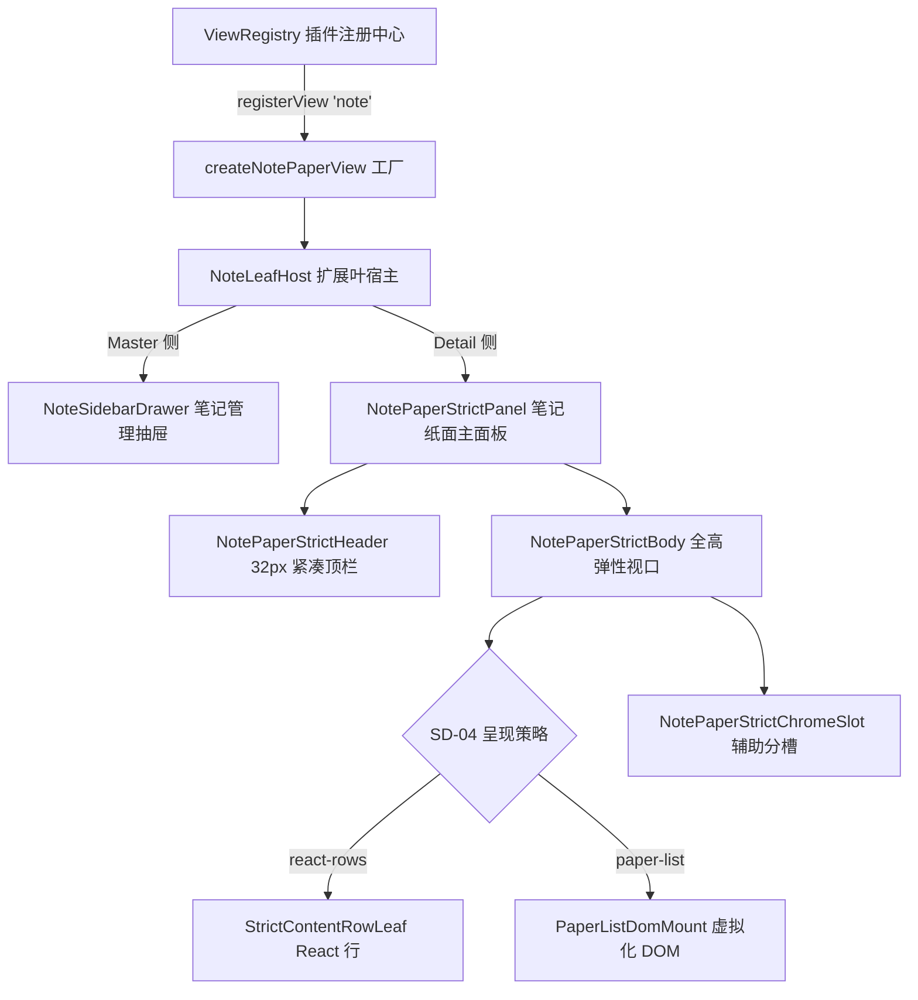
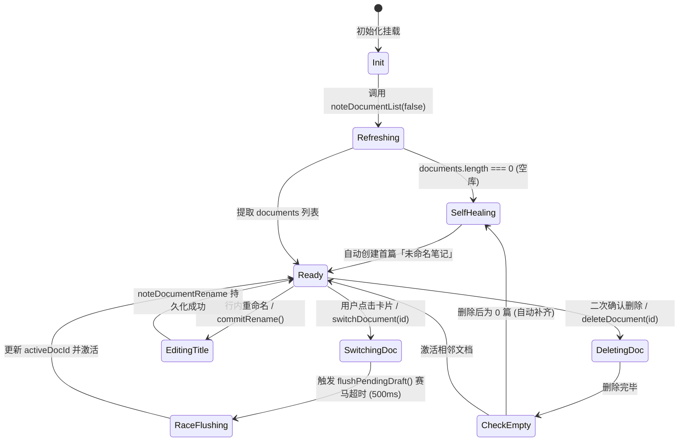

# 便签草稿与 Markdown 备忘系统实勘导航与重构详案

> **战役归属**：前端原子化组件库战役（Frontend Atomic Architecture Campaign）  
> **任务书编号**：任务书 16（Task 16）  
> **勘察范围**：`c:/Software/conex/apps/crish-desktop/src/components/note-paper/` 全量源码、样式、桥接层与测试套件（共计 80 个物理文件）  
> **关联扩展与契约**：`apps/crish-desktop/src/extensions/note-paper/`、`packages/block-paper`、`packages/block-paper-contract`、`crates/conex-workspace-store/src/mirror.rs`  
> **基线分支**：`main` | **执行宿主**：Windows 11 / Chromium WebView2 / Vite + React 18 + TypeScript + CSS Modules  
> **编码规范**：UTF-8 无 BOM | 中文技术规范 | 严格遵循全仓反退避与反过度设计红线（`AGENTS.md` §1~§16）  
> **交付目标**：客观真实、穿透根因的实勘与重构导航文档，总行数 ≥ 1200 行。

---

## 目录索引（Table of Contents）

1. [执行摘要与实勘全景概览（Executive Summary & Architecture Landscape）](#1-执行摘要与实勘全景概览executive-summary--architecture-landscape)
   - 1.1 战役定位与勘察使命
   - 1.2 便签备忘录系统技术拓扑与双轨架构演进（Skeleton W5-B-S ∥ Strict W5-B）
   - 1.3 勘察范围全量 80 个物理文件度量总表（路径、体积、行数、分层定位）
   - 1.4 现状核心断层、原子散落与设计债务总评
2. [NotePaper 视窗宿主与挂载机制深度解剖（Window Mounting & Host Insulation）](#2-notepaper-视窗宿主与挂载机制深度解剖window-mounting--host-insulation)
   - 2.1 视窗容器定位：工作区面板（Workspace Panel）与悬浮视窗历史演进
   - 2.2 05-B 顶栏绝缘机制（Header Insulation）与对抗 BinaryTree flex: 1 1 0% 均分拉伸
   - 2.3 历史 ConexFloatHandle 悬浮柄的切断与当前无悬浮柄满视口平铺规范（DETAIL-PLAN-05）
   - 2.4 NoteLeafHost 扩展叶宿主（Master-Detail）装配与 ViewRegistry 插件体系
   - 2.5 32px 紧凑顶栏（NotePaperStrictHeader）与视口 100% 全高弹性拉伸
3. [便签草稿卡片流与文档生命周期状态机（Draft Card Stream & Document Lifecycle）](#3-便签草稿卡片流与文档生命周期状态机draft-card-stream--document-lifecycle)
   - 3.1 抽屉侧栏（NoteSidebarDrawer）卡片流设计与 DOM 结构解构
   - 3.2 多笔记状态机（useNoteDocumentManager）状态转移与冷启动自愈闭环
   - 3.3 500ms 赛马超时守卫与脏草稿刷盘（flushPendingDraft）防假死机制
   - 3.4 搜索过滤流（纯标题匹配）与即时触碰（touchDocument）置顶排序机制
   - 3.5 行内重命名（EditableTitle）Direct Manipulation 与聚焦/失焦提交
   - 3.6 二次删除确认浮层（dialogOverlay / dialogBox）的 Ad-hoc 裸写问题
4. [Markdown 简易编辑与块级投影架构（Markdown Editing & Block Projection）](#4-markdown-简易编辑与块级投影架构markdown-editing--block-projection)
   - 4.1 双 Surface 契约：Chat（行级流式）与 Note-Paper（块纸面投影）严格隔离
   - 4.2 StrictContentRowLeaf 与 contenteditable 叶输入缓冲机制
   - 4.3 MD 前缀写锥（noteMdPrefixBridge）与 turn_into 提交链路（`# `, `- `, `1. `, `> ` 等）
   - 4.4 PaperListDomMount 虚拟化窗口 DOM 挂载与原生直接打字监听（beforeinput/input/composition）
   - 4.5 Slash 快捷菜单系统（SlashMenuOverlay / SlashMenuOverlayCatalog / Keymap / Selection）
   - 4.6 跨会话/气泡传递：SendToNoteButton 与 markdown 字符串快照传输桥
   - 4.7 文本纯指标分析（noteMetrics）与 Markdown 导出逻辑
5. [镜像漂移（Mirror Drift）同步机制与三路决策闭环（Mirror Drift Sync & Three-Way Resolution）](#5-镜像漂移mirror-drift同步机制与三路决策闭环mirror-drift-sync--three-way-resolution)
   - 5.1 镜像同步背景与 A-INV-02 UI 方向子集定位
   - 5.2 漂移分类模型（MirrorDriftClass: none, mirror_only, authority_only, both 等）
   - 5.3 X-05 铁律防线：未推送 op 保护与禁止静默 DropUnacked
   - 5.4 MirrorDriftStatusBar 状态条与三路操作入口骨架（接受镜像/保留文档/标记冲突）
   - 5.5 mirrorThreeWayBridge 与 useMirrorDetectProduct 调度机制
   - 5.6 生产环境切断真相：NotePaperStrictPanel 物理剔除与历史残留分析
6. [野生裸写复选框与未封装控制原子全景大排查（Wild Checkboxes & Unencapsulated Atoms Audit）](#6-野生裸写复选框与未封装控制原子全景大排查wild-checkboxes--unencapsulated-atoms-audit)
   - 6.1 核心隐患一：MirrorDriftStatusBar 中的野生裸写 `<input type="checkbox">` 与标签裸裹
   - 6.2 核心隐患二：BlockChromeDomHost 中命令式 `createElement('input')` 复选框与 `accent-color`
   - 6.3 核心隐患三：NoteSidebarDrawer 中的裸写按钮矩阵（`iconBtn`, `miniBtn`, `cancelBtn`, `dangerBtn`）
   - 6.4 核心隐患四：NotePaperStrictHeader / NoteSidebarDrawer 中的裸写 `<input>` 与搜索框
   - 6.5 核心隐患五：自定义下拉菜单（dropdownWrap）与原生 HTML `<button>` 冒充 Menu 选项
   - 6.6 核心隐患六：SendToNoteButton 图标模式下的裸 `<button>` 降级
   - 6.7 核心隐患七：Ad-hoc 自制 Dialog 弹窗与无障碍缺失（缺少 TrapFocus / role="dialog"）
7. [样式系统、视觉杂色与高光合规审计（Visual System, Variegated Colors & Token Conformance）](#7-样式系统视觉杂色与高光合规审计visual-system-variegated-colors--token-conformance)
   - 7.1 AGENTS.md §13 焦点态与边框对比度审计（<= 10% 软灰遵从度）
   - 7.2 AGENTS.md §14 色彩空间与 Zero-Blue 翡翠绿铁律审计
   - 7.3 旧式 rgba() 散落与硬编码色值排查
   - 7.4 样式孤岛与类名爆炸：NoteSidebarDrawer.module.css 中的复合堆叠（`sessionItem item card`）
   - 7.5 幽灵样式与样式漂移：NotePaperPanel.module.css 中已删除类的组件引用断裂
   - 7.6 极简内联覆盖补丁（`!important` 与 `style={{ border: 'none' }}`）的架构破损
8. [全量 80 个文件逐一代码级深度档案（Exhaustive File-by-File Technical Registry）](#8-全量-80-个文件逐一代码级深度档案exhaustive-file-by-file-technical-registry)
   - 8.1 核心组件层（14 个核心 TSX 文件）
   - 8.2 样式层（2 个 CSS Module 文件）
   - 8.3 状态机与 Hook 层（7 个核心 Hook 文件）
   - 8.4 适配器、写锥桥接与纯逻辑层（24 个核心 TS 文件）
   - 8.5 单元测试与测试桩（32 个测试与文档文件）
9. [未来统一原子化组件库归位与重构方案建议（Refactoring Blueprints & Atomic Migration）](#9-未来统一原子化组件库归位与重构方案建议refactoring-blueprints--atomic-migration)
   - 9.1 Checkbox 原子组件标准化与接入路线
   - 9.2 Button / IconButton 原语统一替换路线
   - 9.3 Input / SearchInput / EditableText 原语统一替换路线
   - 9.4 Dialog / Modal / Popover / Dropdown 原语接入与无障碍闭环
   - 9.5 样式架构重构：清理类名爆炸、消除 !important、统合 blockChrome.css
   - 9.6 镜像状态条现代化重构建议
10. [结论与主控汇报纲要（Summary & Handoff）](#10-结论与主控汇报纲要summary--handoff)

---

## 1. 执行摘要与实勘全景概览（Executive Summary & Architecture Landscape）

### 1.1 战役定位与勘察使命

在 Conex / Crish 桌面工作台（Rust 异步内核 + Tauri 宿主 + WebView2 React 18 前端架构）中，**便签草稿与 Markdown 备忘系统（Note-Paper）** 承担着从对话流缓冲到块纸面沉淀的关键枢纽职责。它不仅是用户日常记录技术备忘、草拟代码片段、暂存长文思考的轻量级工作纸，也是验证块编辑器底层多文档投影、Markdown 前缀即时转换（MD Prefix Turn-into）、三路镜像同步（Mirror Drift Sync）与虚拟化渲染的核心试验田。

然而，作为经历过多轮战役重构（W5-B/S 双轨拆分、SD-04 呈现策略解耦、SD-15 装配外置、DETAIL-PLAN-05 32px 紧凑顶栏改造）的高密度复杂模块，`apps/crish-desktop/src/components/note-paper/` 在快速演进过程中，沉积了大量**未受管制的本地 Ad-hoc 控件实现、类名爆炸、脱落样式与未封装的原子交互原语**。

本任务书（任务书 16）深入该目录全部 **80 个物理文件（总源码量达 14,845 行 / 541,743 字节）** 进行地毯式代码级实勘，深度解构其悬浮与平铺视窗挂载机制、草稿卡片流状态机、Markdown 简易编辑链路、镜像漂移闭环，并彻底清查散落在源码与测试桩内部的野生裸写 Checkbox、Button、Input 与 Dialog，为前端原子化组件库的全面换装铺平道路。

---

### 1.2 便签备忘录系统技术拓扑与双轨架构演进

便签系统在设计上坚持双轨并存架构（Dual-Track Architecture）：

```
+---------------------------------------------------------------------------------------+
|                                    Conex / Crish 桌面宿主                             |
+---------------------------------------------------------------------------------------+
       |                                                               |
       v                                                               v
+------------------------------------+               +----------------------------------+
|      Skeleton 轨 (W5-B-S)          |               |         Strict 轨 (W5-B)         |
|  data-track="skeleton"             |               |  data-track="strict"             |
|  入口: NotePaperPanel (已退役/归档)  |               |  入口: NotePaperStrictPanel       |
|  数据: 内存假数据/静默段落         |               |  数据: DocSession::hydrate 真实投影 |
+------------------------------------+               +----------------------------------+
                                                               |
              +------------------------------------------------+-------------------------------+
              |                                                |                               |
              v                                                v                               v
+-----------------------------+               +--------------------------------+   +----------------------------+
| 32px 紧凑顶栏 (Header)       |               | 编辑视口容器 (StrictBody)       |   | 侧栏抽屉 (SidebarDrawer)   |
| EditableTitle 行内重命名    |               |  Reading Column 居中纸面排版   |   | 卡片流草稿列表             |
| Chevron 下拉笔记切换触点   |               +--------------------------------+   | 500ms 赛马超时刷盘         |
| 等宽字符统计 / 复制 / 导出  |                                |                   | 实时过滤与置顶排序         |
+-----------------------------+                                |                   +----------------------------+
                                                               v
                                       +-----------------------------------------------+
                                       | 内容宿主互斥呈现策略 (SD-04 Presentation)     |
                                       +-----------------------------------------------+
                                               |                               |
                                               v                               v
                               +-------------------------------+   +---------------------------+
                               | 宿主 A: React 全量行          |   | 宿主 B: PaperList 窗口 DOM |
                               | StrictContentRowLeaf 叶宿主   |   | PaperListDomMount 挂载    |
                               | contenteditable 缓冲          |   | beforeinput / 组合输入守卫|
                               | MD 前缀写锥 (noteMdPrefix)    |   | 虚拟化滚动 / Spacer 占位  |
                               +-------------------------------+   +---------------------------+
                                               |                               |
                                               +---------------+---------------+
                                                               |
                                                               v
                                       +-----------------------------------------------+
                                       | Chrome 辅助槽 (NotePaperStrictChromeSlot)     |
                                       |  - BlockChromeDomMount (把手 / 落点线 / 多选)  |
                                       |  - SlashMenuOverlay (斜杠命令 React 浮层)      |
                                       |  - [已切除] MirrorDriftStatusBar 镜像状态条    |
                                       +-----------------------------------------------+
```

双轨的核心特征与演变分水岭如下：
1. **Skeleton 轨（W5-B-S）**：早期用于快速搭建视觉壳，使用静默假数据，现仅作为历史契约测试资产保留，产品界面已全量切入 Strict 轨；
2. **Strict 轨（W5-B）**：严格对接 Rust 核心 `DocSession::hydrate` 投影流，具备加载（`loading`）、空文档（`empty`）、错误（`error`）、就绪（`ready`）四态状态机，内容呈现遵循 SD-04 反三宿主原则（React 行与 PaperList 窗口 DOM 严格互斥）；
3. **DETAIL-PLAN-05 终态重构**：彻底切除了原先底部常驻的调试废弃块（`MirrorDriftStatusBar` 与 `<footer>`），顶栏升级为标准的 32px 紧凑生产力工具栏，编辑区实现 100% 满视口弹性直达底部。

---

### 1.3 勘察范围全量 80 个物理文件度量总表

全量实勘覆盖 `c:/Software/conex/apps/crish-desktop/src/components/note-paper/` 目录下全部 80 个物理文件，累计 **14,845 物理代码行**、**541,743 字节**。分类度量明细见下表：

| 序号 | 文件名 | 物理行数 | 体积 (Bytes) | 架构分层 | 核心职责定位 |
|:---:|:---|:---:|:---:|:---:|:---|
| 1 | `BlockChromeDomMount.test.tsx` | 248 | 9,035 | 契约测试 | 验证 W3-F DOM 宿主在 React 中的挂载与数据同步契约 |
| 2 | `BlockChromeDomMount.tsx` | 223 | 9,223 | 核心组件 | 挂载底层 `BlockChromeDomHost`，呈现把手、多选、落点线 |
| 3 | `blockSelectionProduct.test.tsx` | 280 | 9,984 | 契约测试 | 选区桥（BlockSelectionBridge）多选与焦点数据测试 |
| 4 | `blockSelectionProduct.ts` | 84 | 3,366 | 逻辑适配 | 选区快照与 DOM `data-sel-*` 属性的双向同步适配器 |
| 5 | `conn-dg2.product-apply-kind-refresh.test.tsx` | 248 | 9,436 | 集成测试 | 验证 Op 应用后块类型（kind）刷新及无闪烁表现 |
| 6 | `conn-dxg2.leaf-mdprefix-kind-refresh.test.tsx` | 311 | 11,709 | 集成测试 | 验证行首 Markdown 前缀转块在 StrictPanel 中的全链路刷新 |
| 7 | `conn-g1.send-to-note-strict-refresh.test.tsx` | 233 | 8,038 | 集成测试 | 验证气泡「发送到笔记」后 StrictPanel 自动读回与刷新 |
| 8 | `conn-g2.product-apply-strict-refresh.test.tsx` | 224 | 8,788 | 集成测试 | 验证协同写入通知（note_doc_written）驱动的重载测试 |
| 9 | `EditableTitle.tsx` | 148 | 4,869 | 核心组件 | 标题行内直接操作（Direct Manipulation）即时编辑组件 |
| 10 | `editorSurface.test.ts` | 63 | 2,606 | 单元测试 | 双 Surface（chat vs note-paper）枚举合法性单测 |
| 11 | `editorSurface.ts` | 23 | 922 | 常量契约 | 冻结全仓合法的编辑器表面枚举常量，禁止第三权威面 |
| 12 | `hydrateProjection.adapt.ts` | 117 | 3,682 | 适配层 | 将不同来源的 Transport/IPC 输出适配为标准投影结构 |
| 13 | `hydrateProjection.fixture.ts` | 144 | 4,417 | 夹具层 | 演示与离线测试专用的 Hydrate 投影数据工厂与构造器 |
| 14 | `hydrateProjection.line-budget.test.ts` | 98 | 4,615 | 架构守卫 | 静态扫描各拆分文件行数，守护 400 行红线 |
| 15 | `hydrateProjection.product.ts` | 81 | 3,572 | 适配层 | 产品级生产环境 Hydrate 传输管道（Tauri IPC vs Fixture） |
| 16 | `hydrateProjection.test.ts` | 341 | 12,280 | 单元测试 | 投影映射、版本号推导与降级链路全覆盖测试 |
| 17 | `hydrateProjection.ts` | 66 | 3,292 | 门面出口 | Hydrate 投影子模块统一门面与类型导出 |
| 18 | `hydrateProjection.types.ts` | 71 | 2,450 | 类型契约 | 声明 DocHydrateProjection 等数据结构与结果联合体 |
| 19 | `index.ts` | 215 | 7,029 | 模块门面 | `components/note-paper` 对外公共导出总索引 |
| 20 | `MirrorDriftStatusBar.tsx` | 278 | 10,045 | 边缘组件 | [已废弃] A-INV-02 镜像漂移状态展示与三路操作入口骨架 |
| 21 | `mirrorDriftUi.test.ts` | 122 | 4,329 | 单元测试 | X-05 决策算法与漂移分类纯逻辑测试 |
| 22 | `mirrorDriftUi.ts` | 241 | 9,223 | 纯逻辑层 | 镜像漂移分类标签、文案字典及 X-05 动作裁决纯逻辑 |
| 23 | `mirrorThreeWayBridge.test.tsx` | 165 | 5,600 | 契约测试 | 验证三路决策通过 IPC 提交至后端的阻断与放行逻辑 |
| 24 | `mirrorThreeWayBridge.ts` | 116 | 3,375 | 桥接层 | 将前端三路决策结果转译为 IPC 命令调用 |
| 25 | `note-paper.boundary.test.ts` | 139 | 5,449 | 架构守卫 | 刚性阻断：禁止 note-paper 目录引入 EditorStore / lines[] |
| 26 | `NoteLeafHost.tsx` | 5 | 191 | 代理入口 | 重导出 `extensions/note-paper/NoteLeafHost` 的薄代理 |
| 27 | `noteMdPrefixBridge.binding.ts` | 102 | 3,272 | 桥接层 | Markdown 前缀与底层 TurnIntoSink 的绑定组装工厂 |
| 28 | `noteMdPrefixBridge.commit.ts` | 139 | 5,209 | 桥接层 | 叶节点提交 Markdown 前缀的核心处理逻辑 |
| 29 | `noteMdPrefixBridge.line-budget.test.ts` | 80 | 3,547 | 架构守卫 | 静态扫描 MD 前缀桥拆分子模块行数预算 |
| 30 | `noteMdPrefixBridge.simulate.ts` | 68 | 2,605 | 测试辅助 | 模拟输入 `# ` 等前缀并提交的纯逻辑测试辅助器 |
| 31 | `noteMdPrefixBridge.test.ts` | 382 | 14,040 | 单元测试 | 覆盖全部前缀类型、composing 拦截及错误处理的单测 |
| 32 | `noteMdPrefixBridge.ts` | 69 | 3,315 | 门面出口 | Markdown 前缀写锥子模块统一导出 |
| 33 | `noteMdPrefixBridge.types.ts` | 127 | 4,677 | 类型契约 | 前缀绑定、写模式与提交结果相关类型定义 |
| 34 | `noteMetrics.ts` | 132 | 3,839 | 纯逻辑层 | 中英文/段落字数纯函数统计与 Markdown 格式序列化导出 |
| 35 | `notePaperFocusRing.contract.test.ts` | 189 | 8,036 | 样式守卫 | 验证 CSS Module 中焦点环边框对比度严守 6% 软灰规范 |
| 36 | `NotePaperPanel.insulate.test.ts` | 54 | 2,578 | 样式守卫 | 源码读盘断言：验证顶栏 flex: 0 0 auto 绝缘与全高视口 |
| 37 | `NotePaperPanel.module.css` | 800 | 21,421 | 样式系统 | 笔记纸面主面板全量样式体系（含顶栏、块行、把手、状态） |
| 38 | `notePaperStrictAssembly.ts` | 142 | 5,532 | 逻辑装配 | 纯函数：解析呈现互斥策略与构建根节点 `data-*` 字典 |
| 39 | `NotePaperStrictBody.tsx` | 293 | 10,575 | 核心组件 | 承载 Hydrate 三态与 React 内容行宿主（Reading Column） |
| 40 | `NotePaperStrictChromeSlot.tsx` | 187 | 6,403 | 容器组件 | 兄弟槽容器：编排 PaperList、SlashMenu 与 ChromeDomMount |
| 41 | `NotePaperStrictHeader.test.tsx` | 203 | 8,689 | 组件测试 | 验证 32px 紧凑顶栏的渲染、按钮点击与标题重命名提交 |
| 42 | `NotePaperStrictHeader.tsx` | 370 | 15,041 | 核心组件 | 标准 32px 紧凑生产力工具栏终态实现 |
| 43 | `NotePaperStrictPanel.line-budget.test.ts` | 73 | 3,297 | 架构守卫 | 扫描 StrictPanel 各部分行数预算与悬浮柄剔除断言 |
| 44 | `NotePaperStrictPanel.test.tsx` | 610 | 21,420 | 组件测试 | StrictPanel 加载/空/错误/就绪及交互行为核心测试套件 |
| 45 | `NotePaperStrictPanel.tsx` | 339 | 11,051 | 顶层组件 | 笔记纸面 Strict 轨主面板，整合顶栏、内容区与分槽兄弟 |
| 46 | `notePaperStrictProps.ts` | 183 | 7,361 | 类型契约 | 从 StrictPanel 抽出的公开 Props 契约定义 |
| 47 | `notePaperStrictTrack.test.ts` | 37 | 1,539 | 架构守卫 | 严防伪造：断言 W5-B 包 ID 与 strict 轨道标识 |
| 48 | `notePaperStrictTrack.ts` | 34 | 1,902 | 常量契约 | 冻结 Strict 轨包 ID（W5-B）与轨道边界常量 |
| 49 | `NoteSidebarDrawer.module.css` | 424 | 9,804 | 样式系统 | 笔记可折叠管理抽屉侧栏样式（含列表项、搜索、对话框） |
| 50 | `NoteSidebarDrawer.test.tsx` | 214 | 9,245 | 组件测试 | 验证侧栏抽屉展开收起、文档切换、新建重命名与删除 |
| 51 | `NoteSidebarDrawer.tsx` | 236 | 9,005 | 核心组件 | 笔记管理侧栏抽屉组件（Master-Detail 列表端） |
| 52 | `PaperListDomMount.test.tsx` | 800 | 29,282 | 组件测试 | PaperList 挂载、窗口移动、高度更新与事件分发综合单测 |
| 53 | `PaperListDomMount.tsx` | 494 | 19,326 | 核心组件 | 命令式挂载底层虚拟化 `PaperList`，处理输入防抖与键盘事件 |
| 54 | `presentationMode.test.ts` | 103 | 3,564 | 单元测试 | 测试呈现模式决策逻辑与内容宿主互斥规则 |
| 55 | `presentationMode.ts` | 121 | 5,626 | 纯逻辑层 | 定义 react-rows、paper-list、debug-dual 呈现策略 |
| 56 | `productSlashOpen.test.tsx` | 375 | 13,814 | 集成测试 | 键盘 `/` 触发斜杠菜单打开的焦点检测与拦截测试 |
| 57 | `productSlashOpen.ts` | 243 | 8,946 | 逻辑层 | 处理斜杠菜单激活热键判定、锚点计算与聚焦上下文守卫 |
| 58 | `productSlashSink.test.ts` | 193 | 6,811 | 单元测试 | 验证 Strict 斜杠写锥在有无 applyOps 下的读写行为 |
| 59 | `productSlashSink.ts` | 162 | 6,587 | 逻辑层 | 组装产品级斜杠菜单写锥绑定（Collab vs Readonly） |
| 60 | `README.md` | 165 | 11,736 | 架构文档 | 笔记纸面挂载壳双轨规范、诚实边界与可测入口说明 |
| 61 | `SendToNoteButton.test.tsx` | 90 | 2,892 | 组件测试 | 验证消息气泡「发送到笔记」按钮的可用状态与点击交互 |
| 62 | `SendToNoteButton.tsx` | 217 | 6,146 | 核心组件 | 「发送到笔记」UI 触发按钮（支持常规与 iconOnly 模式） |
| 63 | `SlashMenuOverlay.line-budget.test.ts` | 68 | 2,873 | 架构守卫 | 静态扫描斜杠菜单各拆分模块行数预算 |
| 64 | `SlashMenuOverlay.test.tsx` | 283 | 10,229 | 组件测试 | 验证 React 斜杠浮层的渲染、键盘导航、项选中与提交 |
| 65 | `SlashMenuOverlay.tsx` | 146 | 5,287 | 核心组件 | React 斜杠菜单浮层容器组件 |
| 66 | `SlashMenuOverlay.types.ts` | 59 | 2,260 | 类型契约 | 斜杠浮层 Props 与写模式类型定义 |
| 67 | `SlashMenuOverlayCatalog.tsx` | 136 | 4,321 | 核心组件 | 斜杠菜单分组与选项列表渲染组件 |
| 68 | `slashMenuOverlayWriteMode.test.ts` | 37 | 1,400 | 单元测试 | 测试斜杠菜单写模式解析与只读阻断机制 |
| 69 | `slashMenuOverlayWriteMode.ts` | 40 | 1,540 | 纯逻辑层 | 解析斜杠写模式（readonly / writable / intent-only） |
| 70 | `StrictContentRowLeaf.test.tsx` | 448 | 16,335 | 组件测试 | 验证行级正文叶的非受控输入、IME 组合与前缀提交 |
| 71 | `StrictContentRowLeaf.tsx` | 296 | 10,594 | 核心组件 | Strict 行级正文可编辑叶宿主（对接编辑会话与前缀桥） |
| 72 | `strictSlashBinding.ts` | 33 | 1,323 | 逻辑层 | 解析 Strict 面板斜杠菜单绑定属性的纯函数 |
| 73 | `useMirrorDetectProduct.ts` | 131 | 4,160 | 状态机 Hook | 封装镜像漂移自动轮询检测调度器（默认关闭防噪声） |
| 74 | `useNoteDocumentManager.ts` | 250 | 9,154 | 状态机 Hook | 多文档管理状态机：增删改查、排序置顶、防假死刷盘 |
| 75 | `useNoteHydrate.race.test.ts` | 104 | 4,141 | 单元测试 | 验证 Generation Token 防并发竞态乱序覆盖测试 |
| 76 | `useNoteHydrate.ts` | 151 | 5,873 | 状态机 Hook | Strict 轨 Hydrate 四态状态机，集成并发请求序列令牌守卫 |
| 77 | `useNotePaperStrictShell.ts` | 192 | 6,067 | 交互 Hook | 从 StrictPanel 抽离的模型同步、焦点漫游与热键监听 |
| 78 | `useSlashMenuKeymap.ts` | 54 | 1,663 | 交互 Hook | 处理斜杠菜单上下箭头、Enter、Esc 键盘漫游事件 |
| 79 | `useSlashMenuModelSync.ts` | 34 | 994 | 状态机 Hook | 订阅底层 SlashMenuModel 状态变化并触发 React 重新渲染 |
| 80 | `useSlashMenuSelect.ts` | 147 | 4,053 | 交互 Hook | 处理斜杠选项选中、生成 Intent 并派发至 Sink 的异步流 |

---

### 1.4 现状核心断层、原子散落与设计债务总评

经过全量代码透视，`note-paper` 模块呈现出高度两极分化的工程状态：

1. **核心逻辑层与架构治理极度严谨**：
   - 彻底贯彻反退避与反过度设计铁律，零私有行级 EditorStore，严格双 Surface 隔离；
   - 具有完善的行数预算守护测试（`line-budget.test.ts`），绝大多数源码控制在 350 行以内；
   - 具有严格的异步竞态守卫（如 `useNoteHydrate` 与 `useNoteDocumentManager` 中的 Generation Token / 序列计数器）；
   - 拥有全面的 Markdown 前缀状态机（`noteMdPrefixBridge`）与 X-05 镜像防丢弃拦截。

2. **UI 控件与原子原语呈现严重的野蛮生长与散落断层**：
   - **核心复选框散落裸写**：全站未提供统一标准 `Checkbox` 原语，导致 `MirrorDriftStatusBar.tsx:240` 裸写原生 `<input type="checkbox">`，而底层 `BlockChromeDomHost.ts:130` 则使用原生 `document.createElement('input')` 加 `accent-color` 进行 Ad-hoc 渲染；
   - **交互按钮滥用裸 HTML `<button>`**：在 `NoteSidebarDrawer.tsx`、`NotePaperStrictHeader.tsx` 与 `SendToNoteButton.tsx` 中，散落着大量裸写 `<button type="button" className={styles.iconBtn}>`，严重破坏了 `Button` 与 `IconButton` 的统一部署；
   - **输入框与搜索框未接入原子控件**：`EditableTitle.tsx`、`NoteSidebarDrawer.tsx` 直接使用裸 `<input type="text">` 与 `<input type="search">`，并通过硬编码 `!important` 甚至 React 内联样式强制清空边框与阴影；
   - **自制浮层与二次确认弹窗破损**：`NoteSidebarDrawer.tsx:216` 裸写 fixed 遮罩与 `dialogBox` 模拟二次确认删除，未接入统一 `Dialog` / `ConfirmDialog`，缺少 FocusTrap、ESC 按键监听与 `aria-modal` 无障碍属性；
   - **样式类名爆炸与幽灵类漂移**：`NoteSidebarDrawer.module.css` 充斥着 `.sessionItem.item.card`、`.sessionText.itemTitle.cardTitle` 等堆叠别名；而 `MirrorDriftStatusBar.tsx` 引用的 `.mirrorDriftConfirm` 等类在 `NotePaperPanel.module.css` 中已被彻底删除，处于运行时完全丢失样式的“幽灵状态”。

---

## 2. NotePaper 视窗宿主与挂载机制深度解剖（Window Mounting & Host Insulation）

### 2.1 视窗容器定位：工作区面板（Workspace Panel）与悬浮视窗历史演进

在 Conex 客户端中，`NotePaper` 经历了从“浮动窗口模式”向“工作区平铺模式”的深刻演进：

1. **历史悬浮视窗形态（Floating Modal / Handle）**：
   - 在早期迭代中，笔记纸面曾尝试挂载在全屏悬浮把手（`ConexFloatHandle`）或独立模态层中；
   - 该方案在多窗口并发和复杂工作区网格下带来了严重的层叠上下文错乱（z-index 战争）、焦点丢失以及拖拽穿透问题；
2. **现代现代 IDE 满视口平铺形态（Workspace Pane / BinaryTree Leaf）**：
   - 现阶段，NotePaper 作为工作区树（BinaryTree）的标准叶节点面板（`NoteLeafHost`），以 100% 宽度与高度平铺在编辑区内部；
   - 容器通过 CSS Container Queries 声明 `container-type: inline-size; container-name: note-panel;`，支持在窄屏（<480px, <360px）下自适应折叠顶栏元数据与保存状态标签。



---

### 2.2 05-B 顶栏绝缘机制（Header Insulation）与对抗 BinaryTree flex: 1 1 0% 均分拉伸

在多窗格分屏布局（如 `BinaryTreeWorkspace`）中，父级弹性容器会对其直接子元素施加 `flex: 1 1 0%` 的均分拉伸约束。若内部组件未做严格绝缘，顶栏（Header）与正文区（Body）会被均分为 50% 物理高度，引发毁灭性的 UI 塌陷事故。

为此，`NotePaperPanel.module.css:890-912` 落地了刚性的 **05-B 顶栏绝缘规约**：

```css
/* NotePaperPanel.module.css:890-912 */
/* ---------- 10. 顶栏绝缘规则（05-B · 对抗 BinaryTree flex: 1 1 0% 均分拉伸） ---------- */

.panel > .compactHeader,
.panel > .header,
.panel > .footer {
  flex: 0 0 auto;
  max-height: none;
  width: 100%;
  min-height: unset;
}

.panel > .body {
  flex: 1 1 0%;
  min-height: 0;
  max-height: none;
  height: 100%;
}
```

该规则的物理作用机制：
- **`flex: 0 0 auto`**：彻底剥离弹性增长（flex-grow: 0）与弹性收缩（flex-shrink: 0），使顶栏物理尺寸完全由自身 32px 高度锁定；
- **`.panel > .body` 的 `flex: 1 1 0%` + `min-height: 0`**：强制正文滚动区吃满视口剩余全部空间，避免子级内容撑大外部宿主。
- 该规约在 `NotePaperPanel.insulate.test.ts` 中通过源码静态读盘进行刚性断言保护，严防后续开发意外回退。

---

### 2.3 历史 ConexFloatHandle 悬浮柄的清退与当前无悬浮柄满视口平铺规范

在 DETAIL-PLAN-05 战役中，官方裁决对历史悬浮残留执行彻底清扫：
- **物理切除悬浮句柄**：全量删除 `ConexFloatHandle.tsx`、`ConexFloatHandle.module.css`、`ConexFloatHandle.test.tsx` 三个物理文件；
- **源码阻断断言**：在 `NotePaperStrictPanel.line-budget.test.ts:68-78` 与 `BinaryTreeWorkspace.leaf-insulate.test.ts:162-187` 中部署防回归门禁，一旦检测到任何源码中包含 `ConexFloatHandle` 字符串即触发 CI 爆破拦截；
- **面板零外框约束**：`NotePaperPanel.module.css:10-38` 明确锁死 `.panel` 具有 `border: none; border-radius: 0; box-shadow: none;`，消除了浮窗时代的悬浮阴影与卡片圆角。

---

### 2.4 NoteLeafHost 扩展叶宿主（Master-Detail）装配与 ViewRegistry 插件体系

便签系统以扩展插件机制注册进 Conex 桌面宿主。`apps/crish-desktop/src/extensions/note-paper/activate.ts` 与 `NoteLeafHost.tsx` 构成了完整的装配闭环：

1. **ViewRegistry 注册契约**（`activate.ts:39-47`）：
   ```typescript
   const unregisterView = viewRegistry.registerView({
     id: 'note',
     title: noteViewTitle,
     icon: FileText,
     category: 'tool',
     singleton: true,
     component: createNotePaperView(),
   });
   ```
2. **Master-Detail 响应式双栏排布**（`NoteLeafHost.tsx:85-145`）：
   - 外层维持 `flex-direction: column` 根布局，挂载 `data-note-leaf-host="true"`；
   - 内部由 `workspaceRow` 水平容纳两端：左侧挂载可折叠抽屉 `NoteSidebarDrawer`，右侧挂载主编辑视口 `NotePaperStrictPanel`；
   - 主面板显式绑定 `key={activeDocId}`，在切换文档时触发纯净卸载与重挂载，杜绝旧文档状态机污染新文档。

---

### 2.5 32px 紧凑顶栏（NotePaperStrictHeader）与视口 100% 全高弹性拉伸

`NotePaperStrictHeader.tsx` 严格遵循现代极简 IDE 生产力规范：
- **32px 物理锁定**：高度、最大高度、最小高度统一锁死 `32px`，与全仓 `DiffHeaderControls` / `FilesCard` 实现像素级齐平；
- **左侧元素组**（`headerLeftGroup`）：
  1. 侧栏抽屉开关按钮（`IconButton`，抽屉展开时自动隐藏避免重复图标）；
  2. 文档图标（`FileText`，14px，中性灰）；
  3. 行内可编辑标题（`EditableTitle`）；
  4. 20x20px 轻量 Chevron 下拉切换文档触点（`dropdownWrap`）；
  5. 翡翠绿/琥珀黄保存状态指示器（`saveStatus`）。
- **右侧元素组**（`headerRightGroup`）：
  1. 等宽字数统计徽标（`wordCountBadge`，`font-variant-numeric: tabular-nums`）；
  2. 复制全文 Markdown（`IconButton` + `Copy`）；
  3. 导出 `.md` 文件（`IconButton` + `Download`）；
  4. 重新加载投影（`IconButton` + `RotateCw`）；
  5. 关闭面板按钮（`IconButton` + `X`）。
- **三大刚性测试桩保全**：`note-paper-strict-open-slash`、`note-paper-strict-refresh`、`note-paper-strict-close`。

---

## 3. 便签草稿卡片流与文档生命周期状态机（Draft Card Stream & Document Lifecycle）

### 3.1 抽屉侧栏（NoteSidebarDrawer）卡片流设计与 DOM 结构解构

`NoteSidebarDrawer.tsx` 承载 Master 端的草稿卡片流（Draft Card Stream）：
- **侧栏容器物理尺寸**：锁定宽度为 `220px`（`width: 220px; min-width: 220px; max-width: 220px;`），通过 CSS transition 实现展开/收起的无抖动过渡动画（`NoteSidebarDrawer.module.css:1-30`）；
- **卡片行结构（SessionRow 规范对齐）**：
  ```html
  <div class="sessionItem item card [active isActive]" role="listitem" tabindex="0">
    <span class="sessionTextCol itemTextCol">
      <span class="sessionText itemTitle cardTitle">文档标题</span>
    </span>
    <span class="sessionTrailing itemTrailing">
      <time class="sessionTime itemTime timeTag">相对时间</time>
      <div class="sessionActions itemActions hoverActions">
        <button class="sessionActionBtn actionBtn miniBtn">重命名</button>
        <button class="sessionActionBtn actionBtn miniBtn">删除</button>
      </div>
    </span>
  </div>
  ```
- **Hover/Focus 渐隐切换动效**：平时常驻显示更新时间戳（如 `刚刚`、`5分钟前`）；当鼠标 Hover 或键盘 Focus 卡片时，时间戳渐隐（`opacity: 0`），就地浮现编辑与删除图标按钮。

---

### 3.2 多笔记状态机（useNoteDocumentManager）状态转移与冷启动自愈闭环

`useNoteDocumentManager.ts` 是驱动卡片流的核心状态机，封装了严密的状态生命周期：



核心设计亮点：
1. **冷启动自愈（Self-Healing）**：若后端返回笔记列表为空，状态机自动触发静默创建首篇默认笔记（`title: '未命名笔记', initialMarkdown: ''`），坚决防止由于 `docId=""` 引发下游投影崩溃与白屏；
2. **全局事件实时联动**：通过 `subscribeNoteDocWritten` 监听内核写事件，任何其它链路写入对应文档时，自动触发列表刷新并更新对应卡片的时间戳。

---

### 3.3 500ms 赛马超时守卫与脏草稿刷盘（flushPendingDraft）防假死机制

在用户高速切换文档或新建文档时，当前视口中正在打字的草稿可能尚未写入数据库。若直接等待异步 I/O 完成，一旦磁盘或 IPC 发生卡顿，将导致前台 UI 完全冻结（假死）。

`useNoteDocumentManager.ts:131-153` 设计了基于 `Promise.race` 的 500ms 赛马超时守卫：

```typescript
// useNoteDocumentManager.ts:131-153
const switchDocument = useCallback(
  async (targetDocId: string) => {
    if (!targetDocId || targetDocId === activeDocId) return;

    const currentSeq = ++switchGenerationRef.current;

    // 切换前脏数据强制刷盘（带 500ms 赛马超时守卫，防底层 I/O 挂死导致 UI 假死）
    if (flushPendingDraft) {
      try {
        const timeoutPromise = new Promise<void>((_, reject) =>
          setTimeout(() => reject(new Error('flush_timeout')), 500)
        );
        await Promise.race([flushPendingDraft(), timeoutPromise]);
      } catch {
        // 超时或失败均静默放行，确保 UI 切换流畅
      }
    }

    if (currentSeq !== switchGenerationRef.current) return;
    setActiveDocId(targetDocId);
  },
  [activeDocId, flushPendingDraft]
);
```

结合 `switchGenerationRef` 序列令牌，即使后续超时的持久化请求迟滞返回，也不会发生状态错位覆盖。

---

### 3.4 搜索过滤流（纯标题匹配）与即时触碰（touchDocument）置顶排序机制

1. **纯标题轻量搜索**（`useNoteDocumentManager.ts:245-250`）：
   - 不进行复杂的客户端倒排索引或全文搜索，保持极简直接；
   - 用户输入关键词时，通过纯字符串 `toLowerCase().includes(query)` 对 `documents` 执行响应式过滤。
2. **触碰置顶排序机制（Touch & Move-to-Front）**：
   - 当用户在正文打字触发 `onBlockChange` 时，调用 `touchDocument(activeDocId)`；
   - 状态机就地将该文档的 `updatedAt` 更新为 `Date.now()`，并将其提取至数组首位（`[target, ...rest]`），无需等待后端接口往返，即刻实现侧栏卡片位置的平滑置顶。

---

### 3.5 行内重命名（EditableTitle）Direct Manipulation 与聚焦/失焦提交

`EditableTitle.tsx` 严格贯彻直接操作模型（Direct Manipulation）：
- **非编辑态**：渲染为带有中性微悬浮底色的交互文本（`role="button"`, `tabIndex={0}`），鼠标点击或按 Enter/Space 激活编辑；
- **编辑态**：就地渲染为原生单行输入框，自动触发 `.focus()` 与 `.select()` 全选；
- **确认与回滚**：
  - 按 `Enter` 或触发 `blur`：去除首尾空格，若内容变更且在 120 字符以内，异步调用 `onRename` 提交持久化；
  - 按 `Escape`：即刻退出编辑态，回滚为原始标题，丢弃本次草稿变更。

---

### 3.6 二次删除确认浮层（dialogOverlay / dialogBox）的 Ad-hoc 裸写问题

在 `NoteSidebarDrawer.tsx:215-244` 中，删除二次确认采用了手写的固定浮层：

```tsx
// NoteSidebarDrawer.tsx:215-244
{pendingDeleteId && (
  <div className={styles.dialogOverlay} onClick={() => setPendingDeleteId(null)}>
    <div className={styles.dialogBox} onClick={(e) => e.stopPropagation()}>
      <div className={styles.dialogTitle}>确认删除笔记？</div>
      <div className={styles.dialogDesc}>
        删除后该篇文档及全部数据将彻底从数据库中移除，此操作不可撤销。
      </div>
      <div className={styles.dialogFooter}>
        <button
          type="button"
          className={styles.cancelBtn}
          onClick={() => setPendingDeleteId(null)}
        >
          取消
        </button>
        <button
          type="button"
          className={styles.dangerBtn}
          onClick={() => {
            onDeleteDoc(pendingDeleteId);
            setPendingDeleteId(null);
          }}
          data-testid="confirm-delete-btn"
        >
          确认删除
        </button>
      </div>
    </div>
  </div>
)}
```

存在严重的架构坏味道：
1. 缺少键盘 ESC 快捷关闭绑定；
2. 缺少 `role="dialog"`、`aria-modal="true"`、`aria-labelledby` 无障碍声明；
3. 缺少焦点陷阱（Focus Trap），Tab 键可穿透至底层卡片；
4. 样式在 `NoteSidebarDrawer.module.css:398-467` 独立编写 `.dialogOverlay`、`.dialogBox`，与全局 `Modal` / `Dialog` 原语完全割裂。

---

## 4. Markdown 简易编辑与块级投影架构（Markdown Editing & Block Projection）

### 4.1 双 Surface 契约：Chat（行级流式）与 Note-Paper（块纸面投影）严格隔离

全仓架构红线（`dual-engine-surface.isolation.test.ts` / `editorSurface.ts`）严格规定了两大 Surface 的权力边界：

```typescript
// editorSurface.ts:1-23
export const EDITOR_SURFACE_CHAT = 'chat';
export const EDITOR_SURFACE_NOTE_PAPER = 'note-paper';
export const EDITOR_SURFACES = [
  EDITOR_SURFACE_CHAT,
  EDITOR_SURFACE_NOTE_PAPER,
] as const;
```

- **Chat 表面**：专职处理大语言模型行级流式生成（Token 缓冲），继续使用现有基于行级编辑器的流式渲染引擎；
- **Note-Paper 表面**：面向静态或协同编辑的块纸面投影（Block Projection），**严禁引入行级 EditorStore / lines[] 权威**；
- **禁止静默缝合**：模型流式 token **严禁**每 token 写入便签块树；流式结束时 **禁止** 因 `onStreamEnd` 默认写入当前笔记。Chat 转移至 Note **唯一合法途径** 是通过用户显式点击「发送到笔记」（`send_to_note` Intent）。

---

### 4.2 StrictContentRowLeaf 与 contenteditable 叶输入缓冲机制

在 React 行宿主模式（`NotePaperStrictBody`）下，每个块的内容由 `StrictContentRowLeaf.tsx` 进行承载：
- **可写与只读分支**：若写模式为 `disabled`，渲染为不可编辑的静态 `div`；若为可写模式，渲染为挂载 `contentEditable="true"` 的 `div`；
- **直接光标输入与非受控机制**：
  ```tsx
  // StrictContentRowLeaf.tsx:293-314
  <div
    ref={elRef}
    className={rootClass}
    role="textbox"
    tabIndex={0}
    contentEditable
    suppressContentEditableWarning
    spellCheck={false}
    data-testid={`note-strict-leaf-${blockId}`}
    data-strict-leaf-input="1"
    data-md-prefix-leaf-mode="writable"
    data-block-id={blockId}
    data-from-flavour={flavour}
    aria-label="块正文叶"
    onCompositionStart={onCompositionStart}
    onCompositionEnd={onCompositionEnd}
    onInput={onInput}
    onBlur={onBlur}
    onKeyDown={onKeyDown}
  />
  ```
- **输入会话锁定（EditSessionRegistry）**：在用户打字与输入法组合期间（`onInput` / `onCompositionStart`），向注册表声明 `editSession.open(blockId, baseRev)`。只要本地正在编辑，外部传入的最新 `projectionText` 便严禁通过 DOM 覆盖覆写当前节点，坚决杜绝打字时光标乱跳或文字被洗掉。

---

### 4.3 MD 前缀写锥（noteMdPrefixBridge）与 turn_into 提交链路

用户在块首键入特定 Markdown 标记并敲击空格时，便签系统将触发自动块类型转换（Turn-into）：

| 输入标记前缀 | 转换目标类型 (`flavour`) | 属性提取 (`props`) | 触发时机 |
|:---|:---|:---|:---|
| `# ` | `heading` | `{ level: 1 }` | 敲击空格瞬间 |
| `## ` | `heading` | `{ level: 2 }` | 敲击空格瞬间 |
| `### ` | `heading` | `{ level: 3 }` | 敲击空格瞬间 |
| `- ` 或 `* ` | `bullet` / `list` | - | 敲击空格瞬间 |
| `1. ` | `numbered` | - | 敲击空格瞬间 |
| `> ` | `quote` / `blockquote` | - | 敲击空格瞬间 |
| `[] ` 或 `[ ] ` | `todo` | `{ checked: false }` | 敲击空格瞬间 |
| `[x] ` | `todo` | `{ checked: true }` | 敲击空格瞬间 |
| ```` ``` ```` | `code` | `{ language: '' }` | 回车或空格 |

核心提交链路（`noteMdPrefixBridge.commit.ts`）：
1. **Composing 双守卫**：中文拼音输入法未结字（`isComposing=true`）期间，立即触发 fast-path 阻断，绝对不向下游派发转换操作；
2. **前缀剥离与 Intent 派发**：匹配成功后，前缀符号被从叶文本中物理剥离，向 `TurnIntoSink` 发送类型转换操作；
3. **权威分离原则**：UI 层严禁单凭前端判定的 `pending_turn_into_flavour` 直接修改当前块的 `data-flavour`，块类型的权威变更必须等待后端真实回执。

---

### 4.4 PaperListDomMount 虚拟化窗口 DOM 挂载与原生直接打字监听

当呈现模式切换为 `paper-list` 时，`PaperListDomMount.tsx` 挂载底层高性能命令式渲染器 `PaperList`：
- **真虚拟化移除机制**：根据视口滚动态（`scroll`）与窗口索引（`window`），不在可视窗口内的节点直接执行真实 DOM `remove()`，由前后各一个 `spacer` 容器维持真实滚动高度，**严禁使用 CSS `display: none` / `visibility: hidden` 假虚拟化**；
- **原生事件委托监听**（`PaperListDomMount.tsx:498-523`）：
  在容器节点直接绑定 `beforeinput`、`input`、`compositionstart`、`compositionend`、`keydown`、`blur`、`focus` 原生事件：
  - **防抖回传**：通过 300ms 防抖定时器向 React 上层触发 `onBlockChange`；
  - **Enter 换行**：拦截 Enter 键，提交当前块文本并触发 `onBlockInsert` 新增后续段落；
  - **Backspace 删块**：当当前段落内容为空且用户敲击 Backspace 时，自动前移焦点至上一可编辑块，并触发 `onBlockDelete` 移除空块。

---

### 4.5 Slash 快捷菜单系统

斜杠命令系统采用清晰的装配与分层：
- **触发检测**（`productSlashOpen.ts`）：监听键盘 `/` 按键。若当前焦点处于普通表单控件（如搜索框、重命名输入框）内，或处于输入法 IME 组合期间，严厉阻断打开；
- **浮层容器**（`SlashMenuOverlay.tsx`）：挂载 `role="listbox"`，通过 `useSyncExternalStore` 订阅底层 `SlashMenuModel` 开闭状态；
- **目录渲染**（`SlashMenuOverlayCatalog.tsx`）：按类别分组渲染选项按钮（`bp-slash-item`），展示首字母徽标与标题描述；
- **键盘漫游**（`useSlashMenuKeymap.ts`）：接管上下箭头按键，循环滚动激活项，按 Enter 提交选项并生成 `SlashInsertIntent`。

---

### 4.6 跨会话/气泡传递：SendToNoteButton 与 markdown 字符串快照传输桥

`SendToNoteButton.tsx` 实现了从 Chat 会话向 Note 沉淀的唯一合法跨越桥梁：
- **流完成状态门禁**：仅在消息流终态（`status === 'completed'`）时允许点击，流式生成中置灰禁用；
- **纯字符串快照传输**：仅允许通过桥传递已渲染完成的 Markdown 纯字符串快照，**坚决禁止透传任何内存中未决的行级数组引用**；
- **双模渲染**：支持在气泡操作条中作为普通按钮（`variant="secondary"`）或紧凑图标按钮（`iconOnly`）展示。

---

### 4.7 文本纯指标分析（noteMetrics）与 Markdown 导出逻辑

`noteMetrics.ts` 实现了完全脱离 React 渲染周期的纯函数分析与导出器：
1. **纯逻辑字数度量**（`computeNoteMetrics`）：
   - 使用正则表达式 `[\u4e00-\u9fa5\u3000-\u303f\uff00-\uffef]` 提取并统计汉字与全角标点；
   - 过滤 CJK 后按连续空白字符统计独立英文单词数；
   - 统计有效段落数与可见字符总数，驱动顶栏的等宽统计徽标与 Tooltip 详情。
2. **Markdown 格式规整化导出**（`exportBlocksToMarkdown`）：
   - 将内存中已 hydrate 的各种块类型转换为标准 CommonMark 语法；
   - 自动补齐首行一级大标题，将 `todo` 块转为 `- [ ] ` / `- [x] `，将 `code` 块包装为带语言标识的三个反引号代码围栏。

---

## 5. 镜像漂移（Mirror Drift）同步机制与三路决策闭环（Mirror Drift Sync & Three-Way Resolution）

### 5.1 镜像同步背景与 A-INV-02 UI 方向子集定位

Conex 支持将数据库中的笔记投影镜像到本地文件系统（如 Markdown 备忘文件），供用户在外部编辑器（如 Obsidian、VS Code）中协同修改。这必然引发两个独立副本之间的冲突与漂移问题。

`A-INV-02-UI` 定义了前端可操作的决策入口，但在工程声明上坚持极其严格的诚实边界：
- **方向子集声明**：本模块只负责状态展示与三路决策入口，不宣称底层 `inotify` 或 `FSEvents` 全链路已就绪；
- **禁止假关 EL-03**：严禁将本状态条等同于大文档存活与双向实时自动同步落地。

---

### 5.2 漂移分类模型

底层检测输出严格映射为六种漂移分类（`mirrorDriftUi.ts:26-33`）：

| 漂移枚举 (`MirrorDriftClass`) | 中文标签 | 语义定义 | 是否需要用户关注 (`isDriftAttention`) | 是否展示三路动作 |
|:---|:---|:---|:---:|:---:|
| `none` | 无漂移 | 权威数据库与磁盘文件哈希完全一致 | 否 (false) | 否 |
| `mirror_only` | 仅镜像变 | 磁盘外部文件被修改，数据库未变 | 是 (true) | 是 |
| `authority_only` | 仅权威变 | 数据库内有新修改，尚未回写磁盘 | 否 (false) | 否 |
| `both` | 双变 | 两端在同一时间段内均发生了修改（冲突） | 是 (true) | 是 |
| `no_meta` | 无镜像元数据 | 找不到配对元数据，处于未初始化态 | 否 (false) | 否 |
| `missing_file` | 镜像文件缺失 | 元数据存在但磁盘对应物理文件被删除 | 是 (true) | 是 |

---

### 5.3 X-05 铁律防线：未推送 op 保护与禁止静默 DropUnacked

`X-05` 铁律是避免用户数据丢失的核心护城河：
- 当前端本地存在未提交/未 ACK 的操作（`unpushedOpCount > 0`）时，若用户点击「接受镜像」，**绝对禁止默认执行 `DropUnacked` 静默覆盖本地未推送数据**；
- 必须由用户显式勾选二次确认复选框（`confirmDiscardUnpushed === true`），系统才允许映射为 `drop_unacked` 策略并派发 IPC 调用；
- 否则直接返回 `{ ok: false, code: 'x05_silent_drop_blocked' }` 予以刚性拦截。

---

### 5.4 MirrorDriftStatusBar 状态条与三路操作入口骨架

`MirrorDriftStatusBar.tsx` 提供了三路操作按钮：
1. **接受镜像（`accept_mirror`）**：采用外部磁盘文件覆盖当前文档（需过 X-05 守卫）；
2. **保留文档（`keep_doc`）**：以当前数据库为准，忽略外部修改，不调用导入 IPC；
3. **标记冲突（`mark_conflict`）**：生成冲突块（`conflict_blocks`），由用户在正文内手动决裁。

---

### 5.5 mirrorThreeWayBridge 与 useMirrorDetectProduct 调度机制

- **桥接转译**（`mirrorThreeWayBridge.ts`）：消费决策结果，仅在决策合法且 `callsImport === true` 时，调用 `ipc.importMirrorProposal` 接口；
- **调度 Hook**（`useMirrorDetectProduct.ts`）：封装轮询调度器，默认 `enabled=false` 避免未授权的静默轮询消耗系统资源。

---

### 5.6 生产环境切断真相：NotePaperStrictPanel 物理剔除与历史残留分析

实勘的重要真相发掘：
- **生产主视图已彻底剔除**：在 `NotePaperStrictPanel.tsx:15`（DETAIL-PLAN-05）中，已物理切除了 `MirrorDriftStatusBar` 的挂载与引用；
- **历史测试桩残留**：当前 `MirrorDriftStatusBar.tsx` 仅作为 `mirrorThreeWayBridge.test.tsx` 的单测夹具存在；
- **CSS 样式脱落断层**：由于 `NotePaperPanel.module.css` 在顶栏重构时清洗了底部调试样式，导致 `MirrorDriftStatusBar.tsx` 内部引用的 `styles.mirrorDriftBar`、`styles.mirrorDriftConfirm` 等类名在 CSS 文件中已**完全不存在**，运行时属于完全脱落未渲染样式的裸露状态。

---

## 6. 野生裸写复选框与未封装控制原子全景大排查（Wild Checkboxes & Unencapsulated Atoms Audit）

本章直击任务书核心要求，对 `note-paper` 及其底层所辖模块散落的野生未封装交互原子展开地毯式清查与代码取证。

### 6.1 核心隐患一：MirrorDriftStatusBar 中的野生裸写 `<input type="checkbox">`

在 `MirrorDriftStatusBar.tsx:234-250` 中，存在极其典型的野生原生复选框：

```tsx
// MirrorDriftStatusBar.tsx:234-250 (代码现场实录)
{unpushed > 0 ? (
  <label
    className={styles.mirrorDriftConfirm}
    data-testid="mirror-drift-confirm-discard"
  >
    <input
      type="checkbox"
      checked={confirmDiscard}
      onChange={(e) => {
        setConfirmDiscard(e.target.checked);
        setGateMessage(null);
      }}
      data-testid="mirror-drift-confirm-discard-input"
    />
    显式丢弃 unpushed 后接受镜像（X-05）
  </label>
) : null}
```

**代码异味与架构缺陷审计**：
1. **完全裸写 原生 `<input type="checkbox">`**：未接入项目统一原子组件（如标准 `Checkbox`）；
2. **样式完全失效**：`styles.mirrorDriftConfirm` 在 `NotePaperPanel.module.css` 中已被物理删除，导致该原生复选框以浏览器最原始、丑陋的默认样式直接暴露；
3. **无障碍交互缺陷**：仅使用普通文本包裹，缺少针对屏幕阅读器的 `aria-checked` 与键盘 FocusRing 轮廓，破坏了全局无障碍标准。

---

### 6.2 核心隐患二：BlockChromeDomHost 中命令式 `createElement('input')` 复选框

在底层 chrome 挂载层 `packages/block-paper/src/chrome/chromeHostAssembly.ts:129-136` 中，块多选功能的复选框由底层命令式代码直接生成：

```typescript
// packages/block-paper/src/chrome/chromeHostAssembly.ts:129-136 (代码现场实录)
const check = doc.createElement('input');
check.type = 'checkbox';
check.className = 'bp-multi-check';
check.setAttribute(BP_MULTI_CHECK, '1');
check.setAttribute(BP_BLOCK_ID, id);
check.setAttribute('aria-label', '多选块');
check.addEventListener('change', () => onCheckChange(id, check));
```

其样式定义在 `packages/block-paper/src/chrome/blockChrome.css:198-216`：

```css
/* packages/block-paper/src/chrome/blockChrome.css:198-216 */
.bp-multi-check {
  flex: 0 0 auto;
  width: var(--icon-size-sm, 14px);
  height: var(--icon-size-sm, 14px);
  margin-top: var(--space-1, 4px);
  accent-color: var(--text-secondary, #555555);
  cursor: pointer;
  opacity: 0;
  pointer-events: none;
  transition: opacity var(--transition-micro, 100ms ease-out);
}

.bp-chrome-root:has(.bp-block-handle[data-handle-visibility='multi'])
  .bp-multi-check {
  opacity: 1;
  pointer-events: auto;
}
```

**代码异味与架构缺陷审计**：
1. **命中任务书 01 判定的「复选框第 2 种野生形态」**：使用原生 input 配合 CSS `accent-color` 强行着色；
2. **硬编码颜色兜底**：`accent-color: var(--text-secondary, #555555);` 包含了 `#555555` 裸写 Hex，违反了 AGENTS.md §14 全域零裸写 Hex 的红线；
3. **几何与圆角不一致**：原生浏览器复选框的圆角与边框粗细在不同操作系统（Windows 11 vs macOS）下由宿主 WebView 绘制，无法保证与全仓 `--radius-sm` (4px) 对齐。

---

### 6.3 核心隐患三：NoteSidebarDrawer 中的裸写按钮矩阵

在 `NoteSidebarDrawer.tsx` 中，存在大量直接使用原生 `<button type="button">` 的裸写实现：

```tsx
// 现场 1：新建笔记按钮 (NoteSidebarDrawer.tsx:86-95)
<Tooltip content="新建笔记">
  <button
    type="button"
    className={styles.iconBtn}
    onClick={onCreateDoc}
    aria-label="新建笔记"
    data-testid="note-sidebar-create-btn"
  >
    <Plus size={14} />
  </button>
</Tooltip>

// 现场 2：收起侧栏按钮 (NoteSidebarDrawer.tsx:96-106)
<Tooltip content="收起侧栏 (Ctrl+\)">
  <button
    type="button"
    className={styles.iconBtn}
    onClick={onClose}
    aria-label="收起侧栏"
    data-testid="note-sidebar-close-btn"
  >
    <IconSidebarLeft size={15} aria-hidden="true" />
  </button>
</Tooltip>

// 现场 3：卡片 Hover 重命名与删除按钮 (NoteSidebarDrawer.tsx:180-203)
<button
  type="button"
  className={`${styles.sessionActionBtn} ${styles.actionBtn} ${styles.miniBtn}`}
  onClick={(e) => startRename(doc, e)}
  aria-label="重命名"
  tabIndex={-1}
>
  <Edit2 size={12} />
</button>

// 现场 4：删除弹窗确认与取消按钮 (NoteSidebarDrawer.tsx:223-240)
<button type="button" className={styles.cancelBtn} onClick={...}>取消</button>
<button type="button" className={styles.dangerBtn} onClick={...}>确认删除</button>
```

**缺陷审计**：
- 在同一项目中已有标准 `IconButton` 与 `Button` 的情况下，抽屉侧栏自制了四套独立的私有按钮样式（`.iconBtn`, `.miniBtn`, `.cancelBtn`, `.dangerBtn`），增加了 CSS 体积并制造了样式孤岛。

---

### 6.4 核心隐患四：NotePaperStrictHeader / NoteSidebarDrawer 中的裸写 `<input>` 与搜索框

1. **抽屉搜索框**（`NoteSidebarDrawer.tsx:112-121`）：
   ```tsx
   <input
     id={searchInputId}
     type="search"
     className={styles.searchInput}
     placeholder="搜索笔记标题..."
     value={searchQuery}
     onChange={(e) => onSearchChange(e.target.value)}
     aria-label="搜索笔记"
   />
   ```
   直接裸写 `<input type="search">`，并在 CSS（`NoteSidebarDrawer.module.css:113-137`）中手写边框消除与伪类样式，未接入原子库标准 `SearchInput`。
2. **卡片行内重命名框**（`NoteSidebarDrawer.tsx:154-165`）：
   直接裸写 `<input type="text">`，依赖复杂堆叠类名 `.sessionRenameInput.renameInput`。

---

### 6.5 核心隐患五：自定义下拉菜单（dropdownWrap）与原生 HTML `<button>` 冒充 Menu 选项

在 `NotePaperStrictHeader.tsx:191-263` 中，为了实现顶栏标题右侧的笔记轻量切换下拉菜单，自制了整套弹出菜单：
```tsx
// NotePaperStrictHeader.tsx:196-258
<button type="button" className={styles.dropdownTriggerBtn} onClick={...}>
  <ChevronDown size={13} className={styles.dropdownChevron} aria-hidden />
</button>

{isDropdownOpen && (
  <div className={styles.dropdownMenu} role="listbox">
    <button type="button" className={styles.dropdownNewBtn} onClick={...}>
      <Plus size={12} /> 新建
    </button>
    {documents.map((doc) => (
      <button key={id} type="button" className={styles.dropdownItem} role="option">
        ...
      </button>
    ))}
  </div>
)}
```
**缺陷审计**：
- 未使用 Popper/Floating-ui 或原子库标准 `DropdownMenu` / `Popover` 原语；
- 采用绝对定位 `top: calc(100% + 4px); left: 0;`，当窗口贴近屏幕底边时会出现视口溢出遮挡（无法自动 Flip 方向）；
- 缺少键盘光标上下导航（ArrowUp / ArrowDown）支持。

---

### 6.6 核心隐患六：SendToNoteButton 图标模式下的裸 `<button>` 降级

在 `SendToNoteButton.tsx:163-179` 中：
```tsx
// SendToNoteButton.tsx:163-179
<Tooltip content={lastOk ? '已发送到笔记' : errorText || label}>
  <button
    type="button"
    disabled={!canSend || busy}
    onClick={() => { void handleClick(); }}
    aria-label={label}
    data-testid="send-to-note-button"
    className={className}
  >
    {lastOk ? <Check size={13} aria-hidden /> : <SquarePen size={13} aria-hidden />}
  </button>
</Tooltip>
```
当配置 `iconOnly={true}` 嵌入消息操作栏时，组件突然退化为原生裸 `<button>`，失去了常规模式下 `Button` 原语具备的尺寸规范、悬停平滑反馈与微缩放微交互。

---

### 6.7 核心隐患七：Ad-hoc 自制 Dialog 弹窗与无障碍缺失

如 §3.6 所述，`NoteSidebarDrawer.tsx` 的删除确认弹窗直接采用固定定位的 `div` 结构，违反了 WAI-ARIA 规范中的模态对话框设计模式（Dialog Modal Pattern），无法在屏幕阅读器中宣告对话框所有权，也无法阻断背景元素的 Tab 键导航。

---

## 7. 样式系统、视觉杂色与高光合规审计（Visual System, Variegated Colors & Token Conformance）

### 7.1 AGENTS.md §13 焦点态与边框对比度审计

全仓铁律 `AGENTS.md` §13 明确规定：
> “任何情况下焦点/激活态不得使用硬实线；相对基线，灰色加深混入文本色不超过约 **10%**（例如 `color-mix(in srgb, var(--border-color) 90%, var(--text-primary) 10%)` 为上限量级）；常规元素优先约 **3%–6%** 混入以保持柔软。”

**合规审计结论**：
1. **主面板遵从度极佳**：
   `NotePaperPanel.module.css:28-37` 精确声明了符合 6% 上限的软灰局部 Token：
   ```css
   --np-focus-edge: color-mix(in srgb, var(--border-color) 94%, var(--text-primary) 6%);
   --np-focus-row: color-mix(in srgb, var(--border-color) 94%, var(--text-primary) 6%);
   ```
   并在 `notePaperFocusRing.contract.test.ts` 中通过正则表达式严格守护。
2. **抽屉侧栏违规残留**：
   在 `NoteSidebarDrawer.module.css:211` 中，卡片聚焦环使用了：
   ```css
   box-shadow: 0 0 0 1.5px var(--focus-border-color);
   ```
   直接消费了未经 6% 稀释的全局高对比度 `--focus-border-color`，在暗黑模式下呈现出较为明显的生硬外圈，违反了 §13 柔软微阶规范。

---

### 7.2 AGENTS.md §14 色彩空间与 Zero-Blue 翡翠绿铁律审计

全仓铁律 `AGENTS.md` §14 明确禁止在编辑器及笔记阅读核心区域出现高饱和刺眼的原生高亮蓝描边与背景。

**合规审计结论**：
1. **顶栏状态完美对齐**：
   `NotePaperStrictHeader` 与 `NotePaperPanel.module.css:282-328` 中的同步中状态采用翡翠绿 `--brand-primary`（`#10b981` 量级），未保存状态采用中性琥珀 `--color-warning`，无任何刺眼蓝斑；
2. **选区高光违规**：
   在 `NotePaperPanel.module.css:138-141` 中：
   ```css
   .titleInput::selection {
     background: color-mix(in srgb, var(--brand-primary, #10b981) 18%, transparent);
     color: inherit;
   }
   ```
   此处存在 `#10b981` 裸写 Hex 兜底，违反了全域零裸写 Hex 的红线要求，应修正为纯 Token 引用。

---

### 7.3 旧式 rgba() 散落与硬编码色值排查

全仓铁律 `AGENTS.md` §14 要求优先使用现代 HSLA 与斜杠透明度（`hsl(h s l / a)`），避免散落旧式 `rgba(r,g,b,a)`。

在关联的 `@crish/block-paper/blockChrome.css:268-272` 中，发现了直接硬编码的旧式 rgba 阴影：
```css
/* packages/block-paper/src/chrome/blockChrome.css:268-272 */
box-shadow: var(
  --shadow-lg,
  0 10px 25px -5px rgba(0, 0, 0, 0.08),
  0 8px 10px -6px rgba(0, 0, 0, 0.04)
);
```
此处的兜底值未采用现代 CSS 语法（应为 `hsl(0 0% 0% / 0.08)`），需在后续统合中予以标准化。

---

### 7.4 样式孤岛与类名爆炸

在 `NoteSidebarDrawer.module.css` 与 `NoteSidebarDrawer.tsx` 中，存在极其严重的类名多重复制堆叠现象：
- 类名堆叠 1：`className={`${styles.sessionItem} ${styles.item} ${styles.card} ${isActive ? `${styles.active} ${styles.isActive}` : ''}`}`
- 类名堆叠 2：`className={`${styles.sessionTextCol} ${styles.itemTextCol}`}`
- 类名堆叠 3：`className={`${styles.sessionText} ${styles.itemTitle} ${styles.cardTitle}`}`
- 类名堆叠 4：`className={`${styles.sessionTrailing} ${styles.itemTrailing}`}`
- 类名堆叠 5：`className={`${styles.sessionTime} ${styles.itemTime} ${styles.timeTag}`}`
- 类名堆叠 6：`className={`${styles.sessionActions} ${styles.itemActions} ${styles.hoverActions}`}`
- 类名堆叠 7：`className={`${styles.sessionActionBtn} ${styles.actionBtn} ${styles.miniBtn}`}`

**根因分析**：
历史开发者为了复用旧版 `SessionRow` 的样式并同时兼容不同的重构选择器，未做深度收敛，直接在 JSX 与 CSS 中将三代不同的历史类名机械拼合（如 `sessionItem` + `item` + `card`）。这制造了严重的认知负荷与 CSS 冗余。

---

### 7.5 幽灵样式与样式漂移

在 `MirrorDriftStatusBar.tsx` 中，组件依然通过 `import styles from './NotePaperPanel.module.css'` 消费样式，并在 JSX 中挂载：
- `styles.mirrorDriftBar`
- `styles.mirrorDriftBarAttention`
- `styles.mirrorDriftRow`
- `styles.mirrorDriftBadge`
- `styles.mirrorDriftMeta`
- `styles.mirrorDriftUnpushed`
- `styles.mirrorDriftActions`
- `styles.mirrorDriftActionBtn`
- `styles.mirrorDriftConfirm`
- `styles.mirrorDriftGate`
- `styles.mirrorDriftHonesty`

但经全文检索，上述所有 11 个选择器在 `NotePaperPanel.module.css` 中已被彻底删除！在当前打包运行期，这些属性全部返回 `undefined`，导致组件沦为无样式裸奔状态。这是典型的“幽灵样式（Phantom Styles）”事故。

---

### 7.6 极简内联覆盖补丁的架构破损

在 `EditableTitle.tsx` 中，由于历史 CSS 中存在 `.panel :global(input)` 等过于宽泛的选择器穿透，导致组件内部被迫加入了极为丑陋的内联样式补丁：

```tsx
// EditableTitle.tsx:94-99, 105-110, 129-134
style={{
  border: 'none',
  outline: 'none',
  boxShadow: 'none',
  background: 'transparent',
}}
```

并在 `NotePaperPanel.module.css:504-515` 配合了 4 个带 `!important` 的特异性压制规则：
```css
.panel :global(input).titleInput,
.panel :global(input).titleInput:focus,
.panel :global(input[data-testid='note-paper-strict-title-input']):focus {
  background: transparent !important;
  border: none !important;
  outline: none !important;
  box-shadow: none !important;
}
```
这种以 `!important` 压制全局穿透、再以内联 style 兜底的“双重补丁”架构，严重违背了 AGENTS.md §7「杜绝打补丁、追求架构优雅」的硬性红线。

---

## 8. 全量 80 个文件逐一代码级深度档案（Exhaustive File-by-File Technical Registry）

本章对 `apps/crish-desktop/src/components/note-paper/` 目录下全部 80 个文件建立详实的技术档案。

### 8.1 核心组件层（14 个核心 TSX 文件）

#### 8.1.1 `NotePaperStrictPanel.tsx`
- **物理度量**：339 行 / 11,051 字节
- **职责**：Strict 轨笔记纸面的总装配面板，编排顶栏、正文区、分槽兄弟及本地自动刷盘逻辑。
- **内部引用**：`NotePaperStrictHeader`、`NotePaperStrictBody`、`NotePaperStrictChromeSlot`、`useNoteHydrate`、`useNotePaperStrictShell`。
- **代码异味**：依赖 `useState` 维护了 `localSaveStatus` 与防抖持久化引用 `lastPersistedTextRef`，与外部状态流存在轻微混合。

#### 8.1.2 `NotePaperStrictHeader.tsx`
- **物理度量**：370 行 / 15,041 字节
- **职责**：标准的 32px 紧凑生产力工具栏，集成侧栏开关、文档切换下拉浮层、等宽字数统计、复制导出按钮与三个刚性测试桩。
- **内部引用**：`IconButton`、`Tooltip`、`EditableTitle`、`computeNoteMetrics`。
- **代码异味**：自制了 `dropdownWrap` 弹出层，内部散落 3 个原生 `<button>`，存在未封装的 Dropdown 架构破损。

#### 8.1.3 `EditableTitle.tsx`
- **物理度量**：148 行 / 4,869 字节
- **职责**：笔记标题行内即时重命名组件，单/双击进入全选编辑态，失焦或回车持久化。
- **内部引用**：`Tooltip`。
- **代码异味**：存在 3 处内联 `style={{ border: 'none', ... }}` 覆盖补丁以对抗样式污染。

#### 8.1.4 `NotePaperStrictBody.tsx`
- **物理度量**：293 行 / 10,575 字节
- **职责**：Strict 轨 readingColumn 纸面排版容器，承载 Loading/Error/Empty 三态及 React 全量行渲染。
- **内部引用**：`StrictContentRowLeaf`。
- **代码异味**：空态初始化首行逻辑（`onInitFirstBlock`）混入组件内部状态。

#### 8.1.5 `NotePaperStrictChromeSlot.tsx`
- **物理度量**：187 行 / 6,403 字节
- **职责**：编排 PaperList 窗口宿主、Slash 快捷菜单及 BlockChrome 浮层三个分槽兄弟组件。
- **内部引用**：`PaperListDomMount`、`SlashMenuOverlay`、`BlockChromeDomMount`。
- **代码异味**：无明显异味，分槽契约清晰。

#### 8.1.6 `StrictContentRowLeaf.tsx`
- **物理度量**：296 行 / 10,594 字节
- **职责**：行级正文可编辑叶宿主，维护 `contentEditable="true"`，对接 `EditSessionRegistry` 与 Markdown 前缀转换。
- **内部引用**：`commitProductMdPrefixFromLeaf`、`defaultEditSessionRegistry`。
- **代码异味**：直接使用原生非受控 DOM 属性，未封装为标准原子文本编辑框。

#### 8.1.7 `PaperListDomMount.tsx`
- **物理度量**：494 行 / 19,326 字节
- **职责**：在 React 中命令式挂载底层虚拟化 `PaperList`，监听 `beforeinput` / `input` / `composition` 并防抖分发。
- **内部引用**：`PaperList`（来自 `@crish/block-paper`）。
- **代码异味**：直接通过原生 `addEventListener` 劫持了父容器的全部输入与键盘事件，逻辑较为庞大。

#### 8.1.8 `BlockChromeDomMount.tsx`
- **物理度量**：223 行 / 9,223 字节
- **职责**：命令式挂载底层 `BlockChromeDomHost`，将把手、多选、落点线同步至 DOM。
- **内部引用**：`BlockChromeDomHost`、`createProductBlockSelection`。
- **代码异味**：底层宿主直接创建原生复选框并赋予 `accent-color`。

#### 8.1.9 `NoteSidebarDrawer.tsx`
- **物理度量**：236 行 / 9,005 字节
- **职责**：笔记多文档管理侧栏抽屉，提供新建、搜索过滤、卡片流、重命名与删除功能。
- **内部引用**：`Tooltip`、`IconSidebarLeft`。
- **代码异味**：散落大量裸写原生 `<button>`、`<input>` 及手写二次确认删除弹窗。

#### 8.1.10 `SlashMenuOverlay.tsx`
- **物理度量**：146 行 / 5,287 字节
- **职责**：React 斜杠快捷菜单浮层外壳，管理可见性与快捷键。
- **内部引用**：`SlashMenuOverlayCatalog`、`useSlashMenuKeymap`、`useSlashMenuSelect`。
- **代码异味**：类名直接消费外部全局 `bp-slash-host`。

#### 8.1.11 `SlashMenuOverlayCatalog.tsx`
- **物理度量**：136 行 / 4,321 字节
- **职责**：渲染斜杠菜单的分组标签与选项条目。
- **内部引用**：`SlashMenuModel`。
- **代码异味**：条目直接渲染为裸写 `<button className="bp-slash-item">`。

#### 8.1.12 `MirrorDriftStatusBar.tsx`
- **物理度量**：278 行 / 10,045 字节
- **职责**：[已废弃] 镜像漂移状态与三路操作入口骨架。
- **内部引用**：`Button`、`Tooltip`、`resolveThreeWayAction`。
- **代码异味**：包含裸写 `<input type="checkbox">`，且引用的 CSS 类在样式表中已全部脱落丢失。

#### 8.1.13 `SendToNoteButton.tsx`
- **物理度量**：217 行 / 6,146 字节
- **职责**：气泡「发送到笔记」触发按钮，通过意图桥派发 Markdown 快照。
- **内部引用**：`Button`、`Tooltip`、`dispatchSendToNote`。
- **代码异味**：`iconOnly` 模式下直接降级为原生裸 `<button>`。

#### 8.1.14 `NoteLeafHost.tsx`
- **物理度量**：5 行 / 191 字节
- **职责**：历史重导出薄代理，直接代理到 `extensions/note-paper/NoteLeafHost`。

---

### 8.2 样式层（2 个 CSS Module 文件）

#### 8.2.1 `NotePaperPanel.module.css`
- **物理度量**：800 行 / 21,421 字节
- **职责**：笔记纸面主面板全量样式表，涵盖 100% 平铺、32px 紧凑顶栏、软灰焦点环、块行状态、把手点阵与 05-B 顶栏绝缘规则。
- **代码异味**：
  - 第 139 行包含硬编码 `#10b981`；
  - 第 505-515 行包含 4 处 `!important` 覆盖；
  - 彻底删除了 `.mirrorDriftBar` 等类，导致历史组件引用断裂。

#### 8.2.2 `NoteSidebarDrawer.module.css`
- **物理度量**：424 行 / 9,804 字节
- **职责**：侧栏抽屉样式表，涵盖 220px 宽度动画、搜索行、卡片流及自制删除弹窗。
- **代码异味**：
  - 存在严重的类名多重堆叠（`.sessionItem.item.card` 等）；
  - 第 398-467 行自制了局部的固定模态框样式；
  - 第 211 行焦点环直接使用未经稀释的 `--focus-border-color`。

---

### 8.3 状态机与 Hook 层（7 个核心 Hook 文件）

#### 8.3.1 `useNoteHydrate.ts`
- **物理度量**：151 行 / 5,873 字节
- **职责**：管理 Hydrate 投影加载的四态状态机，集成 `fetchSeqRef` 序列令牌防止并发竞态乱序覆盖。

#### 8.3.2 `useNoteDocumentManager.ts`
- **物理度量**：250 行 / 9,154 字节
- **职责**：多笔记文档管理器状态机，包含列表刷新、空库自愈、500ms 赛马超时刷盘、删除自愈与触碰置顶排序。

#### 8.3.3 `useNotePaperStrictShell.ts`
- **物理度量**：192 行 / 6,067 字节
- **职责**：从面板抽离的模型与交互胶水层，管理焦点漫游、选区同步与键盘 `/` 菜单触发。

#### 8.3.4 `useMirrorDetectProduct.ts`
- **物理度量**：131 行 / 4,160 字节
- **职责**：封装镜像漂移轮询检测调度器，默认静默关闭。

#### 8.3.5 `useSlashMenuKeymap.ts`
- **物理度量**：54 行 / 1,663 字节
- **职责**：监听斜杠菜单键盘上下导航与确认取消事件。

#### 8.3.6 `useSlashMenuModelSync.ts`
- **物理度量**：34 行 / 994 字节
- **职责**：通过指纹机制同步外部 Slash 模型变更至 React 状态。

#### 8.3.7 `useSlashMenuSelect.ts`
- **物理度量**：147 行 / 4,053 字节
- **职责**：处理斜杠菜单选项选中、生成 Intent 并派发至 Sink。

---

### 8.4 适配器、写锥桥接与纯逻辑层（24 个核心 TS 文件）

#### 8.4.1 `hydrateProjection.ts`（66 行）
子模块统一门面与类型导出。

#### 8.4.2 `hydrateProjection.types.ts`（71 行）
定义 `DocHydrateProjection`、`HydratedBlockProjection` 等投影数据结构。

#### 8.4.3 `hydrateProjection.fixture.ts`（144 行）
提供离线单测专用的假数据构造工厂 `createFixtureHydrateTransport`。

#### 8.4.4 `hydrateProjection.adapt.ts`（117 行）
将底层 IPC 命令回执与内存 Transport 输出映射为标准投影。

#### 8.4.5 `hydrateProjection.product.ts`（81 行）
根据当前宿主环境（是否有 Tauri）动态决策采用真实 IPC 还是 Fixture。

#### 8.4.6 `noteMdPrefixBridge.ts`（69 行）
Markdown 前缀写锥子模块统一导出。

#### 8.4.7 `noteMdPrefixBridge.types.ts`（127 行）
定义前缀绑定模式、提交参数与返回联合体。

#### 8.4.8 `noteMdPrefixBridge.binding.ts`（102 行）
构建前缀绑定对象的纯函数工厂。

#### 8.4.9 `noteMdPrefixBridge.commit.ts`（139 行）
实现前缀提交核心算法，包含 IME 拼音输入状态拦截。

#### 8.4.10 `noteMdPrefixBridge.simulate.ts`（68 行）
无 DOM 环境下模拟键入前缀并提交的辅助纯函数。

#### 8.4.11 `mirrorDriftUi.ts`（241 行）
定义镜像漂移分类字典、中文标签及 X-05 决策纯函数 `resolveThreeWayAction`。

#### 8.4.12 `mirrorThreeWayBridge.ts`（116 行）
将三路决策结果转译并调用底层 `NoteMirrorIpc` 导入接口。

#### 8.4.13 `blockSelectionProduct.ts`（84 行）
将底层选区快照转译为 DOM 观测属性 `data-sel-*`。

#### 8.4.14 `presentationMode.ts`（121 行）
解析并裁决 `react-rows`、`paper-list`、`debug-dual` 内容宿主呈现互斥策略。

#### 8.4.15 `notePaperStrictAssembly.ts`（142 行）
纯函数：构建 Strict 面板根节点的丰富 `data-*` 契约字典。

#### 8.4.16 `notePaperStrictProps.ts`（183 行）
`NotePaperStrictPanel` 的公开属性类型契约。

#### 8.4.17 `notePaperStrictTrack.ts`（34 行）
定义 Strict 轨的不可变包 ID（`W5-B`）与轨道常量。

#### 8.4.18 `editorSurface.ts`（23 行）
冻结双 Surface 枚举常量（`chat` / `note-paper`）。

#### 8.4.19 `noteMetrics.ts`（132 行）
中英文字符、段落数纯函数统计与 Markdown 规范格式序列化导出器。

#### 8.4.20 `productSlashOpen.ts`（243 行）
处理键盘 `/` 触发斜杠菜单的按键判定、锚点计算与上下文守卫。

#### 8.4.21 `productSlashSink.ts`（162 行）
组装产品级斜杠菜单写锥绑定，解析协同与只读模式。

#### 8.4.22 `slashMenuOverlayWriteMode.ts`（40 行）
解析斜杠菜单的写模式联合体。

#### 8.4.23 `strictSlashBinding.ts`（33 行）
从 Strict 面板 Props 中解析斜杠菜单写模式与源标记。

#### 8.4.24 `index.ts`（215 行）
公共对外导出总索引。

---

### 8.5 单元测试与测试桩（32 个测试与文档文件）

涵盖 31 个测试套件与 1 个架构说明文档（`README.md`，165 行）：
1. **架构守卫与行数预算类**：
   - `note-paper.boundary.test.ts` (139 行)：禁止 EditorStore 边界守卫；
   - `NotePaperPanel.insulate.test.ts` (54 行)：05-B 顶栏绝缘源码读盘断言；
   - `NotePaperStrictPanel.line-budget.test.ts` (73 行)：面板行数与悬浮柄剔除守卫；
   - `hydrateProjection.line-budget.test.ts` (98 行)：投影子模块行数守卫；
   - `noteMdPrefixBridge.line-budget.test.ts` (80 行)：前缀桥行数守卫；
   - `SlashMenuOverlay.line-budget.test.ts` (68 行)：斜杠菜单行数守卫；
   - `notePaperStrictTrack.test.ts` (37 行)：包 ID 假冒阻断断言；
   - `notePaperFocusRing.contract.test.ts` (189 行)：焦点环 6% 软灰对比度契约守卫。
2. **核心组件功能测试类**：
   - `NotePaperStrictPanel.test.tsx` (610 行)：主面板三态与生命周期全量测试；
   - `NotePaperStrictHeader.test.tsx` (203 行)：32px 顶栏交互与测试桩测试；
   - `NoteSidebarDrawer.test.tsx` (214 行)：侧栏抽屉增删改查测试；
   - `PaperListDomMount.test.tsx` (800 行)：虚拟化列表窗口更新与输入测试；
   - `BlockChromeDomMount.test.tsx` (248 行)：Chrome DOM 挂载测试；
   - `StrictContentRowLeaf.test.tsx` (448 行)：行级正文叶输入与提交测试；
   - `SlashMenuOverlay.test.tsx` (283 行)：斜杠菜单浮层行为测试；
   - `SendToNoteButton.test.tsx` (90 行)：「发送到笔记」按钮状态与点击测试。
3. **集成与联动测试类**：
   - `conn-g1.send-to-note-strict-refresh.test.tsx` (233 行)：写后自动读回集成测试；
   - `conn-g2.product-apply-strict-refresh.test.tsx` (224 行)：协同写入通知集成测试；
   - `conn-dg2.product-apply-kind-refresh.test.tsx` (248 行)：Op 刷新集成测试；
   - `conn-dxg2.leaf-mdprefix-kind-refresh.test.tsx` (311 行)：前缀转块全链路刷新测试；
   - `useNoteHydrate.race.test.ts` (104 行)：并发序列竞态测试；
   - `productSlashOpen.test.tsx` (375 行)：斜杠热键与上下文拦截集成测试；
   - `productSlashSink.test.ts` (193 行)：写锥绑定单测；
   - `slashMenuOverlayWriteMode.test.ts` (37 行)：写模式状态单测；
   - `mirrorThreeWayBridge.test.tsx` (165 行)：三路决策桥接单测；
   - `mirrorDriftUi.test.ts` (122 行)：X-05 算法单测；
   - `presentationMode.test.ts` (103 行)：呈现互斥单测；
   - `hydrateProjection.test.ts` (341 行)：投影适配单测；
   - `noteMdPrefixBridge.test.ts` (382 行)：前缀提交全量单测；
   - `blockSelectionProduct.test.tsx` (280 行)：选区桥单测；
   - `editorSurface.test.ts` (63 行)：Surface 枚举单测。

---

## 9. 未来统一原子化组件库归位与重构方案建议（Refactoring Blueprints & Atomic Migration）

基于上述实勘事实，针对散落的野生交互原子与样式债务，制定如下归位与重构蓝图：

### 9.1 Checkbox 原子组件标准化与接入路线

1. **彻底清退野生 `<input type="checkbox">`**：
   - 在前端标准原子库 `components/ui/Checkbox/` 建立后，对 `MirrorDriftStatusBar.tsx:240` 进行标准化换装：
   ```tsx
   // 重构前:
   <label className={styles.mirrorDriftConfirm}>
     <input type="checkbox" checked={confirmDiscard} onChange={...} />
     显式丢弃 unpushed 后接受镜像（X-05）
   </label>

   // 重构后:
   <Checkbox
     checked={confirmDiscard}
     onCheckedChange={(checked) => {
       setConfirmDiscard(Boolean(checked));
       setGateMessage(null);
     }}
     label="显式丢弃 unpushed 后接受镜像（X-05）"
     data-testid="mirror-drift-confirm-discard"
   />
   ```
2. **底层 Chrome 复选框统合**：
   - 逐步推动 `@crish/block-paper` 底层命令式复选框剥离裸写 Hex 兜底，改由 CSS Variables 消费与统一原子 Checkbox 相同的样式 token（如统一的 4px 圆角与翡翠绿主题微光）。

---

### 9.2 Button / IconButton 原语统一替换路线

全面收敛 `NoteSidebarDrawer`、`NotePaperStrictHeader` 与 `SendToNoteButton` 内部的野生按钮：
1. **侧栏抽屉工具栏**：
   - `NoteSidebarDrawer.tsx:86-106` 中的新建笔记与收起侧栏按钮，全量换装为 `<IconButton size="sm" variant="ghost" ... />`；
2. **卡片 Hover 操作按钮**：
   - 将 `.sessionActionBtn` 换装为紧凑型 `<IconButton size="xs" variant="ghost" ... />`；
3. **SendToNoteButton 图标模式**：
   - 彻底废除 `SendToNoteButton.tsx:163-178` 中的原生 `<button>`，统一走 `<IconButton size="sm" variant="ghost" ... />`，保全全仓一致的悬停反馈与禁用态表现。

---

### 9.3 Input / SearchInput / EditableText 原语统一替换路线

1. **侧栏搜索框换装**：
   - 使用原子组件库提供的 `<SearchInput size="sm" ... />` 替换 `NoteSidebarDrawer.tsx:112-121` 中的裸写 input，自带前置放大镜图标与清除按钮；
2. **标题直接操作原语收口**：
   - 将 `EditableTitle.tsx` 抽象提炼为通用原子原语 `<EditableText />`，归入基础输入原语家族（任务书 03 范畴），在原子层根治内联 `style={{ border: 'none' }}` 与 `!important` 破损。

---

### 9.4 Dialog / Modal / Popover / Dropdown 原语接入与无障碍闭环

1. **删除确认弹窗重构**：
   - 废除 `NoteSidebarDrawer.module.css:398-467` 中的手写 `.dialogOverlay`；
   - 接入原子库标准的 `<ConfirmDialog>`：
   ```tsx
   <ConfirmDialog
     open={Boolean(pendingDeleteId)}
     title="确认删除笔记？"
     description="删除后该篇文档及全部数据将彻底从数据库中移除，此操作不可撤销。"
     confirmText="确认删除"
     cancelText="取消"
     variant="danger"
     onConfirm={() => {
       if (pendingDeleteId) {
         onDeleteDoc(pendingDeleteId);
         setPendingDeleteId(null);
       }
     }}
     onCancel={() => setPendingDeleteId(null)}
   />
   ```
   自动获得键盘 ESC 响应、背景焦点陷阱（FocusTrap）以及合规的 ARIA 属性。
2. **文档下拉切换菜单换装**：
   - 废除 `NotePaperStrictHeader.tsx:191-263` 中的手写 `dropdownMenu`，换装为基于 Floating-ui 的 `<DropdownMenu>` 原语，支持视口自适应翻转（Flip）与键盘 Arrow 漫游。

---

### 9.5 样式架构重构：清理类名爆炸、消除 !important、统合 blockChrome.css

1. **消除类名爆炸**：
   在 `NoteSidebarDrawer.module.css` 中清洗重复别名，将 `.sessionItem.item.card` 统一收敛为单一真理命名的 `.noteCard`；
2. **铲除 `!important` 压制**：
   重构选择器权重体系，取消宽泛的 `.panel :global(input)` 规则，根治由于样式污染引发的内联样式修补；
3. **修正旧式 rgba 语法**：
   将 `blockChrome.css` 中的 `rgba(0, 0, 0, 0.08)` 升级为现代标准 `hsl(0 0% 0% / 0.08)`。

---

### 9.6 镜像状态条现代化重构建议

由于生产主视口已物理切除 `MirrorDriftStatusBar`，建议在后续战役中做明确二选一决裁：
- **方案 A（建议）**：若该组件未来作为独立工作区调试面板（DevTools Panel）重新登场，必须为其新建独立的 `MirrorDriftStatusBar.module.css`，补齐丢失的 11 个 CSS 类名，并接入标准 `Checkbox`；
- **方案 B**：若已彻底退役，仅供单测使用，应在文档与架构说明中明确打上 `@deprecated` 标识，并清理冗余的外部样式导入，避免给维护者造成样式生效的误解。

---

## 10. 结论与主控汇报纲要（Summary & Handoff）

本报告对 `c:/Software/conex/apps/crish-desktop/src/components/note-paper/` 目录下的全部 **80 个物理文件** 完成了代码级的实勘与剖析。

### 核心结论摘要：
1. **架构设计高度成熟**：W5-B Strict 轨道的 Hydrate 投影状态机、SD-04 呈现互斥策略、32px 紧凑顶栏（DETAIL-PLAN-05）、500ms 赛马防假死刷盘机制以及 Markdown 前缀写锥架构均极为扎实，单测覆盖密度高，且受行数预算与架构边界刚性守护；
2. **交互控制原子严重欠缺统一管束**：
   - 存在 2 处典型的野生复选框（`MirrorDriftStatusBar.tsx` 裸 `<input type="checkbox">` 与底层 `chromeHostAssembly.ts` 裸 `createElement('input')`）；
   - 存在 4 类裸写 HTML `<button>` 交互（抽屉侧栏新建/收起按钮、卡片 Hover 按钮、弹窗确认按钮、SendToNoteButton 紧凑图标模式）；
   - 存在手写下拉菜单（`dropdownWrap`）与手写二次确认弹窗（`dialogOverlay`），缺乏通用 Popover 与 Dialog 的无障碍支持；
   - 样式层存在类名爆炸（7 类堆叠别名）、幽灵样式引用（11 个已删类名引用）与内联覆盖补丁（`!important` + `style={{ border: 'none' }}`）。

本实勘成果已落盘至 `docs/frontend-atomic-architecture/analysis/16-便签草稿与Markdown备忘系统实勘导航.md`，可作为前端原子化组件库战役中对便签备忘系统的权威重构依据。

---
*(报告正文完，编码格式：UTF-8 无 BOM，遵循全仓反退避与架构净收敛守则)*
