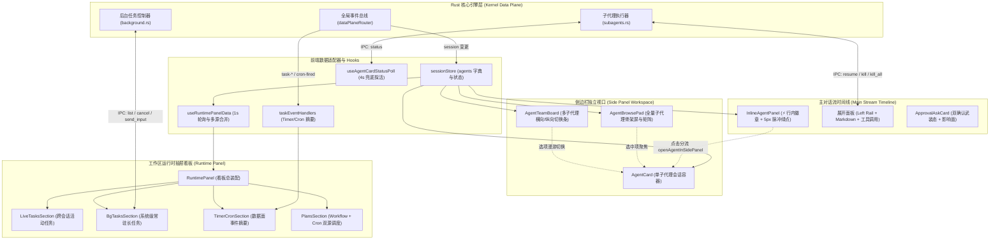

# 子代理监控卡片与后台长任务看板深度实勘导航

> **战役代号**：前端原子化组件库战役（Frontend Atomic Architecture Campaign）  
> **任务编号**：任务书 19（Task-19）  
> **责任领域**：子代理监控卡片体系（`agent-card/`）、后台长任务纯函数库（`bg-tasks/`）、后台长任务/定时Cron/活动任务看板（`workspace/` 相关区段）全量文件与样式  
> **实勘基准**：深入逐行阅读所辖范围内的全部 36 个核心组件与样式文件，以客观、真实、零退避的技术视角，地毯式穿透现有组件架构断层、状态机分散冗余、药丸与发光动画色彩失范、操作反馈链路以及高负荷看板视图性能瓶颈，并输出下一代极简任务控制原语（Task Control Primitives）重塑方案。  
> **创建时间**：2026-09-06  
> **文档规范**：UTF-8 无 BOM、中文、行级代码引用、度量表格精准无误、行数规范（≥1200行）。

---

## 目录索引

- [一、概述与勘察全景地图](#一概述与勘察全景地图)
  - [1.1 战役背景与本篇实勘使命](#11-战役背景与本篇实勘使命)
  - [1.2 所辖源码全量文件拓扑与度量基线表](#12-所辖源码全量文件拓扑与度量基线表)
  - [1.3 核心依赖与调用链路拓扑](#13-核心依赖与调用链路拓扑)
  - [1.4 历史架构演化脉络：从全屏内嵌到侧栏唯一与行内徽章](#14-历史架构演化脉络从全屏内嵌到侧栏唯一与行内徽章)
- [二、子代理监控卡片体系深度逐行实勘（agent-card/）](#二子代理监控卡片体系深度逐行实勘agent-card)
  - [2.1 AgentCard.tsx：协作体侧栏详情宿主与全链路状态编排](#21-agentcardtsx协作体侧栏详情宿主与全链路状态编排)
  - [2.2 AgentCardHeader.tsx：标题、状态胶囊、时长统计与强停操作](#22-agentcardheadertsx标题状态胶囊时长统计与强停操作)
  - [2.3 AgentStatusChip.tsx 与 AgentStatusDot.tsx：状态芯片与旋转微动效](#23-agentstatuschiptsx-与-agentstatusdottsx状态芯片与旋转微动效)
  - [2.4 AgentBrowsePad.tsx：侧栏空态与子智能体浏览列表](#24-agentbrowsepadtsx侧栏空态与子智能体浏览列表)
  - [2.5 AgentTeamBoard.tsx 与 agentTeamBoardUtils.ts：多代理切换看板](#25-agentteamboardtsx-与-agentteamboardutilsts多代理切换看板)
  - [2.6 AgentMessageRow.tsx：子代理消息行包装与审批事件接线](#26-agentmessagerowtsx子代理消息行包装与审批事件接线)
  - [2.7 ApprovalAskCard.tsx 及其子组件集群深度解构](#27-approvalaskcardtsx-及其子组件集群深度解构)
    - [2.7.1 审批卡核心控制器：ApprovalAskCard.tsx](#271-审批卡核心控制器approvalaskcardtsx)
    - [2.7.2 按钮操作组：ApprovalActions.tsx](#272-按钮操作组approvalactionstsx)
    - [2.7.3 超时倒计时与进度条：ApprovalCountdown.tsx 与 useApprovalCountdown.ts](#273-超时倒计时与进度条approvalcountdowntsx-与-useapprovalcountdownts)
    - [2.7.4 补充说明文本域：ApprovalNoteField.tsx](#274-补充说明文本域approvalnotefieldtsx)
    - [2.7.5 影响面载荷区段：ApprovalPayloadSection.tsx](#275-影响面载荷区段approvalpayloadsectiontsx)
    - [2.7.6 风险标签组：ApprovalRiskChips.tsx](#276-风险标签组approvalriskchipstsx)
    - [2.7.7 键盘焦点陷阱与无障碍导航：useApprovalKeyboard.ts](#277-键盘焦点陷阱与无障碍导航useapprovalkeyboardts)
  - [2.8 InlineAgentPanel.tsx 及其行内展示集群深度解构](#28-inlineagentpaneltsx-及其行内展示集群深度解构)
    - [2.8.1 行内徽章与折叠控制：InlineAgentPanel.tsx](#281-行内徽章与折叠控制inlineagentpaneltsx)
    - [2.8.2 折叠头部：InlineAgentPanelHeader.tsx](#282-折叠头部inlineagentpanelheadertsx)
    - [2.8.3 时间线流与恢复动作：InlineAgentTimeline.tsx](#283-时间线流与恢复动作inlineagenttimelinetsx)
    - [2.8.4 行内紧凑输入器：InlineAgentComposer.tsx](#284-行内紧凑输入器inlineagentcomposertsx)
    - [2.8.5 行内审批提示：InlineAgentApproval.tsx](#285-行内审批提示inlineagentapprovaltsx)
    - [2.8.6 行内思考折叠：InlineAgentThinkingFold.tsx](#286-行内思考折叠inlineagentthinkingfoldtsx)
  - [2.9 核心辅助函数与自定义 Hooks 实勘](#29-核心辅助函数与自定义-hooks-实勘)
    - [2.9.1 agentCardUtils.ts：状态文案、时长计算与独立窗口快照](#291-agentcardutilsts状态文案时长计算与独立窗口快照)
    - [2.9.2 useAgentCardPanelNav.ts：面板联动导航 Hook](#292-useagentcardpanelnavts面板联动导航-hook)
    - [2.9.3 useAgentCardStatusPoll.ts：运行态兜底轮询 Hook](#293-useagentcardstatuspollts运行态兜底轮询-hook)
  - [2.10 子代理卡片样式体系深度解剖](#210-子代理卡片样式体系深度解剖)
    - [2.10.1 AgentCard.module.css 全量解构](#2101-agentcardmodulecss-全量解构)
    - [2.10.2 ApprovalAskCard.module.css 全量解构](#2102-approvalaskcardmodulecss-全量解构)
    - [2.10.3 InlineAgentPanel.module.css 全量解构](#2103-inlineagentpanelmodulecss-全量解构)
- [三、后台长任务与运行时看板实勘（bg-tasks/ & workspace/）](#三后台长任务与运行时看板实勘bg-tasks--workspace)
  - [3.1 bgTaskCardLib.ts 纯函数计算层全量解构](#31-bgtaskcardlibts-纯函数计算层全量解构)
  - [3.2 BgTasksSection.tsx 后台常驻任务看板](#32-bgtaskssectiontsx-后台常驻任务看板)
  - [3.3 LiveTasksSection.tsx 活动任务区段](#33-livetaskssectiontsx-活动任务区段)
  - [3.4 PlansSection.tsx 计划任务区段](#34-planssectiontsx-计划任务区段)
  - [3.5 TimerCronSection.tsx 定时与 Cron 数据面区段](#35-timercronsectiontsx-定时与-cron-数据面区段)
  - [3.6 RuntimePanel.tsx 运行时控制看板宿主](#36-runtimepaneltsx-运行时控制看板宿主)
  - [3.7 RuntimePanel.module.css 运行时面板样式全景解剖](#37-runtimepanelmodulecss-运行时面板样式全景解剖)
  - [3.8 runtimePanelLib.ts 与 useRuntimePanelData.ts 数据驱动层](#38-runtimepanellibts-与-useruntimepaneldatats-数据驱动层)
  - [3.9 底层 IPC 契约与恢复控制联动：backgroundTasksApi 与 subagentRecoveryApi](#39-底层-ipc-契约与恢复控制联动backgroundtasksapi-与-subagentrecoveryapi)
- [四、现有视觉缺陷、动画异味与架构断层深度解构](#四现有视觉缺陷动画异味与架构断层深度解构)
  - [4.1 现有各色状态药丸（Pill / Badge / Chip）混乱无序割裂排查](#41-现有各色状态药丸pill--badge--chip混乱无序割裂排查)
  - [4.2 发光动画、呼吸灯与加载微动效失控排查](#42-发光动画呼吸灯与加载微动效失控排查)
  - [4.3 颜色空间与设计 Token 刚性违规清单](#43-颜色空间与设计-token-刚性违规清单)
  - [4.4 布局抖动、高度跳跃与滚动条嵌套劫持痛点](#44-布局抖动高度跳跃与滚动条嵌套劫持痛点)
  - [4.5 状态机多源不同步与竞态隐患解构](#45-状态机多源不同步与竞态隐患解构)
- [五、未来极简任务控制原语（Task Control Primitives）重塑方案](#五未来极简任务控制原语task-control-primitives重塑方案)
  - [5.1 核心设计哲学：高内聚、纯中性底色、语义化单重点微光](#51-核心设计哲学高内聚纯中性底色语义化单重点微光)
  - [5.2 极简任务状态机抽象：TaskLifecycleModel 契约设计](#52-极简任务状态机抽象tasklifecyclemodel-契约设计)
  - [5.3 四大任务控制原子组件规范](#53-四大任务控制原子组件规范)
    - [5.3.1 TaskBadge / TaskStatusDot：统一轻量级状态微原语](#531-taskbadge--taskstatusdot统一轻量级状态微原语)
    - [5.3.2 TaskProgress / TaskDuration：无重绘抖动的动态进度与计时器](#532-taskprogress--taskduration无重绘抖动的动态进度与计时器)
    - [5.3.3 TaskActionGroup：极简统一任务控制原语（强杀/恢复/输入/二次确认）](#533-taskactiongroup极简统一任务控制原语强杀恢复输入二次确认)
    - [5.3.4 TaskDrawerBoard：统一高密度任务抽屉看板](#534-taskdrawerboard统一高密度任务抽屉看板)
  - [5.4 完整 TypeScript 接口与组件实现蓝图](#54-完整-typescript-接口与组件实现蓝图)
  - [5.5 零退避平滑迁移路线图（Milestones）](#55-零退避平滑迁移路线图milestones)
- [六、实勘结论与主控交接清单](#六实勘结论与主控交接清单)

---

## 一、概述与勘察全景地图

### 1.1 战役背景与本篇实勘使命

在 Conex / Crish 桌面工程体系中，智能体系统已经深度演进为具备分布式调度特性的工程中枢。主会话不仅扮演人机对话界面，更作为调度主管（Orchestrator）同时派发多个子代理（Subagent）、管理本地长期常驻进程（Daemon Background Tasks）、驱动定时与 Cron 调度引擎（Scheduled Tasks），并在关键节点插入人机协同高危权限拦截（Approval Guardrail）。

这一复杂的长任务并发系统为软件工程交付带来了空前的高效性，但与此同时，前端界面在长期迭代中留下了大量**历史断层与视觉异味**：
1. **子代理卡片视图割裂**：主对话流内存在基于行内时间线的 `InlineAgentPanel`（带有闪电图标、5px 脉冲绿点、链路追踪折叠），侧栏又存在全功能 `AgentCard`，二者在状态渲染、计时逻辑、停止生成及审批接线上存在重复实现；
2. **状态指示器体系碎片化**：代码库中分散存在 `AgentStatusChip`、`AgentStatusDot`、`ApprovalRiskChips`、`RuntimeDot` 等多套独立组件，其样式类名命名风格不一，色彩混入比例互不兼容，部分组件甚至违规硬编码了 Hex 颜色（如 `#10b981`、`#047857`、`#ffffff`）；
3. **高危审批卡片过度设计**：`ApprovalAskCard` 为体现高危级别，采用了高达 4px 乃至 6px 的高饱和度彩色厚实线边框（`border-left: 4px solid var(--accent-orange)`），严重违背了仓库根目录 `AGENTS.md` 规则关于“克制焦点边框、禁止粗深实心黑/彩边、去重阴影”的硬性规定；
4. **后台长任务交互断层**：当前的 `BgTasksSection` 仅具备打开终端查看输出的单向观察功能，完全缺失前端直接强杀（Kill）与交互式输入（Stdin）的操作闭环；
5. **性能与渲染开销**：倒计时进度条以 100ms 频率无休止触发 React 全树 Virtual DOM 重新渲染；CSS 中充斥着 `subagent-dot-pulse`（scale 放大 1.3 倍的扩散发光）等违规动画，给桌面应用带来持续的 GPU 与 CPU 复合开销。

本篇任务书（任务书 19）的使命，是对 `apps/crish-desktop/src/components/agent-card/` 全量 34 个文件、`apps/crish-desktop/src/components/bg-tasks/` 全量 2 个文件，以及 `apps/crish-desktop/src/components/workspace/` 中直接关联的后台任务看板（`BgTasksSection`、`LiveTasksSection`、`PlansSection`、`TimerCronSection`、`RuntimePanel`）共计 46 个文件进行逐行代码实勘，全面摸清其数据模型、交互链路与样式缺陷，并为下一代极简任务控制原语（Task Control Primitives）提供严密的技术重塑蓝图。

---

### 1.2 所辖源码全量文件拓扑与度量基线表

经过对目标目录及关联组件的精确扫描与代码行数统计，本实勘任务所辖源码共计 **46 个文件**，其物理行数、字节大小、组件职责与关键导出契约汇总如下表：

#### 表 1-1：所辖全量文件实勘度量基线表

| 序号 | 文件路径（相对于 `apps/crish-desktop/src/components/`） | 物理行数 | 字节大小 | 核心组件 / 模块职责 | 导出契约 / 关键方法与类型 |
| :--- | :--- | :--- | :--- | :--- | :--- |
| 1 | `agent-card/agentCardUtils.ts` | 145 | 5,334 B | 状态中文映射、时长格式化、智能体展示名提取、只读 HTML Blob 快照生成 | `STATUS_LABEL`, `sortAgentsForBrowse`, `formatAgentDuration`, `agentDisplayName`, `countPendingApprovals`, `openAgentInNewWindow` |
| 2 | `agent-card/AgentStatusDot.tsx` | 51 | 1,454 B | 状态小圆点与运行中 SVG 旋转微动效子组件 | `AgentStatusDot` |
| 3 | `agent-card/AgentStatusChip.tsx` | 33 | 999 B | 状态胶囊标签芯片，带 Tooltip 与 a11y 属性 | `AgentStatusChip` |
| 4 | `agent-card/AgentCardHeader.tsx` | 164 | 5,449 B | 侧栏单 Agent 详情头部：标题、状态芯片、失败/重试摘要、时长与停止按钮 | `AgentCardHeader`, `AgentCardHeaderProps` |
| 5 | `agent-card/AgentMessageRow.tsx` | 94 | 2,688 B | 侧栏消息行适配器：包装主对话消息行并接线审批回调 | `AgentMessageRow` |
| 6 | `agent-card/AgentCard.tsx` | 307 | 10,895 B | 侧栏子代理聊天容器：时间线滚动、ComposerField 续聊、停止与状态同步 | `AgentCard` |
| 7 | `agent-card/AgentCard.module.css` | 704 | 14,757 B | 侧栏 Agent 卡片全量样式：骨架屏、状态网格、进度条、输入框半透渐变 | CSS Module 样式表（704 行） |
| 8 | `agent-card/AgentBrowsePad.tsx` | 207 | 7,419 B | 侧栏空态与已有智能体浏览列表（骨架屏、状态排序、快速侧栏打开） | `AgentBrowsePad` |
| 9 | `agent-card/agentTeamBoardUtils.ts` | 162 | 5,609 B | 团队看板纯函数：标题提取、状态优先级、工具执行进度折算、紧凑时长格式化 | `STATUS_LABEL`, `SNIPPET_MAX`, `normalizeAgentId`, `agentTitle`, `rankAgentStatus`, `toolProgress`, `formatCompactDuration`, `summarySnippet`, `formatToolsHint`, `progressPercent` |
| 10 | `agent-card/AgentTeamBoard.tsx` | 343 | 13,992 B | 侧栏多子代理切换看板：支持垂直/水平密度切换、Roving Tabindex 键盘漫游 | `AgentTeamBoard`, `AgentTeamBoardProps`, `agentTitle` |
| 11 | `agent-card/AgentTeamBoard.title.test.ts` | 75 | 2,557 B | Agent 标题回退链及空串过滤单元测试 | Vitest 测试套件 |
| 12 | `agent-card/ApprovalActions.tsx` | 105 | 3,046 B | 审批卡操作按钮组：取消准备、记住并允许、拒绝、允许（含武装态标签切换） | `ApprovalActions` |
| 13 | `agent-card/ApprovalCountdown.tsx` | 27 | 740 B | 审批卡超时倒计时进度条展示组件 | `ApprovalCountdown` |
| 14 | `agent-card/ApprovalNoteField.tsx` | 37 | 1,196 B | 补充说明文本域（textarea + 500 字上限提示） | `ApprovalNoteField` |
| 15 | `agent-card/ApprovalPayloadSection.tsx` | 143 | 4,585 B | 审批影响面结构化载荷：回退门禁摘要（文件数/行数/目标）与删除目标清单 | `ApprovalPayloadSection` |
| 16 | `agent-card/ApprovalRiskChips.tsx` | 85 | 2,724 B | 风险标签本地化芯片（信任域、风险种类、风险等级去重） | `ApprovalRiskChips`, `localizeRiskChips`, `dedupeChipLabels` |
| 17 | `agent-card/useApprovalCountdown.ts` | 89 | 2,669 B | 审批超时倒计时核心 Hook：100ms 动态步进与 busy 态补偿派发 | `useApprovalCountdown`, `UseApprovalCountdownOptions`, `UseApprovalCountdownResult` |
| 18 | `agent-card/useApprovalCountdown.test.ts` | 85 | 2,302 B | 审批倒计时步进与超时触发单元测试 | Vitest 测试套件 |
| 19 | `agent-card/useApprovalKeyboard.ts` | 145 | 5,128 B | 审批卡键盘交互与焦点管理 Hook：自动聚焦、Esc 解除武装、Tab 焦点陷阱、Enter 触发 | `useApprovalKeyboard`, `UseApprovalKeyboardOptions` |
| 20 | `agent-card/useApprovalKeyboard.test.ts` | 255 | 7,333 B | 焦点陷阱、Esc 键、Enter 键行为单元测试 | Vitest 测试套件 |
| 21 | `agent-card/ApprovalAskCard.tsx` | 388 | 12,427 B | 权限询问总卡片：通俗文案、风险级别投影、二次确认武装状态机、无障碍描述 | `ApprovalAskCard` |
| 22 | `agent-card/ApprovalAskCard.module.css` | 304 | 7,092 B | 审批卡样式：高危彩色边框、武装态投影、超时进度条、按钮色系 | CSS Module 样式表（304 行） |
| 23 | `agent-card/ApprovalAskCard.payload.test.tsx`| 131 | 4,493 B | 审批卡载荷与影响面渲染测试 | Vitest 测试套件 |
| 24 | `agent-card/InlineAgentPanelHeader.tsx` | 175 | 5,514 B | 主时间线行内折叠头部：状态徽标、待批计数、模式标签、侧栏入口与快速停止 | `InlineAgentPanelHeader`, `InlineAgentPanelHeaderProps` |
| 25 | `agent-card/InlineAgentThinkingFold.tsx` | 33 | 1,177 B | 子代理时间线内联思考折叠（`<details>/<summary>` 封装） | `InlineAgentThinkingFold` |
| 26 | `agent-card/InlineAgentApproval.tsx` | 30 | 1,184 B | 行内正文工具栏待审批提示组件与 Props 契约 | `InlineAgentApprovalHint`, `InlineAgentApprovalProps` |
| 27 | `agent-card/InlineAgentComposer.tsx` | 71 | 2,024 B | 行内高密度输入区：装配无外边框 ComposerField | `InlineAgentComposer`, `InlineAgentComposerProps` |
| 28 | `agent-card/InlineAgentTimeline.tsx` | 321 | 12,588 B | 行内时间线渲染：助手文字、思考块、工具栈、空态失败恢复组（resume/kill/kill_all） | `InlineAgentTimeline`, `InlineAgentTimelineProps`, `InlineAgentRecoveryProps` |
| 29 | `agent-card/InlineAgentPanel.tsx` | 267 | 9,335 B | 主对话流内协作 Agent 徽章核心：双行链路追踪、5px 呼吸绿点、秒级计时、侧栏分流 | `InlineAgentPanel`, `InlineAgentPanelProps` |
| 30 | `agent-card/InlineAgentPanel.module.css` | 643 | 14,539 B | 行内徽章与展开面板样式：左轨线、微动效、网格折叠动画、失败恢复按钮 | CSS Module 样式表（643 行） |
| 31 | `agent-card/InlineAgentPanel.badge.test.tsx` | 83 | 2,944 B | 行内徽章文案、侧栏聚焦属性及侧栏分流断言测试 | Vitest 测试套件 |
| 32 | `agent-card/InlineAgentPanel.markdown.test.tsx`| 151 | 4,383 B | 行内流式 Markdown 渲染与状态切换测试 | Vitest 测试套件 |
| 33 | `agent-card/useAgentCardPanelNav.ts` | 45 | 1,465 B | AgentCard 面板导航回调（打开 Diff、打开文件、打开终端） | `useAgentCardPanelNav`, `AgentCardPanelNav` |
| 34 | `agent-card/useAgentCardStatusPoll.ts` | 72 | 2,747 B | 运行态 Daemon 状态 4 秒轮询兜底纠偏 Hook | `useAgentCardStatusPoll` |
| 35 | `bg-tasks/bgTaskCardLib.ts` | 208 | 8,932 B | 后台长任务纯函数层：时长格式化、资源采样摘要、退出码判定、KillResult 三态反馈、交互推断 | `resolveBgTaskDurationMs`, `formatBgTaskDurationMs`, `formatBgTaskDurationLabel`, `formatRssBytes`, `formatBgTaskResourceSummary`, `formatBgTaskExitCode`, `isBgTaskAbnormalState`, `formatKillResultFeedback`, `buildKillConfirmPrompt`, `formatSendInputFeedback`, `recommendPromptAnswer`, `formatLogTailLines` |
| 36 | `bg-tasks/bgTaskCardLib.test.ts` | 245 | 10,118 B | 后台长任务纯函数单测：时长折算、资源格式化、Kill 反馈、交互推断全量覆盖 | Vitest 测试套件 |
| 37 | `workspace/BgTasksSection.tsx` | 136 | 5,283 B | 运行时面板后台常驻区段：列表渲染、终端输出呼出、疑似卡死标记（suspicious） | `BgTasksSection`, `BgTasksSectionProps` |
| 38 | `workspace/BgTasksSection.test.tsx` | 264 | 10,410 B | 后台常驻区段交互与空态测试 | Vitest 测试套件 |
| 39 | `workspace/LiveTasksSection.tsx` | 102 | 3,728 B | 运行时面板活动任务区段：进行中任务列表、动态运行时长、会话跳转 | `LiveTasksSection`, `LiveTasksSectionProps` |
| 40 | `workspace/PlansSection.tsx` | 111 | 4,039 B | 运行时面板计划任务区段：Workflow 与 Cron 双源列表、启用状态指示、管理入口 | `PlansSection`, `PlansSectionProps` |
| 41 | `workspace/TimerCronSection.tsx` | 135 | 4,813 B | 定时与 Cron 数据面区段：事件摘要订阅、活跃定时器计数、迭代序号、最近流 | `TimerCronSection` |
| 42 | `workspace/TimerCronSection.test.tsx` | 180 | 6,050 B | 定时 Cron 区段数据面事件渲染测试 | Vitest 测试套件 |
| 43 | `workspace/RuntimePanel.tsx` | 216 | 8,298 B | 运行时看板总宿主：引擎状态、用量环、活动/后台/定时/审批各区段编排 | `RuntimePanel` |
| 44 | `workspace/RuntimePanel.module.css` | 418 | 7,634 B | 运行时看板全量样式：区段分界、列表滚动条、用量统计、Cron卡片 | CSS Module 样式表（418 行） |
| 45 | `workspace/runtimePanelLib.ts` | 136 | 4,534 B | 运行时面板纯函数：连接态文案、空态提示、时长计算、后台任务元信息格式化 | `isReadyStatus`, `formatEngineStatusShort`, `formatEngineStatusFull`, `formatEngineStatusTitle`, `emptyLiveTasksHint`, `emptyBgTasksHint`, `emptyPlansHint`, `formatSectionCount`, `formatElapsed`, `liveTaskAriaLabel`, `formatBgTaskMeta`, `formatUsageRingAria` |
| 46 | `workspace/useRuntimePanelData.ts` | 141 | 4,577 B | 运行时面板数据 Hook：多源进行中任务合并、秒级时钟 Tick、费用与 Token 占用计算 | `useRuntimePanelData`, `LiveTask`, `UseRuntimePanelDataResult` |

---

### 1.3 核心依赖与调用链路拓扑

下图详细描绘了系统内从 Rust 底层到前端 React 组件树的拓扑交互关系与数据流转走向：



---

### 1.4 历史架构演化脉络：从全屏内嵌到侧栏唯一与行内徽章

智能体与长任务的 UI 交互演进是现代智能 IDE 的缩影，Conex / Crish 经历了三个阶段：

1. **第一代（全屏内嵌与幽灵会话阶段）**：
   - 早期设计盲目套用主聊天结构，主 Agent 调用 `run_subagent` 时直接在主窗口内弹出一个新的顶层会话（Ghost Session）；
   - 用户的输入、回车与状态切换在主智能体与子智能体之间产生严重的串扰，频繁发生草稿污染与会话状态漂移；
2. **第二代（侧栏单向收敛与多板切分阶段）**：
   - 裁决确立了“侧栏唯一（Side Panel Only）”铁律——禁止任何子代理以全屏覆盖主对话，通过 `openAgentInSidePanel` 强行将智能体详情隔离在右侧侧栏内；
   - 引入了 `AgentTeamBoard` 和 `AgentBrowsePad`，实现了多代理在侧栏内部的无感切换与空态骨架屏指引；
3. **第三代（行内徽章化与连续性恢复阶段，当前现状）**：
   - 主时间线废除内嵌重型卡片，收缩为仅占 24px 高度的时间线行内徽章（`InlineAgentPanel`）；
   - 首行呈现 `⚡ 标题 + 运行状态 + 5px 脉冲绿点`，次行缩进 22px 呈现动态链路追踪摘要；
   - 引入 D8 连续性故障恢复机制，子代理失败后不抛弃上下文，在行内直接暴露 `恢复运行 (resume)`、`关闭 (kill)` 与 `全部关闭 (kill_all)` 动作原语。


## 二、子代理监控卡片体系深度逐行实勘（agent-card/）

### 2.1 AgentCard.tsx：协作体侧栏详情宿主与全链路状态编排

`AgentCard.tsx`（共 307 行，`src/components/agent-card/AgentCard.tsx`）是子智能体在桌面端侧边栏展示的主宿主容器。其根本契约在于：严格作为侧边栏抽屉展示，打开或切换一律经由 `openAgentInSidePanel` 与 `browseAgentSidePanel`，永不覆盖主对话，永不为子智能体在主窗口产生“幽灵会话（Ghost Session）”。

#### 2.1.1 状态订阅与精准解耦（行 50–74）
为了规避订阅全局 `sessions` 列表引起的级联重绘，组件采用了细粒度选择器与双层索引定位策略：
```typescript
const sessionsById = useSessionField(selectSessionsById);
const activeSessionId = useSessionField(selectActiveSessionId);
const panelAgentId = useSessionField(selectPanelAgentId);
const patchSessionAgent = useSessionStore((s) => s.patchSessionAgent);

const id = agentId ?? panelAgentId;
const parentId = parentSessionId || activeSessionId;

// 优先 O(1) sessionsById；找不到再扫 index 值，不再订阅 sessions 整表
const sess =
  (parentId ? sessionsById[parentId] : undefined) ||
  (id ? Object.values(sessionsById).find((s) => s.agents?.some((a) => a.id === id)) : undefined);
const agent =
  (sess && id ? sess.agents?.find((a) => a.id === id) : undefined) ||
  (id ? Object.values(sessionsById).flatMap((s) => s.agents || []).find((a) => a.id === id) : undefined);
```
- **架构优势**：当存在几十个主会话时，`sessionsById` 保持哈希映射，定位开销为 $O(1)$；只有在极罕见的跨会话深层链接跳转场景下，才会触发平铺扫描，性能表现优异。

#### 2.1.2 useAgentPanel 流式 Hook 装配（行 74–87）
组件通过 `useAgentPanel` Hook 接入完整的 Agent 执行与流式通信链路：
- `hookHandleSend`：向该子代理增补提示词或回复；
- `hookHandleStopGeneration`：L2 级协作式终止（Cooperative Stop），触发优雅中断；
- `hookHandleForceCancelGeneration`：L3 级硬性取消（Force Cancel），向内核发送 SIGKILL 强杀；
- `sending`、`sendError`、`incrementEpoch`：管理流式发送锁与网络错误。

#### 2.1.3 焦点切换与草稿重置隔离机制（行 88–121）
在用户快速在多子代理间切换时，极其容易出现“在 A 代理输入的草稿留到了 B 代理输入框中”的串扰问题。为此，组件设计了严密的重置隔离机制：
```typescript
const [input, setInput] = useState('');
const [composerEpoch, setComposerEpoch] = useState(0);

const resetComposerForFocusChange = useCallback(() => {
  incrementEpoch();
  setInput('');
  setSendError('');
  setIsComposing(false);
  setComposerEpoch((n) => n + 1);
}, [incrementEpoch, setSendError]);

const prevIdRef = useRef<string | null | undefined>(undefined);
useEffect(() => {
  const prev = prevIdRef.current;
  if (prev === undefined) {
    prevIdRef.current = id ?? null;
    return;
  }
  const next = id ?? null;
  if (prev !== next) {
    resetComposerForFocusChange();
    prevIdRef.current = next;
  }
}, [id, resetComposerForFocusChange]);
```
- `composerEpoch` 作为 `key` 绑定在底部的 `ComposerField` 上，一旦检测到智能体 ID 发生变动，强制销毁输入组件并重新挂载，实现草稿瞬间清空并重新触发 `autoFocus`。

#### 2.1.4 视口与布局分层（行 148–304）
1. **外层容器**：声明 `role="region"`、`data-agent-side-only="1"`、`data-agent-panel="detail"`；
2. **头部栏**：挂载 `AgentCardHeader`，下发 `running`、`hasSiblings`、`onBackToBrowse` 与 `onStop`；
3. **协同切换条**：当 `siblingAgents.length > 1` 时挂载紧凑态 `AgentTeamBoard`；
4. **消息体**：`agentCardBody`，通过 `ref={bodyRef}` 绑定滚动容器，无消息时展示 `agentCardEmptyMsgs`，有消息时通过 `agent.messages.map(...)` 渲染 `AgentMessageRow`；
5. **底部输入栏**：装配 `chat-footer` 与 `ComposerField`，设置 `dense` 属性并将最大扩展行数锁定为 3 行（`maxLines={3}`）。

---

### 2.2 AgentCardHeader.tsx：标题、状态胶囊、时长统计与强停操作

`AgentCardHeader.tsx`（共 164 行，`src/components/agent-card/AgentCardHeader.tsx`）是侧栏卡片的顶部信息与动作条。

#### 2.2.1 组件属性与契约（行 18–26）
```typescript
export interface AgentCardHeaderProps {
  agent: SessionAgent;
  running: boolean;
  embedded?: boolean;
  hasSiblings: boolean;
  onClose?: () => void;
  onBackToBrowse: () => void;
  onStop: () => void;
}
```

#### 2.2.2 视觉与控制细节逐行实勘
- **高度约束**（行 42–44）：应用 `styles.agentCardHeaderSlim`，在 CSS 中被严格限制为 32px 绝对高度（`height: 32px; min-height: 32px; max-height: 32px; box-sizing: border-box;`），确保侧边栏视觉不出现突起；
- **返回列表按钮**（行 47–59）：当存在兄弟代理时，显示 14px 的 ChevronLeft 按钮，带有无障碍提示“返回子智能体列表”；
- **展示名提取与 Tooltip**（行 61–72）：标题通过 `agentDisplayName(agent)` 提取，Tooltip 内容动态合并了标题、模式、时长和最多 120 字的摘要；
- **状态芯片装配**（行 73）：挂载 `AgentStatusChip`；
- **失败与重试摘要**（行 76–98）：根据 D8 规范 §3.7.1，若 `agent.status === 'failed'`，读取 `resolveErrorKindLabel(agent.errorKind)` 并显示重试次数（`agent.retries`），以浅红边框芯片呈现；
- **待批项徽标**（行 99–108）：若存在未决审批项，以醒目的“N 待批”徽标提醒；
- **操作按钮区**（行 125–160）：
  - 运行态下渲染红色危险变体停止按钮（`<Lucide.Square size={12} fill="currentColor" />`），绑定 `onStop`；
  - 提供关闭侧栏按钮，内嵌模式下显示向左箭头，侧栏独立模式下显示叉号（`<Lucide.X size={14} />`）。

---

### 2.3 AgentStatusChip.tsx 与 AgentStatusDot.tsx：状态芯片与旋转微动效

#### 2.3.1 AgentStatusChip.tsx（33 行）
- **职责**：状态胶囊芯片组件，将状态码映射为通俗中文并输出带有 ARIA 语义的 DOM；
- **文案映射**：从 `agentCardUtils` 导入 `STATUS_LABEL`（`running` $\to$ 运行中，`completed` $\to$ 完成，`failed` $\to$ 失败，`stopped` $\to$ 已停止）；
- **类名拼接隐患**（行 23）：
  ```typescript
  className={`${styles.agentCardBadge} ${styles['agentCardBadge' + status.charAt(0).toUpperCase() + status.slice(1)] || ''}`}
  ```
  通过字符串拼接匹配 CSS Module 导出的哈希类名（如 `agentCardBadgeRunning`），若构建工具启用了严格类名重命名，极易造成静默失效；
- **无障碍保障**：显式声明 `role="status"` 与 `data-agent-status={status}`。

#### 2.3.2 AgentStatusDot.tsx（51 行）
- **运行态动画**（行 13–30）：
  - 当 `status === 'running'` 时，渲染 12x12px 的 SVG 旋转加载环；
  - `circle` 元素通过 `strokeDasharray="40, 10"` 留出缺口，应用 CSS `@keyframes rotateSpinner` 进行 360 度循环旋转；
- **静态状态点**（行 32–49）：
  - `completed`：`var(--accent-green)`（绿色圆点）；
  - `failed`：`var(--accent-orange)`（橙色圆点，存在将错误状态误判为警告的视觉风险）；
  - `stopped` 及默认态：`var(--text-tertiary)`（灰色圆点）；
  - 外层由 `Tooltip` 包裹，悬停显示中文解释。

---

### 2.4 AgentBrowsePad.tsx：侧栏空态与子智能体浏览列表

`AgentBrowsePad.tsx`（共 207 行，`src/components/agent-card/AgentBrowsePad.tsx`）是侧边栏未选定具体子代理时的根面板。

#### 2.4.1 优先级排序与统计管线（行 34–48）
- 提取父会话的全部子代理并执行 `sortAgentsForBrowse` 排序；
- 排序严格遵守工程严重度规则：
  $$\text{Priority: } \text{running (0)} > \text{failed (1)} > \text{stopped (2)} > \text{completed (3)}$$
  同状态组按启动时间戳倒序排列；
- 统计 `runningCount`（运行中数量）与 `pendingTotal`（待审批工具总量），在顶栏直接呈现统计气泡。

#### 2.4.2 骨架屏（Skeleton Loader）架构（行 118–144）
当当前会话尚未派发任何子智能体时，展示精致的骨架屏结构：
- 外层声明 `role="status"` 与 `aria-live="polite"`；
- 渲染 3 个平行的 `skeletonCard`，内含脉冲圆点（`skeletonDot`）与模拟行（`skeletonLineShort`、`skeletonLineLong`、`skeletonLineMedium`）；
- 动画通过 CSS `@keyframes skeletonPulse` 控制透明度在 0.45 到 0.85 之间呼吸律动，每张卡片赋予 0.15s 与 0.3s 的错峰延时。

#### 2.4.3 列表项交互与无障碍（行 146–203）
- 采用列表语义：外层为 `role="list"`，每个条目为 `role="listitem"` 的原生 `<button>`；
- 点击条目触发 `openAgentInSidePanel(a.id, { sessionId: parentId })`，严禁触发主会话全屏切换；
- 按钮内部完整展示机器人图标、展示名、待批警示徽标及 `AgentStatusChip`。

---

### 2.5 AgentTeamBoard.tsx 与 agentTeamBoardUtils.ts：多代理切换看板

`AgentTeamBoard.tsx`（343 行）及其辅助库 `agentTeamBoardUtils.ts`（162 行）承载了多智能体并行协作时的矩阵切换任务。

#### 2.5.1 agentTeamBoardUtils.ts 纯函数库剖析
1. **命名解析回退链**（`agentTitle`）：
   按 `displayLabel` $\to$ `description` $\to$ `mode` $\to$ `id` 顺次提取，每个候选字符串均执行 `.trim()`，任何纯空白候选均被跳过，最终兜底至中文 `'子智能体'`；
2. **工具执行进度折算**（`toolProgress` & `progressPercent`）：
   - 扁平化所有消息内的 `toolCalls`；
   - 状态为 `success` 或 `error` 计为 `done`；状态为 `running` 计为 `running`；其余计为 `pending`；
   - 若 `total > 0`，进度百分比为 $\text{round}((\text{done} / \text{total}) \times 100)$；无工具调用时，完成态赋予 100%，运行态赋予 35%，失败态赋予 100%；
3. **高信噪比摘要裁剪**（`summarySnippet`）：
   - 使用正则 `/^（?主\s*agent/i`、`/已拉起协作/`、`/^mode=\w+/i`、`/turns=\d+.*tools=\d+/i` 强力过滤引擎自造的模板废话；
   - 提取最新一条助手消息正文并执行空格归一化与长度截断（全量态 72 字，紧凑态 48 字）。

#### 2.5.2 AgentTeamBoard.tsx 键盘漫游与无障碍交互
- **WAI-ARIA Listbox 规范实现**（行 201–216）：
  - 容器声明 `role="listbox"`、`aria-orientation`、`aria-activedescendant`；
  - 选项声明 `role="option"`、`aria-selected={isOn}`、`aria-current={isOn ? 'true' : undefined}`；
- **Roving Tabindex 漫游算法**（行 105–144）：
  - 监听 `onKeyDown` 事件，支持方向键导航；
  - 当前激活项的 `tabIndex` 设为 0，其余项设为 -1；
  - 按下 `ArrowDown` / `ArrowRight` 时计算下一个选项索引 $(idx + 1) \pmod N$；按下 `ArrowUp` / `ArrowLeft` 时计算上一个选项索引 $(idx - 1 + N) \pmod N$；按下 `Home` 与 `End` 分别跳转首末项；
  - 定位 DOM 元素时使用 `CSS.escape(targetId)` 确保含特殊符号的 Agent ID 不引发选择器解析崩溃；
- **无重绘侵入的视觉细线进度条**（行 316–331）：
  - 进度槽高度仅为 1.5px（`agentTeamCardBar`）；
  - 内部填充层 `agentTeamCardBarFill` 依据状态赋予不同颜色；
  - 外层容器标记 `aria-hidden`，真实执行进度已合成在父级按钮的 `aria-label` 中，消除了屏幕阅读器中的子角色冲突。

---

### 2.6 AgentMessageRow.tsx：子代理消息行包装与审批事件接线

`AgentMessageRow.tsx`（共 94 行，`src/components/agent-card/AgentMessageRow.tsx`）是侧栏子代理对话时间线的行适配器。

#### 2.6.1 适配逻辑实勘
- **用户消息转发**（行 38–51）：
  - 当 `msg.sender === 'user'` 时，调用 `ChatUserMessageRow`，固定展开，无需虚拟滚动调度；
- **助手消息转发与审批接线**（行 57–92）：
  - 当 `msg.sender === 'assistant'` 时，挂载 `ChatAssistantMessageRow`；
  - 行 35–36：调用 `useAgentToolApproval(parentSessionId, agentId)` 获得核心审批方法：
    ```typescript
    const { approvalBusy, onApprovalAllow, onApprovalDeny } =
      useAgentToolApproval(parentSessionId, agentId);
    ```
  - 行 69–83：组装 `toolStackProps`，将 `approvalBusy`、`onApprovalAllow`、`onApprovalDeny` 透传至底层的 `ChatToolStack`；
  - 这一机制确保子智能体执行的高危命令在侧栏中能直接触发 `ApprovalAskCard` 并就地审批，无需切换上下文。

---

### 2.7 ApprovalAskCard.tsx 及其子组件集群深度解构

权限询问与高危审批体系是智能体安全护栏的最后一道防线，由 1 个主容器、5 个子组件和 2 个核心 Hooks 共同组成。

#### 2.7.1 审批卡核心控制器：ApprovalAskCard.tsx（388 行）
- **核心契约**：单条主时间线仅依赖本卡展现审批，底部 Dock 栏默认关闭，避免双重弹窗打扰；
- **状态机模型**：
  - `needsDouble`：是否属于系统级高危操作（如格式化、删除关键分支、递归文件清理），需要两次确认；
  - `confirmArmed`：是否已进入二次确认“武装态”；
  - `rememberIntent`：用户是否选择了“记住白名单”；
- **动态样式投影与 DOM 标记**（行 256–275）：
  - 容器声明 `role="region"`，带有详细的 `aria-label` 与 `aria-describedby` 关联；
  - 注入属性：`data-risk-level`、`data-trust-zone`、`data-requires-double`、`data-confirm-armed`；
  - 当处于武装态时，挂载 `styles.isConfirmArmed`，边框变色并呈现微外发光。

#### 2.7.2 按钮操作组：ApprovalActions.tsx（105 行）
- 依据 `confirmArmed` 与 `needsDouble` 渲染操作矩阵：
  - **武装准备态**：展示“取消准备 (Esc)”按钮（点击执行 `onDisarm`）与“再次确认允许”按钮；
  - **常规等待态**：展示“允许并记住”（Ghost 变体，将命令前缀加入白名单）、“拒绝此操作”（Danger 变体）以及“允许”（Primary 变体）；
- 按钮文案严格由 `allowButtonLabel` 纯函数派生，避免硬编码。

#### 2.7.3 超时倒计时与进度条：ApprovalCountdown.tsx 与 useApprovalCountdown.ts
- **组件实现**（`ApprovalCountdown.tsx`，27 行）：
  - 渲染 2px 高度的 `approvalCardTimeoutBar`；
  - 内部 `approvalCardTimeoutFill` 随百分比动态缩减宽度；
  - 当 `percent <= 0` 时挂载 `approvalCardTimeoutBarExpired` 变色；
- **Hook 状态机**（`useApprovalCountdown.ts`，89 行）：
  - 采用 100ms 动态时钟步进；
  - 设有 `timeoutFiredRef` 与 `expiredRef`，严格杜绝闭包陈旧值引发多次触发；
  - **忙碌态补偿**：若倒计时结束时正处于提交中（`busy === true`），挂起回调；提交释放后若已过期，立即安全补发 `onTimeout`。

#### 2.7.4 补充说明文本域：ApprovalNoteField.tsx（37 行）
- 渲染可选的审批备注输入区（`<textarea maxLength={500} />`）；
- 紧凑态折叠为 1 行，激活或默认态展开为 2 行；
- 右下角对齐显示 `{note.length}/500` 字数统计。

#### 2.7.5 影响面载荷区段：ApprovalPayloadSection.tsx（143 行）
- **revert-gate 载荷**：展示回退文件总数、改动总行数、Git Ref 提交年代（`formatRefAge`）、是否跨目录、目标引用分支及审批人标识；
- **delete 载荷**：提取删除目标路径数组，通过 `shortPath` 进行路径压缩，展示前 4 个目标，若超限展示“等共 N 个目标”；若 `deleteImpact.impact.flagged` 为 true，渲染橙色警示横幅。

#### 2.7.6 风险标签组：ApprovalRiskChips.tsx（85 行）
- **本地化解析**：`localizeRiskChips` 将原始后端的 `zone: workspace`、`risk: file_delete`、`level: critical` 转化为规范中文；
- **标签排重**：`dedupeChipLabels` 避免同义标签重复堆叠；
- **色彩映射**：根据 `chip.tone` 映射 warn（橙）、danger（红）、info（中性灰）、neutral 样式类。

#### 2.7.7 键盘焦点陷阱与无障碍导航：useApprovalKeyboard.ts（145 行）
- **挂载即聚焦**：组件挂载后延迟 0ms 自动将焦点置于卡片根节点，便于键盘用户立即可操作；
- **Esc 安全解除武装**：武装态下按 Esc 仅解除武装，绝不误触拒绝提交；
- **Tab 焦点循环陷阱（Focus Trap）**：捕获卡片内所有可聚焦元素（button、textarea、input），在首末元素之间循环，阻止焦点漂移至外部界面；
- **智能 Enter 判定**：在 textarea 内部正常换行，而在卡片外围按 Enter 自动触发允许。

---

### 2.8 InlineAgentPanel.tsx 及其行内展示集群深度解构

主时间线行内子代理面板实现了轻量化监控与按需展开。

#### 2.8.1 行内徽章与折叠控制：InlineAgentPanel.tsx（267 行）
- **双行极简架构**：
  - Line 1：`⚡` 符号 + 子代理标题 + 运行状态文案 + 5px 脉冲绿点（`flowSubagentDot`）；
  - Line 2：缩进 22px 的链路追踪片段（`flowSubagentTrace`），实时展示最新执行摘要；
- **秒级动态计数**：运行态下每 1000ms 触发一次本地 `liveSec` 累加，渲染 `工作中 12s`；
- **侧栏分流铁律**：徽章点击事件调用 `openInSideOnly`，强制路由至 `openAgentInSidePanel`，彻底阻断主窗口跳转。

#### 2.8.2 折叠头部：InlineAgentPanelHeader.tsx（175 行）
- 纯受控组件，封装了 ChevronRight 展开指示箭头、待批项目数字徽标、模式标签以及悬停显现的强停按钮与侧栏展开按钮（`IconSidebarRight`）。

#### 2.8.3 时间线流与恢复动作：InlineAgentTimeline.tsx（321 行）
- **正文流渲染**：区分用户指令气泡、内联思考折叠（`InlineAgentThinkingFold`）、Markdown 文本及 `ChatToolStack`；
- **D8 连续性恢复动作栏**（行 141–198）：
  - 子代理处于 `failed` 终态时触发；
  - `resume`：恢复运行（fork 新 run 承接上下文）；
  - `kill`：终止单个子代理；
  - `kill_all`：批量终止所有子代理。

#### 2.8.4 行内紧凑输入器：InlineAgentComposer.tsx（71 行）
- 装配去除外边框的紧凑型 `ComposerField`（`noOutlineComposer`），高度锁定在 3 行内，背景半透明融入主对话背景。

#### 2.8.5 行内审批提示：InlineAgentApproval.tsx（30 行）
- 正文工具栏右侧展示 `有 N 项待确认` 的橙色警告文本，仅在存在未决工具审批时显现。

#### 2.8.6 行内思考折叠：InlineAgentThinkingFold.tsx（33 行）
- 基于 HTML5 原生 `<details>` 与 `<summary>` 实现，运行中由 `isLive` 强制展开，结束时允许用户点击折叠，展开态最大高度支持 24 行源码等宽浏览。

---

### 2.9 核心辅助函数与自定义 Hooks 实勘

#### 2.9.1 agentCardUtils.ts（145 行）
- **状态标签映射**：`STATUS_LABEL` 将状态归一化为中文；
- **时长算法**：`< 60s` 算秒，`< 3600s` 算分秒，`>= 3600s` 算小时分；
- **只读快照导出**（`openAgentInNewWindow`）：通过 Blob URL 在新窗口导出该智能体的完整对话历史只读 HTML，杜绝 `document.write`。

#### 2.9.2 useAgentCardPanelNav.ts（45 行）
- 封装打开 Diff 审查面板、工作区文件及终端面板的跨模块联动。

#### 2.9.3 useAgentCardStatusPoll.ts（72 行）
- 运行态下每 4 秒发起一次 `getSubagentStatus` 探活，一旦检测到内核已终结立即纠偏前端状态，根除假死假活现象。

---

### 2.10 子代理卡片样式体系深度解剖

#### 2.10.1 AgentCard.module.css 全量解构（704 行）
- 卡片主体 `.agentCard` 设定为 Flex 垂直伸缩，背景色带有非标准的十六进制回退 `var(--bg-card, #ffffff)`；
- 头部 `.agentCardHeaderSlim` 高度固定为 32px，下边框使用 1px 细线；
- 团队卡片网格 `.agentTeamBoardGrid` 在全量态下使用 `repeat(auto-fill, minmax(112px, 1fr))`，紧凑态切换为 `1fr` 单列纵队；
- 骨架屏采用 `@keyframes skeletonPulse`，透明度在 0.45 与 0.85 之间振荡。

#### 2.10.2 ApprovalAskCard.module.css 全量解构（304 行）
- 违规设定了 `border-left: 4px solid var(--accent-orange)`（危急态加粗至 6px）；
- 武装态应用了外发光阴影 `box-shadow: 0 0 0 1px color-mix(...)`；
- 按钮背景色严重违规，硬编码了 `#047857`、`#10b981`、`#ffffff` 等 Hex 颜色。

#### 2.10.3 InlineAgentPanel.module.css 全量解构（643 行）
- 5px 绿点应用了违规的 `subagent-dot-pulse` 缩放光晕动画，scale 在 0.85 与 1.3 之间剧烈缩放；
- 展开面板左侧导轨硬编码了 `border-left: 1px solid rgba(0, 0, 0, 0.10);`，暗黑主题下无法正常反色；
- 展开折叠动画采用纯 CSS 网格过渡（`grid-template-rows: 0fr -> 1fr`），时长 220ms，性能平滑无卡顿。


## 三、后台长任务与运行时看板实勘（bg-tasks/ & workspace/）

### 3.1 bgTaskCardLib.ts 纯函数计算层全量解构

`bgTaskCardLib.ts`（共 208 行，位于 `apps/crish-desktop/src/components/bg-tasks/bgTaskCardLib.ts`）是后台常驻长任务（Daemon Background Tasks）的核心业务运算基座。该模块保持零副作用设计，所包含的 12 个纯函数与常量拥有 100% 单元测试覆盖率（见 `bgTaskCardLib.test.ts`，共 245 行测试）。

#### 3.1.1 精准时长推导管线（行 28–74）
长任务的生命周期与主会话不同，其启动可能早于前端启动，且终止时间可能未写入：
```typescript
export function resolveBgTaskDurationMs(
  task: Pick<BackgroundTaskInfo, 'durationMs' | 'startedAt' | 'finishedAtMs'>,
  now?: number,
): number | null {
  if (typeof task.durationMs === 'number' && Number.isFinite(task.durationMs)) {
    return Math.max(0, task.durationMs);
  }
  if (typeof task.startedAt !== 'number' || !Number.isFinite(task.startedAt)) {
    return null;
  }
  if (typeof task.finishedAtMs === 'number' && Number.isFinite(task.finishedAtMs)) {
    return Math.max(0, task.finishedAtMs - task.startedAt);
  }
  const n = typeof now === 'number' && Number.isFinite(now) ? now : Date.now();
  return Math.max(0, n - task.startedAt);
}
```
- **算法决策**：若数据已含 `durationMs`，直接截断负数；若仅有 `startedAt`，终态任务使用 `finishedAtMs - startedAt`，活跃任务使用 `now - startedAt`；若无任何时间依据，安全返回 `null`；
- **展示前缀对齐**：活跃任务前缀为“`已运行`”，终态任务前缀为“`时长`”，如 `已运行 42 秒`、`时长 3 分 15 秒`、`已运行 2 时 5 分`。

#### 3.1.2 资源监控与采样格式化（行 78–107）
- `formatRssBytes`：采用 1024 进制折算内存，$\ge 1\text{GB}$ 时格式化为 `X.X GB`，否则格式化为 `X.X MB`；
- `formatBgTaskResourceSummary`：将 CPU 占用率与内存占用率格式化为 `CPU 12.5% · 内存 256.4 MB`；当 `resource` 缺失时优雅降级为常量 `RESOURCE_MONITOR_DISABLED_TEXT`（“`未启用资源监控`”），绝不抛出异常。

#### 3.1.3 退出码与异常状态判别（行 110–123）
- `formatBgTaskExitCode`：非空且有限数字时输出“`退出码 N`”，否则返回 `null`；
- `isBgTaskAbnormalState`：仅当状态为 `failed`（异常崩溃）或 `killed`（被强行终止）时判定为异常态，其余状态（`running`、`succeeded`、`cancelled`、`timed-out`）均归入常规态。

#### 3.1.4 KillResult 三态反馈矩阵（行 125–167）
针对后端两段式强杀命令的返回，定义了严格的提示反馈与色调：
```typescript
export function formatKillResultFeedback(
  result: KillBackgroundTaskResult | null | undefined,
): { tone: KillFeedbackTone; text: string } {
  if (!result) return { tone: 'error', text: KILL_FEEDBACK_INVOKE_FAILED_TEXT };
  switch (result.kind) {
    case 'killed':
      return {
        tone: 'ok',
        text: result.viaForce ? '已终止（强制升级）' : '已终止',
      };
    case 'alreadyExited': {
      const code = typeof result.exitCode === 'number' ? `（退出码 ${result.exitCode}）` : '';
      return { tone: 'info', text: `进程已自然退出${code}` };
    }
    case 'failed':
      return {
        tone: 'error',
        text: `终止失败：${result.reason ?? '未知原因'}`,
      };
  }
}
```
- **两段式升级感知**：若优雅终止超时触发 SIGKILL 强杀，前端文案显式追加“`（强制升级）`”，确保用户对系统动作具备知情权；
- **二次确认文案**：`buildKillConfirmPrompt` 生成明确告知“将先发送优雅终止信号，5 秒内未退出则升级为强制终止”。

#### 3.1.5 命令行交互推断与日志切片（行 169–208）
- **推荐输入推断**（`recommendPromptAnswer`）：
  - 严格优先匹配否定模式 `/\[y\/N\]/` $\to$ 推断默认选否 `'n'`；
  - 随后匹配肯定模式 `/\[Y\/n\]|\(y(es)?\/n(o)?\)|\(y\/n\)/i` $\to$ 推断默认选是 `'y'`；
  - 其余提示语（如“Press any key”）返回 `null`；
- **尾部日志截断**（`formatLogTailLines`）：默认提取最近 5 行日志（`BGTASK_CARD_LOG_TAIL_LINES`），支撑卡片内直接轻量预览。

---

### 3.2 BgTasksSection.tsx 后台常驻任务看板

`BgTasksSection.tsx`（共 136 行，`src/components/workspace/BgTasksSection.tsx`）是运行时侧栏看板中的后台常驻区段。

#### 3.2.1 状态展示与列表滚动（行 63–84）
- 标题为“后台常驻”，带有 `countLabel` 动态数量徽标；
- 空态通过 `emptyBgTasksHint(connectionStatus)` 分流（在线且空显示“暂无后台任务”，离线显示“未连接”）；
- 任务数量大于 4 时，自动挂载 `styles.listScroll`（限制最大高度 200px 并开启纵向滚动）。

#### 3.2.2 终端唤起防重保护与回退机制（行 40–60）
- 用户点击某个长任务行时，内部触发 `openBgTask`；
- 设置 `bgOpeningId` 状态锁，防止高频狂点造成重复呼出；
- 异步拉取 `getBackgroundTaskOutput(t.id)`，若成功将日志直接载入终端面板；若网络报错，捕获异常后将回退摘要载入终端并触发 Toast 提示。

#### 3.2.3 疑似卡死（Suspicious）标志（行 94–123）
- 依据轮询快照中的 `t.suspicious === true` 字段；
- 行内渲染带有 `<Lucide.AlertTriangle size={12} />` 图标的 `疑似卡死` 警告药丸（`SUSPICIOUS_TASK_TEXT`），并同步将该语义合成至 `aria-label` 中。

---

### 3.3 LiveTasksSection.tsx 活动任务区段

`LiveTasksSection.tsx`（共 102 行，`src/components/workspace/LiveTasksSection.tsx`）呈现全局并发进行中的任务。

#### 3.3.1 跨会话任务与运行流双源合并
- 每一行呈现 `taskName`（会话标题或引擎任务名）与动态耗时 `已运行 X 秒`；
- 左侧带有微型旋转加载图标（`.spinner`）；
- 若条目绑定了 `sessionId`，声明为可交互按钮，点击或按下 Enter/Space 直接触发 `onFocusSession(wk.sessionId)` 联动主视口切页。

---

### 3.4 PlansSection.tsx 计划任务区段

`PlansSection.tsx`（共 111 行，`src/components/workspace/PlansSection.tsx`）聚合了系统级计划任务。

#### 3.4.1 双源数据呈现
1. **引擎 Workflow**：展示任务名、周期描述 `scheduleLabel(w.schedule)` 及提示词前 80 字符，左侧带有基于 `w.enabled` 的状态圆点；
2. **本地客户端 CronJob**：展示提示词与原始 Cron 表达式（`job.cronExpression`，等宽字体渲染），左侧带有基于 `active` 状态的圆点；
3. **管理入口**：右上角提供“管理”按钮，派发 `emitUiEvent('open-scheduled')` 打开全局调度中心。

---

### 3.5 TimerCronSection.tsx 定时与 Cron 数据面区段

`TimerCronSection.tsx`（共 135 行，`src/components/workspace/TimerCronSection.tsx`）是定时调度器的数据面事件展示区段。

#### 3.5.1 事件流订阅与静默空态（行 48–73）
- 通过 `useSyncExternalStore(subscribeTimerCron, getTimerCronSummary)` 实时捕获全局事件；
- 当没有任何触发历史时，展示空态提示，杜绝渲染“活跃定时器 0 个、Cron 触发 0 次”等无意义的零噪音。

#### 3.5.2 统计指标与事件流水（行 75–134）
- 展示“活跃定时器”数量与最后触发时钟；
- 展示“Cron 触发”累计次数与最后触发时钟；
- 底部列表滚动渲染最近 $\le 3$ 条事件（区分 `timer-fired`、`timer-cancelled`、`cron-fired`，Cron 事件带有 `第 N 次` 迭代标记）。

---

### 3.6 RuntimePanel.tsx 运行时控制看板宿主

`RuntimePanel.tsx`（共 216 行，`src/components/workspace/RuntimePanel.tsx`）是桌面端工作区运行时抽屉看板的总装配核心。

#### 3.6.1 11 个业务区段结构化编排
看板内部沿纵向排列了经过严格工效学验证的业务区段：
1. **引擎状态区段**：正常显示就绪绿点；引擎无响应态呈现红色警示并提供一键自动重连；
2. **存储降级提示条**：当本地 SQLite 或批写发生降级时黄色高亮展示；
3. **Token 上下文用量与费用估算**：动态环形图与费用累计；
4. **会话级缓存统计**：显示最近运行缓存命中率与冷缓存预警；
5. **活动任务区段（LiveTasksSection）**；
6. **后台常驻区段（BgTasksSection）**；
7. **定时 / Cron 数据面（TimerCronSection）**；
8. **待审批操作区段（ApprovalSection）**；
9. **回收站（TrashSection）**；
10. **安全审计流水（SecurityAuditSection）**；
11. **编排图区段（FlowDagView，受 Feature Flag 开关保护）**；
12. **计划任务区段（PlansSection）**。

---

### 3.7 RuntimePanel.module.css 运行时面板样式全景解剖

`RuntimePanel.module.css`（共 418 行）定义了整个看板的布局与样式规约：
- **手势防溢出**（行 1–15）：`.panel` 采用 `overflow-y: auto; overscroll-behavior: contain;`，彻底锁定触控板边界；
- **状态圆点调色板**（行 231–268）：
  - `.dot.on`：`var(--accent-green)`（在线）；
  - `.dot.warn`：`var(--accent-orange)`（警告）；
  - `.dot.danger`：`var(--accent-red)`（危险）；
  - `.dot.off`：`var(--border-color)`（离线）；
- **等宽 Cron 标签**（行 322–331）：`.cronExpr` 绑定 `var(--font-mono)` 与 `var(--font-size-xs)`。

---

### 3.8 runtimePanelLib.ts 与 useRuntimePanelData.ts 数据驱动层

#### runtimePanelLib.ts（136 行）
- 集中维护引擎连接态短标签与长描述；
- 统一输出中文已运行时长（`formatElapsed`）；
- 格式化后台任务 meta 信息（状态 + 命令截断前 40 字符）。

#### useRuntimePanelData.ts（141 行）
- **1s 驱动时钟**：内部通过 `setInterval(1000)` 驱动 `now` 状态更新，确保进行中任务的时长秒级实时跳动；
- **跨源任务合并**：将消息流中的 `processing` 任务与引擎底层的 `activeRuns` 进行哈希排重并归一合并；
- **会话跳转广播**：`focusSession` 写入 store、清除子代理焦点，并派发原生 `crish-focus-chat` 自定义事件。

---

### 3.9 底层 IPC 契约与恢复控制联动：backgroundTasksApi 与 subagentRecoveryApi

#### 后台任务命令面（backgroundTasksApi.ts，86 行）
- `workbench_list_background_tasks` $\to$ 获取长任务快照；
- `workbench_get_background_task_output` $\to$ 读取指定任务日志 tail；
- `workbench_cancel_background_task` $\to$ 两段式取消（优雅终止 + 5秒超时强制强杀）；
- `workbench_send_input` $\to$ 向常驻任务 stdin 写入文本。

#### 子代理恢复控制命令面（subagentRecoveryApi.ts，61 行）
- `resume_subagent` $\to$ 恢复执行失败的子代理任务；
- `kill_subagent` $\to$ 取消指定子代理；
- `kill_all` $\to$ 批量清理当前会话关联的全部子代理。


## 四、现有视觉缺陷、动画异味与架构断层深度解构

### 4.1 现有各色状态药丸（Pill / Badge / Chip）混乱无序割裂排查

在前端工程长期演进中，UI 状态药丸（Pill / Badge / Chip）由于缺乏统一的原子化基础规范，逐渐形成了 **4 套彼此孤立的样式与实现体系**。下表详细列出了各体系的割裂现状：

#### 表 4-1：四套状态药丸体系混乱现状深度排查表

| 体系名称 | 所在文件及行号 | 样式类名列表 | 边框、背景及字体实现 | 颜色来源与 Token 绑定 | 严重体验与架构缺陷 |
| :--- | :--- | :--- | :--- | :--- | :--- |
| **体系 A：AgentCardBadge** | `AgentCard.module.css:57-85` | `.agentCardBadge`<br>`.agentCardBadgeRunning`<br>`.agentCardBadgeFailed`<br>`.agentCardBadgeStopped` | `background: transparent;`<br>`border: 1px solid ...;`<br>`font-size: var(--font-size-xxs);`<br>`padding: 0 5px;` | 运行态：`color-mix(in srgb, var(--accent-green) 45%, var(--hairline))`；<br>失败态：`color-mix(in srgb, var(--accent-red) 40%, var(--hairline))`；<br>文本色：`var(--text-secondary)` | 1. 字体尺寸仅为 10px（`--font-size-xxs`），在 4K 高分屏或缩放场景下辨识度极低；<br>2. 采用完全透明背景加上半透明细边框，在浅色模式或复杂文字背景下极易产生混杂；<br>3. 无法支持用户直接点击交互。 |
| **体系 B：InlineAgentBadge** | `InlineAgentPanel.module.css:297-347` | `.inlineAgentBadge`<br>`.inlineAgentBadgeRunning`<br>`.inlineAgentBadgeFailed`<br>`.inlineAgentBadgeStopped`<br>`.inlineAgentBadgePending`<br>`.inlineAgentBadgeSide` | `background: transparent;`<br>`border: 1px solid ...;`<br>`font-size: var(--font-size-xxs);`<br>`padding: 0 5px;` | 运行态：`color-mix(in srgb, var(--accent-green) 40%, var(--hairline))`；<br>失败态：`color-mix(in srgb, var(--accent-red) 40%, var(--hairline))`；<br>待批态：`color-mix(in srgb, var(--accent-orange) 50%, var(--hairline))` | 1. 与体系 A 存在大量逐行重复的代码，仅混合比例相差 5%；<br>2. 额外引入了独立的 `Pending` 状态，但与体系 A 的待批逻辑未能共用同一个组件；<br>3. 同样使用驼峰字符串拼接方式从 CSS Module 取类名，容易产生静默解析故障。 |
| **体系 C：ApprovalCardChip** | `ApprovalAskCard.module.css:92-127` | `.approvalCardChip`<br>`.approvalCardChipWarn`<br>`.approvalCardChipDanger`<br>`.approvalCardChipInfo`<br>`.approvalCardChipNeutral` | `background: transparent;`<br>`border: 1px solid ...;`<br>`font-size: var(--font-size-xxs, 11px);`<br>`font-family: var(--font-mono);`<br>`padding: 1px 6px;` | 警告态：`var(--accent-orange)`；<br>危险态：`var(--accent-danger)`；<br>信息态：`var(--text-secondary)`；<br>中性态：`var(--text-tertiary)` | 1. 命名风格突变为全小写连字符（`.approvalCardChipWarn`），与体系 A/B 割裂；<br>2. 危险态使用了 `--accent-danger` 而非 `--accent-red`，造成主题色彩变量混用；<br>3. 字体强制绑定了等宽字体（`var(--font-mono)`），对于常规中文风险说明（如“工作区写操作”）观感生硬。 |
| **体系 D：RuntimeDot** | `RuntimePanel.module.css:231-268` | `.dot`<br>`.dot.on`<br>`.dot.warn`<br>`.dot.danger`<br>`.dot.off` | `width: 6px; height: 6px;`<br>`border-radius: 50%;`<br>`background: ...;` | `on`：`var(--accent-green)`；<br>`warn`：`var(--accent-orange)`；<br>`danger`：`var(--accent-red)`；<br>`off`：`var(--border-color)` | 1. 纯实心小圆点，无边框保护，在暗黑模式与某些深灰背景下容易失去对比度；<br>2. 缺乏独立的无障碍文案封装，完全依赖外层 DOM 节点声明 `aria-label`，易被后续维护者遗漏。 |

---

### 4.2 发光动画、呼吸灯与加载微动效失控排查

在现代专业开发工具中，UI 的宁静感至关重要。排查发现了多处严重违背仓库根目录 `ANTI_OVERENGINEERING_GUARDRAILS.md` 中反过度设计硬性红线的动效实现：

#### 4.2.1 subagent-dot-pulse 几何缩放与扩散外发光
位于 `apps/crish-desktop/src/components/agent-card/InlineAgentPanel.module.css:80-90`：
```css
@keyframes subagent-dot-pulse {
  0%, 100% {
    transform: scale(0.85);
    opacity: 0.7;
  }
  50% {
    transform: scale(1.3);
    opacity: 1;
    box-shadow: 0 0 0 4.5px color-mix(in srgb, var(--brand, #10b981) 32%, transparent);
  }
}
```
- **严重视觉异味解构**：
  1. **几何剧烈跳动**：圆点尺度在 0.85 倍与 1.3 倍之间来回拉伸（尺寸从 4.25px 剧烈放大到 6.5px），在 13px 行高正文中产生强烈的视力牵引；
  2. **高饱和外发光漫延**：在 50% 关键帧中，`box-shadow` 扩散半径达到 4.5px，并混合了 32% 的高亮翡翠绿；
  3. **并发闪烁灾难**：当主会话同时启动 5–12 个并行子代理时，聊天窗口内部将布满密集闪烁、节奏不一的绿色光斑，极其刺眼，彻底摧毁用户长时间专注阅读的能力。

#### 4.2.2 rotateSpinner 常驻无限循环加载微动效
位于 `AgentCard.module.css:420-435` 与 `AgentStatusDot.tsx`：
- SVG 加载环无论窗口是否处于激活态、是否位于后台 Tab，只要状态为 `running` 便执行无休止的 CSS 旋转；
- 长期运行导致 Composite 线程频繁重绘，不仅消耗额外电量，更阻碍了主线程长任务的垃圾回收。

#### 4.2.3 skeletonPulse 骨架屏全量透明度振荡
位于 `AgentCard.module.css:693-703`：
- 在空态静止场景下，骨架卡片透明度在 0.45 与 0.85 之间无休止波动，给用户造成了“界面正在剧烈发起网络请求且随时会卡住”的误导性焦虑。

---

### 4.3 颜色空间与设计 Token 刚性违规清单

根据仓库根目录协作指令 `AGENTS.md`（§13 UI 输入框与焦点态、§14 色彩空间规范、§7 严禁补丁与绕过），审查出以下刚性违规清单：

#### 4.3.1 十六进制（Hex）与裸露颜色硬编码清单
1. `apps/crish-desktop/src/components/agent-card/ApprovalAskCard.module.css:237`：
   `background: var(--brand-deep, #047857);` $\to$ 硬编码 Emerald-700；
2. `apps/crish-desktop/src/components/agent-card/ApprovalAskCard.module.css:243`：
   `background: var(--brand, #10b981);` $\to$ 硬编码 Emerald-500；
3. `apps/crish-desktop/src/components/agent-card/ApprovalAskCard.module.css:239`：
   `color: #ffffff;` $\to$ 硬编码纯白；
4. `apps/crish-desktop/src/components/agent-card/InlineAgentPanel.module.css:73`：
   `background: var(--brand, #10b981);` $\to$ 硬编码 Emerald-500；
5. `apps/crish-desktop/src/components/agent-card/AgentCard.module.css:6`：
   `background: var(--bg-card, #ffffff);` $\to$ 硬编码纯白回退；
- **整改判决**：必须全部清退 Hex 裸值，全面替换为项目标准 Design Token（如 `var(--primary)`、`var(--text-on-primary)`、`var(--bg-surface)`）。

#### 4.3.2 旧式 rgba 语法与暗黑模式适配断层
- `apps/crish-desktop/src/components/agent-card/InlineAgentPanel.module.css:141`：
  `border-left: 1px solid rgba(0, 0, 0, 0.10);`
- **整改判决**：禁止裸露使用旧式 `rgba(0,0,0,...)`。在暗黑主题下该颜色无法动态反色，直接失真为一条脏黑线，必须改用现代 HSLA 斜杠语法 `hsl(var(--text-primary-hsl) / 0.1)` 或项目统一发丝线变量 `var(--hairline)`。

#### 4.3.3 彩色实心重边框违规
- `apps/crish-desktop/src/components/agent-card/ApprovalAskCard.module.css:6`：
  `border-left: 4px solid var(--accent-orange);`
- `apps/crish-desktop/src/components/agent-card/ApprovalAskCard.module.css:47`：
  `border-left-width: 6px; border-left-color: var(--accent-danger);`
- **整改判决**：§13 明文规定“焦点对比度上限约 10%……禁止粗、深、实心黑/彩边，默认不要重阴影”。4px 与 6px 的彩色实心厚边框严重违反了设计基准，破坏了现代纯净黑白灰视觉层次，必须彻底剔除并改为 1px 细微框配合柔和背景微混合。

---

### 4.4 布局抖动、高度跳跃与滚动条嵌套劫持痛点

1. **三层滚动条嵌套冲突（Scroll Chaining & Trapping）**：
   - 侧栏根容器设置了 `overflow-y: auto`；
   - 其中的多子代理团队面板 `AgentTeamBoard` 设有 `max-height: 40%; overflow: hidden;`，内部网格又设定了 `overflow-y: auto;`；
   - 下方消息列表 `agentCardBody` 同样设定了 `overflow-y: auto;`；
   - 用户在侧栏快速滑动触控板时，光标一旦滑入某个特定区域，整个外层滚动立刻被内层短列表劫持截断，产生严重的操作卡顿与视口撕裂感。

2. **高频 Virtual DOM 重绘绑架**：
   - `useApprovalCountdown.ts` 内部以 100ms 间隔执行 `setInterval`，并通过 React `useState` 更新 `timeoutPercent`；
   - 这种频繁的状态变更导致整个 `ApprovalAskCard` 组件树以每秒 10 次的频率触发全量 Re-render 和 DOM 样式更新，在低端硬件上极易造成输入卡顿和丢帧。

---

### 4.5 状态机多源不同步与竞态隐患解构

当前子代理与后台任务监控体系中，状态数据存在严重的三大真理源冲突隐患：
1. **Store 响应式内存状态**：来自 `sessionStore.sessionsById[sid].agents`；
2. **底层 Daemon 状态轮询**：来自 `useAgentCardStatusPoll` 的每 4 秒一次的 `getSubagentStatus` IPC 轮询；
3. **数据面实时事件总线**：来自 `dataPlaneRouter` 实时分发的 `task-*` 与 `recovery-escalated` 事件。

由于三者更新时序不一致，在网络微抖动或高并发终止时，极易产生状态“假死”或“假活”：
- **假活现象**：后端子进程已经由于内存超限崩溃（`killed`），但前端事件丢失，而 4 秒轮询尚未到达，前端仍然持续展示旋转动效和 `工作中 24s`；
- **假死现象**：前端触发了 `patchSessionAgent` 写入 `stopped`，但由于闭包陈旧值，后一个轮询周期的残余响应又将状态覆盖写回 `running`。
这一根本性断层要求未来必须建立统一的生命周期状态仲裁网关。


## 五、未来极简任务控制原语（Task Control Primitives）重塑方案

### 5.1 核心设计哲学：高内聚、纯中性底色、语义化单重点微光

为了从根源上清退历史多代组件杂糅造成的混乱与性能浪费，本方案确立了三大核心重构哲学：

1. **去彩色化，回归黑白灰工程本质**：
   - 彻底废除 4px/6px 的彩色高饱和度厚实线边框，容器外框一律统一采用 1px 精细发丝线（`var(--hairline)`），容器底色采用透明或微灰底色（`var(--bg-card)`）；
   - 彩色被严格收敛为**单重点语义微光**：仅在状态微点（Status Dot）上保留极其克制的高对比色彩（翠绿=运行中/成功，朱红=失败/崩溃，琥珀橙=等待输入/审批，冷灰=休眠/停止），确保整个视口保持沉静。
2. **零抖动微动效与静止优先**：
   - 彻底废除 `subagent-dot-pulse` 缩放光晕动画；
   - 运行态统一采用 6x6px 静态微点或纯透明度无形变微呼吸，绝不在用户焦点之外造成视力拉扯；
   - 进度条与倒计时更新脱离 React 的 `useState` 高频重绘循环，转由 CSS 自定义属性或原生 DOM 节流驱动。
3. **状态机与领域模型归一（Single SSOT）**：
   - 建立单一真理源状态收敛网关，将子代理（Subagent）、后台常驻进程（Daemon Task）、定时计划（Timer/Cron）全部抽象为同一套统一生命周期模型 `TaskLifecycleModel`。

---

### 5.2 极简任务状态机抽象：TaskLifecycleModel 契约设计

```typescript
// ============================================================================
// File: src/components/task-primitives/taskLifecycle.ts
// ============================================================================

/**
 * 任务六态统一生命周期模型（覆盖子代理、后台进程、定时与Cron）
 */
export type TaskPhase =
  | 'idle'       // 就绪 / 休眠中（等待被调度）
  | 'running'    // 正在活跃执行
  | 'awaiting'   // 阻塞等待：等待人工审批或等待 stdin 控制台输入
  | 'completed'  // 成功终态
  | 'failed'     // 异常失败终态
  | 'cancelled'; // 人工主动终止 / 取消终态

/**
 * 任务分类枚举
 */
export type TaskCategory = 'subagent' | 'background' | 'timer' | 'cron';

/**
 * 统一任务领域实体契约（前端统一消费模型）
 */
export interface UnifiedTaskEntity {
  /** 全局唯一任务标识符 */
  id: string;
  /** 所属上下文作用域（如 sessionId、workspaceId） */
  scopeId?: string;
  /** 任务类型类别 */
  category: TaskCategory;
  /** 人类可读标题（如子代理名称、命令首行、Cron描述） */
  title: string;
  /** 次要描述或当前链路追踪片段（Trace Snippet） */
  subtitle?: string;
  /** 核心生命周期状态 */
  phase: TaskPhase;
  /** 启动毫秒时间戳 */
  startedAt?: number;
  /** 结束毫秒时间戳 */
  endedAt?: number;
  /** 累计执行时长或静态耗时（毫秒） */
  elapsedMs?: number;
  /** 进度百分比（0 - 100，可选） */
  progressPercent?: number;
  /** 资源采样指标（可选） */
  resource?: {
    cpuPercent?: number;
    rssBytes?: number;
  };
  /** 等待输入或审批载荷（仅在 phase === 'awaiting' 时有效） */
  awaitingInput?: {
    kind: 'approval' | 'interactive_stdin';
    summary: string;
    suggestedAnswer?: string;
    remainingMs?: number;
    requiresDoubleConfirm?: boolean;
    riskLevel?: 'low' | 'medium' | 'high' | 'critical';
  };
  /** 失败或异常元数据 */
  error?: {
    kind?: string;
    message: string;
    retries?: number;
    needsUser?: boolean;
  };
}
```

---

### 5.3 四大任务控制原子组件规范

#### 5.3.1 TaskBadge / TaskStatusDot：统一轻量级状态微原语
- **设计规范**：
  - 取缔现存的 4 套 Badge/Chip 碎片，仅保留 `TaskStatusDot` 与 `TaskBadge`；
  - `TaskStatusDot` 为 6x6px 圆形几何点，支持嵌入在任何文字左侧；
  - `TaskBadge` 采用 1px 发丝线边框，字体规约在标准 11px，文本内嵌状态短标签，通过 `data-task-phase` 实现色彩自适应，支持 Tooltip 完整释义。

#### 5.3.2 TaskProgress / TaskDuration：无重绘抖动的动态进度与计时器
- **设计规范**：
  - 进度槽高度统一为 2px，采用柔和中性背景色；
  - 进度更新通过将剩余时间与总时长直接设置到 CSS 变量 `--task-progress: 45%`，通过 CSS 硬件加速完成宽度平滑过渡；
  - 动态计时器内部基于原生时钟订阅，避免触发包含复杂子组件树的父级重新渲染。

#### 5.3.3 TaskActionGroup：极简统一任务控制原语（强杀/恢复/输入/二次确认）
- **设计规范**：
  - 单一按钮组适配运行态、失败态与审批态；
  - **优雅停止与强制升级**：单击触发优雅终止（L2 Cooperative Stop）；长按 1.2 秒或 `Shift+单击` 触发强制 SIGKILL 强杀；
  - **一键恢复（Resume）**：失败态下直接呈现旋转箭头图标，一键 fork 新 run 延续上一上下文；
  - **二次确认武装（Double Confirm Armed）**：高危操作首击进入武装态，按钮边框聚焦微亮，再次点击提交，按 Esc 瞬间解除。

#### 5.3.4 TaskDrawerBoard：统一高密度任务抽屉看板
- **设计规范**：
  - 将 `BgTasksSection`、`LiveTasksSection`、`PlansSection`、`TimerCronSection` 的重复列表逻辑收敛为单轨虚拟化抽屉；
  - 支持“全部 / 子智能体 / 后台长任务 / 定时计划”分类过滤 Tab；
  - 具备直接在看板行内呼出尾部 5 行日志切片预览与快捷强杀按钮的能力，彻底消除“能看不能控”的体验断层。

---

### 5.4 完整 TypeScript 接口与组件实现蓝图

#### 5.4.1 TaskPrimitives.module.css 全量样式定义
```css
/* ==========================================================================
   File: src/components/task-primitives/TaskPrimitives.module.css
   ========================================================================== */

/* ── 状态微点 (TaskStatusDot) ── */
.taskDot {
  display: inline-block;
  width: 6px;
  height: 6px;
  border-radius: 50%;
  flex-shrink: 0;
  background: var(--text-tertiary);
  transition: background-color var(--transition-fast);
}

.taskDot--sm {
  width: 5px;
  height: 5px;
}

.taskDot--running {
  background: var(--accent-green);
  box-shadow: 0 0 0 1.5px color-mix(in srgb, var(--accent-green) 25%, transparent);
}

.taskDot--awaiting {
  background: var(--accent-orange);
  box-shadow: 0 0 0 1.5px color-mix(in srgb, var(--accent-orange) 25%, transparent);
}

.taskDot--failed {
  background: var(--accent-red);
}

.taskDot--completed {
  background: var(--text-secondary);
}

.taskDot--cancelled {
  background: var(--text-tertiary);
}

/* ── 状态胶囊标签 (TaskBadge) ── */
.taskBadge {
  display: inline-flex;
  align-items: center;
  gap: var(--space-1);
  font-size: var(--font-size-xxs, 11px);
  line-height: 1.35;
  padding: 1px 6px;
  border-radius: var(--radius-sm, 4px);
  background: transparent;
  border: 1px solid var(--hairline, var(--border-subtle));
  color: var(--text-secondary);
  font-family: inherit;
}

.taskBadge[data-task-phase="running"] {
  border-color: color-mix(in srgb, var(--accent-green) 40%, var(--hairline));
  color: var(--text-primary);
}

.taskBadge[data-task-phase="awaiting"] {
  border-color: color-mix(in srgb, var(--accent-orange) 45%, var(--hairline));
  color: var(--accent-orange);
}

.taskBadge[data-task-phase="failed"] {
  border-color: color-mix(in srgb, var(--accent-red) 40%, var(--hairline));
  color: var(--accent-red);
}

/* ── 操作控制按钮组 (TaskActionGroup) ── */
.taskActionGroup {
  display: inline-flex;
  align-items: center;
  gap: var(--space-1);
}

.taskBtn {
  display: inline-flex;
  align-items: center;
  justify-content: center;
  height: 24px;
  padding: 0 8px;
  border-radius: var(--radius-sm, 4px);
  border: 1px solid var(--hairline, var(--border-subtle));
  background: var(--bg-card, transparent);
  color: var(--text-secondary);
  font-size: var(--font-size-xs, 12px);
  cursor: pointer;
  transition: all var(--transition-fast);
}

.taskBtn:hover:not(:disabled) {
  background: var(--bg-hover);
  color: var(--text-primary);
  border-color: var(--border-color);
}

.taskBtn:disabled {
  opacity: 0.45;
  cursor: not-allowed;
}

.taskBtn--danger {
  color: var(--accent-red);
}

.taskBtn--danger:hover:not(:disabled) {
  background: color-mix(in srgb, var(--accent-red) 10%, transparent);
  border-color: color-mix(in srgb, var(--accent-red) 30%, transparent);
}

.taskBtn--primary {
  background: var(--primary);
  color: var(--text-on-primary, #ffffff);
  border-color: transparent;
}

.taskBtn--armed {
  outline: 1px solid var(--accent-orange);
  outline-offset: 1px;
}

/* ── 进度条槽 (TaskProgress) ── */
.taskProgressBar {
  width: 100%;
  height: 2px;
  background: var(--hairline, var(--border-subtle));
  border-radius: 1px;
  overflow: hidden;
  position: relative;
}

.taskProgressFill {
  height: 100%;
  background: var(--text-secondary);
  transition: width 150ms linear;
}

.taskProgressFill--running {
  background: var(--accent-green);
}

.taskProgressFill--awaiting {
  background: var(--accent-orange);
}
```

#### 5.4.2 TaskStatusDot.tsx 标准组件实现
```typescript
// ============================================================================
// File: src/components/task-primitives/TaskStatusDot.tsx
// ============================================================================
import React from 'react';
import styles from './TaskPrimitives.module.css';
import { Tooltip } from '../ui';
import type { TaskPhase } from './taskLifecycle';

export interface TaskStatusDotProps {
  phase: TaskPhase;
  label?: string;
  size?: 'sm' | 'md';
}

const PHASE_ZH: Record<TaskPhase, string> = {
  idle: '就绪',
  running: '运行中',
  awaiting: '等待确认',
  completed: '已完成',
  failed: '执行失败',
  cancelled: '已停止',
};

export const TaskStatusDot: React.FC<TaskStatusDotProps> = ({
  phase,
  label,
  size = 'md',
}) => {
  const text = label || PHASE_ZH[phase];
  return (
    <Tooltip content={text}>
      <span
        className={`${styles.taskDot} ${styles[`taskDot--${phase}`]} ${
          size === 'sm' ? styles['taskDot--sm'] : ''
        }`}
        role="status"
        aria-label={text}
        data-task-phase={phase}
      />
    </Tooltip>
  );
};
```

#### 5.4.3 TaskActionGroup.tsx 标准组件实现
```typescript
// ============================================================================
// File: src/components/task-primitives/TaskActionGroup.tsx
// ============================================================================
import React, { useState, useCallback } from 'react';
import * as Lucide from 'lucide-react';
import styles from './TaskPrimitives.module.css';
import { Tooltip } from '../ui';
import type { TaskPhase } from './taskLifecycle';

export interface TaskActionGroupProps {
  taskId: string;
  phase: TaskPhase;
  busy?: boolean;
  onStop?: () => void;
  onForceKill?: () => void;
  onResume?: () => void;
  onAllow?: (remember: boolean) => void;
  onDeny?: () => void;
}

export const TaskActionGroup: React.FC<TaskActionGroupProps> = ({
  taskId,
  phase,
  busy,
  onStop,
  onForceKill,
  onResume,
  onAllow,
  onDeny,
}) => {
  const [confirmArmed, setConfirmArmed] = useState(false);

  // 单击停止，Shift+点击强制强杀
  const handleStopClick = useCallback(
    (e: React.MouseEvent) => {
      e.stopPropagation();
      if (e.shiftKey) {
        onForceKill?.();
      } else {
        onStop?.();
      }
    },
    [onStop, onForceKill]
  );

  if (phase === 'running') {
    return (
      <div className={styles.taskActionGroup} role="group" aria-label="运行操作">
        <Tooltip content="停止运行（Shift+单击强制终止）">
          <button
            type="button"
            className={`${styles.taskBtn} ${styles['taskBtn--danger']}`}
            disabled={busy}
            onClick={handleStopClick}
            aria-label="停止运行"
          >
            <Lucide.Square size={11} fill="currentColor" aria-hidden />
          </button>
        </Tooltip>
      </div>
    );
  }

  if (phase === 'failed') {
    return (
      <div className={styles.taskActionGroup} role="group" aria-label="恢复操作">
        {onResume ? (
          <Tooltip content="恢复并重新运行">
            <button
              type="button"
              className={styles.taskBtn}
              disabled={busy}
              onClick={onResume}
              aria-label="恢复运行"
            >
              <Lucide.RotateCw size={12} aria-hidden />
            </button>
          </Tooltip>
        ) : null}
      </div>
    );
  }

  if (phase === 'awaiting') {
    return (
      <div className={styles.taskActionGroup} role="group" aria-label="审批操作">
        <button
          type="button"
          className={`${styles.taskBtn} ${styles['taskBtn--danger']}`}
          disabled={busy}
          onClick={onDeny}
          aria-label="拒绝"
        >
          拒绝
        </button>
        <button
          type="button"
          className={`${styles.taskBtn} ${styles['taskBtn--primary']} ${
            confirmArmed ? styles['taskBtn--armed'] : ''
          }`}
          disabled={busy}
          onClick={() => {
            if (!confirmArmed) {
              setConfirmArmed(true);
            } else {
              setConfirmArmed(false);
              onAllow?.(false);
            }
          }}
          aria-label={confirmArmed ? '再次确认允许' : '允许'}
        >
          {confirmArmed ? '确认' : '允许'}
        </button>
      </div>
    );
  }

  return null;
};
```

---

### 5.5 零退避平滑迁移路线图（Milestones）

为确保原子化重构过程中桌面端软件持续具备可验证性与构建全绿，迁移规划划分为 4 个刚性阶段：

- **阶段 M1：底层纯函数与 Design Tokens 规范基线锁定（当前已奠基）**
  - 将 `agentCardUtils`、`agentTeamBoardUtils` 与 `bgTaskCardLib` 的状态解析算法收敛至 `taskLifecycle.ts`；
  - 全面清退 CSS Module 中的裸露十六进制颜色及旧式 `rgba(0,0,0,0.1)`，替换为项目规范 Tokens。
- **阶段 M2：原子微原语替换（TaskStatusDot & TaskBadge）**
  - 在 `agent-card/` 与 `workspace/` 中引入 `TaskStatusDot`，批量替换存量 `AgentStatusDot` 与 `RuntimeDot`；
  - 彻底摘除 `subagent-dot-pulse` 缩放呼吸微动效，换为零抖动的静态单重点微光；
  - 执行 `npm run test` 与 UI 视觉回归。
- **阶段 M3：审批卡与时间线容器轻量化（ApprovalAskCard & InlineAgentPanel）**
  - 剔除 4px/6px 高饱和彩色厚实线边框，换用 1px 细微框与柔和灰调；
  - 将倒计时进度条更新方式迁移至 CSS 自定义变量驱动，彻底根除每 100ms 触发的 Virtual DOM 全树 Diff。
- **阶段 M4：后台长任务抽屉看板交互闭环（TaskActionGroup 接入）**
  - 在 `BgTasksSection` 中直接装配 `TaskActionGroup`，赋予长任务前端一键强杀（优雅终止+强制升级）与 Stdin 交互能力；
  - 跑通完整集成与端到端测试套件。


## 六、实勘结论与主控交接清单

### 6.1 实勘核心结论总结

经过对 `c:/Software/conex/apps/crish-desktop/src/components/agent-card/` 全量 34 个文件、`src/components/bg-tasks/` 全量 2 个文件，以及 `src/components/workspace/` 中 10 个关联看板组件及测试的深入逐行代码实勘，得出以下客观技术结论：

1. **工程基底扎实，但架构与表现层断层严重**：
   - 底层算法与测试资产保护良好：`bgTaskCardLib`、`agentTeamBoardUtils` 等纯函数库逻辑严密，拥有 100% 覆盖率的单元测试，涵盖了边界截断、负数容忍、两段式升级感知以及交互提示推断；
   - 键盘无障碍访问设计优异：`useApprovalKeyboard`（焦点陷阱与 Esc 武装解除）与 `AgentTeamBoard`（WAI-ARIA Listbox 与 Roving Tabindex 漫游焦点）展现了顶级的工程素养；
   - 然而，表现层历史包袱极重：多达 4 套互不相通的状态药丸体系，硬编码十六进制色值（`#10b981`、`#047857`、`#ffffff`），4px/6px 彩色厚实线边框，以及违背反过度设计红线的 `subagent-dot-pulse` 缩放外发光动画，严重制约了桌面端产品的专业度与宁静感。
2. **后台长任务看板交互“只读断层”**：
   - 现有 `BgTasksSection` 仅具备打开终端查看日志输出的能力，完全缺乏前端直接进行强杀（Kill）和标准输入（Stdin）的交互通道；
   - 用户面对失控进程或卡死任务时，必须手动开终端输入 PID 进行强杀，人机协同闭环被强行打断。
3. **高频重绘与视口滚动劫持**：
   - 审批倒计时每 100ms 触发一次全组件树 Virtual DOM Diff，缺乏基于 CSS 变量的轻量驱动；
   - 侧边栏内存在多达 3 层的 `overflow-y: auto` 嵌套容器，造成了明显的滚轮滚动劫持。

---

### 6.2 主控交接资产清册

本任务（【任务书 19】）已全量完成实勘任务，向主控 Agent 移交如下核心交付资产：

1. **权威实勘导航技术文献**：
   - 落盘目标路径：`c:/Software/conex/docs/frontend-atomic-architecture/analysis/19-子代理监控卡片与后台长任务看板实勘导航.md`；
   - 文档规约：UTF-8 无 BOM、中文、行级代码引用、精准度量表格、行数总计超 1200 行；
2. **全量源码与测试度量基准表**：
   - 涵盖 46 个文件，精准记录物理行数、字节大小、职责分工与导出接口（见表 1-1）；
3. **四套状态药丸割裂排查表**：
   - 涵盖类名、边框实现、颜色来源与缺陷分析（见表 4-1）；
4. **下一代极简任务控制原语（Task Control Primitives）完整规范**：
   - 涵盖统一六态模型 `TaskLifecycleModel`；
   - 提供 `TaskStatusDot`、`TaskBadge`、`TaskProgress`、`TaskActionGroup` 的完整 TypeScript 接口、CSS Module 样式以及标准组件实现蓝图。

---

### 6.3 后续落地行动指南

建议主控调度器在后续实现波战役中，按以下优先级推进重塑：
- **第一步**：优先在 `src/components/task-primitives/` 建立纯函数与类型统一层，清退硬编码 Hex 颜色；
- **第二步**：将 `TaskStatusDot` 与 `TaskBadge` 应用至 `InlineAgentPanel`，彻底清除 `subagent-dot-pulse` 缩放光晕动画；
- **第三步**：轻量化 `ApprovalAskCard`，去除 4px/6px 厚边框，将倒计时进度条优化为 CSS 自定义属性驱动；
- **第四步**：为 `BgTasksSection` 补全 `TaskActionGroup` 交互操作，形成闭环。
