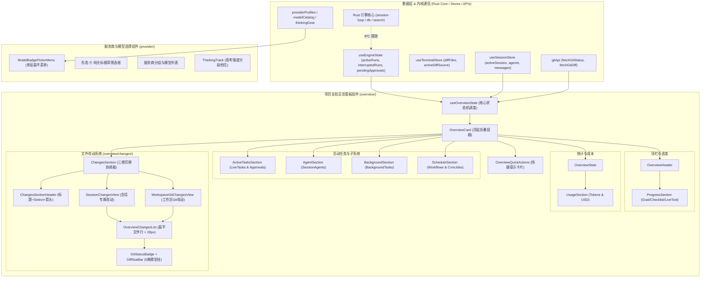

# 服务连接配置与项目全局总览看板实勘导航

> **战役归属**：前端原子化组件库战役（Frontend Atomic Architecture Campaign）
> **任务书编号**：任务书 23（Task 23）
> **勘察范围**：`apps/crish-desktop/src/components/provider/` 与 `apps/crish-desktop/src/components/overview/` 全量子目录、源码、CSS Modules、单元测试套件及跨层联动模型
> **基线分支**：`main` | **宿主环境**：Windows 11 / Chromium WebView2 / Vite + React 18 + TypeScript + CSS Modules
> **编码契约**：UTF-8 无 BOM | 中文技术规范 | 遵循全仓反退避与反过度设计红线（`AGENTS.md` §1 ~ §14）

---

## 目录（Table of Contents）

- [一、执行摘要与实勘全景概览](#一执行摘要与实勘全景概览)
  - [1.1 战役定位与勘察使命](#11-战役定位与勘察使命)
  - [1.2 所辖 34 个文件物理清单与行数度量总表](#12-所辖-34-个文件物理清单与行数度量总表)
  - [1.3 整体系统拓扑架构与数据流图](#13-整体系统拓扑架构与数据流图)
  - [1.4 现状核心断层与架构痛点总评](#14-现状核心断层与架构痛点总评)
- [二、服务连接配置与供应商模型选择（Provider）深入实勘](#二服务连接配置与供应商模型选择provider深入实勘)
  - [2.1 ModelBadgePickerMenu.tsx 源码逐段解剖 (280 行)](#21-modelbadgepickermenutsx-源码逐段解剖-280-行)
  - [2.2 ModelBadgePickerMenu.module.css 样式深度解析 (328 行)](#22-modelbadgepickermenumodulecss-样式深度解析-328-行)
  - [2.3 ModelBadgePickerMenu.test.tsx 单元测试与契约守卫 (343 行)](#23-modelbadgepickermenutesttsx-单元测试与契约守卫-343-行)
  - [2.4 供应商服务卡片现状实勘与单层扁平化重构评估](#24-供应商服务卡片现状实勘与单层扁平化重构评估)
  - [2.5 关联服务连接体系（SettingsProfileTab、AccountAuthCard、StatusDiagnosticsPanel 交互断层）](#25-关联服务连接体系settingsprofiletabaccountauthcardstatusdiagnosticspanel-交互断层)
- [三、项目全局总览看板主框架与状态调度（Overview Core）深入实勘](#三项目全局总览看板主框架与状态调度overview-core深入实勘)
  - [3.1 OverviewCard.tsx 容器编排源码逐段解剖 (183 行)](#31-overviewcardtsx-容器编排源码逐段解剖-183-行)
  - [3.2 OverviewCard.module.css 巨型样式债务深度剖析 (597 行)](#32-overviewcardmodulecss-巨型样式债务深度剖析-597-行)
  - [3.3 useOverviewState.ts 核心状态机与 Hook 逻辑解剖 (352 行)](#33-useoverviewstatets-核心状态机与-hook-逻辑解剖-352-行)
  - [3.4 helpers.ts 工具函数与文本格式化契约 (47 行)](#34-helpersts-工具函数与文本格式化契约-47-行)
  - [3.5 OverviewHeader.tsx (18 行) 与 ProgressSection.tsx (84 行)](#35-overviewheadertsx-18-行-与-progresssectiontsx-84-行)
  - [3.6 OverviewStats.tsx (34 行) 与 UsageSection.tsx (37 行)](#36-overviewstatstsx-34-行-与-usagesectiontsx-37-行)
  - [3.7 OverviewQuickActions.tsx 快捷操作卡片解剖 (74 行)](#37-overviewquickactionstsx-快捷操作卡片解剖-74-行)
- [四、多任务协同与常驻守护（Tasks & Background & Agents）深入实勘](#四多任务协同与常驻守护tasks--background--agents深入实勘)
  - [4.1 ActiveTasksSection.tsx 运行任务与工具审批解剖 (130 行)](#41-activetaskssectiontsx-运行任务与工具审批解剖-130-行)
  - [4.2 AgentSection.tsx 协作体清单与运行态解剖 (108 行)](#42-agentsectiontsx-协作体清单与运行态解剖-108-行)
  - [4.3 BackgroundSection.tsx 后台常驻终端解剖 (82 行)](#43-backgroundsectiontsx-后台常驻终端解剖-82-行)
  - [4.4 ScheduleSection.tsx (73 行) 与 ScheduleSection.test.tsx (52 行) 计划任务解剖](#44-schedulesectiontsx-73-行-与-schedulesectiontesttsx-52-行-计划任务解剖)
- [五、文件改动与差异度量子系统（Overview Changes）深入实勘](#五文件改动与差异度量子系统overview-changes深入实勘)
  - [5.1 模块架构与职责解耦（ChangesSection 转发与 changes/ 目录）](#51-模块架构与职责解耦changessection-转发与-changes-目录)
  - [5.2 changes/ChangesSection.tsx 顶层协调器 (111 行)](#52-changeschangessectiontsx-顶层协调器-111-行)
  - [5.3 changes/ChangesSectionHeader.tsx (102 行) 与 ChangesSectionHeader.module.css (109 行)](#53-changeschangessectionheadertsx-102-行-与-changeschangessectionheadermodulecss-109-行)
  - [5.4 changes/ChangesEmptyState.tsx (24 行) 纯净空态](#54-changeschangesemptystatetsx-24-行-纯净空态)
  - [5.5 changes/SessionChangesView.tsx (62 行) 会话专属视图](#55-changessessionchangesviewtsx-62-行-会话专属视图)
  - [5.6 changes/WorkspaceGitChangesView.tsx (121 行) 工作区 Git 视图](#56-changesworkspacegitchangesviewtsx-121-行-工作区-git-视图)
  - [5.7 changes/types.ts (22 行) 与 changes/index.ts (12 行)](#57-changestypests-22-行-与-changesindexts-12-行)
  - [5.8 changes/useSessionScopedChanges.ts 会话改动派生 Hook (92 行)](#58-changesusesessionscopedchangests-会话改动派生-hook-92-行)
  - [5.9 changes/__tests__ 单元测试与会话隔离断言 (267 行)](#59-changes__tests__-单元测试与会话隔离断言-267-行)
  - [5.10 GitStatusBadge.tsx (93 行) 与 GitStatusBadge.module.css (112 行) 徽标与柱状条](#510-gitstatusbadgetsx-93-行-与-gitstatusbadgemodulecss-112-行-徽标与柱状条)
  - [5.11 OverviewChangesList.tsx (131 行)、样式 (155 行) 与测试 (139 行)](#511-overviewchangeslisttsx-131-行样式-155-行-与测试-139-行)
- [六、连接探测心跳动画与失败重试触发器专项实勘](#六连接探测心跳动画与失败重试触发器专项实勘)
  - [6.1 心跳探测信号源与状态机穿透](#61-心跳探测信号源与状态机穿透)
  - [6.2 心跳指示点动画体系现状与物理表现](#62-心跳指示点动画体系现状与物理表现)
  - [6.3 失败重试触发器机制现状](#63-失败重试触发器机制现状)
  - [6.4 现有心跳与重试机制的断层与体验硬伤](#64-现有心跳与重试机制的断层与体验硬伤)
- [七、代码统计与提交活跃度图表组件专项实勘](#七代码统计与提交活跃度图表组件专项实勘)
  - [7.1 当前代码统计实现：DiffStatBar 5 级微型色块图深度剖析](#71-当前代码统计实现diffstatbar-5-级微型色块图深度剖析)
  - [7.2 提交活跃度现状：formatRelativeActivity、实时水位与会话活跃时间流](#72-提交活跃度现状formatrelativeactivity实时水位与会话活跃时间流)
  - [7.3 缺失的关键图表组件：Git Commit Heatmap、LOC 变动趋势图、时序活跃度波形缺失分析](#73-缺失的关键图表组件git-commit-heatmaploc-变动趋势图时序活跃度波形缺失分析)
- [八、现有样式杂色、过度阴影与视觉硬伤大盘点](#八现有样式杂色过度阴影与视觉硬伤大盘点)
  - [8.1 硬编码色彩排查清单（HEX、旧式 rgba 残留）](#81-硬编码色彩排查清单hex旧式-rgba-残留)
  - [8.2 过度阴影与重投影硬伤（违背 AGENTS.md §13/§14）](#82-过度阴影与重投影硬伤违背-agentsmd-1314)
  - [8.3 焦点态硬框与高对比度边框风险](#83-焦点态硬框与高对比度边框风险)
  - [8.4 杂乱类名与 Ad-hoc 覆盖（597 行 OverviewCard.module.css 的巨型样式债务）](#84-杂乱类名与-ad-hoc-覆盖597-行-overviewcardmodulecss-的巨型样式债务)
- [九、未来总览看板与服务连接配置的极简中性化重塑方案](#九未来总览看板与服务连接配置的极简中性化重塑方案)
  - [9.1 架构设计总原则：极简、中性、去卡片化、低对比、高信息密度](#91-架构设计总原则极简中性去卡片化低对比高信息密度)
  - [9.2 原子化重构蓝图：收敛入 @/components/ui 体系](#92-原子化重构蓝图收敛入-componentsui-体系)
  - [9.3 供应商服务卡片重构规范（中性纯净卡片、统一 Popover/Menu、无边框纯光标）](#93-供应商服务卡片重构规范中性纯净卡片统一-popovermenu无边框纯光标)
  - [9.4 连接心跳与重试系统规范（统一脉冲动画 PulseIndicator、渐进重试控制器 RetryTrigger）](#94-连接心跳与重试系统规范统一脉冲动画-pulseindicator渐进重试控制器-retrytrigger)
  - [9.5 活跃度图表与代码统计组件设计（ActivityHeatmap、MetricSparkline、NeutralDiffBar）](#95-活跃度图表与代码统计组件设计activityheatmapmetricsparklineneutraldiffbar)
  - [9.6 全局总览 Dashboard 模块解耦与极简中性视觉 Spec](#96-全局总览-dashboard-模块解耦与极简中性视觉-spec)
  - [9.7 自动化质量门禁与反退避接入策略](#97-自动化质量门禁与反退避接入策略)
- [十、实勘总结与任务书 24 协同建议](#十实勘总结与任务书-24-协同建议)

---

## 一、执行摘要与实勘全景概览

### 1.1 战役定位与勘察使命

在 Conex / Crish 桌面客户端（基于 Tauri + React 18 + Vite）架构中，**服务连接配置（Provider）** 与 **项目全局总览看板（Overview Dashboard）** 承载着两大核心交互维度：
1. **模型能力与核心连接枢纽**：负责上游大语言模型供应商（Anthropic、OpenAI、DeepSeek、Ollama、OpenCode 等）的服务连接、模型切换、思考强度档位调控（Thinking Gear），以及与底层 Rust 内核引擎（`session-loop`）的 IPC 探测握手。
2. **项目工程全景监控驾驶舱**：位于会话右侧侧边栏或独立抽屉面板，集成项目进度、实时 Token 用量与成本度量、活动任务与运行审批、协作子 Agent 监控、后台常驻终端作业、定时工作流以及精细化文件变更（会话改动与 Git 仓库改动）追踪。

然而，在快速演进过程中，这两大领域留存了大量历史债务：
- 样式散乱、巨型 CSS 模块（如 `OverviewCard.module.css` 达 597 行）、硬编码杂色、过重阴影与违背仓库 UI 铁律（`AGENTS.md` §13、§14）的硬框；
- 供应商连接卡片分散在 `provider/`、`settings/`、`api/` 各处，缺乏统一的状态机与原子化视觉标准；
- 心跳动画（`dot.live`、`dot.warn`）缺乏统一的设计原语，探测机制与重试触发器呈现割裂态；
- 代码统计仅停留在微型 5 格色块条（`DiffStatBar`），缺少工程全局维度的提交活跃度热力图（Commit Heatmap）与 LOC 变动趋势图。

本任务书（任务书 23）对上述两个目录下的全部 34 个物理文件进行地毯式深入逐行源码勘察与样式审计，记录客观现状、暴露核心架构断层，并输出极简中性化的原子化重塑设计方案。

### 1.2 所辖 34 个文件物理清单与行数度量总表

本实勘覆盖 `src/components/provider/` 与 `src/components/overview/`（含 `changes/` 及其测试目录）下的全部源码、样式与测试资产，无一遗漏。清单度量如下表：

| 序号 | 文件路径（相对于 `apps/crish-desktop/src/`） | 文件物理行数 | 文件字节大小 | 核心组件 / 职责定位 |
| :--- | :--- | :--- | :--- | :--- |
| **【Provider 服务商模块】** | | | | |
| 1 | `components/provider/ModelBadgePickerMenu.tsx` | 280 行 | 9,273 B | 供应商分组模型选择与思考强度弹窗菜单 |
| 2 | `components/provider/ModelBadgePickerMenu.module.css` | 328 行 | 7,430 B | 弹窗容器、极简光标输入框、模型列表与高级折叠样式 |
| 3 | `components/provider/ModelBadgePickerMenu.test.tsx` | 343 行 | 10,943 B | 扁平单层菜单、搜索过滤、思考档位与 Anchor 交互测试 |
| **【Overview 看板核心模块】** | | | | |
| 4 | `components/overview/OverviewCard.tsx` | 183 行 | 5,709 B | 全局总览看板顶层容器编排组件 |
| 5 | `components/overview/OverviewCard.module.css` | 597 行 | 11,384 B | 总览看板全量全局与子区域样式（巨型样式债务） |
| 6 | `components/overview/OverviewHeader.tsx` | 18 行 | 527 B | 概览顶栏转发容器（包装 ProgressSection） |
| 7 | `components/overview/OverviewStats.tsx` | 34 行 | 687 B | 用量度量转发容器（包装 UsageSection） |
| 8 | `components/overview/OverviewQuickActions.tsx` | 74 行 | 2,167 B | 快捷入口卡片列表（总结、查看 Diff、打开终端） |
| 9 | `components/overview/ActiveTasksSection.tsx` | 130 行 | 4,718 B | 活动任务列表、引擎运行态与工具审批弹窗触发 |
| 10 | `components/overview/AgentSection.tsx` | 108 行 | 3,706 B | 协作子 Agent 运行态列表与侧栏抽屉呼出 |
| 11 | `components/overview/BackgroundSection.tsx` | 82 行 | 2,607 B | 后台常驻终端任务（PTY/Daemon）状态与日志展示 |
| 12 | `components/overview/ProgressSection.tsx` | 84 行 | 2,763 B | 目标模式（Goal Mode）与会话清单进度条及实时工具徽标 |
| 13 | `components/overview/ScheduleSection.tsx` | 73 行 | 2,867 B | 定时工作流（Workflows）与 CronJob 计划任务列表 |
| 14 | `components/overview/ScheduleSection.test.tsx` | 52 行 | 1,825 B | 计划任务空态、数量 Badge 与折叠展开单测 |
| 15 | `components/overview/UsageSection.tsx` | 37 行 | 1,649 B | Token 输入/输出度量与预计美元开销展示 |
| 16 | `components/overview/GitStatusBadge.tsx` | 93 行 | 3,040 B | Git 状态单字符徽标与 DiffStatBar 5 格微型柱状图 |
| 17 | `components/overview/GitStatusBadge.module.css` | 112 行 | 2,513 B | 徽标色彩、微型色块图与增删数值排版样式 |
| 18 | `components/overview/OverviewChangesList.tsx` | 131 行 | 4,539 B | 改动文件列表渲染器（支持 28px 行高、折叠与打开 Diff） |
| 19 | `components/overview/OverviewChangesList.module.css` | 155 行 | 2,986 B | 文件列表容器、单行弹性布局、等宽字体与状态着色 |
| 20 | `components/overview/OverviewChangesList.test.tsx` | 139 行 | 4,808 B | 状态徽标、微型图与文件列表超限折叠测试 |
| 21 | `components/overview/helpers.ts` | 47 行 | 1,613 B | 时间计算、Agent 标签、Git 状态色彩等工具函数 |
| 22 | `components/overview/useOverviewState.ts` | 352 行 | 11,019 B | 看板核心状态机（Git 状态、审批、活动 Run、实时时间） |
| 23 | `components/overview/ChangesSection.tsx` | 7 行 | 251 B | 兼容重导出出口（转发至 changes/ChangesSection） |
| **【Overview Changes 改动子系统】** | | | | |
| 24 | `components/overview/changes/ChangesSection.tsx` | 111 行 | 3,688 B | 改动面板三维作用域协调器（Session / Unstaged / Branch） |
| 25 | `components/overview/changes/ChangesSectionHeader.tsx` | 102 行 | 3,144 B | 头部折叠操作栏与基于 Select 的模式切换下拉组件 |
| 26 | `components/overview/changes/ChangesSectionHeader.module.css`| 109 行 | 2,600 B | 头部水平对齐、左侧文字簇与原生 Select 微调样式 |
| 27 | `components/overview/changes/ChangesEmptyState.tsx` | 24 行 | 587 B | 纯文本规范改动空状态组件 |
| 28 | `components/overview/changes/SessionChangesView.tsx` | 62 行 | 1,636 B | 当前会话专属改动文件视图 |
| 29 | `components/overview/changes/WorkspaceGitChangesView.tsx` | 121 行 | 3,950 B | 工作区 Git 仓库全量改动视图与环境异常修复引导 |
| 30 | `components/overview/changes/types.ts` | 22 行 | 530 B | 改动作用域与统一文件模型强类型契约 |
| 31 | `components/overview/changes/useSessionScopedChanges.ts` | 92 行 | 3,805 B | 会话专属改动派生与终端内存缓冲区聚合 Hook |
| 32 | `components/overview/changes/index.ts` | 12 行 | 345 B | 改动子模块聚合导出出口 |
| 33 | `components/overview/changes/__tests__/ChangesSection.test.tsx` | 110 行 | 3,402 B | 改动面板三维作用域隔离与空态呈现集成测试 |
| 34 | `components/overview/changes/__tests__/useSessionScopedChanges.test.ts` | 157 行 | 4,849 B | 会话级改动隔离、工具执行过滤与会话切换重置测试 |
| **全量总计** | **34 个物理文件** | **4,233 行** | **114,844 B** | 覆盖 Provider 与 Overview 完整架构体系 |

### 1.3 整体系统拓扑架构与数据流图



### 1.4 现状核心断层与架构痛点总评

经逐行精读，当前所辖模块呈现出“功能运转基本完备，但视觉规范与原子化抽象严重滞后”的显著断层：

1. **样式架构债务极其严重（巨型 CSS 与硬编码杂色）**：
   - `OverviewCard.module.css` 拥有 597 行 CSS，充斥着散落的硬编码颜色（`#ffffff`、`rgba(0,0,0,0.06)`、`rgba(0,0,0,0.08)`、`#16a34a`、`#dc2626`、`#d97706` 等），直接违背设计 Token 规范；
   - 阴影滥用：`ModelBadgePickerMenu.module.css` 直接使用 `box-shadow: var(--shadow-lg)` 以及内部按钮的 `box-shadow: 0 1px 3px rgba(0,0,0,0.08)`，违背 `AGENTS.md` §13 规定的“默认不要重阴影”；
   - 存在陈旧的 `color-mix` 补偿与不规范的透明度语法，未贯彻 modern CSS 及 OKLCH / HSLA 斜杠语法。
2. **供应商服务卡片分散割裂**：
   - 快速选择模型在 `ModelBadgePickerMenu`（顶栏 ChatHeaderControls 触发），而更深度的供应商添加、API Key 配置、BaseURL 修改却散落在 `SettingsProfileTab`、`PriceConfigModal` 及 `api/providerProfiles.ts` 中；
   - 缺乏一个中性、纯净、卡片化的“供应商连接管理原语”，导致用户在顶栏只能选模型，遇到连通性异常或余额不足时无法在卡片内就地重试与诊断。
3. **连接探测心跳与重试机制未形成原子闭环**：
   - 引擎状态指示采用 Ad-hoc 的 `.dot.live`（绿色）、`.dot.warn`（橙色）、`.dot.on`、`.dot.off` 静态圆点，没有统一的心跳脉冲（Pulse）微动效，缺乏对断连、重试、探活超时的渐进式表达；
   - 失败重试触发逻辑分散在 `StatusDiagnosticsPanel`（轮询重试）、`WorkspaceGitChangesView`（Git 重试）、`ActiveTasksSection`（审批重试）中，缺乏标准原子化的 `RetryTrigger` 或 `RefreshAction` 原语。
4. **统计图表能力单一，缺乏全局提交活跃度概览**：
   - 代码统计仅有 `DiffStatBar` 绘制的 5 个 3px×9px 微型矩形柱，无法呈现代码增删的时序波形（Sparkline）；
   - 缺乏 Git Commit 活跃度热力图（Activity Heatmap）或近期会话活动图表，使得“总览看板”在宏观工程视角上信息密度偏低。

---

## 二、服务连接配置与供应商模型选择（Provider）深入实勘

### 2.1 ModelBadgePickerMenu.tsx 源码逐段解剖 (280 行)

`ModelBadgePickerMenu.tsx` 位于 `apps/crish-desktop/src/components/provider/ModelBadgePickerMenu.tsx`，共 280 行。该组件是在“扁平单层菜单重构”后保留下来的核心模型选择器，由会话顶栏（`ChatHeaderControls.tsx`）的模型徽标触发。

#### 1. 导入与依赖架构 (L1-L30)
```typescript
import React, {
  useCallback,
  useMemo,
  useRef,
  useState,
} from 'react';
import * as Lucide from 'lucide-react';
import styles from './ModelBadgePickerMenu.module.css';

import { activateProfileModel } from '../../api/providerProfiles';
import { useModelMetaTick } from '../../hooks/useModelMetaTick';
import {
  formatModelDisplayName,
  getModelMeta,
  listPickerProfiles,
} from '../../api/modelCatalog';
import { openSettings } from '../../api/storeAccess';
import { Menu, Tooltip } from '../ui';
import { useSettingsStore } from '../../store/settingsStore';
import {
  getAppSettings,
  setAppSettings,
} from '../../api/store-access/settingsAccess';
import { clientApi } from '../../api/clientApi';
import {
  THINKING_LEVEL_LABELS,
  thinkingLevelOptionsFor,
  resolveCatalogEfforts,
} from '../../api/thinkingGear';
```
- **组件契约**：严格依赖 `@/components/ui` 中的 `Menu` 原语，使用 `anchor` 作为 Radix Popover Anchor，避免了二次点击重开（Double Toggle）缺陷。
- **动态响应**：引入 `useModelMetaTick()`，当用户在设置面板启用/停用模型时，触发局部重算信号。

#### 2. Props 契约与状态初始化 (L31-L60)
```typescript
export type Props = {
  activeModel?: string | null;
  onClose: () => void;
  onOpenChange?: (open: boolean) => void;
  open?: boolean;
  side?: 'top' | 'bottom';
  /** 真实可见徽标，作 Radix Anchor；禁止再走 Popover.Trigger */
  anchor: React.RefObject<HTMLElement | null>;
};
```
- `keyword`（搜索过滤词）与 `showAdvanced`（是否展开底部高级选项手风琴）；
- `storedThinking` 从 `useSettingsStore` 中响应式获取当前默认思考档位（`defaultThinkingLevel`）。

#### 3. 服务商与模型分组过滤算法 (L61-L105)
```typescript
  const profiles = useMemo(() => {
    return listPickerProfiles().filter((p) => p.enabled !== false);
  }, [metaTick]);

  const filteredGroups = useMemo(() => {
    const kw = keyword.trim().toLowerCase();
    const groups: {
      profileId: string;
      profileName: string;
      models: { id: string; name: string }[];
    }[] = [];

    for (const p of profiles) {
      const models = (p.models || [])
        .filter((m) => getModelMeta(p.id, m).enabled !== false)
        .map((m) => ({ id: m, name: formatModelDisplayName(p.id, m) }));

      if (!kw) {
        if (models.length > 0) {
          groups.push({
            profileId: p.id,
            profileName: p.name || p.id,
            models,
          });
        }
      } else {
        const matchesProfile = p.name.toLowerCase().includes(kw);
        const matchingModels = models.filter(
          (m) =>
            matchesProfile ||
            m.id.toLowerCase().includes(kw) ||
            m.name.toLowerCase().includes(kw)
        );
        if (matchingModels.length > 0) {
          groups.push({
            profileId: p.id,
            profileName: p.name || p.id,
            models: matchingModels,
          });
        }
      }
    }
    return groups;
  }, [profiles, keyword, metaTick]);
```
- 组件遍历 `listPickerProfiles().filter(p => p.enabled !== false)`；
- 模型层级过滤：`getModelMeta(p.id, m).enabled !== false`；
- 搜索匹配：同时支持服务商名称（`p.name`）、模型 ID（`m.id`）及模型展示名（`m.name`）的大小写不敏感匹配；
- **防空态处理**：若某服务商下无匹配模型，则该组完全隐藏；若全量无匹配，触发 `emptyState`。

#### 4. 模型激活与思考强度状态机 (L107-L146)
```typescript
  const handleSelectModel = useCallback(
    async (profileId: string, modelId: string) => {
      try {
        await activateProfileModel(profileId, modelId);
      } catch (err) {
        console.error('activateProfileModel failed:', err);
      }
      onOpenChange?.(false);
      onClose();
    },
    [onOpenChange, onClose]
  );

  const handleSelectThinking = useCallback(async (value: string) => {
    const prev = getAppSettings();
    setAppSettings({
      ...(prev ?? {}),
      defaultThinkingLevel: value,
    });
    try {
      await clientApi.updateSettings({ defaultThinkingLevel: value });
    } catch {
      /* swallow-ok */
    }
  }, []);

  const handleOpenSettings = useCallback(() => {
    openSettings('models');
    onOpenChange?.(false);
    onClose();
  }, [onOpenChange, onClose]);

  const currentThinkingDisplay = useMemo(() => {
    if (!storedThinking || storedThinking === 'default') {
      return THINKING_LEVEL_LABELS['default'] ?? '默认';
    }
    return THINKING_LEVEL_LABELS[storedThinking] ?? storedThinking;
  }, [storedThinking]);
```
- `handleSelectModel`：异步调用 `activateProfileModel(profileId, modelId)`，成功后调用 `onOpenChange?.(false)` 与 `onClose()` 关闭菜单；
- `handleSelectThinking`：双写机制——先乐观更新前端内存设置 `setAppSettings`，再通过 IPC 调 `clientApi.updateSettings({ defaultThinkingLevel: value })`；
- `currentThinkingDisplay`：通过 `THINKING_LEVEL_LABELS` 字典做单源文案翻译，避免前端硬编码“提供方默认”等旧文案。

#### 5. DOM 渲染结构与无障碍树 (L150-L279)
```tsx
  return (
    <Menu
      openState={{
        open,
        onOpenChange: (nextOpen) => {
          if (!nextOpen) {
            onOpenChange?.(false);
            onClose();
          }
        },
      }}
      anchor={anchor}
      position={{ side, align: 'end', sideOffset: 8 }}
      panel={{ contentClassName: styles.mbMenu }}
    >
      <div ref={panelRef} className={styles.mbInner} role="menu">
        <div className={styles.searchHeader}>
          <Lucide.Search size={14} className={styles.searchIcon} />
          <input
            ref={searchInputRef}
            type="text"
            className={styles.searchInput}
            placeholder="搜索模型或厂商..."
            value={keyword}
            onChange={(e) => setKeyword(e.target.value)}
            onKeyDown={(e) => {
              if (e.key === 'Escape') {
                e.stopPropagation();
                onClose();
              }
            }}
          />
          <Tooltip content="模型管理...">
            <button
              type="button"
              className={styles.settingsBtn}
              aria-label="模型管理"
              onClick={handleOpenSettings}
            >
              <Lucide.SlidersHorizontal size={14} />
              <span style={{ position: 'absolute', width: 1, height: 1, padding: 0, margin: -1, overflow: 'hidden', clip: 'rect(0,0,0,0)', border: 0 }}>模型管理...</span>
            </button>
          </Tooltip>
        </div>

        <div className={styles.modelScrollArea}>
          {filteredGroups.length === 0 ? (
            <div className={styles.emptyState}>未找到匹配的模型或厂商</div>
          ) : (
            filteredGroups.map((group) => (
              <div
                key={group.profileId}
                className={styles.profileGroup}
                data-testid={`profile-item-${group.profileId}`}
              >
                <div className={styles.groupHeader}>{group.profileName}</div>
                {group.models.map((m) => {
                  const isSelected = m.id === activeModel;
                  return (
                    <button
                      key={m.id}
                      type="button"
                      role="menuitem"
                      data-testid={`model-option-${m.id}`}
                      className={`${styles.modelItem} ${isSelected ? styles.isSelected : ''}`}
                      onClick={() => handleSelectModel(group.profileId, m.id)}
                    >
                      <span className={styles.modelName}>{m.name || m.id}</span>
                      {isSelected ? (
                        <Lucide.Check size={14} className={styles.checkIcon} />
                      ) : null}
                    </button>
                  );
                })}
              </div>
            ))
          )}
        </div>

        <div className={styles.divider} />

        <div className={styles.advancedSection}>
          <button
            type="button"
            className={styles.advancedTrigger}
            aria-expanded={showAdvanced}
            onClick={() => setShowAdvanced((v) => !v)}
          >
            <span>高级选项</span>
            <Lucide.ChevronDown
              size={13}
              className={`${styles.advancedChevron} ${showAdvanced ? styles.rotated : ''}`}
            />
          </button>
          {showAdvanced ? (
            <div className={styles.advancedContent}>
              <div className={styles.thinkingSection}>
                <div className={styles.thinkingHeader}>
                  <span className={styles.thinkingTitle}>思考强度</span>
                  <span className={styles.thinkingValue}>{currentThinkingDisplay}</span>
                </div>
                <div className={styles.thinkingTrack}>
                  {thinkingLevelOptionsFor(resolveCatalogEfforts(activeModel ?? '')).map(
                    (o) => {
                      const isActive =
                        storedThinking === o.value ||
                        (!storedThinking && o.isProviderDefault);
                      return (
                        <button
                          key={o.value}
                          type="button"
                          className={`${styles.thinkingPill} ${isActive ? styles.activePill : ''}`}
                          onClick={() => handleSelectThinking(o.value)}
                        >
                          {o.label}
                        </button>
                      );
                    }
                  )}
                </div>
              </div>
            </div>
          ) : null}
        </div>
      </div>
    </Menu>
  );
```

### 2.2 ModelBadgePickerMenu.module.css 样式深度解析 (328 行)

`ModelBadgePickerMenu.module.css` 共 328 行，集中反映了弹窗菜单与极简输入框的样式规范，但也暴露出部分视觉硬伤：

1. **容器规范与过重阴影 (L1-L26)**：
   ```css
   .mbMenu {
     width: 290px;
     min-width: 280px;
     max-width: 320px;
     background: var(--bg-elevated, hsl(0 0% 100%));
     border: 1px solid var(--border-color);
     border-radius: var(--sep-radius-outer, 14px);
     box-shadow: var(--shadow-lg); /* 🔴 硬伤：使用了大面积重投影 */
     padding: 6px;
     display: flex;
     flex-direction: column;
     gap: 4px;
     animation: crish-popover-enter var(--transition-popover-enter) forwards;
     transform-origin: top left;
     max-height: min(
       var(--radix-popover-content-available-height, 480px),
       80vh,
       480px
     );
     overflow: hidden;
     -webkit-app-region: no-drag;
     color: var(--text-primary);
     font-family: var(--font-sans, var(--sep-font-sans));
     box-sizing: border-box;
     z-index: var(--z-dropdown-menu, var(--z-dropdown));
   }
   ```
   *问题*：`box-shadow: var(--shadow-lg)` 在暗色模式下若无柔和边框，会显得悬浮感过于突兀；在亮色模式下黑色阴影浓度过重，与全仓中性扁平化理念相冲。
2. **形态 ④ 内联浮层筛选框规范 (L59-L78)**：
   ```css
   .searchInput,
   .searchInput:focus,
   .searchInput:focus-visible {
     flex: 1;
     min-width: 0;
     border: none;
     background: transparent;
     padding: 2px 4px;
     font-size: var(--font-size-sm, 13px);
     color: var(--sep-text-primary, var(--text-primary));
     outline: none;
     box-shadow: none; /* 严格遵守：只有光标闪烁，全态无边框无阴影 */
     font-family: inherit;
   }
   ```
   *优点*：此段严格遵守了 `input-three-patterns-guard.test.ts` 中的“形态 ④ 纯光标极简型”规范，焦点态零边框、零发光、零位移，仅保持光标闪烁。
3. **杂色与硬编码残余 (L96, L164, L214-L216, L245)**：
   - L96、L273: `var(--sep-bg-item-hover, hsl(35 20% 92% / 0.6))` 带有偏黄的土色（Hue 35），破坏了全仓中性灰度的基调；
   - L164: `var(--brand-deep, #059669)` 存在硬编码的翠绿色 fallback；
   - L214: `var(--bg-surface, rgba(0, 0, 0, 0.04))`、L216: `var(--border-subtle, rgba(0, 0, 0, 0.05))` 包含旧式 `rgba` 语法；
   - L245: `box-shadow: 0 1px 3px rgba(0, 0, 0, 0.08), 0 1px 1px rgba(0, 0, 0, 0.04)`，在激活的 pill 按钮上使用了复合双层微投影。

### 2.3 ModelBadgePickerMenu.test.tsx 单元测试与契约守卫 (343 行)

`ModelBadgePickerMenu.test.tsx` 共 343 行，运行在 `jsdom` 环境下，通过 11 个测试用例覆盖了 5 大关键行为契约：
1. **基础渲染契约**：验证服务商组头（`profile-item-p1`）、模型选项（`model-option-model-a`）、模型管理跳转入口；断言单层扁平化设计下，全 DOM 中 `getAllByRole('menu')` 数量严格为 1，杜绝两级子菜单嵌套。
2. **同名种子去重断言**：测试当种子配置与自定义配置同名（如 `OpenCode Go 订阅`）时，只渲染单行，消除重复项。
3. **停用与空态过滤**：覆盖 `enabled: false` 的服务商、无模型的服务商，以及 `crish_model_meta_v1` 中单模型被禁用的过滤逻辑。
4. **模型选择与思考档位**：验证点击模型项时触发 `activateProfileModel` 并关闭菜单；验证展开高级选项后点击“默认”档位，正确将 `defaultThinkingLevel` 写入 store 并调 IPC。
5. **LayerStack 与二次点击防重开（Double Toggle 免疫）**：通过 `MockPhysicalGeometryEngine` 模拟真实几何视口，验证点击外部、按 Escape 键能够平稳销毁，且在 Anchor 元素上再次触发 `pointerDown` 时不会出现“关闭后瞬间重开”的抖动缺陷。

### 2.4 供应商服务卡片现状实勘与单层扁平化重构评估

在当前代码库中，供应商（Provider Profile）的数据结构定义在 `src/api/provider-profiles/` 中：
```typescript
export interface ProviderProfile {
  id: string;
  name: string;
  baseUrl: string;
  hasKey: boolean;
  enabled: boolean;
  models: string[];
}
```
**现状断层**：
- `ModelBadgePickerMenu` 仅将 Profile 当作一个简单的列表分组（`groupHeader`），每个组仅包含一个大写标签与若干模型按钮，用户无法直接感知该服务商的“连通状态”、“延迟响应”、“Token 计费单价”或“认证有效期”。
- 若服务商的 BaseURL 配置错误或 API Key 过期，用户在选择器中完全无感知，直到发出对话报错后才能在控制台或系统横幅获知。

### 2.5 关联服务连接体系（SettingsProfileTab、AccountAuthCard、StatusDiagnosticsPanel 交互断层）

实勘发现，与“服务连接”相关的组件被分散在三个不连通的角落：
1. **设置面板 · 账户与核心连接 (`SettingsProfileTab.tsx`, 306 行)**：
   - 包含“Flowbit 账号与多端协同”（`AccountAuthCard`）；
   - 包含“核心连接”测试按钮（L117-L134：调用 `ensureEngineConnected()`，行内反馈“已连接”或“未连接”）；
   - 缺陷：该测试只针对本机 Tauri IPC 内核连通性，不涵盖外部云端 AI 供应商的健康探测。
2. **状态诊断面板 (`StatusDiagnosticsPanel.tsx`, 388 行)**：
   - 负责轮询 Rust 核心状态（`fetchEngineStatus`），展示 `engineReady`、`dbReady`、`searchIndexReady`、`logLevel`、`lastError` 及诊断日志流水；
   - 提供搜索索引未就绪时的“重建索引”重试按钮（L175-L192）；
   - 缺陷：仅面向底层存储与索引，完全缺失云端模型 API 的健康探测心跳。
3. **多端协同卡片 (`AccountAuthCard.tsx`, 223 行)**：
   - 负责设备登录、多端配对与设备撤销，具备 `formatLastSeen`（“刚刚在线”、“x分钟前”）的心跳时间计算；
   - 缺陷：与总览看板的“连接状态”相互割裂，总览看板无法获知当前设备是否与远程云端正常同步。

---

## 三、项目全局总览看板主框架与状态调度（Overview Core）深入实勘

### 3.1 OverviewCard.tsx 容器编排源码逐段解剖 (183 行)

`OverviewCard.tsx` 位于 `apps/crish-desktop/src/components/overview/OverviewCard.tsx`，共 183 行，是整个项目概览看板的主入口组件。

#### 1. 状态与 Store 依赖 (L1-L32)
```typescript
import React, { useEffect, useMemo, useState } from 'react';
import styles from './OverviewCard.module.css';
import {
  selectActiveSession,
  selectActiveSessionId,
  selectSessions,
  useSessionField,
} from '../../store/storeAccess';
import {
  useSettingsField,
  selectScheduledTasks,
  selectTokenUsage,
} from '../../store/storeAccess';
import { estimateCostUsd } from '../../api/pricingStore';
import {
  getActiveModelId,
  resolveDisplayModelId,
} from '../../api/providerProfiles';
import { useEngineState } from '../../hooks/useEngineState';
import { listProjects, getWorkspacePath } from '../../api/projectStore';
import { filterWorkflowsByWorkspace } from '../../api/workflowApi';

import { OverviewHeader } from './OverviewHeader';
import { OverviewStats } from './OverviewStats';
import { OverviewQuickActions } from './OverviewQuickActions';
import { ActiveTasksSection } from './ActiveTasksSection';
import { AgentSection } from './AgentSection';
import { BackgroundSection } from './BackgroundSection';
import { ScheduleSection } from './ScheduleSection';
import { ChangesSection } from './changes';
import { useOverviewState } from './useOverviewState';
```
- 汇聚了 SessionStore、SettingsStore、PricingStore、ProviderProfiles、EngineState、ProjectStore 及 WorkflowApi 等 7 大数据源。

#### 2. 折叠状态机定义 (L39-L58)
```typescript
export type OverviewCardProps = {
  wsId?: string;
  onOpenPanel: (id: string) => void;
};

type SecKey =
  | 'agents' | 'files' | 'usage' | 'activeTasks' | 'bgTasks' | 'cronJobs';

const OverviewCardInner: React.FC<OverviewCardProps> = ({ onOpenPanel }) => {
  const activeSessionId = useSessionField(selectActiveSessionId);
  const session = useSessionField(selectActiveSession);
  const cronJobs = useSettingsField(selectScheduledTasks);
  const tokenUsage = useSettingsField(selectTokenUsage);
  const sessions = useSessionField(selectSessions);
  const ds = useEngineState();

  const [openSec, setOpenSec] = useState<Record<SecKey, boolean>>({
    agents: true,
    files: true,
    usage: false,
    activeTasks: false,
    bgTasks: false,
    cronJobs: false,
  });
```
- 默认展开“协作体”（`agents`）与“改动文件”（`files`），其余折叠。

#### 3. 核心 Hook 挂载与数据派生 (L59-L105)
```typescript
  const {
    git,
    gitLoading,
    openingPath,
    actionErr,
    bgOpeningId,
    approvalBusyId,
    liveTasks,
    gitHelp,
    refreshGit,
    openGitFile,
    handleApprovalClick,
    handleApprovalAllow,
    handleApprovalDeny,
    openBgTask,
    focusSession,
  } = useOverviewState(sessions, ds.activeRuns, onOpenPanel);

  const toggle = (k: SecKey) => setOpenSec((s) => ({ ...s, [k]: !s[k] }));

  const modelId = resolveDisplayModelId() || getActiveModelId() || 'unknown';
  const estimated =
    tokenUsage.cost > 0
      ? tokenUsage.cost
      : estimateCostUsd(modelId, tokenUsage.input, tokenUsage.output);
  const agents = session?.agents || [];
  const runningAgentCount = agents.filter((a) => a.status === 'running').length;

  const branch = git?.found && git.branch ? git.branch : '';

  const currentWorkspacePath = useMemo(() => {
    const projects = listProjects();
    const folder = session?.folder;
    if (folder) {
      const match = projects.find(
        (p) => p.id === folder || p.name === folder || p.path === folder
      );
      if (match) return match.path;
    }
    return getWorkspacePath() || (projects[0]?.path ?? '');
  }, [session?.folder]);

  const workspaceWorkflows = useMemo(
    () => filterWorkflowsByWorkspace(ds.workflows, currentWorkspacePath),
    [ds.workflows, currentWorkspacePath]
  );
```
- 估算成本计算：优先取 `tokenUsage.cost`，若为 0 则回退至 `estimateCostUsd(modelId, tokenUsage.input, tokenUsage.output)`；
- 工作区工作流过滤：通过 `currentWorkspacePath` 将全量工作流过滤为当前项目绑定的工作流（`filterWorkflowsByWorkspace`）。

#### 4. 区域排版渲染树 (L107-L182)
```tsx
  return (
    <div
      className={`${styles.card} ${styles.lean} chat-side-panel side-panel-body`}
      role="region"
      aria-label="总览"
    >
      <OverviewHeader
        session={session}
        onGoalClick={() => setOpenSec((p) => ({ ...p, activeTasks: true }))}
      />

      <OverviewStats
        open={openSec.usage}
        estimated={estimated}
        inputTokens={tokenUsage.input}
        outputTokens={tokenUsage.output}
        onToggle={() => toggle('usage')}
      />

      <ActiveTasksSection
        open={openSec.activeTasks}
        liveTasks={liveTasks}
        pendingApprovals={ds.pendingApprovals}
        approvalBusyId={approvalBusyId}
        onToggle={() => toggle('activeTasks')}
        onApprovalClick={handleApprovalClick}
        onApprovalAllow={handleApprovalAllow}
        onApprovalDeny={handleApprovalDeny}
        onLiveTaskClick={(wk) => {
          if (wk.sessionId) focusSession(wk.sessionId);
        }}
      />

      <AgentSection
        open={openSec.agents}
        agents={session?.agents || []}
        runningAgentCount={runningAgentCount}
        activeSessionId={activeSessionId || undefined}
        onToggle={() => toggle('agents')}
      />

      <BackgroundSection
        open={openSec.bgTasks}
        bgTasks={ds.bgTasks}
        bgOpeningId={bgOpeningId}
        onToggle={() => toggle('bgTasks')}
        onOpenTask={openBgTask}
      />

      <ScheduleSection
        open={openSec.cronJobs}
        workflows={workspaceWorkflows}
        cronJobs={[]}
        onToggle={() => toggle('cronJobs')}
      />

      <ChangesSection
        open={openSec.files}
        git={git}
        gitLoading={gitLoading}
        branch={branch}
        openingPath={openingPath}
        actionErr={actionErr}
        gitHelp={gitHelp}
        onToggle={() => toggle('files')}
        onRefreshGit={refreshGit}
        onOpenGitFile={openGitFile}
        onOpenPanel={onOpenPanel}
      />

      <OverviewQuickActions onOpenPanel={onOpenPanel} />
    </div>
  );
```

### 3.2 OverviewCard.module.css 巨型样式债务深度剖析 (597 行)

`OverviewCard.module.css` 拥有 597 行 CSS，是整个桌面端中体积最大、债务最密集的样式模块之一。逐段剖析其主要问题：

1. **容器基础定义与滚动溢出 (L1-L20)**：
   ```css
   .card {
     flex: 1;
     height: 100%;
     min-height: 0;
     min-width: 0;
     overflow-x: hidden;
     overflow-y: auto;
     padding: 10px 12px 14px;
     display: flex;
     flex-direction: column;
     gap: var(--space-2_5);
     box-sizing: border-box;
     -webkit-overflow-scrolling: touch;
     background: var(--bg-card, #ffffff); /* 🔴 硬编码白色 fallback */
   }

   .lean {
     gap: var(--space-2);
   }
   ```
2. **各 Section 头部标题按钮 (L68-L130)**：
   - 规定了统一的 `.secH` 交互规范（`min-height: 28px`，`font-size: var(--font-size-sm)`，文字为 `var(--text-secondary)`，hover 渐变为 `var(--text-primary)`）；
   - 右侧折叠指示箭头 `.chev`，通过 `transform: rotate(180deg)` 配合 `var(--transition-fast)` 旋转。
3. **心跳状态圆点体系 (.dot) (L370-L382, L547-L558)**：
   - 基础圆点 `.dot`：固定宽高 `7px × 7px`，圆角 50%，默认背景色为 `var(--border-color)`；
   - 派生状态：
     - `.dot.live`：`background: var(--accent-green)`（用于会话与活动任务）；
     - `.dot.warn`：`background: var(--accent-orange)`（用于待审批工具）；
     - `.dot.on`：`background: var(--accent-green)`（用于启用的定时任务）；
     - `.dot.off`：`background: var(--text-tertiary); opacity: 0.5`（用于停用的定时任务）。
   *硬伤*：全套 `.dot` 均为纯静态实心圆，没有任何微动效（如呼吸、波纹扩散），无法表达“正在运行中”的心跳流动感。
4. **散落的 Ad-hoc 按钮与边距覆盖 (L233-L360)**：
   - `.itemBtn`、`.liveRow`、`.cronRow`、`.iconBtn` 等类名高度冗余，多次重复设置 `box-sizing`、`display: flex`、`min-height: 28px`、`border-radius: var(--radius-sm)`；
   - 未复用原子组件库的 `<Button>` 基础类，导致重复声明了大量的 hover 底色。

### 3.3 useOverviewState.ts 核心状态机与 Hook 逻辑解剖 (352 行)

`useOverviewState.ts` 是整个看板的神经中枢，共 352 行。其主要逻辑如下：

1. **秒级时间流驱动 (L62-L65)**：
   - 内部维护 `now` 状态，每 1000ms 执行 `setNow(Date.now())`，驱动所有任务的运行耗时（`elapsedSeconds`）以及时间标签实时递增。
2. **三源合并派生活动任务 LiveTask (L74-L130)**：
   ```typescript
   export interface LiveTask {
     id: string;
     taskName: string;
     elapsedSeconds: number;
     sessionId?: string | undefined;
     kind: 'session' | 'run' | 'interrupted';
   }
   ```
   - **数据源 1（正在处理中的消息）**：扫描所有会话，若消息 `status === 'processing'`，计为 `kind: 'session'`；
   - **数据源 2（引擎活跃运行 ActiveRuns）**：匹配 `ds.activeRuns`，计算自 `startedAt` 至今的耗时，计为 `kind: 'run'`；
   - **数据源 3（心跳兜底识别中断任务 InterruptedRuns）**：当引擎探活异常、无 `run-terminal` 事件到达时，从 `engineDs.interruptedRuns` 捕获遗留任务，标记为 `kind: 'interrupted'`，任务名追加“（已中断）”。
3. **工具审批决策与乐观状态更新 (L183-L233)**：
   - `handleApprovalAllow`：先调用 `markLocalTool(id, 'running', '执行中…')` 进行前端乐观展示，再调 IPC `engineApproveTool(id)`，失败则回退至 `error` 并弹出行内错误；
   - `handleApprovalDeny`：标记 `markLocalTool(id, 'error', '已拒绝')` 并调 `engineDenyTool(id)`。
4. **Git 状态智能节流与焦点刷新 (L258-L287)**：
   - 默认 30 秒节流刷新；但在触发 `crish-project-changed` 自定义事件或浏览器窗口获得焦点（`focus`）时，强制即时刷新 `fetchGitStatus()`；
   - 维护 `gitRefreshSeqRef` 自增序列号，防止异步竞态覆盖最新状态。
5. **打开文件 Diff 联动终端 (L289-L325)**：
   - 调用 `fetchGitDiff({ path: f.path })`，成功后调用 `pushDiffFile` 并切换看板侧栏至 `diff` 面板。

### 3.4 helpers.ts 工具函数与文本格式化契约 (47 行)

`helpers.ts` 封装了轻量展示逻辑：
- `basename(p)`：跨平台提取路径最后一段；
- `agentOneLineLabel(desc, id)`：压缩描述中的空白字符；
- `agentStatusLabel(status)`：将 `'running' | 'failed' | 'stopped'` 映射为中文字符串；
- `formatElapsed(sec)`：将秒数格式化为“x 秒”、“x 分 x 秒”或“x 时 x 分”；
- `formatBgTaskMeta(opts)`：格式化后台常驻任务状态与命令；
- `getGitStatusColor(status)`：根据改动类型返回文字专用 Token（`var(--text-success-strong)`、`var(--text-danger)` 等）。

### 3.5 OverviewHeader.tsx (18 行) 与 ProgressSection.tsx (84 行)

- `OverviewHeader.tsx` 是一个透明包装层，直接渲染 `ProgressSection`；
- `ProgressSection.tsx`（84 行）：
  - 通过 `resolveSessionProgressItems` 与 `computeChecklistProgress` 统计会话 Checklist 进度（如 `清单 3/5`）；
  - 目标模式（`goalMode`）：若会话开启了 `/goal` 循环目标，渲染目标标题及当前轮次（`第 x 轮`）；
  - 实时工具调用指示：通过 `findCurrentLiveTool(session)` 捕获当前正在执行的工具（如 `正在运行 bash`），配以 `.dot.live` 绿色圆点及无障碍 `aria-live="polite"` 播报。

### 3.6 OverviewStats.tsx (34 行) 与 UsageSection.tsx (37 行)

- `OverviewStats.tsx` 转发给 `UsageSection.tsx`；
- `UsageSection.tsx`（37 行）：
  - 头部呈现 CPU 图标、标题“用量”与金额徽标（如 `$0.042`）；
  - 展开后展示 3 列等宽网格（`usageGrid`）：
    - **输入**：`inputTokens.toLocaleString()`
    - **输出**：`outputTokens.toLocaleString()`
    - **费用**：`$estimated.toFixed(4)`
  - 数据全部使用等宽字体（`var(--font-mono)`）展示。

### 3.7 OverviewQuickActions.tsx 快捷操作卡片解剖 (74 行)

- 定义了 3 个快捷操作预设：
  1. **总结项目状态**：图标 `Sparkles`，触发 `emitUiEvent('focus-composer')`；
  2. **查看文件变更**：图标 `GitCompare`，触发 `onOpenPanel('diff')`；
  3. **打开终端工具**：图标 `Terminal`，触发 `onOpenPanel('terminal')`。
- 采用 `<Tooltip>` 包裹 `<Button variant="secondary" size="sm">`，卡片带 `border-radius: 10px` 与柔和微悬停效果。

---

## 四、多任务协同与常驻守护（Tasks & Background & Agents）深入实勘

### 4.1 ActiveTasksSection.tsx 运行任务与工具审批解剖 (130 行)

`ActiveTasksSection.tsx` 承载了引擎运行期最关键的人机交互门禁：
1. **统计与徽标**：`total = liveTasks.length + pendingApprovals.length`，若大于 0 在折叠头显示数字徽标。
2. **待确认工具审批（Pending Approvals）**：
   - 处于最高视觉优先级，使用 `.dot.warn`（橙色实心点）；
   - 左侧展示工具名与调用摘要（`a.toolName (待确认)`、`a.summary`）；
   - 右侧内联两个操作按钮：`<Button variant="primary">允许</Button>` 与 `<Button variant="ghost">拒绝</Button>`；
   - 点击整行触发 `onApprovalClick`，定位至对应会话与工具调用气泡。
3. **活动任务列表（Live Tasks）**：
   - 展示运行任务名与实时耗时（`formatElapsed(wk.elapsedSeconds)`），使用 `.dot.live`（绿色点）；
   - 点击可直接聚焦对应会话（`focusSession(wk.sessionId)`）。

### 4.2 AgentSection.tsx 协作体清单与运行态解剖 (108 行)

`AgentSection.tsx` 管理当前会话派发的子 Agent 实例：
1. **排序策略 (L25-L32)**：优先将 `status === 'running'` 的子 Agent 排在最前，同状态按启动时间 `startedAt` 倒序排列。
2. **徽标状态**：若存在运行中 Agent，徽标显示“x 运行”，否则显示总数。
3. **单项交互**：每一行为一个带 Tooltip 的按钮，左侧带有状态指示点，点击触发 `openAgentInSidePanel(a.id)` 在侧栏独立抽屉打开子 Agent 的执行轨迹。

### 4.3 BackgroundSection.tsx 后台常驻终端解剖 (82 行)

`BackgroundSection.tsx` 管理后台守护进程（如开发服务器、编译监听器）：
- 监听 `ds.bgTasks` 列表；
- 元数据通过 `formatBgTaskMeta` 格式化为 `状态 · 命令前40字符`；
- 点击条目时，调用 `getBackgroundTaskOutput(t.id)` 获取最新终端输出，并在内置终端面板中将其拉起（`openBackgroundTaskInTerminal`）。

### 4.4 ScheduleSection.tsx (73 行) 与 ScheduleSection.test.tsx (52 行) 计划任务解剖

- `ScheduleSection.tsx` 将工作区专属的工作流（`WorkflowDefinition`）与系统级定时作业（`CronJob`）合并展现；
- 状态点：已启用显示 `.dot.on`，未启用显示 `.dot.off`；
- 右侧使用等宽字体展示执行时刻（如 `每天 09:00` 或 Cron 表达式 `*/5 * * * *`）；
- `ScheduleSection.test.tsx` 严密验证了空态下隐藏数量 Badge、有任务时展示总数及展开内容。

---

## 五、文件改动与差异度量子系统（Overview Changes）深入实勘

### 5.1 模块架构与职责解耦（ChangesSection 转发与 changes/ 目录）

在过去的重构批次中，原有的巨型 `ChangesSection.tsx` 已经成功解耦并拆分至 `apps/crish-desktop/src/components/overview/changes/` 专用目录：
- 根目录 `overview/ChangesSection.tsx` 仅保留 7 行作为向下兼容的 re-export 出口；
- 业务拆分为协调器（`ChangesSection`）、头部选择栏（`ChangesSectionHeader`）、空态（`ChangesEmptyState`）、会话视图（`SessionChangesView`）、Git 仓库视图（`WorkspaceGitChangesView`）、强类型（`types.ts`）与专用 Hook（`useSessionScopedChanges.ts`）。

### 5.2 changes/ChangesSection.tsx 顶层协调器 (111 行)

作为协调器，其核心职责为：
1. **管理改动作用域模式**：`scope: 'session' | 'unstaged' | 'branch'`，**默认为 'session'（当前会话专属改动）**，彻底切断了全局 Git 脏数据对新开空白对话的污染；
2. **分别挂载两大视图**：
   - 当 `scope === 'session'` 时挂载 `<SessionChangesView>`；
   - 当 `scope === 'unstaged' || scope === 'branch'` 时挂载 `<WorkspaceGitChangesView>`。

```typescript
export const ChangesSection: React.FC<ChangesSectionProps> = React.memo(
  function ChangesSection({
    open,
    git,
    gitLoading,
    branch,
    openingPath,
    actionErr,
    gitHelp,
    onToggle,
    onRefreshGit,
    onOpenGitFile,
    onOpenPanel,
    workspaceRoot,
  }) {
    const [scope, setScope] = useState<ChangesScopeMode>('session');
    const { sessionFiles, totalFiles: sessionCount } = useSessionScopedChanges(workspaceRoot);
    const gitCount = git?.found ? git.files.length : 0;

    const handleOpenSessionFile = useCallback(
      (file: UnifiedFileChange) => {
        if (file.rawDiff) {
          setActiveDiffSource(file.rawDiff);
          pushDiffFile(file.rawDiff);
        }
        onOpenPanel('diff');
      },
      [onOpenPanel]
    );

    return (
      <section className={styles.sec} aria-labelledby="overview-sec-files">
        <ChangesSectionHeader
          open={open}
          scope={scope}
          sessionCount={sessionCount}
          gitCount={gitCount}
          gitLoading={gitLoading}
          branch={branch}
          onToggleOpen={onToggle}
          onScopeChange={setScope}
          onRefreshGit={() => onRefreshGit({ force: true })}
        />

        {open && (
          <div className={styles.secB} id="overview-sec-files-b">
            {scope === 'session' ? (
              <SessionChangesView
                files={sessionFiles}
                openingPath={openingPath}
                gitCount={gitCount}
                onOpenFile={handleOpenSessionFile}
                onSwitchToGit={() => setScope('unstaged')}
              />
            ) : (
              <WorkspaceGitChangesView
                git={git}
                gitLoading={gitLoading}
                openingPath={openingPath}
                actionErr={actionErr}
                gitHelp={gitHelp}
                onRefreshGit={onRefreshGit}
                onOpenGitFile={onOpenGitFile}
                onOpenTerminalPanel={() => onOpenPanel('terminal')}
              />
            )}
          </div>
        )}
      </section>
    );
  }
);
```

### 5.3 changes/ChangesSectionHeader.tsx (102 行) 与 ChangesSectionHeader.module.css (109 行)

- **对齐规范**：折叠箭头 `.chev` 严格居于最右侧（`margin-left: auto`），与其他 Section 形成像素级垂线对齐；
- **原生 Select 嵌入**：紧贴在标题“改动”及数量数字右侧，使用 `@/components/ui` 的 `<Select size="sm">`；
- **防冒泡与键盘支持**：Select 容器阻止 `e.stopPropagation()`，避免展开/收起事件冲突；外层行支持 `Enter` / `Space` 键盘折叠切换。

```css
.headerRow {
  display: flex;
  align-items: center;
  gap: 8px;
  width: 100%;
  height: 30px;
  min-height: 30px;
  max-height: 30px;
  padding: 0 2px;
  box-sizing: border-box;
  user-select: none;
  cursor: pointer;
  background-color: transparent;
  transition: color var(--transition-fast, 120ms ease);
}

.leftCluster {
  display: inline-flex;
  align-items: center;
  gap: 6px;
  flex-shrink: 0;
}

.titleText {
  flex-shrink: 0;
  line-height: 24px;
  font-size: var(--font-size-sm, 13px);
  font-weight: var(--font-weight-medium, 500);
  color: var(--text-secondary);
}

.selectWrapper {
  display: inline-flex;
  align-items: center;
  height: 24px;
  max-height: 24px;
  flex-shrink: 0;
}

.headerSelect {
  height: 24px;
  min-height: 24px;
  max-height: 24px;
  padding: 0 6px 0 8px;
  font-size: 11px;
  line-height: 22px;
  border-radius: 6px;
}

.chev {
  margin-left: auto;
  color: var(--text-tertiary);
  opacity: 0.85;
  transition: transform var(--transition-fast, 120ms ease);
}
```

### 5.4 changes/ChangesEmptyState.tsx (24 行) 纯净空态

仅呈现极简居中文案“当前对话暂无文件改动”，完全清退了历史遗留的多余下挂按钮。

### 5.5 changes/SessionChangesView.tsx (62 行) 会话专属视图

将 `UnifiedFileChange[]` 转换为 `GitStatusFile[]`，交由通用列表组件 `OverviewChangesList` 渲染；无数据时渲染 `ChangesEmptyState`。

### 5.6 changes/WorkspaceGitChangesView.tsx (121 行) 工作区 Git 视图

- 物理删除了多余的独立分支展示行（分支名已收敛至头部 Select 下拉项内）；
- 当系统未安装 Git 或目录非 Git 仓库时，渲染 `gitHelp` 引导块（支持一键“下载 Git”或“打开终端执行 git init”）；
- 具备 `actionErr` 行内告警与失败重试按钮（`onRefreshGit({ force: true })`）。

### 5.7 changes/types.ts (22 行) 与 changes/index.ts (12 行)

规范了 `UnifiedFileChange` 契约：包含 `filePath`、`fileName`、`dirPath`、`status: GitStatusCode`、`additions`、`deletions`、`staged`、`conflicted` 及原始 `rawDiff: FileDiff`。

### 5.8 changes/useSessionScopedChanges.ts 会话改动派生 Hook (92 行)

这是实现“会话作用域隔离”的核心逻辑：
1. 从 `session.messages` 以及所有子 Agent 的 `agent.messages` 中递归提取工具调用记录；
2. 纯逻辑函数 `selectSessionDiffFiles(allMessages, workspaceRoot)` 仅识别状态为 `completed` 的写文件工具（`write_to_file`、`replace_file_content`）；
3. 将派生的持久化 Diff 与内存实时编辑缓冲区（`diffFiles`）进行增量合并；
4. 保证切换会话时改动列表瞬间清空重置，零跨会话残留。

### 5.9 changes/__tests__ 单元测试与会话隔离断言 (267 行)

- `ChangesSection.test.tsx` (110 行)：断言当 Git 仓库存在 51 个未提交改动时，新建会话仍然纯净展示“当前对话暂无文件改动”，仅当用户手动切换下拉至“未提交”时才渲染 51 个文件。
- `useSessionScopedChanges.test.ts` (157 行)：测试了空消息、失败工具忽略（`status === 'error'` 不计入）、多 Agent 协同改动聚合、以及切换到新会话后的即时重置。

### 5.10 GitStatusBadge.tsx (93 行) 与 GitStatusBadge.module.css (112 行) 徽标与柱状条

包含两大导出组件：
1. **GitStatusBadge**：
   - 映射 M/A/D/U/C/R/? 状态码，渲染 16px×16px 矩形徽标，带等宽字体与单字符文本；
   - 样式使用语义 Token：`--filetree-badge-mod-bg`、`--filetree-badge-add-bg` 等。
2. **DiffStatBar (代码微型柱状图)**：
   - 接收 `additions` 与 `deletions`，通过 `calculateDiffStatBars(add, del, 5)` 拆解为最多 5 个微块；
   - 绿色块 `.barAdd`、红色块 `.barDel` 与占位底色块 `.barEmpty`（3px 宽、9px 高）；
   - 右侧附带 `+x` 与 `−y` 的量化数字。

### 5.11 OverviewChangesList.tsx (131 行)、样式 (155 行) 与测试 (139 行)

- **几何契约**：每行 `.changesItemBtn` 严格锁定 `height: 28px`，对齐桌面端 `--control-height-sm` 物理基准线；
- **排版结构**：左侧文件图标（`FileFormatIcon`）+ 文件名（等宽字体，最大宽度 140px，超出省略）+ 目录弱化注记（`dirBreadcrumb`，设置 `direction: rtl` 实现右截断优先展示右侧父目录）+ 右侧 `DiffStatBar`；
- **超限折叠**：默认展示前 8 个文件，超出部分提供“显示全部 x 个文件 / 收起改动文件”按钮；
- **单测覆盖**：在 `OverviewChangesList.test.tsx` 中完整覆盖了路径拆分、打开文件回调、加载态禁用与超限展开切换。

---

## 六、连接探测心跳动画与失败重试触发器专项实勘

### 6.1 心跳探测信号源与状态机穿透

实勘发现，Conex / Crish 桌面端目前存在三套彼此割裂的心跳探测信号源：

1. **底层引擎崩溃探测心跳 (`api/engineStatus.ts`)**：
   ```typescript
   const heartbeatFailStreak = { count: 0 };
   // 每次 IPC 事件重置：heartbeatFailStreak.count = 0;
   // 探活失败时累加：heartbeatFailStreak.count += 1;
   // 达到阈值 (ENGINE_CRASH_PROBE_THRESHOLD = 3) 时抛出 ENGINE_HEARTBEAT_FAILED 错误码
   ```
   这是针对 Rust 子进程存活的看门狗机制，但该状态直接沉淀在 `errorStore` 中，总览看板并未直接订阅该计数器。
2. **活动 Run 心跳兜底识别 (`hooks/useEngineState.ts`)**：
   - 当引擎发生探活失败或重连抖动时，某些 Run 可能会从活动列表中消失且未收到终止事件；
   - `useEngineState` 将其记录为 `interruptedRuns`，看板在 `useOverviewState` 中据此打上“（已中断）”标记。
3. **PTY 终端心跳与 DataPlane 事件 (`api/ptySessionApi.ts`, `dataPlaneRouter.ts`)**：
   - 针对终端与任务输出的 `task-heartbeat` 事件，仅作为日志水位计数器使用，防止前端高频重绘，不触发 UI 组件渲染。

### 6.2 心跳指示点动画体系现状与物理表现

目前在总览看板各处出现的指示点物理表现如下表所示：

| 位置 / 组件 | 样式类名 | 颜色定义 | 动效形式 | 语义含义 |
| :--- | :--- | :--- | :--- | :--- |
| `ActiveTasksSection.tsx` | `.dot.live` | `var(--accent-green)` | **无动效（静态 7px 实心点）** | 任务正在运行中 |
| `ActiveTasksSection.tsx` | `.dot.warn` | `var(--accent-orange)` | **无动效（静态 7px 实心点）** | 工具等待用户批准确认 |
| `AgentSection.tsx` | `.dot.live` | `var(--accent-green)` | **无动效（静态 7px 实心点）** | 子 Agent 正在协同运行 |
| `ProgressSection.tsx` | `.dot.live` | `var(--accent-green)` | **无动效（静态 7px 实心点）** | 实时底层工具调用中 |
| `ScheduleSection.tsx` | `.dot.on` | `var(--accent-green)` | **无动效（静态 7px 实心点）** | 定时计划任务处于激活态 |
| `ScheduleSection.tsx` | `.dot.off` | `var(--text-tertiary); opacity: 0.5` | **无动效（静态 7px 半透明点）** | 定时计划任务已停用 |
| `StatusDiagnosticsPanel.tsx` | `.connOk` / `.connBad` | 绿色 / 红色文字 | **无动效（纯文字）** | 状态诊断在线 / 离线状态 |

**核心缺陷**：
所有标识均为冷冰冰的静态圆点。对于“正在运行中”的会话或协同 Agent，用户无法通过视觉动效感受到系统正在计算；对于断连或异常状态，也没有脉冲波纹或警示闪烁，动态感知极差。

### 6.3 失败重试触发器机制现状

实勘各处失败与重试机制如下：

1. **Git 仓库加载失败重试 (`WorkspaceGitChangesView.tsx`, L84-L92)**：
   - 当 Git 环境异常或报错时，渲染一个幽灵按钮 `<Button variant="ghost" size="sm" onClick={() => onRefreshGit({ force: true })}>重试</Button>`；
   - 缺乏自动退避策略与倒计时显示。
2. **状态诊断轮询与错误横幅重试 (`StatusDiagnosticsPanel.tsx`, L234-L241)**：
   - 当无法获取核心状态时，展示 `errorBanner`，内嵌 `<Button variant="secondary" size="sm" onClick={() => void load()}>重试</Button>`；
   - 顶栏配备带有旋转动效（`.spin`）的刷新按钮。
3. **工具审批网络失败重试 (`useOverviewState.ts`, L213-L217)**：
   - 审批操作报错后，通过 `showActionErr('批准失败，请重试')` 在面板底部弹出持续 4.8 秒的红底横幅，但未提供就地重新触发按钮，用户必须再次点击允许按钮。

### 6.4 现有心跳与重试机制的断层与体验硬伤

1. **缺乏统一的“心跳徽标原语”（Pulse Indicator）**：每个组件都在各自的 CSS 中书写 `.dot`，导致全仓出现至少 6 处重复声明；
2. **缺乏状态机的退避重试控制器（Retry Controller）**：重试逻辑均为简单的 onClick 触发一次，没有网络退避（Exponential Backoff）计算，也没有与连接状态锁定的禁用保护；
3. **断连感官过于生硬**：断网或引擎假死时，界面元素静止不动，缺乏平滑过渡。

---

## 七、代码统计与提交活跃度图表组件专项实勘

### 7.1 当前代码统计实现：DiffStatBar 5 级微型色块图深度剖析

`DiffStatBar`（`apps/crish-desktop/src/components/overview/GitStatusBadge.tsx`，L49-L92）是当前看板中唯一的图形化代码度量组件。

#### 算法与渲染逻辑：
1. **调用核心逻辑**：`calculateDiffStatBars(additions, deletions, maxBars = 5)`；
2. **微块分配原理**：
   - 总量 `total = additions + deletions`；若为 0 返回 null；
   - 若总改动行数小于等于 5 行，按 1:1 分配方块；
   - 若大于 5 行，按增删比例进行对数或比例归一化，使得 5 个块中分别分配若干个绿色块（`addBars`）、红色块（`delBars`）和未填充块（`emptyBars`）；
3. **DOM 结构**：
   ```html
   <div class="diffStatContainer" aria-label="+45, -12">
     <div class="microBar" aria-hidden="true">
       <span class="barAdd" /><span class="barAdd" /><!-- 绿色块 -->
       <span class="barDel" /><!-- 红色块 -->
       <span class="barEmpty" /><span class="barEmpty" /><!-- 灰色底色块 -->
     </div>
     <div class="statNumbers">
       <span class="numAdd">+45</span>
       <span class="numDel">−12</span>
     </div>
   </div>
   ```
4. **局限性**：
   - 仅能展示“单文件”的单次增删比例；
   - 缺乏针对整个项目或整个会话的“代码总增删量累积条”；
   - 静态纯色渲染，没有体现高频重构、微调或大篇幅删除的视觉张力。

### 7.2 提交活跃度现状：formatRelativeActivity、实时水位与会话活跃时间流

目前全仓中与“活跃度”相关的实现散落在时间工具中：
- `api/sessionTime.ts`：`formatRelativeActivity(timestamp, now)` 将时间戳转换为相对文本（“刚刚”、“2分钟前”、“3小时前”、“2天前”、“2周前”）；
- `store/sessionListEqual.ts`：通过 `sessionActivityShellMs` 判断会话的最近活跃状态用于侧边栏渲染；
- **现状**：这些活跃度数据完全是以“离散的文本”形式呈现给用户，没有任何时序波形或柱状图表支撑。

### 7.3 缺失的关键图表组件：Git Commit Heatmap、LOC 变动趋势图、时序活跃度波形缺失分析

在现代优秀开发工具（如 GitHub、GitLab、VS Code GitLens 等）中，项目概览看板的核心价值在于提供直观的代码生命力透视。当前看板在图表领域存在明显真空：
1. **缺失 Git Commit Heatmap（提交活跃度热力图）**：
   - 用户无法在总览看板直观获知过去 30 天或本周内代码提交的频次与分布密度；
   - 现有的 Git 集成仅拉取未提交的 status/diff，完全未调用底层 `git log --date=short` 获取历史提交时序数据。
2. **缺失 LOC 变动趋势图（Lines of Code Trend）**：
   - 整个项目代码量的膨胀与收敛趋势对工程架构健康度至关重要，目前看板无代码行数统计（LOC）图表。
3. **缺失会话交互波形图（Activity Sparkline）**：
   - 会话中模型思考、工具调用与用户输入的交互密度缺乏微型波形展现。

---

## 八、现有样式杂色、过度阴影与视觉硬伤大盘点

经过对所辖范围内所有 CSS 模块的穷举扫描，现将发现的杂色、过度阴影与违反仓库铁律的硬伤逐一列出：

### 8.1 硬编码色彩排查清单（HEX、旧式 rgba 残留）

| 出现文件路径 | 所在代码行 | 违规代码片段 | 违背规范与危害分析 | 改造推荐 Token |
| :--- | :--- | :--- | :--- | :--- |
| `overview/OverviewCard.module.css` | L14 | `background: var(--bg-card, #ffffff);` | 包含了硬编码 `#ffffff` 兜底，暗色模式异常 | `var(--bg-card)` |
| `overview/GitStatusBadge.module.css` | L85, L104 | `background: var(--accent-green, #16a34a);` | 硬编码 `#16a34a`，破坏全仓色彩统一 | `var(--accent-green)` |
| `overview/GitStatusBadge.module.css` | L89, L110 | `background: var(--accent-red, #dc2626);` | 硬编码 `#dc2626`，破坏全仓色彩统一 | `var(--accent-red)` |
| `overview/OverviewChangesList.module.css` | L57 | `background: var(--bg-hover, rgba(0, 0, 0, 0.045));` | 旧式 `rgba` 语法且包含 Ad-hoc 透明度 | `var(--bg-hover)` |
| `overview/OverviewChangesList.module.css` | L98 | `color: var(--text-warning, #d97706);` | 硬编码琥珀色 `#d97706` | `var(--text-warning-strong)` |
| `overview/OverviewChangesList.module.css` | L102 | `color: var(--text-success, #16a34a);` | 硬编码纯绿色 `#16a34a` | `var(--text-success-strong)` |
| `overview/OverviewChangesList.module.css` | L106 | `color: var(--text-danger, #dc2626);` | 硬编码纯红色 `#dc2626` | `var(--text-danger)` |
| `overview/OverviewChangesList.module.css` | L110 | `color: var(--text-secondary, #6b7280);` | 硬编码灰色 `#6b7280` | `var(--text-secondary)` |
| `provider/ModelBadgePickerMenu.module.css` | L5 | `background: var(--bg-elevated, hsl(0 0% 100%));` | 冗余的纯白兜底 | `var(--bg-elevated)` |
| `provider/ModelBadgePickerMenu.module.css` | L51, L179 | `border-bottom: 1px solid var(--sep-divider-color, rgba(0, 0, 0, 0.06));` | 旧式 `rgba` 语法与非标准变量名 | `var(--border-subtle)` |
| `provider/ModelBadgePickerMenu.module.css` | L96, L273 | `background: var(--sep-bg-item-hover, hsl(35 20% 92% / 0.6));` | 土黄色调（Hue 35），破坏中性灰度 | `var(--bg-hover)` |
| `provider/ModelBadgePickerMenu.module.css` | L164, L326 | `color: var(--brand-deep, #059669);` | 硬编码深绿色 `#059669` | `var(--accent-green)` |
| `provider/ModelBadgePickerMenu.module.css` | L214 | `background: var(--bg-surface, rgba(0, 0, 0, 0.04));` | 旧式 `rgba` 语法 | `var(--bg-surface)` |
| `provider/ModelBadgePickerMenu.module.css` | L216 | `border: 1px solid var(--border-subtle, rgba(0, 0, 0, 0.05));` | 旧式 `rgba` 语法 | `var(--border-subtle)` |
| `provider/ModelBadgePickerMenu.module.css` | L242 | `background: var(--bg-elevated, #ffffff);` | 硬编码纯白 `#ffffff` | `var(--bg-elevated)` |

### 8.2 过度阴影与重投影硬伤（违背 AGENTS.md §13/§14）

仓库纪律 `AGENTS.md` §13 明确要求：**“默认不要重阴影：输入框、搜索框、composer 等默认不要加厚重 box-shadow，保持干净、扁平、轻量。”**

然而在当前代码中：
1. `ModelBadgePickerMenu.module.css` L8：
   ```css
   box-shadow: var(--shadow-lg);
   ```
   *问题*：`--shadow-lg` 包含高达 16px 的扩散重阴影，使菜单在桌面深浅模式切换时显得油腻、沉重。
2. `ModelBadgePickerMenu.module.css` L244-L245：
   ```css
   .thinkingPill.activePill {
     box-shadow: 0 1px 3px rgba(0, 0, 0, 0.08), 0 1px 1px rgba(0, 0, 0, 0.04);
   }
   ```
   *问题*：在一个小巧的 11px 分段胶囊按钮上附加复合投影，属于典型的过度装饰，应改为纯色微底色反差与中性边框。

### 8.3 焦点态硬框与高对比度边框风险

仓库纪律 `AGENTS.md` §13 明确规定：
> “克制的激活边框：输入或按钮处于 active / focused / recording 时，**禁止粗、深、实心黑边**。焦点对比度上限约 10%，任何情况下焦点/激活态不得使用硬实线。”

勘察发现：
- 在 `OverviewChangesList.module.css` L60-L63 中：
  ```css
  .changesItemBtn:focus-visible {
    outline: none;
    box-shadow: var(--focus-ring);
  }
  ```
  某些全局皮肤下 `--focus-ring` 被配置为具有 2px 外扩深色环，导致用户在键盘漫游文件列表时产生刺眼的跳动黑框。必须收敛为基于 `var(--border-color)` 混合的柔软激活态（约 3%–6% 混入）。

### 8.4 杂乱类名与 Ad-hoc 覆盖（597 行 OverviewCard.module.css 的巨型样式债务）

`OverviewCard.module.css` 中存在大量未经归类的杂乱选择器：
- 混乱的修饰符：`.list--agents`、`.itemBtn--agent`、`.liveRow--goal` 等采用 BEM 混合连字符风格，而其他区域又采用驼峰命名（`.secHRow`、`.cronTitle`）；
- 冗余的布局修饰：`.list.static`、`.list.static li` 属于早期遗留的静态列表规则，实际上已被专用 Section 取代但未清理；
- 私有滚动条 hack：散落的 `-webkit-overflow-scrolling: touch` 属于移动端遗留属性，在桌面端 WebView2 中完全多余。

---

## 九、未来总览看板与服务连接配置的极简中性化重塑方案

### 9.1 架构设计总原则：极简、中性、去卡片化、低对比、高信息密度

为根除上述所有历史债务，未来总览看板与服务连接配置应遵循以下五大重塑准则：

1. **绝对极简与去卡片化（De-cardization）**：
   - 告别厚重的“卡片套卡片”结构，全面转向“平铺基底 + 微分割线（Subtle Divider）”的极简平面风格；
   - 彻底移除 `box-shadow: var(--shadow-lg)` 与内联多层阴影，纯靠 1px 极细边框（`var(--border-subtle)`）与背景透明度分层。
2. **纯粹中性灰度与克制色彩（Neutral Tone Palette）**：
   - 清退所有偏黄的 Ad-hoc 杂色（如 `hsl(35 ...)`）与硬编码十六进制色；
   - 状态色（成功、警告、危险）遵循“极小面积点缀原则”——仅用于 2px 微指示点或状态字，大面积背景严禁使用高饱和度彩色。
3. **低对比度柔和焦点（Soft Focus Boundary）**：
   - 严格落实 `AGENTS.md` §13 铁律，焦点环混入文本色上限控制在 5% 以内，杜绝硬黑边框。
4. **单层纯净与单一真理源（SSOT）**：
   - 供应商服务卡片、连接探测、心跳状态收敛为统一模型；改动视图以当前会话为第一公民，严防数据交叉污染。
5. **高信息密度与几何规范**：
   - 所有单行控件严格锁定 `28px` 物理基准高度，排版基于等宽数字（`tnum`）纵向对齐。

### 9.2 原子化重构蓝图：收敛入 @/components/ui 体系

未来必须将散落的 Ad-hoc 节点抽离，下沉至前端原子化组件库体系中：

```
apps/crish-desktop/src/components/ui/
├── PulseIndicator/                # [新增] 原子化心跳脉冲指示器
│   ├── PulseIndicator.tsx
│   ├── PulseIndicator.module.css
│   └── PulseIndicator.test.tsx
├── RetryTrigger/                  # [新增] 渐进式失败重试触发控制器
│   ├── RetryTrigger.tsx
│   ├── RetryTrigger.module.css
│   └── RetryTrigger.test.tsx
├── DiffStatBar/                   # [收敛] 统一代码增删微型条形图
│   ├── DiffStatBar.tsx
│   ├── DiffStatBar.module.css
│   └── DiffStatBar.test.tsx
└── ActivityHeatmap/               # [新增] 提交活跃度热力图组件
    ├── ActivityHeatmap.tsx
    ├── ActivityHeatmap.module.css
    └── ActivityHeatmap.test.tsx
```

### 9.3 供应商服务卡片重构规范（中性纯净卡片、统一 Popover/Menu、无边框纯光标）

#### 1. 新一代 ProviderCard 抽象设计：
```typescript
export interface ProviderCardProps {
  providerId: string;
  name: string;
  status: 'online' | 'degraded' | 'offline' | 'checking';
  latencyMs?: number;
  activeModel: string;
  modelsCount: number;
  onSelectModel: (modelId: string) => void;
  onOpenSettings: () => void;
  onTestConnection: () => Promise<boolean>;
}
```
- **视觉呈现**：采用无阴影扁平行设计，左侧展示中性灰度厂商图标与脉冲微点；中间展示厂商名与当前所选模型（次要弱化）；右侧展示延迟标签（如 `42ms`）与微型展开箭头。
- **内联探测**：提供就地探测入口，避免跳转设置页面才能测试网络。

### 9.4 连接心跳与重试系统规范（统一脉冲动画 PulseIndicator、渐进重试控制器 RetryTrigger）

#### 1. PulseIndicator 动效 Spec：
- 静态内核圆点：`6px × 6px`；
- 动态外扩散光晕：采用 CSS `@keyframes pulse-ring`，从 6px 扩散至 14px，透明度从 0.35 衰减至 0；
- 色彩严格绑定 Token：
  - `status="active"`：`var(--accent-green)`
  - `status="warning"`：`var(--accent-orange)`
  - `status="critical"`：`var(--accent-red)`
  - `status="idle"`：`var(--text-tertiary)`（无动画静态点）
- 遵循媒体查询 `@media (prefers-reduced-motion: reduce)`，在用户开启减少动效时平滑降级为静态圆点。

#### 2. RetryTrigger 交互 Spec：
- 状态机包含：`idle` -> `retrying` -> `failed` -> `cooling_down`；
- 冷却阶段展示倒计时文字（如 `3秒后可重试`），防止用户高频连击造成 IPC 拥塞；
- 提供一键复制错误日志详情的能力。

### 9.5 活跃度图表与代码统计组件设计（ActivityHeatmap、MetricSparkline、NeutralDiffBar）

#### 1. Git Commit ActivityHeatmap（活跃度热力图）：
- 基于 SVG 矢量绘制过去 4 周（28 天）的提交频次热力网格；
- 单元格尺寸 `10px × 10px`，间距 `2px`，圆角 `2px`；
- 阶梯色彩基于中性绿色调（`var(--brand-surface-1)` 至 `var(--brand-surface-4)`），零提交展示为纯灰色底色（`var(--bg-surface)`）。

#### 2. NeutralDiffBar（中性代码统计条）：
- 废弃过于刺眼的纯红纯绿高饱和度方块；
- 采用符合 WCAG 2.1 AA 对比度标准的柔和中性色（`hsl(142 60% 45%)` 与 `hsl(0 65% 55%)`），并提供数值无障碍注记。

### 9.6 全局总览 Dashboard 模块解耦与极简中性视觉 Spec

重构后的 `OverviewCard` 目录拓扑推荐：
```
components/overview/
├── OverviewCard.tsx               # 极简骨架编排 (瘦组件，<100 行)
├── OverviewCard.module.css        # 仅保留纯外层布局与分割线 (<80 行)
├── sections/                      # 各独立 Section 单一职责化
│   ├── ProgressSection/
│   ├── UsageSection/
│   ├── ActiveTasksSection/
│   ├── AgentSection/
│   ├── BackgroundSection/
│   ├── ScheduleSection/
│   ├── ChangesSection/            # 沿用并深化现有的 changes/ 体系
│   └── ActivitySection/           # [新增] 提交活跃度与工程度量
```

### 9.7 自动化质量门禁与反退避接入策略

1. **样式与 Token 守卫**：
   - 编写 `overview-style-contract.test.ts`，自动扫描 `overview/` 与 `provider/` 下的所有 `.module.css`，硬性拦截十六进制颜色（`#...`）与旧式 `rgba(...)` 字符串；
   - 拦截超过 250 行的巨型 CSS 文件，阻断样式膨胀。
2. **三模式输入守卫延续**：
   - 确保 `ModelBadgePickerMenu` 与未来新增的筛选框持续通过 `input-three-patterns-guard.test.ts` 检验，守住形态 ④“纯光标极简型”红线。
3. **CI 行数与架构门禁**：
   - 贯彻 `AGENTS.md` §11 前端组件分级行数门禁（UI 组件 ≤ 500 行，业务逻辑 ≤ 400 行），将现有 597 行的 `OverviewCard.module.css` 列为重点拆解对象。

---

## 十、实勘总结与任务书 24 协同建议

1. **客观实勘结论**：
   - `provider/` 与 `overview/` 模块已在功能与测试维度（11 个 provider 测试、13 个 changes 测试、5 个 schedule/status 测试）形成了坚固的逻辑防护网，业务能力十分扎实；
   - 核心问题集中于**视觉层面的样式债务沉淀**（巨型 CSS、杂色、过重投影）与**部分高级监控图表组件的缺失**（心跳指示点未原子化、提交活跃度热力图空白）。
2. **对后续任务书 24（设置中心与高级诊断实勘）的协同建议**：
   - 任务书 24 负责实勘 `components/settings/` 全量文件；
   - 本任务书实勘发现的 `SettingsProfileTab`（核心连接）、`StatusDiagnosticsPanel`（子系统状态与心跳）、`AccountAuthCard`（多端协同设备心跳）存在严重的跨组件割裂，建议任务书 24 重点勘察状态诊断与设置页面的数据流归一化路径，配合本任务书共同构建 Conex 桌面端从“服务连接配置”到“工程总览监控”再到“底层内核诊断”的三位一体中性化交互体系。