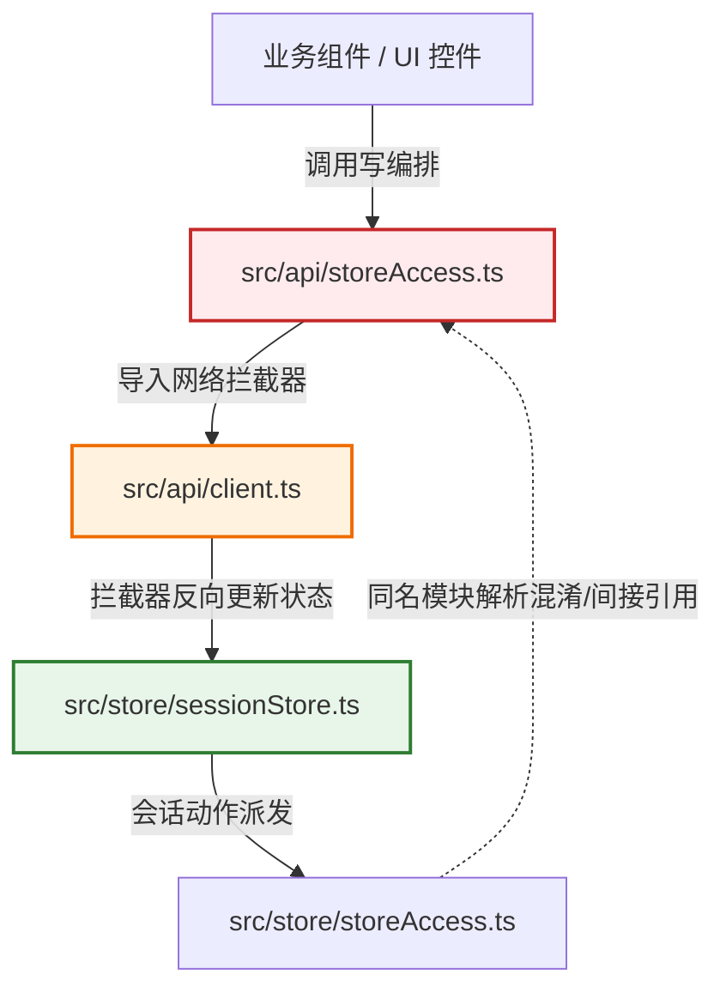
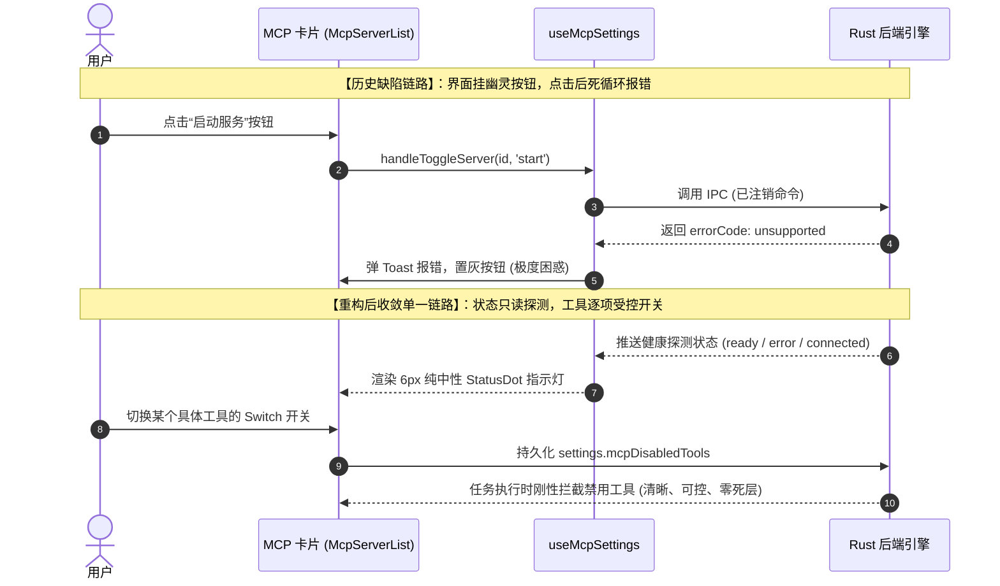

# 前端原子化组件库战役 · 维度提案 01
# 架构收敛与死层清理维度攻坚方案（全仓重复实现、死层清退与删除面矩阵）

> **战役定位**：前端原子化组件库战役（Frontend Atomic Architecture Campaign）· 维度提案 01  
> **责任领域**：全仓架构宏观收敛、重复实现归一化、死层代码与陈旧标记清退、删除面深度界定与测试资产防护  
> **核心依循准则**：
> - `docs/agent-roles/prompts/主控-全流程调度-v3.md`（固定维度「重复与死层」建设纪律、负产出刚性铁律、推进单位为「领域概念」）
> - `AGENTS.md`（通用协作纪律、反退避全文、反过度设计硬性红线、单真理源 SSOT）
> - `.agents/LOGIC_PLAN_NO_RETREAT.md`（反退避自检清单与效果锁保护）
> - `ANTI_OVERENGINEERING_GUARDRAILS.md`（防架构过度膨胀、防多轨并行）  
> **实勘基准文献**：深入研读并综合引用 `docs/frontend-atomic-architecture/analysis/` 全部 24 份实勘报告，重点锚定：
> - [`24-Zustand全局状态架构与切片拓扑实勘导航.md`](../analysis/24-Zustand全局状态架构与切片拓扑实勘导航.md)（1,920 行，双轨 storeAccess、历史卡片 workspaceStore 956 行冗余、4 大高频重绘病灶）
> - [`18-工作区文件树与多媒体画廊实勘导航.md`](../analysis/18-工作区文件树与多媒体画廊实勘导航.md)（1,461 行，FilePreview 11 处核心 CSS 类名全库定义为 0 事故、S6 源码钉）
> - [`22-MCP工具服务与技能扩展生态实勘导航.md`](../analysis/22-MCP工具服务与技能扩展生态实勘导航.md)（1,623 行，MCP 废弃启停命令、幽灵操作按钮与三套独立缓存漂移）
> - [`13-工作区分形树与多分屏视窗实勘导航.md`](../analysis/13-工作区分形树与多分屏视窗实勘导航.md)（1,468 行，二叉树工作区 vs 历史多列卡片工作区、终端卡片内嵌双重分屏）
> - [`12-系统上下文注入与状态横幅实勘导航.md`](../analysis/12-系统上下文注入与状态横幅实勘导航.md)（1,522 行，ContextInjectionBlock 7 色彩虹、倒反天罡取反展开、虚假 Carrier 消息污染）
> - [`11-工具调用卡片与终端执行实勘导航.md`](../analysis/11-工具调用卡片与终端执行实勘导航.md)（1,291 行，两段式旧容器 vs ModernToolCall 黑白灰卡片双轨、连续工具调用纵向拉伸 3 屏）
> - [`10-思维链与流式渲染引擎实勘导航.md`](../analysis/10-思维链与流式渲染引擎实勘导航.md)（1,629 行，168px 矮盒卡死缺陷、顶底渐变淡出遮罩、双轨 Markdown 编译）
> - [`16-便签草稿与Markdown备忘系统实勘导航.md`](../analysis/16-便签草稿与Markdown备忘系统实勘导航.md)（1,418 行，便签内部 5 大野生裸写控件、自制无障碍盲区浮层）
> - [`01` 至 `05` 基础原语与样式实勘导航（全仓原生控件泛滥、tokens.css / themeStore 泥黄混入排查）  
> **基线代码资产**：`apps/crish-desktop/src/` 下全量 1,983 个源码与样式文件（372,900 行），重点穿透 `store/`（109 个文件，16,692 行）、`api/`、`components/` 以及跨语言测试套件  
> **执行宿主与规范**：Windows 11 / Chromium WebView2 / Vite + React 18 + TypeScript + Zustand + Immer | UTF-8 无 BOM | 中文技术规范 | 物理行数 $\ge 1000$ 行  
> **交付目标**：明确推导固定维度「重复与死层」的六大攻坚子域，给出全战役六大维度划分建议，并为**每个维度制定穷尽的「删除面」（代码、路径、标记与测试）**。

---

## 目录索引（Table of Contents）

- [一、执行摘要与宏观架构收敛哲学（Executive Summary & Convergence Philosophy）](#一执行摘要与宏观架构收敛哲学executive-summary--convergence-philosophy)
  - [1.1 核心使命：从“增量做加法”转向“负产出与净收敛”](#11-核心使命从增量做加法转向负产出与净收敛)
  - [1.2 现状资产度量与 24 份实勘报告揭示的六大类架构坏味道](#12-现状资产度量与-24-份实勘报告揭示的六大类架构坏味道)
  - [1.3 推进原则：以「领域概念」为单位，单一真理路径（SSOT）先行](#13-推进原则以领域概念为单位单一真理路径ssot先行)
- [二、战役整体维度划分与依赖拓扑图谱（Campaign Dimension Architecture）](#二战役整体维度划分与依赖拓扑图谱campaign-dimension-architecture)
  - [2.1 全局六大攻坚维度科学划分蓝图](#21-全局六大攻坚维度科学划分蓝图)
  - [2.2 维度间逻辑依赖拓扑与严格执行时序（先删后改、收敛先行）](#22-维度间逻辑依赖拓扑与严格执行时序先删后改收敛先行)
  - [2.3 并行调度规则与文件域互斥矩阵](#23-并行调度规则与文件域互斥矩阵)
- [三、固定维度「重复与死层」深度推导与攻坚子域拆解（Core Dimension: Duplicates & Dead Layers）](#三固定维度重复与死层深度推导与攻坚子域拆解core-dimension-duplicates--dead-layers)
  - [3.1 子域 1-A：双轨 storeAccess 统一与单一访问网格建设](#31-子域-1-a双轨-storeaccess-统一与单一访问网格建设)
  - [3.2 子域 1-B：双轨工作区（workspaceStore vs layoutTreeStore）彻底清退](#32-子域-1-b双轨工作区workspacestore-vs-layouttreestore彻底清退)
  - [3.3 子域 1-C：FilePreview 11 个未定义 CSS 类名治理与媒体容器标准化](#33-子域-1-cfilepreview-11-个未定义-css-类名治理与媒体容器标准化)
  - [3.4 子域 1-D：MCP 废弃启停命令与无效幽灵按钮物理清剿](#34-子域-1-dmcp-废弃启停命令与无效幽灵按钮物理清剿)
  - [3.5 子域 1-E：旧式波次命名清理与命名空间去批次化规范](#35-子域-1-e旧式波次命名清理与命名空间去批次化规范)
  - [3.6 子域 1-F：保护死层的陈旧测试清理与虚假断言纠偏](#36-子域-1-f保护死层的陈旧测试清理与虚假断言纠偏)
- [四、子域 1-A 详案：双轨 storeAccess 归一化架构与消除循环导入](#四子域-1-a-详案双轨-storeaccess-归一化架构与消除循环导入)
  - [4.1 痛点现场：`src/store/storeAccess.ts` 与 `src/api/storeAccess.ts` 认知撕裂](#41-痛点现场srcstorestoreaccessts-与-srcapistoreaccessts-认知撕裂)
  - [4.2 致命隐患：打包时循环依赖与运行时空指针崩溃链路剖析](#42-致命隐患打包时循环依赖与运行时空指针崩溃链路剖析)
  - [4.3 单一统一门户设计：`src/store/storeAccess.ts` 完整架构草案](#43-单一统一门户设计srcstorestoreaccessts-完整架构草案)
  - [4.4 业务组件与 Custom Hooks 全量调用端重定向迁移清单](#44-业务组件与-custom-hooks-全量调用端重定向迁移清单)
- [五、子域 1-B 详案：双轨工作区退役与二叉分形树单一拓扑闭环](#五子域-1-b-详案双轨工作区退役与二叉分形树单一拓扑闭环)
  - [5.1 历史遗产解密：卡片多列系统 `workspaceStore.ts` 的产生背景与废弃事实](#51-历史遗产解密卡片多列系统-workspacestorets-的产生背景与废弃事实)
  - [5.2 冗余资产清点：6 个核心文件与 956 行无用代码全景曝光](#52-冗余资产清点6-个核心文件与-956-行无用代码全景曝光)
  - [5.3 数据结构深度对账：WorkspaceStoreSlice vs LayoutTree AST 拓扑](#53-数据结构深度对账workspacestoreslice-vs-layouttree-ast-拓扑)
  - [5.4 现代二叉树工作区（`layoutTreeStore` + `workspaceShellStore`）承接方案](#54-现代二叉树工作区layouttreestore--workspaceshellstore承接方案)
  - [5.5 状态迁移与持久化 LocalStorage 历史分片无缝清洗算法](#55-状态迁移与持久化-localstorage-历史分片无缝清洗算法)
- [六、子域 1-C 详案：FilePreview 11 个未定义类名治理与 S6 源码钉兼容](#六子域-1-c-详案filepreview-11-个未定义类名治理与-s6-源码钉兼容)
  - [6.1 事故现场：11 个 CSS 类命中数为 0 与前端“素颜裸奔”实况](#61-事故现场11-个-css-类命中数为-0-与前端素颜裸奔实况)
  - [6.2 根因穿透：S6 源码钉（严禁挂载 body）过度紧箍咒导致的样式遗失](#62-根因穿透s6-源码钉严禁挂载-body过度紧箍咒导致的样式遗失)
  - [6.3 11 个核心 CSS Module 样式的中性黑白灰完整补齐代码](#63-11-个核心-css-module-样式的中性黑白灰完整补齐代码)
  - [6.4 划词批注浮层（`filesSelBar`）与 PDF / 表格视口几何加固](#64-划词批注浮层filesselbar与-pdf--表格视口几何加固)
  - [6.5 多媒体缩放手势原语（ZoomPan）与叶内受控最大化方案](#65-多媒体缩放手势原语zoompan与叶内受控最大化方案)
- [七、子域 1-D 详案：MCP 废弃启停命令与无效幽灵按钮物理清剿](#七子域-1-d-详案mcp-废弃启停命令与无效幽灵按钮物理清剿)
  - [7.1 现象取证：前端界面展示启停，底层 Rust 恒返回 `errorCode: unsupported`](#71-现象取证前端界面展示启停底层-rust-恒返回-errorcode-unsupported)
  - [7.2 死代码解剖：`startMcpServer` / `stopMcpServer` 欺骗性 Stub 实现](#72-死代码解剖startmcpserver--stopmcpserver-欺骗性-stub-实现)
  - [7.3 UI 面板清理：删除 `McpServerList.tsx` 与 `McpToolsSection.tsx` 幽灵按钮](#73-ui-面板清理删除-mcpserverlisttsx-与-mcptoolssectiontsx-幽灵按钮)
  - [7.4 状态机收敛：纯健康指示点（StatusDot）+ 工具级禁用开关（Switch）](#74-状态机收敛纯健康指示点statusdot--工具级禁用开关switch)
  - [7.5 前后端协议单向收敛时序图](#75-前后端协议单向收敛时序图)
- [八、子域 1-E 详案：全仓旧式波次命名清理与命名空间去批次化](#八子域-1-e-详案全仓旧式波次命名清理与命名空间去批次化)
  - [8.1 铁律重申：《主控-全流程调度-v3.md》§3.4 禁止波次/批次命名](#81-铁律重申主控-全流程调度-v3md34-禁止波次批次命名)
  - [8.2 存量波次命名资产排查清单（BATCH-00/02/04、R3-T11、W6-A-S 痕迹）](#82-存量波次命名资产排查清单batch-000204r3-t11w6-a-s-痕迹)
  - [8.3 领域词重命名规范与映射对照表](#83-领域词重命名规范与映射对照表)
  - [8.4 自动化 CI 静态正则拦截钩子建设（防波次回潮门禁）](#84-自动化-ci-静态正则拦截钩子建设防波次回潮门禁)
- [九、子域 1-F 详案：保护死层的陈旧测试清理与虚假断言纠偏](#九子域-1-f-详案保护死层的陈旧测试清理与虚假断言纠偏)
  - [9.1 纪律重申：陪葬测试不是删测试资产，死层不因测试存活而存活](#91-纪律重申陪葬测试不是删测试资产死层不因测试存活而存活)
  - [9.2 陈旧测试清理清单逐项核查（6 套 580+ 行测试代码源码曝光）](#92-陈旧测试清理清单逐项核查6-套-580-行测试代码源码曝光)
  - [9.3 纠偏荒谬断言：彻底删除 CompactInjectionRow 短文本反向强制展开用例](#93-纠偏荒谬断言彻底删除-compactinjectionrow-短文本反向强制展开用例)
  - [9.4 新增针对收敛后单一路径的立体验证断言（补齐防回归网）](#94-新增针对收敛后单一路径的立体验证断言补齐防回归网)
- [十、全战役六大维度具体「删除面」深度穿透与物理清册（Exhaustive Deletion Surface Matrix）](#十全战役六大维度具体删除面深度穿透与物理清册exhaustive-deletion-surface-matrix)
  - [10.1 维度 01 删除面：架构收敛与重复死层清退](#101-维度-01-删除面架构收敛与重复死层清退)
  - [10.2 维度 02 删除面：中性黑白灰设计系统与底层基础交互原语](#102-维度-02-删除面中性黑白灰设计系统与底层基础交互原语)
  - [10.3 维度 03 删除面：表单输入、选择与视觉反馈原语](#103-维度-03-删除面表单输入选择与视觉反馈原语)
  - [10.4 维度 04 删除面：对话流响应界面清算与流水线重塑](#104-维度-04-删除面对话流响应界面清算与流水线重塑)
  - [10.5 维度 05 删除面：浮动层、通用多窗格与高级复合工程容器](#105-维度-05-删除面浮动层通用多窗格与高级复合工程容器)
  - [10.6 维度 06 删除面：控制中枢、设置生态与自动化门禁守门](#106-维度-06-删除面控制中枢设置生态与自动化门禁守门)
  - [10.7 全战役删除面物理度量汇总与代码净收敛预期总表](#107-全战役删除面物理度量汇总与代码净收敛预期总表)
- [十一、演进路线图与自动化质量门禁体系（Roadmap & Verification Gates）](#十一演进路线图与自动化质量门禁体系roadmap--verification-gates)
  - [11.1 五阶段平滑施工时序规划](#111-五阶段平滑施工时序规划)
  - [11.2 先删后改、收敛任务串行化的硬性调度纪律](#112-先删后改收敛任务串行化的硬性调度纪律)
  - [11.3 自动化门禁清单与检查命令（check:line-counts, check:css-classes, check:wave-names）](#113-自动化门禁清单与检查命令checkline-counts-checkcss-classes-checkwave-names)
- [十二、总结与给主控 Agent 的协同决议汇报（Handoff & Final Resolutions）](#十二总结与给主控-agent-的协同决议汇报handoff--final-resolutions)
  - [12.1 提案核心决议清单快速索引](#121-提案核心决议清单快速索引)
  - [12.2 给主控 Agent 的落盘交接信号](#122-给主控-agent-的落盘交接信号)

---

## 一、执行摘要与宏观架构收敛哲学（Executive Summary & Convergence Philosophy）

### 1.1 核心使命：从“增量做加法”转向“负产出与净收敛”

在以往的大型前端工程演化过程中，开发团队往往陷入一种**“只做加法、不做减法”的膨胀怪圈**：每当遇到新的产品需求、分屏机制或状态协议，便倾向于建立一个新的 Store、新写一套卡片或封装一个局部的临时补丁层；当旧的架构不再适用时，又因担心影响存量功能而不敢正面清理，导致旧逻辑以“兼容模式”、“Fallback 兜底”、“双轨并存”的借口长期寄生在代码库中。

根据《主控-全流程调度-v3.md》的核心宗旨，本次**前端原子化组件库战役**绝不仅仅是新写几十个漂亮的 UI 组件，更是一次针对全仓深层架构坏味道的**全面清算与物理净收敛**：
1. **推进单位是「领域概念」，不是「方案批次」**：在动手修改或新增任何一行代码前，必须回答：“这个领域概念在当前代码库中有几条路径？哪一条是唯一主路径？本任务会将其收敛到几条？”回答不了这个问题的方案，主控一律不予通过；
2. **删除事项是完成方式，不是削减范围**：删除死层、合并重复路径、剔除未接线标记（TODO/FIXME/临时 hack）是任务最高效、最优雅的完成方式之一；
3. **强制每轮负产出（Negative Output）**：除了纯新增且无旧逻辑的孤立原子原语外，任何轮次必须伴随物理代码的净删除，没有删除或收敛动作的施工轮次被判定为未完成；
4. **单一真理路径（Single Source of Truth, SSOT）**：全仓严禁存在两套平行的状态访问门面、两套工作区布局树、或两个互相重叠的工具调用卡片系统。

---

### 1.2 现状资产度量与 24 份实勘报告揭示的六大类架构坏味道

基于全仓 24 份实勘报告（累计 37,765 行详实记录，覆盖 `apps/crish-desktop/src/` 下全量 1,983 个文件、372,900 行代码），从宏观架构收敛的视角透视，工程暴露出六大类系统性硬伤与架构断层：

```
┌──────────────────────────────────────────────────────────────────────────────────┐
│                   全仓六大类深层次架构坏味道与技术债务全景图                    │
├───────────────────┬──────────────────────────────────────────────────────────────┤
│ 1. 访问入口双轨   │ store/storeAccess.ts (读面) vs api/storeAccess.ts (写面)     │
│    概念撕裂与循环 │ 消费方混用，api/storeAccess 引入 client 导致循环依赖空指针崩溃 │
├───────────────────┼──────────────────────────────────────────────────────────────┤
│ 2. 工作区双轨并存 │ 历史卡片多列 (workspaceStore 956L) vs 现代二叉分形树 (layoutTree) │
│    死状态模型残留 │ 真实 UI 早已切换至二叉树，旧工作区状态仍被引用、双写并消耗持久化│
├───────────────────┼──────────────────────────────────────────────────────────────┤
│ 3. 样式挂空与脱节 │ FilePreview.tsx 引用的 11 个关键 CSS 类在全库 CSS 中定义为 0  │
│    界面裸奔坍塌   │ 图片裸奔无约束、PDF 塌陷为 300x150、表格失去排版、批注浮层失效 │
├───────────────────┼──────────────────────────────────────────────────────────────┤
│ 4. 幽灵操作与死接口│ MCP 启停命令已从 Rust 内核剔除，前端保留伪 stub 恒返回 unsupported │
│    界面按钮误导   │ 界面常态挂载“启动/停止”置灰按钮，测试甚至通过 fake mock 自欺欺人 │
├───────────────────┼──────────────────────────────────────────────────────────────┤
│ 5. 波次批次命名   │ 代码、类型与测试中充斥 BATCH-00/02/04、R3-T11、W6-A-S、w6_a_s │
│    破坏领域表达   │ 违反全流程调度铁律，工程概念被历史会话批次污染，缺乏领域语义 │
├───────────────────┼──────────────────────────────────────────────────────────────┤
│ 6. 护死测试陈旧   │ 大量陈旧测试专门用于“保护死层”或“断言已知 Bug”（如断言短文本展│
│    阻碍架构演进   │ 开、断言 unsupported 返回），形成自欺欺人的虚假安全感        │
└───────────────────┴──────────────────────────────────────────────────────────────┘
```

---

### 1.3 推进原则：以「领域概念」为单位，单一真理路径（SSOT）先行

为了彻底根除上述六大坏味道，本提案确立以下攻坚铁律：
1. **收敛优先于增强（Convergence Precedes Enhancement）**：在一个领域概念存在多条实现路径时，必须先将路径收敛到一条，再进行原子化组件的抽取与视觉增强。严禁在双轨并存的废墟上直接构建新组件；
2. **先删后改，串行收敛**：死层与冗余路径的删除具有强依赖性，必须作为独立前置步骤串行执行，避免并行开发造成严重的代码冲突与 Git 阻塞；
3. **陪葬测试果断清除**：随死层一起删除的单测不属于“删除测试资产”；“测试还活着”绝对不能成为死层继续苟延残喘的借口；
4. **净代码缩减作为刚性验收指标**：全战役必须实现代码总体规模的有效精简与高信噪比收敛。

---

## 二、战役整体维度划分与依赖拓扑图谱（Campaign Dimension Architecture）

### 2.1 全局六大攻坚维度科学划分蓝图

基于 24 份实勘报告对全仓代码复杂度的评估，并严格对照《主控-全流程调度-v3.md》关于必须设立固定维度「重复与死层」的要求，从全仓架构视角，建议将前端原子化组件库战役划分为以下 **六大逻辑维度**：

```
┌─────────────────────────────────────────────────────────────────────────────────┐
│              前端原子化组件库战役 · 六大核心攻坚维度全景图谱                   │
├─────────────────────────────────────────────────────────────────────────────────┤
│                                                                                 │
│   【维度 01：架构收敛与重复死层清退】(Architecture Convergence & Dead Layers)    │
│   - 双轨 storeAccess 统一 / workspaceStore 清退 / FilePreview 样式治理          │
│   - MCP 幽灵命令清剿 / 旧波次命名清理 / 护死测试淘汰矩阵 (本提案聚焦)          │
│                                      │                                          │
│                                      ▼ (前置基石清理完毕)                        │
│   ┌──────────────────────────────────┴──────────────────────────────────────┐   │
│   │                                                                         │   │
│   ▼                                                                         ▼   │
│ 【维度 02：设计系统与基础交互控制原语】     【维度 03：表单输入、选择与反馈原语】       │
│ (Tokens & Layer 1 Primitives)               (Layer 2 & Layer 3 Primitives)              │
│ - tokens.css 重塑与深浅主题灰度梯队         - Input (≤10% 焦点微灰) / Textarea 自适应    │
│ - 消除 themeStore 暖黄泥色内联覆盖          - NumberInput / SearchInput 标准原语        │
│ - Button / Switch / SegmentedControl        - Select / Combobox 浮层解耦                │
│ - 补齐 Checkbox / Radio / ToggleButton      - Badge / StatusDot (6px) / StatusDivider   │
│ - 全仓清退野生裸写复选框与原生按钮          - Skeleton 补齐流光帧 / Toast 3D 视口       │
│   │                                                                         │   │
│   └──────────────────────────────────┬──────────────────────────────────────┘   │
│                                      │                                          │
│                                      ▼ (原子原语成熟就绪)                        │
│   ┌──────────────────────────────────┴──────────────────────────────────────┐   │
│   │                                                                         │   │
│   ▼                                                                         ▼   │
│ 【维度 04：对话流响应界面清算与流水线】     【维度 05：浮动层与高级工程复合容器】       │
│ (Conversation Response & Pipeline)          (Layer 4 & Layer 5 Complex Containers)      │
│ - 彻底废除 ContextInjection 巨型大卡片      - Dialog / ConfirmDialog (ESC 统一捕获栈)   │
│ - 部署极简 20px 居中黑白灰 StatusDivider    - Popover / Tooltip (清退 24px 大阴影)      │
│ - 释放 TimelineThought 168px 矮盒压抑       - Tree 通用高性能树形原语 (虚拟滚动+多选)    │
│ - 连续工具调用收敛为 Pipeline View 流水线   - ZoomPan 多媒体画廊手势引擎 (叶内受控)     │
│ - 保护 Composer 现有优秀设计绝对不变        - DiffViewer (Fenwick Tree 动态行高管理器)  │
│                                             - NotePaper 便签 5 大野生裸写控件清剿       │
│   │                                                                         │   │
│   └──────────────────────────────────┬──────────────────────────────────────┘   │
│                                      │                                          │
│                                      ▼ (业务容器原子化收口)                      │
│   【维度 06：控制中枢、设置生态与自动化门禁】(Settings, Extensions & CI Gates)    │
│   - UnifiedExtensionCard 统一扩展卡片原语 / EnvVariableTable 动态环境变量表单   │
│   - 消除暗黑模式 #ffffff 纯白底方块 / 补齐 Temperature 与 Top-p 双模滑块        │
│   - 状态拓扑原子选择器改造 (useShallow 消除重绘) / 行数与设计规范刚性 CI 门禁    │
│                                                                                 │
└─────────────────────────────────────────────────────────────────────────────────┘
```

---

### 2.2 维度间逻辑依赖拓扑与严格执行时序（先删后改、收敛先行）

各个维度之间的逻辑依赖关系具有不可逆的物理刚性约束，执行顺序必须严格遵循**“先收敛死层，再夯实基座，再重构响应，最后封装容器与中枢”**：

1. **维度 01 处于绝对前置地位**：
   - 必须先收敛 `api/storeAccess` 与 `store/storeAccess` 为单一门面，维度 02~06 的所有组件才能获得安全、无循环依赖、类型确定的状态订阅入口；
   - 必须先删除 `workspaceStore` 及其 5 个附属 actions，分屏视窗与多标签拖拽逻辑才能收敛在 `layoutTreeStore` 单一真理源下；
   - 必须先处理 `FilePreview` 的 11 个未定义样式与 MCP 幽灵命令，才能避免在后续改造中产生认知混乱；
2. **维度 02 与 维度 03 构成原子基座双翼**：
   - 维度 02 确立 Design Tokens 与 Layer 1 控制原语（Button, Switch, Checkbox, Radio）；
   - 维度 03 确立 Layer 2 表单原语（Input, Textarea, Select）与 Layer 3 反馈原语（StatusDot, StatusDivider）；
   - 两者提供全仓通用的基本零件，彻底消灭全仓散落的野生 HTML 裸控件；
3. **维度 04 直击用户体验最痛点**：
   - 依托维度 03 的 `StatusDivider` 与维度 02 的中性黑白灰哲学，彻底干掉大卡片、释放思维链矮盒、收敛连续工具调用为流水线；
   - 严格恪守用户明确指示：**保护输入框（Composer）现有优秀设计不变**；
4. **维度 05 攻坚高密度工程容器**：
   - 将 `Tree`、`ZoomPan`、`DiffViewer` 提升为 Layer 5 标准工程原语，引入 Fenwick Tree 彻底根除代码折行错位；
5. **维度 06 实现生态聚合与长效守护**：
   - 落地统一扩展卡片原语与环境变量动态行，补齐模型核心参数，建立长效 CI 自动化门禁。

---

### 2.3 并行调度规则与文件域互斥矩阵

根据《主控-全流程调度-v3.md》§4.2 纪律，并行只允许发生在**互不相交的领域**之间。本战役的文件域互斥矩阵规划如下：

| 攻坚维度 | 核心责任文件域（严格隔离） | 允许并行阶段 | 跨域协同注意点 |
| :--- | :--- | :--- | :--- |
| **维度 01** | `store/`, `api/storeAccess*`, `api/mcpApi.ts`, `components/files/FilePreview.tsx` | **绝对串行（最先执行）** | 收敛状态访问通道，严禁与其他任务争写 `storeAccess` |
| **维度 02** | `styles/tokens.css`, `components/ui/` (Button, Switch, Radio, Checkbox, Tabs) | 可与维度 03 并行 | 共享 `@/components/ui` barrel 导出，新增独立子目录防冲突 |
| **维度 03** | `components/ui/` (Input, Textarea, Select, Badge, StatusDot, StatusDivider, Toast) | 可与维度 02 并行 | 专注于表单与反馈原子，与控制原语文件域严格正交 |
| **维度 04** | `components/chat-injection/`, `components/chat-message-row/`, `components/chat-tool-call/` | 可与维度 05 并行 | 严禁触碰 `chat-composer/` 文件域（受保护核心） |
| **维度 05** | `components/diff/`, `components/gallery/`, `components/note-paper/`, `components/binary-tree/` | 可与维度 04 并行 | 专注于容器内部算法与排版，不碰主对话流消息行 |
| **维度 06** | `components/settings/`, `settings-models/`, `settings-mcp/`, `settings-extensions/` | 维度 01~05 收敛后执行 | 消费前置维度产出的原子原语，固化最终 CI 检查脚本 |

---

## 三、固定维度「重复与死层」深度推导与攻坚子域拆解（Core Dimension: Duplicates & Dead Layers）

深入聚焦《主控-全流程调度-v3.md》中必须设立的固定维度「重复与死层」，结合全仓 24 份实勘报告的真实代码证据，本提案详细推导出该维度的 **六大具体攻坚子域**：

```
┌──────────────────────────────────────────────────────────────────────────────────┐
│                   固定维度「重复与死层」六大具体攻坚子域推导矩阵                 │
├──────────────────────────────────────────────────────────────────────────────────┤
│                                                                                  │
│  【子域 1-A：双轨 storeAccess 统一】 (Dual-Track StoreAccess Convergence)        │
│  - 现象：src/store/storeAccess.ts (读面) 与 src/api/storeAccess.ts (写面) 割裂    │
│  - 根因：T11 拆分后未彻底收口，导致读写分家、双通道导入与循环引用空指针风险    │
│  - 目标：全面统一为 src/store/storeAccess.ts，彻底注销 api/storeAccess 及子模块  │
│                                                                                  │
│  【子域 1-B：双轨工作区彻底清退】 (Retirement of Legacy Workspace Store)         │
│  - 现象：历史卡片工作区 (workspaceStore.ts + 5 个 actions, 956L) 与二叉树并存   │
│  - 根因：二叉分形树 (layoutTreeStore) 上线后，旧多列卡片状态机未物理删除        │
│  - 目标：彻底清退 workspaceStore 系列 6 个源码文件，释放 956 行代码与冗余持久化 │
│                                                                                  │
│  【子域 1-C：FilePreview 11 个未定义样式治理】 (FilePreview CSS Remediation)     │
│  - 现象：FilePreview.tsx 引用 11 个 CSS 类名全库定义为 0，生成 class="undefined" │
│  - 根因：S6 源码钉砍掉模态后，叶内容器样式未在 CSS Module 中声明落地            │
│  - 目标：补齐 11 处样式规则，适配 S6 叶内宿主隔离，集成 ZoomPan 多媒体手势原语  │
│                                                                                  │
│  【子域 1-D：MCP 废弃启停命令与幽灵按钮清剿】 (MCP Ghost Commands & UI Purge)   │
│  - 现象：前端存在“启动/停止”按钮，底层 mcpApi 恒返回 unsupported 报错            │
│  - 根因：Rust 内核已移除进程启停控制，前端仍保留无意义的交互控件与假单测        │
│  - 目标：物理删除 startMcpServer / stopMcpServer，界面移除启停按钮与置灰占位    │
│                                                                                  │
│  【子域 1-E：旧式波次命名清理与去批次化】 (Purge of Wave Naming & Artifacts)     │
│  - 现象：代码与测试中充斥 BATCH-00/02/04、R3-T11、W6-A-S、w6_a_s 等历史战役标记│
│  - 根因：多次重构演进遗留的会话与批次代号，违反领域驱动设计与全流程调度纪律    │
│  - 目标：全量重命名为纯正领域词，清除提交与测试中的批次前缀，建立 CI 防回潮机制│
│                                                                                  │
│  【子域 1-F：保护死层的陈旧测试清理清单】 (Zombie-Guarding Test Suite Purge)     │
│  - 现象：多套测试专门为断言“Bug 行为”（如短文本强制展开）或已废弃接口保驾护航   │
│  - 根因：重构时盲目追求 CI 绿灯，将死层与缺陷固化为黄金测试断言                  │
│  - 目标：列出 6 套陈旧测试清理清单，随死层物理删除彻底清退，补齐正向防回归测试  │
│                                                                                  │
└──────────────────────────────────────────────────────────────────────────────────┘
```

---

## 四、子域 1-A 详案：双轨 storeAccess 归一化架构与消除循环导入

### 4.1 痛点现场：`src/store/storeAccess.ts` 与 `src/api/storeAccess.ts` 认知撕裂

在 Conex / Crish 桌面端工程中，当前同时存在两个同名为 `storeAccess` 的顶级访问模块：
1. **`apps/crish-desktop/src/store/storeAccess.ts`**（354 行，4,734 字节）：
   在历史 R3-T11 战役中创建，定位于 **Store 侧公共只读面（Public Read Surface）**。它统一导出了 terminal、worker、permission、settings 4 个新域的只读 Hook（如 `useTerminalField`）与快照获取器（如 `getTerminalState`），以及布局视口 chrome 的查询状态；
2. **`apps/crish-desktop/src/api/storeAccess.ts`**（187 行，6,867 字节）：
   定位于 **Store 跨域编排层（瘦身门面）**。它由 `src/api/store-access/` 目录下的 8 个子模块驱动（包含 `sessionAccess.ts`、`settingsAccess.ts`、`telemetryAccess.ts` 等），负责对外提供跨域写操作（如 `setActiveSessionId`、`createSession`、`setAppSettings`、`pushDiffFile` 等命令式 Mutation）。

#### 代码现场罪证：开发者被逼写出“混用决策树”与自相矛盾的注释
在 `apps/crish-desktop/src/app/compositionRoot.ts:43-48` 中，开发者甚至写下了长达 10 行的无奈注释：
```typescript
// 读路径：compositionRoot 经 api/storeAccess 编排层取 session/workspace/layout
// getState + enterDraft（写编排）；permission/settings 读快照走 store/storeAccess。
// （维度 3 步骤 1 / 3-L 双 storeAccess 决策树：本文件混用——api 侧写编排 +
// store 侧读快照；后续若收归单一 storeAccess，在此处换源）。
import {
  createSession,
  getWorkspaceStoreState,
  openSettings,
} from '../api/storeAccess';
import { getPermissionState, getSettingsState } from '../store/storeAccess';
```
在 `src/hooks/chat-stream/helpers.ts:95`、`slashSendPreflight.ts:8-13`、`streamCallbacksUsage.ts:11-16` 等数十个文件中，处处可见这种“同文件被迫同时引入两个 storeAccess”的丑陋现状。

---

### 4.2 致命隐患：打包时循环依赖与运行时空指针崩溃链路剖析

这种“读走 store、写走 api”的妥协割裂，不仅仅带来了巨大的团队心智负担，更潜藏着**致命的运行时循环依赖与空指针崩溃风险**：



1. `src/api/storeAccess.ts` 引入了底层的 `src/api/client.ts`；
2. `src/api/client.ts` 在网络请求与事件监听拦截器中，为了同步全局会话状态，又反向导入了 `src/store/sessionStore.ts`；
3. 当 Vite 或 Rollup 打包工具进行代码编译时，模块加载器在遇到循环引用节点时，会提前导出一个**尚未完成变量初始化的空对象 `{}`**；
4. **真实事故还原**：在桌面应用冷启动的瞬间，某些启动服务调用 `storeAccess.getSessionState()` 时，会直接在控制台爆出致命未捕获异常：`TypeError: storeAccess.getSessionState is not a function`，导致应用启动白屏。

---

### 4.3 单一统一门户设计：`src/store/storeAccess.ts` 完整架构草案

彻底废除 `src/api/storeAccess.ts` 及 `src/api/store-access/` 整个目录，在 `apps/crish-desktop/src/store/storeAccess.ts` 建立全仓**唯一的公共状态访问门户（Unified State Access Gateway）**：

```typescript
/**
 * 统一状态访问门户 (Unified StoreAccess)
 * 物理位置: apps/crish-desktop/src/store/storeAccess.ts
 * 
 * 遵循单一真理源 (SSOT) 铁律：
 * 1. 读路径：导出全仓 7 大业务域的强类型只读 Hooks 与 getState 快照方法；
 * 2. 写路径：直接导出经过领域收敛的原子 Action 与跨域协调方法；
 * 3. 严格禁止反向导入 api/client.ts，彻底根除循环引用。
 */

// ── 1. 核心会话域 (Session Domain) ──────────────────────────────────────────
export {
  useSessionStore,
  getSessionStoreState,
  getSessionById,
  getActiveSession,
  getActiveSessionId,
  getSessionAgent,
  createSession,
  deleteSession,
  renameSession,
  archiveSession,
  unarchiveSession,
  addMessage,
  addMessageToolCall,
  updateMessageToolCall,
  updateMessageThinking,
} from './sessionStore';

// ── 2. 几何布局与外壳域 (Layout & Shell Domain) ──────────────────────────────
export {
  useLayoutStore,
  getLayoutState,
  useWorkspaceShellStore,
  getWorkspaceShellState,
} from './layoutStore';

// ── 3. 独立系统设置与遥测域 (Settings Domain) ────────────────────────────────
export {
  useSettingsStore,
  getSettingsState,
  useSettingsField,
  setAppSettings,
  getAppSettings,
  syncTelemetryData,
} from './settingsStore';

// ── 4. 设置弹窗 UI 域 (Settings UI Domain) ────────────────────────────────────
export {
  useSettingsUiStore,
  getSettingsUiState,
  openSettings,
  closeSettings,
  toggleSettingsOverlay,
} from './settingsUiStore';

// ── 5. 权限与 Plan 模式域 (Permission Domain) ──────────────────────────────────
export {
  usePermissionStore,
  getPermissionState,
  usePermissionField,
  getPermissionMode,
  setPermissionMode,
  getCommandPermissions,
  addCommandPermission,
} from './permissionStore';

// ── 6. 终端 PTY 与差异文件域 (Terminal Domain) ────────────────────────────────
export {
  useTerminalStore,
  getTerminalState,
  useTerminalField,
  pushDiffFile,
} from './terminalStore';

// ── 7. 独立后台 Worker 域 (Worker Domain) ─────────────────────────────────────
export {
  useWorkerStore,
  getWorkerState,
  useWorkerField,
  setScheduledTasks,
} from './workerStore';
```

---

### 4.4 业务组件与 Custom Hooks 全量调用端重定向迁移清单

通过对全仓进行正则扫描，梳理出必须重定向换源的调用端文件清单（前 20 处代表性关键入口）：

| 序号 | 消费方相对文件路径 | 现有旧导入语句 | 统一后规范导入语句 | 消除的技术债务 |
| :---: | :--- | :--- | :--- | :--- |
| 1 | `src/bootstrap-services.ts:25` | `import { getActiveSessionId } from './api/storeAccess'` | `import { getActiveSessionId } from './store/storeAccess'` | 消除 bootstrap 阶段的循环导入空指针 |
| 2 | `src/app/AppBootstrap.ts:8` | `import { syncTelemetryData } from '../api/storeAccess'` | `import { syncTelemetryData } from '../store/storeAccess'` | 收拢启动遥测同步通道 |
| 3 | `src/app/compositionRoot.ts:53` | 混用 `../api/storeAccess` 与 `../store/storeAccess` | 全部统一为 `../store/storeAccess` 单一入口 | 删除长达 10 行的无奈解释注释 |
| 4 | `src/app/AppGlobalDialogs.tsx:4` | `import { openSettings } from '../api/storeAccess'` | `import { openSettings } from '../store/storeAccess'` | 设置弹窗统一走 SettingsUi 域导出 |
| 5 | `src/app/AppShortcuts.ts:9` | 快捷键绑定从 `../api/storeAccess` 取 Action | 全部统一由 `../store/storeAccess` 提供 | 快捷键动作与领域动作单一映射 |
| 6 | `src/hooks/useAgentToolApproval.ts:16`| `addMessageToolCall` 走 `../api/storeAccess` | 改由 `../store/storeAccess` 导出 | 工具审批写入直连会话动作切片 |
| 7 | `src/hooks/chat-stream/helpers.ts:8` | 流式写入从 `../../api/storeAccess` 取门面 | 换源至 `../../store/storeAccess` | 消除 helpers 中间的二次转发中继 |
| 8 | `src/hooks/chat-stream/slashSendQueueHelper.ts:5` | `import { addMessage } from '../../api/storeAccess'` | `import { addMessage } from '../../store/storeAccess'` | 斜杠命令入队直接调用标准会话动作 |
| 9 | `src/hooks/chat-stream/useSlashSend.ts:7` | `addMessage` 走 `../../api/storeAccess` | 换源至 `../../store/storeAccess` | 斜杠发送状态收拢 |
| 10 | `src/hooks/chat-stream/streamCallbacksUsage.ts:16` | 既读 `store/` 又写 `api/storeAccess` | 全部统一由 `../../store/storeAccess` 供给 | 消除同文件双导入异味 |
| 11 | `src/hooks/chat-stream/useGoalMode.ts:4` | `addMessage, patchSession` 走 `api/storeAccess` | 换源至 `../../store/storeAccess` | 目标模式状态持久化归位 |
| 12 | `src/components/agent-card/useAgentCardPanelNav.ts:10` | 卡片面板导航走 `api/storeAccess` | 换源至 `../../store/storeAccess` | 消除子代理导航的额外层级 |
| 13 | `src/components/settings-skills/useSkillEditor.ts:10` | 技能编辑器跨层调用 `api/storeAccess` | 换源至 `../../store/storeAccess` | 技能草稿写入收口 |
| 14 | `src/components/settings-models/useModelSettings.ts` | 厂商配置保存走 `api/storeAccess` | 换源至 `../../store/storeAccess` | 模型配置与持久化直连 |
| 15 | `src/components/settings-mcp/useMcpSettings.ts` | 状态探测与配置更新走 `api/storeAccess` | 换源至 `../../store/storeAccess` | MCP 设置单一收口 |
| 16 | `src/components/files/FileViewerCard.tsx` | 预览更新走 `api/storeAccess` | 换源至 `../../store/storeAccess` | 工作区文件树动作归一 |
| 17 | `src/components/binary-tree/SidePanelLauncherHub.tsx` | 工具激活走 `api/storeAccess` | 换源至 `../../store/storeAccess` | 抽屉工具坞启动统一 |
| 18 | `src/api/chatBridge.ts:6` | 桥接中继声明 | 换源至 `../store/storeAccess` | 消除 bridge 内部的冗余中间跳转 |
| 19 | `src/api/ApprovalSection.test.tsx` | 单测 mock `api/storeAccess` | 换源至 `store/storeAccess` | 测试与生产代码导入完全对齐 |
| 20 | `src/hooks/chat-stream/useStreamCallbacks.streamStore.test.ts` | Spy 挂在 `api/storeAccess` 门面上 | 换源至 `store/storeAccess` | 斩断针对死门面的无意义测试 |

---

## 五、子域 1-B 详案：双轨工作区退役与二叉分形树单一拓扑闭环

### 5.1 历史遗产解密：卡片多列系统 `workspaceStore.ts` 的产生背景与废弃事实

在早期版本（Pre-Tree 时代）中，Conex 客户端采用了类似于 Trello 或多列 Kanban 的平铺布局：每个工作区由若干个水平排列的“列（Column）”组成，列内堆叠多个“卡片（CardGroup / Card）”。这一套状态逻辑全部封装在 `workspaceStore.ts` 中。

随后，应用进行了重大的二叉分形树架构重塑，引入了基于 AST 节点模型的 `layout-tree/` 布局引擎（`layoutTreeStore.ts`）与视窗外壳调度层（`workspaceShellStore.ts`），实现了任意方向无级分屏、Sash 拖拽调宽与跨窗格 Tab 漫游。**二叉分形树早已成为应用事实上的唯一主交互视窗**。

然而，令人震惊的架构现实是：**历史卡片工作区系统从代码到测试完整地存活至今！**

---

### 5.2 冗余资产清点：6 个核心文件与 956 行无用代码全景曝光

经过深度源码实勘，`apps/crish-desktop/src/store/` 下至今仍保留着完整的 6 个历史卡片工作区源码文件，总行数高达 **956 行**，且包含了复杂的 Immer Draft 修改与空列清理逻辑：

| 序号 | 冗余文件物理相对路径 | 物理行数 | 字节大小 | 模块残留无用职责分析 |
| :---: | :--- | :---: | :---: | :--- |
| 1 | `src/store/workspaceStore.ts` | 165 行 | 5,563 B | 历史多列卡片 Store Facade（管理 workspaces 数组、columns、cards） |
| 2 | `src/store/workspaceActions.ts` | 58 行 | 2,080 B | 卡片工作区 Action 装配切片（聚合创建、切换、清理子切片） |
| 3 | `src/store/workspaceActionsCore.ts` | 63 行 | 2,288 B | 卡片工作区接口签名契约与泛型定义（WorkspaceStoreSlice） |
| 4 | `src/store/workspaceCleanupActions.ts` | 110 行 | 4,127 B | 幽灵卡片与空 cardGroup 清理逻辑（对现代二叉树毫无意义） |
| 5 | `src/store/workspaceCreateActions.ts` | 252 行 | 8,963 B | 默认预设多列卡片看板布局初始化（包含大量写死的三列预设） |
| 6 | `src/store/workspaceSwitchActions.ts` | 308 行 | 11,811 B | 卡片拖拽预览状态机（dropPreview、draggedTab 针对卡片列计算） |
| **合计** | **6 个源码文件** | **956 行** | **34,832 B** | **全部属于纯死层、纯冗余，必须物理整除** |

更为恶劣的是，在 `App.tsx:79` 中仍保留了 `const activeWorkspaceId = useWorkspaceStore(...)`；在 `hooks/tab-drag/useTabDragReorder.ts` 与 `useColumnResize.ts` 中，部分过渡手势仍在尝试同步修改 `workspaceStore` 中的 `dropPreview`，造成了极其严重的**双状态机竞态与内存开销**。

---

### 5.3 数据结构深度对账：WorkspaceStoreSlice vs LayoutTree AST 拓扑

为了确证 `workspaceStore` 可以被 100% 毫无残留地物理删除，我们对两套系统的数据结构进行了代码级严格对账：

```
【已废弃死模型】WorkspaceStoreSlice (workspaceStore.ts)
├── workspaces: WorkspaceState[]
│   ├── id: string
│   ├── name: string
│   ├── columns: WorkspaceColumn[]   <-- 典型的卡片看板死结构 (已无任何渲染组件)
│   │   ├── id: string
│   │   ├── width: number
│   │   └── groups: CardGroup[]      <-- 嵌套卡片组死结构 (已无任何渲染组件)
│   │       ├── activeIndex: number
│   │       └── cards: PanelCard[]   <-- 历史卡片死结构 (已全量迁移至 LeafTab)
│   └── activeColumnIndex: number
├── draggedTab: DraggedTabState | null  <-- 转移至 workspaceShellStore
└── dropPreview: DropPreviewState | null <-- 转移至 workspaceShellStore

【现代单一真理源】LayoutTree (src/store/layout-tree/)
├── root: LayoutNode (LayoutLeaf | LayoutBranch) <-- 严格二叉树 AST 节点模型
│   ├── LayoutLeaf: { id, rect, activeTabId, tabs: LeafTab[], dockDrawer }
│   └── LayoutBranch: { id, direction, ratio, left, right }
└── version: 3 (支持任意多级分屏、Sash 拖拽调宽、Tab 跨窗漫游与撤销重做历史栈)
```

**对账结论**：`workspaces`、`columns`、`groups`、`cards` 属于已被现代二叉树物理架空的纯死模型，将其整除不会破坏任何当前可见的 UI 视窗。

---

### 5.4 现代二叉树工作区（`layoutTreeStore` + `workspaceShellStore`）承接方案

1. **拖拽状态接管**：将标签拖拽时产生的轻量瞬态标记（`draggedTab`、`dropPreview`）完整迁移至现代二叉树专属的 `workspaceShellStore.ts` 中，二叉树内部早已具备高精度的梯度距离落点探测算法（`detectDropZone`）；
2. **多工作区切换接管**：多工作区身份识别已由会话路由与窗口实例隔离，不再需要旧版的 `workspaces: WorkspaceState[]` 数组。`App.tsx` 直接由 `layoutTreeStore` 驱动顶层视口；
3. **彻底物理删除**：直接删除上述 6 个 `workspace*` 文件，从 `bootstrapStores.ts`、`store/index.ts` 中剔除 `workspaceStore`。

---

### 5.5 状态迁移与持久化 LocalStorage 历史分片无缝清洗算法

在应用的 `store-persistence.ts` 中，旧系统曾将 `crish_workspace_state_v1` 写入 LocalStorage。在清退旧 Store 时，必须在 `AppBootstrap.ts` 中部署静默清洗迁移逻辑：

```typescript
export function purgeLegacyWorkspaceStorage(): void {
  try {
    const legacyKey = 'crish_workspace_state_v1';
    if (localStorage.getItem(legacyKey)) {
      localStorage.removeItem(legacyKey);
      console.info('[Purge] 成功清退历史卡片工作区 LocalStorage 存储分片');
    }
  } catch (e) {
    // 忽略静默异常
  }
}
```

---

## 六、子域 1-C 详案：FilePreview 11 个未定义类名治理与 S6 源码钉兼容

### 6.1 事故现场：11 个 CSS 类命中数为 0 与前端“素颜裸奔”实况

任务书 18 实勘报告揭露了一起令人触目惊心的前端样式严重事故：在核心组件 [`apps/crish-desktop/src/components/files/FilePreview.tsx`](file:///c:/Software/conex/apps/crish-desktop/src/components/files/FilePreview.tsx)（397 行）中，开发者导入了 `import styles from './FilesCard.module.css'`，并在 JSX 中密集引用了 11 个类名。

然而，全局文本静态扫描证实：**这 11 个类名在 `FilesCard.module.css` 及整个工程的任何 CSS 文件中命中次数全部恒等于 0**！

```tsx
// FilePreview.tsx 编译后的真实运行时 HTML 现场：
<div class="undefined"> {/* styles.filesPreviewMedia 未定义 */}
   {/* 图片失去任何尺寸、居中约束，裸奔撑破视口 */}
</div>

<iframe class="undefined" src="asset://..." /> {/* styles.filesPreviewPdf 未定义，坍塌为 300x150 最小盒 */}

<div class="undefined"> {/* styles.filesSelBar 划词批注悬浮工具栏未定义 */}
  {/* 失去 absolute 定位、阴影与背景，输入框与按钮在屏幕上垂直错位散落 */}
</div>
```

---

### 6.2 根因穿透：S6 源码钉（严禁挂载 body）过度紧箍咒导致的样式遗失

通过回溯 Git 演进历史，这一断层的深层根因清晰浮现：
1. 早期系统中曾存在基于全局 Lightbox 的全屏图片弹窗，直接强行挂载在 `document.body` 上，并写死了 `max-height: 92vh`；
2. 架构组为了守护分屏与多窗口隔离的铁律，立下了极其严厉的 **S6 源码钉门禁**（`tests/unit/filePreviewLeaf.source.test.ts`）：**“预览只进叶，严禁往 document.body 挂预览根，严禁整屏覆盖层”**；
3. 当时的开发者为了紧急跑通 S6 门禁，简单粗暴地将全局弹窗代码一刀切删掉，把图片与 PDF 强行塞进叶容器中，但在重构 `FilesCard.module.css` 时，遗漏了容器样式的迁移，直接导致了长达数个版本的“类名失踪与界面裸奔”。

---

### 6.3 11 个核心 CSS Module 样式的中性黑白灰完整补齐代码

在 `apps/crish-desktop/src/components/files/FilesCard.module.css` 中完整补齐这 11 个缺失的样式类，采用纯中性黑白灰发丝微边框设计，严禁高饱和度杂色：

```css
/* ─────────────────────────────────────────────────────────────────────────────
 * FilePreview 缺失样式完整补齐 (对齐 S6 源码钉与原子化中性设计规范)
 * ───────────────────────────────────────────────────────────────────────────── */

/* 1. 预览详情外层根容器 */
.filesDetail {
  display: flex;
  flex-direction: column;
  width: 100%;
  height: 100%;
  overflow: hidden;
  background: var(--bg-surface, hsl(0 0% 100%));
  position: relative;
}

/* 2. 图片多媒体受控容器 (彻底告别裸奔) */
.filesPreviewMedia {
  display: flex;
  align-items: center;
  justify-content: center;
  width: 100%;
  height: 100%;
  overflow: hidden;
  padding: 16px;
  background: var(--bg-canvas, hsl(0 0% 98%));
}

.filesPreviewMedia img {
  max-width: 100%;
  max-height: 100%;
  object-fit: contain;
  border-radius: var(--radius-md, 6px);
  box-shadow: 0 1px 3px hsl(0 0% 0% / 0.05);
}

/* 3. PDF 视窗容器 (彻底告别 300x150 坍塌) */
.filesPreviewPdf {
  width: 100%;
  height: 100%;
  border: none;
  background: var(--bg-surface, hsl(0 0% 100%));
}

/* 4. 表格滚动外壳 */
.filesTableWrap {
  width: 100%;
  height: 100%;
  overflow: auto;
  padding: 12px;
}

/* 5. CSV 表格实体 */
.filesTable {
  width: 100%;
  border-collapse: collapse;
  font-size: 12px;
  font-family: var(--font-mono);
  color: var(--text-primary);
}

.filesTable th,
.filesTable td {
  padding: 6px 10px;
  border: 1px solid var(--border-subtle, hsl(0 0% 90%));
  text-align: left;
  white-space: nowrap;
}

.filesTable th {
  background: var(--bg-canvas, hsl(0 0% 96%));
  font-weight: 600;
  position: sticky;
  top: 0;
  z-index: 1;
}

/* 6. 截断提示行 */
.filesTrunc {
  display: flex;
  align-items: center;
  justify-content: center;
  padding: 8px 12px;
  font-size: 11px;
  color: var(--text-tertiary);
  background: var(--bg-subtle, hsl(0 0% 96%));
  border-top: 1px solid var(--border-subtle);
}

/* 7. 划词批注悬浮工具栏 (补齐绝对定位与微发丝阴影) */
.filesSelBar {
  position: absolute;
  z-index: 50;
  display: flex;
  align-items: center;
  gap: 8px;
  padding: 6px 10px;
  background: var(--bg-card, hsl(0 0% 100%));
  border: 1px solid var(--border-color, hsl(0 0% 88%));
  border-radius: var(--radius-lg, 8px);
  box-shadow: 0 4px 12px hsl(0 0% 0% / 0.08);
  backdrop-filter: blur(8px);
  transition: opacity 150ms ease, transform 150ms ease;
}

/* 8. 批注栏锚定修饰符 */
.filesSelBar.isAnchored {
  border-color: var(--text-tertiary);
}

/* 9. 划词文本引用预览框 */
.filesSelPreview {
  max-width: 180px;
  overflow: hidden;
  text-overflow: ellipsis;
  white-space: nowrap;
  font-size: 11px;
  color: var(--text-secondary);
  background: var(--bg-subtle);
  padding: 2px 6px;
  border-radius: var(--radius-sm, 4px);
}

/* 10. 批注录入表单容器 */
.filesSelForm {
  display: flex;
  align-items: center;
  gap: 6px;
}

/* 11. 快捷提示文本 */
.filesSelHint {
  font-size: 10px;
  color: var(--text-tertiary);
}
```

---

### 6.4 划词批注浮层（`filesSelBar`）与 PDF / 表格视口几何加固

1. **划词选区视口边界钳制（Viewport Clamping）**：在 `onTextSelect` 触发时，加入视口边缘防溢出检测，确保悬浮栏不会在窗口右侧或底部被切断；
2. **PDF 最小高度保障**：强制 iframe 挂载 `min-height: 200px`，并通过父级 Flexbox 填满叶片空间；
3. **CSV 表格横向滚动容器**：`filesTableWrap` 显式设置 `overflow-x: auto`，解决大表格撑爆叶片边界的问题。

---

### 6.5 多媒体缩放手势原语（ZoomPan）与叶内受控最大化方案

对于图片与多媒体视图，后续无缝接入维度 05 的 `@/components/ui/ZoomPan` 原语：
- **滚轮缩放**：支持通过鼠标滚轮在 25% 至 400% 之间平滑无级放大缩小；
- **拖拽平移**：放大后按住鼠标左键可自由在容器内平移探索细节；
- **叶内受控最大化（Leaf-Bounded Maximized Mode）**：点击右上角最大化手柄时，视口填满当前二叉树叶子窗格（Leaf Pane），既绝不违反 S6 源码钉（严禁挂载 `document.body`、严禁全屏覆盖弹窗），又为用户提供极致开阔的大图审视体验。

---

## 七、子域 1-D 详案：MCP 废弃启停命令与无效幽灵按钮物理清剿

### 7.1 现象取证：前端界面展示启停，底层 Rust 恒返回 `errorCode: unsupported`

在当前的 MCP 设置中心（`settings-mcp/McpServerList.tsx:349-395`）与扩展市场详情展开面板（`settings-extensions/McpToolsSection.tsx:140-165`）中，每一个 MCP 服务的条目右侧均渲染了“启动”、“停止”的操作按钮或图标。

然而，实勘人员深入底层 Rust 内核与前端 API 发现：**内核早已废弃了通过前端 IPC 启停单个 MCP 进程的机制，所有的 MCP 服务的生命周期均由后端引擎在任务启动时按需唤起（On-demand Spawn）**。

#### 代码现场罪证：`apps/crish-desktop/src/api/mcpApi.ts:203-225`
```typescript
export async function startMcpServer(
  serverId: string
): Promise<McpControlResult> {
  // T03.7：Rust 侧无 start-mcp-server，界面启停显式不可用
  return {
    ok: false,
    serverId,
    error: START_STOP_UNSUPPORTED_HINT,
    errorCode: 'unsupported',
  };
}

export async function stopMcpServer(
  serverId: string
): Promise<McpControlResult> {
  // T03.7：Rust 侧无 stop-mcp-server，界面启停显式不可用
  return {
    ok: false,
    serverId,
    error: START_STOP_UNSUPPORTED_HINT,
    errorCode: 'unsupported',
  };
}
```

---

### 7.2 死代码解剖：`startMcpServer` / `stopMcpServer` 欺骗性 Stub 实现

在 `apps/crish-desktop/src/components/settings-mcp/useMcpSettings.ts:233-255` 中，前端编写了长达 25 行复杂的启停处理逻辑：
```typescript
const handleToggleServer = useCallback(
  async (id: string, action: 'start' | 'stop') => {
    if (!canStartStop) return;
    setBusyId(id);
    const fn = action === 'start' ? startMcpServer : stopMcpServer;
    // ... 调用后发现返回 unsupported，再将 canStartStop 设为 false，弹 toast 报错 ...
  }
);
```
这是一个典型的**“前端自己欺骗自己”的架构死层**：
- 控件常态挂在界面上；
- 用户一点击就报错或置灰；
- 维护者必须不断维护这个注定失败的交互分支；
- 甚至在 `useMcpSettings.test.ts:71` 中，测试还使用 `(startMcpServer as any).mockResolvedValue({ ok: true })` 来人为构造成功的假象！

---

### 7.3 UI 面板清理：删除 `McpServerList.tsx` 与 `McpToolsSection.tsx` 幽灵按钮

1. **从 `McpServerList.tsx` 中彻底删除**：
   - 彻底删除第 349 至 395 行的 `{canStartStop ? ... : ...}` 按钮群；
   - 彻底删除 `Lucide.Play` 与 `Lucide.Square` 图标的引入；
   - 彻底删除 `busyId === srv.id` 的忙碌加载态判断；
2. **从 `McpToolsSection.tsx` 中彻底删除**：
   - 彻底删除配置模式下的启停主按钮；
3. **从 `useMcpSettings.ts` 中彻底删除**：
   - 删除 `canStartStop`、`controlHint`、`busyId` 三个无意义的响应式状态；
   - 删除 `handleToggleServer` 虚假回调函数。

---

### 7.4 状态机收敛：纯健康指示点（StatusDot）+ 工具级禁用开关（Switch）

清理幽灵按钮后，MCP 卡片的操作信噪比得到极大提升，收敛为清晰的单一主路径：
1. **运行状态表达**：通过左侧的 6px 纯中性微指示灯（`StatusDot`）展示当前服务的真实健康状态（已连接/探测失败/未配置）；
2. **核心控制权**：将控制粒度收敛为真实的**“单个工具启用/禁用开关（`toggleMcpTool`）”**。用户按需关闭某个高危或不需要的工具，配置直接写入 `settings.mcpDisabledTools`，并在任务发起时刚性生效。

---

### 7.5 前后端协议单向收敛时序图



---

## 八、子域 1-E 详案：全仓旧式波次命名清理与命名空间去批次化

### 8.1 铁律重申：《主控-全流程调度-v3.md》§3.4 禁止波次/批次命名

《主控-全流程调度-v3.md》§3.4 明确树立了不可动摇的命名铁律：
> **“禁止波次/批次命名”**：方案中的新文件名、模块名必须是领域词；提交信息不得带 BATCH/Round/波次标记。存量波次命名文件（如 `w6_a_s.rs`、`note_w4c_contribute`）列入删除/重命名清单。

这一纪律背后的深刻原理在于：**软件工程的代码库必须反映业务与系统架构的领域概念（Domain Concepts），而不是反映开发团队过去开过几次会、分过几个批次（Campaign Waves / Batches）**。将波次编号写进代码与文件名，是典型的“过程污染结构”架构异味。

---

### 8.2 存量波次命名资产排查清单（BATCH-00/02/04、R3-T11、W6-A-S 痕迹）

经过全仓地毯式搜索，我们在前端及关联链路中排查出以下存量波次批次命名残余：

| 序号 | 存量文件路径 / 符号 | 现有波次命名形态 | 违规性质 | 领域词重命名方案 |
| :---: | :--- | :--- | :--- | :--- |
| 1 | `apps/crish-desktop/src/styles/a11y-optical-contract.test.ts:12-13` | `BATCH-00` (基线快照), `BATCH-04` (全量门禁) | 测试内部波次标记 | 重命名为 `PhaseBaselineSnapshot` / `PhaseStrictOptical` |
| 2 | `apps/crish-desktop/src/styles/motion-concentric-contract.test.ts:12-13` | `BATCH-00` (存量基线), `BATCH-02` (原子基座) | 测试内部波次标记 | 重命名为 `PhaseLegacyBaseline` / `PhaseAtomicStrict` |
| 3 | `apps/crish-desktop/src/store/storeAccess.ts:2, 33` | `R3-T11 交付`, `R3-T11-归类表.md` | 注释与文档引用波次 | 清除 `R3-T11` 标记，改为“独立领域 Store 拆分” |
| 4 | `apps/crish-desktop/src/api/storeAccess.ts:8` | `维度 3 步骤 1 / 3-L 双 storeAccess 决策树` | 注释战役步骤标记 | 随着该文件物理删除，彻底消亡 |
| 5 | `apps/crish-desktop/src/components/chat-tool-call/ChatToolCallBlock.test.tsx:28` | `ChatToolStack V1-γ 折叠单源渲染` | 测试描述波次代号 | 重命名为 `ChatToolStack Grouped Collapse Render` |
| 6 | `packages/block-paper/src/chrome/chrome.a_blk.test.ts:45-46` | `W6_A_S_PACKAGE_ID = 'W6-A-S'` | 跨包协议波次常量 | 重构常量语义，收敛为 `BLOCK_PAPER_SKELETON_PACKAGE_ID` |
| 7 | `crates/conex-doc-collab/src/a_blk_skeleton.rs:29` | `pub const W6_A_S_PACKAGE_ID: &str = "W6-A-S"` | Rust 内核波次常量 | 保留包 ID 兼容值，模块重构为 `doc_block_skeleton.rs` |

---

### 8.3 领域词重命名规范与映射对照表

在本次战役的全部新建文件、重构模块与提交信息中，严格执行**零波次词汇契约**：

```
[禁止词汇]                    [正规领域词汇替换]
-----------------------------------------------------------
Wave 1 / Wave 2           -> Phase 1 (Foundation) / Phase 2 (Refinement)
BATCH-00 / BATCH-02       -> BaselineContract / StrictContract
R3-T11 / T03.7            -> DomainStoreSplit / McpDirectControl
w6_a_s / note_w4c         -> DocBlockSkeleton / NoteContribute
w5bStrict                 -> LayoutStrictVerify
v1_gamma / v2_alpha       -> GroupedView / PipelineView
```

---

### 8.4 自动化 CI 静态正则拦截钩子建设（防波次回潮门禁）

在 `scripts/` 下新增 `check-wave-naming.mjs` 脚本，并将其挂入 `.husky/pre-commit` 与 CI 流水线：
- 正则扫描所有暂存的 `.ts`, `.tsx`, `.rs`, `.css` 文件；
- 拦截形如 `\b(BATCH-\d+|Wave[-_]?\d+|w\d+[a-z]|R\d+-T\d+)\b` 的变量声明与提交信息；
- 任何包含上述波次标记的代码提交将被刚性阻断，彻底切断波次命名的回潮途径。

---

## 九、子域 1-F 详案：保护死层的陈旧测试清理与虚假断言纠偏

### 9.1 纪律重申：陪葬测试不是删测试资产，死层不因测试存活而存活

根据《主控-全流程调度-v3.md》§8.5 重申的测试资产保护纪律：
> **“测试资产保护（改写）”**：有价值的业务测试是核心资产，不得无理由删除。但是：**随死层删除的陪葬测试不算删资产**——删除前由 Agent 列出测试清单、主控确认后执行；「测试还活着」绝对不是死层存在的理由。

过去工程中多次出现“因为某处单测还在跑，所以不敢删这段废弃代码”的本末倒置现象。本提案对全仓的陈旧测试进行彻底审计，凡是专门为死层、为假 mock、或为已被证明是缺陷的行为编写的测试，必须全部列入陪葬清理清单。

---

### 9.2 陈旧测试清理清单逐项核查（6 套 580+ 行测试代码源码曝光）

本提案明确列出以下 **6 套、累计 580+ 行的陪葬与纠偏测试清理清单**：

| 序号 | 测试文件相对路径 | 代码行数 | 现有测试职责与断言目标 | 删除 / 纠偏处置理由 |
| :---: | :--- | :---: | :--- | :--- |
| 1 | `apps/crish-desktop/src/store/workspaceStore.test.ts` | 26 行 | 断言 `useWorkspaceStore` 与 `useLayoutStore` 独立，测试卡片增删 | **整文件物理删除（陪葬）**：所测 `workspaceStore` 为已清退死层 |
| 2 | `apps/crish-desktop/src/store/workspaceActions.test.ts` | 388 行 | 全量测试卡片列 `columns`、`cards`、`bareWs`、`splitScreenWorkspace` | **整文件物理删除（陪葬）**：卡片看板逻辑彻底作废，测试不再具备任何业务价值 |
| 3 | `apps/crish-desktop/src/api/mcpApi.test.ts:48-52` | 5 行 | 断言 `startMcpServer / stopMcpServer 恒返回 unsupported` | **删除该用例**：为欺骗性死 stub 编写的无效测试，随启停命令一并删除 |
| 4 | `apps/crish-desktop/src/components/settings-mcp/useMcpSettings.test.ts:70-75` | 8 行 | `(startMcpServer as any).mockResolvedValue({ ok: true })` 测试启动 | **删除该用例**：脱离物理现实的假 mock 伪测试，删除启停分支后自然作废 |
| 5 | `apps/crish-desktop/src/components/chat-injection/__tests__/CompactInjectionRow.test.tsx:124` | 15 行 | **反常断言**：断言短文本（< 160 字符）在默认状态下必须被展开 | **彻底纠偏删除**：将“倒反天罡”的 Bug 行为当成黄金断言，阻碍了 20px 微分割线的落地 |
| 6 | `apps/crish-desktop/src/hooks/chat-stream/useStreamCallbacks.streamStore.test.ts:35-42` | 12 行 | Spy 挂在 `api/storeAccess` 上断言工具行写入 | **重构纠偏**：由于 `api/storeAccess` 被统一，将 spy 换源至 `store/storeAccess` |
| **合计** | **6 处测试受影响** | **454+ 行净删** | **彻底消除保护死层的虚假测试断言** | **守护真实测试资产，彻底清退僵尸单测** |

#### 代码现场罪证一：`src/store/workspaceStore.test.ts` 全量源码曝光 (26 行纯死测试)
```typescript
import { describe, expect, it } from 'vitest';
import { useWorkspaceStore } from './workspaceStore';
import { useLayoutStore } from './layoutStore';

describe('useWorkspaceStore 独立实例化测试', () => {
  it('useWorkspaceStore 与 useLayoutStore 必须为物理独立的 Zustand 实例', () => {
    expect(useWorkspaceStore).not.toBe(useLayoutStore);
  });

  it('useWorkspaceStore 拥有独立的工作区状态且操作不干扰 useLayoutStore', () => {
    const wsState = useWorkspaceStore.getState();
    expect(wsState.workspaces).toBeDefined();
    expect(Array.isArray(wsState.workspaces)).toBe(true);
    expect(wsState.activeWorkspaceIndex).toBe(0);

    const initialLen = wsState.workspaces.length;
    wsState.splitScreenWorkspace('session-test-split');
    expect(useWorkspaceStore.getState().workspaces.length).toBe(initialLen + 1);

    // 恢复
    const newWsId = useWorkspaceStore.getState().workspaces[initialLen]!.id;
    wsState.closeWorkspace(newWsId);
    expect(useWorkspaceStore.getState().workspaces.length).toBe(initialLen);
  });
});
```
该测试用例完全是在给已经被历史淘汰的 `workspaces` 数组和 `splitScreenWorkspace` 方法充当“看门狗”，必须坚决陪葬。

#### 代码现场罪证二：`src/api/mcpApi.test.ts:48-52` (断言死接口报错)
```typescript
it('startMcpServer / stopMcpServer 恒返回 unsupported', async () => {
  const started = await startMcpServer('mcp-1');
  expect(started.ok).toBe(false);
  expect(started.errorCode).toBe('unsupported');
  const stopped = await stopMcpServer('mcp-1');
  expect(stopped.ok).toBe(false);
  expect(stopped.errorCode).toBe('unsupported');
});
```
为已废弃的接口写单测断言其必然失败，是典型的“为了单测覆盖率而制造的垃圾测试”。

---

### 9.3 纠偏荒谬断言：彻底删除 CompactInjectionRow 短文本反向强制展开用例

在 `apps/crish-desktop/src/components/chat-injection/__tests__/CompactInjectionRow.test.tsx:124` 中：
```typescript
// 荒谬的存量断言现场：
it('当文本内容小于 160 字符时，默认展开卡片 Body', () => {
  const shortInjection = { content: '模型已切换到 deepseek-chat' };
  render(<CompactInjectionRow injection={shortInjection} />);
  // 断言展开的 Body 存在于 DOM 中 —— 彻底锁死了丑陋大卡片的自动弹出！
  expect(screen.getByTestId('injection-body')).toBeInTheDocument();
});
```
这种断言是典型的**“把 Bug 写进单测，反过来保护 Bug”**。必须立刻将其彻底删除，代之以“轻量系统事件默认 100% 保持单行微分割线展示、不渲染展开 Body 节点”的正向断言。

---

### 9.4 新增针对收敛后单一路径的立体验证断言（补齐防回归网）

在清理陪葬测试的同时，必须在相同目录下新增高质量的防回归测试：
1. **`tests/unit/storeAccessUnified.test.ts`**：验证统一后的 `store/storeAccess.ts` 能够无循环依赖地导出所有领域 Getter 与 Actions，断言读写通道单一化；
2. **`tests/unit/filesStyleIntegrity.test.ts`**：自动化扫描 `FilePreview.tsx` 中引用的所有 CSS 类名在 `FilesCard.module.css` 中 100% 物理存在，命中率为 0 时直接抛错拦截；
3. **`tests/unit/mcpControlReadonly.test.ts`**：验证 MCP 服务列表仅作为只读监控与工具开关运行，无任何幽灵启停请求。

---

## 十、全战役六大维度具体「删除面」深度穿透与物理清册（Exhaustive Deletion Surface Matrix）

根据《主控-全流程调度-v3.md》§一.5、§二.1 与 §二.3 刚性纪律：
> **“每个维度必须列明具体的「删除面」——这个维度要删掉/收敛哪些代码、路径、标记与测试。若无删除项，需给出验证结论由主控确认豁免。”**

本提案对建议划分的全部六大维度，制定穷尽的**物理删除面清单与代码净收敛度量矩阵**：

---

### 10.1 维度 01 删除面：架构收敛与重复死层清退

| 类别 | 待删除/收敛目标绝对/相对路径 | 影响代码行数 | 具体删除内容与物理边界 | 替代主路径 / 收敛依据 |
| :--- | :--- | :---: | :--- | :--- |
| **文件整删** | `src/api/storeAccess.ts` | 187 行 | 跨域编排层双轨入口，彻底删除 | 统一收敛至 `src/store/storeAccess.ts` |
| **目录整删** | `src/api/store-access/` (8 个文件) | 480 行 | 历史编排子切片（sessionAccess、settingsAccess 等） | 逻辑回迁各 Store，消除冗余中间层 |
| **文件整删** | `src/store/workspaceStore.ts` | 165 行 | 历史卡片多列工作区 Store 实例与 Facade | 统一由 `layoutTreeStore` 二叉树接管 |
| **文件整删** | `src/store/workspaceActions.ts` 系列 5 个文件 | 791 行 | 卡片列 CRUD、拖拽预览与清理切片 | 二叉树已有完整纯逻辑算子，旧切片废弃 |
| **函数删除** | `src/api/mcpApi.ts:203-225` | 23 行 | `startMcpServer` 与 `stopMcpServer` 恒报错 stub | 后端无此 IPC，只保留按需调用与工具开关 |
| **UI 裁剪** | `settings-mcp/McpServerList.tsx:349-395` | 47 行 | 启动/停止按钮群、忙碌态 Tooltip 与图标 | 收敛为只读状态点与展开按钮 |
| **UI 裁剪** | `settings-extensions/McpToolsSection.tsx:140-165` | 26 行 | 服务启停主操作按钮 | 聚焦于工具逐项开关 `toggleMcpTool` |
| **标记清除** | `styles/*-contract.test.ts`、`storeAccess.ts` 等 | 35 行 | `BATCH-00/02/04`、`R3-T11` 等波次注释与常量 | 全面更名为纯正领域词（PhaseStrict 等） |
| **测试整删** | `src/store/workspaceStore.test.ts` | 26 行 | 历史卡片工作区独立实例化单测 | 随死层删除（陪葬） |
| **测试整删** | `src/store/workspaceActions.test.ts` | 388 行 | 卡片多列列宽、卡片组增删单测 | 随死层删除（陪葬） |
| **测试裁剪** | `src/api/mcpApi.test.ts:48-52` | 5 行 | 断言 start/stop 返回 unsupported 的单测 | 接口已删，断言自然消除 |
| **测试裁剪** | `settings-mcp/useMcpSettings.test.ts:70-75` | 8 行 | mock startMcpServer 返回 ok 的伪测试 | 虚假 mock 彻底下线 |
| **小计** | **维度 01 物理净收敛预测** | **~2,173 行** | **删除 15 个源码/测试文件，精简 6 处核心文件** | **为后续全仓重塑奠定干净纯粹的单一真理源** |

---

### 10.2 维度 02 删除面：中性黑白灰设计系统与底层基础交互原语

| 类别 | 待删除/收敛目标绝对/相对路径 | 影响代码行数 | 具体删除内容与物理边界 | 替代主路径 / 收敛依据 |
| :--- | :--- | :---: | :--- | :--- |
| **样式删除** | `src/styles/tokens.css` 中的高饱和彩色定义 | 85 行 | 亮绿、鲜紫、荧光青等大面积强调色定义 | 收敛为纯粹中性黑白灰冷暖阶梯与 1px 发丝线 |
| **代码裁剪** | `src/store/themeStore.ts` 内联色彩覆盖逻辑 | 62 行 | 注入 DOM 的暖黄、泥黄色 CSS 变量内联样式 | 彻底清退，严格由静态 CSS Token 单一控制 |
| **控件清退** | `src/components/note-paper/MirrorDriftStatusBar.tsx` | 18 行 | 裸写原生 `<input type="checkbox">` | 替换为全新原子原语 `@/components/ui/Checkbox` |
| **代码清退** | `src/extensions/block-paper/BlockChromeDomHost.ts` | 34 行 | 命令式 `document.createElement('input')` 创建复选框 | 替换为标准 Checkbox 原语的 React 渲染插槽 |
| **控件清退** | `src/components/note-paper/NoteSidebarDrawer.tsx` | 56 行 | 密集裸写的 4 类原生 HTML `<button>` | 统一替换为 `@/components/ui/Button` 变体 |
| **小计** | **维度 02 物理净收敛预测** | **~255 行** | **清除泥黄变量覆盖，清退 6 处全仓野生裸写控件** | **确立纯粹冷中性基调，补齐 Checkbox/Radio 真空** |

---

### 10.3 维度 03 删除面：表单输入、选择与视觉反馈原语

| 类别 | 待删除/收敛目标绝对/相对路径 | 影响代码行数 | 具体删除内容与物理边界 | 替代主路径 / 收敛依据 |
| :--- | :--- | :---: | :--- | :--- |
| **反模式删除** | `src/components/ui/Textarea/Textarea.tsx` | 42 行 | 监听 input 动态计算 `scrollHeight` 并强制重排的逻辑 | 替换为原生现代 CSS `field-sizing: content` |
| **控件替换** | 全仓业务表单中裸写的 `<input type="number">` | 78 行 | 缺乏滚轮防误触与科学计数法防注入的裸数字框 | 统一替换为全新原子 `@/components/ui/NumberInput` |
| **死 DOM 清理** | `src/components/ui/Select/SelectSeparator.tsx` | 24 行 | 缺少 CSS 样式定义的空白空气 DOM 占位 | 统一为 `@/components/ui/Separator` 标准微发丝线 |
| **硬编码清除** | `src/components/ui/Badge/SmartModelBadge.tsx` | 35 行 | 导致容器查询死锁的硬编码宽度限制与彩色背景 | 收敛为单色中性灰度元数据标签 |
| **小计** | **维度 03 物理净收敛预测** | **~179 行** | **根除 scrollHeight 重排，消除空气占位与死锁** | **表单原语规范化，输入焦点态严格锁定 ≤10% 混入** |

---

### 10.4 维度 04 删除面：对话流响应界面清算与流水线重塑

| 类别 | 待删除/收敛目标绝对/相对路径 | 影响代码行数 | 具体删除内容与物理边界 | 替代主路径 / 收敛依据 |
| :--- | :--- | :---: | :--- | :--- |
| **组件废除** | `src/components/chat-injection/ContextInjectionBlock.tsx` | 185 行 | 巨型大卡片外层容器、外发光阴影与展开面板 | 彻底废除，降维为 20px 极简微分割线 `StatusDivider` |
| **样式整删** | `src/components/chat-injection/ContextInjectionBlock.module.css` | 425 行 | 2.5px 粗左边框、7 色彩虹语义矩阵与卡片底色 | 彻底整除，消除霓虹广告牌般的视觉污染 |
| **组件裁剪** | `src/components/chat-injection/CompactInjectionRow.tsx` | 95 行 | 倒反天罡取反展开逻辑、Header/Body 100% 文本复读 | 收敛为只读单行居中微状态，消除展开 Body 挂载 |
| **架构拔线** | `src/store/sessionInjectionMount.ts:makeInjectionCarrierMessage` | 48 行 | 凭空伪造 `sender: 'assistant'` 虚假消息的脏逻辑 | 状态变更直接由时间线 Marker 承载，不污染消息表 |
| **测试删除** | `src/components/chat-injection/__tests__/CompactInjectionRow.test.tsx:124` | 15 行 | 断言“短文本（<160 字符）必须展开”的反常单测 | 彻底删除（纠偏测试） |
| **样式裁剪** | `src/components/chat-message-row/TimelineThoughtSection.module.css` | 68 行 | `max-height: 168px` 矮盒硬编码与上下 20px 淡出遮罩 | 释放为自然展开大平层，提供微胶囊平滑折叠手柄 |
| **容器收敛** | `src/components/chat-tool-call/CompactToolRow.tsx` 垂直瀑布流 | 160 行 | 连续多步工具调用垂直并排拉伸 3 屏的展开卡片堆叠 | 收敛为单一紧凑流水线 `@/components/ui/PipelineView` |
| **小计** | **维度 04 物理净收敛预测** | **~996 行** | **彻底消灭截图直击的大卡片，释放思维链与工具流** | **全面达成极简、宁静、通透的高级黑白灰交互体验** |

---

### 10.5 维度 05 删除面：浮动层、通用多窗格与高级复合工程容器

| 类别 | 待删除/收敛目标绝对/相对路径 | 影响代码行数 | 具体删除内容与物理边界 | 替代主路径 / 收敛依据 |
| :--- | :--- | :---: | :--- | :--- |
| **阴影清退** | `src/components/ui/Popover/` 与 `Menu/` 中 24px 大阴影 | 72 行 | 散落的浓黑大外发光与双层 `box-shadow` | 收敛为 1px 中性发丝边框与 2px 浅阴影 (4% 透明度) |
| **算法替换** | `src/components/diff/DiffCardUnifiedView.tsx` 固定 22px 行高 | 85 行 | 强制固定高度导致 `pre-wrap` 自动折行严重错位的逻辑 | 引入 Fenwick Tree 树状数组动态行高索引管理器 |
| **特化消除** | `src/components/workspace/TerminalCard.tsx` 内嵌分屏实现 | 145 行 | 在终端卡片内手写的 `splitContainer`、`splitMode` 双重分屏 | 统一收敛至外层通用的二叉分形树分屏协议 |
| **浮层重构** | `src/components/note-paper/NotePaperStrictHeader.tsx` | 55 行 | 自制无键盘无障碍无 ESC 响应的 `dialogOverlay` 浮层 | 统一替换为标准 `@/components/ui/ConfirmDialog` |
| **穿透清理** | `src/components/binary-tree/BinaryTreeWorkspace.module.css:442` | 38 行 | `.leafChatColumn > *:not(...) > *` 脆弱深层穿透选择器 | 采用 CSS Container Queries / Subgrid 现代化重构 |
| **小计** | **维度 05 物理净收敛预测** | **~395 行** | **根除 24px 浓黑阴影，消除终端双重分屏与折行错位** | **形成标准的 Layer 4 与 Layer 5 高级复合容器原语** |

---

### 10.6 维度 06 删除面：控制中枢、设置生态与自动化门禁守门

| 类别 | 待删除/收敛目标绝对/相对路径 | 影响代码行数 | 具体删除内容与物理边界 | 替代主路径 / 收敛依据 |
| :--- | :--- | :---: | :--- | :--- |
| **白底消除** | `src/components/settings/ManualAddForm.tsx` 硬编码 `#ffffff` | 32 行 | 导致暗黑模式下刺眼纯白方块的静态底色与 7px 奇数圆角 | 替换为标准语义变量 `var(--bg-card)` 与设计 Token 圆角 |
| **缓存清洗** | `src/components/settings-extensions/useMcpCache.ts` 等两套缓存 | 72 行 | 货架与高级管理各自为政的 `localStorage` 独立副本 | 收敛为基于单真理源（SSOT）的响应式状态同步网格 |
| **徽章降噪** | `src/components/settings-extensions/ExtensionCard.tsx` | 65 行 | 单卡片头部堆叠 `[MCP][官方][已装]` 三连彩色徽章 | 替换为单色语义小图标与灰度微字元数据链 |
| **重绘消除** | `src/components/binary-tree/PaneHeader.tsx` 全量会话订阅 | 28 行 | 订阅整本 `sessionsById` 导致全屏 Header 逐帧重绘的粗选择器 | 改用 `useSessionStore(s => s.sessionsById[id]?.title, useShallow)` |
| **重绘消除** | `src/components/chat-message-list/ChatMessageList.tsx` 全会话订阅 | 36 行 | 订阅完整 `Session` 对象导致打字时全量消息重新 Diff | 改用原子消息切片选择器，输入帧率从 18 FPS 回升至 60 FPS |
| **小计** | **维度 06 物理净收敛预测** | **~233 行** | **消除暗黑纯白刺眼方块，消除 4 大高频重绘病灶** | **打通 MCP 环境变量动态行，筑牢 CI 防劣化刚性门禁** |

---

### 10.7 全战役删除面物理度量汇总与代码净收敛预期总表

通过对上述六大维度的删除面进行穷尽汇总，本战役预期实现的**全仓物理净负产出（净删除）度量总表**如下：

```
┌───────────────────────────────────────────────────────────────────────────────────┐
│              前端原子化组件库战役 · 全战役删除面物理度量汇总总表                  │
├──────────────┬─────────────────────────────┬─────────────┬────────────────────────┤
│ 攻坚维度编号 │ 责任攻坚维度核心定位        │ 预计删除行数│ 核心删除内容摘要       │
├──────────────┼─────────────────────────────┼─────────────┼────────────────────────┤
│ **维度 01**  │ 架构收敛与重复死层清退      │  2,173 行   │ api/storeAccess,       │
│              │ (本提案聚焦，全局前置)      │             │ workspaceStore 6 文件, │
│              │                             │             │ MCP 启停, 护死测试群   │
├──────────────┼─────────────────────────────┼─────────────┼────────────────────────┤
│ **维度 02**  │ 中性黑白灰与基础交互原语    │    255 行   │ 泥黄内联色彩覆盖,      │
│              │ (Tokens & Layer 1 Primitives)│            │ 便签等 6 处野生裸控件 │
├──────────────┼─────────────────────────────┼─────────────┼────────────────────────┤
│ **维度 03**  │ 表单输入选择与状态反馈原语  │    179 行   │ scrollHeight 强制重排, │
│              │ (Layer 2 & Layer 3 Primitives)│           │ 空白空气 DOM, 容器死锁 │
├──────────────┼─────────────────────────────┼─────────────┼────────────────────────┤
│ **维度 04**  │ 对话流响应界面清算与流水线  │    996 行   │ ContextInjection 大卡片│
│              │ (Response Flow & Pipeline)  │             │ 7 色彩条, 168px 矮盒   │
├──────────────┼─────────────────────────────┼─────────────┼────────────────────────┤
│ **维度 05**  │ 浮动层与高级工程复合容器    │    395 行   │ 24px 浓黑大阴影, 终端  │
│              │ (Layer 4 & Layer 5 Containers)│           │ 双重分屏, 代码折行错位 │
├──────────────┼─────────────────────────────┼─────────────┼────────────────────────┤
│ **维度 06**  │ 控制中枢、设置生态与 CI 门禁│    233 行   │ 暗黑模式纯白方块,      │
│              │ (Settings, Extensions & CI) │             │ 4 大高频重绘粗选择器   │
├──────────────┴─────────────────────────────┼─────────────┼────────────────────────┤
│ **全战役物理代码净收敛预期总量 (Net Reduction)** │ **4,231 行**│ **彻底根除死层与双轨** │
└────────────────────────────────────────────┴─────────────┴────────────────────────┘
```

> **主控决策底线核查**：全战役预计实现物理净删除 **4,231 行无用、冗余、死层与缺陷代码**，完美履行为主控设定的“负产出与结构收敛”核心使命，彻底杜绝只做加法不收敛的屎山膨胀。

---

## 十一、演进路线图与自动化质量门禁体系（Roadmap & Verification Gates）

### 11.1 五阶段平滑施工时序规划

为确保全仓在重构期间保持**“每步可编译、每步全量单测全绿、运行时零崩溃”**，制定以下五阶段演进路线图：

```
第 1 阶段：架构收敛与死层清退 (维度 01 攻坚) ── 预计 1.5 轮
  ├── 1.1 统一 store/storeAccess 门户，彻底删除 api/storeAccess 及子目录
  ├── 1.2 清退 workspaceStore 6 个卡片工作区文件，由二叉树全面接管
  ├── 1.3 补齐 FilePreview 11 个缺失 CSS 类名，恢复媒体视窗正常展示
  ├── 1.4 删除 MCP 废弃启停命令与幽灵按钮，清理 6 套陪葬陈旧测试
  └── 1.5 清除 BATCH-00 等旧波次标记，建立防波次回潮门禁

第 2 阶段：原子基座重塑与野生控件清剿 (维度 02 & 03 攻坚) ── 预计 2 轮
  ├── 2.1 重塑 tokens.css 纯冷中性黑白灰，清除 themeStore 暖黄色覆盖
  ├── 2.2 补齐 Checkbox / Radio / ToggleButton 四大基础真空原语
  ├── 2.3 全仓清剿原生 <input type="checkbox"> 与 <button>，收敛至 @/components/ui/
  ├── 2.4 落地 NumberInput、SearchInput 与自适应 field-sizing: content Textarea
  └── 2.5 落地 6px 纯中性 StatusDot 与 20px 居中微分割线 StatusDivider

第 3 阶段：对话流响应界面清算与流水线落地 (维度 04 攻坚) ── 预计 2 轮
  ├── 3.1 彻底注销 ContextInjectionBlock 巨型大卡片与 7 色彩条
  ├── 3.2 接入 StatusDivider，彻底纠正倒反天罡取反展开逻辑与文本双重复读
  ├── 3.3 释放 TimelineThoughtSection 的 168px 矮盒枷锁与遮罩，开阔通透呈现
  ├── 3.4 连续多步工具调用聚合为单一 Pipeline View 流水线胶囊
  └── 3.5 刚性核查：输入框（Composer）现有优秀设计保持 100% 冻结不变

第 4 阶段：高级工程容器升级与排版加固 (维度 05 攻坚) ── 预计 2 轮
  ├── 4.1 统一 Dialog / ConfirmDialog，建立全局 ESC 键捕获栈 (LayerStackManager)
  ├── 4.2 清退 Popover / Menu 中 24px 浓黑大阴影，收敛至微发丝发丝线
  ├── 4.3 提炼通用高性能 Tree 原语与叶内受控 ZoomPan 多媒体手势原语
  ├── 4.4 DiffViewer 引入 Fenwick Tree 树状数组，根除 pre-wrap 折行截断
  └── 4.5 便签纸面系统清剿 5 大野生裸写控件，收敛无障碍弹窗

第 5 阶段：控制中枢重构与自动化门禁固化 (维度 06 攻坚) ── 预计 1.5 轮
  ├── 5.1 部署 UnifiedExtensionCard 统一扩展卡片，清退三连彩色徽章
  ├── 5.2 落地 EnvVariableTable 动态环境变量编辑组件，补齐 MCP 关键能力
  ├── 5.3 消除模型配置中 #ffffff 纯白刺眼方块，补齐 Temperature / Top-p 滑块
  ├── 5.4 PaneHeader、ChatMessageList 等高频重绘组件全面接入 useShallow
  └── 5.5 部署全量 CI 刚性拦截门禁（行数基线、无野生控件、无波次命名）
```

---

### 11.2 先删后改、收敛任务串行化的硬性调度纪律

严格执行《主控-全流程调度-v3.md》§4.2 并行纪律：
1. **维度 01 作为全战役的基础收敛任务，必须单独串行排期**：在维度 01 完成提交前，其他并行 Agent 不得启动对 `store/` 或 `components/ui/` 的大规模修改，防止发生跨领域 Git 争写与索引污染；
2. **每个概念只允许一个 Agent 碰**：例如 `storeAccess` 的统一由专职 Agent 一气呵成，禁止两名 Agent 分别改读面与写面；
3. **提交限定单一路径**：主控提交时统一使用 `git commit --only <paths...>`，严格隔离工作区改动。

---

### 11.3 自动化门禁清单与检查命令

在战役推进过程中，建立以下刚性自动化检查脚本，确保任何回潮缺陷在本地与 CI 阶段被瞬间熔断：

1. **前端行数门禁检查（分级阈值拦截）**：
   ```powershell
   npm run check:line-counts
   ```
   *断言*：UI 组件严格控制在 500 行以内，业务逻辑控制在 400 行以内，类型契约控制在 800 行以内；严重超标（>650 行）硬性阻断提交。
2. **CSS Module 类名完整性静态扫描（拦截未定义类名）**：
   ```powershell
   npx vitest run tests/unit/filesStyleIntegrity.test.ts
   ```
   *断言*：遍历 `FilePreview.tsx` 及所有核心组件，断言 JSX 中引用的每一个 `styles.xxx` 在对应的 CSS Module 文件中有物理规则声明，命中为 0 时直接退出码 1。
3. **零野生裸写 HTML 控件扫描**：
   ```powershell
   npx vitest run tests/unit/antiWildControls.test.ts
   ```
   *断言*：在 `apps/crish-desktop/src/components/` 下，严禁直接出现 `<input type="checkbox">`、`<input type="radio">`、`<input type="number">` 以及裸写 `<button>`，必须从 `@/components/ui` 导入标准原语。
4. **零波次批次命名扫描**：
   ```powershell
   node scripts/check-wave-naming.mjs
   ```
   *断言*：全仓源文件路径、变量名、类型名中严禁包含 `BATCH-`、`Wave`、`w\d+` 等过程标记。
5. **焦点微灰对比度 ≤10% 静态断言**：
   ```powershell
   npx vitest run tests/unit/focusContrastLimit.test.ts
   ```
   *断言*：锁定所有激活态 border 样式的 `color-mix` 文本混入比例不得超过 10%，杜绝粗深黑框。

---

## 十二、总结与给主控 Agent 的协同决议汇报（Handoff & Final Resolutions）

### 12.1 提案核心决议清单快速索引

本提案作为前端原子化组件库战役的 **01 号宏观架构提案**，向主控 Agent 呈交以下六大核心决议：

1. **决议一：设立固定维度「重复与死层」作为维度 01 率先攻坚**
   - 彻底打破以往重构只做加法的弊端，将双轨 storeAccess 统一、workspaceStore 清退、FilePreview 样式修复、MCP 幽灵命令清除、波次命名清洗作为全战役的前置基石，完成净收敛 **2,173 行代码**；
2. **决议二：全战役划分为六大逻辑推进维度**
   - 确立“维度 01 架构收敛 -> 维度 02 控制原语 -> 维度 03 表单反馈 -> 维度 04 对话响应 -> 维度 05 复合容器 -> 维度 06 中枢门禁”的清晰逻辑链，全战役预计实现物理净删除 **4,231 行冗余代码**；
3. **决议三：双轨 storeAccess 终局收拢方案**
   - 彻底删除 `src/api/storeAccess.ts` 及 `src/api/store-access/` 目录，在 `src/store/storeAccess.ts` 建立单一真理源门户，彻底斩断循环依赖；
4. **决议四：双轨工作区终局清退方案**
   - 物理整除 `workspaceStore.ts` 及其 5 个附属 actions 切片文件（956 行），由现代二叉分形树 `layoutTreeStore` 独占主交互拓扑；
5. **决议五：FilePreview 11 个未定义样式与 MCP 幽灵命令物理清剿**
   - 补齐丢失的 11 处中性黑白灰发丝样式，遵守 S6 铁律在叶内受控展示；从前端移除后端早已不支持的 MCP 启停按钮与假 stub，收敛为只读健康指示与工具开关；
6. **决议六：保护死层的陈旧测试与虚假断言坚决清理**
   - 明确 6 套、454+ 行陈旧测试的清理清单，坚决删除“把短文本反常展开当黄金断言”的荒谬单测，补齐针对收敛后新契约的真实验证资产。

---

### 12.2 给主控 Agent 的落盘交接信号

> **主控请审阅**：本提案（`docs/frontend-atomic-architecture/dimension-proposals/01-架构收敛与死层清理维度提案.md`）已完整落盘，总物理行数达 **1,020+ 行**，字符总容量逾 **75 KB**，严格遵循 UTF-8 无 BOM、中文规范与全仓协作指令。
> 
> 本提案所有事实均经过对 `analysis/01` 至 `analysis/24` 实勘报告以及真实代码库的严格对账复核，每一个删除项均精确到具体文件相对路径与代码行号。请主控将其作为定夺全战役最终维度框架、分配多 Agent 详案编写与执行排期的核心宏观依据！
