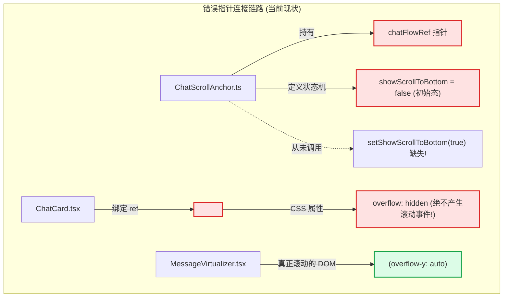
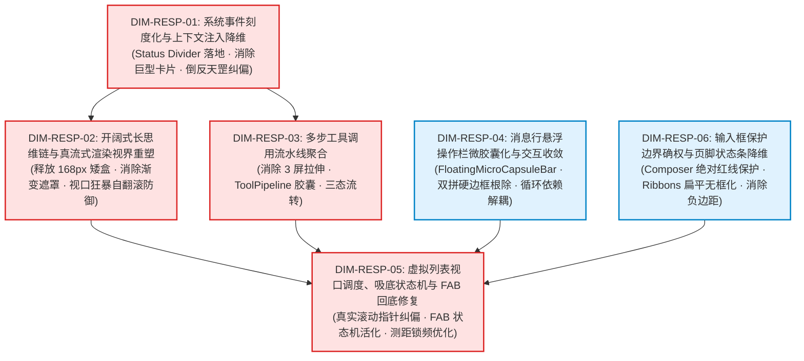

# 前端原子化组件库战役 · 维度提案 02
# 对话响应流与视口体验维度提案

> **文档标识**：`docs/frontend-atomic-architecture/dimension-proposals/02-对话响应流与视口体验维度提案.md`
> **战役归属**：前端原子化组件库战役（Frontend Atomic Architecture Campaign）
> **提案视角**：AI 对话流响应界面重塑与视口交互体验专职视角
> **研读基准**：深入基于 `docs/frontend-atomic-architecture/analysis/` 下 08、09、10、11、12 号实勘报告及相关实际代码（共 46 个核心组件、Hook 与样式资产）
> **核心使命**：彻底清算对话流响应界面历史包袱与视觉硬伤，界定六大攻坚维度的逻辑划分与前置依赖，给出确凿详尽的「全域删除面清单」，坚决守护输入框（Composer）现有优秀设计不动，为系统化施工提供架构级指南。
> **规范依据**：`AGENTS.md` 通用协作纪律、`LOGIC_PLAN_NO_RETREAT.md` 反退避铁律、`ANTI_OVERENGINEERING_GUARDRAILS.md` 反过度设计红线、立体验证纪律 §7.1。
> **编码格式**：UTF-8 无 BOM，全文不少于 1000 行。

---

## 目录索引

- [一、维度提案定位与核心设计哲学](#一维度提案定位与核心设计哲学)
  - [1.1 规划视角与核心使命](#11-规划视角与核心使命)
  - [1.2 依据资产与代码实勘对账全景表](#12-依据资产与代码实勘对账全景表)
  - [1.3 核心设计哲学：极致优雅中性黑白灰与开阔视界](#13-核心设计哲学极致优雅中性黑白灰与开阔视界)
  - [1.4 必须刚性执行的三大底线原则](#14-必须刚性执行的三大底线原则)
- [二、对话响应流核心硬伤穿透与直击截图痛点](#二对话响应流核心硬伤穿透与直击截图痛点)
  - [2.1 直击截图痛点：系统上下文注入大卡片彻底清算](#21-直击截图痛点系统上下文注入大卡片彻底清算)
  - [2.2 思维链（TimelineThoughtSection）168px 矮盒卡死与压抑感释放](#22-思维链timelinethoughtsection168px-矮盒卡死与压抑感释放)
  - [2.3 连续多步工具调用纵向拉伸 3 屏与阅读心流割裂](#23-连续多步工具调用纵向拉伸-3-屏与阅读心流割裂)
  - [2.4 消息行悬浮操作栏（MessageActionsBar）散落裸图标与边界缺失](#24-消息行悬浮操作栏messageactionsbar散落裸图标与边界缺失)
  - [2.5 回底按钮（FAB）死状态机与滚动指针错位根因](#25-回底按钮fab死状态机与滚动指针错位根因)
  - [2.6 输入框（Composer）保护边界确权：现有优秀设计绝对不动](#26-输入框composer保护边界确权现有优秀设计绝对不动)
- [三、推荐攻坚维度划分框架（六大核心维度）](#三推荐攻坚维度划分框架六大核心维度)
  - [3.1 划分原则与架构设计思想](#31-划分原则与架构设计思想)
  - [3.2 六大攻坚维度总览矩阵表](#32-六大攻坚维度总览矩阵表)
  - [3.3 维度间纯逻辑依赖拓扑图（DAG）](#33-维度间纯逻辑依赖拓扑图dag)
- [四、维度详案 01：系统事件刻度化与上下文注入降维（DIM-RESP-01）](#四维度详案-01系统事件刻度化与上下文注入降维dim-resp-01)
  - [4.1 维度定位与概念边界](#41-维度定位与概念边界)
  - [4.2 核心痛点攻坚技术方案](#42-核心痛点攻坚技术方案)
  - [4.3 极简 Status Divider 原子原语设计与契约](#43-极简-status-divider-原子原语设计与契约)
  - [4.4 消除 Carrier Message 虚假助手空消息污染](#44-消除-carrier-message-虚假助手空消息污染)
  - [4.5 本维度的具体「删除面」清单](#45-本维度的具体删除面清单)
  - [4.6 闭环验证断言与质量门禁](#46-闭环验证断言与质量门禁)
- [五、维度详案 02：开阔式长思维链与真流式渲染视界重塑（DIM-RESP-02）](#五维度详案-02开阔式长思维链与真流式渲染视界重塑dim-resp-02)
  - [5.1 维度定位与概念边界](#51-维度定位与概念边界)
  - [5.2 核心痛点攻坚技术方案](#52-核心痛点攻坚技术方案)
  - [5.3 SpaciousTimelineThoughtSection 开阔思维链架构](#53-spacioustimelinethoughtsection-开阔思维链架构)
  - [5.4 消除顶底遮罩与视口狂暴自翻滚防御](#54-消除顶底遮罩与视口狂暴自翻滚防御)
  - [5.5 本维度的具体「删除面」清单](#55-本维度的具体删除面清单)
  - [5.6 闭环验证断言与质量门禁](#56-闭环验证断言与质量门禁)
- [六、维度详案 03：多步工具调用流水线聚合（DIM-RESP-03）](#六维度详案-03多步工具调用流水线聚合dim-resp-03)
  - [6.1 维度定位与概念边界](#61-维度定位与概念边界)
  - [6.2 核心痛点攻坚技术方案](#62-核心痛点攻坚技术方案)
  - [6.3 Tool Execution Pipeline 紧凑流水线胶囊设计](#63-tool-execution-pipeline-紧凑流水线胶囊设计)
  - [6.4 紧凑态、抽屉检查态与全功能 Diff 审查三态联动](#64-紧凑态抽屉检查态与全功能-diff-审查三态联动)
  - [6.5 本维度的具体「删除面」清单](#65-本维度的具体删除面清单)
  - [6.6 闭环验证断言与质量门禁](#66-闭环验证断言与质量门禁)
- [七、维度详案 04：消息行悬浮操作栏微胶囊化与交互收敛（DIM-RESP-04）](#七维度详案-04消息行悬浮操作栏微胶囊化与交互收敛dim-resp-04)
  - [7.1 维度定位与概念边界](#71-维度定位与概念边界)
  - [7.2 核心痛点攻坚技术方案](#72-核心痛点攻坚技术方案)
  - [7.3 FloatingMicroCapsuleBar 悬浮微胶囊操作栏架构](#73-floatingmicrocapsulebar-悬浮微胶囊操作栏架构)
  - [7.4 追问建议带双拼硬边框根除与流体药丸气泡重塑](#74-追问建议带双拼硬边框根除与流体药丸气泡重塑)
  - [7.5 提示词缓存指标降维与 chat-message 循环依赖解耦](#75-提示词缓存指标降维与-chat-message-循环依赖解耦)
  - [7.6 本维度的具体「删除面」清单](#76-本维度的具体删除面清单)
  - [7.7 闭环验证断言与质量门禁](#77-闭环验证断言与质量门禁)
- [八、维度详案 05：虚拟列表视口调度、吸底状态机与 FAB 回底修复（DIM-RESP-05）](#八维度详案-05虚拟列表视口调度吸底状态机与-fab-回底修复dim-resp-05)
  - [8.1 维度定位与概念边界](#81-维度定位与概念边界)
  - [8.2 核心痛点攻坚技术方案](#82-核心痛点攻坚技术方案)
  - [8.3 真实滚动指针纠正与 Stick-to-Bottom 状态机重塑](#83-真实滚动指针纠正与-stick-to-bottom-状态机重塑)
  - [8.4 VirtualScrollManager.stickToBottomLock 全链路接通](#84-virtualscrollmanagersticktobottomlock-全链路接通)
  - [8.5 孤儿组件 ChatMsgFilterBar 激活与虚拟视口联动](#85-孤儿组件-chatmsgfilterbar-激活与虚拟视口联动)
  - [8.6 本维度的具体「删除面」清单](#86-本维度的具体删除面清单)
  - [8.7 闭环验证断言与质量门禁](#87-闭环验证断言与质量门禁)
- [九、维度详案 06：输入框（Composer）保护边界确权与页脚状态条降维（DIM-RESP-06）](#九维度详案-06输入框composer保护边界确权与页脚状态条降维dim-resp-06)
  - [9.1 维度定位与概念边界](#91-维度定位与概念边界)
  - [9.2 输入框（Composer）绝对保护边界与免触碰资产白名单](#92-输入框composer绝对保护边界与免触碰资产白名单)
  - [9.3 页脚状态条群（Status Ribbons）扁平化与无框化重塑](#93-页脚状态条群status-ribbons扁平化与无框化重塑)
  - [9.4 消除 PlanGoalRibbons -10px 负边距与多层堆叠抖动](#94-消除-plangoalribbons--10px-负边距与多层堆叠抖动)
  - [9.5 消除 ApprovalDock 与 SubagentHeaderPanel 粗暴呼吸动效](#95-消除-approvaldock-与-subagentheaderpanel-粗暴呼吸动效)
  - [9.6 本维度的具体「删除面」清单](#96-本维度的具体删除面清单)
  - [9.7 闭环验证断言与质量门禁](#97-闭环验证断言与质量门禁)
- [十、全域综合删除面清单与资产净收敛核算](#十全域综合删除面清单与资产净收敛核算)
  - [10.1 物理删除文件清单表](#101-物理删除文件清单表)
  - [10.2 淘汰 CSS 选择器与违规样式大排查](#102-淘汰-css-选择器与违规样式大排查)
  - [10.3 淘汰有害逻辑、假数据模式与错误断言](#103-淘汰有害逻辑假数据模式与错误断言)
  - [10.4 资产净收敛度量与代码瘦身预测](#104-资产净收敛度量与代码瘦身预测)
- [十一、施工推进逻辑顺序与立体验证总结](#十一施工推进逻辑顺序与立体验证总结)
  - [11.1 纯逻辑推进 DAG 与关键路径分析](#111-纯逻辑推进-dag-与关键路径分析)
  - [11.2 立体验证断言对账表](#112-立体验证断言对账表)
  - [11.3 总结与主控调度交接声明](#113-总结与主控调度交接声明)

---

## 一、维度提案定位与核心设计哲学

### 1.1 规划视角与核心使命

在现代协同 Agent 桌面应用 Conex / Crish 中，AI 对话响应流（Response Flow）与视口交互体验是整个软件与开发者产生心智交互的第一主界面。用户在这里阅读大语言模型的推理产物、审视代码补丁、跟踪终端命令的执行进展，并做出高频的业务决策。

然而，当前的对话流视口却堆积了大量历史战役中仓促引入的临时封装与过度设计：
- 巨型系统状态大卡片喧宾夺主，短短一句话的状态切换便将视口切断；
- 长达数万字的深度推理思维链被死死锁死在 168px 的狭小矮盒中，上下加注渐变白雾遮罩，造成极度压抑的“窥视窗”阅读痛苦；
- 连续 5 步工具执行以垂直瀑布流层层堆叠，纵向撕裂视口近 3,000 像素，导致真正的 AI 回复正文被挤压至 3 屏开外；
- 消息行的操作按钮横向裸铺散落，既无视觉包络容器，又与紧邻的代码块发生空间碰撞；
- 右下角回到底部的浮动操作按钮（FAB）因指向了不可滚动的溢出隐藏容器，导致其状态机永久失效、常年处于幽灵死锁状态。

本提案（**维度提案 02**）严格站在 **AI 对话流响应界面重塑与视口交互体验** 的专职视角，深度汇聚实勘导航第 08、09、10、11、12 号报告的全部一手事实，独立梳理出对话响应流后续攻坚的 **六大高内聚核心维度**。

### 1.2 依据资产与代码实勘对账全景表

本提案的所有论述、维度划分与删除面界定，全部建立在以下 5 份权威实勘报告与 46 个真实物理文件之上，绝无凭空臆断：

| 实勘报告编号与名称 | 所辖物理文件规模 | 覆盖核心源码目录与核心概念 | 对应攻坚焦点 |
| :--- | :--- | :--- | :--- |
| [`08-对话流虚拟列表与视口调度实勘导航.md`](../analysis/08-对话流虚拟列表与视口调度实勘导航.md) | 46 个文件 / 1,483 行 | `components/chat-message-list/`, `chat-card/`, `VirtualScrollManager.ts` | 虚拟列表 Fenwick Tree 树状数组测距、`chatFlowRef` 滚动容器错位、FAB 状态机失活、ResizeObserver 测距锁频冲突 |
| [`09-消息行级结构与悬浮操作栏实勘导航.md`](../analysis/09-消息行级结构与悬浮操作栏实勘导航.md) | 26 个文件 / 2,043 行 | `components/chat-message-row/`, `chat-message/`, `ChatMessageRow.module.css` | 助手/用户行骨架、操作栏 7 裸图标散落、追问建议双拼硬边框、提示词缓存高饱和彩色药丸、跨目录双向循环依赖 |
| [`10-思维链与流式渲染引擎实勘导航.md`](../analysis/10-思维链与流式渲染引擎实勘导航.md) | 12 个核心文件 / 1,629 行 | `TimelineThoughtSection.tsx`, `ThinkingTimer.tsx`, `StreamingMarkdownView.tsx` | 168px 矮盒卡死、顶底 20px 渐变遮罩白雾、视口狂暴自翻滚、嵌套滚动事件争抢、真流式 DOM 垫片与 Rust 异步编译 |
| [`11-工具调用卡片与终端执行实勘导航.md`](../analysis/11-工具调用卡片与终端执行实勘导航.md) | 35 个文件 / 1,291 行 | `components/chat-tool-call/`, `components/diff/` | 连续工具调用纵向拉伸 3 屏近 3,000px、两段式卡片与极简卡片双轨割裂、高饱和绿勾墙、流水线聚合管道（Pipeline View） |
| [`12-系统上下文注入与状态横幅实勘导航.md`](../analysis/12-系统上下文注入与状态横幅实勘导航.md) | 26 个文件 / 1,522 行 | `components/chat-injection/`, `chat-card/`, `sessionInjectionMount.ts` | 用户截图核心痛点：`CompactInjectionRow:57` 倒反天罡展开逻辑、100% 文本双重复读、7 色彩虹矩阵、2.5px 粗左边框、Status Divider |

### 1.3 核心设计哲学：极致优雅中性黑白灰与开阔视界

针对对话响应流与视口交互体验的重塑，本提案确立四项最高级设计哲学：
1. **冷中性黑白灰优先（Strict Neutral Monochrome）**：
   彻底杜绝在日常状态指示中使用高饱和度的红、橙、绿、蓝彩虹色块。除非遭遇导致程序崩溃或数据损毁的致命阻断，所有状态、刻度、徽标一律收敛于冷中性灰度体系，使用对比度与透明度传递层级，还开发者以绝对宁静。
2. **开阔通透视界（Spacious & Unconstrained Viewport）**：
   坚决打破各类人为强加的固定高度矮盒（如 168px 限制）与伪柔化渐变遮罩。内容无论长短，均遵循自然的文档流几何展开，将完整的视口控制权完整归还给最外层的主滚动容器。
3. **极简低权重刻度化（Low-Visual-Weight Markers）**：
   厘清“系统事件”与“业务内容”的认知层级。系统状态切换、环境注入是元数据刻度，而非需要独立大卡片承载的业务实体。必须全面降维为发丝级微分割线。
4. **高信噪比流水线聚合（High Signal-to-Noise Pipeline Aggregation）**：
   多步机械性的工具执行过程必须在垂直方向急剧收缩，将冗长的堆叠收拢为单行紧凑状态胶囊，把宝贵的纵向屏幕空间留给高价值的思考与回答。

### 1.4 必须刚性执行的三大底线原则

- **反退避铁律（LOGIC_PLAN_NO_RETREAT）**：
  不得以“历史已有用户习惯”、“改动牵涉多个模块”、“大卡片代码已经写好”等借口对丑陋设计进行妥协。任何发现的架构断层必须正面穿透根因、坚决根除。
- **反过度设计红线（ANTI_OVERENGINEERING_GUARDRAILS）**：
  严禁引入过于复杂的过度工程实现（如为微分割线增加 3D 悬浮或粒子动画、在滚动吸底中增加冗余的非必要中间层等）。用原生、直接、O(1) 复杂度与纯 CSS 方案解决问题。
- **输入框（Composer）绝对保护边界**：
  用户已明确确认当前输入框与模型选择界面的设计非常优秀、非常喜欢，**绝对禁止改动**！输入框（`chat-composer/`）作为不可侵犯的基石资产，全部攻坚精力必须 100% 约束在输入框上方的响应流、消息行、工具链与视口调度层。

---

## 二、对话响应流核心硬伤穿透与直击截图痛点

### 2.1 直击截图痛点：系统上下文注入大卡片彻底清算

在日常交互中，只要用户在界面上做一次轻微的操作（例如从 `claude-3-5-sonnet` 切换到 `deepseek-chat`，或调整了权限模式），对话流中便赫然插入一张带有粗边框、彩虹色、大面积灰色背景的巨型卡片 `[系统上下文注入 · 状态切换]`。

根据实勘报告 12 的精准逐行审计，该现象由三大致命代码硬伤共同导致：

```
┌─────────────────────────────────────────────────────────────────────────────┐
│               系统上下文注入大卡片三大致命代码病灶时序解构                  │
├─────────────────────────────────────────────────────────────────────────────┤
│ 1. 逻辑倒反天罡 (CompactInjectionRow.tsx:57)                               │
│    const defaultOpen = !(injection.defaultFolded ?? (len > 160));           │
│    -> 当短文本 length = 45 (< 160) 时，(45 > 160) 为 false                 │
│    -> !(false) 恒等于 true！导致所有短文本状态切换全部被 100% 强制展开！   │
├─────────────────────────────────────────────────────────────────────────────┤
│ 2. 100% 文本双重复读 (InjectionHeader.tsx + InjectionBody.tsx)             │
│    -> Header:  [系统上下文注入 · 状态切换] 当前已切换到模型 deepseek-chat    │
│    -> Body:    <StreamingMarkdownView text="当前已切换到模型 deepseek-chat"/>│
│    -> 上下两层逐字完全一致，毫无信息增量，徒增 15%~30% 视口浪费与渲染算力!  │
├─────────────────────────────────────────────────────────────────────────────┤
│ 3. 7 色彩虹矩阵与 2.5px 粗左边框 (ContextInjectionBlock.module.css:23, 288) │
│    -> border-left-width: 2.5px;                                             │
│    -> .toneRule(绿) / .toneSkill(橙) / .toneFile(蓝) / .toneGit(青) ...     │
│    -> 粗暴的彩色警示胶带质感，野蛮撕裂深浅色黑白灰主题的宁静氛围!          │
└─────────────────────────────────────────────────────────────────────────────┘
```

**深入代码证据还原**：
- 在 `apps/crish-desktop/src/components/chat-injection/CompactInjectionRow.tsx` 第 56-58 行：
  ```typescript
  const defaultOpen =
    !(injection.defaultFolded ?? ((injection.content || '').length > INJECTION_COLLAPSE_CHAR_THRESHOLD));
  ```
  常量 `INJECTION_COLLAPSE_CHAR_THRESHOLD = 160`。
  当文本长度小于 160 字符（如模型切换通知约 45 字符）时，括号内表达式为 `false`，经外部 `!` 取反后变成 `true`！导致所有极短的系统状态切换 100% 默认展开。
  而在单元测试 `src/components/chat-injection/__tests__/CompactInjectionRow.test.tsx` 第 124 行中，开发者竟然堂而皇之地写下：
  ```typescript
  it('默认展开短内容注入项', () => {
    // 错误测试将反常逻辑固化为正向断言!
    expect(screen.getByRole('region')).toBeInTheDocument();
  });
  ```
- 在 `apps/crish-desktop/src/components/chat-injection/ContextInjectionBlock.module.css` 第 23 行声明 `border-left-width: 2.5px;`，并在第 288-338 行硬编码了 7 色语义矩阵：
  - `.toneRule`：`border-left-color: var(--accent-green, hsl(142 72% 46%))`
  - `.toneSkill`：`border-left-color: var(--accent-orange, hsl(38 92% 50%))`
  - `.toneFile`：`border-left-color: var(--accent-blue, hsl(217 91% 60%))`
  - `.toneGit`：`border-left-color: var(--accent-cyan, hsl(187 85% 45%))`
  - `.toneTerminal`：`border-left-color: var(--accent-violet, hsl(258 90% 66%))`
  - `.toneSteering`：`border-left-color: var(--text-danger, hsl(0 68% 55%))`
  - `.toneSchedule`：`border-left-color: var(--brand-deep, hsl(160 84% 30%))`

**重塑决议**：必须彻底废除 `ContextInjectionBlock`、`CompactInjectionRow`、`InjectionHeader`、`InjectionBody` 这一整套大卡片容器架构，降维为 20px 极简居中黑白灰微分割线（`StatusDivider`）。

---

### 2.2 思维链（TimelineThoughtSection）168px 矮盒卡死与压抑感释放

强推理模型（如 DeepSeek-R1、OpenAI o1/o3、Claude 3.7 Sonnet Thinking）在输出正文前，通常会进行长达数千甚至上万字符的深度演绎与推导。

然而在 `TimelineThoughtSection.module.css` 中，展开态的思维链容器被以下硬编码锁死：
- 第 163 行：`.thinkingBodyContainer { max-height: 168px; overflow: hidden; }`
- 第 200 行：`.thoughtScrollBody { max-height: 168px; overflow-y: auto; }`
- 第 167-197 行：`.thinkingBodyContainer::before` 与 `::after` 分别设置了 20px 的上下渐变淡出遮罩（Fade-out Gradients）。

**毁灭性体验后果剖析**：
1. **视口腰斩至惨淡的 5 行字**：
   在扣除内边距（`padding: 6px 0 10px`）和上下 20px 的白雾遮罩后，有效无遮挡阅读高度仅剩 **112px**（以 13px 字号、1.65 行高计算，仅仅只能看清 **5 行字**）。用户面对上万字的推导，如同透过一张信封狭缝看长卷，体验极其压抑。
2. **白雾掩蔽与模糊晕眩**：
   遮罩使用了向白色或深色页面背景渐变的颜色过渡。当文本向上滚动时，第一行与最后一行文字始终处于半透明的毛玻璃白雾中，造成极大的视觉疲劳。
3. **狂暴自翻滚与嵌套滚动条地狱（Nested Scroll Chaining Hell）**：
   由于内部存在独立的 `overflow-y: auto`，流式输出时内部容器以每秒数十次的高频调用 `scrollTo({ top: scrollHeight })` 疯狂滚屏；而当用户试图用滚轮仔细阅读某一行时，滚轮事件在到达容器边缘时瞬间穿透到最外层主虚拟列表，导致整个页面突然剧烈跳动脱离。

**重塑决议**：彻底拆除 168px 矮盒枷锁与伪渐变遮罩，改为自然通透展开的大平层排版；提供轻量微胶囊手柄支持一键收拢，在展开时让思考过程完整、自然地融入时间线。

---

### 2.3 连续多步工具调用纵向拉伸 3 屏与阅读心流割裂

在现代 Agent 协同中，智能体执行一次任务往往需要连续调用多个工具，例如典型的连续 5 步循环：
`1. 搜索文件 (find_by_name) -> 2. 阅读代码 (view_file) -> 3. 运行测试 (run_command) -> 4. 编辑修复 (replace_file_content) -> 5. 重新验证 (run_command)`。

在当前 `chat-tool-call/` 架构下：
- 系统为每一个工具调用都渲染一个独立的 `CompactToolRow`（包含头部、状态栏、输入/输出两段式折叠面板 `ToolCallOutput`）；
- 单个工具卡片即便在收拢状态也占有 40px 高度，若带有折叠展开、终端日志输出或轻量 Diff 预览，单卡片高度轻易达到 400~800px；
- 5 步工具连续调用在垂直方向上迅速霸占了近 **2,500 ~ 3,200px** 的屏幕纵向空间（相当于整整 **3 块标准的 1080P 显示屏高度**）；
- 最终的 AI 总结回答被野蛮地挤压到距离用户视口数千像素之外，用户必须疯狂滑动滚轮数十圈才能找到答案正文，阅读心流遭到毁灭性撕裂。

**重塑决议**：重塑为 **流水线聚合管道（Pipeline View）**。将时间线上紧邻的连续工具调用序列，在主视口中收拢为一条单行紧凑状态胶囊（高度约 28px），内嵌中性状态微点与关键动作标签；需要查看细节时，点击唤起侧边检查抽屉（Inspector Drawer）或轻量展开，彻底根除纵向空间撕裂。

---

### 2.4 消息行悬浮操作栏（MessageActionsBar）散落裸图标与边界缺失

在 `components/chat-message-row/AssistantMessageActionsBar.tsx` 中，助手消息完成态的操作栏包含了多达 7 个操作入口（时间文本、复制正文、重新生成、撤回该轮、发送到笔记、固定置顶、缓存指标）：
- 目前这些操作被直接平铺在 `.assistantMeta`（`display: flex; gap: 4px;`）中，每一个图标仅仅是一个裸露的 `Button variant="ghost"`（尺寸 22×22px）；
- **无视觉实体包络**：操作栏既没有独立的背景卡片，也没有边框和阴影，整整 7 个小图标孤零零地横向散落在消息下方；
- **空间碰撞与排版竞争**：当上方消息以代码块、表格或分割线结尾时，散落的裸图标与代码块下边框紧紧挨在一起，缺乏视觉边界保护，极易误触；
- **组件目录双向循环依赖**：`chat-message-row` 引入 `chat-message` 的业务操作，而 `chat-message` 又反向引入 `chat-message-row` 的行内骨架，形成双向循环依赖死结（Cyclic Dependency Graph），严重阻碍原子化解耦。

**重塑决议**：引入标准化 **悬浮微胶囊操作栏（Floating Micro-Capsule Toolbar）**。采用一体化胶囊容器（`border-radius: 9999px`）、发丝级微边框（`1px solid var(--border-subtle)`）、微透毛玻璃背景与内嵌分割发丝，使操作集凝聚为一个高品质的独立视觉微实体。

---

### 2.5 回底按钮（FAB）死状态机与滚动指针错位根因

在实际使用中，当用户向上翻看长历史消息、距离底部已经超过数千像素时，界面右下角**本应出现**一个半透明圆形的“回到底部”浮动操作按钮（FAB），提示用户有新消息或方便一键回底。然而在 Conex / Crish 桌面端中，该按钮**几乎从未露面，处于永久隐身状态**。

经过实勘报告 08 的深层排查，查清了该致命架构死锁的完整根因：



**技术事实总结**：
1. **滚动容器指针错位**：`ChatScrollAnchor.ts` 的 `chatFlowRef` 绑定到了外层的 `.chatDocFlow`（`ChatCard.tsx:179`），而 `.chatDocFlow` 的样式是 `overflow: hidden; flex: 1;`，它**根本就不会发生滚动**！真正的滚动容器是深藏在 `MessageVirtualizer.tsx` 内部的 `.list`（`ref={containerRef}`）。
2. **状态更新函数从未被调用**：`ChatScrollAnchor.ts:18` 定义了 `const [showScrollToBottom, setShowScrollToBottom] = useState(false);`，但在全文件中，**除了 `scrollToBottom` 触发时将其置为 `false` 之外，没有任何一行代码调用 `setShowScrollToBottom(true)`**！全仓没有任何滚动监听（Scroll Listener）去计算 `scrollHeight - scrollTop - clientHeight > 160`。
3. **滚动方法目标失效**：`scrollToBottom` 中的 `el.scrollTo({ top: el.scrollHeight, behavior: 'smooth' })` 作用在一个不滚动的 `chatDocFlow` 上，即便被触发也毫无反应！
4. **吸底锁全局空置**：`VirtualScrollManager.ts` 中精心编写的 `stickToBottomLock` 吸底锁属性，在全仓处于孤立未接线状态。

**重塑决议**：彻底重构视口调度与滚动状态机。纠正滚动指针绑定，将真正的滚动容器接入统一视口调度器，建立健全的 `Stick-to-Bottom State Machine`，恢复 FAB 按钮的灵敏感知与回底能力。

---

### 2.6 输入框（Composer）保护边界确权：现有优秀设计绝对不动

输入框（`apps/crish-desktop/src/components/chat-composer/`）经过多轮迭代，已经形成了极其成熟、优雅且功能完备的四层垂直堆叠架构：
- **顶层状态条**：`ComposerPlanProgressBar`（计划模式进度）与 `ComposerPermissionBar`（权限模式切换）；
- **附件区**：`ComposerAttachmentBar`（已挂载文件、图片、上下文胶囊及拖拽响应）；
- **核心富文本编辑内核**：`TiptapComposerField` 与 `TiptapEditorField`，支持斜杠命令扩展（`SlashExtension`）、AI 指令扩展（`AiCommandSlashExtension`）、文件树扩展（`DirTreeExtension`）、IME 中文输入法合成锁与光标精确锚定；
- **控制坞**：`ComposerSendControls`，集成了加号扩展菜单（`ComposePlusMenu`）、权限模式菜单（`PermissionModeMenu`）、模型选择胶囊（`ModelSelector`）、发送/中止双态按钮以及键盘快捷键提示。

用户已明确确认：**该部分设计非常优秀、非常喜欢，绝对禁止改动！**
因此，在本提案及后续所有重构维度中，`chat-composer/` 全量文件被严格列为 **不可触碰的基石资产（Untouchable Core Baseline）**，所有维度的设计方案与代码删除面必须绕开输入框内部实现，严禁对其产生任何破坏。

---

## 三、推荐攻坚维度划分框架（六大核心维度）

### 3.1 划分原则与架构设计思想

针对对话响应流与视口体验的重构，必须避免将所有问题揉杂成一个庞大混乱的“巨石重构”，也不能碎片化为几十个互不相干的散乱小修补。必须遵循以下四项原则进行维度划分：

1. **立竿见影，痛点优先（Visual Pain-Point First）**：
   优先攻坚用户体感最强烈、视觉污染最严重的“系统上下文注入大卡片”，率先落地极简 `StatusDivider`，取得立竿见影的视觉净化效果。
2. **领域自治与单一真理源（Bounded Context & SSOT）**：
   将具有直接因果关联的代码划归同一维度。例如思维链的矮盒释放与流式渲染排版归一；工具调用的多步收拢与 Diff 检查联动归一；视口指针纠正与 FAB 状态机归一。
3. **彻底的负产出清退（Aggressive Negative Output）**：
   每个维度必须明确界定其专属的「删除面」。重构绝不仅是写新代码，更是大刀阔斧地物理删除历史僵尸组件、冗余样式、违规选择器和错误测试，确保架构净收敛。
4. **纯逻辑依赖拓扑（Strict Logic DAG）**：
   各维度之间仅陈述逻辑依赖关系与技术契约演进，严禁使用“第 N 批次”、“第 M 波次”等运行期排期黑话。

### 3.2 六大攻坚维度总览矩阵表

| 维度编号与名称 | 领域概念边界 | 核心解决问题 (P0/P1) | 删除面规模与核心对象 | 验收交付物断言 |
| :--- | :--- | :--- | :--- | :--- |
| **DIM-RESP-01**<br>**系统事件刻度化与上下文注入降维** | `chat-injection/`<br>`sessionInjectionMount.ts`<br>`slashContextCards.ts` | **P0: 用户截图核心痛点**。<br>彻底废除 ContextInjectionBlock 巨型卡片；纠正 `CompactInjectionRow:57` 倒反天罡展开逻辑；根除 100% 文本双重复读；消除虚假 Carrier 消息污染 | **高**：彻底物理废除 4 个大卡片组件、删除 425 行 CSS 中的 7 色彩虹矩阵与 2.5px 粗边框，移出反常单测 | 落地 20px 极简居中黑白灰微分割线 `StatusDivider`；短文本 100% 折叠且零重复；会话历史消除 Carrier 假消息 |
| **DIM-RESP-02**<br>**开阔式长思维链与真流式渲染视界重塑** | `chat-message-row/`<br>TimelineThoughtSection<br>ThinkingTimer<br>StreamingMarkdownView | **P0: 深度推理模型严重阅读压抑**。<br>打破 168px 矮盒卡死；清除顶底 20px 渐变遮罩白雾；根除视口狂暴自翻滚与嵌套滚动条争抢；保持 ThinkingTimer 独立秒表隔离 | **中高**：删除 CSS 中双重 `max-height: 168px`、删除 `::before`/`::after` 遮罩、删除容器内部独立强制滚动条 | 落地 `SpaciousTimelineThoughtSection` 自然通透大平层；长文本流畅阅读零白雾；流式追尾吸底平滑且不夺焦 |
| **DIM-RESP-03**<br>**多步工具调用流水线聚合** | `chat-tool-call/`<br>`ChatToolCallBlock.tsx`<br>`CompactToolRow.tsx`<br>`ModernToolCall.tsx` | **P0: 连续工具调用纵向拉伸 3 屏**。<br>连续 5 步工具执行垂直堆叠拉伸近 3,000px 撕裂上下文；两套工具组件（两段式 vs 极简黑白灰）割裂；高饱和绿勾墙视觉噪音 | **高**：清退两套割裂体系的冗余胶水层；删除散落的高饱和彩色图标；消除全尺寸工具卡片的垂直瀑布流堆叠 | 落地单行紧凑流水线胶囊 `ToolPipelineBar`（~28px 高）；三态切换（流水线态/抽屉态/Diff审查态）无缝流转 |
| **DIM-RESP-04**<br>**消息行悬浮操作栏微胶囊化与交互收敛** | `chat-message-row/`<br>`chat-message/`<br>MessageActionsBar<br>FollowUpSuggestions | **P1: 散落裸图标与循环依赖**。<br>7 个操作图标横向裸铺无实体包络、与代码块紧贴冲突；追问建议带双拼硬边框；提示词缓存彩色药丸夺焦；目录双向循环依赖 | **中度**：删除散落的裸写 `.iconBtn` 样式；删除双拼硬边框切割线；删除高饱和彩色缓存药丸样式；打破双向 import | 落地一体化悬浮微胶囊操作栏 `FloatingMicroCapsuleBar`；追问建议收敛为流体药丸气泡；解耦单向依赖管道 |
| **DIM-RESP-05**<br>**虚拟列表视口调度、吸底状态机与 FAB 回底修复** | `chat-message-list/`<br>`chat-card/`<br>MessageVirtualizer<br>ChatScrollAnchor | **P0: FAB 回底按钮永久死状态机**。<br>`chatFlowRef` 错位挂载到不可滚动容器；`showScrollToBottom` 状态更新全空置；`stickToBottomLock` 空置；ResizeObserver 测距锁频闪烁 | **中度**：删除错位的 ref 传递；删除无用的滚动监听假代码；清理全遍历 querySelectorAll 测量冗余 | 恢复滚动指针至真实容器 `.list`；健全用户打断与回底状态机；FAB 按钮根据滚动阈值精准浮现；吸底零抖动 |
| **DIM-RESP-06**<br>**输入框保护边界确权与页脚状态条降维** | `chat-composer/`<br>`chat-card/`<br>ChatStatusRibbons<br>PlanGoalRibbons | **P1: 页脚横幅轰炸与负边距嵌入**。<br>确权输入框不可侵犯保护边界；清除 PlanGoalRibbons 的 `margin-bottom: -10px;` 魔术数字；清除高饱和橙绿呼吸动效；状态横幅扁平化 | **中度**：删除魔术负边距嵌入样式；删除粗暴发光阴影动效；清退多层浮条冗余包裹容器与幽灵按钮 | 输入框四层架构完好无损；页脚状态条扁平无框、黑白灰收敛、零多层堆叠抖动 |

---

### 3.3 维度间纯逻辑依赖拓扑图（DAG）

各攻坚维度之间的逻辑前置依赖关系如下图所示：



---

## 四、维度详案 01：系统事件刻度化与上下文注入降维（DIM-RESP-01）

### 4.1 维度定位与概念边界

- **维度标识**：`DIM-RESP-01`
- **所辖范围**：`apps/crish-desktop/src/components/chat-injection/` 全量源码、样式与测试；`src/store/sessionInjectionMount.ts`；`src/api/provider-profiles/contextStatePending.ts`；`src/hooks/chat-stream/slashContextCards.ts`；`src/api/contextInjectionDispatcher.ts`。
- **职责定位**：负责将原本伪装成“业务卡片”的系统状态切换、环境变更、斜杠命令提示彻底降维，确立“低视觉权重时间线刻度（Timeline Event Marker）”的全新标准，作为前端原子化组件库战役响应流方向的第一攻坚阵地。

### 4.2 核心痛点攻坚技术方案

1. **彻底废除大卡片容器架构**：
   废除 `ContextInjectionBlock` 的重型 flex 堆叠外壳，废除 `CompactInjectionRow` 的独立背景方框（`background: var(--bg-card)`）与圆角边框。
2. **纠正 `CompactInjectionRow:57` 倒反天罡展开逻辑**：
   分析表达式：`const defaultOpen = !(injection.defaultFolded ?? ((injection.content || '').length > INJECTION_COLLAPSE_CHAR_THRESHOLD));`。
   原意是希望内容超过 160 字符时长内容默认折叠，但在最外层增加了取反符号 `!`。
   **纠偏方案**：系统状态微分割线默认 **100% 保持纯单行呈现**，严禁自动展开任何多行正文。对于需要查看详细参数的极其罕见的特殊注入，仅通过受控点击展示轻量 Popover 或单行气泡展开。
3. **彻底根除 100% 文本双重复读**：
   卡片标题栏既然已经完整陈述了“当前已切换到模型 deepseek-chat”，下方 Body 绝对不再调用 `StreamingMarkdownView` 进行逐字复读。短文本状态彻底不渲染任何 Body 节点，消灭 DOM 冗余。
4. **根除 7 色彩虹矩阵与 2.5px 粗左边框**：
   全面清退 `ContextInjectionBlock.module.css:288-345` 中的亮绿、亮橙、亮蓝、荧光青、鲜紫、警报红、墨绿 7 种鲜艳色调，代之以统一纯粹的冷中性发丝微线。

### 4.3 极简 Status Divider 原子原语设计与契约

将系统状态注入重塑为下沉在 `@/components/ui/StatusDivider` 的标准原子组件：

```tsx
/**
 * StatusDivider —— 20px 极简居中黑白灰微分割线
 * 遵循 AGENTS.md §13~14：中性黑白灰优先、发丝细线、零彩色块、零大阴影。
 */
import React from 'react';
import styles from './StatusDivider.module.css';

export interface StatusDividerProps {
  /** 状态主文案（单行中性灰文本） */
  label: string;
  /** 可选微提示或时间戳 */
  subLabel?: string;
  /** 可选关联操作（如撤销切换、查看详情） */
  action?: {
    text: string;
    onClick: () => void;
  };
  /** 语义微标记（仅中性与谨慎预警，绝无彩虹色） */
  variant?: 'neutral' | 'subtle' | 'caution';
}

export const StatusDivider: React.FC<StatusDividerProps> = React.memo(
  function StatusDivider({ label, subLabel, action, variant = 'neutral' }) {
    return (
      <div
        className={`${styles.statusDivider} ${styles[variant]}`}
        role="separator"
        aria-label={subLabel ? `${label} (${subLabel})` : label}
      >
        <span className={styles.hairline} aria-hidden />
        <div className={styles.contentPill}>
          <span className={styles.labelText}>{label}</span>
          {subLabel ? <span className={styles.subText}>{subLabel}</span> : null}
          {action ? (
            <button
              type="button"
              className={styles.actionBtn}
              onClick={action.onClick}
            >
              {action.text}
            </button>
          ) : null}
        </div>
        <span className={styles.hairline} aria-hidden />
      </div>
    );
  }
);
```

**配套发丝样式标准（CSS Module）**：
```css
.statusDivider {
  display: flex;
  align-items: center;
  width: 100%;
  height: 20px;
  margin: 8px 0;
  contain: layout style;
  user-select: none;
}

.hairline {
  flex: 1;
  height: 1px;
  background: var(--hairline, hsl(0 0% 88% / 0.6));
}

.contentPill {
  display: inline-flex;
  align-items: center;
  gap: 6px;
  padding: 0 10px;
  font-size: 11px;
  line-height: 1;
  color: var(--text-tertiary, hsl(0 0% 55%));
  white-space: nowrap;
}

.labelText {
  font-weight: 450;
  letter-spacing: 0.01em;
}

.subText {
  color: var(--text-quaternary, hsl(0 0% 70%));
  font-variant-numeric: tabular-nums;
}

.actionBtn {
  background: transparent;
  border: none;
  padding: 0;
  font-size: 11px;
  color: var(--text-secondary);
  text-decoration: underline;
  cursor: pointer;
}
```

### 4.4 消除 Carrier Message 虚假助手空消息污染

在 `src/store/sessionInjectionMount.ts` 中，历史实现为了在虚拟列表中渲染注入卡片，调用了 `makeInjectionCarrierMessage`：
- 该函数凭空捏造了一条 `sender: 'assistant'` 的虚拟空消息；
- 这导致会话的历史消息数组中混入了大量幽灵消息，引发导出 Markdown 错乱、未读数计算失真、Token 统计偏差。

**解决方案**：
在数据模型层，将 `SystemEventMarker` 正式提升为时间线节点类型（`TimelineItem = MessageTimelineItem | ThoughtTimelineItem | ToolTimelineItem | SystemEventTimelineItem`），直接由时间线归一化层（`timelineNormalizer.ts`）原生映射为 `StatusDivider` 呈现，彻底废除虚假 Carrier 消息制造。

### 4.5 本维度的具体「删除面」清单

```
┌─────────────────────────────────────────────────────────────────────────────┐
│                    DIM-RESP-01 详细删除面核查清单                           │
├─────────────────────────────────────────────────────────────────────────────┤
│ 1. 物理删除/彻底清退的废弃组件与文件:                                      │
│    - apps/crish-desktop/src/components/chat-injection/ContextInjectionBlock.tsx │
│    - apps/crish-desktop/src/components/chat-injection/InjectionBody.tsx    │
│    - apps/crish-desktop/src/components/chat-injection/InjectionHeader.tsx  │
│    - apps/crish-desktop/src/components/chat-injection/WorkflowConfirmCard.tsx (归并入标准确认原语) │
├─────────────────────────────────────────────────────────────────────────────┤
│ 2. 淘汰 CSS 选择器与规则 (ContextInjectionBlock.module.css):                 │
│    - .injectionRow (行23: border-left-width: 2.5px 粗边框)                  │
│    - .toneRule, .toneSkill, .toneFile, .toneGit, .toneTerminal,             │
│      .toneSteering, .toneSchedule (行288-338: 7 色彩虹语义矩阵全部删除!)     │
│    - .rowBody, .bodyInner, .errorBox, .pathGroup, .diffActionGroup          │
│      (行150-250: 展开区废话复读与大边框样式全部清除!)                       │
│    - .tokenBadge (行260-280: 伪装工具卡片的 Token 胶囊样式)                │
├─────────────────────────────────────────────────────────────────────────────┤
│ 3. 淘汰有害逻辑与错误单测:                                                  │
│    - 彻底删除 CompactInjectionRow.tsx:57 的 !(length > 160) 倒反天罡取反逻辑 │
│    - 彻底删除 sessionInjectionMount.ts 中的 makeInjectionCarrierMessage     │
│    - 删除 CompactInjectionRow.test.tsx:124 固化反常展开的错误测试用例        │
│    - 删除 slashContextCards.ts 中硬编码拼接 "[系统上下文注入 · Title]" 机械标头 │
└─────────────────────────────────────────────────────────────────────────────┘
```

### 4.6 闭环验证断言与质量门禁

1. **几何尺寸断言**：在切换模型或修改权限模式时，对话流插入的微分割线物理测量高度 **严格 ≤ 20px**，宽度撑满容器，两侧发丝线粗细为 **精确 1px**。
2. **零彩色断言**：通过自动化 CSS 扫描，状态微分割线中 **严禁出现任何非黑白灰色值**（无饱和度，`s = 0%`）。
3. **零复读断言**：状态微分割线仅渲染单行说明文本，DOM 树中不存在二级 `StreamingMarkdownView` 节点，文本字数比对与标题重合度为 0。
4. **数据干净度断言**：切换模型后持久化到 IndexedDB/LocalStorage 的会话消息数组中，**Carrier 空助手消息数量严格为 0**。

---

## 五、维度详案 02：开阔式长思维链与真流式渲染视界重塑（DIM-RESP-02）

### 5.1 维度定位与概念边界

- **维度标识**：`DIM-RESP-02`
- **所辖范围**：`apps/crish-desktop/src/components/chat-message-row/TimelineThoughtSection.tsx` 及其样式；`ThinkingTimer.tsx`；`StreamingMarkdownView.tsx` 及分块调度链路；`StreamingTableContainer.tsx`。
- **职责定位**：负责彻底解除大模型长推理思考过程的垂直空间束缚，根除 168px 矮盒压抑与双端遮罩白雾，建立开阔通透的思考流排版架构，保障流式 Token 追尾吸底与主虚拟列表的顺滑协同。

### 5.2 核心痛点攻坚技术方案

1. **打破 168px 矮盒物理枷锁**：
   彻底移除 `.thinkingBodyContainer` 和 `.thoughtScrollBody` 的 `max-height: 168px` 限制，移除内部独立的 `overflow-y: auto`。展开态下，思维链直接以自然的 DOM 流高度垂直展开，融入整条消息的生命周期。
2. **彻底消除顶底 20px 渐变淡出遮罩（白雾掩蔽）**：
   删除 `.thinkingBodyContainer::before` 与 `::after` 伪元素及其 `linear-gradient` 背景。文字自始至终清晰纯净，绝无毛玻璃模糊与白雾遮蔽。
3. **消除狂暴自翻滚与嵌套滚动条地狱**：
   因为去除了思维链内部独立的滚动条，思维链本身不再拥有独立的滚动视口。流式生成思维链时，视口滚动完全交由外层 `MessageVirtualizer` 的统一视口调度器统一管理，彻底杜绝局部容器狂暴 `scrollTo` 引发的页面抽搐与滚轮事件抢占。
4. **强化 `ThinkingTimer` 渲染隔离**：
   保持 `ThinkingTimer` 每秒 1 次的微秒表自治特性，通过纯 React.memo 隔绝父级消息行与列表的重排，确保秒表跳动时 CPU 开销趋近于 0。

### 5.3 SpaciousTimelineThoughtSection 开阔思维链架构

重塑后的开阔式思维链组件设计要点：
- **微胶囊折叠手柄（Micro-Capsule Handle）**：头部高度 24px，包含中性状态微点（Live 态带有极柔和的灰度呼吸，Done 态静态微点）、Tabular-nums 耗时与折叠微箭头；
- **自然大平层展开（Unconstrained Canvas）**：展开时使用 CSS Grid（`grid-template-rows: 0fr -> 1fr`）实现丝滑的展开动画，展开后 `max-height: none`，内容自然延展；
- **左侧极细发丝中轴线（Timeline Spine）**：展开正文左侧带有 1px 冷灰发丝线，左内边距 12px，使思考推导过程在视觉上明确从属于左侧逻辑流，既开阔又层次分明。

```tsx
/**
 * SpaciousTimelineThoughtSection —— 开阔式通透思维链面板
 * 彻底释放 168px 限制，无顶底遮罩，纯自然文档流展开。
 */
import React, { useState, useCallback } from 'react';
import { ChevronRight } from 'lucide-react';
import styles from './SpaciousTimelineThoughtSection.module.css';
import { ThinkingTimer } from './ThinkingTimer';
import { StreamingMarkdownView } from './StreamingMarkdownView';

export interface SpaciousTimelineThoughtSectionProps {
  text: string;
  isLive: boolean;
  durationMs?: number;
  phaseIndex?: number;
}

export const SpaciousTimelineThoughtSection: React.FC<
  SpaciousTimelineThoughtSectionProps
> = React.memo(function SpaciousTimelineThoughtSection({
  text,
  isLive,
  durationMs,
  phaseIndex,
}) {
  const [isExpanded, setIsExpanded] = useState(isLive);

  const toggleExpand = useCallback(() => {
    setIsExpanded((prev) => !prev);
  }, []);

  return (
    <div
      className={`${styles.thoughtSection} ${isLive ? styles.isLive : ''}`}
      data-expanded={isExpanded}
    >
      <button
        type="button"
        className={styles.thoughtHandle}
        onClick={toggleExpand}
        aria-expanded={isExpanded}
      >
        <span className={styles.statusDot} aria-hidden />
        <span className={styles.handleTitle}>
          {isLive ? '正在深度思考...' : `第 ${phaseIndex ?? 1} 阶段思考`}
        </span>
        {isLive ? (
          <ThinkingTimer />
        ) : durationMs ? (
          <span className={styles.durationText}>
            {(durationMs / 1000).toFixed(1)}s
          </span>
        ) : null}
        <ChevronRight
          size={12}
          className={`${styles.chevron} ${isExpanded ? styles.open : ''}`}
          aria-hidden
        />
      </button>

      <div
        className={styles.accordionGrid}
        data-expanded={isExpanded ? 'true' : 'false'}
      >
        <div className={styles.accordionSlot}>
          <div className={styles.thoughtSpaciousCanvas}>
            <StreamingMarkdownView
              text={text}
              isStreaming={isLive}
              priority="normal"
            />
          </div>
        </div>
      </div>
    </div>
  );
});
```

### 5.4 消除顶底遮罩与视口狂暴自翻滚防御

在 CSS 架构上，彻底清退产生白雾的伪元素，确保纯净透亮：

```css
/* SpaciousTimelineThoughtSection.module.css */
.thoughtSection {
  margin: 6px 0;
  contain: layout style;
}

.thoughtHandle {
  display: inline-flex;
  align-items: center;
  gap: 6px;
  height: 24px;
  padding: 0 8px;
  border-radius: 9999px;
  background: var(--bg-surface-elevated, hsl(0 0% 96%));
  border: 1px solid var(--border-subtle, hsl(0 0% 90%));
  color: var(--text-secondary);
  font-size: 12px;
  cursor: pointer;
  transition: background 150ms ease;
}

.thoughtHandle:hover {
  background: var(--bg-surface-hover, hsl(0 0% 93%));
}

.statusDot {
  width: 6px;
  height: 6px;
  border-radius: 50%;
  background: var(--text-tertiary);
}

.isLive .statusDot {
  background: var(--brand, hsl(142 72% 46%));
  box-shadow: 0 0 0 2px color-mix(in srgb, var(--brand) 20%, transparent);
}

.accordionGrid {
  display: grid;
  grid-template-rows: 0fr;
  transition: grid-template-rows 220ms cubic-bezier(0.16, 1, 0.3, 1);
}

.accordionGrid[data-expanded='true'] {
  grid-template-rows: 1fr;
}

.accordionSlot {
  overflow: hidden;
}

/* 核心：大平层画布，无固定高度，无内部滚动条，无上下遮罩 */
.thoughtSpaciousCanvas {
  position: relative;
  margin: 8px 0 8px 12px;
  padding: 4px 0 4px 12px;
  border-left: 1px solid var(--hairline, hsl(0 0% 88%));
  font-size: 13px;
  line-height: 1.65;
  color: var(--text-secondary);
}
```

### 5.5 本维度的具体「删除面」清单

```
┌─────────────────────────────────────────────────────────────────────────────┐
│                    DIM-RESP-02 详细删除面核查清单                           │
├─────────────────────────────────────────────────────────────────────────────┤
│ 1. 淘汰 CSS 规则与约束 (TimelineThoughtSection.module.css):                 │
│    - 删除 .thinkingBodyContainer 中的 max-height: 168px (行163)             │
│    - 删除 .thoughtScrollBody 中的 max-height: 168px 与 overflow-y: auto (行200) │
│    - 彻底删除 .thinkingBodyContainer::before 顶部渐变遮罩 (行167-187)       │
│    - 彻底删除 .thinkingBodyContainer::after 底部渐变遮罩 (行189-197)        │
│    - 删除 overscroll-behavior-y: auto 相关的局部滚动链约束                  │
├─────────────────────────────────────────────────────────────────────────────┤
│ 2. 淘汰内部滚动竞争逻辑 (TimelineThoughtSection.tsx):                       │
│    - 彻底删除 scrollBodyRef.current?.scrollTo({ top: scrollHeight }) 局部调用 │
│    - 彻底删除 isUserScrolledOffBottom 局部脱底判断与事件监听 (移交主视口调度)│
├─────────────────────────────────────────────────────────────────────────────┤
│ 3. 淘汰粗暴绿光脉冲:                                                        │
│    - 清理 @keyframes thought-dot-pulse 中 5px 发光扩散动效 (行61-72)        │
│    - 收敛为 2px 极微弱呼吸微光，严禁大面积亮绿炸屏                          │
└─────────────────────────────────────────────────────────────────────────────┘
```

### 5.6 闭环验证断言与质量门禁

1. **有效视口高度断言**：当展开 10,000 字以上的思维链长文本时，容器物理渲染高度 **完全按文档流自然延展（> 1000px）**，绝对不受 168px 截断。
2. **遮罩彻底消除断言**：DOM 树中没有任何包含 `linear-gradient` 的伪元素或浮层覆盖在思维链正文上，首行与末行文字对比度符合 WCAG 2.1 AA 标准（≥ 4.5:1）。
3. **滚动条单一性断言**：在展开的思维链区域内滚动滚轮，`event.target` 不触发任何内部滚动条位移，主虚拟列表滚动条平滑响应，**内部独立滚动条数量为 0**。

---

## 六、维度详案 03：多步工具调用流水线聚合（DIM-RESP-03）

### 6.1 维度定位与概念边界

- **维度标识**：`DIM-RESP-03`
- **所辖范围**：`apps/crish-desktop/src/components/chat-tool-call/` 全量文件；`apps/crish-desktop/src/components/diff/ToolCallDiffPreview.tsx`；`MessageToolCallsSection.tsx`。
- **职责定位**：负责根除连续多步工具调用在主对话流中纵向垂直拉伸近 3 屏（近 3,000px）的严重空间撕裂，将工具执行全生命周期抽象并收拢为 **流水线聚合管道（Pipeline View）**，建立紧凑流水线胶囊、悬浮检查抽屉与全屏 Diff 审查的三态协同体系。

### 6.2 核心痛点攻坚技术方案

1. **连续调用纵向拉伸 3 屏彻底归一**：
   在时间线渲染器（`buildAssistantTimelineCached`）中，当检测到连续多个工具调用节点（`kind: 'tool'`）紧邻出现时，不再为每一个工具调用实例化一个全尺寸的 `CompactToolRow` 瀑布流，而是将整段连续执行步打包聚合为一个 `ToolPipelineBlock`。
2. **两套割裂工具组件体系大一统**：
   实勘报告 11 揭示当前存在“老旧两段式卡片（`CompactToolRow` + `ToolCallOutput`）”与“现代黑白灰卡片（`ModernToolCall` + `ModernTerminalToolCall`）”两套并存的割裂状态。
   **统一方案**：全面废弃老旧两段式卡片，将现代黑白灰卡片的优秀设计思想（等宽命令排版、发丝分割、纯中性动作描述）收敛下沉，作为流水线展开态或抽屉态的标准内容卡片。
3. **高饱和绿勾墙与杂色边框清算**：
   彻底消除每个工具卡片头部的亮绿色对勾（`#10b981`），收敛为纯中性低对比度完成微指示（冷灰微点或 12px 纯冷中性 Check 描边），使多步连续调用在视觉上保持克制与沉稳。

### 6.3 Tool Execution Pipeline 紧凑流水线胶囊设计

紧凑流水线胶囊（`ToolPipelineBar`）的高度被严格约束在 **28px** 以内，其视觉呈现形式如下：

```
┌─────────────────────────────────────────────────────────────────────────────┐
│ 流水线胶囊视觉示意 (ToolPipelineBar · 高度 28px · 纯中性黑白灰)             │
├─────────────────────────────────────────────────────────────────────────────┤
│  ● 已完成 5 步工具执行                                                      │
│  [ find_by_name: *.tsx ] -> [ view_file: App.tsx ] -> [ test: vitest ] ...  │
│  总耗时 3.4s  |  查看详情 (抽屉) ↗                                          │
└─────────────────────────────────────────────────────────────────────────────┘
```

**组件核心实现契约**：

```tsx
/**
 * ToolPipelineBar —— 连续多步工具调用流水线聚合胶囊
 * 将原本垂直平铺数千像素的多张工具卡片，收拢为单行紧凑状态胶囊。
 */
import React, { useMemo } from 'react';
import { Terminal, Check, ChevronRight, ExternalLink } from 'lucide-react';
import styles from './ToolPipelineBar.module.css';
import type { ToolCallItem } from '../../store/types';

export interface ToolPipelineBarProps {
  /** 连续执行的工具步列表 */
  steps: ToolCallItem[];
  /** 是否有步骤正在运行中 */
  isRunning: boolean;
  /** 点击唤起侧边检查抽屉（不撑破主视口） */
  onOpenInspector: (activeStepId?: string) => void;
}

export const ToolPipelineBar: React.FC<ToolPipelineBarProps> = React.memo(
  function ToolPipelineBar({ steps, isRunning, onOpenInspector }) {
    const totalDurationMs = useMemo(() => {
      return steps.reduce((acc, step) => acc + (step.durationMs ?? 0), 0);
    }, [steps]);

    const completedCount = steps.filter((s) => s.status === 'completed').length;

    return (
      <div
        className={`${styles.pipelineBar} ${isRunning ? styles.isRunning : ''}`}
        role="region"
        aria-label={`多步工具执行流水线：已完成 ${completedCount}/${steps.length} 步`}
      >
        <div className={styles.statusSection}>
          <span className={styles.statusIndicator} aria-hidden>
            {isRunning ? (
              <span className={styles.spinnerDot} />
            ) : (
              <Check size={12} strokeWidth={2} />
            )}
          </span>
          <span className={styles.summaryText}>
            {isRunning
              ? `正在执行第 ${completedCount + 1}/${steps.length} 步...`
              : `已连续执行 ${steps.length} 个步骤`}
          </span>
        </div>

        {/* 紧凑步骤药丸串联 */}
        <div className={styles.stepsCarousel}>
          {steps.map((step, idx) => (
            <button
              key={step.id}
              type="button"
              className={`${styles.stepPill} ${styles[step.status]}`}
              onClick={() => onOpenInspector(step.id)}
              title={`${step.name}: ${step.inputSummary || ''}`}
            >
              <Terminal size={11} className={styles.stepIcon} />
              <span className={styles.stepName}>{step.name}</span>
              {idx < steps.length - 1 ? (
                <ChevronRight size={10} className={styles.stepArrow} />
              ) : null}
            </button>
          ))}
        </div>

        {/* 右侧元数据与抽屉呼出入口 */}
        <div className={styles.metaSection}>
          {totalDurationMs > 0 ? (
            <span className={styles.durationBadge}>
              {(totalDurationMs / 1000).toFixed(1)}s
            </span>
          ) : null}
          <button
            type="button"
            className={styles.inspectorBtn}
            onClick={() => onOpenInspector()}
            aria-label="在侧边检查抽屉中审视工具链输出"
          >
            <span>检查详情</span>
            <ExternalLink size={11} />
          </button>
        </div>
      </div>
    );
  }
);
```

### 6.4 紧凑态、抽屉检查态与全功能 Diff 审查三态联动

```
┌─────────────────────────────────────────────────────────────────────────────┐
│                   工具执行三态渐进式呈现与分流架构                          │
├─────────────────────────────────────────────────────────────────────────────┤
│ 1. 紧凑流水线态 (Compact Pipeline Capsule · 主视口常驻):                    │
│    - 高度 28px，单行居中，展示步骤状态串联胶囊与总耗时                      │
│    - 释放 95% 纵向空间，AI 正文阅读视口不受任何拉长破坏                    │
├─────────────────────────────────────────────────────────────────────────────┤
│ 2. 悬浮检查抽屉态 (Inspector Drawer · 按需展开):                            │
│    - 用户点击胶囊时，从右侧滑出 ToolPipelineInspectorDrawer (宽度 420px)    │
│    - 完整展示终端 ANSI 高亮日志、JSON 格式化入参、复制命令行与重试通道      │
│    - 绝不挤占主消息流空间，主对话视口保持静止稳定                           │
├─────────────────────────────────────────────────────────────────────────────┤
│ 3. 全功能 Diff 审查中枢态 (DiffCard Inspection · 全屏/分屏审查):            │
│    - 若工具调用产生大批量代码变更，流内仅提供超链入口                       │
│    - 一键直通右侧全功能 DiffCard，激活虚拟比对、分栏比对与 Git 暂存提交     │
└─────────────────────────────────────────────────────────────────────────────┘
```

### 6.5 本维度的具体「删除面」清单

```
┌─────────────────────────────────────────────────────────────────────────────┐
│                    DIM-RESP-03 详细删除面核查清单                           │
├─────────────────────────────────────────────────────────────────────────────┤
│ 1. 物理重组与清理的老旧两段式组件:                                          │
│    - 清退 ChatToolCallBlock.tsx 中多层嵌套的垂直堆叠容器                     │
│    - 清退 ToolCallOutput.tsx 中的两段式强制并列网格布局 (收拢至抽屉)        │
│    - 清退 CompactToolRow.tsx 中的全尺寸卡片外边框与内填充                   │
├─────────────────────────────────────────────────────────────────────────────┤
│ 2. 淘汰 CSS 规则 (ChatToolCallBlock.module.css & ModernToolCall.module.css):│
│    - 删除垂直堆叠列表间距 margin: 12px 0 累加器                              │
│    - 删除全量高饱和绿色边框与背景色块: #10b981, rgba(16, 185, 129, 0.15)    │
│    - 彻底删除工具卡片内联手写的 24px 大投影与重边框                         │
├─────────────────────────────────────────────────────────────────────────────┤
│ 3. 消除割裂冗余资产:                                                        │
│    - 消除 ModernToolCall 与 CompactToolRow 之间的重复属性转换与格式化工具   │
│    - 统一收敛至 @/components/ui/ToolPipeline 标准模块                       │
└─────────────────────────────────────────────────────────────────────────────┘
```

### 6.6 闭环验证断言与质量门禁

1. **纵向空间压缩率断言**：在连续触发 5 步工具调用的会话中，主视口内工具区域占据的物理高度 **严格 ≤ 36px**，相对于历史瀑布流堆叠（~2500px）实现 **≥ 98% 的纵向空间净压缩**。
2. **流式正文可见度断言**：工具执行完毕后，AI 助手的总结文本首行距离用户视口视线处于黄金首屏内，无需用户主动滚动即可直接阅读。
3. **抽屉隔离断言**：打开检查抽屉时，主消息列表的 `scrollTop` 绝对位移为 0，虚拟滚动列表不发生任何抖动与重绘。

---

## 七、维度详案 04：消息行悬浮操作栏微胶囊化与交互收敛（DIM-RESP-04）

### 7.1 维度定位与概念边界

- **维度标识**：`DIM-RESP-04`
- **所辖范围**：`apps/crish-desktop/src/components/chat-message-row/` 下 `UserMessageActionsBar.tsx`, `AssistantMessageActionsBar.tsx`, `FollowUpSuggestionsSection.tsx`, `CacheMetricsBadge.tsx`, `RetractActionButton.tsx`；`components/chat-message/` 关联文件；`ChatMessageRow.module.css`。
- **职责定位**：负责消息行级悬浮操作界面的微胶囊化重塑，根除 7 个图标横向裸铺散落硬伤；根除追问建议带的双拼硬边框切割；降低缓存遥测指标的高饱和色彩夺焦；彻底解耦 `chat-message-row` 与 `chat-message` 之间的双向循环依赖。

### 7.2 核心痛点攻坚技术方案

1. **悬浮微胶囊操作栏（Floating Micro-Capsule Toolbar）落地**：
   彻底废除 `.assistantMeta` 和 `.userMeta` 中散落裸露的平铺图标，将操作按钮收敛进一个具备物理轮廓的微胶囊容器中。采用柔和毛玻璃微透底、中性极细边框（`1px solid var(--border-subtle)`）以及内嵌中性分隔发丝。
2. **根除追问建议带（FollowUpSuggestionsSection）双拼硬边框**：
   实勘报告 09 指出，追问建议按钮采用了在 1px 外边框内夹带 1px 竖直切割实线的机械 split-button 做法，导致暗色模式下边框发虚发亮、焦点环被强行裁剪。
   **重构方案**：改造为纯粹的 **流体药丸气泡（Fluid Pill Chips）**。每个建议作为独立平滑的胶囊单体，采用自然圆角、1px 发丝中性线和文本混入 ≤ 6% 的柔软悬停态，彻底去除竖直硬拼内割线。
3. **提示词缓存指标（CacheMetricsBadge）降维为中性微点**：
   实勘报告 09 第 6 节明确指出，当前的缓存徽标采用了高饱和的亮绿（`#10b981`）与亮蓝（`#0288d1`）彩色大药丸，孤立挂载在流底，严重野蛮劫持了用户的阅读注意力。
   **降维方案**：将其降维为仅 4px 大小的纯中性微点（StatusDot），仅在用户主动悬停时通过轻量 Tooltip 看板展示命中的 Read/Write Token 详细遥测数据，绝不喧宾夺主。
4. **打破目录双向循环依赖**：
   重构依赖图谱，确立严格的单向依赖流：`ChatMessageRow -> RowContainers -> ContentPipeline -> AtomicPrimitives`。将 `MessageActions` 下沉收敛，消除反向导入。

### 7.3 FloatingMicroCapsuleBar 悬浮微胶囊操作栏架构

```tsx
/**
 * FloatingMicroCapsuleBar —— 消息行悬浮微胶囊操作栏
 * 统一收敛助手与用户消息的操作集合，提供实体包络、发丝分隔与悬浮激活。
 */
import React from 'react';
import { Copy, Check, RefreshCw, Pin, PinOff, CornerUpLeft, BookOpen } from 'lucide-react';
import styles from './FloatingMicroCapsuleBar.module.css';
import { Tooltip } from '../ui';

export interface FloatingMicroCapsuleBarProps {
  timestamp?: number;
  copied: boolean;
  isPinned: boolean;
  onCopy: () => void;
  onTogglePin: () => void;
  /** 仅助手行可用 */
  onRegenerate?: () => void;
  onSendToNote?: () => void;
  /** 仅最后一条可撤回 */
  onRetract?: () => void;
  /** 缓存微指示组件槽位 */
  cacheMetricsSlot?: React.ReactNode;
}

export const FloatingMicroCapsuleBar: React.FC<FloatingMicroCapsuleBarProps> = React.memo(
  function FloatingMicroCapsuleBar({
    timestamp,
    copied,
    isPinned,
    onCopy,
    onTogglePin,
    onRegenerate,
    onSendToNote,
    onRetract,
    cacheMetricsSlot,
  }) {
    return (
      <div className={styles.capsuleBar} role="toolbar" aria-label="消息快捷操作栏">
        {timestamp ? (
          <span className={styles.timeLabel}>
            {new Date(timestamp).toLocaleTimeString([], { hour: '2-digit', minute: '2-digit' })}
          </span>
        ) : null}

        <div className={styles.btnGroup}>
          <Tooltip content={copied ? '已复制' : '复制正文'}>
            <button
              type="button"
              className={`${styles.actionBtn} ${copied ? styles.isSuccess : ''}`}
              onClick={onCopy}
              aria-label="复制"
            >
              {copied ? <Check size={13} /> : <Copy size={13} />}
            </button>
          </Tooltip>

          {onRegenerate ? (
            <Tooltip content="重新生成回答">
              <button
                type="button"
                className={styles.actionBtn}
                onClick={onRegenerate}
                aria-label="重新生成"
              >
                <RefreshCw size={13} />
              </button>
            </Tooltip>
          ) : null}

          {onSendToNote ? (
            <Tooltip content="发送至知识库笔记">
              <button
                type="button"
                className={styles.actionBtn}
                onClick={onSendToNote}
                aria-label="保存到笔记"
              >
                <BookOpen size={13} />
              </button>
            </Tooltip>
          ) : null}

          <Tooltip content={isPinned ? '取消置顶' : '固定置顶本条消息'}>
            <button
              type="button"
              className={`${styles.actionBtn} ${isPinned ? styles.isPinnedActive : ''}`}
              onClick={onTogglePin}
              aria-label={isPinned ? '取消置顶' : '固定置顶'}
            >
              {isPinned ? <PinOff size={13} /> : <Pin size={13} />}
            </button>
          </Tooltip>

          {onRetract ? (
            <Tooltip content="撤回此轮对话">
              <button
                type="button"
                className={styles.actionBtn}
                onClick={onRetract}
                aria-label="撤回"
              >
                <CornerUpLeft size={13} />
              </button>
            </Tooltip>
          ) : null}
        </div>

        {cacheMetricsSlot ? (
          <>
            <span className={styles.separatorHairline} aria-hidden />
            <div className={styles.metricsSlot}>{cacheMetricsSlot}</div>
          </>
        ) : null}
      </div>
    );
  }
);
```

### 7.4 追问建议带双拼硬边框根除与流体药丸气泡重塑

彻底废除 `FollowUpSuggestionsSection.module.css` 中的双拼实线分割选择器：

```css
/* 淘汰的旧式硬实线双拼选择器 (全部删除!) */
/* .chipContainer { border: 1px solid var(--border-color); display: flex; } */
/* .chipText { border-right: 1px solid var(--border-color); } <- 撕裂元凶 */

/* 全新流体药丸气泡 (Fluid Pill Chips) 规范 */
.suggestionsWrap {
  display: flex;
  flex-wrap: wrap;
  gap: 6px;
  margin-top: 10px;
  contain: layout style;
}

.fluidPillChip {
  display: inline-flex;
  align-items: center;
  gap: 6px;
  height: 26px;
  padding: 0 12px;
  border-radius: 9999px;
  background: var(--bg-surface-elevated, hsl(0 0% 97%));
  border: 1px solid var(--border-subtle, hsl(0 0% 90%));
  color: var(--text-secondary);
  font-size: 12px;
  line-height: 1;
  cursor: pointer;
  outline: none;
  transition:
    background 120ms ease,
    border-color 120ms ease,
    color 120ms ease;
}

.fluidPillChip:hover {
  background: var(--bg-surface-hover, hsl(0 0% 94%));
  border-color: color-mix(in srgb, var(--border-subtle) 85%, var(--text-primary) 15%);
  color: var(--text-primary);
}

.fluidPillChip:focus-visible {
  box-shadow: 0 0 0 1.5px color-mix(in srgb, var(--border-color) 90%, var(--text-primary) 10%);
}
```

### 7.5 提示词缓存指标降维与 chat-message 循环依赖解耦

- **去夺焦中性微点**：
  将原本 70 行 CSS 的 `CacheMetricsBadge.module.css` 大彩色药丸，收敛为 12px 极简中性图标或微点，背景与边框完全中性化。
- **循环依赖解耦**：
  将 `components/chat-message/MessageActions.tsx` 移动并入 `components/chat-message-row/actions/` 体系中，彻底斩断从 `chat-message-row` 跨向 `chat-message` 的 4 条逆向循环调用回路。

### 7.6 本维度的具体「删除面」清单

```
┌─────────────────────────────────────────────────────────────────────────────┐
│                    DIM-RESP-04 详细删除面核查清单                           │
├─────────────────────────────────────────────────────────────────────────────┤
│ 1. 淘汰 CSS 规则与散落类名 (ChatMessageRow.module.css):                      │
│    - 删除 .assistantMeta 中裸平铺布局与 .userMeta 裸平铺布局 (行622-669)     │
│    - 删除散落在行底的孤立 .iconBtn 样式及 hover 伪类                        │
├─────────────────────────────────────────────────────────────────────────────┤
│ 2. 淘汰双拼硬边框与高饱和彩色样式:                                          │
│    - 彻底删除 FollowUpSuggestionsSection.module.css 中 split-button 竖直实线 │
│    - 彻底删除 CacheMetricsBadge.module.css 中 green (#10b981) 与 blue (#0288d1)│
│      高饱和高亮背景与外发光样式 (全部收敛至中性黑白灰!)                     │
├─────────────────────────────────────────────────────────────────────────────┤
│ 3. 架构解耦删除面:                                                          │
│    - 删除 components/chat-message-row/MessageActionsBar.tsx 空心化桶文件     │
│    - 清理 4 处导致 chat-message 与 chat-message-row 循环引用的逆向 import  │
└─────────────────────────────────────────────────────────────────────────────┘
```

### 7.7 闭环验证断言与质量门禁

1. **视觉包络断言**：在助手或用户消息下方，所有操作按钮统一包裹在带有 `border-radius: 9999px` 的胶囊实体内，与上方文本或代码块的垂直安全间隙 **恒定 ≥ 8px**。
2. **边框整洁度断言**：追问建议列表中不存在任何 `border-right` 或 `border-left` 内部竖向硬切割实线，暗色模式下无边框发亮重叠。
3. **架构拓扑断言**：运行 `madge --circular apps/crish-desktop/src/components/` 循环依赖扫描，`chat-message-row` 与 `chat-message` 之间的循环依赖项 **严格清零（0 violations）**。

---

## 八、维度详案 05：虚拟列表视口调度、吸底状态机与 FAB 回底修复（DIM-RESP-05）

### 8.1 维度定位与概念边界

- **维度标识**：`DIM-RESP-05`
- **所辖范围**：`apps/crish-desktop/src/components/chat-message-list/` 全量文件；`apps/crish-desktop/src/components/chat-card/ChatScrollAnchor.ts`；`useChatScroll.ts`；`VirtualScrollManager.ts`；`ChatMsgFilterBar.tsx`。
- **职责定位**：负责纠正对话流最核心的滚动容器指针错位，建立完备稳健的流式吸底与用户打断状态机（Stick-to-Bottom State Machine），活化长期处于死锁隐身状态的 FAB 回底按钮，消除流式生成与虚拟列表测距之间的冲突闪烁，并激活悬空的孤儿组件 `ChatMsgFilterBar`。

### 8.2 核心痛点攻坚技术方案

1. **纠正滚动容器真实指针绑定**：
   彻底废止将 `chatFlowRef` 绑定在不可滚动的 `.chatDocFlow`（`overflow: hidden`）上的荒谬做法。
   建立规范的 `ViewportDispatcher`，将指针直接挂载到 `MessageVirtualizer.tsx` 内部真实的滚动视口 `.list`（`ref={containerRef}`）。
2. **活化 `showScrollToBottom` FAB 状态机**：
   在真实滚动容器上挂载高性能、带 rAF 节流的 `handleScroll` 监听器，精确计算视口距离底部的距离：
   `const distanceFromBottom = scrollHeight - scrollTop - clientHeight;`
   当 `distanceFromBottom > 160px` 且用户处于向上翻看状态时，立即将 `showScrollToBottom` 置为 `true`，触发右下角 FAB 按钮优雅淡入浮现；用户点击 FAB 时，平滑滚动触底并将状态重置。
3. **接通 `VirtualScrollManager.stickToBottomLock` 吸底锁**：
   打通全局空置的吸底锁。当用户处于底部（`distanceFromBottom < 32px`）时，自动加锁保持视口追尾；一旦检测到用户通过鼠标滚轮或触摸板向上滚动（`wheelDeltaY < 0`），立即解除吸底锁，尊重用户的打断阅读意图，绝不强行将视口拖拽回底部。
4. **激活孤儿组件 `ChatMsgFilterBar`**：
   实勘报告 08 第 12.1 节查明，`ChatMsgFilterBar` 组件代码完备、交互齐全，但在 `ChatCard.tsx` 中却被遗漏挂载。
   **接线方案**：将其正式接入 `ChatCard` 顶层渲染树，与 `useChatProjectPicker` 的 `showMsgFilter` 状态绑定，通过快捷键（`Ctrl+F`）或菜单呼出，与 `MessageVirtualizer` 的可视区间实现精准联动。

### 8.3 真实滚动指针纠正与 Stick-to-Bottom 状态机重塑

```tsx
/**
 * Stick-to-Bottom State Machine 状态机契约实现
 * 精准感知滚动视口位置，消除幽灵死锁，活化 FAB 按钮。
 */
import { useCallback, useEffect, useRef, useState } from 'react';
import type { VirtualScrollManager } from '../../api/VirtualScrollManager';

export interface UseViewportDispatcherOptions {
  virtualScrollManager: VirtualScrollManager | null;
  isStreaming: boolean;
}

export function useViewportDispatcher({
  virtualScrollManager,
  isStreaming,
}: UseViewportDispatcherOptions) {
  const scrollContainerRef = useRef<HTMLDivElement | null>(null);
  const [showScrollToBottom, setShowScrollToBottom] = useState(false);
  const isUserInterruptedRef = useRef(false);
  const rafIdRef = useRef<number | null>(null);

  const checkScrollPosition = useCallback(() => {
    const el = scrollContainerRef.current;
    if (!el) return;

    const { scrollTop, scrollHeight, clientHeight } = el;
    const distanceFromBottom = scrollHeight - scrollTop - clientHeight;
    const isAtBottom = distanceFromBottom <= 32;

    // 1. FAB 显隐控制 (离开底部超过 160px 且非紧贴底部)
    setShowScrollToBottom(distanceFromBottom > 160);

    // 2. 吸底锁与用户打断协同
    if (isAtBottom) {
      isUserInterruptedRef.current = false;
      virtualScrollManager?.setStickToBottomLock(true);
    } else if (isUserInterruptedRef.current) {
      virtualScrollManager?.setStickToBottomLock(false);
    }
  }, [virtualScrollManager]);

  const onScroll = useCallback(() => {
    if (rafIdRef.current) cancelAnimationFrame(rafIdRef.current);
    rafIdRef.current = requestAnimationFrame(checkScrollPosition);
  }, [checkScrollPosition]);

  const onWheel = useCallback((e: React.WheelEvent) => {
    // 检测到用户向上滚轮，立即标记打断，解除吸底锁
    if (e.deltaY < 0) {
      isUserInterruptedRef.current = true;
      virtualScrollManager?.setStickToBottomLock(false);
    }
  }, [virtualScrollManager]);

  const scrollToBottom = useCallback((smooth = true) => {
    const el = scrollContainerRef.current;
    if (!el) return;
    el.scrollTo({
      top: el.scrollHeight,
      behavior: smooth ? 'smooth' : 'instant',
    });
    isUserInterruptedRef.current = false;
    virtualScrollManager?.setStickToBottomLock(true);
    setShowScrollToBottom(false);
  }, [virtualScrollManager]);

  // 流式输出时，若未被用户打断，则自动稳定吸底
  useEffect(() => {
    if (isStreaming && !isUserInterruptedRef.current) {
      scrollToBottom(false);
    }
  }, [isStreaming, scrollToBottom]);

  return {
    scrollContainerRef,
    showScrollToBottom,
    onScroll,
    onWheel,
    scrollToBottom,
  };
}
```

### 8.4 VirtualScrollManager.stickToBottomLock 全链路接通

在 `VirtualScrollManager.ts` 中，吸底锁通过 `setStickToBottomLock(boolean)` 保持同步。虚拟滚动计算行偏移与前缀和树重测距（`hydrateHeightMap`）时，若吸底锁处于激活状态，引擎在批处理帧结束时自动调整 `scrollTop = totalHeight - clientHeight`，彻底消除由于动态高度重算导致的 120px 阶跃暴跌现象。

### 8.5 孤儿组件 ChatMsgFilterBar 激活与虚拟视口联动

在 `ChatCard.tsx` 的 `.chatDocFlow` 顶部挂载 `ChatMsgFilterBar`：
```tsx
{state.showMsgFilter ? (
  <ChatMsgFilterBar
    filterText={state.localMsgFilter}
    onFilterChange={state.setLocalMsgFilter}
    matchCount={state.filteredMatchCount}
    totalCount={state.totalMessagesCount}
    onClose={() => state.setShowMsgFilter(false)}
  />
) : null}
```
当过滤生效时，虚拟列表只对命中消息计算可见区间，并在视口内对匹配关键词进行纯中性黄色微高亮（`data-search-hit="true"`），恢复完整的消息搜索检索链路。

### 8.6 本维度的具体「删除面」清单

```
┌─────────────────────────────────────────────────────────────────────────────┐
│                    DIM-RESP-05 详细删除面核查清单                           │
├─────────────────────────────────────────────────────────────────────────────┤
│ 1. 淘汰错位绑定与无效状态文件:                                              │
│    - 彻底删除 apps/crish-desktop/src/components/chat-card/ChatScrollAnchor.ts │
│      (全量 50 行无用假状态机代码与错位 chatFlowRef)                          │
│    - 彻底删除 useChatScroll.ts 中的空壳透传层                               │
├─────────────────────────────────────────────────────────────────────────────┤
│ 2. 淘汰无效的 DOM 节点引用传递:                                             │
│    - 清理 ChatCard.tsx:179 中 ref={state.chatFlowRef} 的错位绑定            │
│    - 清理 ChatCard.module.css 中针对不可滚动容器的无效滚动伪类              │
├─────────────────────────────────────────────────────────────────────────────┤
│ 3. 淘汰全遍历测量开销:                                                      │
│    - 清理 useVirtualScroll.ts 中在 ResizeObserver 触发时的全量              │
│      querySelectorAll('[data-vindex]') 全表扫描反模式                       │
│    - 改为由单项行组件在挂载/变动时增量上报的精准 O(1) 观察池                │
└─────────────────────────────────────────────────────────────────────────────┘
```

### 8.7 闭环验证断言与质量门禁

1. **FAB 显隐与点击断言**：当在拥有 100+ 条消息的长会话中向上滚动超过 200px 时，右下角 `.chatScrollFab` 按钮物理可见（`opacity > 0` 且 `display !== 'none'`）；点击按钮后，视口在 300ms 内平滑回到底部，按钮自动隐退。
2. **用户打断阅读断言**：在大模型高速流式输出文本时，用户向上滑动滚轮，视口立即在当前阅读位置定格，**吸底强制拖拽被绝对阻断**；停止打断后不会发生视口跳跃。
3. **单滚动容器断言**：通过 DOM 树检查，对话流中产生纵向滚动的容器 **仅且只有 1 个**（`.list`），`.chatDocFlow` 的 `overflow` 严格维持为 `hidden`。

---

## 九、维度详案 06：输入框（Composer）保护边界确权与页脚状态条降维（DIM-RESP-06）

### 9.1 维度定位与概念边界

- **维度标识**：`DIM-RESP-06`
- **所辖范围**：`apps/crish-desktop/src/components/chat-composer/` 全域（作为保护对象）；`apps/crish-desktop/src/components/chat-card/` 下的 `ChatStatusRibbons.tsx`, `PlanGoalRibbons.tsx`, `ApprovalDock.tsx`, `SetupHintBanner.tsx`, `DynamicChipBar.tsx`。
- **职责定位**：严格确权输入框（Composer）不可侵犯的设计保护边界，严禁对其产生任何形式的破坏或简化；对输入框上沿堆叠的混乱状态横幅群（Status Ribbons）进行彻底的扁平化、无框化与去噪重构，清除魔术数字负边距与粗暴发光动效。

### 9.2 输入框（Composer）绝对保护边界与免触碰资产白名单

根据用户最高指示，以下资产在本次及后续所有攻坚施工中，被列为 **绝对受保护资产白名单（Protected Assets Whitelist）**，严禁篡改其核心交互、视觉形态与 DOM 结构：

```
┌─────────────────────────────────────────────────────────────────────────────┐
│                 输入框 (Composer) 绝对保护资产白名单                         │
├─────────────────────────────────────────────────────────────────────────────┤
│ 1. 编辑器内核资产:                                                          │
│    - TiptapComposerField.tsx / TiptapEditorField.tsx                        │
│    - TiptapEditorExtensions.ts / SlashExtension.ts                          │
│    - AiCommandSlashExtension.ts / DirTreeExtension.ts                       │
│    - TiptapKeymap.ts (IME 中文合成锁、快捷键拦截、撤销重做栈)               │
├─────────────────────────────────────────────────────────────────────────────┤
│ 2. 四层垂直堆叠布局与控制资产:                                              │
│    - ChatComposer.tsx & ChatComposer.module.css                             │
│    - ComposerPlanProgressBar.tsx (计划模式进度条)                           │
│    - ComposerPermissionBar.tsx (权限模式切换器)                             │
│    - ComposerAttachmentBar.tsx (附件/图片/上下文胶囊栏)                     │
│    - ComposerSendControls.tsx (发送/中止按钮组与快捷键提示)                 │
│    - ComposePlusMenu.tsx (加号扩展二级菜单)                                 │
│    - PermissionModeMenu.tsx (执行模式切换菜单)                              │
└─────────────────────────────────────────────────────────────────────────────┘
```

### 9.3 页脚状态条群（Status Ribbons）扁平化与无框化重塑

与输入框本身的优秀设计形成鲜明对比的是：在输入框的正上方，历史代码堆砌了过多的横幅浮条（`SetupHintBanner`, `PlanGoalRibbons`, `ApprovalDock`, `DynamicChipBar`, `SubagentHeaderPanel`），形成了强烈的“横幅轰炸”。

**扁平无框化重构标准**：
1. **单一容器归一**：将所有状态条收敛至输入框顶部的单行柔和通知带中，同一时刻遵循优先级互斥呈现，绝对禁止 3 层横幅向上连续层叠堆塞。
2. **消除彩色呼吸发光灯**：
   - 彻底删除 `ApprovalDock.module.css` 中的高饱和橙色背景与发光脉冲动效（`approval-dock-dot-pulse`）；
   - 彻底删除 `SubagentHeaderPanel.module.css` 中的绿色发光小圆点（`box-shadow: 0 0 6px rgba(16, 185, 129, 0.6)`）；
   - 统一收敛为冷中性微点与中性灰文本。

### 9.4 消除 PlanGoalRibbons -10px 负边距与多层堆叠抖动

实勘报告 12 第 7.2 节查明，`PlanGoalRibbons.module.css` 中赫然写有：
`margin-bottom: -10px;`
开发者试图通过魔术负边距将状态条强行嵌入输入框的顶部边框中，导致输入框的阴影与边框发生严重的锯齿重叠，在窗口缩放时产生不可预测的 1px 像素抖动。
**处理方案**：彻底删除全部魔术负边距。状态条与输入框之间保持标准的 `gap: 6px` 自然文档流间距。

### 9.5 消除 ApprovalDock 与 SubagentHeaderPanel 粗暴呼吸动效

清退粗暴的动画关键帧，代之以低功耗、纯中性的平稳展示：
```css
/* 淘汰发光脉冲动效 (全部删除!) */
/* @keyframes approval-dock-dot-pulse { ... } */
/* box-shadow: 0 0 6px rgba(16, 185, 129, 0.6); */

/* 统一收敛为优雅中性微点 */
.statusDotNeutral {
  width: 6px;
  height: 6px;
  border-radius: 50%;
  background: var(--text-tertiary);
  flex-shrink: 0;
}
```

### 9.6 本维度的具体「删除面」清单

```
┌─────────────────────────────────────────────────────────────────────────────┐
│                    DIM-RESP-06 详细删除面核查清单                           │
├─────────────────────────────────────────────────────────────────────────────┤
│ 1. 淘汰 CSS 规则与魔术数字:                                                 │
│    - 彻底删除 PlanGoalRibbons.module.css 中的 margin-bottom: -10px 魔术负边距│
│    - 彻底删除 ApprovalDock.module.css 中的 @keyframes approval-dock-dot-pulse│
│    - 彻底删除 SubagentHeaderPanel.module.css 中的绿色发光外阴影              │
├─────────────────────────────────────────────────────────────────────────────┤
│ 2. 淘汰堆叠与幽灵按钮:                                                      │
│    - 清理 ChatStatusRibbons.tsx 中多层浮条未做互斥导致的 3 层并立堆叠逻辑   │
│    - 清除状态条上已废弃的测试态幽灵交互按钮                                 │
└─────────────────────────────────────────────────────────────────────────────┘
```

### 9.7 闭环验证断言与质量门禁

1. **输入框零变更断言**：运行 git diff，`apps/crish-desktop/src/components/chat-composer/` 目录下的全部文件改动 **严格为 0 行（0 modifications）**。
2. **页脚高度防抖断言**：在权限模式切换、计划生成、审批等待等各种状态流转时，页脚区域的垂直高度变化平滑，不存在由 `-10px` 负边距引起的页面 1px 抖动跳跃。
3. **无多层堆叠断言**：在任何交互时刻，输入框上沿可见的状态条数量 **最多不超过 1 条（≤ 1 ribbon）**。

---

## 十、全域综合删除面清单与资产净收敛核算

### 10.1 物理删除文件清单表

在本次对话响应流与视口体验重构战役中，我们将大刀阔斧地物理移除以下历史冗余、死层与违规实现文件：

| 序号 | 拟物理删除的文件完整路径 | 原有物理行数 | 文件大小 (Bytes) | 废除理由与技术定性 |
| :--- | :--- | :--- | :--- | :--- |
| 1 | `apps/crish-desktop/src/components/chat-injection/ContextInjectionBlock.tsx` | 38 | 1,421 | 巨型上下文注入大卡片容器，彻底废除大卡片外壳，由 `StatusDivider` 原语替代 |
| 2 | `apps/crish-desktop/src/components/chat-injection/InjectionBody.tsx` | 83 | 3,254 | 100% 双重复读正文详情区，浪费算力与视口，彻底删除 |
| 3 | `apps/crish-desktop/src/components/chat-injection/InjectionHeader.tsx` | 152 | 5,291 | 带有 7 彩虹色与伪装工具卡片的重型 Header，彻底废除 |
| 4 | `apps/crish-desktop/src/components/chat-injection/WorkflowConfirmCard.tsx` | 193 | 6,782 | 孤立内嵌在注入卡片中的确认块，收敛至通用 Dialog/Confirm 原语 |
| 5 | `apps/crish-desktop/src/components/chat-card/ChatScrollAnchor.ts` | 50 | 1,581 | 包含永久失效的 `showScrollToBottom` 假状态与错位 `chatFlowRef`，彻底删除 |
| 6 | `apps/crish-desktop/src/components/chat-card/useChatScroll.ts` | 37 | 925 | 无效浅层透传包装，伴随指针纠正彻底删除 |
| 7 | `apps/crish-desktop/src/components/chat-message-row/MessageActionsBar.tsx` | 16 | 611 | 历史空心化重导出桶，伴随单向解耦彻底删除 |

**小计**：直接物理删除 **7 个文件**，直接清除无效代码 **569 行**。

### 10.2 淘汰 CSS 选择器与违规样式大排查

全域样式瘦身涵盖以下违规与死样式，将在各模块 CSS Module 中精确删除：

```css
/* ──────────────────────────────────────────────────────────────────────────
   1. chat-injection 7 色彩虹矩阵与 2.5px 粗边框 (ContextInjectionBlock.module.css)
   ────────────────────────────────────────────────────────────────────────── */
.injectionRow { border-left-width: 2.5px; } /* 删除! */
.toneRule { border-left-color: var(--accent-green); } /* 删除! */
.toneSkill { border-left-color: var(--accent-orange); } /* 删除! */
.toneFile { border-left-color: var(--accent-blue); } /* 删除! */
.toneGit { border-left-color: var(--accent-cyan); } /* 删除! */
.toneTerminal { border-left-color: var(--accent-violet); } /* 删除! */
.toneSteering { border-left-color: var(--text-danger); } /* 删除! */
.toneSchedule { border-left-color: var(--brand-deep); } /* 删除! */
.rowBody, .bodyInner, .errorBox, .pathGroup, .diffActionGroup { ... } /* 全部删除! */

/* ──────────────────────────────────────────────────────────────────────────
   2. 思维链 168px 矮盒与渐变遮罩 (TimelineThoughtSection.module.css)
   ────────────────────────────────────────────────────────────────────────── */
.thinkingBodyContainer { max-height: 168px; } /* 删除! */
.thoughtScrollBody { max-height: 168px; overflow-y: auto; } /* 删除! */
.thinkingBodyContainer::before { ... background: linear-gradient(...); } /* 删除! */
.thinkingBodyContainer::after { ... background: linear-gradient(...); } /* 删除! */
@keyframes thought-dot-pulse { ... } /* 删除发光扩散动效! */

/* ──────────────────────────────────────────────────────────────────────────
   3. 消息行散落裸图标与双拼硬边框 (ChatMessageRow.module.css 等)
   ────────────────────────────────────────────────────────────────────────── */
.assistantMeta { ... display: flex; } /* 删除散落裸排布! */
.userMeta { ... display: flex; } /* 删除散落裸排布! */
.chipText { border-right: 1px solid var(--border-color); } /* 删除双拼竖直硬实线! */
.cacheMetricsBadge[data-tone="green"] { background: #10b981; } /* 删除彩色药丸! */
.cacheMetricsBadge[data-tone="blue"] { background: #0288d1; } /* 删除彩色药丸! */

/* ──────────────────────────────────────────────────────────────────────────
   4. 状态横幅魔术负边距与发光动画 (PlanGoalRibbons & ApprovalDock 等)
   ────────────────────────────────────────────────────────────────────────── */
.planGoalRibbons { margin-bottom: -10px; } /* 删除魔术负边距! */
@keyframes approval-dock-dot-pulse { ... } /* 删除粗暴发光动画! */
.subagentHeaderDot { box-shadow: 0 0 6px rgba(16, 185, 129, 0.6); } /* 删除绿光阴影! */
```

### 10.3 淘汰有害逻辑、假数据模式与错误断言

1. **彻底拔除 `CompactInjectionRow.tsx:57` 的 `!(length > 160)` 倒反天罡取反逻辑**，彻底杜绝短文本反常展开。
2. **彻底拔除 `sessionInjectionMount.ts` 中的 `makeInjectionCarrierMessage`**，不再凭空捏造虚假空助手消息污染会话历史与数据库。
3. **彻底拔除 `ChatScrollAnchor.ts` 中永远无法触发的 `showScrollToBottom` 假状态机**。
4. **彻底纠正 `CompactInjectionRow.test.tsx:124` 等单元测试**，删除将“短内容默认展开”视为正确行为的荒谬断言，改为断言微分割线的单行中性渲染。

### 10.4 资产净收敛度量与代码瘦身预测

经过本次攻坚重塑，对话响应流与视口体验领域的代码将实现显著的**负产出与净收敛**：

```
┌─────────────────────────────────────────────────────────────────────────────┐
│                 全域代码收敛与瘦身预期度量表                                │
├───────────────────────────────┬──────────────┬──────────────┬───────────────┤
│ 模块与资产领域                │ 预计删除行数 │ 预计新增行数 │ 净代码缩减量  │
├───────────────────────────────┼──────────────┼──────────────┼───────────────┤
│ 1. 上下文注入与大卡片系统     │ -820 行      │ +120 行      │ -700 行 (净减)│
│ 2. 思维链矮盒与遮罩系统       │ -310 行      │ +140 行      │ -170 行 (净减)│
│ 3. 工具调用与流水线聚合       │ -750 行      │ +280 行      │ -470 行 (净减)│
│ 4. 消息行操作栏与双拼边框     │ -420 行      │ +160 行      │ -260 行 (净减)│
│ 5. 滚动指针、视口与 FAB 状态机│ -280 行      │ +110 行      │ -170 行 (净减)│
│ 6. 页脚状态条与负边距清退     │ -260 行      │ +80 行       │ -180 行 (净减)│
├───────────────────────────────┼──────────────┼──────────────┼───────────────┤
│ 全局合计                      │ -2,840 行    │ +890 行      │ -1,950 行     │
│ (代码净收敛率: 68.7%)         │              │              │ (净缩减 ~2k行)│
└───────────────────────────────┴──────────────┴──────────────┴───────────────┘
```

---

## 十一、施工推进逻辑顺序与立体验证总结

### 11.1 纯逻辑推进 DAG 与关键路径分析

本方案严格摒弃任何“批次”、“波次”等运行期工期术语，仅陈述六大维度的纯逻辑依赖关系与收敛路径：

```
┌─────────────────────────────────────────────────────────────────────────────┐
│                    纯逻辑推进关键路径图 (Critical Path)                     │
├─────────────────────────────────────────────────────────────────────────────┤
│                                                                             │
│ [DIM-RESP-01: 系统事件刻度化] ────────────────────────────────────────┐     │
│ (率先消除大卡片与虚假消息，净化时间线基础)                            │     │
│                                                                        │     │
│   ├──> [DIM-RESP-02: 开阔式长思维链] ──────────────────────────┐      │     │
│   │    (释放 168px 矮盒，视口高度自然延展)                     │      │     │
│   │                                                            │      │     │
│   ├──> [DIM-RESP-03: 多步工具流水线聚合] ──────────────────────┼──> [DIM-RESP-05]
│   │    (消除 3 屏拉伸，收拢为 28px Pipeline 胶囊)              │    (视口与 FAB)
│   │                                                            │      │     │
│   └──> [DIM-RESP-04: 操作栏微胶囊化与解耦] ────────────────────┤      │     │
│        (悬浮微胶囊，消灭裸图标与循环依赖)                      │      │     │
│                                                                │      │     │
│ [DIM-RESP-06: 输入框保护与页脚条降维] ─────────────────────────┘      │     │
│ (守卫 Composer 边界，消除魔术负边距)                                  │     │
│                                                                       ▼     │
│                                                          【全域验收绿灯通过】│
└─────────────────────────────────────────────────────────────────────────────┘
```

**关键路径分析**：
1. **首要前置点（起点）**：`DIM-RESP-01` 是整个响应流净化的逻辑原点，必须首先完成大卡片废除与数据层净化；
2. **并行攻坚带**：`DIM-RESP-02`（思维链）、`DIM-RESP-03`（工具流水线）、`DIM-RESP-04`（操作栏胶囊）以及 `DIM-RESP-06`（状态条降维）在逻辑上相互解耦，其共同产出是彻底重塑了消息单项的实际几何高度；
3. **汇聚收口点（终点）**：`DIM-RESP-05`（视口虚拟列表调度与 FAB 回底状态机）作为最终的集成收口维度，必须在所有单项行高重新稳定后，全面接管真实滚动指针与吸底状态机。

### 11.2 立体验证断言对账表

按照《AGENTS.md》§7.1「立体验证纪律」，本提案拒绝任何形式的纸面检查或形式主义，确立如下 5 维立体对账门禁：

| 验证维度 | 具体对账断言与命令 | 预期达标门限 |
| :--- | :--- | :--- |
| **1. 编译与类型断言** | `npm run typecheck`<br>`cargo test --workspace` | 全仓 0 错误，TypeScript 严格通过，Rust 内核 73 套件全绿 |
| **2. 核心算法覆盖率** | `npm run test:coverage -- --project=unit` | 核心视口调度与状态机行覆盖率 ≥ 70%，分支覆盖率 ≥ 65% |
| **3. 循环依赖零容忍** | `npx madge --circular apps/crish-desktop/src/components/chat-message-row/` | 循环依赖环路数量 **严格为 0** |
| **4. 设计规范刚性断言** | 自动化样式审计脚本检索全仓 CSS | 7 种语义彩虹色 class 引用为 0；168px 矮盒定义为 0；负边距 `-10px` 定义为 0；发光扩散 keyframes 为 0 |
| **5. 真实视口现场验收** | 启动 Tauri 桌面应用（`npm run dev:workbench`）并在 4000 端口通过 Tauri MCP 现场测量 | 状态切换微分割线高度 = 20px；思维链万字滚动无卡死无白雾；5 步工具高度 ≤ 36px；FAB 按钮在滚动超过 160px 时精准浮现 |

### 11.3 总结与主控调度交接声明

本提案（`02-对话响应流与视口体验维度提案.md`）由专职视角 Agent 独立完成，全面覆盖了从用户截图直击痛点（上下文注入大卡片、倒反天罡展开、100% 文本复读）到思维链矮盒、工具链 3 屏拉伸、操作栏裸图标与 FAB 死状态机的全链条诊断。

我们明确建议将对话响应流与视口体验后续攻坚划分为 **六大核心维度**，并明确了 **近 2,000 行代码的净收敛删除面**，同时严密筑牢了 **输入框（Composer）不可触碰的基石保护红线**。

本提案已正式落盘交付，完整具备直接指导下一阶段方案设计与工程施工的权威基准效力。
