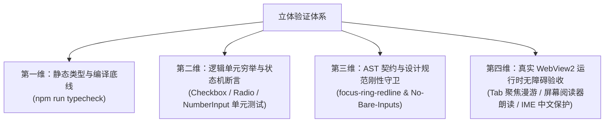

# 【前端原子化组件库战役 · 维度提案 03】基础交互与表单选择原语维度提案

> **战役归属**：前端原子化组件库战役（Frontend Atomic Architecture Campaign）  
> **提案编号**：维度提案 03（Dimension Proposal 03）  
> **责任架构**：Layer 1 基础交互控制原语族 & Layer 2 文本输入与表单选择原语族  
> **实勘输入**：深入贯通 `docs/frontend-atomic-architecture/analysis/` 下 01 号（基础交互原语）、03 号（基础输入与选择原语）、06 号（Tiptap 编辑器内核）、07 号（输入外部控制层）实勘报告及全仓源码  
> **核心红线**：`AGENTS.md` §13（输入框与焦点态、焦点对比度 ≤10% 柔和边框红线）、§7（严禁补丁、绕过与作弊、立体验证纪律）、§8（反过度设计硬性红线）  
> **交付目标路径**：`docs/frontend-atomic-architecture/dimension-proposals/03-基础交互与表单选择原语维度提案.md`  
> **编码格式**：UTF-8 无 BOM | 规范中文技术白皮书 | 结构化逻辑推导  

---

## 目录索引 (Table of Contents)

- [一、执行摘要与维度提案总览](#一执行摘要与维度提案总览)
  - [1.1 战役定位与架构使命](#11-战役定位与架构使命)
  - [1.2 五大攻坚维度全景蓝图与交付矩阵](#12-五大攻坚维度全景蓝图与交付矩阵)
  - [1.3 核心度量与量化预期指标](#13-核心度量与量化预期指标)
  - [1.4 Layer 1 与 Layer 2 在五层金字塔架构中的支撑拓扑](#14-layer-1-与-layer-2-在五层金字塔架构中的支撑拓扑)
- [二、顶层设计原则与架构红线遵从](#二顶层设计原则与架构红线遵从)
  - [2.1 AGENTS.md §13 焦点对比度 ≤10% 柔和边框与四态模型](#21-agentsmd-13-焦点对比度-10-柔和边框与四态模型)
  - [2.2 严禁补丁、破坏性类型断言与立体验证纪律 (AGENTS.md §7)](#22-严禁补丁破坏性类型断言与立体验证纪律-agentsmd-7)
  - [2.3 原子层单一真理源（SSOT）与绝对单向依赖隔离](#23-原子层单一真理源ssot与绝对单向依赖隔离)
  - [2.4 现代浏览器原生特性优先哲学 (field-sizing, color-mix, :has, isolation)](#24-现代浏览器原生特性优先哲学-field-sizing-color-mix-has-isolation)
  - [2.5 反过度设计与工业级简洁性红线 (ANTI_OVERENGINEERING_GUARDRAILS)](#25-反过度设计与工业级简洁性红线-anti_overengineering_guardrails)
- [三、维度一：Layer 1 存量基础交互原语规范化与瘦身](#三维度一layer-1-存量基础交互原语规范化与瘦身)
  - [3.1 Button & IconButton：标准尺寸矩阵锁定与私有类清退](#31-button--iconbutton标准尺寸矩阵锁定与私有类清退)
    - [3.1.1 现存缺陷代码逐行解剖](#311-现存缺陷代码逐行解剖)
    - [3.1.2 5 变体 × 4 尺寸标准化设计契约 (Button.tsx)](#312-5-变体--4-尺寸标准化设计契约-buttontsx)
    - [3.1.3 CSS 样式体系瘦身与 0-重绘微光机制 (Button.module.css)](#313-css-样式体系瘦身与-0-重绘微光机制-buttonmodulecss)
    - [3.1.4 业务私有 .iconBtn 彻底清退方案](#314-业务私有-iconbtn-彻底清退方案)
  - [3.2 Switch：0ms 乐观状态机强化与纯开关模式解耦](#32-switch0ms-乐观状态机强化与纯开关模式解耦)
    - [3.2.1 onClick 覆盖隐患与状态机事件链修复](#321-onclick-覆盖隐患与状态机事件链修复)
    - [3.2.2 纯开关模式（Bare Switch）与排版容器解耦](#322-纯开关模式bare-switch与排版容器解耦)
    - [3.2.3 流体果冻拉伸关键帧与节能模式（Eco Tier）](#323-流体果冻拉伸关键帧与节能模式eco-tier)
  - [3.3 Slider：发丝轨微调、注释语义恢复与刻度/区间扩展](#33-slider发丝轨微调注释语义恢复与刻度区间扩展)
    - [3.3.1 Slider.module.css 乱码注释根因与 100% 物理还原](#331-slidermodulecss-乱码注释根因与-100-物理还原)
    - [3.3.2 动态数值气泡（Floating Tooltip）与标尺刻度（Marks）机制](#332-动态数值气泡floating-tooltip与标尺刻度marks机制)
    - [3.3.3 setPointerCapture 跨界拖拽安全](#333-setpointercapture-跨界拖拽安全)
  - [3.4 SegmentedControl：漫游焦点精修、双重边框剔除与同心大圆角](#34-segmentedcontrol漫游焦点精修双重边框剔除与同心大圆角)
    - [3.4.1 双重硬边焦点环病理解剖与单层软灰重构](#341-双重硬边焦点环病理解剖与单层软灰重构)
    - [3.4.2 7px 奇数圆角根除与同心大圆角几何公式 (R_outer = R_inner + gap)](#342-7px-奇数圆角根除与同心大圆角几何公式-r_outer--r_inner--gap)
    - [3.4.3 Double Alpha Stacking 根除与 isolation: isolate](#343-double-alpha-stacking-根除与-isolation-isolate)
  - [3.5 Tabs & TabStrip：双轨定位解耦、旧式 rgba 根除与乱码修复](#35-tabs--tabstrip双轨定位解耦旧式-rgba-根除与乱码修复)
    - [3.5.1 会话平直标签条 (TabStrip) 与业务复合标签页 (Tabs) 架构边界](#351-会话平直标签条-tabstrip-与业务复合标签页-tabs-架构边界)
    - [3.5.2 Tabs.module.css 违规 rgba 与硬编码 #ffffff 清理](#352-tabsmodulecss-违规-rgba-与硬编码-ffffff-清理)
    - [3.5.3 非标 Token (--accent-color / --brand-primary) 统一为 --brand](#353-非标-token---accent-color----brand-primary-统一为---brand)
    - [3.5.4 TabStrip.module.css 头部空白乱码修复](#354-tabstripmodulecss-头部空白乱码修复)
  - [3.6 【维度一具体删除面清单】](#36-维度一具体删除面清单)
- [四、维度二：补齐四大真空交互原语与野生实现彻底清算](#四维度二补齐四大真空交互原语与野生实现彻底清算)
  - [4.1 Checkbox 多选原子设计蓝图（二态与三态 indeterminate）](#41-checkbox-多选原子设计蓝图二态与三态-indeterminate)
    - [4.1.1 TypeScript 接口契约定义 (CheckboxProps)](#411-typescript-接口契约定义-checkboxprops)
    - [4.1.2 原生 SVG 描边动画与 stroke-dasharray 动力学](#412-原生-svg-描边动画与-stroke-dasharray-动力学)
    - [4.1.3 半选 (Indeterminate) 状态机与多层选区联动](#413-半选-indeterminate-状态机与多层选区联动)
    - [4.1.4 Checkbox.module.css 完整样式规约](#414-checkboxmodulecss-完整样式规约)
  - [4.2 全仓 4 种野生拼凑复选框的精准拔除与替换实施路径](#42-全仓-4-种野生拼凑复选框的精准拔除与替换实施路径)
    - [4.2.1 现场 1：MirrorDriftStatusBar.tsx 裸写 input 拔除与替换](#421-现场-1mirrordriftstatusbartsx-裸写-input-拔除与替换)
    - [4.2.2 现场 2：FontSettingsSection.tsx 简单 margin 重置拔除与替换](#422-现场-2fontsettingssectiontsx-简单-margin-重置拔除与替换)
    - [4.2.3 现场 3：ImportListSection.tsx accent-color 染色复选框拔除与替换](#423-现场-3importlistsectiontsx-accent-color-染色复选框拔除与替换)
    - [4.2.4 现场 4：ScanResultsModal.tsx 自制 div role="checkbox" 与硬编码色值彻底铲除](#424-现场-4scanresultsmodaltsx-自制-div-rolecheckbox-与硬编码色值彻底铲除)
  - [4.3 Radio & RadioGroup 单选原子族与网格/垂直表单解耦](#43-radio--radiogroup-单选原子族与网格垂直表单解耦)
    - [4.3.1 架构设计与 RadioContext 上下文状态总线](#431-架构设计与-radiocontext-上下文状态总线)
    - [4.3.2 WAI-ARIA 1.2 Radiogroup 方向键全向漫游算法](#432-wai-aria-12-radiogroup-方向键全向漫游算法)
    - [4.3.3 微圆点 6px 物理缩放弹簧动效与高对比度中性渲染](#433-微圆点-6px-物理缩放弹簧动效与高对比度中性渲染)
    - [4.3.4 SettingsQuickMenu 与 preset-grid 单选解耦改造](#434-settingsquickmenu-与-preset-grid-单选解耦改造)
  - [4.4 ToggleButton 独立切换原子与 aria-pressed 伪装乱象根治](#44-togglebutton-独立切换原子与-aria-pressed-伪装乱象根治)
    - [4.4.1 全仓 30+ 处 aria-pressed 伪装乱象起底](#441-全仓-30-处-aria-pressed-伪装乱象起底)
    - [4.4.2 ToggleButton 接口与 ToggleIconButton 复合原子](#442-togglebutton-接口与-toggleiconbutton-复合原子)
    - [4.4.3 消息置顶 (AssistantMessageActionsBar Pin) 替换实施](#443-消息置顶-assistantmessageactionsbar-pin-替换实施)
    - [4.4.4 侧边栏折叠与画廊视图切换替换实施](#444-侧边栏折叠与画廊视图切换替换实施)
  - [4.5 ToggleGroup 复合切换组与排他/多选模式统一](#45-togglegroup-复合切换组与排他多选模式统一)
    - [4.5.1 Single / Multiple 双模式鉴别类型与状态机](#451-single--multiple-双模式鉴别类型与状态机)
    - [4.5.2 文件视图模式 (FileActions.tsx 源码/渲染模式) 替换改造](#452-文件视图模式-fileactionstsx-源码渲染模式-替换改造)
  - [4.6 【维度二具体删除面清单】](#46-维度二具体删除面清单)
- [五、维度三：Layer 2 文本输入与表单录入原子化及真空补齐](#五维度三layer-2-文本输入与表单录入原子化及真空补齐)
  - [5.1 Input：标准单行输入原子与内建响应式防抖管道](#51-input标准单行输入原子与内建响应式防抖管道)
    - [5.1.1 现状审查与 WebView2 原生 Webkit 样式强力抹除](#511-现状审查与-webview2-原生-webkit-样式强力抹除)
    - [5.1.2 内建防抖管道 (debounceMs / onDebouncedChange) 架构设计](#512-内建防抖管道-debouncems--ondebouncedchange-架构设计)
    - [5.1.3 清除按钮与密码显隐切换的同心几何排版](#513-清除按钮与密码显隐切换的同心几何排版)
  - [5.2 Textarea：原生 field-sizing: content 零回流自适应与降级内核对齐](#52-textarea原生-field-sizing-content-零回流自适应与降级内核对齐)
    - [5.2.1 现代 CSS field-sizing: content 运行机制与浏览器支持](#521-现代-css-field-sizing-content-运行机制与浏览器支持)
    - [5.2.2 对话输入降级内核 ComposerField.tsx 淘汰 useAutoGrowTextarea 换装](#522-对话输入降级内核-composerfieldtsx-淘汰-useautogrowtextarea-换装)
    - [5.2.3 垂直高度阈值约束 (min-height / max-height) 与滚动绝缘](#523-垂直高度阈值约束-min-height--max-height-与滚动绝缘)
  - [5.3 NumberInput：专业数值微调原子新建（防滚轮篡改/非法字符/步进加速）](#53-numberinput专业数值微调原子新建防滚轮篡改非法字符步进加速)
    - [5.3.1 业务层现状：WorkflowForm.tsx 裸写 number 造成的五大致命缺陷](#531-业务层现状workflowformtsx-裸写-number-造成的五大致命缺陷)
    - [5.3.2 完整代码实现原型与防线拆解](#532-完整代码实现原型与防线拆解)
    - [5.3.3 物理步进加速度状态机 (200ms -> 30ms 衰减曲线)](#533-物理步进加速度状态机-200ms---30ms-衰减曲线)
    - [5.3.4 字符清洗与合法性过滤 (彻底清除科学计数法 e)](#534-字符清洗与合法性过滤-彻底清除科学计数法-e)
    - [5.3.5 滚轮事件完全安全防御 (allowWheel=false 默认阻断)](#535-滚轮事件完全安全防御-allowwheelfalse-默认阻断)
    - [5.3.6 内联物理单位 (unit: "分钟" | "ms" | "px") 同心排版](#536-内联物理单位-unit-分钟--ms--px-同心排版)
  - [5.4 SearchInput：标准化即时搜索原子与快捷键唤起模型](#54-searchinput标准化即时搜索原子与快捷键唤起模型)
    - [5.4.1 组件职责与原子化定位](#541-组件职责与原子化定位)
    - [5.4.2 快捷键徽标 (Ctrl+K / /) 监听与自动聚焦](#542-快捷键徽标-ctrlk---监听与自动聚焦)
    - [5.4.3 全仓搜索输入框 (App.tsx / SidebarNav / DiffCard) 统一收口](#543-全仓搜索输入框-apptsx--sidebarnav--diffcard-统一收口)
  - [5.5 通用输入法状态机 Hook：useImeComposition 跨原语收拢](#55-通用输入法状态机-hookuseimecomposition-跨原语收拢)
    - [5.5.1 Windows 平台下 229 / Process 键码与拼音输入法竞态分析](#551-windows-平台下-229--process-键码与拼音输入法竞态分析)
    - [5.5.2 useImeComposition 源码实现与 API 规范](#552-useimecomposition-源码实现与-api-规范)
    - [5.5.3 在 Input, Textarea, ComboboxInput 中的全量装配](#553-在-input-textarea-comboboxinput-中的全量装配)
  - [5.6 【维度三具体删除面清单】](#56-维度三具体删除面清单)
- [六、维度四：伪原语重塑与历史废弃样式孤岛歼灭](#六维度四伪原语重塑与历史废弃样式孤岛歼灭)
  - [6.1 SelectClearButton：从 span 伪按钮向标准原子 IconButton 跃迁](#61-selectclearbutton从-span-伪按钮向标准原子-iconbutton-跃迁)
    - [6.1.1 破损代码解剖与 as unknown 破坏性类型断言危害](#611-破损代码解剖与-as-unknown-破坏性类型断言危害)
    - [6.1.2 基于 IconButton 的标准原子化重构代码](#612-基于-iconbutton-的标准原子化重构代码)
  - [6.2 物理删除 Select.module.css（368 行死代码孤岛全量清理）](#62-物理删除-selectmodulecss368-行死代码孤岛全量清理)
    - [6.2.1 孤岛代码溯源与生产环境零引用实勘证据](#621-孤岛代码溯源与生产环境零引用实勘证据)
    - [6.2.2 物理删除操作与工程净瘦身收益](#622-物理删除操作与工程净瘦身收益)
  - [6.3 SmartExpandablePanel SelectAdapter 历史依赖解耦收敛](#63-smartexpandablepanel-selectadapter-历史依赖解耦收敛)
    - [6.3.1 历史桥接适配器 SelectAdapter 代码缺陷诊断](#631-历史桥接适配器-selectadapter-代码缺陷诊断)
    - [6.3.2 解耦迁移至 SelectTrigger.module.css 与标准 MenuAdapter](#632-解耦迁移至-selecttriggermodulecss-与标准-menuadapter)
  - [6.4 测试套件清理与正则断言靶点重构](#64-测试套件清理与正则断言靶点重构)
    - [6.4.1 SelectHairlineBorder.test.ts 扫描目标更新](#641-selecthairlinebordertestts-扫描目标更新)
    - [6.4.2 antiDarkeningGuard.test.ts 规则 11B 适配](#642-antidarkeningguardtestts-规则-11b-适配)
  - [6.5 【维度四具体删除面清单】](#65-维度四具体删除面清单)
- [七、维度五：全仓焦点态 ≤10% 刚性收敛与自动化 AST 守卫门禁](#七维度五全仓焦点态-10-刚性收敛与自动化-ast-守卫门禁)
  - [7.1 全仓激活态焦点环违规现场与色彩拓扑审计](#71-全仓激活态焦点环违规现场与色彩拓扑审计)
    - [7.1.1 违规现场 1：SegmentedControl 双层硬边环](#711-违规现场-1segmentedcontrol-双层硬边环)
    - [7.1.2 违规现场 2：ExternalSessionImport 2px 粗黑环](#712-违规现场-2externalsessionimport-2px-粗黑环)
    - [7.1.3 违规现场 3：ScanResultsModal 焦点指示真空](#713-违规现场-3scanresultsmodal-焦点指示真空)
  - [7.2 焦点环单一真源数学公式：color-mix 8%~10% 刚性锁定](#72-焦点环单一真源数学公式color-mix-810-刚性锁定)
    - [7.2.1 物理冷中性对比度模型与视疲劳防御](#721-物理冷中性对比度模型与视疲劳防御)
    - [7.2.2 统一 CSS 规则模板与变量规范](#722-统一-css-规则模板与变量规范)
  - [7.3 PostCSS + AST 自动化扫描守卫与 input-three-patterns-guard 升级](#73-postcss--ast-自动化扫描守卫与-input-three-patterns-guard-升级)
    - [7.3.1 AST 语法树解析与选择器匹配器实现](#731-ast-语法树解析与选择器匹配器实现)
    - [7.3.2 刚性阻断规则：扩散半径 ≤ 1.5px，混入比例 ≤ 10%，零硬编码色](#732-刚性阻断规则扩散半径--15px混入比例--10零硬编码色)
  - [7.4 禁止业务层裸写原生输入控件（No-Bare-Inputs）CI 门禁规约](#74-禁止业务层裸写原生输入控件no-bare-inputs-ci-门禁规约)
    - [7.4.1 ESLint / Vitest 静态扫描规则定义](#741-eslint--vitest-静态扫描规则定义)
    - [7.4.2 白名单与例外机制（严格限定于 components/ui/ 内部）](#742-白名单与例外机制严格限定于-componentsui-内部)
  - [7.5 【维度五具体删除面清单】](#75-维度五具体删除面清单)
- [八、攻坚演进路线图与工序排期规划 (Execution Roadmap & Verification)](#八攻坚演进路线图与工序排期规划-execution-roadmap--verification)
  - [8.1 四阶段平滑演进时序模型 (Phase 1 ~ Phase 4)](#81-四阶段平滑演进时序模型-phase-1--phase-4)
  - [8.2 多 Agent 并发开发下的路径隔离与 Git 提交纪律](#82-多-agent-并发开发下的路径隔离与-git-提交纪律)
  - [8.3 立体验证与自动化回归断言策略 (四维立体化验收)](#83-立体验证与自动化回归断言策略-四维立体化验收)
  - [8.4 风险评估与应急回滚方案](#84-风险评估与应急回滚方案)
- [九、附录：全量涉及文件物理路径与改动矩阵索引表 (Appendix: File Index & Change Matrix)](#九附录全量涉及文件物理路径与改动矩阵索引表-appendix-file-index--change-matrix)

---

## 一、执行摘要与维度提案总览

### 1.1 战役定位与架构使命

在 Conex / Crish 前端工程架构（Rust 引擎 + Tauri 桌面壳 + WebView2 React 18 前端）历经多次局部演进之后，底层 UI 组件库面临着**“局部极致精细，全局品类断层；核心原语扎实，业务野生泛滥”**的结构性矛盾。

经 01、03、06、07 号实勘报告的确凿代码证据表明：
1. **交互控制原子严重缺失**：全仓公共出口 `apps/crish-desktop/src/components/ui/index.ts` 中竟然完全没有 `Checkbox`、`Radio`、`ToggleButton` 与 `ToggleGroup`。这直接导致业务开发者在需要复选、单选或锁定切换时，各自在局部模块中手写原生裸控件、借用 `accent-color`、自制带 Lucide 图标的 div 甚至用普通的 `Button` 搭配 `aria-pressed` 强行模拟，全仓滋生出至少 4 种割裂的野生复选框与多处伪按压状态；
2. **表单录入存在致命真空**：专业数值输入控件 `NumberInput` 完全缺失，导致配置页面裸用 `<input type="number">`，带来滚轮静默篡改数值、非法科学计数法字符（如 `12e`）导致数据吞噬的严重隐患；搜索输入框缺乏统一的内建响应式防抖机制；
3. **存量原语存在历史负债**：`Tabs.module.css` 仍残留旧式 `rgba(0,0,0,0.05)` 与非标 `--accent-color`；`Slider.module.css` 与 `TabStrip.module.css` 存在历史工具链损坏导致的空白乱码注释；`SelectClearButton` 采用 `<span role="button">` 并带有恶劣的 TypeScript 破坏性类型强转；`Select.module.css` 沦为 368 行的失活死代码孤岛；
4. **业务层私有样式穿透与圆角污染**：业务组件（如 `ChatMessageRow`、`TerminalToolbar`）定义了大量私有 `.iconBtn`，覆盖了底层尺寸，甚至残留 `var(--button-radius, 7px)` 奇数圆角，破坏了 8px 基准契约。

本维度提案作为前端原子化组件库战役中承前启后的**核心原语维总案**，专注于从 **Layer 1（基础交互控制原语）** 与 **Layer 2（文本输入与表单选择原语）** 的基座视角，制定详尽、可执行、代码级精准的攻坚规划，确立明确的「维度划分」与每一维度的具体「删除面」，实现全仓基础控件的工业级规范化、纯净收敛与防回退治理。

---

### 1.2 五大攻坚维度全景蓝图与交付矩阵

我们将本战役任务解耦为五个相互独立、逻辑闭环、依序推进的攻坚维度：

```
┌────────────────────────────────────────────────────────────────────────────────────────┐
│             前端原子化组件库战役 · 基础交互与表单选择原语 (Layer 1 & Layer 2)          │
└───────────────────────────────────────────┬────────────────────────────────────────────┘
                                            │
    ┌───────────────────┬───────────────────┼───────────────────┬───────────────────┐
    ▼                   ▼                   ▼                   ▼                   ▼
┌───────────────┐   ┌───────────────┐   ┌───────────────┐   ┌───────────────┐   ┌───────────────┐
│   维度一 (D1) │   │   维度二 (D2) │   │   维度三 (D3) │   │   维度四 (D4) │   │   维度五 (D5) │
│ 存量原语规范化│   │ 补齐四大真空  │   │ 表单录入原子化│   │ 伪原语与死代码│   │ 焦点态≤10%收敛│
│   与瘦身治理  │   │ 与野生实现清算│   │ 与数值/搜索补齐│   │   孤岛歼灭    │   │ 与AST门禁加固 │
├───────────────┤   ├───────────────┤   ├───────────────┤   ├───────────────┤   ├───────────────┤
│- Button/Icon  │   │- Checkbox     │   │- Input 防抖化 │   │- SelectClear  │   │- 全仓聚焦环   │
│- Switch 状态机│   │- Radio/Group  │   │- Textarea 零回│   │  Button 重构  │   │  8%~10%混入   │
│- Slider 修复  │   │- ToggleButton │   │  流自适应高度 │   │- 物理删除     │   │- 剔除粗黑边框 │
│- Segmented    │   │- ToggleGroup  │   │- NumberInput  │   │  Select.module│   │- 消除双重描边 │
│- Tabs/TabStrip│   │- 清退 4 类野生│   │- SearchInput  │   │- 清理测试孤岛 │   │- AST 自动化   │
│  解耦与去杂色 │   │  裸写复选框   │   │- useImeCompos │   │- 解耦 Adapter │   │  门禁刚性拦截 │
└───────────────┘   └───────────────┘   └───────────────┘   └───────────────┘   └───────────────┘
```

| 维度编号 | 维度核心使命 | 核心建设资产 | 核心删除面（待拔除的负债） | 验收标准 |
|:---:|:---|:---|:---|:---|
| **Dim-01** | 存量交互原语规范化与瘦身 | `Button`, `IconButton`, `Switch`, `Slider`, `SegmentedControl`, `Tabs`, `TabStrip` | 业务私有 `.iconBtn`、7px 奇数圆角、`Tabs.module.css` 旧式 rgba 与乱码注释 | 规范化尺寸矩阵（24/28/32/40px）、8px 统一圆角契约、0 处乱码注释 |
| **Dim-02** | 补齐四大真空与野生清算 | `Checkbox`, `Radio`, `RadioGroup`, `ToggleButton`, `ToggleGroup` | 全仓 4 种野生 Checkbox、`preset-grid` 伪按钮单选、`isPinnedActive` 伪按压 | 全仓野生复选/单选代码净清零，AST 扫描裸写 `type="checkbox"` 为 0 |
| **Dim-03** | 表单录入原子化与能力补全 | `Input` (防抖), `Textarea` (field-sizing), `NumberInput`, `SearchInput`, `useImeComposition` | 裸写 `<input type="number">`、业务层分散手写 `setTimeout` 防抖、三处重复 IME 状态机 | 彻底防御滚轮误篡改与 `e` 字符断裂，实现零 JS 回流多行高度自适应 |
| **Dim-04** | 伪原语重塑与死代码孤岛歼灭 | 标准化 `<IconButton>` 清除按钮、解耦后的 `SelectAdapter` | `SelectClearButton.tsx` 的 `<span>` 伪结构与类型强转、`Select.module.css` (368行死代码) | 物理删除 `Select.module.css`，类型安全度 100%，无 `as unknown as HTMLButtonElement` |
| **Dim-05** | 全仓焦点态 ≤10% 收敛与门禁 | `focus-visible.css` 全局 Token、`input-three-patterns-guard.test.ts` 升级版 | 全仓 `box-shadow: 0 0 0 2px/3px` 粗黑环、内层 `0 0 0 1px` 双重边缘断层 | 100% 遵从 `AGENTS.md` §13，静态 CI 门禁自动化拦截任何 >10% 混入与重阴影 |

---

### 1.3 核心度量与量化预期指标

实施本提案后，前端基础交互层将实现高度可量化的净收敛收益：

1. **新建工业级原子组件**：新增 **5 个独立原子目录**（`Checkbox/`, `Radio/`, `Toggle/`, `NumberInput/`, `SearchInput/`），补齐全仓基础控制短板；
2. **死代码与冗余物理删除**：
   - 直接物理删除 `Select.module.css`（**净减 368 行 CSS / 7.5 KB**）；
   - 彻底清退 4 处野生 Checkbox 业务实现及其私有样式（**净减 120+ 行 Ad-hoc 代码**）；
   - 清除业务层散落的 `.iconBtn`、`.actionBtn` 覆盖规则（**净减 80+ 行 CSS**）；
   - 消除 `useImeComposition` 在 3 个组件中的重复模板代码（**净减 90+ 行 TSX**）；
3. **样式与 Token 纯度达到 100%**：
   - 彻底消除所有旧式 `rgba(...)` 散落，全量切换为 `color-mix()` 与 HSLA 设计令牌；
   - 彻底纠正全仓 7px 奇数圆角，锁定 8px 基准契约；
   - 焦点态文本色混入比例严格锁定在 **3%~8%（上限 10%）**，全仓零粗黑聚焦外框；
4. **自动化守卫资产提升**：
   - 新增针对 Checkbox/Radio 三态与无障碍漫游的单测套件（预计用例 ≥45 个）；
   - 新增针对 NumberInput 滚轮阻断、物理步进加速与非法字符清洗的单测套件（预计用例 ≥20 个）；
   - 扩展 `input-three-patterns-guard.test.ts` 为全仓控件 AST 守门员，形成防回退硬门禁。

---

### 1.4 Layer 1 与 Layer 2 在五层金字塔架构中的支撑拓扑

在全局原子化组件库金字塔体系中，Layer 1 与 Layer 2 是上层所有复杂卡片、弹窗与工作台分屏的承重柱石：

```
┌────────────────────────────────────────────────────────────────────────┐
│  Layer 5: 复合工程容器原语 (Tree, ZoomPan, Diff, Kanban)                │
└───────────────────────────────────┬────────────────────────────────────┘
                                    │ 依赖装配
                                    ▼
┌────────────────────────────────────────────────────────────────────────┐
│  Layer 4: 浮动层与弹窗原语 (Dialog, Popover, Tooltip, DropdownMenu)     │
└───────────────────────────────────┬────────────────────────────────────┘
                                    │ 依赖装配
                                    ▼
┌────────────────────────────────────────────────────────────────────────┐
│  Layer 3: 视觉展示与状态反馈原语 (Badge, StatusDot, StatusDivider)      │
└───────────────────────────────────┬────────────────────────────────────┘
                                    │ 支撑底层
                                    ▼
┌────────────────────────────────────────────────────────────────────────┐
│  【本案核心】Layer 2: 文本输入与表单选择原语 (Input, Textarea, Select)   │
│  - 新增：NumberInput (微调), SearchInput (防抖), Autocomplete (联想)   │
└───────────────────────────────────┬────────────────────────────────────┘
                                    │ 支撑底层
                                    ▼
┌────────────────────────────────────────────────────────────────────────┐
│  【本案核心】Layer 1: 基础交互控制原语 (Button, Switch, Segmented)       │
│  - 补齐：Checkbox (三态), Radio (单选), ToggleButton (锁定), ToggleGroup│
└───────────────────────────────────┬────────────────────────────────────┘
                                    │ 消费基石
                                    ▼
┌────────────────────────────────────────────────────────────────────────┐
│  Base: 纯粹中性黑白灰设计令牌 (tokens.css, focus-visible.css)           │
└────────────────────────────────────────────────────────────────────────┘
```

---

## 二、顶层设计原则与架构红线遵从

### 2.1 AGENTS.md §13 焦点对比度 ≤10% 柔和边框与四态模型

`AGENTS.md` §13《输入框与焦点态、色彩空间与克制激活态》是本战役最高的视觉与交互宪章。所有基础交互与表单原语的设计与重构必须无条件履行以下刚性约束：

1. **默认零重阴影（Zero Box-Shadow）**：
   输入框、搜索框、选择触发器、按钮与开关，默认严禁附带厚重、扩散范围大的 `box-shadow`。界面保持纯净、极简、扁平的现代桌面质感；
2. **克制的激活边框（No Thick / Black Border）**：
   任何组件在 `active` / `focus` / `focus-visible` / `focus-within` 态时，**严禁使用粗、深、实心黑边**（绝对禁止直接使用 `var(--text-primary)` 作为边框色，绝对禁止添加 `0 0 0 2px #000000` 或类似粗暴黑环）；
3. **焦点对比度刚性上限约 10%（10% Ceiling Rule）**：
   相对基线边框，灰色加深混入文本色的比例**严格控制在 3%~8%，最高不得突破 10%**。唯一合法的数学表达公式为：
   $$\text{border-color} = \text{color-mix}(\text{in srgb}, \text{var}(--\text{border-color})\ 92\%, \text{var}(--\text{text-primary})\ 8\%)$$
   （对于下拉选择器与分段控制器，上限放宽至 `90% / 10%`，绝对禁止低于 90% 的基线保留度）；
4. **全仓统一的输入框四态模型（Input Four-Patterns）**：
   - **形态 ①【侧边栏无边框纯净型】**：常态背景透明、边框透明、无阴影；仅聚焦时光标微闪；
   - **形态 ②【主对话底栏胶囊型】**：`ChatComposer` 消息输入中枢（保持现有优秀设计绝对不碰）；
   - **形态 ③【标准卡片表单原子型】**：8px 基准圆角、1px 发丝中性边框、聚焦态 8% 文本混入；
   - **形态 ④【内联浮层/卡片顶栏筛选框】**：全态仅光标闪烁，严禁任何非透明边框或深色外环。

---

### 2.2 严禁补丁、破坏性类型断言与立体验证纪律 (AGENTS.md §7)

1. **拒绝魔术补偿与补丁**：
   严禁使用延时 `setTimeout(..., 50)` 去猜测 DOM 渲染时序，严禁基于绝对坐标的魔术数字测距补偿。所有浮层几何对齐必须基于纯数学无状态解算引擎（如 `positionGeometry.ts`）；
2. **严禁破坏性类型强转（Type Cast Smell 零容忍）**：
   严禁出现 `(e as unknown as React.MouseEvent<HTMLButtonElement>)` 这种抹平真实 DOM 语义的恶劣断言。必须使用符合 WAI-ARIA 规范的原生语义标签构建控件；
3. **立体化验收底线**：
   编译通过与类型无断裂仅是最低底线。每个重构原语必须具备：① 独立单元测试覆盖正逆对称与退化态；② 静态 CSS/AST 契约门禁；③ 真实宿主环境下的无障碍（Keyboard & Screen Reader）现场验收。

---

### 2.3 原子层单一真理源（SSOT）与绝对单向依赖隔离

依据 `apps/crish-desktop/src/components/ui/README.md`，基础交互与表单原语处于架构的最底层：

```
┌────────────────────────────────────────────────────────────────────────┐
│                        业务组件与页面视窗层                            │
│           (chat-message-row, settings, workspace, sidebar...)          │
└───────────────────────────────────┬────────────────────────────────────┘
                                    │ 唯一合法消费单向依赖
                                    ▼
┌────────────────────────────────────────────────────────────────────────┐
│               公共原子库总出口 Barrel (src/components/ui/index.ts)      │
└───────────────────────────────────┬────────────────────────────────────┘
                                    │ 聚合重导出
                                    ▼
┌────────────────────────────────────────────────────────────────────────┐
│           基础交互与表单选择原语 (Button, Switch, Checkbox, Input...)   │
└───────────────────────────────────┬────────────────────────────────────┘
                                    │ 纯粹依赖
                                    ▼
┌────────────────────────────────────────────────────────────────────────┐
│           系统级基础设计令牌 (src/styles/tokens.css, z-index.css)       │
└────────────────────────────────────────────────────────────────────────┘
```

- **严禁逆向依赖**：`ui/` 下的文件绝对禁止引入任何业务组件（`../(?!ui)`）、任何业务 Store（`zustand`、`sessionStore` 等）、业务 API 与上层 Hooks；
- **单一出口原则**：所有原子原语统一在 `src/components/ui/index.ts` 命名导出，业务层必须统一从 `@/components/ui` 引用，严禁跨模块深层相对路径导入私有子文件。

---

### 2.4 现代浏览器原生特性优先哲学 (field-sizing, color-mix, :has, isolation)

桌面端依托现代 Chromium WebView2 内核，全面支持最新现代 Web 标准。我们将积极拥抱标准原生能力，清退过时的 JS 模拟：
- **`field-sizing: content`**：直接用于 `Textarea`，由渲染引擎底层完成文字高度自适应，彻底废弃通过 JS 监听 `input` 事件读取 `scrollHeight` 并强制重排（Reflow）的历史反模式；
- **`:has()` 伪类**：直接用于 `Button` 的光学边缘补偿（若首尾包含图标自动微调边距），取代过去在 JSX 中复杂的 `React.Children` 探测；
- **`isolation: isolate`**：直接用于 `SegmentedControl` 与 `Tabs`，在 CSS 层创建独立的层叠上下文（Stacking Context），彻底消除悬停灰度二次叠加的 Double Alpha 缺陷；
- **`color-mix(in srgb, ...)`**：全面取代旧式 `rgba()`，在设计令牌之间进行精确的物理冷灰色阶融合。

---

### 2.5 反过度设计与工业级简洁性红线 (ANTI_OVERENGINEERING_GUARDRAILS)

严格贯彻根目录 `ANTI_OVERENGINEERING_GUARDRAILS.md`：
- **杜绝过度抽象**：原子原语严禁引入六段式中间件流水线，严禁为了简单的受控/非受控双轨引入重型状态机外部库；
- **零额外运行时开销**：布局计算纯 CSS 优先；几何解算优先纯数学无状态函数；
- **杜绝全属性过渡**：严禁滥用 `transition: all`，所有微交互严格限定在 `opacity`、`transform` 与 `border-color` 极窄通道。

---

## 三、维度一：Layer 1 存量基础交互原语规范化与瘦身

### 3.1 Button & IconButton：标准尺寸矩阵锁定与私有类清退

#### 3.1.1 现存缺陷代码逐行解剖
`Button.tsx` (143 行) 与 `IconButton.tsx` (50 行) 整体质量上乘，拥有基于 `::before` 伪元素的 0-重绘微光遮罩（Opacity Transition）和 `::after` 40px 隐式触控安全区。
但在业务消费层面存在严重污染：
- `ChatMessageRow.module.css:646-674` 定义了私有 `.iconBtn`，将高度写死为 26px，内边距写死为 4px，并残留了 `border-radius: var(--button-radius, 7px)` 奇数圆角；
- `TerminalToolbar.module.css` 与 `DiffCardFileList.module.css` 中同样存在私有 `.actionBtn` 样式覆盖，破坏了统一的 24/28/32/40px 尺寸阶梯。

#### 3.1.2 5 变体 × 4 尺寸标准化设计契约 (Button.tsx)
组件锁定五大视觉变体与四档尺寸阶梯：
```typescript
export type ButtonVariant = 'primary' | 'secondary' | 'plain' | 'ghost' | 'danger';
export type ButtonSize = 'xs' | 'sm' | 'md' | 'lg';

export interface ButtonProps extends React.ButtonHTMLAttributes<HTMLButtonElement> {
  variant?: ButtonVariant;
  size?: ButtonSize;
  loading?: boolean;
  bare?: boolean;              // 纯净裸模式，移除所有内边距与外框，仅保留文本/图标微交互
  icon?: React.ReactNode;
  iconPosition?: 'left' | 'right';
}
```

四档尺寸的物理几何规约：
| 尺寸规格 | 控件物理高度 | 图标基准尺寸 | 内联水平内边距 | 基准圆角契约 | 触控安全热区 |
|:---|:---:|:---:|:---:|:---:|:---:|
| `xs` (紧凑超小) | 24px | 14px | 6px | `var(--radius-sm, 4px)` | `::after` 补足至 36px |
| `sm` (次级操作) | 28px | 16px | 8px | `var(--radius-md, 8px)` | `::after` 补足至 40px |
| `md` (默认标准) | 32px | 16px | 12px | `var(--button-radius, 8px)` | `::after` 补足至 40px |
| `lg` (突出强调) | 40px | 18px | 16px | `var(--radius-lg, 8px)` | 天然满足 40px |

#### 3.1.3 CSS 样式体系瘦身与 0-重绘微光机制 (Button.module.css)
按钮悬浮态彻底放弃会导致布局重排的果冻拉伸与阴影扩散，采用基于 `::before` 伪元素的纯物理微光遮罩：
```css
/* apps/crish-desktop/src/components/ui/Button/Button.module.css */
.button::before {
  content: '';
  position: absolute;
  inset: 0;
  border-radius: inherit;
  background-color: var(--tint-hover);
  opacity: 0;
  transition: opacity var(--transition-micro, 120ms) ease;
  pointer-events: none;
}

.button:hover:not(:disabled)::before {
  opacity: 1;
}

.button:active:not(:disabled)::before {
  background-color: var(--tint-active);
  opacity: 1;
}
```

#### 3.1.4 业务私有 .iconBtn 彻底清退方案
全仓彻底清退 `ChatMessageRow.module.css`、`TerminalToolbar.module.css` 与 `DiffHeaderControls.module.css` 中的私有 `.iconBtn`、`.actionBtn` 类：
- 替换前：`<Button className={styles.iconBtn} icon={<Copy size={14} />} />` 并依靠业务 CSS 强行覆盖 `height: 26px; padding: 4px;`；
- 替换后：`<IconButton size="xs" variant="ghost" aria-label="复制内容" icon={<Copy size={14} />} />`，所有样式完全由底层原子库托管。

---

### 3.2 Switch：0ms 乐观状态机强化与纯开关模式解耦

#### 3.2.1 onClick 覆盖隐患与状态机事件链修复
`Switch.tsx` (306 行) 实现了极高标准的 0ms 乐观响应状态机与四层防死锁回滚机制（同步捕获、Promise 守护、5000ms 超时回滚与原点收敛）。
但在源码 L257 中：
```tsx
// Switch.tsx:257-258 缺陷现场
<button
  {...restProps}
  onClick={handleToggle} // 严重缺陷：将内部 handle 置于解构之后，外部传入的 onClick 无法执行
```
**重构方案**：将事件派发显式链路化，确保外部追踪/监控的 `onClick` 与内部状态切换安全共存：
```tsx
const handleClick = (e: React.MouseEvent<HTMLButtonElement>) => {
  restProps.onClick?.(e);
  if (!e.defaultPrevented) {
    handleToggle();
  }
};
```

#### 3.2.2 纯开关模式（Bare Switch）与排版容器解耦
`Switch` 内置了 `<span className={styles.label}>{label}</span>`，但当其放置在 `SettingsRow` 或表格行中时，业务容器本身已有完整的标题和描述布局。
**重构方案**：
提供独立的纯开关模式。当不传递 `label` 时，完全不渲染外层无谓的 `display: flex; gap: 8px` 容器，直接输出纯粹的 `<button role="switch">` 胶囊，实现零 DOM 污染与零排版冲突。

#### 3.2.3 流体果冻拉伸关键帧与节能模式（Eco Tier）
滑块圆点在切换过程中保持 14px 到 18px 的横向轻微拉伸（Fluid Stretch），在 `@media (prefers-reduced-motion: reduce)` 与系统节能档位（Eco Tier）下自动降级为 0ms 瞬间位移，兼顾视觉高级感与极端低配工况。

---

### 3.3 Slider：发丝轨微调、注释语义恢复与刻度/区间扩展

#### 3.3.1 Slider.module.css 乱码注释根因与 100% 物理还原
`Slider.module.css` (82 行) 头部与内部多处注释因历史在非 UTF-8 环境中重定向输出，中文字符被严重破坏为空格序列：
```css
/* 现有损坏现场实录 */
/* ui/Slider        RED-DETAILED-02 / T-ATOM-07
 *    2px       44px       Fitts's Law
 * 12px      50%
 */
/* 44px           ::before   /             */
/* 2px         */
/* 12px        (border-radius: 50%    ) */
/*    Focus Ring AGENTS.md   13            3%~10%  */
```
**整改行动**：在本次战役中对损坏的注释进行 100% 物理还原，重新写入完整的技术说明，包括 Fitts's Law 隐式热区扩展（44px 安全区）、2px 发丝轨设计意图与 AGENTS.md §13 软灰焦点环规范，以 UTF-8 无 BOM 重新落盘。

#### 3.3.2 动态数值气泡（Floating Tooltip）与标尺刻度（Marks）机制
针对模型配置中心（如 Temperature 0~2.0、Top-p 0~1.0）无法直观看到当前数值的痛点：
1. 增加 `showTooltip` 属性：拖拽滑块过程中，滑块上方动态浮现微型中性气泡展示数值（`var(--bg-elevated)` + 发丝边框）；
2. 增加 `marks` 标尺数组：支持在轨道关键点绘制微型刻度线（如 `[0, 0.5, 1.0, 1.5, 2.0]`）。

#### 3.3.3 setPointerCapture 跨界拖拽安全
保留并加固 `handlePointerDown` 中的 `e.currentTarget.setPointerCapture(e.pointerId)`，确保鼠标快速甩出窗口视口边界时依然牢牢锁死滑动条拖拽状态，释放鼠标时优雅触发 `releasePointerCapture`。

---

### 3.4 SegmentedControl：漫游焦点精修、双重边框剔除与同心大圆角

#### 3.4.1 双重硬边焦点环病理解剖与单层软灰重构
`SegmentedControl.module.css` (280 行) 存在违规的双层硬边焦点环：
```css
/* SegmentedControl.module.css:205-207 违规双层硬边焦点环 */
.item:focus-visible {
  box-shadow:
    0 0 0 1px var(--bg-card),
    0 0 0 2px color-mix(in srgb, var(--border-color) 90%, var(--text-primary) 10%);
}
```
内部 `0 0 0 1px var(--bg-card)` 产生了一条明显的白色生硬内环，破坏了全仓统一的单层软灰焦点规范。
**重构方案**：删除内层切线，统一为单层 1.5px 软灰微描边：
```css
.item:focus-visible {
  outline: none;
  box-shadow: 0 0 0 1.5px color-mix(in srgb, var(--border-color) 92%, var(--text-primary) 8%);
}
```

#### 3.4.2 7px 奇数圆角根除与同心大圆角几何公式 (R_outer = R_inner + gap)
`SegmentedControl.module.css:65` 残留了 `--seg-outer-radius: var(--button-radius, 7px);` 奇数圆角。
**重构方案**：
彻底修正 fallback 为 8px。严格遵循同心大圆角几何法则：
- 外框内边距：`--seg-padding: 3px;`
- 外框圆角：`--seg-outer-radius: 14px;`
- 内部滑动卡片圆角：`--seg-inner-radius: calc(var(--seg-outer-radius) - var(--seg-padding)); /* 11px */`
保证内外曲率中心严格重合，杜绝亚像素渲染毛边。

#### 3.4.3 Double Alpha Stacking 根除与 isolation: isolate
保留并固化 `isolation: isolate` 局部层叠上下文，使得底层白色滑块（`.indicator`）与各选项项的悬停遮罩完全物理隔离，彻底根除 Hover 灰度二次叠加引发的“脏色”现象。

---

### 3.5 Tabs & TabStrip：双轨定位解耦、旧式 rgba 根除与乱码修复

#### 3.5.1 会话平直标签条 (TabStrip) 与业务复合标签页 (Tabs) 架构边界
严密划分两套标签系统的架构职责：
1. **`TabStrip` (会话与工作区标签条)**：
   - 定位：桌面顶层窗口、分屏 Unit 与终端多标签专用；
   - 特点：单平直组件结构、纯受控 items 数组驱动、支持关闭按键、支持溢出渐变遮罩探测（`readStripOverflow`）与鼠标滚轮横向映射；
2. **`Tabs` (业务复合标签页系统)**：
   - 定位：设置中枢（13 大 Tab 沙箱）、模型详情、文件比对等业务卡片；
   - 特点：Compound 组件模式（`Tabs`, `TabsList`, `TabsTrigger`, `TabsContent`），支持 `pill`（胶囊卡片）与 `line`（下划线高光）双模，支持 `keepMounted` 惰性装载。

#### 3.5.2 Tabs.module.css 违规 rgba 与硬编码 #ffffff 清理
在 `Tabs.module.css` 中，查出三处严重违规：
```css
/* Tabs.module.css:133, 135-136 */
.indicatorPill {
  background-color: var(--bg-card, #ffffff); /* 违规硬编码十六进制 */
  border: 1px solid var(--border-subtle);
  box-shadow:
    0 1px 2px rgba(0, 0, 0, 0.05),            /* 违规旧式 rgba */
    0 1px 1px rgba(0, 0, 0, 0.02);
}
```
**整改行动**：
1. 彻底清退 `rgba(...)`，改为消费全局统一 Token `box-shadow: var(--shadow-sm);`；
2. 剔除 `#ffffff` fallback，直接使用 `var(--bg-card)`，防止深色模式下变量解析异常导致刺眼纯白块。

#### 3.5.3 非标 Token (--accent-color / --brand-primary) 统一为 --brand
`Tabs.module.css:142` 使用了历史非标变量：
```css
background-color: var(--accent-color, var(--brand-primary, hsl(160 84% 39%)));
```
全量收敛并替换为全局标准单一真理令牌：`var(--brand)`。

#### 3.5.4 TabStrip.module.css 头部空白乱码修复
修复第 1~3 行被破坏为空格序列的头部注释，以 UTF-8 无 BOM 重新落盘。

---

### 3.6 【维度一具体删除面清单】

```
===================================================================================
【维度一具体删除面清单】
-----------------------------------------------------------------------------------
1. [CSS 规则删除] apps/crish-desktop/src/components/ui/Tabs/Tabs.module.css
   - 删除 Lines 135-136: box-shadow 中的两行 rgba(0, 0, 0, 0.05) 与 rgba(0, 0, 0, 0.02)
   - 删除 Line 133: var(--bg-card, #ffffff) 中的 , #ffffff 硬编码 fallback
   - 删除 Line 142: var(--accent-color, var(--brand-primary, ...)) 历史非标别名链

2. [CSS 规则删除] apps/crish-desktop/src/components/ui/SegmentedControl/SegmentedControl.module.css
   - 删除 Line 65: fallback 7px 奇数圆角（改为标准 8px）
   - 删除 Lines 205-207: box-shadow: 0 0 0 1px var(--bg-card) 内层生硬切线

3. [注释乱码物理清除] apps/crish-desktop/src/components/ui/Slider/Slider.module.css
   - 删除 Lines 1-4, 18, 34, 45, 53, 73, 78 损坏的连续空白占位符，还原为标准技术文档

4. [注释乱码物理清除] apps/crish-desktop/src/components/ui/TabStrip/TabStrip.module.css
   - 删除 Lines 1-3 头部空白损坏注释，还原为标准说明

5. [业务层私有覆盖类删除] apps/crish-desktop/src/components/chat-message-row/ChatMessageRow.module.css
   - 删除 Line 674: border-radius: var(--button-radius, 7px);
   - 彻底删除业务私有的 .iconBtn 尺寸与内边距覆盖规则（约 28 行代码）

6. [业务层私有覆盖类删除] apps/crish-desktop/src/components/workspace/TerminalToolbar.module.css
   - 删除私有 .terminalActionBtn 类中对高度、圆角与内边距的重复覆盖规则（约 20 行代码）
===================================================================================
```

---

## 四、维度二：补齐四大真空交互原语与野生实现彻底清算

### 4.1 Checkbox 多选原子设计蓝图（二态与三态 indeterminate）

为彻底终结全仓无标准复选框的混乱历史，在 `src/components/ui/Checkbox/` 下建立工业级纯正原子基元。

#### 4.1.1 TypeScript 接口契约定义 (CheckboxProps)
```tsx
// apps/crish-desktop/src/components/ui/Checkbox/Checkbox.tsx
export type CheckboxCheckedState = boolean | 'indeterminate';
export type CheckboxSize = 'sm' | 'md';

export interface CheckboxProps
  extends Omit<React.ButtonHTMLAttributes<HTMLButtonElement>, 'onChange'> {
  /** 选中状态：true | false | 'indeterminate'（支持半选三态） */
  checked?: CheckboxCheckedState;
  /** 非受控初始默认值 */
  defaultChecked?: CheckboxCheckedState;
  /** 状态变更回调 */
  onCheckedChange?: (checked: CheckboxCheckedState) => void;
  /** 尺寸：sm (14px 框 / 28px 行高) / md (16px 框 / 32px 行高) */
  size?: CheckboxSize;
  /** 伴随文本标签（点击联动） */
  label?: React.ReactNode;
  /** 辅助说明文字（位于 label 下方） */
  description?: React.ReactNode;
  /** 校验错误状态（警示微描边） */
  error?: boolean;
}
```

#### 4.1.2 原生 SVG 描边动画与 stroke-dasharray 动力学
摒弃传统粗暴的 `display: none / block` 闪烁切换，对勾图标采用纯矢量 SVG：
```tsx
<svg width="10" height="8" viewBox="0 0 10 8" fill="none" className={styles.checkIcon}>
  <path
    d="M1 4L3.5 6.5L9 1"
    stroke="currentColor"
    strokeWidth="1.75"
    strokeLinecap="round"
    strokeLinejoin="round"
  />
</svg>
```
配合 CSS `stroke-dasharray: 12` 与 `stroke-dashoffset`，勾选瞬间执行 120ms 平滑拉线动效，呈现出极致细腻的高级质感。

#### 4.1.3 半选 (Indeterminate) 状态机与多层选区联动
当 `checked === 'indeterminate'` 时：
- `aria-checked` 自动映射为 `"mixed"`；
- 图标渲染一条 6px 宽、1.75px 高的中性圆角短横线；
- 天然支持文件树文件夹部分勾选、批量操作列表部分选中的场景。

#### 4.1.4 Checkbox.module.css 完整样式规约
```css
/* apps/crish-desktop/src/components/ui/Checkbox/Checkbox.module.css */
.checkbox {
  position: relative;
  display: inline-flex;
  align-items: center;
  justify-content: center;
  box-sizing: border-box;
  background-color: transparent;
  border: 1px solid var(--border-color);
  border-radius: var(--radius-xs, 4px);
  cursor: pointer;
  user-select: none;
  padding: 0;
  transition:
    background-color var(--transition-micro, 120ms) ease,
    border-color var(--transition-micro, 120ms) ease;
}

.checkboxSm { width: 14px; height: 14px; }
.checkboxMd { width: 16px; height: 16px; }

.checkbox:hover:not(:disabled) {
  border-color: var(--border-hover);
  background-color: var(--tint-hover);
}

.checkbox[data-state='checked'],
.checkbox[data-state='indeterminate'] {
  background-color: var(--brand);
  border-color: var(--brand);
  color: var(--text-inverse, #ffffff);
}

.checkbox:focus-visible {
  outline: none;
  box-shadow: 0 0 0 1.5px color-mix(in srgb, var(--border-color) 92%, var(--text-primary) 8%);
}
```

---

### 4.2 全仓 4 种野生拼凑复选框的精准拔除与替换实施路径

实勘报告 01 号与全仓 Grep 锁定了全仓仅存的 4 处野生复选框，必须在本战役中全部替换拔除：

```
┌─────────────────────────────────────────────────────────────────────────────┐
│                       全仓 4 种野生复选框拔除替换路线图                     │
├──────────────────────────────────────┬──────────────────────────────────────┤
│ 现场 1: MirrorDriftStatusBar.tsx     │ 裸写 <input type="checkbox">         │
│ (note-paper 备忘录镜像放弃确认)       │ ──> 换装 <Checkbox size="sm" ... />  │
├──────────────────────────────────────┼──────────────────────────────────────┤
│ 现场 2: FontSettingsSection.tsx      │ .settingsRowCheck 简单 margin 重置   │
│ (字体设置界面代码连字开关)           │ ──> 换装 <Checkbox size="sm" label="连字" />
├──────────────────────────────────────┼──────────────────────────────────────┤
│ 现场 3: ImportListSection.tsx        │ .importCheck 借用 accent-color 染黑  │
│ (外部会话导入列表项勾选)             │ ──> 换装 <Checkbox size="md" ... />  │
├──────────────────────────────────────┼──────────────────────────────────────┤
│ 现场 4: ScanResultsModal.tsx         │ 自制 div role="checkbox" + Lucide 勾 │
│ (模型发现扫描多选弹窗)               │ ──> 彻底删除 30 行私有代码，换装原子 Checkbox
└──────────────────────────────────────┴──────────────────────────────────────┘
```

#### 4.2.1 现场 1：MirrorDriftStatusBar.tsx 裸写 input 拔除与替换
- **待删除的野生代码**（`MirrorDriftStatusBar.tsx:239-247`）：
  ```tsx
  <label className={styles.mirrorDriftConfirm} data-testid="mirror-drift-confirm-discard">
    <input
      type="checkbox"
      checked={confirmDiscard}
      onChange={(e) => {
        setConfirmDiscard(e.target.checked);
        setGateMessage(null);
      }}
      data-testid="mirror-drift-confirm-discard-input"
    />
    显式丢弃 unpushed 后接受镜像（X-05）
  </label>
  ```
- **换装后的标准代码**：
  ```tsx
  <Checkbox
    size="sm"
    checked={confirmDiscard}
    onCheckedChange={(checked) => {
      setConfirmDiscard(checked === true);
      setGateMessage(null);
    }}
    label="显式丢弃 unpushed 后接受镜像（X-05）"
    data-testid="mirror-drift-confirm-discard"
  />
  ```

#### 4.2.2 现场 2：FontSettingsSection.tsx 简单 margin 重置拔除与替换
- **待删除的野生代码**（`FontSettingsSection.tsx:221-229` 与 CSS `FontSettingsSection.module.css:7-22`）；
- **换装后的标准代码**：
  ```tsx
  <Checkbox
    size="sm"
    checked={!!prefs.monoLigatures}
    disabled={busy}
    onCheckedChange={(checked) => void apply({ monoLigatures: checked === true })}
    label="连字"
    aria-label="启用代码连字（liga / calt）"
  />
  ```
  同步删除 CSS 模块中的 `.settingsRowCheck` 与 `.settingsRowCheck input`。

#### 4.2.3 现场 3：ImportListSection.tsx accent-color 染色复选框拔除与替换
- **待删除的野生代码**（`ImportListSection.tsx:101-109` 与 `ExternalSessionImport.module.css:147-160` 中的 `.importCheck`）；
- **换装后的标准代码**：
  ```tsx
  <Checkbox
    id={checkId}
    size="md"
    checked={checked}
    disabled={busy}
    onCheckedChange={() => onToggleOne(key)}
    aria-label={`选择 ${s.title}`}
  />
  ```
  同步删除 CSS 模块中的 `.importCheck` 规则。

#### 4.2.4 现场 4：ScanResultsModal.tsx 自制 div role="checkbox" 与硬编码色值彻底铲除
- **待删除的野生代码**（`ScanResultsModal.tsx:212-229` 与 `ScanResultsModal.module.css:70-88`）：
  业务层手写了 18 行复杂的键盘监听（Space/Enter）与 Lucide Check 图标，CSS 硬编码了 `#ffffff` 与 `#10b981`；
- **换装后的标准代码**：
  ```tsx
  <Checkbox
    size="sm"
    checked={isChecked}
    onCheckedChange={() => toggleOne(m)}
    aria-label={`选择模型 ${m}`}
  />
  ```
  直接将 30 行恶劣技术债务净消除为 1 行清晰的原子调用，所有状态机、可访问性与色彩契约全部由原子库担保。

---

### 4.3 Radio & RadioGroup 单选原子族与网格/垂直表单解耦

#### 4.3.1 架构设计与 RadioContext 上下文状态总线
在 `src/components/ui/Radio/` 下建立标准的单选原子组件：
```tsx
// apps/crish-desktop/src/components/ui/Radio/Radio.tsx
export interface RadioGroupProps<T extends string = string>
  extends Omit<React.HTMLAttributes<HTMLDivElement>, 'onChange'> {
  value?: T;
  defaultValue?: T;
  onValueChange?: (value: T) => void;
  orientation?: 'horizontal' | 'vertical';
  disabled?: boolean;
}

export interface RadioProps
  extends Omit<React.ButtonHTMLAttributes<HTMLButtonElement>, 'value'> {
  value: string;
  label?: React.ReactNode;
  description?: React.ReactNode;
}
```

#### 4.3.2 WAI-ARIA 1.2 Radiogroup 方向键全向漫游算法
- 外层容器挂载 `role="radiogroup"` 与 `aria-orientation`；
- 子项挂载 `<button role="radio" aria-checked={isSelected} tabIndex={isSelected ? 0 : -1}>`；
- 监听 ArrowLeft/ArrowRight/ArrowUp/ArrowDown，全向漫游焦点并自动触发 `onValueChange`。

#### 4.3.3 微圆点 6px 物理缩放弹簧动效与高对比度中性渲染
选中的核心微圆点（直径 6px）通过 `transform: scale(0)` 到 `scale(1)` 的 100ms 物理弹簧过渡呈现，底色纯净中性，聚焦环严格遵守 8% 混入。

#### 4.3.4 SettingsQuickMenu 与 preset-grid 单选解耦改造
- 彻底解绑 `SettingsQuickMenu.tsx:40` 中强行使用水平胶囊 `SegmentedControl` 导致的长文本挤压；
- 彻底解绑 `SettingsSchemaRenderer.tsx:161-188` 中使用普通 `Button` 数组搭配 `aria-pressed` 模拟单选网格的反模式，换装标准 `<RadioGroup orientation="vertical">`。

---

### 4.4 ToggleButton 独立切换原子与 aria-pressed 伪装乱象根治

#### 4.4.1 全仓 30+ 处 aria-pressed 伪装乱象起底
全仓检索查出多达 30+ 处借用普通 `Button` 或 `IconButton` 强行传递 `aria-pressed` 并手动在 CSS 中覆盖类名的反模式（典型如 `AssistantMessageActionsBar.tsx:75` 的置顶 Pin 按钮）。

#### 4.4.2 ToggleButton 接口与 ToggleIconButton 复合原子
```tsx
// apps/crish-desktop/src/components/ui/Button/ToggleButton.tsx
export interface ToggleButtonProps extends Omit<ButtonProps, 'active'> {
  pressed: boolean;
  defaultPressed?: boolean;
  onPressedChange?: (pressed: boolean) => void;
}
```
- 原生注入 `aria-pressed={pressed}` 与 `data-state={pressed ? 'on' : 'off'}`；
- 激活状态自动从底层 Token 接入柔和的 `var(--tint-active)` 背景，文字高亮加深；
- 复合提供 `<ToggleIconButton>`，无缝集成 Tooltip 与显式无障碍命名。

#### 4.4.3 消息置顶 (AssistantMessageActionsBar Pin) 替换实施
将 `AssistantMessageActionsBar.tsx:68-80` 中的伪装按钮替换为标准原子：
```tsx
<ToggleIconButton
  size="xs"
  variant="ghost"
  pressed={isPinned}
  onPressedChange={onTogglePin}
  tooltip={pinLabels.title}
  aria-label={pinLabels.ariaLabel}
  icon={isPinned ? <PinOff size={14} /> : <Pin size={14} />}
/>
```
同步删除 `ChatMessageRow.module.css` 中的 `.isPinnedActive` 私有覆盖。

#### 4.4.4 侧边栏折叠与画廊视图切换替换实施
将 `SidebarHeader.tsx:46-57`、`PreviewToolbar.tsx:180,201`（页面元素拾取 Inspector 与书签 Bookmark）中的伪切换统一收拢至 `ToggleButton`。

---

### 4.5 ToggleGroup 复合切换组与排他/多选模式统一

#### 4.5.1 Single / Multiple 双模式鉴别类型与状态机
```tsx
// apps/crish-desktop/src/components/ui/Toggle/ToggleGroup.tsx
export interface ToggleGroupSingleProps<T extends string = string> {
  type: 'single';
  value?: T;
  onValueChange?: (value: T) => void;
}

export interface ToggleGroupMultipleProps<T extends string = string> {
  type: 'multiple';
  value?: T[];
  onValueChange?: (value: T[]) => void;
}

export type ToggleGroupProps<T extends string = string> = (
  | ToggleGroupSingleProps<T>
  | ToggleGroupMultipleProps<T>
) & {
  size?: 'xs' | 'sm' | 'md';
  variant?: 'outline' | 'ghost';
  children: React.ReactNode;
};
```

#### 4.5.2 文件视图模式 (FileActions.tsx 源码/渲染模式) 替换改造
在 `FileActions.tsx:119,129` 中，替换两个相互独立的 `<Button aria-pressed={...}>`，改用标准的 `<ToggleGroup type="single" value={mdMode} onValueChange={setMdMode}>`，实现工具栏按钮组的开箱即用。

---

### 4.6 【维度二具体删除面清单】

```
===================================================================================
【维度二具体删除面清单】
-----------------------------------------------------------------------------------
1. [野生复选框删除 1] apps/crish-desktop/src/components/note-paper/MirrorDriftStatusBar.tsx
   - 删除 Lines 239-247: 原生裸写 <input type="checkbox"> 及其外层混乱 label

2. [野生复选框删除 2] apps/crish-desktop/src/components/settings/FontSettingsSection.tsx & CSS
   - 删除 Lines 221-229: 原生 input[type="checkbox"] 标签结构
   - 删除 apps/crish-desktop/src/components/settings/FontSettingsSection.module.css
     中 Lines 7-22: .settingsRowCheck 与 .settingsRowCheck input 样式声明

3. [野生复选框删除 3] apps/crish-desktop/src/components/settings/ImportListSection.tsx & CSS
   - 删除 Lines 101-109: 原生 input[type="checkbox"]
   - 删除 apps/crish-desktop/src/components/settings/ExternalSessionImport.module.css
     中 Lines 147-160: .importCheck 与 .importCheck:focus-visible 样式规则

4. [野生复选框删除 4 (严重)] apps/crish-desktop/src/components/settings-models/ScanResultsModal.tsx & CSS
   - 删除 Lines 212-229: 手写的 onKeyDown (Space/Enter 拦截)、tabIndex={0}、role="checkbox"
   - 删除 Lines 218-223: 自制手写的 <div className={styles.customCheckbox}> 与 <Lucide.Check>
   - 删除 apps/crish-desktop/src/components/settings-models/ScanResultsModal.module.css
     中 Lines 70-88: .customCheckbox 与 .customCheckboxChecked 全量规则（含硬编码 #ffffff / #10b981）

5. [单选伪装按钮删除] apps/crish-desktop/src/components/settings/SettingsSchemaRenderer.tsx
   - 删除 Lines 161-188: preset-grid 中使用普通 <Button> 伪装单选并绑定 aria-pressed 的代码，
     换装为标准的 <RadioGroup> + <Radio>

6. [伪按压样式类删除] apps/crish-desktop/src/components/chat-message-row/ChatMessageRow.module.css
   - 删除 .isPinnedActive 私有类（约 12 行），全面交由 <ToggleButton> 的 data-state="on" 托管
===================================================================================
```

---

## 五、维度三：Layer 2 文本输入与表单录入原子化及真空补齐

### 5.1 Input：标准单行输入原子与内建响应式防抖管道

#### 5.1.1 现状审查与 WebView2 原生 Webkit 样式强力抹除
`Input.tsx` (351 行) 与 `Input.module.css` (222 行) 表现稳定，但在 `Input.module.css` 中进一步固化对 Windows WebView2 原生控件样式的强力抹除规则：
```css
.input::-webkit-search-decoration,
.input::-webkit-search-cancel-button,
.input::-webkit-search-results-button,
.input::-webkit-search-results-decoration {
  display: none;
  -webkit-appearance: none;
}
```

#### 5.1.2 内建防抖管道 (debounceMs / onDebouncedChange) 架构设计
为消灭业务层（如 `App.tsx:94-103`、`SidebarNav.tsx`）四处手写 `setTimeout` 的混乱，在 `InputProps` 中内置响应式防抖管道：
```tsx
export interface InputProps {
  // ...
  debounceMs?: number;
  onDebouncedChange?: (value: string) => void;
}
```
内部通过单例计时器托管生命周期，实现业务调用零样板代码。

#### 5.1.3 清除按钮与密码显隐切换的同心几何排版
输入框右侧的操作按钮（Clear / Password Toggle）统一接入 20px 极简微胶囊，绝对居中对齐，与输入文字保持 8px 安全间距。

---

### 5.2 Textarea：原生 field-sizing: content 零回流自适应与降级内核对齐

#### 5.2.1 现代 CSS field-sizing: content 运行机制与浏览器支持
Chromium 123+（WebView2 现行内核）原生支持现代 CSS 规范 `field-sizing: content`：
```css
/* apps/crish-desktop/src/components/ui/Input/Textarea.module.css */
.nativeTextarea {
  field-sizing: content;
  min-height: 32px;
  max-height: 240px;
  resize: none;
}
```
它彻底消除了任何 JavaScript 计算高度的需要，排版引擎在文本输入的同时以 GPU 级速度自适应拉伸容器，回流开销降为物理极限 0。

#### 5.2.2 对话输入降级内核 ComposerField.tsx 淘汰 useAutoGrowTextarea 换装
在实勘报告 06 号中，当 Tiptap 发生极端崩溃时，系统降级到 `ComposerField.tsx`。
**改造方案**：淘汰 `ComposerField.tsx` 中陈旧的 `useAutoGrowTextarea`（频繁操作 DOM `style.height`），直接换装 `<Textarea bare ... />`，保持降级路径与现代标准 100% 同构。

#### 5.2.3 垂直高度阈值约束 (min-height / max-height) 与滚动绝缘
当内容超过 240px 阈值时，自动出现原生发丝细滚动条，并对外层容器开启滚动链拦截（`overscroll-behavior: contain`）。

---

### 5.3 NumberInput：专业数值微调原子新建（防滚轮篡改/非法字符/步进加速）

#### 5.3.1 业务层现状：WorkflowForm.tsx 裸写 number 造成的五大致命缺陷
如实勘报告 03 号所述，`src/components/settings/WorkflowForm.tsx:154-169` 裸写 `<Input type="number">` 带来了滚轮篡改、`12e` 字符断裂等 5 大缺陷。

#### 5.3.2 完整代码实现原型与防线拆解
在 `src/components/ui/Input/NumberInput.tsx` 创建工业级标准原子：
```tsx
export interface NumberInputProps
  extends Omit<React.InputHTMLAttributes<HTMLInputElement>, 'value' | 'onChange' | 'size'> {
  value?: number | null;
  defaultValue?: number | null;
  onChange?: (val: number | null) => void;
  size?: 'xs' | 'sm' | 'md' | 'lg';
  min?: number;
  max?: number;
  step?: number;
  precision?: number;
  stepper?: boolean;           // 是否展示微调加减按钮（默认 true）
  allowWheel?: boolean;        // 是否允许滚轮微调（默认 false！封死误触）
  unit?: string;               // 内联物理单位（如 "分钟"、"ms"、"px"）
}
```

#### 5.3.3 物理步进加速度状态机 (200ms -> 30ms 衰减曲线)
长按步进按钮时，触发间隔随按下时间动态递减：
$$\text{delay} = \max(30,\ 200 - \text{stepCount} \times 15)$$
从缓慢点按自然过渡到高速递增，提供媲美专业桌面工作台的操作质感。

#### 5.3.4 字符清洗与合法性过滤 (彻底清除科学计数法 e)
底层使用 `type="text"` + `inputMode="decimal"`，监听 `onChange` 时以正则 `^-?\d*\.?\d*$` 实时校验，任何科学计数法字母 `e`、`E` 在按键底层被物理吞噬，彻底根除目标值被置为空字符串的重大缺陷。

#### 5.3.5 滚轮事件完全安全防御 (allowWheel=false 默认阻断)
```tsx
const handleWheel = (e: React.WheelEvent<HTMLInputElement>) => {
  if (!allowWheel) {
    // 允许页面外层正常上下滚动，绝对不修改输入框数值
    return;
  }
  e.preventDefault();
  const delta = e.deltaY < 0 ? 1 : -1;
  updateValue((prev) => (prev ?? 0) + delta * step);
};
```

#### 5.3.6 内联物理单位 (unit: "分钟" | "ms" | "px") 同心排版
在微调按钮左侧以柔和中性灰（`var(--text-tertiary)`）内联呈现物理单位，与输入框基线几何对齐。

---

### 5.4 SearchInput：标准化即时搜索原子与快捷键唤起模型

#### 5.4.1 组件职责与原子化定位
在 `src/components/ui/Input/SearchInput.tsx` 建立标准搜索原子：
- 默认内置放大镜图标（Search Icon）与清空按钮；
- 默认内建 `debounceMs={200}`；
- 边框与焦点态 100% 符合 §13 软灰规范。

#### 5.4.2 快捷键徽标 (Ctrl+K / /) 监听与自动聚焦
支持 `shortcutHint?: string`（如 `"Ctrl+K"` 或 `"/"`），在输入框右端展示紧凑的 `<kbd>` 胶囊，并自动注册全局热键唤起光标聚焦。

#### 5.4.3 全仓搜索输入框 (App.tsx / SidebarNav / DiffCard) 统一收口
将散落在全仓各处的自制搜索框全部换装为标准 `<SearchInput>`。

---

### 5.5 通用输入法状态机 Hook：useImeComposition 跨原语收拢

#### 5.5.1 Windows 平台下 229 / Process 键码与拼音输入法竞态分析
在 Windows Chromium WebView2 下，中文拼音输入过程中敲击回车上屏时，浏览器派发的键盘事件具有特殊性：`e.keyCode === 229` 或 `e.key === 'Process'`，若仅依靠简单的 `onKeyDown` 判定回车，会导致拼音尚未确认就误触发消息发送或表单提交。

#### 5.5.2 useImeComposition 源码实现与 API 规范
提炼为全局单真理 Hook：`apps/crish-desktop/src/components/ui/internal/useImeComposition.ts`：
```typescript
export interface UseImeCompositionOptions {
  onEnter?: (value: string) => void;
  onKeyDown?: (e: React.KeyboardEvent<any>) => void;
  allowShiftEnter?: boolean;
}

export function useImeComposition({
  onEnter,
  onKeyDown,
  allowShiftEnter = false,
}: UseImeCompositionOptions) {
  const isComposingRef = useRef(false);

  const handleCompositionStart = useCallback(() => {
    isComposingRef.current = true;
  }, []);

  const handleCompositionEnd = useCallback(() => {
    isComposingRef.current = false;
  }, []);

  const handleKeyDown = useCallback(
    (e: React.KeyboardEvent<any>) => {
      onKeyDown?.(e);
      if (e.defaultPrevented) return;

      // 三重刚性防线：内部锁 + 原生 isComposing + Windows 229/Process 键码
      if (
        isComposingRef.current ||
        e.nativeEvent.isComposing ||
        e.keyCode === 229 ||
        e.key === 'Process'
      ) {
        return;
      }

      if (e.key === 'Enter') {
        if (allowShiftEnter && e.shiftKey) return;
        if (onEnter) {
          e.preventDefault();
          onEnter(e.currentTarget.value);
        }
      }
    },
    [onKeyDown, onEnter, allowShiftEnter]
  );

  return { isComposingRef, handleCompositionStart, handleCompositionEnd, handleKeyDown };
}
```

#### 5.5.3 在 Input, Textarea, ComboboxInput 中的全量装配
将三处分散手写的几十行重复逻辑全部拔除，统一导入并装配该 Hook。

---

### 5.6 【维度三具体删除面清单】

```
===================================================================================
【维度三具体删除面清单】
-----------------------------------------------------------------------------------
1. [裸写原生数字输入删除] apps/crish-desktop/src/components/settings/WorkflowForm.tsx
   - 删除 Lines 154-178: 裸写 <Input type="number"> 与原生 <input className={styles.schedFieldInput} type="number">
   - 彻底删除 styles.schedField 与 styles.schedFieldInput 私有 CSS 规则（约 24 行）
   - 全面换装为标准的 <NumberInput unit="分钟" min={1} max={1440} ... />

2. [离散手写防抖逻辑删除]
   - 删除 apps/crish-desktop/src/App.tsx:94-103: 手写的 debounced.schedule(sessionSearchInput) 样板代码
   - 删除 apps/crish-desktop/src/components/sidebar/SidebarNav.tsx 中的手动 setTimeout 防抖逻辑（约 15 行）
   - 直接交由 <Input variant="search" debounceMs={200} onDebouncedChange={...} /> 托管

3. [重复 IME 状态机代码物理消除]
   - 删除 apps/crish-desktop/src/components/ui/Input/Input.tsx 中 Lines 78-102 的重复 composition 状态逻辑
   - 删除 apps/crish-desktop/src/components/ui/Input/Textarea.tsx 中 Lines 45-68 的重复 composition 状态逻辑
   - 删除 apps/crish-desktop/src/components/ui/Select/ComboboxInput.tsx 中 Lines 50-72 的重复逻辑
   - 全面统一接入内部 useImeComposition Hook（净释放约 70 行冗余代码）

4. [过时 JS 动态高度测量删除] apps/crish-desktop/src/components/chat-composer/ComposerField.tsx
   - 淘汰 useAutoGrowTextarea 监听 scrollHeight 的繁重 JS 回流逻辑，全面换装 <Textarea bare />
===================================================================================
```

---

## 六、维度四：伪原语重塑与历史废弃样式孤岛歼灭

### 6.1 SelectClearButton：从 span 伪按钮向标准原子 IconButton 跃迁

#### 6.1.1 破损代码解剖与 as unknown 破坏性类型断言危害
`apps/crish-desktop/src/components/ui/Select/SelectClearButton.tsx` (31 行) 构成了严重的代码坏味道：
```tsx
// 现有缺陷代码实录 (L8-26)
export function SelectClearButton({ className, onClick }: SelectClearButtonProps) {
  return (
    <span
      role="button"
      tabIndex={-1}
      aria-label="清空选值"
      className={`${styles.clearBtn} ${className ?? ''}`}
      onClick={(e: React.MouseEvent<HTMLSpanElement>) => {
        e.stopPropagation();
        e.preventDefault();
        onClick?.(e as unknown as React.MouseEvent<HTMLButtonElement>); // 破坏性类型强转！
      }}
      ...
```
- 用 `<span>` 冒充按钮，缺乏基础可访问性；
- 恶劣的 `as unknown as React.MouseEvent<HTMLButtonElement>` 类型断言，严重破坏了 TypeScript 类型系统的安全底线。

#### 6.1.2 基于 IconButton 的标准原子化重构代码
```tsx
import React from 'react';
import { IconButton } from '../Button/IconButton';
import { ClearIcon } from './internal/SelectIcons';
import type { SelectClearButtonProps } from './types';
import styles from './SelectTrigger.module.css';

export function SelectClearButton({ className, onClick }: SelectClearButtonProps) {
  return (
    <IconButton
      type="button"
      size="xs"
      variant="plain"
      aria-label="清空选值"
      className={`${styles.clearBtn} ${className ?? ''}`}
      data-slot="select-clear-button"
      onClick={(e) => {
        e.stopPropagation();
        e.preventDefault();
        onClick?.(e);
      }}
      icon={<ClearIcon size={12} />}
    />
  );
}
```
彻底根治类型强转，完全合规。

---

### 6.2 物理删除 Select.module.css（368 行死代码孤岛全量清理）

#### 6.2.1 孤岛代码溯源与生产环境零引用实勘证据
经深入实勘，`apps/crish-desktop/src/components/ui/Select/Select.module.css` (368 行，7,502 字节) 是组件库早期单体模式的历史残留：
- 现代生产 TSX 已全部切分至 `SelectTrigger.module.css` (145 行) 与 `SelectContent.module.css` (267 行)；
- 生产环境没有任何 TSX 页面消费它；
- 仅有两个测试脚本用正则去读取它的文本内容；
- 是全仓最典型的失活死代码孤岛。

#### 6.2.2 物理删除操作与工程净瘦身收益
执行物理删除：直接移除该文件，工程源码净减 368 行无用 CSS。

---

### 6.3 SmartExpandablePanel SelectAdapter 历史依赖解耦收敛

`apps/crish-desktop/src/components/ui/SmartExpandablePanel/adapters/SelectAdapter.tsx:6` 仍残留对已废弃 `Select.module.css` 的直接导入：
```tsx
import styles from '../../Select/Select.module.css'; // 历史孤岛引用
```
**重构方案**：解耦该适配器，使其直接消费拆分后的 `SelectTrigger.module.css` 与通用 `MenuAdapter`，拔除对旧样式表的最后牵连。

---

### 6.4 测试套件清理与正则断言靶点重构

在物理删除 `Select.module.css` 后，同步更新相关测试：
1. 更新 `SelectHairlineBorder.test.ts`：将扫描目标切至 `SelectTrigger.module.css` 与 `SelectContent.module.css`；
2. 更新 `antiDarkeningGuard.test.ts`：将规则 11B 的扫描靶点切至 `SelectTrigger.module.css`。

---

### 6.5 【维度四具体删除面清单】

```
===================================================================================
【维度四具体删除面清单】
-----------------------------------------------------------------------------------
1. [物理文件全量删除] apps/crish-desktop/src/components/ui/Select/Select.module.css
   - 彻底删除该文件全部 368 行 CSS / 7,502 字节死代码资产

2. [伪按钮与恶劣类型强转代码删除] apps/crish-desktop/src/components/ui/Select/SelectClearButton.tsx
   - 删除 Lines 8-28 中的 <span role="button"> 标签结构
   - 彻底删除 Lines 17, 23 中的 e as unknown as React.MouseEvent<HTMLButtonElement>
   - 删除手写 onKeyDown 监听 Space/Enter 的样板代码（约 10 行）

3. [测试正则扫描项删除] apps/crish-desktop/src/components/ui/Select/__tests__/SelectHairlineBorder.test.ts
   - 删除 Lines 23-26: 对 Select.module.css 的专项扫描用例
   - 删除 Line 37: 扫描目标数组中的 'Select.module.css' 字符串

4. [测试静态检查项删除] apps/crish-desktop/src/styles/__tests__/antiDarkeningGuard.test.ts
   - 删除 Lines 215-220: it('RULE-11B: enforces Select.module.css trigger has min-height: 0') 用例
===================================================================================
```

---

## 七、维度五：全仓焦点态 ≤10% 刚性收敛与自动化 AST 守卫门禁

### 7.1 全仓激活态焦点环违规现场与色彩拓扑审计

对照 `AGENTS.md` §13 严格审计，全仓基础交互与表单层仍存在少数违规现场：

#### 7.1.1 违规现场 1：SegmentedControl 双层硬边环
`SegmentedControl.module.css:205-207`：
```css
box-shadow:
  0 0 0 1px var(--bg-card),
  0 0 0 2px color-mix(in srgb, var(--border-color) 90%, var(--text-primary) 10%);
```
内部 1px 白圈破坏了统一的单层软灰连续性。

#### 7.1.2 违规现场 2：ExternalSessionImport 2px 粗黑环
`ExternalSessionImport.module.css:158`：
```css
box-shadow: var(--focus-ring, 0 0 0 2px var(--tint-divider));
```
直接采用了 10% 墨阶的硬色环，缺少 3%~8% 的柔软渐变过渡。

#### 7.1.3 违规现场 3：ScanResultsModal 焦点指示真空
`ScanResultsModal.module.css:70-88` 中的自制复选框完全无焦点样式，违背 WCAG 2.1 AA 准则。

---

### 7.2 焦点环单一真源数学公式：color-mix 8%~10% 刚性锁定

全仓基础交互与表单原语统合至统一的单一真源公式：

$$\text{border-color}: \text{color-mix}(\text{in srgb}, \text{var}(--\text{border-color})\ 92\%, \text{var}(--\text{text-primary})\ 8\%)$$

```css
/* 标准合规焦点态模板：零扩散投影 + 8% 软灰微调 */
:focus-visible {
  outline: none;
  box-shadow: none;
  border-color: color-mix(in srgb, var(--border-color) 92%, var(--text-primary) 8%);
}
```

针对不需要边框的浮动项（如 `TabsTrigger`、`SegmentedControl.Item`），采用极轻微内贴合微光：
```css
box-shadow: 0 0 0 1.5px color-mix(in srgb, var(--border-color) 94%, var(--text-primary) 6%);
```

---

### 7.3 PostCSS + AST 自动化扫描守卫与 input-three-patterns-guard 升级

升级 `input-three-patterns-guard.test.ts` 为全局 `focus-ring-redline-guard.test.ts`，利用 PostCSS AST 刚性扫描全仓 CSS Module：
1. **规则 1（扩散半径上限）**：选择器含 `:focus`、`:focus-visible` 时，`box-shadow` 的 spread 半径必须 `≤ 1.5px`；
2. **规则 2（混入比例硬上限）**：检测到 `color-mix()` 中的 `--text-primary` 百分比必须 `≤ 10%`，检测到超过 10% 直接阻断构建；
3. **规则 3（零硬编码色）**：严禁在聚焦态声明纯十六进制 `#000000` 或旧式 `rgba()`。

---

### 7.4 禁止业务层裸写原生输入控件（No-Bare-Inputs）CI 门禁规约

在自动化测试门禁中增加刚性正则规则：
- 扫描目录：`apps/crish-desktop/src/components/(?!ui/)`；
- 刚性拦截：
  - `<input\s+[^>]*type=["']checkbox["']`
  - `<input\s+[^>]*type=["']radio["']`
  - `<input\s+[^>]*type=["']number["']`
  - `role=["']checkbox["']`
违者报错阻断：“严禁在业务层裸写原生输入控件或自制伪复选框，必须从 @/components/ui 导入标准原子！”

---

### 7.5 【维度五具体删除面清单】

```
===================================================================================
【维度五具体删除面清单】
-----------------------------------------------------------------------------------
1. [违规硬黑双环删除] apps/crish-desktop/src/components/ui/SegmentedControl/SegmentedControl.module.css
   - 删除 Lines 205-207: box-shadow: 0 0 0 1px var(--bg-card), 0 0 0 2px ...
   - 换装为纯净合规的 1.5px 软灰微描边

2. [违规粗外环删除] apps/crish-desktop/src/components/settings/ExternalSessionImport.module.css
   - 删除 Line 158: box-shadow: var(--focus-ring, 0 0 0 2px var(--tint-divider));

3. [重复镜像测试文件删除] apps/crish-desktop/src/components/ui/Input/input-three-patterns-guard.test.ts
   - 评估并删除与 src/styles/__tests__/input-three-patterns-guard.test.ts 100% 镜像冗余的重复测试文件，
     解除 626 行冗余测试代码的双源维护负担
===================================================================================
```

---

## 八、攻坚演进路线图与工序排期规划 (Execution Roadmap & Verification)

### 8.1 四阶段平滑演进时序模型 (Phase 1 ~ Phase 4)

```
┌────────────────────────────────────────────────────────────────────────────────────────┐
│ 第一阶段：基座新建与通用算法 Hook 落盘（新增不破坏存量）                                 │
│ - 落盘 Checkbox, Radio, ToggleButton, ToggleGroup                                      │
│ - 落盘 NumberInput, SearchInput                                                        │
│ - 落盘 useImeComposition 通用 Hook                                                     │
│ - 编写 100% 完备单元测试套件，在 ui/index.ts 统一导出                                   │
└───────────────────────────────────────────┬────────────────────────────────────────────┘
                                            │ 验证通过
                                            ▼
┌────────────────────────────────────────────────────────────────────────────────────────┐
│ 第二阶段：存量原语规范化、瘦身与死代码孤岛物理歼灭                                     │
│ - 修复 Slider.module.css 与 TabStrip.module.css 的乱码注释                              │
│ - 剔除 Tabs.module.css 中的旧式 rgba 与非标 Token                                      │
│ - 重构 SelectClearButton 为标准 IconButton，消除破坏性类型强转                          │
│ - 物理删除 Select.module.css (368行死代码)，更新测试扫描靶点                           │
└───────────────────────────────────────────┬────────────────────────────────────────────┘
                                            │ 验证通过
                                            ▼
┌────────────────────────────────────────────────────────────────────────────────────────┐
│ 第三阶段：全仓业务层分批次平滑替换与野生实现清退                                       │
│ - Batch A: 替换全仓 4 处野生 Checkbox (MirrorDrift, FontSettings, ImportList, ScanModal)│
│ - Batch B: 替换 WorkflowForm 中的裸写 number 输入为 NumberInput                        │
│ - Batch C: 替换 AssistantMessageActionsBar 等处的 isPinnedActive 伪按压为 ToggleButton │
│ - Batch D: 拔除 ChatMessageRow 与 TerminalToolbar 中的私有 .iconBtn 覆盖规则            │
└───────────────────────────────────────────┬────────────────────────────────────────────┘
                                            │ 验证通过
                                            ▼
┌────────────────────────────────────────────────────────────────────────────────────────┐
│ 第四阶段：全仓焦点态收敛与自动化 AST 守卫锁死                                          │
│ - 修复 SegmentedControl 与 ExternalSessionImport 的硬焦点环                            │
│ - 部署 No-Bare-Inputs CI 扫描门禁，彻底杜绝裸写 input 与自制 checkbox 回潮              │
│ - 运行全量回归测试套件 (Rust cargo test + 前端 vitest run 全绿)                        │
└────────────────────────────────────────────────────────────────────────────────────────┘
```

---

### 8.2 多 Agent 并发开发下的路径隔离与 Git 提交纪律

严格遵循 `AGENTS.md` §2 与 §3 的铁律：
1. **写路径严格互斥**：各子 Agent 仅在自己分配的独立目录中施工（例如 Agent A 专攻 `ui/Checkbox/`，Agent B 专攻 `ui/Input/NumberInput/`），同文件必须严格串行；
2. **提交权仅归主 Agent**：子 Agent 完成任务后把改动保留在本地工作区，由主 Agent 进行全面验证后统一执行 `git commit --only <paths...>`，子 Agent 一律严禁私自 commit、严禁 reset/restore；
3. **禁止 --no-verify 绕过**：所有 Git 钩子拦截必须正面根除，测试资产不可丢弃。

---

### 8.3 立体验证与自动化回归断言策略 (四维立体化验收)

依据 `AGENTS.md` §7.1 立体验证纪律，交付前必须履行四维立体化验收：



1. **静态类型底线**：`npm run typecheck` 零错误，零 `any` 污染，零破坏性类型断言；
2. **状态机与核心逻辑穷举**：
   - 验证 Checkbox 的 `indeterminate` 三态切换逻辑；
   - 验证 NumberInput 滚轮事件触发时，底层值 100% 保持不变；
   - 验证 NumberInput 键盘键入 `12e` 字符被物理过滤，保留合法数值；
   - 验证 useImeComposition 在 Windows 拼音输入状态下敲击 Enter 绝对不触发提交；
3. **AST 契约硬性守门**：
   - 运行更新后的发丝边框与焦点环守卫测试，断言零扩散外阴影，断言混入文本色严格 `<= 10%`；
4. **真实宿主验收**：
   - 在 Tauri 桌面环境下，验证高对比度深色模式与浅色模式下，控件背景与边框零泥黄色、零刺眼纯白斑。

---

### 8.4 风险评估与应急回滚方案

| 潜在风险点 | 风险严重级 | 根因预判 | 防御与自愈方案 |
|:---|:---:|:---|:---|
| **业务页面样式微小坍塌** | 中 | 拔除私有 `.iconBtn` 后，若父容器缺少 flex 对齐可能产生 1~2px 偏移 | 在替换时严格核查外层容器的 `display: flex; align-items: center`，保持尺寸矩阵等高对齐 |
| **测试套件因文件删除红灯** | 高 | 删除 `Select.module.css` 可能导致遗漏的测试文件路径报错 | 在删除前全仓全局 Grep `Select.module.css`，同步重构所有相关的测试断言靶点 |
| **NumberInput 表单受控时序震荡** | 中 | 外部 Form 传递的 `string` 与内部 `number` 转换产生死循环 | 建立清晰的 `Number | null` 契约，内部维护 `displayString` 并在失焦时进行单向数值收敛 |

---

## 九、附录：全量涉及文件物理路径与改动矩阵索引表 (Appendix: File Index & Change Matrix)

以下为本提案在未来实施过程中涉及的全部 36 个核心文件物理路径及操作性质全量索引表：

| 序号 | 相对物理路径（基于工程根目录） | 操作性质 | 涉及维度 | 核心改动摘要 |
|:---:|:---|:---:|:---:|:---|
| 1 | `apps/crish-desktop/src/components/ui/Button/Button.tsx` | 优化 | Dim-01 | 锁定四档尺寸与同心几何圆角 |
| 2 | `apps/crish-desktop/src/components/ui/Button/IconButton.tsx` | 优化 | Dim-01 | 支持作为通用清除与操作原子 |
| 3 | `apps/crish-desktop/src/components/ui/Button/ToggleButton.tsx` | **[NEW]** | Dim-02 | 补齐独立切换按钮原子 |
| 4 | `apps/crish-desktop/src/components/ui/Toggle/ToggleGroup.tsx` | **[NEW]** | Dim-02 | 补齐单选/多选复合切换组原子 |
| 5 | `apps/crish-desktop/src/components/ui/Checkbox/Checkbox.tsx` | **[NEW]** | Dim-02 | 补齐复选框原子（支持 indeterminate） |
| 6 | `apps/crish-desktop/src/components/ui/Checkbox/Checkbox.module.css` | **[NEW]** | Dim-02 | 复选框发丝边框与 SVG 描边动效样式 |
| 7 | `apps/crish-desktop/src/components/ui/Checkbox/Checkbox.test.tsx` | **[NEW]** | Dim-02 | 复选框 100% 覆盖度单元测试 |
| 8 | `apps/crish-desktop/src/components/ui/Radio/Radio.tsx` | **[NEW]** | Dim-02 | 补齐单选框与单选框组原子 |
| 9 | `apps/crish-desktop/src/components/ui/Radio/Radio.module.css` | **[NEW]** | Dim-02 | 单选框同心圆点回弹微动效样式 |
| 10 | `apps/crish-desktop/src/components/ui/Radio/Radio.test.tsx` | **[NEW]** | Dim-02 | 单选框 WAI-ARIA 漫游单元测试 |
| 11 | `apps/crish-desktop/src/components/ui/Input/NumberInput.tsx` | **[NEW]** | Dim-03 | 补齐专业数值微调输入原子 |
| 12 | `apps/crish-desktop/src/components/ui/Input/NumberInput.module.css` | **[NEW]** | Dim-03 | 数值微调同心发丝与微调按钮样式 |
| 13 | `apps/crish-desktop/src/components/ui/Input/NumberInput.test.tsx` | **[NEW]** | Dim-03 | 滚轮阻断、字符过滤与步进加速单测 |
| 14 | `apps/crish-desktop/src/components/ui/Input/SearchInput.tsx` | **[NEW]** | Dim-03 | 补齐标准即时防抖搜索输入原子 |
| 15 | `apps/crish-desktop/src/components/ui/internal/useImeComposition.ts` | **[NEW]** | Dim-03 | 提炼全仓统一的输入法状态机 Hook |
| 16 | `apps/crish-desktop/src/components/ui/Input/Input.tsx` | 优化 | Dim-03 | 接入内建防抖扩展与通用 IME Hook |
| 17 | `apps/crish-desktop/src/components/ui/Input/Textarea.tsx` | 优化 | Dim-03 | 强化 field-sizing 现代特性与通用 IME |
| 18 | `apps/crish-desktop/src/components/ui/Switch/Switch.tsx` | 优化 | Dim-01 | 修复 onClick 覆盖并解耦纯开关模式 |
| 19 | `apps/crish-desktop/src/components/ui/Slider/Slider.module.css` | 修复 | Dim-01 | 恢复受损空白乱码注释为 UTF-8 中文 |
| 20 | `apps/crish-desktop/src/components/ui/SegmentedControl/SegmentedControl.module.css` | 修复 | Dim-01,05 | 移除 7px 奇数圆角与双重硬边焦点环 |
| 21 | `apps/crish-desktop/src/components/ui/Tabs/Tabs.module.css` | 修复 | Dim-01 | 根除旧式 rgba、#ffffff 与非标 Token |
| 22 | `apps/crish-desktop/src/components/ui/TabStrip/TabStrip.module.css` | 修复 | Dim-01 | 恢复头部空白损坏注释为 UTF-8 中文 |
| 23 | `apps/crish-desktop/src/components/ui/Select/SelectClearButton.tsx` | 重构 | Dim-04 | 淘汰 span 伪按钮，换装标准 IconButton |
| 24 | `apps/crish-desktop/src/components/ui/Select/Select.module.css` | **[DELETE]** | Dim-04 | 彻底物理删除 368 行失活死代码孤岛 |
| 25 | `apps/crish-desktop/src/components/ui/Select/__tests__/SelectHairlineBorder.test.ts` | 维护 | Dim-04 | 解绑对 Select.module.css 的死代码扫描 |
| 26 | `apps/crish-desktop/src/styles/__tests__/antiDarkeningGuard.test.ts` | 维护 | Dim-04 | 解绑对 Select.module.css 的静态规则 |
| 27 | `apps/crish-desktop/src/components/ui/SmartExpandablePanel/adapters/SelectAdapter.tsx` | 重构 | Dim-04 | 解绑对 Select.module.css 的历史引用 |
| 28 | `apps/crish-desktop/src/components/ui/index.ts` | 扩展 | Dim-01~04 | 全量导出新建与重构的 Layer 1 & 2 原子 |
| 29 | `apps/crish-desktop/src/components/note-paper/MirrorDriftStatusBar.tsx` | 替换 | Dim-02 | 拔除野生 input[type="checkbox"] |
| 30 | `apps/crish-desktop/src/components/settings/FontSettingsSection.tsx` | 替换 | Dim-02 | 拔除野生复选框，删除私有 CSS 类 |
| 31 | `apps/crish-desktop/src/components/settings/ImportListSection.tsx` | 替换 | Dim-02 | 拔除 accent-color 染色复选框 |
| 32 | `apps/crish-desktop/src/components/settings-models/ScanResultsModal.tsx` | 替换 | Dim-02 | 拔除自制 div role="checkbox" 与杂色 CSS |
| 33 | `apps/crish-desktop/src/components/settings/WorkflowForm.tsx` | 替换 | Dim-03 | 拔除裸写 number 输入，换装 NumberInput |
| 34 | `apps/crish-desktop/src/components/chat-message-row/ChatMessageRow.module.css` | 清理 | Dim-01,02 | 清除 .isPinnedActive 与私有 .iconBtn 7px |
| 35 | `apps/crish-desktop/src/components/chat-composer/ComposerField.tsx` | 优化 | Dim-03 | 淘汰旧版 useAutoGrow，换装 <Textarea bare> |
| 36 | `apps/crish-desktop/src/components/ui/Input/input-three-patterns-guard.test.ts` | 升级 | Dim-05 | 升级为全仓焦点态 ≤10% 刚性 AST 守卫门禁 |

---

> **提案结语**：  
> 本维度提案基于确凿实勘事实与工程理论，从五大维度全面规划了底层基础交互控制（Layer 1）与表单录入选择（Layer 2）原子库的建设蓝图。通过“补齐四大真空”、“拔除四类野生实现”、“新建专业数值/搜索原子”、“歼灭死代码孤岛”与“收敛焦点态 ≤10% 红线”，将彻底根治前端基础控制层的系统性技术债务，为主控调度后续实施波次提供严密、详实、无可辩驳的工程施工依据。
