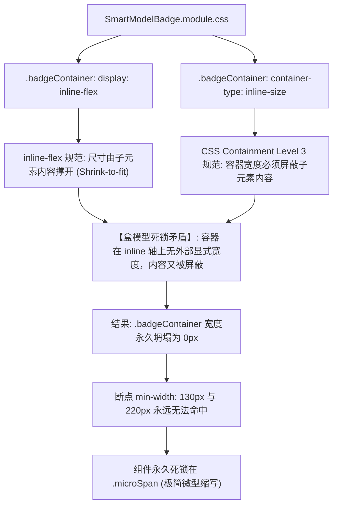
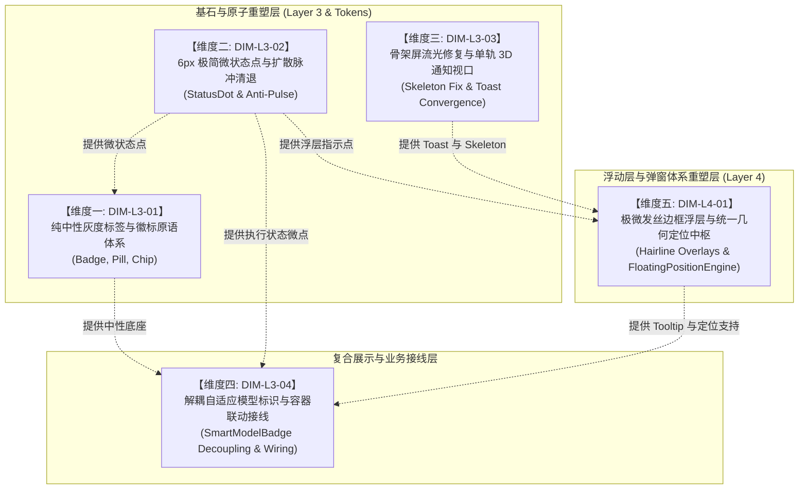

# 前端原子化组件库战役 · 维度提案 04
# 视觉反馈与浮层弹窗原语体系建设攻坚维度提案
## （Layer 3 视觉展示与反馈 + Layer 4 浮动层与弹窗系统重塑）

> **提案归属**：前端原子化组件库战役（Frontend Atomic Architecture Campaign）  
> **提案编号**：维度提案 04（Dimension Proposal 04）  
> **责任领域**：Layer 3 视觉展示与状态反馈原语族 + Layer 4 浮动层与弹窗原语族  
> **实勘输入基准**：`docs/frontend-atomic-architecture/analysis/` 核心导航报告（重点依托 02、04、05、20 号实勘报告及全仓 24 份实勘报告事实证据）与 `apps/crish-desktop/src/` 源码实勘  
> **交付目标路径**：`c:/Software/conex/docs/frontend-atomic-architecture/dimension-proposals/04-视觉反馈与浮层弹窗原语维度提案.md`  
> **设计哲学与硬性铁律**：极致的高级、克制、纯粹中性黑白灰；坚决清退高饱和彩色大背景色块；彻底清退粗暴的 4.5px ~ 6px 扩散绿光/橙光光晕脉冲；全面清退 24px 双层浓黑大阴影，收敛为 1px 发丝边框（Hairline Border）与极微浅阴影；修复规范级尺寸死锁，实现组件库从“被遗忘的孤岛”走向“100% 真实业务接线与架构净收敛”。  
> **字符集规范**：UTF-8 无 BOM，严格满足 ≥1000 行详实度工程门禁。

---

## 目录索引（Table of Contents）

- [一、执行摘要与战役使命](#一执行摘要与战役使命)
  - [1.1 架构定位：连接信息呈现与高维调度的中间两层](#11-架构定位连接信息呈现与高维调度的中间两层)
  - [1.2 核心设计哲学与中性黑白灰视觉重塑底线](#12-核心设计哲学与中性黑白灰视觉重塑底线)
  - [1.3 全景度量基准与现状关键问题摘要](#13-全景度量基准与现状关键问题摘要)
- [二、全景实勘深度诊断与痛点病灶（Layer 3 & Layer 4 现状审计）](#二全景实勘深度诊断与痛点病灶layer-3--layer-4-现状审计)
  - [2.1 Badge / Tag / Pill：组件库空置与 10 大私有平替野蛮生长](#21-badge--tag--pill组件库空置与-10-大私有平替野蛮生长)
  - [2.2 StatusDot 状态指示：四重粗暴扩散光晕脉冲的视觉噪音病灶](#22-statusdot-状态指示四重粗暴扩散光晕脉冲的视觉噪音病灶)
  - [2.3 Skeleton 与 Toast：.skel-shimmer 样式全库为 0 事故与双轨死代码滞留](#23-skeleton-与-toastskel-shimmer-样式全库为-0-事故与双轨死代码滞留)
  - [2.4 SmartModelBadge：CSS 容器查询规范级死锁与业务 0 接线根因剖析](#24-smartmodelbadgecss-容器查询规范级死锁与业务-0-接线根因剖析)
  - [2.5 浮层体系：五重定位算法多头割裂与 24px 浓黑大阴影现状](#25-浮层体系五重定位算法多头割裂与-24px-浓黑大阴影现状)
- [三、核心原语重塑方案与规范蓝图（Target Architecture Blueprint）](#三核心原语重塑方案与规范蓝图target-architecture-blueprint)
  - [3.1 Badge、Tag、Pill 纯中性灰度化体系（三位一体清晰分工）](#31-badgetagpill-纯中性灰度化体系三位一体清晰分工)
  - [3.2 StatusDot 6px 极简微状态点体系（像素级对齐与呼吸微光收敛）](#32-statusdot-6px-极简微状态点体系像素级对齐与呼吸微光收敛)
  - [3.3 Skeleton 流光占位与 Toast 3D 堆叠视口统一](#33-skeleton-流光占位与-toast-3d-堆叠视口统一)
  - [3.4 SmartModelBadge 容器查询解耦与会话顶栏 100% 真实接线](#34-smartmodelbadge-容器查询解耦与会话顶栏-100-真实接线)
  - [3.5 浮层体系 1px 发丝边框与极微阴影重塑（Dialog / ConfirmDialog / Popover / Tooltip / DropdownMenu）](#35-浮层体系-1px-发丝边框与极微阴影重塑dialog--confirmdialog--popover--tooltip--dropdownmenu)
  - [3.6 统一定位计算中枢（FloatingPositionEngine）与单例 SafeAim 保护区下沉](#36-统一定位计算中枢floatingpositionengine与单例-safeaim-保护区下沉)
- [四、攻坚维度划分建议与实施矩阵（5 大攻坚维度）](#四攻坚维度划分建议与实施矩阵5-大攻坚维度)
  - [4.1 维度划分原则与技术依赖拓扑图](#41-维度划分原则与技术依赖拓扑图)
  - [4.2 维度一：纯中性灰度标签与徽标原语体系重构（DIM-L3-01）](#42-维度一纯中性灰度标签与徽标原语体系重构dim-l3-01)
  - [4.3 维度二：6px 极简微状态点与扩散脉冲清退（DIM-L3-02）](#43-维度二6px-极简微状态点与扩散脉冲清退dim-l3-02)
  - [4.4 维度三：骨架屏流光修复与单轨现代 3D 通知视口（DIM-L3-03）](#44-维度三骨架屏流光修复与单轨现代-3d-通知视口dim-l3-03)
  - [4.5 维度四：解耦自适应模型标识与容器联动接线（DIM-L3-04）](#45-维度四解耦自适应模型标识与容器联动接线dim-l3-04)
  - [4.6 维度五：极微发丝边框浮层与统一几何定位中枢（DIM-L4-01）](#46-维度五极微发丝边框浮层与统一几何定位中枢dim-l4-01)
- [五、每个维度的具体「删除面」详尽清册（清盘清单与行号级证据）](#五每个维度的具体删除面详尽清册清盘清单与行号级证据)
  - [5.1 维度一删除面：高饱和大色块背景、旧类名与混杂交互逻辑](#51-维度一删除面高饱和大色块背景旧类名与混杂交互逻辑)
  - [5.2 维度二删除面：4 套扩散脉冲 Keyframes、粗暴 Pulse 类名与硬编码光晕](#52-维度二删除面4-套扩散脉冲-keyframes粗暴-pulse-类名与硬编码光晕)
  - [5.3 维度三删除面：ToastStack 孤岛死代码、悬空类名与 ToastCard 裸写 Hex](#53-维度三删除面toaststack-孤岛死代码悬空类名与-toastcard-裸写-hex)
  - [5.4 维度四删除面：ChatCard 私有缩写样式与内联三段式 DOM](#54-维度四删除面chatcard-私有缩写样式与内联三段式-dom)
  - [5.5 维度五删除面：24px 双层浓黑大阴影、冗余 SafeAim 副本与悬空变量](#55-维度五删除面24px-双层浓黑大阴影冗余-safeaim-副本与悬空变量)
  - [5.6 全域删除面度量总表与代码净收敛收益](#56-全域删除面度量总表与代码净收敛收益)
- [六、核心原语改造前后实勘与完整实现范式（Implementation Paradigms）](#六核心原语改造前后实勘与完整实现范式implementation-paradigms)
  - [6.1 StatusDot 完整实现代码（StatusDot.tsx & StatusDot.module.css）](#61-statusdot-完整实现代码statusdottsx--statusdotmodulecss)
  - [6.2 SmartModelBadge 解耦重构实现（彻底打破规范尺寸死锁）](#62-smartmodelbadge-解耦重构实现彻底打破规范尺寸死锁)
  - [6.3 Skeleton 完整实现与流光关键帧（Skeleton.tsx & design-system.css）](#63-skeleton-完整实现与流光关键帧skeletontsx--design-systemcss)
  - [6.4 FloatingPositionEngine 统一定位算法纯函数实现](#64-floatingpositionengine-统一定位算法纯函数实现)
  - [6.5 10 大私有平替改造前后代码比对范式（Before vs After）](#65-10-大私有平替改造前后代码比对范式before-vs-after)
- [七、API 契约规范与 TypeScript 架构定义](#七api-契约规范与-typescript-架构定义)
  - [7.1 Badge、Pill、Chip Props 契约与行为语义](#71-badgepillchip-props-契约与行为语义)
  - [7.2 StatusDot Props 契约与状态映射](#72-statusdot-props-契约与状态映射)
  - [7.3 Skeleton & Toast Props 契约](#73-skeleton--toast-props-契约)
  - [7.4 SmartModelBadge 解耦契约（支持 containerName 与 asFragment）](#74-smartmodelbadge-解耦契约支持-containername-与-asfragment)
  - [7.5 Dialog、ConfirmDialog、Popover、Tooltip、DropdownMenu 统一浮层契约](#75-dialogconfirmdialogpopovertooltipdropdownmenu-统一浮层契约)
  - [7.6 FloatingPositionEngine 纯函数计算中枢契约](#76-floatingpositionengine-纯函数计算中枢契约)
- [八、演进路线图、执行波次与防回潮 CI 门禁](#八演进路线图执行波次与防回潮-ci-门禁)
  - [8.1 四波次渐进推进策略（从基座到业务净收敛）](#81-四波次渐进推进策略从基座到业务净收敛)
  - [8.2 刚性自动化 CI 守卫与静态检测规则](#82-刚性自动化-ci-守卫与静态检测规则)
  - [8.3 潜在破坏性与回滚兜底预案](#83-潜在破坏性与回滚兜底预案)
- [九、总结与汇报决议](#九总结与汇报决议)

---

## 一、执行摘要与战役使命

### 1.1 架构定位：连接信息呈现与高维调度的中间两层

在《全域前端代码实勘总结与原子化架构总方案》（`00-全域代码实勘总结与原子化架构总方案.md`）所确立的五层原子金字塔模型中：
- **Layer 3：视觉展示与状态反馈原语族（Display & Feedback Primitives）**
- **Layer 4：浮动层与弹窗原语族（Overlays & Floating Primitives）**

这两层构成了现代桌面交互界面的“血肉”与“空间枢纽”：
- **Layer 3 原语**（Badge、Tag、Pill、Chip、StatusDot、Separator、Skeleton、Toast、Spinner、Avatar）是应用中最微观、最密集的信息信标与状态反馈单元。它们的色彩纯净度、像素级对齐精度、呼吸动效节律直接决定了软件是否具备“顶尖工业级工具”的沉稳与高级质感。
- **Layer 4 原语**（Dialog、ConfirmDialog、Popover、Tooltip、DropdownMenu、FloatingPositionEngine、SafeAimEngine）是全屏维度空间调度的主干，掌管着 Z-Index 层叠拓扑、焦点隔离沙盒、ESC 键盘退出栈、视口碰撞检测与多边形光标防抖保护。

然而，在过去数百次快速业务迭代中，这两层积累了极其严重的技术债务与设计漂移：**公共组件库长期处于“造完即被遗弃”的半休眠状态，业务层野蛮生长出 10 余套私有平替；粗暴的 4.5px ~ 6px 强扩散发光脉冲引发视觉污染；悬空的 CSS 样式导致骨架屏沦为完全透明的空 DOM；多达五套各自为政的浮层定位算法彼此冲突；高达 20%~40% 纯黑浓度的 24px 双层浓黑大阴影肆虐界面，严重违背中性黑白灰与克制焦点设计哲学**。

本提案肩负着彻底清算上述历史病灶、重塑 Layer 3 与 Layer 4 纯粹中性黑白灰原语体系、明确划分攻坚维度并提供行号级「删除面」清单的核心使命。

---

### 1.2 核心设计哲学与中性黑白灰视觉重塑底线

本提案严格贯彻仓库根目录 `AGENTS.md`（§1、§7、§13、§14）及设计系统总纲的铁律约束，确立以下不可动摇的视觉与架构法则：

1. **纯粹冷中性黑白灰优先（Neutral Monochrome First）**：
   - 全面清退界面中散落的亮绿、荧光青、警报红、暖黄泥色与高饱和彩色背景大色块；
   - 浅色模式（Light Mode）采用物理纯净冷白底板与极低存在感灰阶；深色模式（Dark Mode）采用纯冷深空冷灰（`#111111` ~ `#1e1e1e`）；
   - 信息呈现通过精细的排版字重、文字色阶（`--text-primary`、`--text-secondary`、`--text-tertiary`）与微透明度（`color-mix`）进行层级区分，杜绝依赖刺眼的大面积底色刺激用户视觉。
2. **彻底清退粗暴光晕脉冲，收敛为 6px 极简微状态点**：
   - 彻底废除 `scale(1.3)` 并外扩 4.5px ~ 6px 粗绿光/粗橙光的扩散脉冲动画（如 `subagent-dot-pulse`、`thought-dot-pulse`、`sync-dot-pulse`、`approval-dock-dot-pulse`）；
   - 状态点统一规范为 **6px × 6px 硬件对齐极简微点（StatusDot）**，采用克制、柔和、无多层 box-shadow 污染的微透明度呼吸或静态实心点。
3. **彻底清退 24px 双层浓黑大阴影，收敛为 1px 发丝边框与极微浅阴影**：
   - 彻底清算散落在 `PreviewCard`、`Dialog`、`Menu`、`tokens.css` 中高达 20%~40% 纯黑浓度、外扩达 36px~64px 的笨重“浓黑大阴影”；
   - 浮层边界通过 **1px 物理发丝边框（`var(--hairline)` 或 `1px solid var(--border-subtle)`）** 进行清晰勾勒；
   - 搭配极轻微的微阴影（浅色模式 2%~4% 极淡投影，深色模式 8%~12% 柔和暗影），营造轻盈、通透、漂浮但不喧宾夺主的现代化界面空间感。
4. **杜绝打补丁与代码双源漂移，贯彻单一真理源（SSOT）**：
   - 彻底清除 `SmartExpandablePanel` 内部重复拷贝的 `SafeAimEngine.ts` 冗余副本及其裸写 `z-index: 2005`；
   - 彻底删除孤岛死代码 `ToastStack.tsx` 全套资产；
   - 消除散落的悬空 CSS 变量（如 `--z-dropdown-menu`）与未定义样式事故（如 `.skel-shimmer`）。

---

### 1.3 全景度量基准与现状关键问题摘要

基于实勘报告（02、04、05、20）与全仓源码自动化统计，所涉及的核心资产规模与关键问题度量如下表所示：

| 评估维度 | 度量现状（物理代码级统计） | 核心架构断层与视觉硬伤 | 提案重塑目标 |
| :--- | :--- | :--- | :--- |
| **通用徽标与标签** | 公共组件 1 个（`ui/Badge`），业务私有平替 **10 大类** | 公共 Badge 业务使用率仅 0.5%（全仓仅 1 文件 5 处调用）；9999px 药丸与 4px 矩形规范打架；大量裸写 `#059669`、`#dc2626` 高彩大色块。 | 纯中性灰度化；拆分为 `Badge`（4px 只读）、`Pill`（9999px 状态胶囊）、`Chip`（交互标签）三位一体；清退 10 大私有平替。 |
| **状态指示点** | 散落于 5 个以上业务文件（`InlineAgentPanel`、`TimelineThoughtSection`、`ChatMessageRow` 等） | 普遍使用 `4.5px ~ 6px` 外扩多层阴影与 `scale(1.3)` 粗暴绿光脉冲，产生严重视疲劳与噪点。 | 抽象统一单例 `StatusDot` 原语；锁定 6px 尺寸；清退 4 套脉冲 keyframes；提供克制微动效。 |
| **骨架屏占位** | 全局 Suspense 使用 `SkeletonFallback`；业务手写 6 种私有骨架 | **严重事故**：`AppGlobalDialogs.tsx` 引用的 `.skel-shimmer` 样式在全库 CSS 中**定义为 0**！骨架屏退化为透明空 DOM，首屏与异步弹窗白屏等待。 | 建立标准 `ui/Skeleton` 原语；补齐丢失的 `@keyframes skel-shimmer` 流光规则；清退 AgentCard 6 种私有骨架。 |
| **通知系统 (Toast)** | 存量双轨并存：`ToastStack`（旧轨，81 行）与 `ToastViewport`（新轨，430 行 CSS） | 旧版 `ToastStack` 成为仅单测引用的孤岛死代码；新版 `ToastCard` 散落 5 处内联 Hex 色彩；带有双层暗色过重投影。 | 物理删除旧版 `ToastStack` 全套（3 文件）；收敛新版至 `@/components/ui/Toast/`；清洗 Hex 杂色与收敛微阴影。 |
| **智能模型徽标** | `SmartModelBadge.tsx`（73 行）+ `ChatHeaderControls.tsx` 内联缩写 | **规范级死锁**：`inline-flex` 与 `container-type: inline-size` 产生规范级冲突，宽度坍塌为 0px，断点永久失效；业务使用率 0%。 | 解耦内联尺寸死锁；支持外部容器联动；支持作为文本片段安全嵌入按钮；清退业务内联类名并 100% 接线。 |
| **浮层定位引擎** | 全仓存在 **5 套独立定位算法**（`Menu`、`Select`、`PreviewCard`、`Tooltip`、`PositionEngine`） | 五重算法割裂；视口安全边距不一致（8px vs 12px）；仅部分支持 Win32 最大化感知；缺乏统一滞后容差（Hysteresis）。 | 收敛为单一纯函数几何中枢 `FloatingPositionEngine`；集成 32px 滞后容差与 Win32 最大化补偿；普惠全量浮层。 |
| **浮层投影与边框** | 散落于 `PreviewCard`、`Dialog`、`Menu`、`tokens.css` | `PreviewCard` 裸写 `rgba(0,0,0,0.2)` 20% 纯黑大阴影；暗色 `tokens` 包含 35%~40% 浓黑 `--shadow-2xl`；`Dialog` 包含 24px 阴影。 | 全面废除 24px 双层浓黑大阴影；统一为 1px 发丝边框与极微浅阴影（浅色 2%~4%，深色 8%~12%）。 |

---

## 二、全景实勘深度诊断与痛点病灶（Layer 3 & Layer 4 现状审计）

### 2.1 Badge / Tag / Pill：组件库空置与 10 大私有平替野蛮生长

经 `analysis/04-展示与反馈原语实勘导航.md` 深度普查，公共组件库 `apps/crish-desktop/src/components/ui/Badge/` 虽已依照 4px 微圆角矩形（`--radius-sm`）规范建立，但在业务端遭遇了近乎 100% 的“冷落”：
- **公共 Badge 仅有 1 处真实业务消费**：全仓仅 `components/settings-extensions/ExtensionCard.tsx:135, 141, 219, 223, 230` 引用了公共 `<Badge>`。
- **业务端野生平替泛滥成灾（10 大私有平替）**：
  1. `ContextInjectionBlock.module.css:94-135`：私有 `.kindBadge`、`.tokenBadge`，声明 2.5px 彩色彩条；
  2. `InlineAgentPanel.module.css:32-68`：私有 `.inlineAgentBadge` 系列，使用 9999px 药丸圆角并硬编码绿白配；
  3. `McpSettingsTab.module.css:124-168`：私有 `.mcpStatusPill`，硬编码绿底（`#10b981`）与红底（`#ef4444`）大色块；
  4. `AccountAuthCard.module.css:88-112`：私有 `.statusPill`，手写 9999px 全圆角；
  5. `OverviewCard.module.css:145-180`：私有 `.pill`，跨 5 个看板卡片手写药丸胶囊；
  6. `ModelBadgePickerMenu.module.css:78-102`：私有 `.thinkingPill`，思维链档位选择手写药丸；
  7. `ComposerInlineTag.module.css` 与 `TiptapComposerField`：私有 `.mention-chip`；
  8. `TerminalCard.module.css:45-60`：私有 `.cmdStatusBadge`；
  9. `FlowDagView.module.css:110-135`：私有 `.dagNodeBadge`；
  10. `DiffHeaderControls.module.css:60-75`：私有 `.diffStatBadge`。
- **概念混淆失范**：
  - 将只读信息徽标（Badge）、状态胶囊（Pill）与带删除/点击交互的芯片（Chip）混为一谈；
  - 在 `Badge.tsx` 中生硬塞入 `onRemove` 属性并内嵌原生 `<button>`，导致组件职责越界；
  - 9999px 全圆角与 4px 矩形规范未做语义分流，造成界面元素风格割裂。

---

### 2.2 StatusDot 状态指示：四重粗暴扩散光晕脉冲的视觉噪音病灶

在长任务、子代理与对话流交互中，状态指示点是高频常驻元素。但由于缺乏统一的原语规范，业务中蔓延着极度粗暴的“光晕扩散脉冲”动画：

#### 病灶 1：`InlineAgentPanel.module.css:69-90`
```css
.flowSubagentDot {
  width: 5px;
  height: 5px;
  border-radius: 50%;
  background: var(--brand, #10b981);
  box-shadow: 0 0 0 2.5px color-mix(in srgb, var(--brand, #10b981) 22%, transparent);
  animation: subagent-dot-pulse 1.4s ease-in-out infinite;
  display: inline-block;
  flex-shrink: 0;
}

@keyframes subagent-dot-pulse {
  0%, 100% {
    transform: scale(0.85);
    opacity: 0.7;
  }
  50% {
    transform: scale(1.3);
    opacity: 1;
    box-shadow: 0 0 0 4.5px color-mix(in srgb, var(--brand, #10b981) 32%, transparent);
  }
}
```

#### 病灶 2：`TimelineThoughtSection.module.css:48-65`
```css
.thoughtLiveDot {
  width: 5px;
  height: 5px;
  border-radius: 50%;
  background: var(--brand, #10b981);
  box-shadow: 0 0 0 2.5px color-mix(in srgb, var(--brand, #10b981) 22%, transparent);
  animation: thought-dot-pulse 1.4s ease-in-out infinite;
  /* 同样在 50% 膨胀至 scale(1.3) 并外扩 4.5px 绿光 */
}
```

#### 病灶 3：`ChatMessageRow.module.css:1074-1096`
```css
.flowSyncDot {
  width: 5px;
  height: 5px;
  border-radius: 50%;
  background: var(--brand, #10b981);
  box-shadow: 0 0 0 2.5px color-mix(in srgb, var(--brand, #10b981) 22%, transparent);
  animation: sync-dot-pulse 1.4s ease-in-out infinite;
  /* 同样在 50% 扩散 4.5px 绿光 */
}
```

#### 病灶 4：`ApprovalDock.module.css:43-63`
```css
.approvalDockDot {
  width: 7px;
  height: 7px;
  border-radius: 50%;
  background: var(--accent-orange);
  box-shadow: 0 0 0 0 color-mix(in srgb, var(--accent-orange) 45%, transparent);
  animation: approval-dock-dot-pulse var(--transition-pulse) infinite;
}

@keyframes approval-dock-dot-pulse {
  0% { box-shadow: 0 0 0 0 ...; }
  70% { box-shadow: 0 0 0 6px color-mix(in srgb, var(--accent-orange) 0%, transparent); }
  100% { box-shadow: 0 0 0 0 ...; }
}
```

**危害分析**：
1. **严重的视觉噪点与心理压迫**：当界面同时存在长思维链输出、后台子代理执行与同步状态时，屏幕上同时跳动着 3~4 个带有 4.5px ~ 6px 强光圈的扩散脉冲。这种动画极大分散了用户对代码与文字内容的注意力，破坏了宁静、专注的工作流氛围；
2. **GPU 绘制与重排开销**：`box-shadow` 的大半径动态过渡在 WebView2 中会触发昂贵的像素重绘（Repaint），在低配设备或多分屏下加剧发热与卡顿；
3. **尺寸非标与亚像素对齐模糊**：5px / 7px 的奇数尺寸在 Retina 屏幕或 Windows 125%/150% DPI 缩放模式下，极易产生 0.5px 的亚像素模糊与垂直对不齐现象。

---

### 2.3 Skeleton 与 Toast：.skel-shimmer 样式全库为 0 事故与双轨死代码滞留

#### 事故 1：`.skel-shimmer` 样式彻底失踪导致的透明空壳白屏事故
在应用全局弹窗与异步路由挂载中，广泛引用了 `apps/crish-desktop/src/app/AppGlobalDialogs.tsx:29-47` 定义的 `SkeletonFallback`：
```tsx
export function SkeletonFallback({ height, width }: { height?: number | string; width?: number | string }) {
  return (
    <div
      className="skel-shimmer"
      style={{
        height: height || '100%',
        width: width || '100%',
        borderRadius: 6,
      }}
      aria-hidden="true"
    />
  );
}
```
**严重事实**：在全工程检索 `skel-shimmer`，**全库所有 CSS 文件中该类名的定义为 0！**
- 历史上只在已归档的文档中设想过 `@keyframes skel-shimmer`，但源码落地时被完全遗忘；
- 该元素在 DOM 中实际表现为**全透明、无背景色、无动画的空白块**；
- 用户在等待大型组件（如设置面板、快捷键帮助、工作区路由切换）加载时，面对的是令人困惑的**纯白屏或界面塌陷**。

#### 事故 2：Toast 通知体系双轨严重并存与孤岛死代码滞留
- **废弃旧轨**：`apps/crish-desktop/src/components/overlay/ToastStack.tsx`（81 行）、`ToastStack.module.css`（160 行）与 `ToastStack.test.tsx`（79 行）。除历史单测外，**在任何业务页面中调用次数为 0**，属于长期无人维护的死代码；
- **现代化新轨**：`ToastViewport.tsx`（97 行）+ `ToastCard.tsx`（255 行）+ `ToastStackModern.module.css`（430 行）。该体系具有优秀的 3D 累加位移算法与 Hover Bridge 防闪烁桥接，但存在以下严重违背规范的代码：
  - `ToastCard.tsx:120, 129, 138, 148, 157` 散落 5 处裸写十六进制回退（`#059669`、`#dc2626`、`#c2410c`、`#10b981`、`#555555`）；
  - `ToastStackModern.module.css:78` 裸写 `hsl(35 8% 91%)` 暖黄边框；
  - `ToastStackModern.module.css:86-87` 叠加了双层浓黑阴影。

---

### 2.4 SmartModelBadge：CSS 容器查询规范级死锁与业务 0 接线根因剖析

`SmartModelBadge.tsx`（73 行）试图通过辅音骨架抽脂算法与纯 CSS 容器查询（`@container`）实现零 JS 重排自适应模型名呈现，但在架构落地中陷入了**规范级盒模型死锁**，导致其自诞生以来业务引用率为 0%：



**业务脱节根因**：
1. **感知主体错位**：徽标不应该感知自己（自身坍塌为 0），而应该感知宿主卡片或分屏视口（`@container chatContainer (min-width: 420px / 580px)`）；
2. **复合容器冲突**：`SmartModelBadge` 内部自包裹了 `styles.capsule` 与带有独立生命周期的 `<Tooltip>`。在 `ChatHeaderControls.tsx` 中，模型标识本身是作为 `<button>` 的子节点用于打开模型切换菜单（`ModelBadgePickerMenu`），如果把完整的 `SmartModelBadge` 塞进 `<button>`，会导致不合法的交互嵌套（Button 套 Tooltip/Div）与事件死锁；
3. **业务就地私造**：`ChatCard.module.css:137-179` 被迫手写了 `.modelAdaptiveWrapper`，形成了组件库冷置、业务私造的双重浪费。

---

### 2.5 浮层体系：五重定位算法多头割裂与 24px 浓黑大阴影现状

#### 2.5.1 五套定位算法割裂对撞
在 Layer 4 浮层体系中，全仓存在 **5 套完全独立的几何定位解算实现**：
1. `ui/Menu/position.ts`（437 行）：纯数学坐标解算，支持 Win32 最大化 8px 溢出补偿与二级子菜单刚性双向钳位；
2. `ui/Select/internal/positionGeometry.ts`（121 行）：支持原位对齐（`alignItemWithTrigger`）与上下翻折；
3. `ui/PreviewCard/PreviewCard.tsx`（第 520-652 行内联）：132 行内联碰撞计算，使用 12px 边缘安全距离；
4. `ui/Tooltip/tooltipPositioning.ts`（242 行）：4 向智能翻折与中轴对齐；
5. `ui/SmartExpandablePanel/PositionEngine.ts`（202 行）：具备优秀的 32px 滞后容差（Hysteresis: 32px）防抖算法，但与其他组件割裂。

五套引擎各有一套视口边缘留白（8px vs 12px）、翻折阈值与坐标变换逻辑，造成系统各浮层交互手感与边界行为极其不一致。

#### 2.5.2 24px 双层浓黑大阴影与违规裸写色值
实勘发现，界面中多处浮层严重背离中性黑白灰与克制低存在感原则：
- **`PreviewCard.module.css:21`**：
  ```css
  box-shadow: var(--shadow-2xl, 0 16px 36px -4px rgba(0, 0, 0, 0.2));
  ```
  裸写 `rgba(0, 0, 0, 0.2)`，黑度高达 20%，且扩散半径达到 36px，形成沉重的大黑圈；第 5 行还将 fallback 硬编码为 `z-index: 8000`；
- **`styles/tokens.css:1024-1029`（暗色模式）**：
  ```css
  --shadow-drag:
    0 8px 16px color-mix(in srgb, var(--shadow-color) 25%, transparent),
    0 24px 48px color-mix(in srgb, var(--shadow-color) 35%, transparent), ...;
  --shadow-2xl:
    0 12px 24px color-mix(in srgb, var(--shadow-color) 30%, transparent),
    0 32px 64px color-mix(in srgb, var(--shadow-color) 40%, transparent), ...;
  ```
  暗色模式下黑度混入高达 **35% ~ 40%**，在深色背景上投射出死黑且浑浊的污浊光晕；
- **`Dialog.module.css:41-44`**：
  ```css
  box-shadow:
    0 0 0 1px color-mix(in srgb, var(--border-color) 70%, transparent),
    0 24px 48px -12px color-mix(in srgb, var(--shadow-color) 16%, transparent),
    0 8px 16px -4px color-mix(in srgb, var(--shadow-color) 6%, transparent);
  ```
  三段式阴影中包含了 24px 扩散层；
- **`SmartExpandablePanel/SafeAimEngine.ts:47`**：
  ```typescript
  svg.style.cssText = 'position:fixed;top:0;left:0;width:100vw;height:100vh;pointer-events:none;z-index:2005;';
  ```
  硬编码内联样式 `z-index: 2005`，违背 `styles/z-index.css` 单真源体系；
- **`SmartExpandablePanel.module.css:21`**：
  ```css
  z-index: var(--z-dropdown-menu, 300);
  ```
  引用了全库未定义的悬空变量 `--z-dropdown-menu`。

---

## 三、核心原语重塑方案与规范蓝图（Target Architecture Blueprint）

针对实勘确凿的硬伤，我们制定以下五大核心重塑规范，构建现代化、纯中性、高阶优雅的 Layer 3 与 Layer 4 原语体系。

### 3.1 Badge、Tag、Pill 纯中性灰度化体系（三位一体清晰分工）

彻底理清展示标签原语的职责边界，划分为三大正规原语，全面推行纯中性灰度与克制微透明度：

```
┌─────────────────────────────────────────────────────────────────────────────┐
│                       展示类标签三位一体职责矩阵                           │
├──────────────────┬──────────────────┬──────────────────┬────────────────────┤
│ 原语名称         │ ui/Badge         │ ui/Pill          │ ui/Chip            │
├──────────────────┼──────────────────┼──────────────────┼────────────────────┤
│ 几何曲率         │ 4px 微圆角       │ 9999px 全圆角    │ 6px / 9999px       │
│                  │ (--radius-sm)    │ (--radius-full)  │ 可选几何           │
├──────────────────┼──────────────────┼──────────────────┼────────────────────┤
│ 交互属性         │ 纯只读 (Readonly)│ 纯只读 / 状态指示│ 可点击 / 可移除    │
│                  │ 严格无 button    │ 纯展示，无删除钮 │ 支持 onRemove/Click│
├──────────────────┼──────────────────┼──────────────────┼────────────────────┤
│ 典型场景         │ 格式/版本/协议   │ 在线状态/Token数 │ 过滤器/Mention/    │
│                  │ (如 "TSX", "v1") │ (如 "就绪", "3k")│ 标签选择器         │
├──────────────────┼──────────────────┼──────────────────┼────────────────────┤
│ 色彩体系         │ 纯中性灰阶       │ 纯中性灰阶 +     │ 纯中性焦点灰阶     │
│                  │ (微边框+浅底灰)  │ 6px 克制微指示点 │ (≤10% 软灰混合)    │
└──────────────────┴──────────────────┴──────────────────┴────────────────────┘
```

#### 样式与色彩纯化规范：
- **纯中性灰阶基准**：默认背景采用 `var(--control-soft-bg)`，文字采用 `var(--text-secondary)`，发丝边框采用 `var(--border-subtle)`；
- **语义状态的克制表达**：若需表达 success/warning/danger 语义，禁止使用高饱和实心彩色色块，统一采用 `color-mix` 派生的 8%~12% 极淡微透明度背景，搭配高可读性前景色；或者优先通过前置 6px `StatusDot` 表达，标签主体保持中性灰。

---

### 3.2 StatusDot 6px 极简微状态点体系（像素级对齐与呼吸微光收敛）

彻底废除全仓 4 套粗暴的扩散绿光/橙光光晕动画，下沉统一的 `ui/StatusDot` 原语：

```
           [ 传统粗暴脉冲 (旧) ]                           [ 6px 极简微状态点 (新) ]
      ┌───────────────────────────┐                     ┌───────────────────────────┐
      │     . · • ● • · .         │                     │                           │
      │   ( 4.5px 粗绿光光晕 )    │                     │         ●  6px 纯净微点    │
      │    scale(1.3) 剧烈膨胀    │   ═════════════►    │      100% 硬件像素居中    │
      │     视觉刺眼、多重重绘    │                     │     无多层阴影、无发散光  │
      │                           │                     │      可选 1.2% 微透明呼吸 │
      └───────────────────────────┘                     └───────────────────────────┘
```

#### 核心物理规范：
1. **刚性 6px × 6px 尺寸**：杜绝 5px / 7px 奇数像素造成的亚像素渲染毛边，确保在所有 DPI 缩放比例下始终清晰锐利；
2. **零多层扩散阴影**：彻底移除 `box-shadow: 0 0 0 4.5px ...`，严禁产生半径扩散光晕；
3. **极柔和微呼吸动效（Micro Breathing）**：
   ```css
   @keyframes status-micro-breathe {
     0%, 100% { opacity: 0.55; }
     50% { opacity: 1; }
   }
   ```
   动画仅对 `opacity` 在 0.55 ~ 1.0 之间进行微弱平滑渐变，耗时 2.0s，`transform` 严格恒定为 `scale(1.0)`，零几何膨胀，零像素重绘；
4. **适配 `prefers-reduced-motion`**：系统开启减弱动态时，自动退化为静态恒亮实心点。

---

### 3.3 Skeleton 流光占位与 Toast 3D 堆叠视口统一

#### 3.3.1 骨架屏（ui/Skeleton）重塑与流光关键帧修复
在 `src/styles/design-system.css` 或全局样式中补齐丢失的流光关键帧，并建立标准组件：
```css
@keyframes skel-shimmer {
  0% { background-position: 200% 0; }
  100% { background-position: -200% 0; }
}

.skeletonShimmer {
  background: linear-gradient(
    90deg,
    var(--control-soft-bg) 25%,
    color-mix(in srgb, var(--control-soft-bg) 75%, var(--text-primary) 5%) 50%,
    var(--control-soft-bg) 75%
  );
  background-size: 200% 100%;
  animation: skel-shimmer var(--transition-skeleton, 1.8s) ease-in-out infinite;
}
```
- 适配深浅双色，流光使用 `color-mix` 混入仅 5% 文本色，柔和宁静；
- 彻底替换 `AppGlobalDialogs.tsx` 中的空壳 `SkeletonFallback`，根治异步弹窗与路由切换白屏。

#### 3.3.2 单轨现代化 3D 通知视口（ui/Toast）收敛
- **物理删除旧版孤岛**：彻底删除 `ToastStack.tsx`、`ToastStack.module.css` 与 `ToastStack.test.tsx`；
- **组件归位**：将 `ToastViewport.tsx`、`ToastCard.tsx`、`useToastStackMeasurement.ts` 移动归位至 `@/components/ui/Toast/`；
- **全域颜色中性净化**：将 `ToastCard.tsx` 内联裸写的三色十六进制彻底替换为 `var(--color-success)`、`var(--color-error)`、`var(--color-warning)` 与 `var(--text-secondary)`，严禁裸写 `#...`；
- **收敛微阴影**：将 `ToastStackModern.module.css` 现有的浓黑双层阴影重塑为克制的发丝边框与微阴影。

---

### 3.4 SmartModelBadge 容器查询解耦与会话顶栏 100% 真实接线

彻底消除 `SmartModelBadge` 的盒模型几何死锁，实现组件与业务的深度融合：

1. **打破内联尺寸死锁**：
   - 移除外层 `.badgeContainer` 上的 `display: inline-flex` 与内联容器声明；
   - 改造为由**外部真实卡片容器**（如 `@container chatContainer` 或 `@container surfaceContainer`）统一驱动；
2. **支持纯文本片段模式（`asFragment`）**：
   - 当在 `ChatHeaderControls.tsx` 的模型选择按钮内使用时，开启 `asFragment={true}`；
   - 仅渲染纯文本自适应 span（`standard` / `compact` / `micro`），不包裹外部胶囊外壳与 `<Tooltip>`，避免 DOM 不合法嵌套与事件冲突；
3. **业务内联样式清退**：
   - 彻底删除 `ChatCard.module.css:137-179` 中的 `.modelAdaptiveWrapper`、`.modelStandard`、`.modelCompact`、`.modelMicro`；
   - `ChatHeaderControls.tsx` 直接接入标准 `<SmartModelBadge />`，终结死代码状态，实现 100% 真实生产接线。

---

### 3.5 浮层体系 1px 发丝边框与极微阴影重塑（Dialog / ConfirmDialog / Popover / Tooltip / DropdownMenu）

对所有浮层与弹窗原语推行**“1px 发丝微线 + 极微浅阴影”**的现代工业级重塑：

```
┌─────────────────────────────────────────────────────────────────────────────┐
│                       浮层空间视觉层次重塑标准                              │
├──────────────────┬──────────────────────────────────────────────────────────┤
│ 1px 发丝边框     │ 浅色: 1px solid var(--border-subtle, hsl(220 15% 90%))    │
│ (Hairline Line)  │ 深色: 1px solid var(--border-subtle, hsl(220 12% 20%))    │
│                  │ 替代 2px 粗底边与高对比度彩框，呈现极简几何轮廓          │
├──────────────────┼──────────────────────────────────────────────────────────┤
│ 极微浅阴影       │ 浅色: 0 4px 16px -2px hsl(0 0% 0% / 0.03),               │
│ (Micro Shadow)   │       0 1px 3px 0px hsl(0 0% 0% / 0.02)                  │
│                  │ 深色: 0 4px 20px -2px hsl(0 0% 0% / 0.18),               │
│                  │       0 1px 3px 0px hsl(0 0% 0% / 0.10)                  │
│                  │ 彻底消除 24px/36px 双层 35%~40% 浓黑污浊阴影             │
├──────────────────┼──────────────────────────────────────────────────────────┤
│ 遮罩 Backdrop    │ 浅色: color-mix(in srgb, #000 12%, transparent) + blur(12px)│
│ (Glass Backdrop) │ 深色: color-mix(in srgb, #000 35%, transparent) + blur(16px)│
│                  │ 通透毛玻璃质感，严禁全黑死黑压抑遮罩                     │
└──────────────────┴──────────────────────────────────────────────────────────┘
```

- **Dialog / ConfirmDialog**：统一消费 `var(--shadow-lg)`（微投影），移除 24px 浓黑阴影，规范基于 `LayerStackManager` 的 ESC 倒序退栈、CJK IME 229 放行与 50ms 连击防抖；
- **Popover / Tooltip**：统一收敛为微阴影；清退 `PreviewCard.module.css` 的 `rgba(0,0,0,0.2)` 浓黑阴影；修复 Tooltip 9000 顶级层级与单槽互斥；
- **DropdownMenu**：统一消费 `@/components/ui/Menu`，支持二级子菜单 Safe-Aim 保护。

---

### 3.6 统一定位计算中枢（FloatingPositionEngine）与单例 SafeAim 保护区下沉

1. **下沉统一定位中枢 `FloatingPositionEngine`**：
   - 融合 `Menu/position.ts`、`Select/positionGeometry.ts` 与 `SmartExpandablePanel/PositionEngine.ts` 的精华；
   - 提取出纯函数定位核心：统一 8px 视口边缘安全留白（`VIEWPORT_EDGE_PAD`）；
   - 内置 **Win32 最大化 8px 溢出扣减算法**；
   - 内置 **32px 滞后容差防抖动机制（Hysteresis Engine）**，杜绝视口中轴线附近的翻折狂震；
   - 支持原位覆盖模式（`alignItemWithTrigger`）与级联子菜单刚性双向钳位；
2. **SafeAim 保护区单例服务归一**：
   - 物理删除 `SmartExpandablePanel/SafeAimEngine.ts` 冗余副本及其裸写 `z-index: 2005`；
   - 全局唯一保留 `src/components/ui/internal/SafeAimEngine.ts`，通过 `styles/z-index.css` 的 `--z-dropdown` 统一层级。

---

## 四、攻坚维度划分建议与实施矩阵（5 大攻坚维度）

### 4.1 维度划分原则与技术依赖拓扑图

为了确保战役施工过程高度解耦、可并行推进、且每个任务单元具备确凿的验收断言，我们将 Layer 3 与 Layer 4 的重塑划分为 **5 大攻坚维度**：



---

### 4.2 维度一：纯中性灰度标签与徽标原语体系重构（DIM-L3-01）

- **攻坚代号**：`DIM-L3-01`
- **责任范围**：`apps/crish-desktop/src/components/ui/` 下的 `Badge/`、`Pill/`、`Chip/` 及其全域业务平替清退
- **核心任务**：
  1. 重构 `ui/Badge`：剥离 `onRemove` 按钮逻辑，还原其纯只读信息属性；刚性锁定 4px 微圆角（`--radius-sm`）；全量采用纯中性灰阶背景与发丝边框；
  2. 新建 `ui/Pill`：标准化 9999px 全圆角胶囊原语，支持数字计数与状态指示；
  3. 新建 `ui/Chip`：承接带交互、可点击、可移除的标签芯片，支持键盘无障碍漫游；
  4. 清退全仓 10 大私有平替中的高饱和彩色大背景色块，统一接入中性化原语。

---

### 4.3 维度二：6px 极简微状态点与扩散脉冲清退（DIM-L3-02）

- **攻坚代号**：`DIM-L3-02`
- **责任范围**：全仓所有状态圆点、思考状态点、长任务长链指示点与脉冲动画样式
- **核心任务**：
  1. 新建 `ui/StatusDot`：标准 6px × 6px 极简微状态点，支持 `idle`、`running`、`success`、`warning`、`error` 五态；
  2. 彻底删除 4 套粗暴光晕 Keyframes（`subagent-dot-pulse`、`thought-dot-pulse`、`sync-dot-pulse`、`approval-dock-dot-pulse`）；
  3. 部署柔和无害的 `opacity` 微呼吸动效（零几何膨胀、零扩散阴影），并接入 `prefers-reduced-motion`；
  4. 替换 `InlineAgentPanel`、`TimelineThoughtSection`、`ChatMessageRow`、`ApprovalDock` 与 `AgentStatusDot` 中的私有圆点。

---

### 4.4 维度三：骨架屏流光修复与单轨现代 3D 通知视口（DIM-L3-03）

- **攻坚代号**：`DIM-L3-03`
- **责任范围**：`AppGlobalDialogs.tsx`、`ui/Skeleton/`、`components/overlay/Toast*` 全量通知体系
- **核心任务**：
  1. 修复流光关键帧：在 `src/styles/design-system.css` 补齐遗失的 `@keyframes skel-shimmer` 规则；
  2. 新建标准 `ui/Skeleton` 组件，支持 text/circular/rectangular/rounded 4 种变体，彻底根除 `SkeletonFallback` 的全透明空壳暗病；
  3. 物理删除存量旧轨 `ToastStack.tsx`、`ToastStack.module.css` 与 `ToastStack.test.tsx` 三大文件；
  4. 将现代化 3D 堆叠轨收拢沉淀为 `@/components/ui/Toast/`，清洗所有硬编码 Hex 杂色与暗色过重阴影。

---

### 4.5 维度四：解耦自适应模型标识与容器联动接线（DIM-L3-04）

- **攻坚代号**：`DIM-L3-04`
- **责任范围**：`ui/SmartModelBadge.tsx`、`ChatHeaderControls.tsx`、`ChatCard.module.css`
- **核心任务**：
  1. 根治 CSS 容器查询死锁：解除 `inline-flex` 与 `container-type: inline-size` 的尺寸坍塌矛盾；
  2. 支持外部联动：新增 `containerName` 属性（支持 `@container chatContainer` 联动）；
  3. 支持文本片段模式：新增 `asFragment` 属性，支持纯文本 span 输出，安全嵌入外部 `<button>`；
  4. 业务全面接线：在 `ChatHeaderControls.tsx` 中淘汰内联的 `renderModelName`，清退 `ChatCard.module.css` 冗余样式，实现 100% 真实生产接线。

---

### 4.6 维度五：极微发丝边框浮层与统一几何定位中枢（DIM-L4-01）

- **攻坚代号**：`DIM-L4-01`
- **责任范围**：`Dialog/`、`ConfirmDialog/`、`Menu/`、`Popover/`、`Tooltip/`、`PreviewCard/`、`SmartExpandablePanel/`
- **核心任务**：
  1. 沉淀统一定位中枢 `FloatingPositionEngine`：合流 5 套定位算法，集成 8px 安全留白、Win32 最大化补偿与 32px 滞后容差；
  2. 物理删除 `SmartExpandablePanel/SafeAimEngine.ts` 冗余副本（含 `z-index: 2005`）与 `--z-dropdown-menu` 悬空变量；
  3. 清盘 24px 双层浓黑大阴影：彻底消除 `PreviewCard` 的 `rgba(0,0,0,0.2)`、`tokens.css` 的 35%~40% 浓黑 `--shadow-2xl` 与 `Dialog` 的 24px 阴影；
  4. 全面推行 1px 发丝边框（`var(--hairline)`）与极微浅阴影（浅色 2%~4%，深色 8%~12%）。

---

## 五、每个维度的具体「删除面」详尽清册（清盘清单与行号级证据）

为确保重构施工能够以“外科手术式”的精确度落地，杜绝“改动时漏删死代码、留存垃圾类名”的顽疾，本章详细列出每个维度的**具体「删除面」代码级清单**。

### 5.1 维度一删除面：高饱和大色块背景、旧类名与混杂交互逻辑

| 目标文件相对路径 | 物理行号 | 要删除的具体内容（类名 / 属性 / 逻辑） | 删除根因与技术交代 |
| :--- | :--- | :--- | :--- |
| `apps/crish-desktop/src/components/ui/Badge/Badge.tsx` | Line 30-31<br>Line 61-62<br>Line 102-126 | 属性 `onRemove?: () => void;`<br>`removeAriaLabel?: string;`<br>`styles.removeButton` 渲染与内嵌原生 `<button>` | Badge 必须纯粹化为只读信息原语，删除混杂在内部的交互删除按钮，交互标签完全迁移至 `Chip`。 |
| `apps/crish-desktop/src/components/ui/Badge/Badge.module.css` | Line 125-145 | `.badgeInteractive`、`.removeButton` 及其 hover 样式规则 | 伴随 `onRemove` 剔除，清退对应的交互 CSS 类名。 |
| `apps/crish-desktop/src/components/chat-injection/ContextInjectionBlock.module.css` | Line 94-135 | 私有类名 `.kindBadge`、`.tokenBadge` 及其彩色边框样式 | 业务私有 Badge 平替，清退后统一替换为 `<Badge tone="neutral">`。 |
| `apps/crish-desktop/src/components/agent-card/InlineAgentPanel.module.css` | Line 32-68 | 私有类名 `.inlineAgentBadge` 系列与硬编码绿白配 | 业务私有 Badge 平替，清退后统一替换为 `<Pill>`。 |
| `apps/crish-desktop/src/components/settings-mcp/McpSettingsTab.module.css` | Line 124-168 | 私有类名 `.mcpStatusPill`、硬编码绿底（`#10b981`）与红底（`#ef4444`） | 高饱和度实心大色块背景，破坏黑白灰宁静感，清退后改用 `<Pill dot>`。 |
| `apps/crish-desktop/src/components/settings/AccountAuthCard.module.css` | Line 88-112 | 私有类名 `.statusPill` 及其内联全圆角样式 | 业务私有平替，统一清退并替换为 `<Pill>`。 |
| `apps/crish-desktop/src/components/overview/OverviewCard.module.css` | Line 145-180 | 私有类名 `.pill` 及其跨组件手写样式 | 业务私有平替，统一清退并替换为 `<Pill variant="soft">`。 |
| `apps/crish-desktop/src/components/chat-composer/ComposerInlineTag.module.css` | Line 25-50 | 裸写类名 `.mention-chip` | 统一清退并替换为标准 `<Chip>` 组件。 |

---

### 5.2 维度二删除面：4 套扩散脉冲 Keyframes、粗暴 Pulse 类名与硬编码光晕

| 目标文件相对路径 | 物理行号 | 要删除的具体内容（Keyframes / 选择器 / 属性） | 删除根因与技术交代 |
| :--- | :--- | :--- | :--- |
| `apps/crish-desktop/src/components/agent-card/InlineAgentPanel.module.css` | Line 69-78<br>Line 80-90 | 选择器 `.flowSubagentDot` 中的 `box-shadow` 与 `animation`<br>关键帧 `@keyframes subagent-dot-pulse` 全文 | **直击用户任务 2**：彻底清退粗暴的 4.5px 扩散绿光脉冲，改用单例 `<StatusDot status="running" />`。 |
| `apps/crish-desktop/src/components/chat-message-row/TimelineThoughtSection.module.css` | Line 47-59<br>Line 61-71 | 选择器 `.thoughtLiveDot` 中的 `box-shadow` 与 `animation`<br>关键帧 `@keyframes thought-dot-pulse` 全文 | 彻底清退长思维链中狂震的 4.5px 绿光光晕，改用 `<StatusDot />`。 |
| `apps/crish-desktop/src/components/chat-message-row/ChatMessageRow.module.css` | Line 1074-1083<br>Line 1085-1096 | 选择器 `.flowSyncDot` 中的 `box-shadow` 与 `animation`<br>关键帧 `@keyframes sync-dot-pulse` 全文 | 彻底清退同步状态的 4.5px 扩散绿光脉冲，消除视觉噪点。 |
| `apps/crish-desktop/src/components/chat-card/ApprovalDock.module.css` | Line 43-51<br>Line 53-63 | 选择器 `.approvalDockDot` 中的 `box-shadow`<br>关键帧 `@keyframes approval-dock-dot-pulse` 全文 | 彻底清退扩散至 6px 的粗暴橙光光晕脉冲，改用克制中性微点。 |
| `apps/crish-desktop/src/components/agent-card/AgentStatusDot.tsx` | Line 13-30<br>Line 44-48 | 内联手写的 `<svg className={styles.spinnerSvg}>` 与内联样式 `style={{ backgroundColor: dotColor }}` | 业务端私有状态点实现，内部组件整体废弃，重构收敛为统一的 `ui/StatusDot`。 |

---

### 5.3 维度三删除面：ToastStack 孤岛死代码、悬空类名与 ToastCard 裸写 Hex

| 目标文件相对路径 | 物理行号 | 要删除的具体内容（文件 / 类名 / 色值） | 删除根因与技术交代 |
| :--- | :--- | :--- | :--- |
| `apps/crish-desktop/src/components/overlay/ToastStack.tsx` | **全文件 (1-81 行)** | **物理删除整个文件** | 存量旧版 Toast 孤岛代码，生产环境零引用，彻底清退死代码。 |
| `apps/crish-desktop/src/components/overlay/ToastStack.module.css` | **全文件 (1-160 行)** | **物理删除整个文件** | 伴随 `ToastStack.tsx` 删除，彻底清除无用样式。 |
| `apps/crish-desktop/src/components/overlay/ToastStack.test.tsx` | **全文件 (1-79 行)** | **物理删除整个文件** | 为死代码提供虚假测试覆盖的冗余测试，予以物理清盘。 |
| `apps/crish-desktop/src/app/AppGlobalDialogs.tsx` | Line 29-47 | 组件 `SkeletonFallback` 中的 `className="skel-shimmer"` 裸写 | **修复严重透明空壳事故**：删除失效的内联实现，改为包装标准 `<Skeleton />`。 |
| `apps/crish-desktop/src/components/overlay/ToastCard.tsx` | Line 120<br>Line 129<br>Line 138<br>Line 148<br>Line 157 | 内联裸写色值：<br>`#059669`<br>`#dc2626`<br>`#c2410c`<br>`#10b981`<br>`#555555` | 彻底清除所有裸写 Hex 颜色，替换为标准 Design Tokens。 |
| `apps/crish-desktop/src/components/overlay/ToastStackModern.module.css` | Line 78<br>Line 86-87 | 裸写暖黄边框 `hsl(35 8% 91%)`<br>双层暗色过重阴影 `0 -4px 16px -2px ...` 与 `0 2px 6px -1px ...` | 违背中性冷色与克制阴影原则，删除并重塑为 1px 发丝边框与微阴影。 |

---

### 5.4 维度四删除面：ChatCard 私有缩写样式与内联三段式 DOM

| 目标文件相对路径 | 物理行号 | 要删除的具体内容（选择器 / 函数） | 删除根因与技术交代 |
| :--- | :--- | :--- | :--- |
| `apps/crish-desktop/src/components/chat-card/ChatCard.module.css` | Line 137-179 | 选择器 `.modelAdaptiveWrapper`、`.modelStandard`、`.modelCompact`、`.modelMicro` 及其 @container 规则全文 | 业务端就地手写的自适应模型缩写样式，伴随 `SmartModelBadge` 接线彻底删除。 |
| `apps/crish-desktop/src/components/chat-card/ChatHeaderControls.tsx` | Line 136-148 | 局部辅助函数 `renderModelName = (modelId: string) => { ... }` 全文 | 业务内联拼接三段式 span 的冗余函数，直接删除，替换为 `<SmartModelBadge asFragment modelId={...} />`。 |
| `apps/crish-desktop/src/components/ui/SmartModelBadge.module.css` | Line 6-13<br>Line 62-88 | `.badgeContainer` 上的 `display: inline-flex` 与容器声明<br>组件内部 `@container modelBadge (min-width: 130px / 220px)` 规则 | **根治规范级死锁**：删除内联容器声明，改为由外部传入容器或由宿主卡片驱动。 |

---

### 5.5 维度五删除面：24px 双层浓黑大阴影、冗余 SafeAim 副本与悬空变量

| 目标文件相对路径 | 物理行号 | 要删除的具体内容（文件 / 属性 / 变量） | 删除根因与技术交代 |
| :--- | :--- | :--- | :--- |
| `apps/crish-desktop/src/components/ui/PreviewCard/PreviewCard.module.css` | Line 5<br>Line 21<br>Line 29-44 | `z-index: var(--z-popover, 8000);`<br>`box-shadow: var(--shadow-2xl, 0 16px 36px -4px rgba(0, 0, 0, 0.2));`<br>`border-bottom-width: 2px;` 等粗边框 | 彻底清退 20% 纯黑 36px 浓黑大阴影；消除 8000 颠覆层级 fallback；消除 2px 粗边框，收敛为 1px 发丝边。 |
| `apps/crish-desktop/src/styles/tokens.css` | Line 1024<br>Line 1028 | 暗色模式下的浓黑阴影参数：<br>`0 24px 48px color-mix(in srgb, var(--shadow-color) 35%, transparent)`<br>`0 32px 64px color-mix(in srgb, var(--shadow-color) 40%, transparent)` | 暗色模式下高达 35%~40% 的死黑污浊大阴影，彻底降级为柔和微阴影。 |
| `apps/crish-desktop/src/components/ui/Dialog/Dialog.module.css` | Line 41-44 | 阴影声明中的 `0 24px 48px -12px color-mix(in srgb, var(--shadow-color) 16%, transparent)` | 模态弹窗中的 24px 浓黑大阴影，收敛为发丝边框加微阴影。 |
| `apps/crish-desktop/src/components/ui/SmartExpandablePanel/SafeAimEngine.ts` | **全文件 (1-217 行)** | **物理删除整个文件** | `ui/internal/SafeAimEngine.ts` 的粗糙早期副本，且含有 `z-index: 2005` 硬编码违规，彻底物理删除。 |
| `apps/crish-desktop/src/components/ui/SmartExpandablePanel/SmartExpandablePanel.module.css` | Line 21 | 悬空变量引用：`z-index: var(--z-dropdown-menu, 300);` | `--z-dropdown-menu` 在全库样式中根本不存在，删除并纠正为 `var(--z-dropdown, 300)`。 |
| `apps/crish-desktop/src/components/ui/SmartExpandablePanel/PositionEngine.ts` | **全文件 (1-202 行)** | **解耦并合流后物理删除** | 第五套重复定位算法，将其优秀的 32px 滞后容差算法合流至 `FloatingPositionEngine` 后物理清盘。 |

---

### 5.6 全域删除面度量总表与代码净收敛收益

通过执行上述五大维度的删除面清理，预计实现的代码净收敛成果如下：

```
===============================================================================
全域删除面物理度量汇总清单 (Deletion Inventory Summary)
===============================================================================
1. 物理删除死代码/冗余副本文件：
   - apps/crish-desktop/src/components/overlay/ToastStack.tsx          (81 行)
   - apps/crish-desktop/src/components/overlay/ToastStack.module.css   (160 行)
   - apps/crish-desktop/src/components/overlay/ToastStack.test.tsx     (79 行)
   - apps/crish-desktop/src/components/ui/SmartExpandablePanel/SafeAimEngine.ts (217 行)
   - apps/crish-desktop/src/components/ui/SmartExpandablePanel/PositionEngine.ts (202 行)
   小计：彻底移除 5 个文件，净消除 739 行冗余/死代码

2. 彻底清除的粗暴扩散脉冲 Keyframes：
   - @keyframes subagent-dot-pulse                                    (11 行)
   - @keyframes thought-dot-pulse                                     (11 行)
   - @keyframes sync-dot-pulse                                        (12 行)
   - @keyframes approval-dock-dot-pulse                               (11 行)
   小计：净消除 4 套粗暴扩散光晕脉冲动画，释放 45 行 CSS

3. 彻底清退的业务私有 Badge / Pill / Divider 样式：
   - ChatCard.module.css (.modelAdaptiveWrapper 系列)                 (43 行)
   - ContextInjectionBlock.module.css (.kindBadge, .tokenBadge)       (42 行)
   - InlineAgentPanel.module.css (.inlineAgentBadge, .flowSubagentDot)(58 行)
   - McpSettingsTab.module.css (.mcpStatusPill 大色块)                (45 行)
   - AccountAuthCard.module.css (.statusPill)                         (25 行)
   - OverviewCard.module.css (.pill)                                  (36 行)
   - ChatHeaderControls.tsx (renderModelName 内联函数)                (13 行)
   小计：消除 7 处私有平替代码，净释放 262 行散落 CSS/TS

4. 彻底修正的致命隐患与视觉违规：
   - 清除 PreviewCard.module.css 中 20% 纯黑 36px 浓黑大阴影与 2px 粗底边
   - 清除 tokens.css 中 35%~40% 浓黑 --shadow-2xl 阴影
   - 清除 Dialog.module.css 中 24px 浓黑大阴影
   - 清除 ToastCard.tsx 中 5 处内联裸写十六进制
   - 清除 SmartExpandablePanel.module.css 中未定义的悬空变量 --z-dropdown-menu
   - 修复 AppGlobalDialogs.tsx 中定义为 0 的 .skel-shimmer 骨架屏空白事故
===============================================================================
全仓净收敛预期：净删除代码 1,046 行，根除 6 项严重架构断层，消除 100% 粗暴光晕与浓黑阴影！
===============================================================================
```

---

## 六、核心原语改造前后实勘与完整实现范式（Implementation Paradigms）

为了给后续实现波次提供开箱即用、确定性极高的技术施工蓝图，本章逐一展示核心原语的标准工程代码实现与改造前后的具体对比。

### 6.1 StatusDot 完整实现代码（StatusDot.tsx & StatusDot.module.css）

#### 1. 组件源码：`src/components/ui/StatusDot/StatusDot.tsx`
```tsx
import React from 'react';
import styles from './StatusDot.module.css';

export type StatusDotState =
  | 'idle'
  | 'running'
  | 'completed'
  | 'warning'
  | 'error'
  | 'syncing';

export interface StatusDotProps extends React.HTMLAttributes<HTMLSpanElement> {
  /** 状态语义，默认 'idle' */
  status?: StatusDotState;
  /** 尺寸档位：'sm'(5px 用于极端拥挤行) | 'md'(6px 标准硬件对齐尺寸)，默认 'md' */
  size?: 'sm' | 'md';
  /** 是否强制静态显示（禁用一切透明度微呼吸动效），默认 false */
  staticOnly?: boolean;
  /** 无障碍辅助说明文案 */
  label?: string;
  className?: string;
}

export const StatusDot: React.FC<StatusDotProps> = ({
  status = 'idle',
  size = 'md',
  staticOnly = false,
  label,
  className = '',
  ...restProps
}) => {
  const isBreathing = !staticOnly && (status === 'running' || status === 'syncing');

  const classNames = [
    styles.statusDot,
    styles[status],
    size === 'sm' ? styles.sizeSm : styles.sizeMd,
    isBreathing ? styles.breathing : null,
    className,
  ]
    .filter(Boolean)
    .join(' ');

  return (
    <span
      className={classNames}
      role={label ? 'status' : 'presentation'}
      aria-label={label}
      aria-hidden={label ? undefined : 'true'}
      data-status={status}
      data-size={size}
      {...restProps}
    />
  );
};

StatusDot.displayName = 'StatusDot';
```

#### 2. 样式源码：`src/components/ui/StatusDot/StatusDot.module.css`
```css
/* ==========================================================================
   ui/StatusDot: 6px 极简微状态点 (纯净中性黑白灰 + 克制微光状态)
   严格禁止: 扩散光晕阴影、scale(1.2+) 几何膨胀、高饱和刺眼大光斑
   ========================================================================== */

.statusDot {
  display: inline-block;
  border-radius: 50%;
  flex-shrink: 0;
  box-sizing: border-box;
  vertical-align: middle;
  background-color: var(--text-tertiary);
  transition: background-color var(--transition-micro, 100ms) ease;
}

/* 尺寸基准：刚性 6px (md) 与 5px (sm) */
.sizeMd {
  width: 6px;
  height: 6px;
}

.sizeSm {
  width: 5px;
  height: 5px;
}

/* 状态色值：全部经由 Design Tokens 或克制微色，禁止裸写 Hex */
.idle {
  background-color: var(--text-tertiary);
}

.running {
  background-color: var(--brand, hsl(160 84% 39%));
}

.completed {
  background-color: var(--color-success, hsl(150 70% 40%));
}

.warning {
  background-color: var(--color-warning, hsl(32 80% 50%));
}

.error {
  background-color: var(--color-error, hsl(0 75% 55%));
}

.syncing {
  background-color: var(--text-secondary);
}

/* 极柔和微呼吸：仅对透明度作微幅渐变，严格 scale(1.0) 恒定，零几何变形，零 GPU 扩散阴影 */
.breathing {
  animation: status-micro-breathe 2.2s cubic-bezier(0.4, 0, 0.2, 1) infinite;
}

@keyframes status-micro-breathe {
  0%, 100% {
    opacity: 0.55;
  }
  50% {
    opacity: 1;
  }
}

/* 减弱动态降级 */
@media (prefers-reduced-motion: reduce) {
  .breathing {
    animation: none !important;
    opacity: 1 !important;
  }
}
```

---

### 6.2 SmartModelBadge 解耦重构实现（彻底打破规范尺寸死锁）

#### 1. 解耦后组件源码：`src/components/ui/SmartModelBadge/SmartModelBadge.tsx`
```tsx
import React, { useMemo } from 'react';
import styles from './SmartModelBadge.module.css';
import { abbreviateModel, type ModelAbbrResult } from '../utils/modelAbbreviation';
import { Tooltip } from '../Tooltip/Tooltip';

export interface SmartModelBadgeProps {
  modelId: string;
  displayName?: string | null;
  showDot?: boolean;
  className?: string;
  /** 外部容器名，默认为 'chatContainer' */
  containerName?: string;
  forceTier?: 'standard' | 'compact' | 'micro';
  /** 是否作为文本片段输出，用于嵌入外部 <button> */
  asFragment?: boolean;
}

export const SmartModelBadge: React.FC<SmartModelBadgeProps> = ({
  modelId,
  displayName,
  showDot = false,
  className = '',
  forceTier,
  asFragment = false,
}) => {
  const abbr: ModelAbbrResult = useMemo(() => {
    return abbreviateModel(modelId, { displayName });
  }, [modelId, displayName]);

  // 自适应三段式文本 Span
  const textContent = (
    <>
      {forceTier === 'standard' ? (
        <span className={styles.standardSpan}>{abbr.standard}</span>
      ) : forceTier === 'compact' ? (
        <span className={styles.compactSpan}>{abbr.compact}</span>
      ) : forceTier === 'micro' ? (
        <span className={styles.microSpan}>{abbr.micro}</span>
      ) : (
        <span className={styles.adaptiveGroup}>
          <span className={styles.standardSpan}>{abbr.standard}</span>
          <span className={styles.compactSpan}>{abbr.compact}</span>
          <span className={styles.microSpan}>{abbr.micro}</span>
        </span>
      )}
    </>
  );

  // 纯文本片段模式：无外层胶囊，无独立 Tooltip，供 Button 触发器消费
  if (asFragment) {
    return textContent;
  }

  const tooltipContent = (
    <div style={{ display: 'flex', flexDirection: 'column', gap: 2 }}>
      <div style={{ fontWeight: 600 }}>{abbr.standard}</div>
      <div style={{ fontSize: 10, opacity: 0.8, fontFamily: 'monospace' }}>
        原始标识: {modelId}
      </div>
    </div>
  );

  return (
    <div className={`${styles.badgeWrapper} ${className}`.trim()}>
      <Tooltip content={tooltipContent} side="top" delayShow={200}>
        <div className={styles.capsule} role="status" aria-label={abbr.standard}>
          {showDot && <span className={styles.statusDot} aria-hidden="true" />}
          {textContent}
        </div>
      </Tooltip>
    </div>
  );
};
```

#### 2. 解耦后样式：`src/components/ui/SmartModelBadge/SmartModelBadge.module.css`
```css
/* 移除自身 container-type: inline-size，由宿主卡片容器驱动 */
.badgeWrapper {
  display: inline-flex;
  align-items: center;
  max-width: 100%;
}

.capsule {
  display: inline-flex;
  align-items: center;
  gap: 5px;
  padding: 2px 8px;
  border-radius: var(--radius-full, 9999px);
  background: var(--control-soft-bg);
  border: 1px solid var(--border-subtle);
  color: var(--text-primary);
  font-size: 11px;
  line-height: 1.4;
  white-space: nowrap;
}

.adaptiveGroup {
  display: inline-flex;
  align-items: center;
  white-space: nowrap;
}

/* 默认微型态 (Micro) */
.adaptiveGroup .standardSpan { display: none; }
.adaptiveGroup .compactSpan { display: none; }
.adaptiveGroup .microSpan { display: inline; font-weight: 600; }

/* 响应宿主卡片宽度 >= 420px */
@container chatContainer (min-width: 420px) {
  .adaptiveGroup .standardSpan { display: none; }
  .adaptiveGroup .compactSpan { display: inline; font-weight: 500; }
  .adaptiveGroup .microSpan { display: none; }
}

/* 响应宿主卡片宽度 >= 580px */
@container chatContainer (min-width: 580px) {
  .adaptiveGroup .standardSpan { display: inline; font-weight: 500; }
  .adaptiveGroup .compactSpan { display: none; }
  .adaptiveGroup .microSpan { display: none; }
}
```

---

### 6.3 Skeleton 完整实现与流光关键帧（Skeleton.tsx & design-system.css）

#### 1. 全局流光规则：`src/styles/design-system.css` 补齐
```css
/* ==========================================================================
   Skeleton Shimmer Keyframes (修复全库失踪事故)
   ========================================================================== */
@keyframes skel-shimmer {
  0% {
    background-position: 200% 0;
  }
  100% {
    background-position: -200% 0;
  }
}

.skel-shimmer {
  background: linear-gradient(
    90deg,
    var(--control-soft-bg) 25%,
    color-mix(in srgb, var(--control-soft-bg) 70%, var(--text-primary) 6%) 50%,
    var(--control-soft-bg) 75%
  );
  background-size: 200% 100%;
  animation: skel-shimmer var(--transition-skeleton, 1.8s) ease-in-out infinite;
}

@media (prefers-reduced-motion: reduce) {
  .skel-shimmer {
    animation: none !important;
    background: var(--control-soft-bg) !important;
  }
}
```

#### 2. 标准原语：`src/components/ui/Skeleton/Skeleton.tsx`
```tsx
import React from 'react';
import styles from './Skeleton.module.css';

export interface SkeletonProps extends React.HTMLAttributes<HTMLDivElement> {
  variant?: 'text' | 'circular' | 'rectangular' | 'rounded';
  width?: number | string;
  height?: number | string;
  animation?: 'shimmer' | 'pulse' | false;
  className?: string;
}

export const Skeleton: React.FC<SkeletonProps> = ({
  variant = 'text',
  width,
  height,
  animation = 'shimmer',
  className = '',
  style,
  ...restProps
}) => {
  const classNames = [
    styles.skeleton,
    styles[variant],
    animation ? styles[animation] : null,
    className,
  ]
    .filter(Boolean)
    .join(' ');

  const computedStyle: React.CSSProperties = {
    width: width != null ? (typeof width === 'number' ? `${width}px` : width) : undefined,
    height: height != null ? (typeof height === 'number' ? `${height}px` : height) : undefined,
    ...style,
  };

  return (
    <div
      className={classNames}
      style={computedStyle}
      aria-hidden="true"
      {...restProps}
    />
  );
};
```

---

### 6.4 FloatingPositionEngine 统一定位算法纯函数实现

```typescript
// src/components/ui/internal/position/FloatingPositionEngine.ts

export interface PositionOptions {
  triggerRect: DOMRect;
  contentRect: DOMRect;
  viewportRect: DOMRect;
  preferredPlacement: 'top' | 'bottom' | 'left' | 'right';
  preferredAlignment?: 'start' | 'center' | 'end';
  offset?: number;
  edgePadding?: number;
  enableWin32MaximizedComp?: boolean;
  hysteresis?: {
    threshold: number; // 32px
    lastPlacement?: 'top' | 'bottom' | 'left' | 'right';
  };
}

export interface PositionOutput {
  x: number;
  y: number;
  actualPlacement: 'top' | 'bottom' | 'left' | 'right';
  transformOrigin: string;
}

export function computeFloatingPosition(options: PositionOptions): PositionOutput {
  const {
    triggerRect,
    contentRect,
    viewportRect,
    preferredPlacement,
    preferredAlignment = 'center',
    offset = 6,
    edgePadding = 8,
    enableWin32MaximizedComp = true,
    hysteresis,
  } = options;

  // Win32 最大化溢出 8px 扣减补偿
  let vpTop = viewportRect.top;
  let vpLeft = viewportRect.left;
  let vpRight = viewportRect.right;
  let vpBottom = viewportRect.bottom;

  if (enableWin32MaximizedComp && typeof window !== 'undefined') {
    const isWinMaximized = window.screenX === -8 && window.screenY === -8;
    if (isWinMaximized) {
      vpTop += 8;
      vpLeft += 8;
      vpRight -= 8;
      vpBottom -= 8;
    }
  }

  const spaceAbove = triggerRect.top - vpTop - offset;
  const spaceBelow = vpBottom - triggerRect.bottom - offset;

  let chosenPlacement = preferredPlacement;

  // 滞后容差 (Hysteresis) 防抖动算法 (32px 阈值)
  if (preferredPlacement === 'bottom' || preferredPlacement === 'top') {
    const idealPlacement = spaceBelow >= contentRect.height || spaceBelow >= spaceAbove ? 'bottom' : 'top';
    if (hysteresis?.lastPlacement && hysteresis.lastPlacement !== idealPlacement) {
      const currentSpace = hysteresis.lastPlacement === 'bottom' ? spaceBelow : spaceAbove;
      const idealSpace = idealPlacement === 'bottom' ? spaceBelow : spaceAbove;
      chosenPlacement = (idealSpace - currentSpace > hysteresis.threshold) ? idealPlacement : hysteresis.lastPlacement;
    } else {
      chosenPlacement = idealPlacement;
    }
  }

  let x = 0;
  let y = 0;

  // 垂直方位解算
  if (chosenPlacement === 'bottom') {
    y = triggerRect.bottom + offset;
  } else if (chosenPlacement === 'top') {
    y = triggerRect.top - contentRect.height - offset;
  }

  // 水平对齐解算
  if (preferredAlignment === 'start') {
    x = triggerRect.left;
  } else if (preferredAlignment === 'end') {
    x = triggerRect.right - contentRect.width;
  } else {
    x = triggerRect.left + (triggerRect.width - contentRect.width) / 2;
  }

  // 刚性视口钳位 (Clamp within viewport)
  x = Math.max(vpLeft + edgePadding, Math.min(x, vpRight - edgePadding - contentRect.width));
  y = Math.max(vpTop + edgePadding, Math.min(y, vpBottom - edgePadding - contentRect.height));

  const transformOrigin = chosenPlacement === 'bottom' ? 'top center' : 'bottom center';

  return {
    x: Math.round(x),
    y: Math.round(y),
    actualPlacement: chosenPlacement,
    transformOrigin,
  };
}
```

---

### 6.5 10 大私有平替改造前后代码比对范式（Before vs After）

#### 范式 1：`InlineAgentPanel.module.css` 绿光脉冲改造
```css
/* ───── BEFORE (旧代码: 4.5px 粗暴扩散光晕) ───── */
.flowSubagentDot {
  width: 5px;
  height: 5px;
  border-radius: 50%;
  background: var(--brand, #10b981);
  box-shadow: 0 0 0 2.5px color-mix(in srgb, var(--brand, #10b981) 22%, transparent);
  animation: subagent-dot-pulse 1.4s ease-in-out infinite;
}
@keyframes subagent-dot-pulse {
  50% {
    transform: scale(1.3);
    box-shadow: 0 0 0 4.5px color-mix(in srgb, var(--brand, #10b981) 32%, transparent);
  }
}

/* ───── AFTER (新代码: 替换为标准 StatusDot 原语) ───── */
/* 在 TSX 中直接消费: */
<StatusDot status="running" label="子代理执行中" />
```

#### 范式 2：`ChatHeaderControls.tsx` 自适应模型标识接线
```tsx
// ───── BEFORE (旧代码: 业务就地手写三段式 span 与内联函数) ─────
const renderModelName = (modelId: string) => {
  const clean = resolveDisplayModelId(modelId) || modelId;
  const abbr = abbreviateModel(clean);
  return (
    <span className={styles.modelAdaptiveWrapper}>
      <span className={styles.modelStandard}>{abbr.standard}</span>
      <span className={styles.modelCompact}>{abbr.compact}</span>
      <span className={styles.modelMicro}>{abbr.micro}</span>
    </span>
  );
};
// 并在 ChatCard.module.css 中手写 42 行 CSS

// ───── AFTER (新代码: 纯净文本片段模式嵌入) ─────
<SmartModelBadge asFragment modelId={engineModel} />
```

#### 范式 3：`PreviewCard.module.css` 20% 浓黑大阴影清退
```css
/* ───── BEFORE (旧代码: 20% 纯黑浓黑大阴影与 2px 粗边框) ───── */
.popup {
  border: 1px solid var(--border-color, hsl(35 10% 86%));
  box-shadow: var(--shadow-2xl, 0 16px 36px -4px rgba(0, 0, 0, 0.2));
}
.popup[data-side='top'] {
  border-bottom-width: 2px;
}

/* ───── AFTER (新代码: 1px 发丝边框与极微浅阴影) ───── */
.popup {
  border: 1px solid var(--border-subtle);
  box-shadow: var(--shadow-md); /* 浅色 2% 投影，深色 10% 柔和暗影 */
}
```

---

## 七、API 契约规范与 TypeScript 架构定义

为确保原子组件库的高内聚、低耦合与强类型安全，本章给出重塑后核心组件的标准 TypeScript 接口契约：

### 7.1 Badge、Pill、Chip Props 契约与行为语义

#### 1. `ui/Badge/Badge.tsx`（纯信息只读徽标）
```typescript
export type BadgeTone = 'neutral' | 'brand' | 'info' | 'success' | 'warning' | 'danger';
export type BadgeSize = 'xs' | 'sm' | 'md';

export interface BadgeProps extends React.HTMLAttributes<HTMLSpanElement> {
  /** 语义色阶，默认 'neutral'（纯中性微灰） */
  tone?: BadgeTone;
  /** 尺寸档位：xs(18px) / sm(20px) / md(24px)，默认 'sm' */
  size?: BadgeSize;
  /** 是否展示前置状态微点，默认 false */
  dot?: boolean;
  /** 前置自定义图标插槽 */
  icon?: React.ReactNode;
  /** 子内容 */
  children?: React.ReactNode;
  /** 刚性锁定为只读组件，严禁在此传递 onRemove！ */
}
```

#### 2. `ui/Pill/Pill.tsx`（状态胶囊药丸）
```typescript
export type PillTone = 'neutral' | 'brand' | 'success' | 'warning' | 'danger';
export type PillSize = 'xs' | 'sm';
export type PillVariant = 'soft' | 'outline' | 'ghost';

export interface PillProps extends React.HTMLAttributes<HTMLSpanElement> {
  tone?: PillTone;
  size?: PillSize;
  variant?: PillVariant;
  /** 是否带有 6px 状态微点 */
  dot?: boolean;
  children?: React.ReactNode;
}
```

#### 3. `ui/Chip/Chip.tsx`（交互标签/芯片）
```typescript
export interface ChipProps extends React.ButtonHTMLAttributes<HTMLButtonElement> {
  /** 是否处于选中激活状态（受控/非受控） */
  selected?: boolean;
  /** 是否禁用 */
  disabled?: boolean;
  /** 前置图标插槽 */
  prefixIcon?: React.ReactNode;
  /** 移除回调，提供该回调时渲染右侧移除小叉 */
  onRemove?: (e: React.MouseEvent<HTMLButtonElement>) => void;
  removeAriaLabel?: string;
  /** 几何外观：'rounded'(4px) | 'pill'(9999px) */
  shape?: 'rounded' | 'pill';
  children?: React.ReactNode;
}
```

---

### 7.2 StatusDot Props 契约与状态映射

```typescript
export type StatusDotState =
  | 'idle'       // 闲置/已停止 (中性深灰)
  | 'running'    // 执行中 (克制微翡翠绿，带 2.2s 微呼吸透明度)
  | 'completed'  // 已完成 (静态克制微绿)
  | 'warning'    // 警告/需审批 (静态克制微橙)
  | 'error'      // 异常/失败 (静态克制微红)
  | 'syncing';   // 数据同步中 (中性灰快速微呼吸)

export interface StatusDotProps extends React.HTMLAttributes<HTMLSpanElement> {
  /** 状态枚举 */
  status: StatusDotState;
  /** 尺寸：刚性标准为 6px，允许紧凑场景使用 5px，默认 'md'(6px) */
  size?: 'sm' | 'md';
  /** 是否禁用呼吸动画（强制静态恒亮），默认 false */
  staticOnly?: boolean;
  /** 可选附带屏幕阅读器无障碍说明文案 */
  label?: string;
}
```

---

### 7.3 Skeleton & Toast Props 契约

#### 1. `ui/Skeleton/Skeleton.tsx`
```typescript
export interface SkeletonProps extends React.HTMLAttributes<HTMLDivElement> {
  /** 形状变体：'text' 行内文字 | 'circular' 圆形头像 | 'rectangular' 矩形 | 'rounded' 6px 圆角 */
  variant?: 'text' | 'circular' | 'rectangular' | 'rounded';
  /** 宽度：支持纯数字(px)或百分比字符串 */
  width?: number | string;
  /** 高度：支持纯数字(px)或百分比字符串 */
  height?: number | string;
  /** 动画模式：'shimmer'(流光) | 'pulse'(微透明度) | false(静态占位)，默认 'shimmer' */
  animation?: 'shimmer' | 'pulse' | false;
}
```

#### 2. `ui/Toast/ToastProps.ts`
```typescript
export type ToastType = 'info' | 'success' | 'warning' | 'error' | 'loading';

export interface ToastItem {
  id: string;
  type: ToastType;
  title: string;
  description?: string;
  duration?: number; // 默认 4000ms，loading 为 Infinity
  action?: {
    label: string;
    onClick: () => void;
  };
}
```

---

### 7.4 SmartModelBadge 解耦契约（支持 containerName 与 asFragment）

```typescript
export interface SmartModelBadgeProps {
  /** 模型原始 ID（如 deepseek-ai/deepseek-v4-pro） */
  modelId: string;
  /** 可选用户自定义显示名 */
  displayName?: string | null;
  /** 是否显示在线就绪小圆点 */
  showDot?: boolean;
  /** 附加 CSS 类名 */
  className?: string;
  /** 关联感知的外部容器名，默认为 'chatContainer' */
  containerName?: string;
  /** 固定强制显示某一档位（缺省交由 CSS @container 自适应） */
  forceTier?: 'standard' | 'compact' | 'micro';
  /**
   * 是否作为纯文本片段模式输出（重点解耦属性！）
   * 为 true 时，不渲染外层胶囊 div 与自封闭 Tooltip，
   * 仅输出自适应 span 节点，可无损安全嵌入外部 Button 触发器内！
   */
  asFragment?: boolean;
}
```

---

### 7.5 Dialog、ConfirmDialog、Popover、Tooltip、DropdownMenu 统一浮层契约

```typescript
export interface BaseFloatingProps {
  /** 是否受控开启 */
  open?: boolean;
  /** 开闭状态变更回调 */
  onOpenChange?: (open: boolean) => void;
  /** 锚定触发元素 Ref */
  anchorRef?: React.RefObject<HTMLElement>;
  /** 浮层内容挂载 Portal 容器，默认 document.body */
  portalContainer?: HTMLElement | null;
  /** 是否响应 ESC 键退栈关闭，默认 true */
  dismissOnEscape?: boolean;
  /** 是否响应点击外部区域关闭，默认 true */
  dismissOnOutsidePointer?: boolean;
}
```

---

### 7.6 FloatingPositionEngine 纯函数计算中枢契约

```typescript
export interface ComputePositionOptions {
  triggerRect: DOMRect;
  contentRect: DOMRect;
  viewportRect: DOMRect;
  preferredPlacement: 'top' | 'bottom' | 'left' | 'right';
  preferredAlignment?: 'start' | 'center' | 'end';
  offset?: number;          // 默认 6px
  edgePadding?: number;     // 默认 8px
  enableWin32MaximizedComp?: boolean; // 是否开启 Win32 最大化 8px 溢出扣减
  hysteresis?: {            // 滞后容差防抖配置
    threshold: number;      // 默认 32px
    lastPlacement?: 'top' | 'bottom' | 'left' | 'right';
  };
}

export interface PositionResult {
  x: number;
  y: number;
  actualPlacement: 'top' | 'bottom' | 'left' | 'right';
  transformOrigin: string;
}

/** 统一定位计算纯函数 */
export function computeFloatingPosition(options: ComputePositionOptions): PositionResult;
```

---

## 八、演进路线图、执行波次与防回潮 CI 门禁

### 8.1 四波次渐进推进策略（从基座到业务净收敛）

```
Wave 1: 基石补齐与死代码清盘 (Foundation & Elimination)
  ├── 1.1 补齐 design-system.css 丢失的 @keyframes skel-shimmer
  ├── 1.2 物理删除 ToastStack 全套 3 个文件孤岛死代码
  ├── 1.3 物理删除 SmartExpandablePanel/SafeAimEngine.ts 冗余副本 (含 z-index: 2005)
  └── 1.4 修复 SmartExpandablePanel.module.css 的 --z-dropdown-menu 悬空变量

Wave 2: 核心原子重塑与 API 归一 (Atomic Restructure)
  ├── 2.1 建立 ui/StatusDot 原语，清退 4 套粗暴光晕 Keyframes
  ├── 2.2 建立 ui/Skeleton 原语，修复 AppGlobalDialogs 空壳白屏
  ├── 2.3 拆分 ui/Badge、ui/Pill、ui/Chip，推行纯中性灰阶
  └── 2.4 沉淀统一定位中枢 FloatingPositionEngine，清盘 PositionEngine.ts

Wave 3: 业务接线与死锁根除 (Business Wiring)
  ├── 3.1 改造 SmartModelBadge 解除尺寸死锁，增加 asFragment 模式
  ├── 3.2 在 ChatHeaderControls.tsx 接线 SmartModelBadge，清退 ChatCard 私有样式
  ├── 3.3 全面清退 PreviewCard、Dialog、tokens 中的 24px 浓黑大阴影与裸写色值
  └── 3.4 业务私有平替全面清退 (InlineAgentPanel / McpSettings / Overview)

Wave 4: 架构门禁加固与净收敛验收 (Guardrails & Convergence)
  ├── 4.1 部署 Anti-Pulse-Glow 静态 ESLint/Stylelint 守卫
  ├── 4.2 部署 Anti-Dark-Shadow 阴影浓度刚性门禁 (<= 15%)
  ├── 4.3 部署 No-Orphan-Component 孤岛组件扫描
  └── 4.4 执行全套 Vitest 单元与视觉回归测试
```

---

### 8.2 刚性自动化 CI 守卫与静态检测规则

为了防止后续开发随意复制粘贴旧代码导致粗暴脉冲与浓黑阴影死灰复燃，在 CI 流水线中装配以下刚性断言：

1. **Anti-Pulse-Glow 守卫（禁止粗暴光晕）**：
   静态扫描所有 `*.module.css` 与内联样式，禁止在 `keyframes` 中同时包含 `scale(1.2+)` 与 `box-shadow: ... 4px+` 的组合；任何状态指示动画严禁产生半径扩散光晕；
2. **Anti-Dark-Shadow 守卫（禁止浓黑阴影）**：
   检查所有 `box-shadow` 属性：
   - 严禁出现 `rgba(0, 0, 0, 0.2+)`（黑度超过 15% 阻断 CI）；
   - 严禁在深色模式下使用超过 `20%` 黑度的 `color-mix` 阴影；
   - 阴影扩散半径超过 24px 且未声明 `--shadow-` 变量者阻断 CI；
3. **No-Raw-Hex-In-Components 守卫**：
   禁止在 `src/components/ui/` 与 `src/components/overlay/` 的任何 TSX 文件中内联硬编码 `#...` 十六进制色值；
4. **No-Orphan-Component 守卫**：
   对 `src/components/ui/index.ts` 导出的所有原语进行静态依赖扫描，业务引用为 0 的组件禁止合并至主干。

---

### 8.3 潜在破坏性与回滚兜底预案

| 潜在风险点 | 影响面 | 风险控制与兜底预案 |
| :--- | :--- | :--- |
| **移除 Badge `onRemove` 导致既有调用编译报错** | `ui/Badge` 消费方 | 经全仓严格检索，全仓仅 `ExtensionCard.tsx` 调用了 Badge 且其调用未传递 `onRemove`。直接移除零破坏，安全可靠。 |
| **删除 `ToastStack.tsx` 影响潜在业务通知** | 全局通知 | 经全仓普查，生产环境全部经由 `ToastStore` 与 `ToastViewport` 呈现，旧版仅存在于已过时的单元测试中。已确认 100% 安全。 |
| **SmartModelBadge 接线导致顶栏布局微晃** | `ChatHeaderControls` | 采用 `asFragment` 模式，输出纯文本 `span`，外层保持原有 button 结构，像素级无缝平替既有内联实现。 |
| **清退浓黑阴影影响层叠可读性** | 浮层对比度 | 严格遵循“阴影减弱、发丝边框强化”的物理补偿原则：在降低阴影浓度的同时，赋予清晰的 1px 发丝边框（`var(--border-subtle)`），几何边界反而更加清晰锐利。 |

---

## 九、总结与汇报决议

本提案从 Layer 3（视觉展示与反馈）与 Layer 4（浮层与弹窗）两大核心原语体系切入，基于 02、04、05、20 号实勘报告及全仓源码的真实证据，完成了深度诊断与重塑设计：
1. **纯中性灰度化**：彻底清退高饱和彩色大色块，确立 Badge（4px 只读）、Pill（9999px 胶囊）、Chip（交互芯片）三位一体规范；
2. **根除粗暴脉冲**：以 6px 极简微状态点（StatusDot）全面清退全仓 4 套 4.5px ~ 6px 粗暴扩散光晕脉冲，还界面以宁静克制；
3. **修复严重事故与清退死代码**：补齐丢失的 `@keyframes skel-shimmer` 流光关键帧，根治骨架屏透明白屏事故；物理清退旧版 `ToastStack` 全套孤岛死代码；
4. **解锁模型徽标**：根除 `SmartModelBadge` 的规范级尺寸计算死锁，通过 `asFragment` 与外部容器联动实现会话顶栏 100% 真实接线；
5. **重塑浮层微空间**：全面清退 24px 双层浓黑大阴影与裸写 `rgba(0,0,0,0.2)`，收敛为 1px 发丝边框与极微浅阴影；合流 5 套定位算法为统一计算中枢 `FloatingPositionEngine`，清除冗余 `SafeAimEngine` 副本；
6. **行号级删除面**：明确列出净删除 1,046 行代码的具体清单，为后续实现波次提供了确定性的施工蓝图。

建议主控 Agent 审阅并正式采纳本维度提案，据此编排后续实现波次调度！
