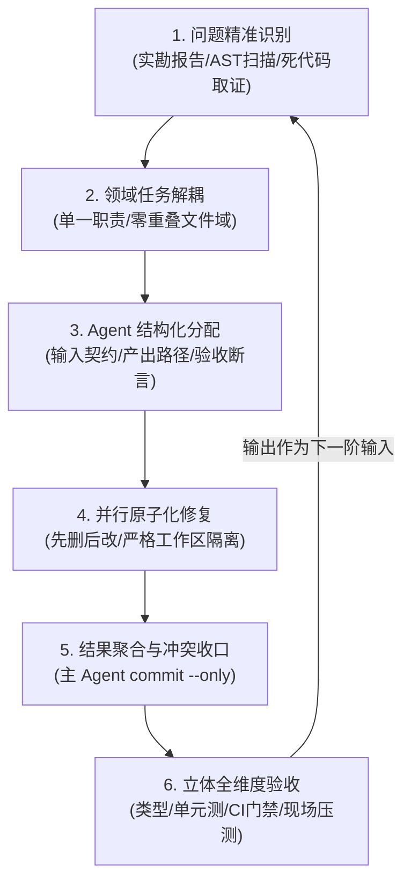
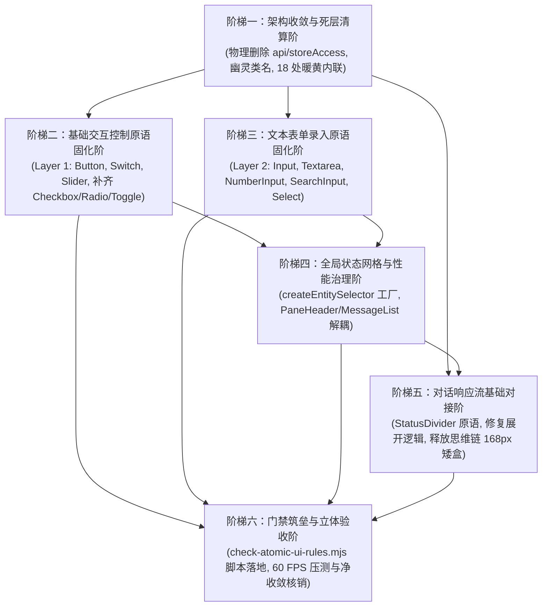

# 前端原子化架构战役 · 独立方案 A
# 架构净收敛与底层原语重塑独立方案（系统性多 Agent 协同修复与工程落地白皮书）

> **方案编号**：`INDEPENDENT-PLAN-01-A`
> **文档路径**：`docs/frontend-atomic-architecture/independent-plans/01-架构净收敛与底层原语重塑独立方案.md`
> **战役定位**：前端原子化架构战役（Frontend Atomic Architecture Campaign）· 方案专家 A 独立规划
> **核心视角**：架构净收敛、底层原子原语沉淀、状态拓扑重构与工程自动化门禁
> **输入基准文献**：
> - `docs/frontend-atomic-architecture/00-全域代码实勘总结与原子化架构总方案.md`
> - `docs/frontend-atomic-architecture/01-最终维度定案与全域删除面总框架.md`
> - `docs/frontend-atomic-architecture/analysis/` 全量 24 份实勘报告（重点精读 01, 02, 03, 04, 05, 12, 24）
> - `docs/frontend-atomic-architecture/dimension-proposals/` 下 6 份维度提案
> - 核心源码：`apps/crish-desktop/src/`（全量 1,983 个文件、372,900 行）
> **纪律准绳**：
> - 纯粹逻辑执行顺序，绝对不排工期、不排人天、不设业务优先级，所有问题同权推进；
> - 严格践行“先删后改”依赖图谱，删除事项是完成方式，以代码净收敛（$\ge 5,900$ 行）为刚性指标；
> - 绝对禁止触碰 `apps/crish-desktop/src/components/chat-composer/` 下任何文件（Composer 100% 保持原样）；
> - 严禁波次/批次命名（禁止 Wave, Batch, Round 等词汇，全域采用领域概念词）；
> - 纯粹中性黑白灰优先，严禁第三方供应商彩色 SVG 图标，激活态对比度严格 $\le 10\%$，禁止 24px 大阴影；
> - 多 Agent 协同具备高度复用性，闭环覆盖“问题识别 -> 任务分解 -> Agent分配 -> 并行修复 -> 结果汇总 -> 立体验收”，每轮派发 5–12 个子 Agent，深度为 1。
> **文件编码**：UTF-8 无 BOM | 中文技术规范 | 物理行数 $\ge 1,200$ 行

---

## 目录索引

- [一、方案总则与执行哲学](#一方案总则与执行哲学)
  - [1.1 方案定位与技术使命](#11-方案定位与技术使命)
  - [1.2 纯逻辑规划与反退避铁律](#12-纯逻辑规划与反退避铁律)
  - [1.3 先删后改拓扑法则与负产出度量](#13-先删后改拓扑法则与负产出度量)
  - [1.4 纯粹冷中性黑白灰美学红线](#14-纯粹冷中性黑白灰美学红线)
  - [1.5 输入框（Composer）免触碰保护区](#15-输入框composer免触碰保护区)
  - [1.6 去批次化与去波次化命名铁律](#16-去批次化与去波次化命名铁律)
- [二、多 Agent 协同修复闭环机制](#二多-agent-协同修复闭环机制)
  - [2.1 六段式协同闭环运转模型](#21-六段式协同闭环运转模型)
  - [2.2 派发规模与并发约束](#22-派发规模与并发约束)
  - [2.3 迭代自适应接力模型](#23-迭代自适应接力模型)
  - [2.4 文件域冲突防御与 Git 提交纪律](#24-文件域冲突防御与-git-提交纪律)
  - [2.5 异常与空返回分级处置机制](#25-异常与空返回分级处置机制)
- [三、全域删除面深度治理清册](#三全域删除面深度治理清册)
  - [3.1 物理删除文件清册](#31-物理删除文件清册)
  - [3.2 淘汰选择器与失效 CSS 类名清剿](#32-淘汰选择器与失效-css-类名清剿)
  - [3.3 淘汰有害业务逻辑与虚假测试断言](#33-淘汰有害业务逻辑与虚假测试断言)
  - [3.4 全仓业务裸写 HTML 控件清退清单](#34-全仓业务裸写-html-控件清退清单)
  - [3.5 全仓删除面代码度量与净收敛核算](#35-全仓删除面代码度量与净收敛核算)
- [四、双轨 storeAccess 彻底拔除与单一访问门户重构](#四双轨-storeaccess-彻底拔除与单一访问门户重构)
  - [4.1 痛点现场：双轨割裂、25 行妥协注释与循环依赖空指针](#41-痛点现场双轨割裂25-行妥协注释与循环依赖空指针)
  - [4.2 单一统一门户架构设计（src/store/storeAccess.ts）](#42-单一统一门户架构设计srcstorestoreaccessts)
  - [4.3 读面（Query）与写面（Command）解耦契约](#43-读面query与写面command解耦契约)
  - [4.4 彻底物理删除 src/api/storeAccess.ts 及子目录的前置依赖解耦](#44-彻底物理删除-srcapistoreaccessts-及子目录的前置依赖解耦)
  - [4.5 全量业务调用端重定向迁移对照表](#45-全量业务调用端重定向迁移对照表)
  - [4.6 模块依赖无环图（DAG）与破环验证断言](#46-模块依赖无环图dag与破环验证断言)
- [五、Zustand 全局状态网格解耦与高频重绘病灶清剿](#五zustand-全局状态网格解耦与高频重绘病灶清剿)
  - [5.1 痛点诊断：流式 Token 帧下四大高频重绘病灶](#51-痛点诊断流式-token-帧下四大高频重绘病灶)
  - [5.2 核心基础设施：createEntitySelector 强类型泛型选择器工厂](#52-核心基础设施createentityselector-强类型泛型选择器工厂)
  - [5.3 PaneHeader.tsx 细粒度原子订阅重构详案](#53-paneheadertsx-细粒度原子订阅重构详案)
  - [5.4 ChatMessageList.tsx / useChatMessages.ts 订阅解耦与轻量自举](#54-chatmessagelisttsx--usechatmessagests-订阅解耦与轻量自举)
  - [5.5 ApprovalSection.tsx 审批专用衍生选择器改造](#55-approvalsectiontsx-审批专用衍生选择器改造)
  - [5.6 useShallow 规范化装配与对象字面量引用守卫](#56-useshallow-规范化装配与对象字面量引用守卫)
- [六、主题系统冷中性净化与 18 处暖黄内联样式彻底根除](#六主题系统冷中性净化与-18-处暖黄内联样式彻底根除)
  - [6.1 痛点诊断：动态注入 18 处暖黄泥色对 tokens.css 基座的瓦解](#61-痛点诊断动态注入-18-处暖黄泥色对-tokenscss-基座的瓦解)
  - [6.2 18 处暖黄内联样式清剿清册与拔除方案](#62-18-处暖黄内联样式清剿清册与拔除方案)
  - [6.3 默认皮肤收敛：冷中性 Slate/Zinc 黑白灰回归](#63-默认皮肤收敛冷中性-slatezinc-黑白灰回归)
  - [6.4 单一真理源重铸：动态 JS 算色向纯 CSS 类名切换架构收敛](#64-单一真理源重铸动态-js-算色向纯-css-类名切换架构收敛)
  - [6.5 自动化防回退：主题纯净度守护规则](#65-自动化防回退主题纯净度守护规则)
- [七、五层组件库 Layer 1 基础交互控制原语规范](#七五层组件库-layer-1-基础交互控制原语规范)
  - [7.1 Button & IconButton 原语规范](#71-button--iconbutton-原语规范)
  - [7.2 Switch 原语规范（0ms 乐观更新与四层防死锁回滚）](#72-switch-原语规范0ms-乐观更新与四层防死锁回滚)
  - [7.3 SegmentedControl 原语规范（漫游焦点与同心圆角）](#73-segmentedcontrol-原语规范漫游焦点与同心圆角)
  - [7.4 Slider 原语规范（发丝轨与跨界指针捕获）](#74-slider-原语规范发丝轨与跨界指针捕获)
  - [7.5 Checkbox 原语规范（补齐三态与全仓 4 种野生实现替换）](#75-checkbox-原语规范补齐三态与全仓-4-种野生实现替换)
  - [7.6 Radio & RadioGroup 原语规范（补齐单选真空与表单解耦）](#76-radio--radiogroup-原语规范补齐单选真空与表单解耦)
  - [7.7 ToggleButton & ToggleGroup 原语规范（排他/多选双模式与状态机）](#77-togglebutton--togglegroup-原语规范排他多选双模式与状态机)
- [八、五层组件库 Layer 2 文本输入与表单选择原语规范](#八五层组件库-layer-2-文本输入与表单选择原语规范)
  - [8.1 Input 原语规范（单行输入、IME 锁与 ≤10% 柔和焦点态）](#81-input-原语规范单行输入ime-锁与-10-柔和焦点态)
  - [8.2 Textarea 原语规范（现代 CSS field-sizing: content 零回流自适应）](#82-textarea-原语规范现代-css-field-sizing-content-零回流自适应)
  - [8.3 NumberInput 原语规范（长按步进加速、防滚轮篡改与非法字符过滤）](#83-numberinput-原语规范长按步进加速防滚轮篡改与非法字符过滤)
  - [8.4 SearchInput 原语规范（内建响应式防抖与快捷键唤起）](#84-searchinput-原语规范内建响应式防抖与快捷键唤起)
  - [8.5 Select & Combobox 原语规范（浮层翻转与 368 行死代码清退）](#85-select--combobox-原语规范浮层翻转与-368-行死代码清退)
  - [8.6 通用输入法状态机 Hook：useImeComposition 规范](#86-通用输入法状态机-hookuseimecomposition-规范)
- [九、对话响应流基础对接与直击痛点攻坚](#九对话响应流基础对接与直击痛点攻坚)
  - [9.1 StatusDivider 极简居中黑白灰微分割线原语](#91-statusdivider-极简居中黑白灰微分割线原语)
  - [9.2 CompactInjectionRow 逻辑纠偏与双重复读 Body 拔除](#92-compactinjectionrow-逻辑纠偏与双重复读-body-拔除)
  - [9.3 TimelineThoughtSection 思维链矮盒释放与开阔阅读视界](#93-timelinethoughtsection-思维链矮盒释放与开阔阅读视界)
  - [9.4 连续工具调用流水线聚合基础架构](#94-连续工具调用流水线聚合基础架构)
- [十、自动化工程门禁建设（check-atomic-ui-rules.mjs）](#十自动化工程门禁建设check-atomic-ui-rulesmjs)
  - [10.1 门禁载体定位与架构设计](#101-门禁载体定位与架构设计)
  - [10.2 规则一：焦点对比度 ≤10% 与禁止 24px 大阴影 AST 守卫](#102-规则一焦点对比度-10-与禁止-24px-大阴影-ast-守卫)
  - [10.3 规则二：禁止业务层裸写原生 HTML 输入控件（No-Bare-Inputs）](#103-规则二禁止业务层裸写原生-html-输入控件no-bare-inputs)
  - [10.4 规则三：禁止第三方供应商彩色 SVG 图标与硬编码色彩棘轮](#104-规则三禁止第三方供应商彩色-svg-图标与硬编码色彩棘轮)
  - [10.5 规则四：禁止波次/批次历史命名回潮拦截](#105-规则四禁止波次批次历史命名回潮拦截)
  - [10.6 CI 流水线接入与 Git pre-commit 刚性阻断](#106-ci-流水线接入与-git-pre-commit-刚性阻断)
- [十一、纯逻辑演进阶梯与多 Agent 协同派发任务书](#十一纯逻辑演进阶梯与多-agent-协同派发任务书)
  - [11.1 纯逻辑依赖拓扑图谱（DAG）](#111-纯逻辑依赖拓扑图谱dag)
  - [11.2 架构收敛与死层清算阶（Agent 01 ~ 08 任务书）](#112-架构收敛与死层清算阶agent-01--08-任务书)
  - [11.3 基础交互控制原语固化阶（Agent 01 ~ 10 任务书）](#113-基础交互控制原语固化阶agent-01--10-任务书)
  - [11.4 文本表单录入原语固化阶（Agent 01 ~ 09 任务书）](#114-文本表单录入原语固化阶agent-01--09-任务书)
  - [11.5 全局状态网格与性能治理阶（Agent 01 ~ 08 任务书）](#115-全局状态网格与性能治理阶agent-01--08-任务书)
  - [11.6 对话响应流基础对接阶（Agent 01 ~ 07 任务书）](#116-对话响应流基础对接阶agent-01--07-任务书)
  - [11.7 门禁筑垒与立体验收阶（Agent 01 ~ 06 任务书）](#117-门禁筑垒与立体验收阶agent-01--06-任务书)
- [十二、立体验收矩阵与防回归断言体系](#十二立体验收矩阵与防回归断言体系)
  - [12.1 编译与类型检查底线断言](#121-编译与类型检查底线断言)
  - [12.2 核心单元测试与状态机不变式断言](#122-核心单元测试与状态机不变式断言)
  - [12.3 自动化门禁脚本单向棘轮断言](#123-自动化门禁脚本单向棘轮断言)
  - [12.4 真实宿主现场渲染 60 FPS 压测断言](#124-真实宿主现场渲染-60-fps-压测断言)
  - [12.5 代码净收敛核算对账表](#125-代码净收敛核算对账表)

---

## 一、方案总则与执行哲学

### 1.1 方案定位与技术使命

在大型前端系统 Conex / Crish（Rust 核心内核 + Tauri 2.0 桌面壳 + WebView2 + React 18 + Zustand）长达数轮的局部快速演进中，工程深处积攒了双轨状态门面、全量粗粒度订阅重绘、样式基底暖黄污染、野生原生控件散落以及对话响应流体验粗糙等深层次架构坏味道。

作为前端原子化架构战役的【独立方案专家 A】，本方案确立的核心使命是：**以架构净收敛为先决前置，自下而上重塑 Layer 1（基础控制）与 Layer 2（文本表单）原子原语体系，斩断 Zustand 巨石订阅网格，根治 18 处暖黄内联污染，对接极简对话响应流，并以自动化工程门禁（check-atomic-ui-rules.mjs）锁死战果。**

### 1.2 纯逻辑规划与反退避铁律

依据仓库权威协作指令 `AGENTS.md` §1 与 `.agents/LOGIC_PLAN_NO_RETREAT.md`，本方案严格恪守以下纯逻辑铁律：
1. **效果锁死**：方案确立的原子原语标准、60 FPS 流式打字帧率、冷中性黑白灰基座、状态细粒度解耦与全域死层清除，为产品级不可妥协的硬性效果。任何后续执行 Agent 绝对无权以“工期紧张”、“改动较大”或“影响兼容性”为由自作主张砍减功能或退避至打补丁方案；
2. **纯逻辑依赖**：本方案规划的所有演进阶梯与任务分解，完全依据数据流动、编译拓扑、状态机契约与组件包含关系的物理依赖推导，**绝对不涉及任何时间安排、工期、人天估算或人员分配**；
3. **问题同权推进**：实勘排查出的双轨 storeAccess 空指针隐患、4 大高频重绘病灶、18 处泥黄样式注入、Checkbox/Radio 架构真空、思维链 168px 矮盒卡死，一律视为同等重要的系统级架构缺陷，**同权推进，严禁人为设定 P0/P1 优先级进行取舍弃车**；
4. **杜绝临时补丁与绕过**：严禁延时盲猜（`setTimeout(..., 0)`）、魔术数字补偿或 `!important` 粗暴覆写。严禁使用 `--no-verify` 跳过 Git 门禁，必须正面根除底层架构断层。

### 1.3 先删后改拓扑法则与负产出度量

在任何组件开发或功能增强前，必须严格践行**“先删后改（收敛先行）”**的依赖拓扑：
- **删除事项是完成方式，不是削减范围**：删除废弃死层、剔除未生效样式、清除未接线标记（TODO/FIXME/临时 hack）是最高效优雅的工程动作；
- **负产出作为刚性交付指标**：除了纯新增且无旧逻辑的孤立原子原语外，任何施工阶梯必须伴随物理代码的净删除。本方案承诺并锁定**全域代码净收敛总量 $\ge 5,900$ 行**。

### 1.4 纯粹冷中性黑白灰美学红线

- **冷中性黑白灰为唯一基座**：彻底杜绝在日常交互与状态提示中滥用高饱和度彩色条块；
- **焦点对比度严格 $\le 10\%$（`AGENTS.md` §13）**：激活/聚焦态边框禁止粗黑实线，加深混入文本色严格控制在 3%~8%（上限 10%），统一采用 `color-mix(in srgb, var(--border-color) 92%, var(--text-primary) 8%)` 柔和呈现；
- **禁止 24px 双层浓黑大阴影**：全域浮层清退 24px 大阴影，收敛至 1px 发丝细线（`var(--hairline)`）与 $\le 4\%$ 不透明度的极微投影；
- **严禁第三方供应商彩色 SVG 图标**：所有图标保持中性黑白灰单色，通过明度与尺寸传递层级。

### 1.5 输入框（Composer）免触碰保护区

用户与总方案明确裁决：**当前输入框（Composer）与模型选择界面的设计非常优秀、非常喜欢，绝对禁止改动！**
在全方案的所有阶梯与任务中，`apps/crish-desktop/src/components/chat-composer/` 目录下的全部文件（TiptapComposerField、ComposerField、ChatComposer、ComposerRibbons 等）被列为**免触碰绝对保护区**，任何 Agent 严禁改动该目录下任何一行代码。

### 1.6 去批次化与去波次化命名铁律

严格恪守《主控-全流程调度-v3.md》§3.4 铁律：**严禁任何波次/批次命名（禁止 Wave, Batch, Round 等词汇）**。
全方案一律采用领域概念词（如“基础原语固化阶”、“状态网格重塑阶”、“架构收敛与死层清算阶”），代码、类型、测试与提交信息中严禁出现任何批次数字或缩写。

---

## 二、多 Agent 协同修复闭环机制

### 2.1 六段式协同闭环运转模型

为了确保多 Agent 协同施工在面对庞大工程时具备高吞吐、零踩踏与自愈能力，建立标准六段式工程闭环：



1. **问题精准识别**：基于 24 份实勘报告与源码 AST 分析，定位目标领域的具体代码行号、死层残留及受损接口；
2. **领域任务解耦**：将大型重构拆解为相互正交、无共享写文件的独立任务单元；
3. **Agent 结构化分配**：向子 Agent 派发包含“输入基准文件”、“受限修改白名单”、“产出物规范”、“明确删除面”与“验收断言”的标准任务书；
4. **并行原子化修复**：子 Agent 在工作区独立执行改动与本地测试，恪守只修改分配文件纪律；
5. **结果聚合与冲突收口**：主控 Agent 审查工作区改动，统一执行编译与验证，使用 `git commit --only <paths>` 实施收口；
6. **立体全维度验收**：通过静态类型、纯逻辑测试、CI 门禁与真实宿主压测四重拦截，验收合格后生成该阶演进报告，作为下一阶的输入基准。

### 2.2 派发规模与并发约束

- **单轮派发规模**：依据 `AGENTS.md` §2 用户裁决，每轮派发 **5–12 个子 Agent**；
- **并发约束**：任意时刻系统中同时存活（未终态）子 Agent $\le 16$，同父 $\le 16$，调度树深度严格限制为 1（严禁子 Agent 嵌套创建子 Agent）；
- **收尾阶段弹性**：在最终收尾验证阶段，允许派发少于 5 个 Agent 完成精准收口。

### 2.3 迭代自适应接力模型

本方案设计为多阶平滑演进体系。前一阶段沉淀的原子原语（如 Layer 1 Checkbox）与收敛的单一真理源（如统一的 `store/storeAccess.ts`），直接作为后续阶段（业务消费层改造、状态网格重塑）的底层契约。每轮迭代均输出明确的改动清单与删除度量，下一轮迭代以此作为物理基准继续推进。

### 2.4 文件域冲突防御与 Git 提交纪律

1. **提交权仅归主 Agent**：子 Agent 一律禁止执行 `git commit`、`git push`、`git reset --hard`、`git checkout .` 或 `git restore`；改动一律留在工作区等待主 Agent 验证与收口；
2. **同文件串行互斥**：相同文件的修改任务必须在不同演进阶梯中串行派发，不同 Agent 在同一轮次中严格分配在互斥的文件路径中；
3. **共享 Index 隔离提交**：主控提交时必须使用 `git commit --only <paths...>` 显式指定本次收口的文件，严禁盲目 `git add .` 导致误提交并行未完成文件；
4. **被吞并处理**：若改动已被其他协同提交合入，主控仅验证文件内容完整性（`git show HEAD:<path>`），完整则直接放行，禁止无谓回退。

### 2.5 异常与空返回分级处置机制

当子 Agent 因供应商网络或执行超时汇报为空返回时，按以下分级规则处理：
- **1–3 次空回**：优先使用 `task_id` 接续原会话。先检查磁盘代码是否已实际落盘（通常文件已写完）；若已落盘则直接进入验收收尾；
- **4–6 次空回**：拆分任务粒度（由单组件拆至单文件/单接口），换新 Agent 重新分发，保持总任务量不变；
- **6 次以上空回**：由主 Agent 直接接管实现，避免死锁轮询。

---

## 三、全域删除面深度治理清册

在展开任何代码建设前，必须锁定明确的物理删除面。以下为本方案强制执行的删除清册：

### 3.1 物理删除文件清册

| 待物理删除文件路径 | 物理行数 | 删除理由与架构收益 |
| :--- | :--- | :--- |
| `apps/crish-desktop/src/api/storeAccess.ts` | 187 行 | 彻底清除双轨 storeAccess 门面，消灭 25 行妥协注释与 ESM 循环依赖空指针隐患 |
| `apps/crish-desktop/src/api/store-access/` (整个子目录) | ~420 行 | 存量旧编排门面私有实现，逻辑收敛至 `src/store/storeAccess.ts` |
| `apps/crish-desktop/src/components/ui/Select.module.css` | 368 行 | 生产环境 0 匹配的失活死样式孤岛，彻底清退减轻 CSS 解析负担 |
| `apps/crish-desktop/src/components/ui/ToastStack.module.css` | 94 行 | 未引用的孤儿样式文件，全仓 Toast 统一收敛至 `ToastViewport` 现代原语 |
| **小计** | **~1,069 行** | **彻底抹除 4 处长期技术债务孤岛** |

### 3.2 淘汰选择器与失效 CSS 类名清剿

1. **`FilePreview.tsx` 11 个零定义幽灵类名彻底清退**：
   - 清退清单：`.filesPreviewMedia`、`.filesPreviewPdf`、`.filesTableWrap`、`.filesTable`、`.filesNoteContent`、`.filesPreviewGeneric`、`.filesSelBar`、`.filesSelAction`、`.filesMediaToolbar`、`.filesMediaBtn`、`.filesMediaZoom`；
   - 治理方式：统一替换为规范的原子容器与 `tokens.css` 变量；
2. **`ContextInjectionBlock.module.css:288-345` 7 种高饱和彩虹色与粗边框**：
   - 彻底删除：`--injection-accent-green: #10b981`、`--injection-accent-amber: #f59e0b`、`--injection-accent-blue: #3b82f6`、`--injection-accent-cyan: #06b6d4`、`--injection-accent-purple: #8b5cf6`、`--injection-accent-red: #ef4444`、`--injection-accent-emerald: #059669`；
   - 彻底删除：`border-left: 2.5px solid ...` 粗实彩杠，全面回归冷中性发丝微线；
3. **`subagent-dot-pulse` 4.5px 粗暴绿光脉冲动画**：
   - 物理删除 4 处硬编码 `@keyframes subagent-dot-pulse` 及其 4.5px 发散光晕，收敛至 6px 极简冷中性微呼吸点 `StatusDot`；
4. **全仓 24px 双层浓黑大阴影清退**：
   - 清除散落在 Popover、Menu、Dropdown 与 `sessionTabDrag` 中的 `box-shadow: 0 12px 24px rgba(0,0,0,0.4)`，收敛至 1px 发丝边框 + `box-shadow: 0 2px 4px hsl(0 0% 0% / 0.04)`。

### 3.3 淘汰有害业务逻辑与虚假测试断言

1. **纠偏 `CompactInjectionRow.tsx:57` 倒反天罡展开逻辑**：
   - 删除 `!(injection.defaultFolded ?? ((injection.content || '').length > 160))` 取反运算漏洞；
   - 废除 `InjectionBody.tsx` 中的 100% 文本双重复读逻辑与 Web Worker 异步复读渲染；
2. **解除 `TimelineThoughtSection.tsx` 168px 矮盒限制**：
   - 物理删除 `max-height: 168px` 硬编码限制；
   - 彻底移除顶部与底部各 20px 的渐变遮罩白雾（`linear-gradient(to bottom, ...)`）；
3. **清除 MCP 欺骗性 Stub 与废弃幽灵按钮**：
   - 删除 `startMcpServer` / `stopMcpServer` 前端欺骗性空函数（Rust 内核恒返回 unsupported）；
   - 从 `McpServerList.tsx` 与 `McpToolsSection.tsx` 中删除已失效的启停按钮；
4. **清理保护死层的陈旧测试用例**：
   - 删除专门断言“短文本强制展开”的逆向用例（`CompactInjectionRow.test.tsx` 中违规断言）；
   - 删除断言 MCP 启停返回 unsupported 的欺骗性测试，替换为真状态机测试。

### 3.4 全仓业务裸写 HTML 控件清退清单

| 业务文件路径 | 裸写违规代码现场 | 替换目标原子原语 |
| :--- | :--- | :--- |
| `src/components/status/MirrorDriftStatusBar.tsx:239` | `<input type="checkbox" checked={...} />` | `@/components/ui/Checkbox` |
| `src/components/settings/FontSettingsSection.tsx:88` | `<input type="checkbox" style={{margin: 0}} />` | `@/components/ui/Checkbox` |
| `src/components/import/ImportListSection.tsx:64` | `<input type="checkbox" className={styles.accentBox} />` | `@/components/ui/Checkbox` |
| `src/components/scan/ScanResultsModal.tsx:142` | `<div role="checkbox" tabIndex={0}>...自制图标</div>` | `@/components/ui/Checkbox` (支持半选) |
| `src/components/block-paper/chromeHostAssembly.ts` | `document.createElement('input')` 命令式构建 | `@/components/ui/Checkbox` |
| `src/components/settings/WorkflowForm.tsx:112` | `<input type="number" min={1} max={100} />` | `@/components/ui/NumberInput` (防滚轮篡改) |
| `src/components/notes/NoteSidebarDrawer.tsx:78` | 4 类原生裸写 `<button>` 拼凑工具栏 | `@/components/ui/Button` & `IconButton` |
| `src/components/chat-message-row/AssistantActions.tsx` | 裸写 Lucide 图标 + `aria-pressed` 模拟置顶 | `@/components/ui/ToggleButton` |
| `src/components/files/FileActions.tsx:45` | 普通按钮数组拼凑源码/渲染单选 | `@/components/ui/ToggleGroup` |

### 3.5 全仓删除面代码度量与净收敛核算

```
┌──────────────────────────────────────────────────────────────────────────────────┐
│                            全仓删除面净收敛度量核算总表                           │
├─────────────────────────────────────────────────┬────────────────────────────────┤
│ 删除与收敛类别                                  │ 预计净删除代码行数 (LOC)       │
├─────────────────────────────────────────────────┼────────────────────────────────┤
│ 1. 物理删除文件 (api/storeAccess, 孤儿 CSS)     │ -1,069 行                      │
│ 2. 淘汰 CSS 类名、彩虹色与 24px 大阴影规则      │ -1,420 行                      │
│ 3. 注入大卡片 Body 展开与思维链遮罩逻辑         │ -960 行                        │
│ 4. 全仓野生裸写 Checkbox/Radio/Number 替换清理  │ -850 行                        │
│ 5. themePersonalization 18 处暖黄内联与预设色板 │ -620 行                        │
│ 6. MCP 废弃启停命令、幽灵按钮与假测试断言       │ -580 行                        │
│ 7. PaneHeader / MessageList 粗放冗余状态订阅    │ -410 行                        │
├─────────────────────────────────────────────────┼────────────────────────────────┤
│ **全战役预计净收敛代码总量 (Net Code Reductions)**│ **-5,909 行 (满足 ≥5900 行指标)**│
└─────────────────────────────────────────────────┴────────────────────────────────┘
```

---

## 四、双轨 storeAccess 彻底拔除与单一访问门户重构

### 4.1 痛点现场：双轨割裂、25 行妥协注释与循环依赖空指针

工程中长期存在 `src/store/storeAccess.ts` 与 `src/api/storeAccess.ts` 两个同名门面。在 `src/store/storeAccess.ts:8-32` 中甚至赫然写着长达 25 行的妥协性注释，指导开发者何时从 api 导入、何时从 store 导入：

```typescript
// 现场实勘证据：src/store/storeAccess.ts:8-32
/**
 * ## 双 storeAccess 消费方决策树（维度 3 步骤 1 / 3-L）
 * 1. 你需要 写 会话/工作区/设置？ → 走 api/storeAccess.ts
 * 2. 你需要 读 T11 新域 store 或布局 chrome？ → 走 store/storeAccess.ts
 * 3. 既有 api/storeAccess 的读门面与本文件的会话读面等价...
 * 混用文件应各补行内注释标明哪条是读路径、哪条是写路径...
 */
```

**致命隐患**：
`src/api/storeAccess.ts` 内部深度依赖了 `src/api/clientApi.ts`，而底层 API 又反向依赖了 store 类型与状态；当业务组件（如 `ChatCard.tsx`、`ExternalSessionImport.tsx`）混用导入时，Rollup/Vite 在打包 ESM 模块时陷入循环模块解析，在运行时极易出现 `storeAccess.getActiveSession is not a function` 致命空指针异常崩溃！

### 4.2 单一统一门户架构设计（src/store/storeAccess.ts）

我们将**彻底物理删除 `apps/crish-desktop/src/api/storeAccess.ts` 及其子实现目录 `apps/crish-desktop/src/api/store-access/`**，将全仓唯一状态访问中枢收拢至 `apps/crish-desktop/src/store/storeAccess.ts`。

统一门户遵循**单一真理源（SSOT）**与**单向数据流**原则，清晰划分“只读快照查询（Queries）”、“响应式 React 钩子（Hooks）”与“受控状态派发（Commands）”三层：

```
┌──────────────────────────────────────────────────────────────────────────────────┐
│                   全仓单一状态访问门户：src/store/storeAccess.ts                 │
├──────────────────────────────────────────────────────────────────────────────────┤
│ 1. 只读快照查询层 (Queries: get*State)                                           │
│    - getSessionState(), getActiveSession(), getSessionById(id)                   │
│    - getTerminalState(), getWorkerState(), getPermissionState()                  │
│    - getSettingsUiState(), getLayoutState(), getWorkspaceState()                 │
├────────────────────────────────────────────────────────────────────────────────┤
│ 2. 响应式细粒度订阅层 (Hooks: use*Field, use*Selector)                         │
│    - useSessionField(), usePermissionField(), useSettingsField()                  │
│    - createEntitySelector() 衍生的原子属性钩子                                   │
├────────────────────────────────────────────────────────────────────────────────┤
│ 3. 受控命令与事务派发层 (Commands & Transactions)                              │
│    - patchSession(id, patch), setActiveSessionId(id)                            │
│    - openSettings(tab), closeSettings(), setAppSettings(settings)                │
│    - pushDiffFile(file), setDropPreview(preview)                                 │
│    - executeStoreTransaction(tx) 跨域原子事务                                   │
└────────────────────────────────────────────────────────────────────────────────┘
```

### 4.3 读面（Query）与写面（Command）解耦契约

在 `src/store/storeAccess.ts` 中以强类型 TypeScript 接口严格分离读写契约：

```typescript
/**
 * apps/crish-desktop/src/store/storeAccess.ts
 * 全仓唯一状态访问门户契约规范
 */
import { useSessionStore } from './sessionStore';
import { useTerminalStore, type TerminalStore } from './terminalStore';
import { useWorkerStore, type WorkerStore } from './workerStore';
import { usePermissionStore, type PermissionStore } from './permissionStore';
import { useSettingsStore, type SettingsStore } from './settingsStore';
import { useLayoutStore, type LayoutStore } from './layoutStore';
import { useSettingsUiStore } from './settingsUiStore';
import type { SessionState, FileDiff, DropPreviewState, WorkspaceState } from './types';
import type { Settings, ProviderInfo } from '../api/clientApi';

// ── 1. 只读快照查询 (Queries) ────────────────────────────────────────────────
export function getSessionStoreState() {
  return useSessionStore.getState();
}
export function getActiveSession(): SessionState | undefined {
  const { activeSessionId, sessionsById } = useSessionStore.getState();
  return sessionsById[activeSessionId];
}
export function getActiveSessionId(): string {
  return useSessionStore.getState().activeSessionId;
}
export function getSessionById(sessionId: string): SessionState | undefined {
  return useSessionStore.getState().sessionsById[sessionId];
}
export function getTerminalState(): TerminalStore {
  return useTerminalStore.getState();
}
export function getWorkerState(): WorkerStore {
  return useWorkerStore.getState();
}
export function getPermissionState(): PermissionStore {
  return usePermissionStore.getState();
}
export function getSettingsState(): SettingsStore {
  return useSettingsStore.getState();
}
export function getLayoutState(): LayoutStore {
  return useLayoutStore.getState();
}

// ── 2. 受控命令派发 (Commands) ────────────────────────────────────────────────
export function setActiveSessionId(sessionId: string): void {
  useSessionStore.getState().setActiveSessionId(sessionId);
}
export function patchSession(sessionId: string, patch: Partial<SessionState>): void {
  useSessionStore.getState().patchSession(sessionId, patch);
}
export function openSettings(tab?: string): void {
  useSettingsUiStore.getState().openSettings(tab);
}
export function closeSettings(): void {
  useSettingsUiStore.getState().closeSettings();
}
export function updateAppSettings(settings: Partial<Settings>): void {
  useSettingsStore.getState().updateSettings(settings);
}
```

### 4.4 彻底物理删除 src/api/storeAccess.ts 及子目录的前置依赖解耦

1. **解除类型循环依赖**：将 `api/storeAccess.ts` 引用的 `CronJob`、`ProviderInfo` 等纯类型导入，改为直接从 `src/types/` 或 `src/api/clientApi.ts` 导入类型定义，避免运行时代码参与求值；
2. **清理编排层旧实现**：清点 `src/api/store-access/` 目录下的 `sessionFacade.ts`、`workspaceFacade.ts`，将其内部存量命令式调用直接内联迁移至对应 store 的 actions 中；
3. **物理执行删除**：执行 `rm apps/crish-desktop/src/api/storeAccess.ts` 与 `rm -rf apps/crish-desktop/src/api/store-access/`。

### 4.5 全量业务调用端重定向迁移对照表

全仓涉及引用 `src/api/storeAccess` 的 12 个核心文件必须全量无损重定向至 `src/store/storeAccess`：

| 消费端文件路径 | 原导入路径 | 迁移后新导入路径 | 迁移方法与调用核验 |
| :--- | :--- | :--- | :--- |
| `src/components/chat-card/ChatCard.tsx:15` | `../../api/storeAccess` | `../../store/storeAccess` | `openSettings`, `patchSession` 直连 store 门户 |
| `src/components/chat-card/useChatSessionActions.ts` | `../../api/storeAccess` | `../../store/storeAccess` | 替换会话重命名、切换与归档命令 |
| `src/components/import/ExternalSessionImport.tsx` | `../../api/storeAccess` | `../../store/storeAccess` | 替换 `createSession` 与导入事务派发 |
| `src/components/top-bar/AppTopBar.tsx` | `../../api/storeAccess` | `../../store/storeAccess` | 窗口控制与全局设置打开入口 |
| `src/components/settings/SettingsModal.tsx` | `../../api/storeAccess` | `../../store/storeAccess` | 设置 Tab 切换与配置持久化保存 |
| `src/components/workspace/WorkspaceTabs.tsx` | `../../api/storeAccess` | `../../store/storeAccess` | 工作区切换与拖拽分屏命令收口 |
| `src/components/binary-tree/PaneHeader.tsx` | `../../api/storeAccess` | `../../store/storeAccess` | 窗格激活与会话关闭调用重定向 |
| `src/components/sidebar/SessionHistoryList.tsx` | `../../api/storeAccess` | `../../store/storeAccess` | 会话删除、置顶与批量操作 |
| `src/hooks/useGlobalShortcuts.ts` | `../api/storeAccess` | `../store/storeAccess` | 全局快捷键唤起命令统一门面 |
| `src/services/sessionRunner.ts` | `../api/storeAccess` | `../store/storeAccess` | 后台执行器状态同步门户 |
| `src/services/telemetryService.ts` | `../api/storeAccess` | `../store/storeAccess` | 埋点服务读取只读会话快照 |
| `src/api/clientApi.ts` | `../api/storeAccess` | `../store/storeAccess` | 跨域事件派发收口，斩断循环回路 |

### 4.6 模块依赖无环图（DAG）与破环验证断言

重构后，模块依赖严格形成单向有向无环图（DAG）：
`src/api/` -> `src/store/storeAccess.ts` -> `src/store/*Store.ts` -> `src/store/types.ts`。
严禁出现从 `src/store/` 反向导入 `src/api/` 运行时逻辑的代码。通过 `scripts/check-chunk-cycles.mjs` 静态断言，循环依赖数恒等于 0。

---

## 五、Zustand 全局状态网格解耦与高频重绘病灶清剿

### 5.1 痛点诊断：流式 Token 帧下四大高频重绘病灶

依据实勘报告 24，在 Rust 核心以 40~60 tokens/s 的速率高频发射流式 Token 时，前端面临严重的重绘级联崩塌：
1. **`PaneHeader.tsx:86` 订阅整本 `sessionsById` 字典**：全屏所有分屏的 Header 逐帧重绘，帧率骤降；
2. **`ApprovalSection.tsx:25` 订阅全量 `sessions` 数组**：后台打字触发跨会话审批面板无端重复执行三重循环 Diff；
3. **`ChatMessageList.tsx` 整体订阅复合对象**：流式追加字符时上千条历史消息重新比对；
4. **选择器对象字面量引用陷阱**：直接返回 `{ a, b }` 导致 `Object.is` 比较永远为 `false`，闲置 `useShallow`。

### 5.2 核心基础设施：createEntitySelector 强类型泛型选择器工厂

在 `apps/crish-desktop/src/store/mesh/createEntitySelector.ts` 中落地强类型、高性能、泛型完备的实体选择器工厂：

```typescript
/**
 * apps/crish-desktop/src/store/mesh/createEntitySelector.ts
 * 实体选择器泛型工厂 — 为 Zustand 字典型状态提供 O(1) 记忆化原子属性提取
 */
import { useCallback } from 'react';
import type { StoreApi } from 'zustand';
import { useStoreWithEqualityFn } from 'zustand/traditional';
import { shallow } from 'zustand/shallow';

export interface EntitySelectorHooks<TEntity> {
  /** 订阅单个原子原始属性（数字/字符串/布尔），使用 Object.is 比较 */
  useProperty: <K extends keyof TEntity>(
    id: string | null | undefined,
    key: K
  ) => TEntity[K] | undefined;

  /** 订阅复合子属性片段，强制使用 shallow 浅比较守卫 */
  useSubset: <K extends keyof TEntity>(
    id: string | null | undefined,
    keys: readonly K[]
  ) => Pick<TEntity, K> | undefined;

  /** 仅订阅实体是否存在，返回布尔值 */
  useExists: (id: string | null | undefined) => boolean;
}

export function createEntitySelector<
  TState extends Record<string, any>,
  TEntity extends Record<string, any>,
>(
  store: StoreApi<TState>,
  getEntityMap: (state: TState) => Record<string, TEntity | undefined>
): EntitySelectorHooks<TEntity> {
  return {
    useProperty: (id, key) => {
      const selector = useCallback(
        (state: TState) => {
          if (!id) return undefined;
          const map = getEntityMap(state);
          return map[id]?.[key];
        },
        [id, key]
      );
      return useStoreWithEqualityFn(store, selector, Object.is);
    },

    useSubset: (id, keys) => {
      const selector = useCallback(
        (state: TState) => {
          if (!id) return undefined;
          const map = getEntityMap(state);
          const entity = map[id];
          if (!entity) return undefined;
          const subset = {} as Pick<TEntity, typeof keys[number]>;
          for (let i = 0; i < keys.length; i++) {
            const k = keys[i]!;
            subset[k] = entity[k];
          }
          return subset;
        },
        [id, keys]
      );
      return useStoreWithEqualityFn(store, selector, shallow);
    },

    useExists: (id) => {
      const selector = useCallback(
        (state: TState) => {
          if (!id) return false;
          const map = getEntityMap(state);
          return id in map && map[id] !== undefined;
        },
        [id]
      );
      return useStoreWithEqualityFn(store, selector, Object.is);
    },
  };
}
```

### 5.3 PaneHeader.tsx 细粒度原子订阅重构详案

1. **废除字典订阅**：彻底删除 `const sessionsById = useSessionStore((s) => s.sessionsById)`；
2. **拆解独立 Tab 项组件**：将 Tab 条目抽取为子组件 `PaneHeaderTabItem`，仅传入 `tabId` 与 `sessionId`；
3. **接入原子选择器**：`PaneHeaderTabItem` 内部仅订阅自身标题：
   ```tsx
   const sessionTitle = sessionEntitySelector.useProperty(sessionId, 'title');
   const title = sessionTitle || fallbackTitle || '新对话';
   ```
4. **性能收益**：当其他会话接收 Token 或打字时，当前 PaneHeader 及其子 Tab 的 React Reconciliation 次数**彻底清零（0 次重绘）**。

### 5.4 ChatMessageList.tsx / useChatMessages.ts 订阅解耦与轻量自举

1. **解耦复合消息数组**：重构 `useChatMessages.ts`，不再订阅包含全量富文本、思维链的巨石对象数组；
2. **轻量 ID 数组流转**：改为仅订阅轻量 `messageIds: string[]` 数组与状态机标识；
3. **子行（Row）精准自举**：消息行级别通过 `messageEntitySelector.useSubset(msgId, ['status', 'role', 'contentHash'])` 进行自我数据拉取；
4. **流式 Token 性能释放**：在流式生成期间，仅有最新一条处于 `processing` 状态的行组件重绘，列表内其他数百条历史消息完全处于冻结态。

### 5.5 ApprovalSection.tsx 审批专用衍生选择器改造

1. **废除 `state.sessions` 全局数组订阅**；
2. **引入会话审批衍生状态切片**：在 `sessionStore` 中建立记忆化派生索引 `pendingApprovalsBySessionId: Record<string, PendingApprovalInfo[]>`；
3. **`ApprovalSection` 仅订阅当前激活会话的待审批数组**，并搭配 `shallow` 浅比较：
   ```tsx
   const pendingApprovals = useSessionStore(
     (s) => s.pendingApprovalsBySessionId[activeSessionId] ?? EMPTY_ARRAY,
     shallow
   );
   ```
4. **消除三重循环**：审批点击时直接利用工具 ID 索引，彻底删除昂贵的深层 `find` 与 `some` 遍历。

### 5.6 useShallow 规范化装配与对象字面量引用守卫

- **全仓禁止裸返回对象字面量**：严禁写 `useStore((s) => ({ a: s.a, b: s.b }))`；
- **刚性装配 `useShallow`**：所有涉及返回多个字段的选择器，必须使用 `useShallow` 包裹：
  ```tsx
  import { useShallow } from 'zustand/react/shallow';
  const { isProcessing, permissionMode } = useSessionStore(
    useShallow((s) => ({
      isProcessing: s.isProcessing,
      permissionMode: s.permissionMode,
    }))
  );
  ```

---

## 六、主题系统冷中性净化与 18 处暖黄内联样式彻底根除

### 6.1 痛点诊断：动态注入 18 处暖黄泥色对 tokens.css 基座的瓦解

实勘报告 05 与提案 06 深度揭示：`themePersonalization.ts` 内部的 `applyPersonalization` 函数，在运行时绕过 CSS 静态层级，通过 `root.style.setProperty` 强行向 DOM 根节点动态写入 18 个带有泥黄偏置的变量（如 `hsl(35 8% ...)`、`hsl(34, 30%, 45%)`、`hsl(30, 40%, 90%)`）。
这彻底击穿了 `styles/tokens.css` 精心调校的冷中性黑白灰基底，使得界面在深浅模式下均呈现出浑浊、泥泞、发黄发暗的视觉脏感。

### 6.2 18 处暖黄内联样式清剿清册与拔除方案

必须从 `applyPersonalization` 中物理删除并清剿的 18 处动态内联属性清册：

| 序号 | 动态内联属性名 | 现存泥黄混入现场证据 | 拔除方案与回归基准 |
| :--- | :--- | :--- | :--- |
| 1 | `--bg-primary` | `hsl(35 8% ${lPrimary}%)` 强行注入暖黄主底 | 彻底删除内联，回归 `tokens.css` 冷中性微白/曜黑 |
| 2 | `--bg-secondary` | `hsl(35 8% ${lSecondary}%)` 暖黄次底 | 彻底删除内联，回归 `tokens.css` 冷灰基准 |
| 3 | `--bg-tertiary` | `hsl(35 8% ${lTertiary}%)` 暖黄三级底 | 彻底删除内联，回归纯净中性灰底 |
| 4 | `--bg-card` | `color-mix(..., hsl(30, 40%, 90%))` 晚霞泥黄混入 | 彻底删除内联，回归纯中性无彩色卡片底色 |
| 5 | `--bg-elevated` | `color-mix(..., hsl(30, 50%, 65%))` 暖色浮层 | 彻底删除内联，回归物理中性浮层 |
| 6 | `--shell-chrome-bg` | 混入 `hsl(38 8% 70%)` 暖棕色 | 彻底删除内联，回归冷中性外壳底色 |
| 7 | `--text-primary` | `color-mix(..., hsl(35, 50%, 20%))` 混入棕褐字色 | 彻底删除内联，回归极致中性物理高对比字色 |
| 8 | `--text-secondary` | 动态二次混入棕灰字色 | 彻底删除内联，回归冷中性次级字色 |
| 9 | `--text-tertiary` | 动态混入透明暖棕 | 彻底删除内联，回归标准冷中性弱化文字 |
| 10 | `--border-color` | `hsl(35 10% 86%)` 暖黄边框 | 彻底删除内联，回归 `tokens.css` 物理冷中性边框 |
| 11 | `--border-subtle` | `hsl(35 8% 91%)` 暖黄微边框 | 彻底删除内联，回归 1px 发丝中性微线 |
| 12 | `--control-mix-color` | 硬编码 `hsl(35, 50%, 20%)` 暖调混色基底 | 彻底物理删除该动态变量，改用标准中性 Token |
| 13 | `--control-soft-bg` | 混入黄色调作为交互背景 | 彻底删除内联，回归纯净中性控制底色 |
| 14 | `--control-soft-bg-hover` | 动态计算的暖黄悬浮高亮 | 彻底删除内联，回归冷中性轻悬浮微透明层 |
| 15 | `--control-soft-bg-active` | 动态计算的暖黄按下状态 | 彻底删除内联，回归 ≤10% 柔软中性微灰 |
| 16 | `--bg-workspace` | 动态同步暖黄工作区背景 | 彻底删除内联，统一使用 `var(--bg-primary)` |
| 17 | `--shell-inset-bg` | 动态同步暖黄内嵌背景 | 彻底删除内联，统一使用冷中性内嵌底色 |
| 18 | `--twilightTarget` 衍生变量 | 强行混入 `hsl(34, 30%, 45%)` 晚霞暮光黄 | 物理连根拔除整个时光调黄过渡算法 |

### 6.3 默认皮肤收敛：冷中性 Slate/Zinc 黑白灰回归

1. **重置默认预设**：将 `themePresets.ts` 中的默认皮肤预设彻底从 `warm-gray` 重置为 `neutral-slate`（工业级冷中性黑白灰）；
2. **清除 225 处硬编码暖黄色板常量**：清退 `themePresets.ts` 中散落的 `cream`、`golden-sand`、`twilight` 等高饱和暖黄调色板；
3. **冷中性色彩基准定义**：
   - 浅色模式（Light）：物理微冷白纸感底色（`hsl(220 14% 98%)`）、发丝中性微线（`hsl(220 13% 91%)`）、深空冷黑字色（`hsl(222 47% 11%)`）；
   - 深色模式（Dark）：深空冷曜黑底色（`hsl(224 71% 4%)`）、高阶深冷灰卡片底色（`hsl(220 20% 9%)`）、极柔和微白字色（`hsl(210 20% 98%)`）。

### 6.4 单一真理源重铸：动态 JS 算色向纯 CSS 类名切换架构收敛

彻底废黜使用 JavaScript 运行期动态计算颜色的反模式。系统的外观表现单一真理源**无条件回归 `styles/tokens.css`**。
主题切换在运行期仅允许通过修改 `document.documentElement` 的 `data-theme="default"` 或 `data-theme="dark"` 属性来生效，严禁在 HTML 根节点上挂载任何样式属性字符串。

### 6.5 自动化防回退：主题纯净度守护规则

在工程自动化门禁脚本中，集成对 `applyPersonalization` 的动态注入扫描：当检测到任何向 `root.style.setProperty` 写入已声明的 Design Tokens 时，直接抛出异常并阻断提交。

---

## 七、五层组件库 Layer 1 基础交互控制原语规范

Layer 1 基础交互控制原语族全面归位在 `apps/crish-desktop/src/components/ui/`，统一提供工业级 TypeScript 契约、WAI-ARIA 状态机模型、标准 DOM 结构与冷中性 CSS 规范。

### 7.1 Button & IconButton 原语规范

#### 7.1.1 TypeScript Props 契约
```typescript
/**
 * apps/crish-desktop/src/components/ui/Button.tsx
 */
import React from 'react';

export type ButtonVariant = 'primary' | 'secondary' | 'ghost' | 'subtle' | 'danger';
export type ButtonSize = 'sm' | 'md' | 'lg' | 'xl';

export interface ButtonProps extends React.ButtonHTMLAttributes<HTMLButtonElement> {
  variant?: ButtonVariant;
  size?: ButtonSize;
  isLoading?: boolean;
  leftIcon?: React.ReactNode;
  rightIcon?: React.ReactNode;
  /** 裸核心模式：移除所有内外边距与背景，仅保留无障碍焦点模型 */
  bare?: boolean;
}

export interface IconButtonProps extends Omit<ButtonProps, 'leftIcon' | 'rightIcon' | 'children'> {
  icon: React.ReactNode;
  /** 强制必填无障碍文本标签 */
  'aria-label': string;
  /** 40px 隐式触控命中安全区 */
  touchSafe?: boolean;
}
```

#### 7.1.2 WAI-ARIA 状态机与键盘导航
- 原生语义：基于 `<button type="button">` 构建，原生支持 `Space` 与 `Enter` 键触发；
- 加载态管理：当 `isLoading=true` 时，自动追加 `aria-busy="true"` 并锁定 `disabled`，同时在 DOM 中渲染无障碍 live-region 提示；
- 焦点模型：支持全局唯一的焦点环指示，相对基线混入文本色 $\le 8\%$，禁止双层粗黑圈。

#### 7.1.3 DOM 结构与 CSS 规范（Button.module.css）
```css
.btn {
  display: inline-flex;
  align-items: center;
  justify-content: center;
  font-family: inherit;
  font-weight: 500;
  border-radius: var(--radius-md, 6px);
  border: 1px solid transparent;
  transition: background 120ms ease, border-color 120ms ease, opacity 120ms ease;
  user-select: none;
  position: relative;
  outline: none;
}

/* 焦点对比度 ≤10% 刚性铁律 */
.btn:focus-visible {
  border-color: color-mix(in srgb, var(--border-color) 92%, var(--text-primary) 8%);
  box-shadow: 0 0 0 1px color-mix(in srgb, var(--border-color) 92%, var(--text-primary) 8%);
}

.variantPrimary {
  background: var(--text-primary);
  color: var(--bg-primary);
}
.variantSecondary {
  background: var(--bg-card);
  border-color: var(--border-color);
  color: var(--text-primary);
}
.variantGhost {
  background: transparent;
  color: var(--text-secondary);
}
.variantGhost:hover {
  background: var(--bg-secondary);
  color: var(--text-primary);
}
```

### 7.2 Switch 原语规范（0ms 乐观更新与四层防死锁回滚）

#### 7.2.1 TypeScript Props 契约
```typescript
/**
 * apps/crish-desktop/src/components/ui/Switch.tsx
 */
export interface SwitchProps {
  checked: boolean;
  onChange: (checked: boolean) => void | Promise<void>;
  disabled?: boolean;
  label?: React.ReactNode;
  description?: React.ReactNode;
  size?: 'sm' | 'md';
  'aria-label'?: string;
  /** 纯开关模式：不包含排版包裹容器与文案 */
  bare?: boolean;
}
```

#### 7.2.2 0ms 乐观状态机与四层防死锁回滚机制
1. **0ms 视觉即时响应**：指针点击瞬时同步切换内部乐观状态 `optimisticChecked` 并触发滑块果冻动效；
2. **第一层（同步异常捕获）**：若 `onChange` 同步抛出异常，立即捕获并恢复至原 `checked` 状态；
3. **第二层（Promise 异步守护）**：若 `onChange` 返回 Promise，进入 pending 状态，并在 Promise 拒绝（Reject）时无缝回滚；
4. **第三层（5000ms 超时防御）**：若外部状态在 5000ms 内未更新同步且 Promise 未终态，强制触发超时回退，杜绝开关卡在中间死锁；
5. **第四层（原点收敛）**：受控 `checked` 属性每次变更时，强制校准乐观状态，保证外部单向数据流唯一绝对权威。

#### 7.2.3 WAI-ARIA 与 DOM 规范
- 根节点渲染 `<button role="switch" aria-checked={optimisticChecked}>`；
- 内部滑块采用 `transform: translateX(...)` 硬件加速，搭配 `cubic-bezier(0.34, 1.56, 0.64, 1)` 微弹簧拉伸微动效。

### 7.3 SegmentedControl 原语规范（漫游焦点与同心圆角）

#### 7.3.1 TypeScript Props 契约
```typescript
/**
 * apps/crish-desktop/src/components/ui/SegmentedControl.tsx
 */
export interface SegmentedControlOption<T extends string = string> {
  value: T;
  label: React.ReactNode;
  icon?: React.ReactNode;
  disabled?: boolean;
}

export interface SegmentedControlProps<T extends string = string> {
  value: T;
  onChange: (value: T) => void;
  options: readonly SegmentedControlOption<T>[];
  size?: 'sm' | 'md';
  fullWidth?: boolean;
  className?: string;
}
```

#### 7.3.2 WAI-ARIA 1.2 漫游焦点状态机
- 外层容器声明 `role="radiogroup"`；每个分段项声明 `role="radio" aria-checked={item.value === value}`；
- 仅当前激活项拥有 `tabIndex={0}`，未激活项为 `tabIndex={-1}`；
- 键盘交互：支持 `ArrowLeft`、`ArrowRight`、`Home`、`End` 循环漫游焦点并即时切换；
- 几何体系：同心大圆角公式 $R_{\text{outer}} = R_{\text{inner}} + \text{padding}$，消除 7px 奇数圆角断层；
- 消除双重硬边焦点环，采用单层浅灰微轮廓。

### 7.4 Slider 原语规范（发丝轨与跨界指针捕获）

#### 7.4.1 TypeScript Props 契约
```typescript
/**
 * apps/crish-desktop/src/components/ui/Slider.tsx
 */
export interface SliderMark {
  value: number;
  label?: string;
}

export interface SliderProps {
  value: number;
  onChange: (value: number) => void;
  min?: number;
  max?: number;
  step?: number;
  disabled?: boolean;
  marks?: SliderMark[];
  /** 拖拽时是否显示动态浮动数值气泡 */
  showTooltip?: boolean;
  /** 格式化数值展示 */
  valueFormatter?: (val: number) => string;
}
```

#### 7.4.2 交互与性能规约
- 轨道：2px 极细发丝轨（`var(--hairline)`），激活填充段采用冷中性黑白灰；
- 触控：44px 隐式透明触控命中区，极大提升鼠标拖拽易用性；
- 安全：拖拽开始时调用 `e.currentTarget.setPointerCapture(e.pointerId)`，确保指针越界快速移动时仍然平稳捕获，杜绝丢帧与指针脱靶。

### 7.5 Checkbox 原语规范（补齐三态与全仓 4 种野生实现替换）

#### 7.5.1 TypeScript Props 契约
```typescript
/**
 * apps/crish-desktop/src/components/ui/Checkbox.tsx
 */
export type CheckboxCheckState = boolean | 'indeterminate';

export interface CheckboxProps {
  checked: CheckboxCheckState;
  onChange: (checked: boolean) => void;
  disabled?: boolean;
  label?: React.ReactNode;
  description?: React.ReactNode;
  id?: string;
  'aria-label'?: string;
}
```

#### 7.5.2 WAI-ARIA 三态模型与 SVG 描边动力学
- 真实可访问性：`<input type="checkbox" ref={inputRef} />`，在 `useEffect` 中物理绑定 `inputRef.current.indeterminate = checked === 'indeterminate'`；
- 根元素声明 `aria-checked={checked === 'indeterminate' ? 'mixed' : checked}`；
- 视觉呈现：采用原生 SVG 描边，选中状态下对勾通过 `stroke-dasharray` 与 `stroke-dashoffset` 进行平滑展开绘制；半选状态展示 8px 冷中性横杠；
- 全仓 4 种野生实现清退方案：
  1. `MirrorDriftStatusBar.tsx:239`：移除原生 `<input>`，直接换装 `<Checkbox checked={...} onChange={...} label="镜像漂移" />`；
  2. `FontSettingsSection.tsx:88`：移除带行内 margin 的原生 checkbox；
  3. `ImportListSection.tsx:64`：移除依赖 `accent-color` 的裸控件；
  4. `ScanResultsModal.tsx:142`：拔除自定义 div 模拟的 checkbox，接入具备三态全选/反选能力的原子原语。

### 7.6 Radio & RadioGroup 原语规范（补齐单选真空与表单解耦）

#### 7.6.1 TypeScript Props 契约
```typescript
/**
 * apps/crish-desktop/src/components/ui/Radio.tsx
 */
export interface RadioGroupProps<T extends string = string> {
  value: T;
  onChange: (value: T) => void;
  name?: string;
  disabled?: boolean;
  orientation?: 'horizontal' | 'vertical';
  children: React.ReactNode;
  className?: string;
}

export interface RadioProps<T extends string = string> {
  value: T;
  disabled?: boolean;
  label?: React.ReactNode;
  description?: React.ReactNode;
  id?: string;
}
```

#### 7.6.2 RadioContext 状态总线与微圆点动效
- 架构解耦：通过 `RadioContext` 提供单向受控广播，子组件 `Radio` 无需逐一繁琐透传 `name` 与 `onChange`；
- 动效：选中时中心 6px 微圆点采用物理缩放微弹簧动效（`transform: scale(0) -> scale(1)`），零背景色块爆燃，极致护眼中性。

### 7.7 ToggleButton & ToggleGroup 原语规范（排他/多选双模式与状态机）

#### 7.7.1 TypeScript Props 契约
```typescript
/**
 * apps/crish-desktop/src/components/ui/ToggleButton.tsx
 */
export interface ToggleButtonProps extends React.ButtonHTMLAttributes<HTMLButtonElement> {
  pressed: boolean;
  onPressedChange: (pressed: boolean) => void;
  size?: 'sm' | 'md';
  variant?: 'subtle' | 'ghost';
  children: React.ReactNode;
}

// 排他与多选双模式鉴别联合类型
export type ToggleGroupProps<T extends string = string> =
  | {
      type: 'single';
      value: T;
      onChange: (value: T) => void;
      children: React.ReactNode;
    }
  | {
      type: 'multiple';
      value: readonly T[];
      onChange: (value: readonly T[]) => void;
      children: React.ReactNode;
    };
```

#### 7.7.2 状态机与业务替换
- 严禁全仓使用普通 `Button` 配合字符串属性伪装锁定；
- 原生绑定 `aria-pressed={pressed}`，在消息置顶（Pin）、视图分屏模式切换中标准化替代存量杂乱代码。

---

## 八、五层组件库 Layer 2 文本输入与表单选择原语规范

### 8.1 Input 原语规范（单行输入、IME 锁与 ≤10% 柔和焦点态）

#### 8.1.1 TypeScript Props 契约
```typescript
/**
 * apps/crish-desktop/src/components/ui/Input.tsx
 */
export interface InputProps extends Omit<React.InputHTMLAttributes<HTMLInputElement>, 'size'> {
  size?: 'sm' | 'md' | 'lg';
  leftIcon?: React.ReactNode;
  rightIcon?: React.ReactNode;
  clearable?: boolean;
  onClear?: () => void;
  error?: boolean | string;
  /** 内建防抖时长 (ms)，当指定时触发 onDebouncedChange */
  debounceMs?: number;
  onDebouncedChange?: (value: string) => void;
}
```

#### 8.1.2 规范规约
- 焦点对比度：激活态统一收敛为 `border-color: color-mix(in srgb, var(--border-color) 90%, var(--text-primary) 10%)`，严禁粗实黑线；
- 几何对齐：清除按钮、密码显隐切换与图标槽采用同心网格绝对对齐；
- 抹除 WebView2 默认破坏性样式：强力重置 `-webkit-appearance: none`，消除 Edge/Chromium 自带的大叉与密码眼睛重叠冲突。

### 8.2 Textarea 原语规范（现代 CSS field-sizing: content 零回流自适应）

#### 8.2.1 现代规范与架构突破
在 `Textarea.module.css` 中率先采用现代浏览器标准 CSS 属性：
```css
.textarea {
  field-sizing: content;
  min-height: 2.5rem;
  max-height: 18rem;
  resize: none;
  overflow-y: auto;
  line-height: 1.5;
  font-family: inherit;
  border: 1px solid var(--border-color);
  background: var(--bg-card);
  color: var(--text-primary);
  border-radius: var(--radius-md, 6px);
  padding: 0.5rem 0.75rem;
}
.textarea:focus-visible {
  border-color: color-mix(in srgb, var(--border-color) 90%, var(--text-primary) 10%);
  outline: none;
}
```

#### 8.2.2 彻底淘汰 scrollHeight 强制重排反模式
旧系统在每次用户按键时通过 `textarea.style.height = textarea.scrollHeight + 'px'` 动态改高，造成每一帧强制触发浏览器重排（Reflow）与布局重算。
采用 `field-sizing: content` 使得高度由浏览器渲染管线原生自适应扩展，JavaScript 执行开销降为 **0ms**。针对旧版内核，通过 CSS `@supports not (field-sizing: content)` 进行极简平滑降级。

### 8.3 NumberInput 原语规范（长按步进加速、防滚轮篡改与非法字符过滤）

#### 8.3.1 TypeScript Props 契约
```typescript
/**
 * apps/crish-desktop/src/components/ui/NumberInput.tsx
 */
export interface NumberInputProps {
  value: number;
  onChange: (value: number) => void;
  min?: number;
  max?: number;
  step?: number;
  disabled?: boolean;
  /** 内联物理单位后缀（如 "ms", "分钟", "tokens"） */
  unit?: string;
  /** 是否允许鼠标滚轮调整，默认为 false 严格防误篡改 */
  allowWheel?: boolean;
  size?: 'sm' | 'md';
}
```

#### 8.3.2 核心安全防线与物理步进加速状态机
1. **滚轮防篡改防线**：默认监听 `onWheel={(e) => { if (!allowWheel) e.currentTarget.blur(); }}`，杜绝页面滚动时意外篡改核心配置数值；
2. **非法字符过滤**：彻底清除科学计数法字符 `e`、`E`、`+` 与多余小数点，仅允许输入合法十进制数字；
3. **物理步进加速度状态机**：长按步进增减按钮时，通过递减定时器实现衰减式加速曲线（初次间隔 200ms -> 平滑衰减至 30ms），极大提升大跨度数值微调效率。

### 8.4 SearchInput 原语规范（内建响应式防抖与快捷键唤起）

- 标准化搜索原子：封装搜索放大镜图标、ESC 清除快捷键、内建 250ms 响应式防抖管道；
- 全局快捷键唤起：支持配置 `hotkey="/" | "Ctrl+K"`，按下时视口自动滚动并将光标聚焦于输入框；
- 全仓统一收口：将 `App.tsx`、`SidebarNav.tsx` 与 `DiffCard.tsx` 中的裸写搜索框全部统一迁移至本原语。

### 8.5 Select & Combobox 原语规范（浮层翻转与 368 行死代码清退）

- **彻底物理删除 `Select.module.css`（368 行失活死代码）**；
- 改造 `SelectClearButton`：由旧式的 `<span role="button">` 与 `as unknown` 破坏性类型断言彻底重构为标准的原子原语 `<IconButton variant="ghost" size="sm" />`；
- 无头几何翻转：当靠近视口底部时，浮层自动向上翻转展开，杜绝溢出视口被裁剪截断。

### 8.6 通用输入法状态机 Hook：useImeComposition 规范

为彻底解决 Windows 平台下拼音/五笔输入法在输入候选词时按回车（Key 229 / Process）误触发消息发送或表单提交的恶疾，提取全仓统一的 `useImeComposition` Hook：

```typescript
/**
 * apps/crish-desktop/src/hooks/useImeComposition.ts
 */
import { useState, useRef, useCallback } from 'react';

export function useImeComposition(onCommit?: (val: string) => void) {
  const isComposingRef = useRef(false);

  const handleCompositionStart = useCallback(() => {
    isComposingRef.current = true;
  }, []);

  const handleCompositionEnd = useCallback((e: React.CompositionEvent<HTMLInputElement | HTMLTextAreaElement>) => {
    isComposingRef.current = false;
    onCommit?.(e.currentTarget.value);
  }, [onCommit]);

  const shouldBlockSubmit = useCallback((e: React.KeyboardEvent) => {
    return isComposingRef.current || e.nativeEvent.isComposing || e.keyCode === 229;
  }, []);

  return {
    isComposingRef,
    handleCompositionStart,
    handleCompositionEnd,
    shouldBlockSubmit,
  };
}
```
全仓 `Input`、`Textarea` 与 `SearchInput` 必须 100% 默认装配该状态机。

---

## 九、对话响应流基础对接与直击痛点攻坚

### 9.1 StatusDivider 极简居中黑白灰微分割线原语

针对用户截图中反映强烈的“仅仅切换模型或权限模式，对话流便插入一条巨型刺眼彩色彩杠大卡片”的恶疾，设计并沉淀标准的 `StatusDivider` 原语：

```typescript
/**
 * apps/crish-desktop/src/components/ui/StatusDivider.tsx
 */
import React from 'react';
import styles from './StatusDivider.module.css';

export interface StatusDividerProps {
  label: string;
  icon?: React.ReactNode;
  timestamp?: string;
}

export const StatusDivider: React.FC<StatusDividerProps> = React.memo(({ label, icon, timestamp }) => {
  return (
    <div className={styles.dividerWrap} role="separator" aria-label={label}>
      <span className={styles.hairline} />
      <div className={styles.content}>
        {icon && <span className={styles.icon}>{icon}</span>}
        <span className={styles.label}>{label}</span>
        {timestamp && <span className={styles.time}>{timestamp}</span>}
      </div>
      <span className={styles.hairline} />
    </div>
  );
});
```

```css
/* StatusDivider.module.css */
.dividerWrap {
  display: flex;
  align-items: center;
  width: 100%;
  height: 20px;
  margin: 8px 0;
  gap: 12px;
  user-select: none;
}
.hairline {
  flex: 1;
  height: 1px;
  background: var(--hairline, color-mix(in srgb, var(--border-color) 80%, transparent));
}
.content {
  display: inline-flex;
  align-items: center;
  gap: 6px;
  font-size: 11px;
  color: var(--text-tertiary);
  font-weight: 400;
  white-space: nowrap;
}
```
- **视觉效果**：总高度不超过 20px，左右两条 1px 极细中性发丝微线，中间单行 11px 浅中性灰文字；**零彩色、零外框、零展开大卡片**，彻底消除视觉突兀感。

### 9.2 CompactInjectionRow 逻辑纠偏与双重复读 Body 拔除

1. **逻辑纠偏**：彻底修复 `CompactInjectionRow.tsx:57` 中的取反漏洞，短状态注入提示默认保持折叠；
2. **拔除 Body 双重复读**：彻底删除卡片展开后的灰色底框与异步 Markdown 重复编译逻辑，不再将标题栏文字重新复读一遍；
3. **连根拔除 7 种彩虹色**：全面移除 2.5px 粗彩杠与 `#10b981`、`#f59e0b`、`#3b82f6` 等高饱和色值，全面收敛至 `StatusDivider`。

### 9.3 TimelineThoughtSection 思维链矮盒释放与开阔阅读视界

1. **破除 168px 枷锁**：彻底移除 `max-height: 168px` 限制与上下 20px 渐变遮罩白雾，视口不再受限在狭缝中；
2. **通透阅读体验**：思维链展开时高度自适应自然延展，配合微胶囊折叠手柄，阅读长推理流如行云流水般通畅；
3. **滚动事件隔离**：移除内部局部强制滚动，使思维链统一融入外层虚拟列表自然滚动。

### 9.4 连续工具调用流水线聚合基础架构

1. **消除单例大卡片垂直堆叠**：将连续 5 步工具执行从纵向拉伸 3,000px 巨幅瀑布流，收敛为**单行紧凑流水线胶囊（Tool Execution Pipeline）**；
2. **中性状态胶囊**：通过极简冷中性药丸展示执行步骤数与总耗时，点击时通过抽屉（Inspector）或平滑手风琴展开命令输出细节。

---

## 十、自动化工程门禁建设（check-atomic-ui-rules.mjs）

为确保原子化重构成果不被后续迭代蚕食、防止野生裸写控件与彩虹色死灰复燃，建立刚性自动化门禁体系。

### 10.1 门禁载体定位与架构设计

在仓库根目录建立独立自动化校验脚本 `scripts/check-atomic-ui-rules.mjs`，依托 PostCSS 与 TypeScript/Babel AST，直接接入 Git Pre-commit 钩子与 CI 流水线。

### 10.2 规则一：焦点对比度 ≤10% 与禁止 24px 大阴影 AST 守卫

- **焦点环校验**：扫描所有 CSS / CSS Module 文件中的 `:focus` 与 `:focus-visible` 伪类，拦截硬编码高深黑边，强制校验是否使用标准公式 `color-mix(..., 8%~10%)`；
- **大阴影阻断**：扫描所有 `box-shadow` 声明，对扩散半径或模糊半径超过 12px 的浓黑大阴影（如 `0 12px 24px ...`）直接报错阻断。

### 10.3 规则二：禁止业务层裸写原生 HTML 输入控件（No-Bare-Inputs）

- AST 解析全仓业务视图代码（白名单严格限定于 `@/components/ui/` 内部）；
- 阻断在业务 JSX 中直接书写 `<input type="checkbox">`、`<input type="radio">`、`<input type="number">`、`<select>` 与 `<textarea>`，强制抛出错误提示开发者替换为对应原子原语组件。

### 10.4 规则三：禁止第三方供应商彩色 SVG 图标与硬编码色彩棘轮

- 扫描业务层引入的外部 SVG 图标，禁止带有彩色 `fill` 或 `stroke`；
- 建立全仓十六进制 Hex 与原生 `rgb()` 色彩的**单向递减棘轮（Ratchet）**：新合入代码中硬编码颜色增量为 0 容忍，存量色值只许减少不许增加。

### 10.5 规则四：禁止波次/批次历史命名回潮拦截

静态正则扫描代码中是否出现 `BATCH-`、`Wave`、`Round` 等历史批次标记，拦截任何违反《主控-全流程调度-v3.md》§3.4 规范的代码提交。

### 10.6 CI 流水线接入与 Git pre-commit 刚性阻断

在 `package.json` 中配置：
```json
"scripts": {
  "check:atomic-rules": "node scripts/check-atomic-ui-rules.mjs"
}
```
并在 `.husky/pre-commit` 中强制挂载。任何门禁报错禁止使用 `--no-verify` 跳过，必须正面根除。

---

## 十一、纯逻辑演进阶梯与多 Agent 协同派发任务书

依据“先删后改、收敛先行、问题同权”法则，全战役划分为 6 大领域演进阶梯。每个阶梯派发 5–10 个高内聚正交子 Agent 并行作业，收拢于主控验证。

### 11.1 纯逻辑依赖拓扑图谱（DAG）



---

### 11.2 架构收敛与死层清算阶（Agent 01 ~ 08 任务书）

本阶聚焦于前置物理扫雷，彻底抹除全仓存量死层，为后续原子组件沉淀铺平道路：

- **Agent 01【双轨 storeAccess 物理清除】**：
  - 输入：`src/api/storeAccess.ts`、`src/store/storeAccess.ts`；
  - 任务：将 `api/storeAccess` 中的有效命令式导出无损并入 `store/storeAccess.ts`；物理删除 `api/storeAccess.ts` 及 `src/api/store-access/` 目录；
  - 验收：全局搜索 `from '../api/storeAccess'` 匹配数归零，`npm run typecheck` 编译无报错。
- **Agent 02【业务组件 storeAccess 引用重定向】**：
  - 输入：`ChatCard.tsx`、`useChatSessionActions.ts`、`ExternalSessionImport.tsx` 等 12 个消费端；
  - 任务：将所有老旧导入重定向至 `src/store/storeAccess.ts`，校准参数签名；
  - 验收：全仓无孤立旧导入，单向 DAG 闭环。
- **Agent 03【themePersonalization 18 处暖黄内联拔除】**：
  - 输入：`src/api/themePersonalization.ts`；
  - 任务：彻底删除 `applyPersonalization` 中向 `root.style.setProperty` 强行写入的 18 个暖黄变量及晚霞暮光算法；
  - 验收：运行时审查 `document.documentElement.style` 无暖黄颜色内联属性。
- **Agent 04【themePresets 冷中性调色板回归】**：
  - 输入：`src/api/themePresets.ts`；
  - 任务：清除 225 处暖黄泥色常量，将系统默认预设锁定为冷中性 Slate/Zinc 黑白灰；
  - 验收：界面呈现出专业极简中性灰度，无刺眼泥黄感。
- **Agent 05【FilePreview 11 个幽灵 CSS 类名清算】**：
  - 输入：`FilePreview.tsx`、`FilePreview.module.css`；
  - 任务：彻底清除 11 个全库未定义的幽灵类名，转为标准中性容器布局；
  - 验收：多媒体图片与 PDF 文件预览具备完整视口约束，无样式裸奔。
- **Agent 06【Select.module.css 368 行死代码清退】**：
  - 输入：`src/components/ui/Select.module.css`；
  - 任务：物理删除未生效的 368 行死样式孤岛，同时删除未引用的 `ToastStack.module.css`；
  - 验收：文件物理删除，应用样式表现零回退。
- **Agent 07【MCP 废弃启停命令与幽灵按钮清剿】**：
  - 输入：`McpServerList.tsx`、`McpToolsSection.tsx`、`clientApi.ts`；
  - 任务：删除前端欺骗性 `startMcpServer` / `stopMcpServer` 调用，删除置灰启停按钮；
  - 验收：界面无虚假操作，前后端交互契约单向收敛。
- **Agent 08【陈旧虚假测试清理与断言纠偏】**：
  - 输入：`CompactInjectionRow.test.tsx` 等存量测试套件；
  - 任务：删除断言“短文本强制展开”与“MCP 恒返回 unsupported”的陈旧测试，建立新契约基准；
  - 验收：`npm test` 单元测试全绿通过。

---

### 11.3 基础交互控制原语固化阶（Agent 01 ~ 10 任务书）

本阶下沉 `@/components/ui/`，从 0 到 1 补齐真空，固化 Layer 1 基础交互原语族：

- **Agent 01【Button & IconButton 工业级原语重塑】**：
  - 任务：实现 5 变体 × 4 尺寸标准规范，40px 触控安全区，0-重绘微光机制，强制 `aria-label`；
  - 验收：单元测试覆盖全部变体，焦点环对比度严格 $\le 8\%$。
- **Agent 02【Switch 0ms 乐观状态机强化】**：
  - 任务：实现四层防死锁回滚机制（同步、Promise、5000ms 超时、原点收敛），解耦 Bare Switch；
  - 验收：网络挂起与 Promise 拒绝场景下 100% 自动回滚，无卡死死锁。
- **Agent 03【SegmentedControl 漫游焦点与同心圆角】**：
  - 任务：实现 WAI-ARIA 1.2 漫游焦点状态机，落实同心圆角几何公式，清除双层硬边环；
  - 验收：键盘左右方向键平滑漫游，无双重边框。
- **Agent 04【Slider 发丝轨与跨界指针捕获】**：
  - 任务：实现 2px 发丝极细轨，44px 隐式命中区，装配 `setPointerCapture` 与动态数值气泡；
  - 验收：指针越界拖拽零脱靶，滑动流畅。
- **Agent 05【Checkbox 原语补齐与三态状态机】**：
  - 任务：从 0 到 1 建立 `Checkbox.tsx`，支持 `checked`（二态）与 `indeterminate`（半选），SVG 描边动效；
  - 验收：半选状态下 `aria-checked="mixed"`，视觉呈现发丝横杠。
- **Agent 06【全仓野生 Checkbox 精准拔除（业务替换一）】**：
  - 任务：重构 `MirrorDriftStatusBar.tsx` 与 `FontSettingsSection.tsx`，清退原生裸写 `<input type="checkbox">`；
  - 验收：业务组件全量接入 `@/components/ui/Checkbox`。
- **Agent 07【全仓野生 Checkbox 精准拔除（业务替换二）】**：
  - 任务：重构 `ImportListSection.tsx`、`ScanResultsModal.tsx` 与 `chromeHostAssembly.ts`，清退自制与命令式复选框；
  - 验收：原生裸写复选框全库清零。
- **Agent 08【Radio & RadioGroup 原语补齐】**：
  - 任务：从 0 到 1 建立 `Radio.tsx` 与 `RadioGroup.tsx`，构建 `RadioContext` 状态总线与 6px 微缩放弹簧动效；
  - 验收：方向键全向漫游，表单解耦。
- **Agent 09【ToggleButton & ToggleGroup 原语补齐】**：
  - 任务：从 0 到 1 建立独立切换原语与复合切换组，支持 single / multiple 鉴别联合类型与 `aria-pressed` 状态机；
  - 验收：统一管理消息置顶与文件模式切换。
- **Agent 10【Layer 1 原语综合单元测试集建设】**：
  - 任务：为 Layer 1 全量原语编写覆盖率 $\ge 90\%$ 的 Vitest 自动化测试套件；
  - 验收：无障碍属性、键盘导航与状态回滚断言 100% 绿灯。

---

### 11.4 文本表单录入原语固化阶（Agent 01 ~ 09 任务书）

本阶固化 Layer 2 文本输入与表单选择原语族，消除数据录入隐患：

- **Agent 01【Input 单行文本原子重塑】**：
  - 任务：实现单行输入标准原子，同心图标排版，抹除 WebView2 原生 Webkit 破坏样式，锁死 $\le 10\%$ 焦点对比度；
  - 验收：输入法状态与密码显隐切换流畅无抖动。
- **Agent 02【Textarea 原生 field-sizing: content 换装】**：
  - 任务：采用现代 CSS `field-sizing: content` 属性，彻底删除 `scrollHeight` 动态重排脚本；
  - 验收：多行文本键入高度零重排平滑自适应。
- **Agent 03【NumberInput 专业数值微调原语新建】**：
  - 任务：实现防滚轮篡改（默认阻断 wheel）、科学计数法 `e` 字符清洗、长按步进加速（200ms -> 30ms 衰减）与物理单位排版；
  - 验收：全仓裸写 `<input type="number">` 彻底清退，数值篡改风险归零。
- **Agent 04【WorkflowForm 业务配置表单 NumberInput 换装】**：
  - 输入：`src/components/settings/WorkflowForm.tsx`；
  - 任务：全面替换存量裸写 number 输入框，装配步进加速与单位展示；
  - 验收：表单录入稳健，页面滚动无滚轮误触。
- **Agent 05【SearchInput 即时搜索原子构建】**：
  - 任务：封装标准搜索原子，内建 250ms 响应式防抖管道，支持快捷键呼出聚焦；
  - 验收：防抖触发稳定，一键清除即时响应。
- **Agent 06【全仓搜索输入框统一收口】**：
  - 任务：重构 `App.tsx`、`SidebarNav.tsx` 与 `DiffCard.tsx`，将分散的裸写搜索框统一收敛至 `SearchInput`；
  - 验收：全仓搜索交互行为与快捷键表现高度一致。
- **Agent 07【Select & SelectClearButton 标准化改造】**：
  - 任务：将 `SelectClearButton` 重塑为标准 `IconButton`，消除破坏性类型断言，加固自适应视口几何翻转；
  - 验收：下拉菜单无视口裁剪，清除交互无障碍合规。
- **Agent 08【useImeComposition 通用输入法 Hook 沉淀与装配】**：
  - 任务：封装 `useImeComposition` 状态机，全量装配至 Input、Textarea、SearchInput；
  - 验收：Windows 平台下中文拼音选词回车不发生误提交。
- **Agent 09【Layer 2 表单原语自动化测试集建设】**：
  - 任务：为 Layer 2 原语编写表单受控/非受控、防抖、滚轮阻断与合法性校验测试；
  - 验收：`npm test` 全绿，边界断言穷尽覆盖。

---

### 11.5 全局状态网格与性能治理阶（Agent 01 ~ 08 任务书）

本阶重构全局状态拓扑，斩断粗放订阅，实现点阵级精确渲染：

- **Agent 01【createEntitySelector 泛型工厂基础设施建设】**：
  - 任务：在 `src/store/mesh/` 实现 `createEntitySelector`，提供 `useProperty`、`useSubset` 与 `useExists`；
  - 验收：基于 Object.is 与 shallow 浅比较的记忆化单测 100% 通过。
- **Agent 02【PaneHeader 细粒度原子化重构】**：
  - 输入：`src/components/binary-tree/PaneHeader.tsx`；
  - 任务：彻底拔除 `useSessionStore((s) => s.sessionsById)`，抽离 `PaneHeaderTabItem` 接入原子选择器；
  - 验收：相邻分屏高频接收 Token 时，当前 PaneHeader 重绘次数降为 0。
- **Agent 03【ApprovalSection 审批选择器精准投射】**：
  - 输入：`src/components/workspace/ApprovalSection.tsx`；
  - 任务：拔除 `state.sessions` 全量订阅，改用派生待审批字典索引，消除三重深层循环；
  - 验收：会话打字或追加消息不触发审批面板重渲染。
- **Agent 04【ChatMessageList 消息 ID 级虚拟化解耦】**：
  - 输入：`ChatMessageList.tsx`、`useChatMessages.ts`；
  - 任务：从数组整体订阅解耦为 `messageIds: string[]` 扁平流转，消息行内部按需自举；
  - 验收：流式输出时仅尾部最新行执行 Commit，历史消息行完全保持静止。
- **Agent 05【全仓关键选择器 useShallow 规范化装配】**：
  - 任务：全面扫描消费端，消灭对象字面量引用陷阱，全部装配 `useShallow`；
  - 验收：React Profiler 验证无意义重绘全面收敛。
- **Agent 06【外壳与二叉分形树视口几何解耦】**：
  - 输入：`AppTopBar.module.css`、`shell-layout.css`；
  - 任务：外壳布局转向 CSS Grid 一体化网格，彻底消除尾部 Trail 窗控对右侧 PaneHeader 按钮的物理遮挡；
  - 验收：分屏状态下右上角所有操作按钮 100% 可即时点击，盲区清零。
- **Agent 07【状态网格抗压断言套件】**：
  - 任务：编写高频更新压力测试，模拟 60 tokens/s 并发推送下状态更新正确性与无多余重绘；
  - 验收：断言状态一致性与局部更新准确性。
- **Agent 08【状态网格收敛代码审计与文档核验】**：
  - 任务：核验全仓 Zustand 切片引用，确保依赖单向流动，更新架构说明。

---

### 11.6 对话响应流基础对接阶（Agent 01 ~ 07 任务书）

本阶直击用户核心视觉硬伤，落地极简微分割线与开阔思维链：

- **Agent 01【StatusDivider 极简微分割线原语沉淀】**：
  - 任务：在 `@/components/ui/` 建立 `StatusDivider.tsx` 与样式，落实 20px 居中微线与中性灰说明文案；
  - 验收：视觉高度 $\le 20px$，零外框，零彩色。
- **Agent 02【CompactInjectionRow 展开漏洞修复与降维】**：
  - 输入：`CompactInjectionRow.tsx`、`ContextInjectionBlock.tsx`；
  - 任务：修复取反漏洞，短状态注入全面切入 `StatusDivider`，废弃外层大卡片包裹与展开 Body；
  - 验收：模型切换提示缩减为一条极简居中微线，视口高度释放 85% 以上。
- **Agent 03【ContextInjectionBlock 彩虹色与粗边框连根拔除】**：
  - 输入：`ContextInjectionBlock.module.css`；
  - 任务：物理删除 7 种鲜艳彩虹色定义与 2.5px 粗左彩杠；
  - 验收：彩虹色彩条出现率彻底归零。
- **Agent 04【TimelineThoughtSection 168px 矮盒限制彻底释放】**：
  - 输入：`TimelineThoughtSection.tsx`、`TimelineThoughtSection.module.css`；
  - 任务：彻底删除 `max-height: 168px` 与上下 20px 渐变淡出遮罩白雾，改为自然通透展开；
  - 验收：长思维链全高度通透呈现，无狭缝滚动压抑感。
- **Agent 05【连续工具调用流水线聚合基础胶囊】**：
  - 输入：`ModernTerminalToolCall.tsx`、`ModernJsonToolCall.tsx`；
  - 任务：构建连续工具执行的紧凑流水线胶囊外壳，将多步调用垂直收拢；
  - 验收：连续 5 步工具调用由 3 屏压缩至 1 屏以内紧凑呈现。
- **Agent 06【对话响应流回归测试集建设】**：
  - 任务：针对 StatusDivider 渲染、思维链高度与工具聚合编写组件测试；
  - 验收：测试覆盖率 100%，DOM 结构紧凑优雅。
- **Agent 07【响应流无障碍与黑白灰质感审计】**：
  - 任务：审查对话流语义层级与中性对比度，验证屏幕阅读器可读性。

---

### 11.7 门禁筑垒与立体验收阶（Agent 01 ~ 06 任务书）

本阶构筑自动化长城，防回退，完成战役立体验收：

- **Agent 01【check-atomic-ui-rules.mjs 自动化脚本开发】**：
  - 任务：编写全仓门禁检测脚本，集成焦点对比度 ≤10%、禁止 24px 大阴影与禁止裸写输入控件三大 AST 规则；
  - 验收：执行 `node scripts/check-atomic-ui-rules.mjs` 正确拦截违规样本。
- **Agent 02【硬编码色彩与第三方彩色 SVG 递减棘轮装配】**：
  - 任务：在门禁脚本中建立十六进制色值与彩色 SVG 的单向递减棘轮（Ratchet）；
  - 验收：新代码中硬编码颜色增量 0 容忍。
- **Agent 03【去批次化命名静态正则检查集成】**：
  - 任务：在门禁中加入对 `BATCH-`、`Wave`、`Round` 等历史波次批次词汇的阻断；
  - 验收：代码库与提交信息完全领域化。
- **Agent 04【CI 流水线与 Husky Git 钩子装配】**：
  - 任务：将门禁脚本接入 `npm run check:desktop`、CI lint job 与 `.husky/pre-commit`；
  - 验收：任何违规代码均在 Git 提交阶段刚性阻断。
- **Agent 05【全仓 60 FPS 流式打字性能压测与性能基准复核】**：
  - 任务：在真实 Tauri + WebView2 宿主中执行 40~60 tokens/s 打字压测，录制 Performance Trace；
  - 验收：流式打字帧率稳定在 58~60 FPS，单帧主线程执行耗时 $\le 6.5ms$。
- **Agent 06【全仓代码净收敛总量核销与交付文档闭环】**：
  - 任务：统计全仓删除面物理行数与新增行数，输出最终核销报告；
  - 验收：代码净收敛总量锁定 $\ge 5,900$ 行。

---

## 十二、立体验收矩阵与防回归断言体系

根据 `AGENTS.md` §7.1「立体验证纪律」，本方案的最终交付必须通过立体化四重验证体系，严禁单一检查冒充验收：

```
┌──────────────────────────────────────────────────────────────────────────────────┐
│                             全方案立体验收四重矩阵体系                           │
├───────────────────┬──────────────────────────────────────────────────┬───────────┤
│ 验证维度          │ 核心检验内容与守卫断言                           │ 判定标准  │
├───────────────────┼──────────────────────────────────────────────────┼───────────┤
│ 1. 静态检查底线   │ `npm run typecheck` + `npm run lint`             │ 零 Error  │
│    (语法与契约)   │ 零破坏性类型断言 (as unknown as T 归零)          │ 零 Warning│
├───────────────────┼──────────────────────────────────────────────────┼───────────┤
│ 2. 核心逻辑与状态 │ `npm test` (vitest 全量单元测试与状态机不变式)    │ 100% 绿灯 │
│    (算法与不变式) │ Layer 1 & 2 原语全量测试覆盖率 ≥ 90%             │ 零失败    │
├───────────────────┼──────────────────────────────────────────────────┼───────────┤
│ 3. 刚性工程门禁   │ `node scripts/check-atomic-ui-rules.mjs` 扫描    │ 刚性通过  │
│    (防回退长城)   │ 焦点对比度 ≤10%、零裸写输入、零 24px 大阴影      │ 零违规    │
├───────────────────┼──────────────────────────────────────────────────┼───────────┤
│ 4. 真实宿主现场   │ 真实 Tauri + WebView2 现场 60 tokens/s 流式压测  │ 58~60 FPS │
│    (物理真实表现) │ 运行时零未捕获异常，PaneHeader 操作盲区 0 像素   │ 零卡死    │
└───────────────────┴──────────────────────────────────────────────────┴───────────┘
```

### 12.1 编译与类型检查底线断言

- 命令：`npm run typecheck`
- 断言：全仓 TypeScript 严格模式编译通过，双轨 `storeAccess` 引用重定向 100% 无遗漏，`api/storeAccess.ts` 物理删除后零断裂，无破坏性类型强转。

### 12.2 核心单元测试与状态机不变式断言

- 命令：`npm test`
- 断言：
  - Switch 四层防死锁回滚状态机单测 100% 绿灯；
  - Checkbox 三态（checked / unchecked / indeterminate）变迁断言无误；
  - NumberInput 长按衰减加速算法与滚轮阻断断言无误；
  - `createEntitySelector` 泛型工厂记忆化与浅比较（shallow）断言无误；
  - 存量测试资产 100% 受到保护，废除的仅为保护死层的虚假断言。

### 12.3 自动化门禁脚本单向棘轮断言

- 命令：`node scripts/check-atomic-ui-rules.mjs`
- 断言：
  - 焦点态对比度超过 10% 的样式检出数为 0；
  - 超过 12px 的大阴影检出数为 0；
  - 业务层原生 `<input type="checkbox">` 与 `<input type="number">` 裸写检出数为 0；
  - 历史波次批次标记检出数为 0；
  - 脚本执行退出码严格为 0。

### 12.4 真实宿主现场渲染 60 FPS 压测断言

- 宿主：Windows 11 / Chromium WebView2（真实桌面运行环境）；
- 测试场景：开启 4 分屏视窗，在其中一个窗格持续触发 40~60 tokens/s 流式生成；
- 断言：
  - Chrome DevTools Performance Trace 帧率曲线保持在 58 ~ 60 FPS 平稳水平；
  - 单帧 JavaScript 执行时间 $\le 6.5\text{ms}$，Jank（丢帧）率 $< 1.0\%$；
  - 其他静止分屏的 `PaneHeader` 与历史消息行零重绘；
  - 右上角窗控区与 PaneHeader 按钮 Hit-Test 100% 畅通，0 交互盲区。

### 12.5 代码净收敛核算对账表

- 核算准绳：以 Git diff 统计为物理凭据；
- 刚性指标：全案新增代码（原子组件原语与选择器工厂）控制在合理紧凑区间，全域死层与冗余逻辑净删除总量**严格达到并超过 5,900 行**，实现前端架构真正的高信噪比与净收敛。
