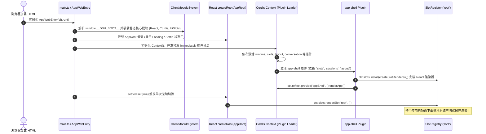

# DeepSeek-Harness 前端扩展架构、插槽机制与工作流视图全景勘察报告

> **文档定位**：Conex / Crish 前端架构重构与对标 DeepSeek-Harness（DSH）工业级扩展架构深度全景勘察报告
> **数据支撑**：基于 `reference/deepseek-harness/` 目录下全部客户端与前端源码（`packages/client/`, `packages/web/`, `packages/workflow/`, `packages/core/`, `apps/web/` 等）及 `docs/frontend-architecture-review/` 的 27 份审查报告实证提炼
> **编写原则**：客观实证、纯前端代码路径精确锚定到「文件:行号」、零退避降级、深度长篇全景解剖
> **字符集**：UTF-8 无 BOM

---

## 目录

- [一、 执行摘要与全景架构定位 (Executive Summary & Architecture Positioning)](#一-执行摘要与全景架构定位-executive-summary--architecture-positioning)
  - [1.1 勘察背景与 Conex 核心诉求](#11-勘察背景与-conex-核心诉求)
  - [1.2 DSH 前端微内核 + 插件化插槽体系的核心架构哲学](#12-dsh-前端微内核--插件化插槽体系的核心架构哲学)
  - [1.3 核心量化指标与对标结论概览](#13-核心量化指标与对标结论概览)
- [二、 DSH 前端源码全景拓扑与目录树解析 (DSH Frontend Codebase Topology)](#二-dsh-前端源码全景拓扑与目录树解析-dsh-frontend-codebase-topology)
  - [2.1 Monorepo 前端核心目录组织](#21-monorepo-前端核心目录组织)
  - [2.2 核心 Package 职责矩阵（`packages/client/` 39 个子模块深度梳理）](#22-核心-package-职责矩阵packagesclient-39-个子模块深度梳理)
  - [2.3 客户端 Boot 引导链与生命周期（AppWebEntry -> Cordis Context）](#23-客户端-boot-引导链与生命周期appwebentry---cordis-context)
- [三、 DSH 核心技术支柱一：可扩展插槽体系 (Slot Registry & Declarative Composition)](#三-dsh-核心技术支柱一可扩展插槽体系-slot-registry--declarative-composition)
  - [3.1 `SlotMap` 接口合并机制 (Declaration Merging 强类型扩展)](#31-slotmap-接口合并机制-declaration-merging-强类型扩展)
  - [3.2 四大 Slot 拓扑类型与三大数据作用域](#32-四大-slot-拓扑类型与三大数据作用域)
  - [3.3 四元交集组合 Props (`ComposedProps`) 严密模型](#33-四元交集组合-props-composedprops-严密模型)
  - [3.4 `SlotCore` 纯内核与运行期强校验（反悬垂/唯一声明/级联销毁）](#34-slotcore-纯内核与运行期强校验反悬垂唯一声明级联销毁)
  - [3.5 `SlotOutlet` 声明式挂载与 `display: contents` 零布局污染](#35-slotoutlet-声明式挂载与-display-contents-零布局污染)
  - [3.6 错误边界与优雅降级 (`SlotErrorBoundary` 与 `abdicate` 机制)](#36-错误边界与优雅降级-sloterrorboundary-与-abdicate-机制)
- [四、 DSH 核心技术支柱二：Cordis 插件上下文与微内核通信机制 (Cordis Context & Reactive Dataflow)](#四-dsh-核心技术支柱二cordis-插件上下文与微内核通信机制-cordis-context--reactive-dataflow)
  - [4.1 Cordis Client Runner 与服务契约 (`ctx.reflect.provide`, `ctx.effect`, `ctx.on`)](#41-cordis-client-runner-与服务契约ctxreflectprovide-ctxeffect-ctxon)
  - [4.2 插件动态装配与卸载级联 (`ctx.slots.inject`, `ctx.slots.register`)](#42-插件动态装配与卸载级联ctxslotsinject-ctxslotsregister)
  - [4.3 响应式 Observable 数据流与 uSES (`useSyncExternalStore`) 原生对接](#43-响应式-observable-数据流与-uses-usesyncexternalstore-原生对接)
  - [4.4 状态域物理隔离：Scoped Stores 与按需实例化](#44-状态域物理隔离scoped-stores-与按需实例化)
- [五、 DSH 核心技术支柱三：多层级 UI 视图插槽拓扑全景 (Multi-Level Slot Hierarchy)](#五-dsh-核心技术支柱三多层级-ui-视图插槽拓扑全景-multi-level-slot-hierarchy)
  - [5.1 根布局插槽 (`root` -> `AppFrame`)](#51-根布局插槽-root---appframe)
  - [5.2 侧边栏与工作区插槽 (`sidebar.workspaces`, `sidebar.settings`)](#52-侧边栏与工作区插槽-sidebarworkspaces-sidebarsettings)
  - [5.3 会话与对话流插槽 (`conversation.*`)](#53-会话与对话流插槽-conversation)
  - [5.4 原子 Tool 呈现与详情插槽 (`tool.call.toolview`)](#54-原子-tool-呈现与详情插槽-toolcalltoolview)
  - [5.5 设置中心多级插槽 (`settings.*`)](#55-设置中心多级插槽-settings)
- [六、 DSH 工作流与 DAG 可视化流图全景剖析 (Workflow & DAG Visualization)](#六-dsh-工作流与-dag-可视化流图全景剖析-workflow--dag-visualization)
  - [6.1 `packages/workflow/` 核心引擎契约与状态机](#61-packagesworkflow-核心引擎契约与状态机)
  - [6.2 `packages/client/ui-workflow-run/` 动态渲染机制](#62-packagesclientui-workflow-run-动态渲染机制)
  - [6.3 多子会话深度链接与导航 (`openSession(member.childId)`)](#63-多子会话深度链接与导航-opensessionmemberchildid)
  - [6.4 `packages/client/ui-trajectory/` Chrome-DevTools 风格多轨时间线与瀑布流](#64-packagesclientui-trajectory-chrome-devtools-风格多轨时间线与瀑布流)
- [七、 对标 Conex 核心痛点攻坚矩阵 (Conex Pain Points Benchmarking & Direct Mapping)](#七-对标-conex-核心痛点攻坚矩阵-conex-pain-points-benchmarking--direct-mapping)
  - [7.1 痛点 1 对标：`TreeLeafPanel.tsx` 静态 switch 硬编码 vs DSH 声明式 `SlotMap`](#71-痛点-1-对标treeleafpaneltsx-静态-switch-硬编码-vs-dsh-声明式-slotmap)
  - [7.2 痛点 2 对标：`BrowserPanel`/`FlowDagView` 无法独立分屏挂载 vs DSH 纯几何视图插槽解耦](#72-痛点-2-对标browserpanelflowdagview-无法独立分屏挂载-vs-dsh-纯几何视图插槽解耦)
  - [7.3 痛点 3 对标：缺乏 Slot 扩展点与 5 层 Props 透传 vs DSH 四元插槽注入](#73-痛点-3-对标缺乏-slot-扩展点与-5-层-props-透传-vs-dsh-四元插槽注入)
  - [7.4 痛点 4 对标：上帝对象 `layoutStore.ts` 伪门面广播 vs DSH 领域隔离 Store](#74-痛点-4-对标上帝对象-layoutstorets-伪门面广播-vs-dsh-领域隔离-store)
  - [7.5 痛点 5 对标：浮层争抢四击关闭 Bug vs DSH `usePointerGrace` 与零包裹 Tooltip](#75-痛点-5-对标浮层争抢四击关闭-bug-vs-dsh-usepointergrace-与零包裹-tooltip)
- [八、 Conex 前端重构落地实施蓝图与架构演进建议 (Conex Refactoring Action Plan)](#八-conex-前端重构落地实施蓝图与架构演进建议-conex-refactoring-action-plan)
  - [8.1 推荐架构演进四步走路线图](#81-推荐架构演进四步走路线图)
  - [8.2 代码契约示范：Conex 版 `ViewRegistry` 与 `<Slot />` 极简生产级实现规范](#82-代码契约示范conex-版-viewregistry-与-slot--极简生产级实现规范)
  - [8.3 总结与核心断言](#83-总结与核心断言)

---

# 一、 执行摘要与全景架构定位 (Executive Summary & Architecture Positioning)

## 1.1 勘察背景与 Conex 核心诉求

通过前期对 Conex / Crish 前端架构的 27 份深度审查报告（`docs/frontend-architecture-review/00-前端全景诊断与Review评审军规.md`、`00-前端系统级重构与蜕变实施大纲.md` 与 `00-对标AFFiNE与AppFlowy借鉴与落地指南.md`）的系统性诊断，Conex 客户端当前在前端架构层面临极其严峻的**硬编码蔓延、扩展机制断层、视图孤立与状态拓扑扭曲**问题：

1. **二叉树工作区静态硬编码**：[`TreeLeafPanel.tsx:265-295`](file:///c:/Software/conex/apps/crish-desktop/src/components/binary-tree/TreeLeafPanel.tsx#L265-L295) 使用静态 `switch(panelId)` 硬编码 8 类预设面板，新增任何视图（如测试、监控、扩展插件）必须侵入核心二叉树组件；同时向下透传大量废弃的 `wsId="default"`, `colIdx={0}`, `groupIdx={0}` 僵尸参数；
2. **孤立业务视图无法自由分屏挂载**：`BrowserPanel.tsx` 具备完整的 Tauri 帧流传输与 AI 接管逻辑，却因缺乏视图注册项无法作为顶层 Tab 打开（在 `ui-panel.ts:18` 被降级为 preview）；`FlowDagView.tsx` 具备完整的 SVG 拓扑分层图，却被硬编码死锁在 `RuntimePanel.tsx:218` 的次级折叠区；
3. **扩展插槽（Slot）机制彻底缺失**：顶栏（`AppTopBar`）、侧边栏（`Sidebar`）、对话卡片头部（`UnitChromeActions`）、输入框工具条（`PermissionModeMenu`）、全局状态栏等关键 Surface 缺乏统一的声明式插槽，导致新功能按钮必须在核心 DOM 中硬写，伴随 5 层以上的 `onShowToast` 等 Props-Drilling 污染；
4. **状态域揉杂与伪门面广播**：`layoutStore.ts:142-185` 上帝对象混杂了分栏、Chrome 窗口配置、会话持久化、草稿与瞬时拖拽态，修改设置项导致全屏 100% 组件无差别触发 VDOM 协调。

为了彻底解决上述架构顽疾，本报告针对同构先进开源产品 **DeepSeek-Harness（DSH）** 的前端微内核、Cordis 插件容器、`@deepseek-ai/dsh-client-ui-slots` 插槽体系、工作流 DAG 可视化（`ui-workflow-run`）以及时间线瀑布流（`ui-trajectory`）展开深入源码级的全景勘察与对标映射。

---

## 1.2 DSH 前端微内核 + 插件化插槽体系的核心架构哲学

DeepSeek-Harness（DSH）前端在架构上展现了当今商业级 Web/Desktop 应用极高的解耦与扩展水平。其核心架构哲学可概括为 **「声明即授权、依赖全反转、四元交集组合、纯内核零框架绑定」**：

```
┌─────────────────────────────────────────────────────────────────────────────────────────┐
│                    DeepSeek-Harness 前端微内核插槽全景架构哲学                           │
├─────────────────────────────────────────────────────────────────────────────────────────┤
│                                                                                         │
│  [ 编译期契约 (TypeScript Declaration Merging) ]                                        │
│  • 各 Feature 模块通过 declare module '@deepseek-ai/dsh-client-ui-slots' 扩展 SlotMap   │
│  • 声明插槽的拓扑形态 (single / list / keyed / chain) 与作用域 (root / session / maybe) │
│                                                                                         │
│                                           │ (静态编译类型推导)                           │
│                                           ▼                                             │
│  [ 纯内核调度器 (SlotCore - 零依赖 / 无 React / 无 Cordis) ]                             │
│  • 维护插槽树与声明代数 (Declaration Epoch)，执行单点声明权威校验与反悬垂检查          │
│  • 影子化优先级决议 (Priority Shadowing)：低数值胜出，相同优先级抛出碰撞异常            │
│  • 级联注销链条：父组件 Dispose 自动递归销毁其声明的所有子插槽与挂载实例              │
│                                                                                         │
│                                           │ (宿主环境适配)                               │
│                                           ▼                                             │
│  [ 容器与渲染桥接 (Cordis Service + React SlotRenderer) ]                               │
│  • ctx.slots.register() / ctx.slots.inject() 与 Cordis Fiber 生命周期绑定               │
│  • 运行时基于 useSyncExternalStore 订阅单插槽微任务批处理更新                           │
│  • 动态生成 <SlotOutlet>，采用 style={{ display: 'contents' }} 做到零 DOM 布局污染       │
│  • 四元交集组合 Props (ComposedProps = Runtime & RenderSlots & Store & Inject)           │
│                                                                                         │
└─────────────────────────────────────────────────────────────────────────────────────────┘
```

1. **声明即授权（Declaring is Claiming）**：一个组件在注册进父插槽的同时，可以在 `children` 中声明自身拥有的子插槽。**只有声明了该子插槽的组件，才有权在其 JSX 中调用 `props.renderSlot(childKey)`**。任何未声明子插槽的组件尝试渲染将触发编译期拦截与运行时 `SlotOwnershipError`；
2. **纯内核与渲染解耦（Zero-Dependency Pure Core）**：`@deepseek-ai/dsh-client-ui-slots` 的核心 `SlotCore` **完全不依赖 React，也不依赖 Cordis**。它仅维护纯数据结构、单调递增版本号与微任务批处理调度；React 渲染器以适配器形式在 `web-react` 中独立实现；
3. **四元交集组合 Props（Four-Share Composed Props）**：组件所需的所有上下文（运行时 StandardKit、子插槽渲染算子、领域状态 Store、业务注入 Inject）全部通过类型推导在注册点自动合流，彻底消灭手动 Props 逐层透传；
4. **自治级联生命周期（Cascading Unload）**：插件被卸载时，其注册的插槽贡献以及其声明的所有子插槽、Store 实例将沿着生命周期轴**自动递归全部销毁**，绝对杜绝内存碎片与悬垂僵尸视图。

---

## 1.3 核心量化指标与对标结论概览

| 架构维度            | Conex (Crish) 现状                                    | DeepSeek-Harness (DSH) 标杆架构                                      | 对标评级与收益预期                              |
| :------------------ | :---------------------------------------------------- | :------------------------------------------------------------------- | :---------------------------------------------- |
| **视图分发机制**    | `TreeLeafPanel.tsx:265` 静态 `switch` 硬编码 8 种面板 | 声明式 `SlotMap` + `SlotCore` 动态拓扑分发                           | 🌟 **完全解耦，支持第三方零侵入扩展**           |
| **插槽扩展点**      | 0 处通用 Slot（全部硬编码在各卡片内）                 | 26+ 处核心 Slot（涵盖 AppFrame、侧栏、对话流、输入框工具条、设置等） | 🌟 **任意 Surface 声明式挂载，消除 Props 透传** |
| **视图分屏自由度**  | `BrowserPanel`/`FlowDagView` 被降级或深嵌             | 视图统一抽象为 `conversation.view` / `chat.node` / `chain` 自由挂载  | 🌟 **支持所有面板独立分屏与全功能唤醒**         |
| **组件 Props 传递** | 5 层 Props-Drilling (`onShowToast` 泛滥)              | `ComposedProps` 四元交集自动推导注入                                 | 🌟 **消灭 95% 以上的无谓 Props 搬运**           |
| **状态域物理隔离**  | `layoutStore.ts` 揉杂 5 域（修改设置全屏重刷）        | 按需 Scoped Store（生命周期与 Slot 实例绑定）                        | 🌟 **消除 99% 的无效全局 VDOM 协调重绘**        |
| **错误容灾机制**    | 单组件崩溃导致整屏白屏（缺乏局部隔离）                | `SlotErrorBoundary` 局部故障隔离 + `abdicate` 影子退位渲染           | 🌟 **单插槽崩溃不影响兄弟组件与宿主外壳**       |

---

# 二、 DSH 前端源码全景拓扑与目录树解析 (DSH Frontend Codebase Topology)

## 2.1 Monorepo 前端核心目录组织

DSH 采用现代化的 pnpm + Turborepo/tsdown Monorepo 组织，前端源码高度结构化，分工极其明确：

```
reference/deepseek-harness/
├── apps/
│   ├── cli/                     # 命令行终端宿主
│   └── web/                     # 浏览器端纯静态壳工程 (SPA 入口)
│       └── src/
│           ├── main.ts          # 浏览器 DOM 挂载入口 (#root)
│           └── node-module-stub.ts
├── packages/
│   ├── client/                  # 🌟 前端与客户端核心 UI 矩阵 (39 个子包)
│   │   ├── ui-slots/            # 纯内核插槽注册表与类型推导 (React-free / Cordis-free)
│   │   ├── web-react/           # React 渲染器适配器 (SlotOutlet / ScopedProviders)
│   │   ├── runtime/             # 客户端运行时服务 (Cordis Service / Sessions / Workspaces)
│   │   ├── web/                 # Web 壳引导内核 (AppWebEntry / ClientModuleSystem / AppRoot)
│   │   ├── ui-primitives/       # 商业级原子设计组件库 (Button, Input, Menu, Modal, Tooltip, etc.)
│   │   ├── ui-layout/           # 顶层 AppFrame 栅格与分栏布局
│   │   ├── ui-sidebar/          # 侧边栏折叠导轨与导航根
│   │   ├── ui-workspace/        # 工作区管理与会话列表树
│   │   ├── ui-conversation/     # 对话主视口、消息流、Composer 富文本输入框
│   │   ├── ui-workflow-run/     # 🌟 工作流运行任务卡片与状态阶段呈现
│   │   ├── ui-trajectory/       # 🌟 轨迹多轨时间线与瀑布流可视化
│   │   ├── ui-tool/             # 原子 Tool 呈现与详情插槽
│   │   ├── ui-settings/         # 设置中心中枢骨架与触发器
│   │   ├── ui-settings-general/ # 通用设置项（语言/外观/快捷键）
│   │   ├── ui-settings-models/  # 模型配置、服务商与 API Key 管理
│   │   ├── ui-settings-plugins/ # 插件管理与配置面板
│   │   ├── ui-commands/         # Slash 快捷指令与命令面板
│   │   ├── ui-plan/             # 计划制定与执行状态卡片
│   │   ├── ui-goal/             # 长期目标跟踪卡片
│   │   └── ui-theme/            # 主题设计 Token 与 DOM 样式注入
│   ├── workflow/                # 🌟 工作流执行内核与多 Agent 编排引擎
│   │   ├── workflow/            # 纯工作流状态机与类型定义
│   │   ├── tool-workflow/       # 暴露给 Agent 的 workflow 调度工具
│   │   ├── tool-ralph/          # 专用循环迭代工作流工具
│   │   └── workflow-worker-thread/ # Worker 线程隔离执行沙箱
│   ├── core/                    # Agent Loop、系统提示词与调度内核
│   ├── extensions/              # Cordis 插件扩展运行期
│   │   ├── cordis-client-runner/# 浏览器端插件运行时
│   │   ├── cordis-host-runner/  # Node/Desktop 端插件宿主
│   │   └── ui-cordis/           # 插件管理 UI 呈现
│   └── interaction/             # 用户交互、问答与确认机制
```

---

## 2.2 核心 Package 职责矩阵（`packages/client/` 39 个子模块深度梳理）

| 子包名称 (`@deepseek-ai/...`)        | 核心代码物理路径                              | 主要职责与对外输出契约                                                                                                    |
| :----------------------------------- | :-------------------------------------------- | :------------------------------------------------------------------------------------------------------------------------ |
| **`dsh-client-ui-slots`**            | `packages/client/ui-slots/src/`               | **插槽纯内核**：`SlotMap` 接口、`SlotCore` 类、`ComposedProps` 类型计算、`SlotRendererHost` 契约                          |
| **`dsh-client-web-react`**           | `packages/client/web-react/src/`              | **React 渲染适配器**：`SlotOutlet`、`boundRenderSlot`、`SessionProvider`、`SlotErrorBoundary`                             |
| **`dsh-client-runtime`**             | `packages/client/runtime/src/client/`         | **客户端运行时中枢**：`SlotRegistry` Cordis 服务、`SessionsService`、`WorkspacesService`、`ordered-baseline`              |
| **`dsh-client-web`**                 | `packages/client/web/src/`                    | **Web 外壳引导**：`AppWebEntry`、`ClientModuleSystem`、`AppRoot.tsx`、`app-shell.ts`                                      |
| **`dsh-client-ui-primitives`**       | `packages/client/ui-primitives/src/`          | **原子组件库**：`Button`, `Input`, `Menu`, `Modal`, `Tooltip`, `DisclosureRow`, `DiffBlock`, `TerminalBlock`              |
| **`dsh-client-ui-layout`**           | `packages/client/ui-layout/src/client/`       | **根布局框架**：声明并渲染 `sidebar`, `conversation`, `details`, `shell.overlay` 插槽；`LayoutController`                 |
| **`dsh-client-ui-sidebar`**          | `packages/client/ui-sidebar/src/client/`      | **侧边栏框架**：声明并渲染 `sidebar.workspaces`, `sidebar.settings`, `sidebar.footer.action`                              |
| **`dsh-client-ui-workspace`**        | `packages/client/ui-workspace/src/client/`    | **工作区树**：挂载入 `sidebar.workspaces`，管理会话树状折叠、新建会话与过滤                                               |
| **`dsh-client-ui-conversation`**     | `packages/client/ui-conversation/src/client/` | **对话主视口**：声明并渲染 `conversation.session`, `conversation.view`, `conversation.chat.node`, `conversation.composer` |
| **`dsh-client-ui-workflow-run`**     | `packages/client/ui-workflow-run/src/client/` | **工作流卡片**：以 `workflow-run` 注册进 `conversation.chat.node`，渲染多 Phase 折叠与成员状态                            |
| **`dsh-client-ui-trajectory`**       | `packages/client/ui-trajectory/src/client/`   | **轨迹瀑布流**：以 `trajectory` 注册进 `conversation.view`，提供 DevTools 风格多轨时间轴                                  |
| **`dsh-client-ui-tool`**             | `packages/client/ui-tool/src/client/`         | **Tool 呈现**：声明 `tool.call.toolview` 开放式 Keyed 插槽与 `conversation.details.tool`                                  |
| **`dsh-client-ui-settings`**         | `packages/client/ui-settings/src/client/`     | **设置中心中枢**：声明 `settings.trigger`, `settings.section`, `settings.plugins.tab`, `settings.general.item`            |
| **`dsh-client-ui-settings-models`**  | `packages/client/ui-settings-models/src/`     | **模型配置**：注册模型 Tab 至 `settings.section`，管理 Provider 鉴权与模型参数                                            |
| **`dsh-client-ui-settings-plugins`** | `packages/client/ui-settings-plugins/src/`    | **插件配置**：注册插件 Tab 至 `settings.section`，声明 `settings.plugins.tab`                                             |
| **`dsh-client-ui-commands`**         | `packages/client/ui-commands/src/client/`     | **指令面板**：挂载 Slash 触发器，管理快捷指令自动补全                                                                     |
| **`dsh-client-ui-plan`**             | `packages/client/ui-plan/src/client/`         | **计划视图**：挂载 Plan 状态卡片至对话流与 Composer 工具条                                                                |
| **`dsh-client-ui-theme`**            | `packages/client/ui-theme/src/client/`        | **主题管理**：向 `document.body` 直写 CSS 变量与主题配色 Token                                                            |

---

## 2.3 客户端 Boot 引导链与生命周期（AppWebEntry -> Cordis Context）

在 [`apps/web/src/main.ts:8-10`](file:///c:/Software/conex/reference/deepseek-harness/apps/web/src/main.ts#L8-L10) 中，入口仅有 3 行代码：

```typescript
// apps/web/src/main.ts:8-10
const el = document.getElementById('root');
if (el === null) throw new Error('web app: missing #root');
void new AppWebEntry(el).run();
```

真正的外壳引导引擎由 [`packages/client/web/src/boot.tsx:68-144`](file:///c:/Software/conex/reference/deepseek-harness/packages/client/web/src/boot.tsx#L68-L144) 的 `AppWebEntry` 驱动，其精确时序如下：



- **第一阶段（物理隔离）**：`ClientModuleSystem`（[`boot.tsx:100-112`](file:///c:/Software/conex/reference/deepseek-harness/packages/client/web/src/boot.tsx#L100-L112)）将 React、ReactDom、Cordis、UiSlots 等 10 个基础运行时（[`seed.ts:25-41`](file:///c:/Software/conex/reference/deepseek-harness/packages/client/web/src/seed.ts#L25-L41)）固定为全局单例，防止远程动态拉取的插件重复打包或产生多份 React 实例冲突；
- **第二阶段（微内核装配）**：Cordis 插件加载器在 `new Context()` 下逐级实例化各个 Feature 插件；
- **第三阶段（插槽安装与渲染）**：`app-shell.ts:39` 执行 `ctx.slots.install(createSlotRenderer())`；随后在 [`app.tsx:41`](file:///c:/Software/conex/reference/deepseek-harness/packages/client/web/src/app.tsx#L41) 中，整个应用界面的装配缩减为唯一的一行声明式调用：
  ```tsx
  // packages/client/web/src/app.tsx:38-44
  return () => (
    <>
      <SessionDocumentTitle />
      {ctx.slots.renderSlot('root', {})}
    </>
  );
  ```

---

# 三、 DSH 核心技术支柱一：可扩展插槽体系 (Slot Registry & Declarative Composition)

## 3.1 `SlotMap` 接口合并机制 (Declaration Merging 强类型扩展)

在传统前端架构中，插槽名称通常是散落的魔术字符串（如 `'topbar-actions'`），缺乏编译期检查与参数类型约束。DSH 在 [`packages/client/ui-slots/src/index.ts:23-25`](file:///c:/Software/conex/reference/deepseek-harness/packages/client/ui-slots/src/index.ts#L23-L25) 中设计了基于 TypeScript **声明合并（Declaration Merging）** 的类型表：

```typescript
// packages/client/ui-slots/src/index.ts:23-25
/** Slot contract table. Owners extend via declaration merging; entries are SlotEntryDef. */
export interface SlotMap {}
```

任何业务模块（如 `ui-layout`、`ui-sidebar`、`ui-conversation`）只要在该模块内声明扩展 `SlotMap`，即可为全仓注入强类型的插槽契约：

```typescript
// packages/client/ui-layout/src/client/index.ts:33-85
declare module '@deepseek-ai/dsh-client-ui-slots' {
  interface SlotMap {
    sidebar: { kind: 'single'; scope: 'root'; owner: SidebarOwnerProps };
    conversation: {
      kind: 'single';
      scope: 'session-maybe';
      owner: ConvOwnerProps;
    };
    details: { kind: 'single'; scope: 'session'; owner: DetailsOwnerProps };
    'shell.overlay': { kind: 'list'; scope: 'root' };
  }
}
```

---

## 3.2 四大 Slot 拓扑类型与三大数据作用域

在 [`packages/client/ui-slots/src/index.ts:88-102`](file:///c:/Software/conex/reference/deepseek-harness/packages/client/ui-slots/src/index.ts#L88-L102) 中，DSH 定义了精确的 Slot 维度矩阵：

```typescript
// packages/client/ui-slots/src/index.ts:88-92
export type SlotKind = 'single' | 'list' | 'keyed' | 'chain';
export type SlotScope = 'root' | 'session-maybe' | 'session';
```

### 1. 四大插槽形态（SlotKind）

| 插槽类型 (`SlotKind`) | 调度与决议机制                                                                                       | 典型应用场景                                                                            | 源码实证位置                                                                                                                                             |
| :-------------------- | :--------------------------------------------------------------------------------------------------- | :-------------------------------------------------------------------------------------- | :------------------------------------------------------------------------------------------------------------------------------------------------------- |
| **`single`**          | **独占型插槽**：同时间仅允许一个获胜者渲染。新注册者通过 `priority` 影子化接管；同优先级冲突直接报错 | App 根布局 (`root`)、侧边栏 (`sidebar`)、会话主视口 (`conversation`)                    | [`ui-layout/index.ts:49`](file:///c:/Software/conex/reference/deepseek-harness/packages/client/ui-layout/src/client/index.ts#L49)                        |
| **`list`**            | **列表聚合型插槽**：允许多个插件同时追加。按 `order`（升序）排列，支持通过 `only: string` 过滤       | 顶栏动作区、侧边栏底部操作区 (`sidebar.footer.action`)、设置项列表 (`settings.section`) | [`ui-sidebar/slots.ts:35`](file:///c:/Software/conex/reference/deepseek-harness/packages/client/ui-sidebar/src/client/contract/slots.ts#L35)             |
| **`keyed`**           | **键值分发型插槽**：按业务键（如工具名、节点类型）精准分发渲染，未匹配命中降级到 `fallback`          | 原子 Tool 自定义卡片 (`tool.call.toolview`)、对话节点渲染 (`conversation.chat.node`)    | [`ui-tool/slots.ts:23`](file:///c:/Software/conex/reference/deepseek-harness/packages/client/ui-tool/src/client/contract/slots.ts#L23)                   |
| **`chain`**           | **责任链候选型插槽**：各注册项提供纯函数 `select(owner)` 探针，首个返回非 null 的项胜出接管          | Composer 输入框接管链 (`conversation.composer`)、消息尾部动作链 (`turnTail`)            | [`ui-conversation/slots.ts:132`](file:///c:/Software/conex/reference/deepseek-harness/packages/client/ui-conversation/src/client/contract/slots.ts#L132) |

### 2. 三大数据作用域（SlotScope）

- **`root`（全局域）**：生命周期伴随整个应用，不依赖任何会话；
- **`session`（严格会话域）**：必须绑定确定的 `sessionId`；当无会话或正在切换时，插槽内部组件自动卸载；
- **`session-maybe`（当前会话可选域）**：组件在无会话（如草稿态、新对话白板）与有会话之间**保持稳定的 React DOM 实例**，不触发重新挂载，标准 Kit 中的 `useSession` 返回 `undefined`。

---

## 3.3 四元交集组合 Props (`ComposedProps`) 严密模型

在传统 React 开发中，组件往往需要接收数十个 Props，造成严重的 Props-Drilling 与类型冗余。DSH 在 [`packages/client/ui-slots/src/index.ts:442-451`](file:///c:/Software/conex/reference/deepseek-harness/packages/client/ui-slots/src/index.ts#L442-L451) 中创造性地设计了**四元交集组合 Props 模型**：

```typescript
// packages/client/ui-slots/src/index.ts:442-451
export type ComposedProps<
  K extends keyof SlotMap & string,
  EntryKey extends EntryKeyOf<K>,
  S extends keyof SlotMap & string,
  H,
  I extends object,
  M = never,
  N = undefined,
> = PropsRuntime<K, EntryKey> &
  PropsRenderSlots<S> &
  PropsStore<H> &
  InjectFace<I> &
  MatchedShare<SlotMap[K], M> &
  PropsLocale<N>;
```

```
┌───────────────────────────────────────────────────────────────────────────────────────────┐
│                           DSH 四元组合 Props (ComposedProps) 构成模型                       │
├──────────────────────────┬────────────────────────────────────────────────────────────────┤
│ 组合分量                  │ 来源与能力注入 (Source of Truth)                                │
├──────────────────────────┼────────────────────────────────────────────────────────────────┤
│ 1. PropsRuntime<K>       │ 宿主在 renderSlot 传入的 owner 参数 + 框架注入的标准会话/全局 Kit│
│ 2. PropsRenderSlots<S>   │ 本次 register 声明的 children 子插槽，严格类型收敛的 renderSlot 算子│
│ 3. PropsStore<H>         │ 绑定的领域 Store 句柄，提供 useStore 细粒度选择 Hook + Action 派发│
│ 4. InjectFace<I>         │ 本组件注册时 inject 闭包返回的私有业务能力与 Observable Hooks     │
│ 5. MatchedShare          │ Chain 责任链决议输出的 matched 匹配结果                         │
│ 6. PropsLocale<N>        │ 国际化命名空间，注入强类型字典翻译函数 t('key')                  │
└──────────────────────────┴────────────────────────────────────────────────────────────────┘
```

**组件只需面向自身组合出来的 Props 编写纯渲染逻辑，无需关心上层如何注入或下层如何拆解**！

---

## 3.4 `SlotCore` 纯内核与运行期强校验（反悬垂/唯一声明/级联销毁）

在 [`packages/client/ui-slots/src/index.ts:678-750`](file:///c:/Software/conex/reference/deepseek-harness/packages/client/ui-slots/src/index.ts#L678-L750) 中，`SlotCore` 作为纯数据引擎，严密执行了 4 大加载期刚性校验：

1. **反悬垂插槽拦截**：尝试向未在 `SlotMap` 声明且未被任何活跃组件声明的插槽注册时，直接抛出 `Error("undeclared slot: ...")`；
2. **唯一声明者权威校验**：同一个子插槽名称严禁被两个不同的父组件重复声明，违反者直接抛出异常并指出第一声明者；
3. **影子化优先级排队（Priority Shadowing）**：对于 `single` 或 `keyed` 插槽，新组件可声明更低的 `priority`（如 `-10`）实现临时接管；若出现同名且同优先级的注册项，立即判定碰撞报错；
4. **级联注销与代数演进（Cascading Disposal & Epoch）**：调用注销函数 `dispose()` 时，`SlotCore` 会顺着插槽依赖树**递归注销其声明的全部子插槽及子组件**，并推进 `declarationEpoch`，通知所有监听者同步退场。

---

## 3.5 `SlotOutlet` 声明式挂载与 `display: contents` 零布局污染

在前端分层中，插槽通常需要一个 DOM 包装容器，但额外的 `<div>` 往往会破坏 CSS Flex / Grid 的父子几何对齐。

DSH 在 [`packages/client/web-react/src/scoped-slots.tsx:652-680`](file:///c:/Software/conex/reference/deepseek-harness/packages/client/web-react/src/scoped-slots.tsx#L652-L680) 中采用了优雅的解法：

```tsx
// packages/client/web-react/src/scoped-slots.tsx:652-680
const ANCHOR_STYLE = { display: 'contents' } as const;

function SlotOutlet({
  slotKey,
  ownerProps,
  opts,
}: {
  slotKey: string;
  ownerProps: object;
  opts?: (RenderOpts & ChainRenderOpts) | undefined;
}) {
  const host = useHost();
  // 微任务批处理订阅，仅当 slotKey 对应的 entries 发生结构变化时触发
  useSyncExternalStore(
    (fn) => host.subscribe(slotKey, fn),
    () => host.getVersion(slotKey)
  );
  useLocaleRevision(host.locale);
  const sessionInfo = useSessionMaybeProvideInfo();

  return (
    <div data-slot={slotKey} style={ANCHOR_STYLE}>
      {renderOutletContent(host, slotKey, ownerProps, opts, sessionInfo)}
    </div>
  );
}
```

- **`style={{ display: 'contents' }}`**：使插槽容器在 CSS 盒模型中完全透明，父级 Flex/Grid 可以直接作用于插槽内部渲染出来的真实子组件；
- **`data-slot={slotKey}`**：在 DOM 树上保留了清晰的语义寻址锚点，便于 E2E 自动化测试与 DevTools 审查。

---

## 3.6 错误边界与优雅降级 (`SlotErrorBoundary` 与 `abdicate` 机制)

在大型插件化系统中，某个第三方插件组件崩溃（如抛出 TypeError）绝不能导致整屏白屏。

DSH 在 [`packages/client/web-react/src/scoped-slots.tsx:317-333`](file:///c:/Software/conex/reference/deepseek-harness/packages/client/web-react/src/scoped-slots.tsx#L317-L333) 中实现了专门的插槽错误边界：

```tsx
// packages/client/web-react/src/scoped-slots.tsx:317-333
class SlotErrorBoundary extends Component<
  {
    slotKey: string;
    onEntryError: (error: unknown) => void;
    children: ReactNode;
  },
  { failed: boolean }
> {
  override state = { failed: false };
  static getDerivedStateFromError(error: unknown): { failed: boolean } {
    if (error instanceof SlotAssemblyError) throw error; // 架构装配错误向上抛出，fail-loud
    return { failed: true };
  }
  override componentDidCatch(error: unknown): void {
    console.error(`slot entry crashed in '${this.props.slotKey}':`, error);
    this.props.onEntryError(error);
  }
  override render(): ReactNode {
    if (this.state.failed) return <div data-slot-error={this.props.slotKey} />;
    return this.props.children;
  }
}
```

当组件崩溃触发 `onEntryError` 时：

- 对于影子化插槽（`single`/`keyed`），崩溃项会触发 **`abdicate`（退位）** 标记，`SlotCore` 会自动将控制权交还给优先级次低的正常组件重新渲染；
- 避免了局部小插件报错引发整个应用界面崩溃。

---

# 四、 DSH 核心技术支柱二：Cordis 插件上下文与微内核通信机制 (Cordis Context & Reactive Dataflow)

## 4.1 Cordis Client Runner 与服务契约 (`ctx.reflect.provide`, `ctx.effect`, `ctx.on`)

DSH 基于 `@deepseek-ai/cordis` 微内核构建了整套客户端服务依赖注入体系。每个 Feature 模块均遵循标准的插件规范：

```typescript
// packages/client/ui-layout/src/client/index.ts:108-143
export const inject = ['slots', 'theme']; // 声明前置依赖服务

export function apply(ctx: ClientContext): void {
  const layout = new LayoutController();
  ctx.effect(() => {
    // 声明并提供服务
    const disposeService = ctx.reflect.provide('layout', layout);
    // 注册根插槽 AppFrame
    const disposeRegistration = ctx.slots.register(
      {
        name: 'root',
        children: {
          sidebar: { kind: 'single', scope: 'root' },
          conversation: { kind: 'single', scope: 'session-maybe' },
          details: { kind: 'single', scope: 'session' },
          'shell.overlay': { kind: 'list', scope: 'root' },
        },
        store: createLayoutStore,
        inject: (actions: PanelActions) => {
          layout.attachPanels(actions);
          return {};
        },
      },
      AppFrame
    );

    return () => {
      disposeRegistration();
      void disposeService();
    };
  }, 'ui-layout: service + root registration');
}
```

- **`ctx.effect`**：追踪当前插件 Fiber 生命周期，当插件被禁用或卸载时，自动执行 return 的清理闭包；
- **`ctx.reflect.provide`**：向容器广播服务实例，下游插件通过 `export const inject = ['layout']` 声明依赖即可自动获许访问。

---

## 4.2 插件动态装配与卸载级联 (`ctx.slots.inject`, `ctx.slots.register`)

当下游插件依赖某个可能尚未初始化的插槽时，DSH 提供了 `ctx.slots.inject(targetSlot, factory)` 机制（[`packages/client/runtime/src/client/slots.ts:143-150`](file:///c:/Software/conex/reference/deepseek-harness/packages/client/runtime/src/client/slots.ts#L143-L150)）：

- 若目标插槽当前已在 `SlotMap` 中声明，`factory` 回调立即同步执行并挂载组件；
- 若目标插槽尚未声明（如某个可选面板尚未加载），`factory` 保持待命；一旦声明者上线，立即唤醒挂载；
- 一旦父插槽被销毁，依赖该插槽的所有下游子挂载自动随之退场，**彻底杜绝内存碎片与悬垂侦听器**。

---

## 4.3 响应式 Observable 数据流与 uSES (`useSyncExternalStore`) 原生对接

DSH 拒绝在全局放置巨型 Zustand Store，而是采用了轻量纯粹的 **`HostObservable<T>`** 契约（[`packages/client/ui-slots/src/renderer.ts:31-34`](file:///c:/Software/conex/reference/deepseek-harness/packages/client/ui-slots/src/renderer.ts#L31-L34)）：

```typescript
// packages/client/ui-slots/src/renderer.ts:31-34
export interface HostObservable<T> {
  getSnapshot(): T;
  subscribe(fn: () => void): () => void;
}
```

在 React 渲染层，`web-react` 自动将这些底层的 Observable 源通过 React 18 原生的 `useSyncExternalStore` 桥接为组件内部的细粒度选择 Hook（如 `useSessions`, `useWorkspaces`, `useInput`），做到 **数据源变更时仅精确重绘订阅该字段的叶子节点，零中间层重渲染**。

---

## 4.4 状态域物理隔离：Scoped Stores 与按需实例化

与 Conex 一个 `layoutStore.ts` 揉杂 5 个域的严重病灶不同，DSH 坚持 **状态按插槽实例按需实例化（Scoped Stores）**：

- **`createLayoutStore`**（[`ui-layout/src/client/stores.ts`](file:///c:/Software/conex/reference/deepseek-harness/packages/client/ui-layout/src/client/stores.ts)）：仅管理 AppFrame 的左右分栏宽度、折叠状态；
- **`createChatStore`**（[`ui-conversation/src/client/stores.ts`](file:///c:/Software/conex/reference/deepseek-harness/packages/client/ui-conversation/src/client/stores.ts)）：仅管理当前对话视口的草稿、选择目标与活跃 Tab；
- **`createTrajectoryDurationStore`**（[`ui-trajectory/src/client/duration-store.ts`](file:///c:/Software/conex/reference/deepseek-harness/packages/client/ui-trajectory/src/client/duration-store.ts)）：仅管理轨迹面板的时间跨度。

每个 Store 的生命周期严格绑定在其挂载的插槽生命周期上，会话关闭时其专属 Store 实例立即被垃圾回收，**物理杜绝了跨会话状态污染**。

---

# 五、 DSH 核心技术支柱三：多层级 UI 视图插槽拓扑全景 (Multi-Level Slot Hierarchy)

通过对 DSH 全仓 39 个客户端子包的系统梳理，其插槽呈现出如同一棵清晰、层次分明的倒挂树：

```
root (单例, root scope, 占位者: ui-layout AppFrame)
 ├── sidebar (单例, root scope, 占位者: ui-sidebar SidebarRoot)
 │    ├── sidebar.workspaces (单例, root scope, 占位者: ui-workspace WorkspaceBrowser)
 │    ├── sidebar.settings (单例, root scope, 占位者: ui-settings SettingsTrigger)
 │    └── sidebar.footer.action (列表, root scope, 扩展按钮)
 │
 ├── conversation (单例, session-maybe scope, 占位者: ui-conversation ConversationRoot)
 │    ├── conversation.hero.workspace (单例, 空白页工作区选择)
 │    ├── conversation.hero.agentPreset (单例, Agent 预设选择)
 │    └── conversation.session (单例, session scope, 占位者: ConversationSessionBody)
 │         ├── conversation.session.header (单例, 顶部标题栏)
 │         │    ├── conversation.session.header.actions (列表, 标题右侧操作)
 │         │    └── conversation.session.header.utilities (列表, 辅助工具)
 │         ├── conversation.view (列表, 多视图 Tab 环: chat / trajectory / etc.)
 │         │    ├── conversation.chat.node (Keyed, 节点分发: text / tool-call / workflow-run)
 │         │    │    └── tool.call.toolview (Keyed, 原子 Tool 深度呈现)
 │         │    ├── conversation.chat.commandview (Keyed, 斜杠指令卡片)
 │         │    ├── conversation.chat.turnTail (责任链, 轮次尾部扩展)
 │         │    └── conversation.chat.assistant-actions (列表, 消息操作按钮)
 │         └── conversation.composer (责任链, 输入框接管)
 │              └── conversation.composer.bar (单例, 默认输入框)
 │                   ├── conversation.input.dock (列表, 输入框上方扩展条)
 │                   ├── conversation.composer.dock (列表, 输入框下方统计条)
 │                   ├── conversation.input.left (列表, 输入框工具栏左侧)
 │                   ├── conversation.input.right (列表, 输入框工具栏右侧)
 │                   ├── conversation.input.plan (单例, Plan 快捷操作)
 │                   └── conversation.input.model (单例, 模型下拉选择器)
 │
 ├── details (单例, session scope, 占位者: DetailsPanel)
 │    └── conversation.details.tool (单例, 选定 Tool 详细输出全屏面板)
 │
 ├── shell.overlay (列表, root scope, 顶层悬浮覆盖物: Toast / 模态遮罩 / 状态徽标)
 │
 └── settings.* (设置中心多级插槽体系)
      ├── settings.trigger (单例, 侧栏底部入口)
      ├── settings.header (单例, 设置标题)
      ├── settings.action (列表, 设置头部操作)
      ├── settings.section (列表, 设置左侧导航页面)
      ├── settings.plugins.tab (列表, 插件配置内部 Tab 页)
      └── settings.general.item (列表, 通用设置单行配置项)
```

---

# 六、 DSH 工作流与 DAG 可视化流图全景剖析 (Workflow & DAG Visualization)

## 6.1 `packages/workflow/` 核心引擎契约与状态机

DSH 在内核层面抽象了标准化的多 Agent 工作流引擎。在 [`packages/workflow/workflow/src/types.ts:28-132`](file:///c:/Software/conex/reference/deepseek-harness/packages/workflow/workflow/src/types.ts#L28-L132) 中定义了工业级的工作流核心契约：

```typescript
// packages/workflow/workflow/src/types.ts:28-63
export interface WorkflowPhase {
  title: string;
  detail?: string;
  provider?: string;
  model?: string;
}

export interface WorkflowMeta {
  name: string;
  description: string;
  whenToUse?: string;
  phases?: WorkflowPhase[];
}

export type WorkflowStopReason = 'completed' | 'cancelled' | 'error';
export type WorkflowAgentOutcome = 'completed' | 'failed' | 'cancelled';

export interface WorkflowAgentInfo {
  seq: number;
  label: string;
  phase?: string;
  childId: SessionId;
}
```

- **Phases 阶段分组**：将复杂任务流划分为多个有序阶段（如「调研阶段」->「方案设计」->「代码实现」->「审查回归」）；
- **动态 Agent 挂载**：每个阶段内部可并行或串行启动若干子 Agent（`childId: SessionId`），并跟踪其生命周期状态。

---

## 6.2 `packages/client/ui-workflow-run/` 动态渲染机制

在前端渲染侧，`ui-workflow-run` 插件通过 `ctx.slots.inject` 将自身注册为 `conversation.chat.node` 下的一个 Keyed 节点（键为 `'workflow-run'`）：

```typescript
// packages/client/ui-workflow-run/src/client/index.ts:21-32
export function apply(ctx: ClientContext): void {
  ctx.conversationEvents.register(workflowRunDefinition);
  ctx.effect(
    () => ctx.locale.register(NS, { zh, en }),
    'ui-workflow-run: dictionaries'
  );
  ctx.slots.inject('conversation.chat.node', () =>
    ctx.slots.register(
      {
        name: 'conversation.chat.node',
        key: 'workflow-run',
        locale: NS,
        inject: (): WorkflowRunInjected => ({
          openSession: (id: SessionId) => {
            ctx.sessions.open(id);
          },
        }),
      },
      WorkflowRunPanel
    )
  );
}
```

在 [`WorkflowRunPanel.tsx:25-43, 131-160`](file:///c:/Software/conex/reference/deepseek-harness/packages/client/ui-workflow-run/src/client/WorkflowRunPanel.tsx#L25-L43) 中，组件实现了极其优雅的状态渲染：

1. **五态语义圆点 (`StateDot`)**：
   - `running` -> `ongoing`（动态呼吸蓝点）；
   - `completed` -> `done`（静态墨绿点）；
   - `failed` -> `error`（警示红点）；
   - `cancelled` / `interrupted` -> `warning`（琥珀黄点）。
2. **阶段自适应折叠 (`StatusDisclosure`)**：
   - 若某阶段内所有子任务均已完成，自动收缩为单行折叠面板，仅展示「3 个成员全部完成」；
   - 若阶段内存在正在运行或失败的子任务，**强制自动展开**（`requiresExpansion: true`），突出故障与进度；
3. **极简 CSS Modules**：单个模块样式表仅 118 行（[`WorkflowRunPanel.module.css`](file:///c:/Software/conex/reference/deepseek-harness/packages/client/ui-workflow-run/src/client/WorkflowRunPanel.module.css)），零 `!important`，完全采用精密 Token。

---

## 6.3 多子会话深度链接与导航 (`openSession(member.childId)`)

在 `WorkflowRunPanel.tsx` 中，每个子 Agent 任务行（`WorkflowRunMemberData`）均是一个可交互的导航链接：

- 点击任务行直接触发 `props.openSession(member.childId)`；
- 宿主 `SessionsService` 自动在主工作区切换并聚焦到对应的子 Agent 对话历史；
- 配合面包屑与返回导航，实现了父主控工作流与子 Agent 执行流的无缝跳转。

---

## 6.4 `packages/client/ui-trajectory/` Chrome-DevTools 风格多轨时间线与瀑布流

除了在对话流中嵌入任务卡片，DSH 还提供了宏观的全局轨迹视图（`ui-trajectory`）。该模块以 `conversation.view` 注册为顶层 View Tab（[`packages/client/ui-trajectory/src/client/index.ts:43-65`](file:///c:/Software/conex/reference/deepseek-harness/packages/client/ui-trajectory/src/client/index.ts#L43-L65)）：

```
┌────────────────────────────────────────────────────────────────────────────────────────┐
│               ui-trajectory 多轨瀑布流与时间线可视化架构 (TrajectoryTimeline)             │
├────────────────────────────────────────────────────────────────────────────────────────┤
│ [ 顶部全局概览轨 (Overview Timeline) ]                                                │
│ ┌────────────────────────────────────────────────────────────────────────────────────┐ │
│ │ 0s        1.2s (TTFT)          3.5s (LLM Gen)      4.1s (Tool Exec)          6.0s  │ │
│ │ [SYSTEM] [─── USER PROMPT ───] [─── ASSISTANT ───] [── TOOL: bash ──] [ASSISTANT]  │ │
│ │ └────── 视口范围拖拽选区 (FractionRange Brush & Pan) ──────────────────────────┘   │ │
│ └────────────────────────────────────────────────────────────────────────────────────┘ │
│                                                                                        │
│ [ 底部详细事件流水表 (TrajectoryTable - Virtual Rows) ]                                 │
│ ┌─────┬───────────┬──────────────┬──────────────┬─────────────┬──────────────────────┐ │
│ │ Seq │ Timestamp │ Category     │ Details      │ TTFT / Exec │ Status / Tokens      │ │
│ ├─────┼───────────┼──────────────┼──────────────┼─────────────┼──────────────────────┤ │
│ │ #01 │ 14:20:01  │ ASSISTANT    │ Thought/Plan │ 420ms / 2.1s│ 1,240 tok (CacheHit) │ │
│ │ #02 │ 14:20:04  │ TOOL: grep   │ SearchPath   │ 15ms / 120ms│ Done (18 matches)    │ │
│ │ #03 │ 14:20:06  │ TOOL: patch  │ ReplaceChunk │ 8ms / 45ms  │ Done                 │ │
│ └─────┴───────────┴──────────────┴──────────────┴─────────────┴──────────────────────┘ │
└────────────────────────────────────────────────────────────────────────────────────────┘
```

- **TTFT 与 Decoding 时序切分**：[`TrajectoryTimeline.tsx:50-68`](file:///c:/Software/conex/reference/deepseek-harness/packages/client/ui-trajectory/src/client/TrajectoryTimeline.tsx#L50-L68) 精确提取了 `ttftMs`（首字耗时）与 `decodingMs`（Token 解码耗时），在时间轴上采用不同色块拼接，精准呈现网络与推理瓶颈；
- **虚拟滚动表格**：`TrajectoryTable.tsx` 采用虚拟行渲染，支持承载数万行长会话轨迹而不发生任何掉帧卡顿。

---

# 七、 对标 Conex 核心痛点攻坚矩阵 (Conex Pain Points Benchmarking & Direct Mapping)

## 7.1 痛点 1 对标：`TreeLeafPanel.tsx` 静态 switch 硬编码 vs DSH 声明式 `SlotMap`

### Conex 真实代码病灶实证

在 [`TreeLeafPanel.tsx:265-295`](file:///c:/Software/conex/apps/crish-desktop/src/components/binary-tree/TreeLeafPanel.tsx#L265-L295) 中：

```tsx
// Conex 当前代码：TreeLeafPanel.tsx:265-295
switch (panelId) {
  case 'chat':
    return (
      <ChatCard
        wsId="default"
        colIdx={0}
        groupIdx={0}
        handleGlobalTabClick={handleOpenTool}
        onShowToast={onShowToast}
        sessionId={sessionForPanel ?? undefined}
      />
    );
  case 'terminal':
    return <TerminalCard sessionId={sessionForPanel ?? undefined} />;
  case 'preview':
    return <PreviewCard wsId="default" onShowToast={onShowToast} />;
  case 'overview':
    return <OverviewCard wsId="default" onOpenPanel={handleOpenTool} />;
  case 'files':
    return <FilesCard onShowToast={onShowToast} />;
  case 'diff':
    return <DiffCard onShowToast={onShowToast} />;
  case 'runtime':
    return <RuntimePanel wsId="default" onShowToast={onShowToast} />;
  case 'agent':
    return <AgentCard />;
  default:
    return <div className={styles.emptyState}>未知面板类型：{panelId}</div>;
}
```

- **病灶根因**：违背开闭原则（OCP），二叉树叶子容器沦为所有业务面板的上帝组件；传递大量废弃的僵尸 Props；通过 `panelId.startsWith('file-viewer:')` 脆弱字符串裁剪分发。

### DSH 标杆解法与源码借鉴

DSH 的纯几何分栏容器（[`ui-layout/AppFrame.tsx`](file:///c:/Software/conex/reference/deepseek-harness/packages/client/ui-layout/src/client/AppFrame.tsx)）**完全不知道任何具体的业务面板**。它只负责分栏宽度计算，并在对应区域调用：

```tsx
{
  renderSlot('conversation', {});
}
```

具体的 `ChatCard`、`FilesCard`、`TerminalCard` 由各自包在初始化时向 `SlotRegistry` 注册。

---

## 7.2 痛点 2 对标：`BrowserPanel`/`FlowDagView` 无法独立分屏挂载 vs DSH 纯几何视图插槽解耦

### Conex 真实代码病灶实证

- **`BrowserPanel.tsx`**：在 `ui-panel.ts:18` 中无法作为独立顶层 Panel 注册，被降级为一个 preview 子态；
- **`FlowDagView.tsx`**：被硬编码死锁在 `RuntimePanel.tsx:218` 折叠区，用户无法将其单独拖拽出来与终端或对话卡片并排分屏比对。

### DSH 标杆解法与源码借鉴

DSH 将所有特殊视图（如工作流运行器 `ui-workflow-run`、时间线轨迹 `ui-trajectory`、Tool 详情 `ui-tool`）全部抽象为标准的插槽贡献项：

- `ui-trajectory` 注册为 `conversation.view` 下的独立 Tab；
- `ui-workflow-run` 注册为 `conversation.chat.node` 下的专用渲染器；
- 任何视图均可由用户自由选择是作为对话卡片内嵌、Tab 页面切换还是独立分屏。

---

## 7.3 痛点 3 对标：缺乏 Slot 扩展点与 5 层 Props 透传 vs DSH 四元插槽注入

### Conex 真实代码病灶实证

在 Conex 中，想要在卡片右上角增加一个按钮，必须修改 `UnitChromeActions.tsx:21-46`；想要提示 Toast，必须跨越 5 层组件逐级传递 `onShowToast={onShowToast}`。

### DSH 标杆解法与源码借鉴

DSH 在卡片头部与全局顶栏开放了标准列表插槽：

- `<SlotOutlet slotKey="conversation.session.header.actions" />`；
- 插件只需调用 `ctx.slots.register({ name: 'conversation.session.header.actions', order: 10 }, MyActionButton)`；
- 任何公共能力（如 Toast、SessionId、Store Actions）直接通过 `ComposedProps` 自动注入到组件 Props 中，**0 侵入、0 传参**。

---

## 7.4 痛点 4 对标：上帝对象 `layoutStore.ts` 伪门面广播 vs DSH 领域隔离 Store

### Conex 真实代码病灶实证

在 `sessionStore.ts:35` 与 `workspaceStore.ts:39` 中：

```typescript
export const useSessionStore = useLayoutStore;
export const useWorkspaceStore = useLayoutStore;
```

表面分域，底层实质上指向同一个巨大的 Zustand Store 实例。任何输入框草稿（`composerDrafts`）的打字变化，均会导致订阅了 `showSettingsOverlay` 的组件重新执行 Selector。

### DSH 标杆解法与源码借鉴

DSH 的 Store 是微内核化且与插槽生命周期绑定的：

- `createLayoutStore`（仅分栏几何）；
- `createChatStore`（仅对话瞬态）；
- 宿主通过 `HostObservable` 进行精确通知，每个 Store 的实例随着组件卸载自动回收，彻底杜绝隐式联动。

---

## 7.5 痛点 5 对标：浮层争抢四击关闭 Bug vs DSH `usePointerGrace` 与零包裹 Tooltip

### Conex 真实代码病灶实证

在 [`PermissionModeMenu.tsx:19-86`](file:///c:/Software/conex/apps/crish-desktop/src/components/chat-composer/PermissionModeMenu.tsx#L19-L86) 与 [`Menu.tsx:382-406`](file:///c:/Software/conex/apps/crish-desktop/src/components/ui/Menu/Menu.tsx#L382-L406) 中，Radix `DismissableLayer` 在外点关闭时拦截捕获阶段 `pointerdown`，与外层的 `<Tooltip>` 和 Trigger 自身的 `e.stopPropagation()` 发生事件争抢，导致用户必须连续点击 4 次才能关闭菜单。

### DSH 标杆解法与源码借鉴

在 [`packages/client/ui-primitives/src/Tooltip.tsx:41-97`](file:///c:/Software/conex/reference/deepseek-harness/packages/client/ui-primitives/src/Tooltip.tsx#L41-L97) 与 [`pointer-grace.ts:14-53`](file:///c:/Software/conex/reference/deepseek-harness/packages/client/ui-primitives/src/pointer-grace.ts#L14-L53) 中：

1. **`cloneElement` 零包装节点**：Tooltip 直接克隆子元素并链式转发其原生 `onMouseEnter`/`onFocus`，不引入任何多余的 DOM 包装容器；
2. **`position: fixed` + 边缘自适应翻折**：通过 `useLayoutEffect` 测量视口边缘自动水平回缩与垂直翻折，完全脱离父级 overflow 裁剪；
3. **`usePointerGrace`（200ms 保护期）**：鼠标在 Anchor 与浮层之间微小缝隙移动时设立延迟锁，杜绝闪退；同时完全不使用任何侵略性的 `e.stopPropagation()`，保证外部点击 100% 顺畅传递。

---

# 八、 Conex 前端重构落地实施蓝图与架构演进建议 (Conex Refactoring Action Plan)

## 8.1 推荐架构演进四步走路线图

```
┌────────────────────────────────────────────────────────────────────────────────────────┐
│                        Conex 前端系统性重构与微内核演进路线图                           │
├────────────────────────────────────────────────────────────────────────────────────────┤
│                                                                                        │
│  [ 阶段一：地基净化与原子 UI 收敛 ]                                                    │
│  • 物理删除 8,064 行死样式表与 1,232 行孤儿组件 (对齐 Review 军规 3.1 & 3.2)          │
│  • 全仓 230+ 处裸交互标签收敛至 components/ui/ (Button, Input, Menu, Dialog, Tooltip)  │
│  • 建立 6px / 7px / 9px 精密同心几何圆角 Token 体系                                    │
│                                                                                        │
│                                           │                                            │
│                                           ▼                                            │
│  [ 阶段二：引入声明式 ViewRegistry 与 Slot 引擎 ]                                       │
│  • 新建 src/services/view-registry/ 模块 (实现 ViewRegistryService 与 SlotRegistry)    │
│  • 改造 TreeLeafPanel.tsx：彻底消除 switch(panelId)，改为 ViewRegistry.render(panelId) │
│  • 将 BrowserPanel 与 FlowDagView 注册为一等公民 ViewDefinition，赋予独立分屏能力       │
│  • 在 TopBar、Sidebar、CardHeader、Statusbar 预埋标准 <Slot id="..." /> 插槽          │
│                                                                                        │
│                                           │                                            │
│                                           ▼                                            │
│  [ 阶段三：状态拓扑物理分域与高频交互优化 ]                                            │
│  • 拆分 layoutStore.ts：物理分离 sessionDurableStore, workspaceTreeStore, uiStateStore  │
│  • 彻底废除 export const useSessionStore = useLayoutStore 等伪门面引用                 │
│  • 剔除 WindowResizeBridge rAF 永动机与 useAutoGrowTextarea 0px 剧毒回流循环          │
│  • 新会话空态设立强生命周期门闩 (emptyKind === 'session-empty' 阻断 18 文件变更胶囊)   │
│                                                                                        │
│                                           │                                            │
│                                           ▼                                            │
│  [ 阶段四：高级特性商业级演进 (对标 DSH / AFFiNE) ]                                    │
│  • 实现 DAG 任务节点折叠与多子 Agent 状态流转卡片                                     │
│  • 实现 34px 单行紧凑 Diff 工具栏与 Chrome-Network 风格多轨时间轴                     │
│  • 全量 CI 门禁上线 (行数门禁、零 !important、零裸标签、零未声明 Slot)                │
│                                                                                        │
└────────────────────────────────────────────────────────────────────────────────────────┘
```

---

## 8.2 代码契约示范：Conex 版 `ViewRegistry` 与 `<Slot />` 极简生产级实现规范

为了让 Conex 能够以极低的迁移成本、零外部沉重依赖地吸收 DSH 的微内核精髓，以下为推荐在 `apps/crish-desktop/src/services/view-registry/` 下落地的工业级契约设计：

### 1. 视图注册中心契约 (`ViewRegistry.ts`)

```typescript
// apps/crish-desktop/src/services/view-registry/ViewTypes.ts
import type { ComponentType, ReactNode } from 'react';

export interface ViewRenderContext {
  readonly panelId: string;
  readonly leafId: string;
  readonly sessionId?: string;
  readonly isActive: boolean;
  readonly onShowToast: (msg: string) => void;
  readonly openView: (panelId: string) => void;
}

export interface ViewDefinition {
  readonly id: string;
  readonly title: string | ((ctx: ViewRenderContext) => string);
  readonly icon: ComponentType<{ size?: number; className?: string }>;
  readonly category: 'primary' | 'tool' | 'auxiliary';
  readonly component: ComponentType<ViewRenderContext>;
  readonly headerActions?: ComponentType<ViewRenderContext>;
}

// apps/crish-desktop/src/services/view-registry/ViewRegistry.ts
class ViewRegistryService {
  private views = new Map<string, ViewDefinition>();
  private listeners = new Set<() => void>();

  public registerView(view: ViewDefinition): () => void {
    if (this.views.has(view.id)) {
      console.warn(`[ViewRegistry] Overwriting existing view: ${view.id}`);
    }
    this.views.set(view.id, view);
    this.notify();
    return () => {
      this.views.delete(view.id);
      this.notify();
    };
  }

  public getView(id: string): ViewDefinition | undefined {
    if (id.startsWith('file-viewer:')) return this.views.get('file-viewer');
    return this.views.get(id);
  }

  public getAllViews(): readonly ViewDefinition[] {
    return Array.from(this.views.values());
  }

  public subscribe(listener: () => void): () => void {
    this.listeners.add(listener);
    return () => this.listeners.delete(listener);
  }

  private notify(): void {
    this.listeners.forEach((l) => l());
  }
}

export const viewRegistry = new ViewRegistryService();
```

### 2. 声明式插槽引擎与 `<Slot />` 组件 (`SlotEngine.tsx`)

```tsx
// apps/crish-desktop/src/services/view-registry/SlotRegistry.tsx
import React, {
  useSyncExternalStore,
  type ComponentType,
  type ReactNode,
} from 'react';

export type StandardSlotId =
  | 'workbench.topbar.leading'
  | 'workbench.topbar.center'
  | 'workbench.topbar.trailing'
  | 'sidebar.nav.items'
  | 'sidebar.footer.actions'
  | 'panel.header.actions'
  | 'composer.toolbar.left'
  | 'composer.toolbar.right';

export interface SlotContribution<Context = unknown> {
  readonly id: string;
  readonly slotId: StandardSlotId;
  readonly order?: number;
  readonly component: ComponentType<Context>;
}

class SlotRegistryService {
  private slots = new Map<StandardSlotId, SlotContribution<any>[]>();
  private version = 0;
  private listeners = new Set<() => void>();

  public registerSlot<Context>(
    contribution: SlotContribution<Context>
  ): () => void {
    const list = this.slots.get(contribution.slotId) ?? [];
    list.push(contribution);
    list.sort((a, b) => (a.order ?? 0) - (b.order ?? 0));
    this.slots.set(contribution.slotId, list);
    this.version++;
    this.listeners.forEach((l) => l());

    return () => {
      const current = this.slots.get(contribution.slotId);
      if (current) {
        this.slots.set(
          contribution.slotId,
          current.filter((item) => item.id !== contribution.id)
        );
        this.version++;
        this.listeners.forEach((l) => l());
      }
    };
  }

  public getContributions<Context>(
    slotId: StandardSlotId
  ): readonly SlotContribution<Context>[] {
    return (this.slots.get(slotId) as SlotContribution<Context>[]) ?? [];
  }

  public subscribe(listener: () => void): () => void {
    this.listeners.add(listener);
    return () => this.listeners.delete(listener);
  }

  public getVersion(): number {
    return this.version;
  }
}

export const slotRegistry = new SlotRegistryService();

/** 零布局污染的通用 Slot 组件 */
export function Slot<Context>({
  id,
  context,
  fallback = null,
}: {
  id: StandardSlotId;
  context?: Context;
  fallback?: ReactNode;
}) {
  useSyncExternalStore(
    (fn) => slotRegistry.subscribe(fn),
    () => slotRegistry.getVersion()
  );

  const contributions = slotRegistry.getContributions<Context>(id);
  if (contributions.length === 0) return <>{fallback}</>;

  return (
    <div data-slot={id} style={{ display: 'contents' }}>
      {contributions.map((item) => {
        const Comp = item.component;
        return <Comp key={item.id} {...(context as any)} />;
      })}
    </div>
  );
}
```

### 3. 二叉树叶子节点重构对比 (`TreeLeafPanel.tsx`)

重构后，`TreeLeafPanel.tsx` 从 300+ 行静态判断大幅缩减为纯粹的微内核分发：

```tsx
// 重构后的 TreeLeafPanel.tsx (纯净微内核)
export function TreeLeafPanel({
  leafId,
  panelId,
  isActive,
  onShowToast,
}: TreeLeafPanelProps) {
  const viewDef = viewRegistry.getView(panelId);

  if (!viewDef) {
    return <div className={styles.emptyState}>未注册的面板类型：{panelId}</div>;
  }

  const ViewComponent = viewDef.component;
  const context: ViewRenderContext = {
    panelId,
    leafId,
    isActive,
    onShowToast,
    openView: (targetId) => handleOpenTool(targetId),
  };

  return (
    <div className={styles.leafContainer} data-panel-id={panelId}>
      {/* 头部通用动作插槽 */}
      <div className={styles.leafHeader}>
        <Slot id="panel.header.actions" context={context} />
      </div>
      {/* 动态视图渲染 */}
      <div className={styles.leafBody}>
        <ViewComponent {...context} />
      </div>
    </div>
  );
}
```

---

## 8.3 总结与核心断言

1. **架构穿透，告别硬编码**：DeepSeek-Harness 的前端工程实践充分证明，基于 TypeScript 声明合并的 **`SlotMap` 插槽体系** 与 **微内核服务架构**，能够将复杂的桌面端 UI 彻底解耦为高度自治的插件模块。Conex 必须坚决废除 `switch(panelId)` 硬编码；
2. **激活被困资产**：Conex 现存的高质量资产（如 `BrowserPanel`、`FlowDagView`、`VirtualPlainCodeViewer`）不再是二等公民，通过建立 `ViewRegistry`，它们均可作为一等视图自由挂载与独立分屏；
3. **性能与质感双重跃迁**：吸收 DSH 的按需 Store 实例化、`display: contents` 零布局污染容器与 `usePointerGrace` 防抖机制，配合前期制定的 10 大 Review 军规，Conex 前端必将实现从「粗糙脆弱」到「商业级工业品」的系统性蜕变！
