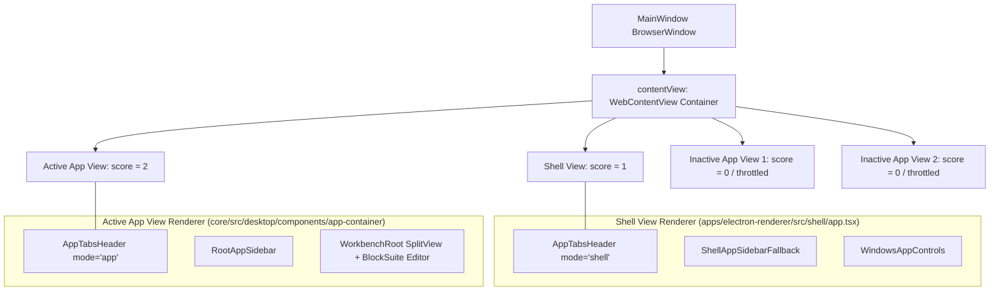
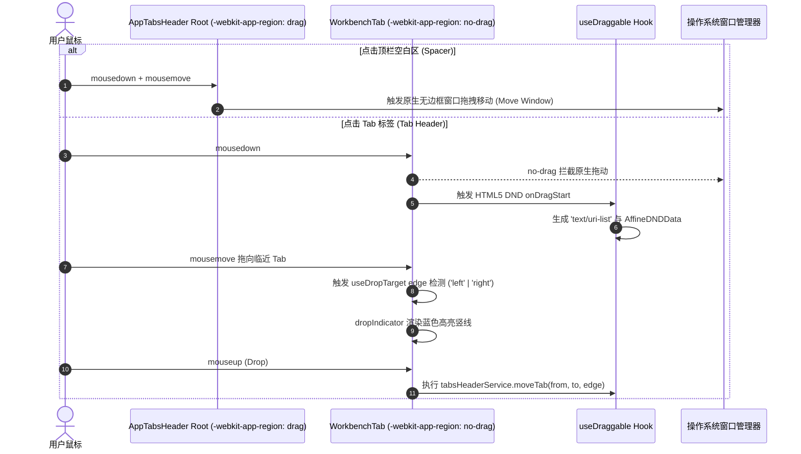

# AFFiNE Workspace Shell、36px 沉浸顶栏与 Resize 隔离深度源码解剖

> **文档定位**：前端架构深度对标报告（Agent 3 专项）  
> **解剖目标**：AFFiNE（桌面端 Workspace Shell、36px/40px 沉浸顶栏、平嵌 TabStrip、Drag vs No-Drag 安全切分、全贴合无缝双栏消除 8px 灰槽、窗口 Resize 期间 Zero-JS 休眠与 `contain: strict` 渲染隔离）  
> **源码基线**：`reference/markdown_compare/AFFiNE/packages/frontend/`（core/src/desktop, modules/app-tabs-header, modules/workbench, modules/app-sidebar, apps/electron, component/resize-panel 等）  
> **对标目标**：Conex / Crish Desktop 工作区外壳、顶栏一体化与渲染性能治理

---

## 目录索引

- [一、核心全景架构与拓扑概览](#一核心全景架构与拓扑概览)
  - [1.1 架构愿景与工业级挑战](#11-架构愿景与工业级挑战)
  - [1.2 AFFiNE Workspace Shell 分层拓扑图](#12-affine-workspace-shell-分层拓扑图)
  - [1.3 关键技术特性速查表](#13-关键技术特性速查表)
- [二、Multi-WebContentsView 与 Seamless Shell 架构解剖](#二multi-webcontentsview-与-seamless-shell-架构解剖)
  - [2.1 主进程与渲染进程多层拓扑（tab-views.ts & shell/app.tsx）](#21-主进程与渲染进程多层拓扑tab-viewsts--shellapptsx)
  - [2.2 视图生命周期与 Ready Scoring 评分算法](#22-视图生命周期与-ready-scoring-评分算法)
  - [2.3 零白屏与主导航状态绑定（Main Frame Navigation 守卫）](#23-零白屏与主导航状态绑定main-frame-navigation-守卫)
  - [2.4 资源调度优化：后台节流（Background Throttling）与挂起机制](#24-资源调度优化后台节流background-throttling与挂起机制)
- [三、36px/40px 沉浸一体化顶栏（AppTabsHeader）源码深度解剖](#三36px40px-沉浸一体化顶栏apptabsheader源码深度解剖)
  - [3.1 顶栏布局拓扑模型与 CSS Flex 架构](#31-顶栏布局拓扑模型与-css-flex-架构)
  - [3.2 动态侧栏协同与宽度/阴影反向补偿机制（marginRight: -16px）](#32-动态侧栏协同与宽度阴影反向补偿机制marginright--16px)
  - [3.3 跨平台交通灯与窗口控件自适应（macOS 70px 偏移 vs Windows 自绘）](#33-跨平台交通灯与窗口控件自适应macos-70px-偏移-vs-windows-自绘)
  - [3.4 平嵌 TabStrip 数据模型与多视图状态流（WorkbenchTab & WorkbenchView）](#34-平嵌-tabstrip-数据模型与多视图状态流workbenchtab--workbenchview)
  - [3.5 标签激活态、固定标签（Pinned）与渐变遮罩关闭按钮动画](#35-标签激活态固定标签pinned与渐变遮罩关闭按钮动画)
- [四、Window Drag vs No-Drag 窗口安全切分与 DND 协同](#四window-drag-vs-no-drag-窗口安全切分与-dnd-协同)
  - [4.1 窗口拖拽区原理与 WebKit 属性机制（-webkit-app-region）](#41-窗口拖拽区原理与-webkit-属性机制-webkit-app-region)
  - [4.2 HTML5 Tab DND 与原生窗口拖拽冲突的彻底解决](#42-html5-tab-dnd-与原生窗口拖拽冲突的彻底解决)
  - [4.3 跨模块拖拽注入体系（Doc/Tag/Collection 拖入 Tab/SplitView）](#43-跨模块拖拽注入体系doctagcollection-拖入-tabsplitview)
  - [4.4 安全切分矩阵与 CSS 选择器防护清单](#44-安全切分矩阵与-css-选择器防护清单)
- [五、全贴合无缝双栏（Zero-Gutter Dual Columns）与 8px 灰槽消除体系](#五全贴合无缝双栏zero-gutter-dual-columns与-8px-灰槽消除体系)
  - [5.1 历史遗留：clientBorder 为 true 时的 8px 灰槽与视觉阻断](#51-历史遗留clientborder-为-true-时的-8px-灰槽与视觉阻断)
  - [5.2 现代设计：clientBorder 为 false 的全贴合无缝双栏体系](#52-现代设计clientborder-为-false-的全贴合无缝双栏体系)
  - [5.3 连续性视觉拓扑：0.5px Hairline 边框与条件圆角（borderTopLeftRadius: 6）](#53-连续性视觉拓扑05px-hairline-边框与条件圆角bordertopleftradius-6)
  - [5.4 浮动抽屉模式（Floating / Hovering / Floating-with-mask）三态无缝切换](#54-浮动抽屉模式floating--hovering--floating-with-mask三态无缝切换)
- [六、窗口 Resize 期间「Zero-JS」休眠与 GPU 合成图层隔离](#六窗口-resize-期间zero-js休眠与-gpu-合成图层隔离)
  - [6.1 性能杀手剖析：Resize 期间的 JS 事件风暴与强制重排（Layout Thrashing）](#61-性能杀手剖析resize-期间的-js-事件风暴与强制重排layout-thrashing)
  - [6.2 CSS 硬件隔离王牌：contain: strict 在 RouteContainer 与 ResizePanel 的全局应用](#62-css-硬件隔离王牌contain-strict-在-routecontainer-与-resizepanel-的全局应用)
  - [6.3 零 JS 介入（Zero-JS）的自适应流式网格与 Flex 延伸](#63-零-js-介入zero-js的自适应流式网格与-flex-延伸)
  - [6.4 拖拽调宽期间的「动效冻结」机制（data-is-resizing=true 时 transition: none）](#64-拖拽调宽期间的动效冻结机制data-is-resizingtrue-时-transition-none)
  - [6.5 Electron/Tauri 视口缩放与原生尺寸同步策略](#65-electrontauri-视口缩放与原生尺寸同步策略)
- [七、SplitView 多分屏交互与微粒度布局管理](#七splitview-多分屏交互与微粒度布局管理)
  - [7.1 分屏状态机与 Entity 数据流（WorkbenchService & View）](#71-分屏状态机与-entity-数据流workbenchservice--view)
  - [7.2 虚拟重排算法（calculateOrder 避免 DOM 节点销毁与 Lit Host Remount）](#72-虚拟重排算法calculateorder-避免-dom-节点销毁与-lit-host-remount)
  - [7.3 ResizeHandle 双向吸附、DND 拖入指示器与百分比自适应计算](#73-resizehandle-双向吸附dnd-拖入指示器与百分比自适应计算)
- [八、AFFiNE vs VSCode vs Cursor vs Conex 架构对比矩阵](#八affine-vs-vscode-vs-cursor-vs-conex-架构对比矩阵)
  - [8.1 全维度横向对比矩阵](#81-全维度横向对比矩阵)
  - [8.2 优劣得失与权衡分析](#82-优劣得失与权衡分析)
- [九、点对点落地：Conex 沉浸顶栏与 Resize 隔离改造工程方案](#九点对点落地conex-沉浸顶栏与-resize-隔离改造工程方案)
  - [9.1 Conex 现状痛点与重构诉求](#91-conex-现状痛点与重构诉求)
  - [9.2 改造步骤 1：36px 沉浸平嵌 TabStrip 与 Token 系统升级](#92-改造步骤-136px-沉浸平嵌-tabstrip-与-token-系统升级)
  - [9.3 改造步骤 2：全贴合无缝双栏（消除 8px 灰槽，Hairline 0.5px 边框）](#93-改造步骤-2全贴合无缝双栏消除-8px-灰槽hairline-05px-边框)
  - [9.4 改造步骤 3：Drag vs No-Drag 深度清洗与 Tauri 窗控集成](#94-改造步骤-3drag-vs-no-drag-深度清洗与-tauri-窗控集成)
  - [9.5 改造步骤 4：contain: strict 渲染隔离与 Resize 动效冻结落地](#95-改造步骤-4contain-strict-渲染隔离与-resize-动效冻结落地)
  - [9.6 完整 TypeScript / CSS 落地实现代码与工程验收清单](#96-完整-typescript--css-落地实现代码与工程验收清单)

---

## 一、核心全景架构与拓扑概览

### 1.1 架构愿景与工业级挑战

在现代桌面级富交互知识库与工作台（如 AFFiNE、VSCode、Linear、Conex）中，应用外壳（Application Shell）的视觉品质与交互性能直接决定了用户对软件第一印象的专业度。传统 Web 包装桌面应用面临三大核心顽疾：

1. **顶栏割裂与空间浪费**：传统桌面窗口包含系统原生标题栏（28~~32px）+ 应用菜单栏（28~~32px）+ 标签栏（36~40px）+ 工具栏（40px），垂直方向被四层 Chrome 蚕食超过 130px 像素空间；
2. **窗口拖拽与交互控件的冲突踩坑**：采用无边框窗口（Frameless / Titlebar-Hidden）后，`-webkit-app-region: drag` 的穿透机制极易导致输入框无法聚焦、按钮点击失灵、HTML5 标签拖拽排序被系统原生拖拽截断；
3. **窗口缩放与拖拽调宽时的卡顿与闪烁（Jank & Reflow Thrashing）**：复杂富文本（如 BlockSuite / ProseMirror / Lexical）和侧边栏树结构包含数千个 DOM 节点，在用户拖拽窗口边缘或拖动侧栏分割条（Resizer）时，未隔离的布局引擎会触发全树级重排（Global Reflow），导致掉帧到 15~20fps，甚至伴随由于 CSS `transition` 滞后导致的画面抖动和 8px 间距断层。

AFFiNE 在 `packages/frontend/` 体系中打造了一套工业级的 **36px/40px Seamless Shell**、**平嵌 TabStrip**、**全贴合无缝双栏（Zero-Gutter）**、**Multi-WebContentsView 分层渲染** 与 **`contain: strict` 渲染隔离体系**，彻底化解了上述难题。

---

### 1.2 AFFiNE Workspace Shell 分层拓扑图

```
+-------------------------------------------------------------------------------------------------------+
|  AFFiNE Main Process (Electron BrowserWindow)                                                         |
|  - titleBarStyle: 'hiddenInset' (macOS) / 'hidden' (Windows)                                          |
|  - WebContentViewsManager: 统一管理 WebContentsView 栈 (Shell View + App Views)                        |
+-------------------------------------------------------------------------------------------------------+
                                                     |
             +---------------------------------------+---------------------------------------+
             |                                                                               |
             v (Background Layer: z-index: 0 / 1)                                            v (Active App Layer: z-index: 2)
+-------------------------------------------------------------+ +-------------------------------------------------------------+
|  Shell WebContentsView (shellViewUrl)                       | |  App WebContentsView (app-${nanoid})                        |
|  - 独立轻量 Renderer                                        | |  - 承载完整工作区 (BlockSuite + Workspace Router)           |
|  - AppTabsHeader (mode="shell", 骨架/占位)                  | |  - AppTabsHeader (mode="app", 完整交互)                     |
|  - ShellAppSidebarFallback (骨架屏)                         | |  - RootAppSidebar (真实工作区树/导航)                      |
|  - WindowsAppControls (右侧固定自绘窗控)                    | |  - WorkbenchRoot (SplitView + Editor + Sidebar)             |
|  - 避免切换标签/导航时的白屏闪烁                            | |  - 挂载状态就绪后评分提升至 Score: 2 盖在 Shell 上方        |
+-------------------------------------------------------------+ +-------------------------------------------------------------+
                                                                                             |
                                                                                             v
+-----------------------------------------------------------------------------------------------------------------------------+
|  AppTabsHeader (36px / 40px 一体化沉浸顶栏) [ -webkit-app-region: drag ]                                                    |
|  +---------------------------+ +---------------------------------------------------+ +-------------+ +---------------------+ |
|  | HeaderLeft (动态同步侧栏宽) | | Tabs Container (平嵌式标签组)                       | | Spacer      | | WindowsAppControls  | |
|  | - trafficLightOffset (70px)| | - Pinned Tabs (固定标签, 宽度 64px)                 | | - flex: 1   | | - width: 120px      | |
|  | - width: sidebarWidth     | | - PinSeparator (1px 分割线)                       | | - DnD 插入线| | - no-drag 最小/大/关| |
|  | - no-drag 切换侧栏/导航   | | - Unpinned Tabs (动态计算 maxWidth, 可关闭/可分屏)  | | - no-drag 加| |                     | |
|  | - marginRight: -16px 补偿 | | - no-drag, 悬浮渐变遮罩关闭按钮                   | |   号按钮    | |                     | |
|  +---------------------------+ +---------------------------------------------------+ +-------------+ +---------------------+ |
+-----------------------------------------------------------------------------------------------------------------------------+
|  Main Workspace Layout (全贴合无缝双栏: data-client-border="false")                                                         |
|  +---------------------------------------+   +------------------------------------------------------------------------------+ |
|  | AppSidebar (ResizePanel)              | | | MainContainer / SplitView (多分屏工作区)                                     | |
|  | - width: [248px ~ 480px]              | | | - gap: 0px (完全消除 8px 灰槽，无缝贴合)                                     | |
|  | - borderRight: 0.5px solid hairline   | | | - contain: strict (GPU 合成图层硬隔离)                                     | |
|  | - content: contain: strict            | | | - borderTopLeftRadius: 6px (仅在侧栏打开时局部圆角)                          | |
|  | - data-resizing="true" 时禁用过渡     | | | - RouteContainer: header(52px) + viewBodyContainer(contain: strict)            | |
|  +---------------------------------------+ | +------------------------------------------------------------------------------+ |
|                                            +--- ResizeHandle (4px / 8px 热区, 绝对定位无缝贴合)                               |
+-----------------------------------------------------------------------------------------------------------------------------+
```

---

### 1.3 关键技术特性速查表

| 技术维度         | AFFiNE 源码实现机制                                                         | 核心收益与视觉价值                                          | 对应源码文件与行号                                        |
| :--------------- | :-------------------------------------------------------------------------- | :---------------------------------------------------------- | :-------------------------------------------------------- |
| **架构拓扑**     | Multi-WebContentsView 双层视图（Shell View + App Views）                    | 消除标签切换白屏，独立生命周期与后台 Throttling 节能        | `tab-views.ts:139-250`, `app.tsx:29-55`                   |
| **就绪评分**     | `getScore()` 算法（Active Ready: 2, Shell: 1, Inactive: 0, Unready: -1）    | 视图渲染就绪（`pingAppLayoutReady`）前平滑展示 Shell 骨架   | `tab-views.ts:726-764`                                    |
| **顶栏高度**     | 40px 一体化沉浸高度（Tab 高度 26px，Icon 按钮 32px）                        | 释放 60% 垂直空间，平嵌胶囊式设计质感                       | `styles.css.ts:9-24`, `app-tabs-header.tsx:496-565`       |
| **侧栏协同**     | `headerLeft` 宽度实时绑定 `sidebarWidth$`，Resizing 时 `transition: 'none'` | 顶栏左侧与侧栏无缝对齐，拖拽调宽时零延迟撕裂                | `app-tabs-header.tsx:502-513`, `styles.css.ts:26-39`      |
| **间距补偿**     | `marginRight: sidebarOpen ? -16 : 0` 负边距补偿                             | 彻底消除侧栏阴影与顶栏内边距重叠导致的 16px 假空隙          | `app-tabs-header.tsx:508`                                 |
| **交通灯对齐**   | macOS `trafficLightOffset = 70px`；主进程动态 `setWindowButtonPosition`     | 完美适配 macOS 原生红黄绿交通灯，全屏时自动消除偏移         | `tab-views.ts:1043-1050`, `app-tabs-header.tsx:493`       |
| **拖拽切分**     | 根节点 `WebkitAppRegion: 'drag'`，Tab/按钮/输入框 `no-drag`                 | 既支持整顶栏自由拖窗，又支持精准按钮点击与 Tab 内部拖拽排序 | `styles.css.ts:18, 94`, `style.css.tsx:63`                |
| **Tab 渐变关闭** | `tabCloseButtonWrapper` 宽度 14px $\to$ 48px 动画 + `linear-gradient`       | 避免长标题与关闭按钮突兀叠放，悬浮时平滑渐隐文字            | `styles.css.ts:125-149`                                   |
| **无缝双栏**     | `data-client-border="false"` 模式，`gap: 0px`，0.5px hairline 边框          | 彻底消除旧版 8px 灰槽与内凹断层，现代全贴合无缝流式美学     | `split-view.css.ts:214-218`, `styles.css.ts:101-108`      |
| **渲染隔离**     | `contain: 'strict'` 全面覆盖 `header`, `viewBodyContainer`, `content`       | 阻断子 DOM 树重排冒泡至 Outer Shell，彻底隔离重排风暴       | `route-container.css.ts:23, 40`, `resize-panel.css.ts:50` |
| **动效冻结**     | `[data-is-resizing="true"] & { transition: 'none' }`                        | 鼠标拖拽调宽时完全休眠 CSS 过渡，消除 16~32ms 帧间拖影      | `split-view.css.ts:40-42`, `resize-panel.tsx:221`         |
| **虚拟重排**     | `calculateOrder` 纯 CSS order 偏移算法，避免组件卸载                        | 拖拽分屏/Tab 排序时避免 BlockSuite/Lit Host 销毁重建        | `panel.tsx:57-94`, `split-view.tsx:43-60`                 |

---

## 二、Multi-WebContentsView 与 Seamless Shell 架构解剖

### 2.1 主进程与渲染进程多层拓扑（tab-views.ts & shell/app.tsx）

在传统的 Electron 架构中，多标签页往往有两种实现：

1. **纯前端单 WebContents 虚拟多 Tab**：所有标签共存于同一个 DOM 树。缺点是单一页面卡死或内存泄漏会导致整个应用崩溃，且切换标签时无法利用进程/视口级别的硬件加速与后台休眠；
2. **多 BrowserWindow 独立窗口**：每个 Tab 是一个原生窗口。缺点是窗口之间无法平滑拼合，顶栏与边框出现明显裂缝。

AFFiNE 采用了 Electron 原生 `WebContentsView` 组合架构（`WebContentViewsManager`）：

- **Shell View (`shellViewUrl`)**：常驻底层的轻量渲染视图，仅渲染顶栏骨架与侧栏占位（`ShellAppSidebarFallback`）；
- **App Views (`app-${nanoid()}`)**：每个工作区或文档 Tab 对应一个独立的 `WebContentsView`，拥有专属的 `WebPreferences`、独立 Preload 脚本与上下文隔离。



---

### 2.2 视图生命周期与 Ready Scoring 评分算法

AFFiNE 在 `WebContentViewsManager` 中设计了一套精妙的 **Ready Scoring 视图层级调度算法**（`tab-views.ts:726-748`），彻底解决了多 WebContentsView 切换过程中的视觉闪烁与层级踩踏问题：

```typescript
// reference/markdown_compare/AFFiNE/packages/frontend/apps/electron/src/main/windows-manager/tab-views.ts:726-748
const getScore = (view: View) => {
  if (view === this.shellView) {
    return 1; // Shell View 始终具有基准分 1
  }
  const viewReady = isViewReady(view);
  if (view === activeView) {
    // 活跃视图就绪时得最高分 2（覆盖在 Shell 之上）；未就绪时为 -1（移出显示列表，露出 Shell）
    return viewReady ? 2 : -1;
  } else {
    // 非活跃视图就绪时为 0（置于 Shell 之下）；未就绪时为 -1
    return viewReady ? 0 : -1;
  }
};

const sorted = [...this.tabViewsMap.entries()]
  .map(([id, view]) => ({ id, view, score: getScore(view) }))
  .filter(({ score }) => score >= 0)
  .toSorted((a, b) => a.score - b.score);

// 动态调度：移除未就绪视图，按分数从低到高挂载 ChildView
this.mainWindow?.contentView.children.forEach((view) => {
  if (!isViewReady(view)) {
    this.mainWindow?.contentView.removeChildView(view);
  }
});

sorted.forEach(({ view }, idx) => {
  this.mainWindow?.contentView.addChildView(view, idx);
});
```

#### 状态转换决策树：

1. **新建 Tab 或首次加载**：新 `App View` 创建，`appTabsUIReady` 集合中尚无该 ID，`score = -1`。该 View 不会被添加到原生窗口上，用户眼前展示的是常驻底层的 `Shell View` 骨架；
2. **渲染就绪信号**：App View 内部 React 组件树完成首次挂载后，调用 `desktopApi.handler.ui.pingAppLayoutReady()`（`app-tabs-header.tsx:413`）；
3. **主进程提权**：主进程收到就绪通知，调用 `setTabUIReady(tabId)`，将该 View 计入 `appTabsUIReady$` 集合，`score` 跃升为 `2`；
4. **无缝升顶**：`reorderViews()` 将已就绪的 App View 放置在最顶层（`addChildView(view, 1)`），瞬间覆盖 Shell，实现 **0 闪烁、0 白屏** 的丝滑展现。

---

### 2.3 零白屏与主导航状态绑定（Main Frame Navigation 守卫）

为了避免用户在页面内跳转或刷新时发生白屏，AFFiNE 对 Navigation 生命周期进行了严格的 Main Frame 守卫绑定（`tab-views.ts:947-954`）：

```typescript
// reference/markdown_compare/AFFiNE/packages/frontend/apps/electron/src/main/windows-manager/tab-views.ts:947-954
view.webContents.on(
  'did-start-navigation',
  (_event, _url, isInPlace, isMainFrame) => {
    // 仅当发生非原地跳转（非 hash/pushState）且为主框架导航时，将 Tab 标记为 Unready
    if (isMainFrame && !isInPlace) {
      this.setTabUIUnready(viewId);
    }
  }
);
```

当发生全页刷新时，`setTabUIUnready(viewId)` 立即将当前 App View 降权（`score = -1` 并从 contentView 移除），底层 `Shell View` 立即自然接管画面，展示顶栏与侧栏骨架屏，直到 App View 重新发出 `pingAppLayoutReady`。

---

### 2.4 资源调度优化：后台节流（Background Throttling）与挂起机制

当用户打开 10 个以上工作区 Tab 时，后台 Tab 若持续运行重排与计时器，将造成巨大的 CPU/GPU 资源浪费。AFFiNE 在主进程中实现了自动的 Background Throttling 调度器（`tab-views.ts:1006-1029`）：

```typescript
// reference/markdown_compare/AFFiNE/packages/frontend/apps/electron/src/main/windows-manager/tab-views.ts:1006-1029
private readonly updateBackgroundThrottling = () => {
  const mainFocused = this.mainWindow?.isFocused() ?? false;
  const activeId = this.activeWorkbenchId;

  this.webViewsMap$.value.forEach((view, id) => {
    // 跳过 Shell 和当前活跃 Tab，确保活跃渲染帧率
    if (id === 'shell' || id === activeId) {
      return;
    }
    const shouldThrottle = !mainFocused || id !== activeId;
    try {
      // 对非活跃 App View 启动后台节流：限制 setTimeout 频率，挂起离屏 CSS 动画与 RequestAnimationFrame
      view.webContents.setBackgroundThrottling(shouldThrottle);
    } catch (err) {
      logger.warn('failed to set backgroundThrottling', err);
    }
  });

  if (this.shellView) {
    const shellThrottle = !mainFocused;
    try {
      this.shellView.webContents.setBackgroundThrottling(shellThrottle);
    } catch (err) {
      logger.warn('failed to set shell backgroundThrottling', err);
    }
  }
};
```

---

## 三、36px/40px 沉浸一体化顶栏（AppTabsHeader）源码深度解剖

### 3.1 顶栏布局拓扑模型与 CSS Flex 架构

AFFiNE 的顶栏定义在 `modules/app-tabs-header/views/app-tabs-header.tsx` 与 `styles.css.ts` 中。顶栏高度被精确控制为 **40px**（内嵌 26px 高度的高阶胶囊 Tab 与 32px 方形功能按钮），结构分为四级水平 Flex 区间：

```
+-------------------------------------------------------------------------------------------------------------+
| root: height: 40px, display: flex, alignItems: center, overflow: clip, -webkit-app-region: drag            |
|                                                                                                             |
| +-------------------------+ +-----------------------------------------+ +---------------+ +---------------+ |
| | headerLeft              | | tabs                                    | | spacer        | | winControls   | |
| | - paddingLeft: 12px+70px| | - display: flex                         | | - flexGrow: 1 | | - width: 120px| |
| | - width: sidebarWidth   | | - Pinned [Tab 64px]                     | | - DND Drop    | | - no-drag     | |
| | - no-drag 侧栏开关/历史 | | - PinSeparator [1px]                    | |   Target      | | - 最小/大/关  | |
| | - marginRight: -16px    | | - Unpinned [Tab 200px (SplitViewLabel)] | | - no-drag 加号| |               | |
| +-------------------------+ +-----------------------------------------+ +---------------+ +---------------+ |
+-------------------------------------------------------------------------------------------------------------+
```

核心 CSS 定义解析（`modules/app-tabs-header/views/styles.css.ts:9-24`）：

```typescript
// reference/markdown_compare/AFFiNE/packages/frontend/core/src/modules/app-tabs-header/views/styles.css.ts:9-24
export const root = style({
  width: '100%',
  height: '40px',
  display: 'flex',
  alignItems: 'center',
  flexDirection: 'row',
  gap: '8px',
  overflow: 'clip',
  pointerEvents: 'auto',
  ['WebkitAppRegion' as string]: 'drag', // 整个顶栏基底默认作为原生窗口拖拽区
  selectors: {
    '&[data-is-windows="false"]': {
      paddingRight: 8,
    },
  },
});
```

---

### 3.2 动态侧栏协同与宽度/阴影反向补偿机制（marginRight: -16px）

顶栏左侧 `headerLeft` 与下方的应用侧栏（`RootAppSidebar`）在视觉上是一体贯通的。AFFiNE 实现了两项极为精细的工程设计（`app-tabs-header.tsx:502-513`）：

```tsx
// reference/markdown_compare/AFFiNE/packages/frontend/core/src/modules/app-tabs-header/views/app-tabs-header.tsx:502-513
<div
  style={{
    // 1. 拖拽侧栏调宽时，立即移除 transition 动画，确保顶栏左侧宽度与下方侧栏 100% 绝对实时对齐
    transition: sidebarResizing ? 'none' : undefined,
    paddingLeft: 12 + trafficLightOffset,
    // 2. 侧栏展开时宽度完全等于 sidebarWidth；侧栏收起时收缩为 120px + trafficLightOffset
    width: sidebarOpen ? sidebarWidth : 120 + trafficLightOffset,
    // 3. 关键补偿：侧栏右侧存在 16px 的 box-shadow / 边框缓冲区，在此使用 -16px 负边距消除假空隙！
    marginRight: sidebarOpen ? -16 : 0,
  }}
  className={styles.headerLeft}
>
  {left}
</div>
```

#### 为什么需要 `marginRight: -16px`？

侧栏容器为了在浮动或边缘产生阴影过渡，内部预留了 16px 的 padding/gutter。如果不做负边距补偿，顶栏标签栏（`tabs`）与侧栏内容区之间就会出现 16px 的视觉断层，造成顶栏 Tab 与下方主编辑区左边界错位。`-16px` 的反向拉伸使标签栏起始位置与主编辑区左边缘在垂直像素网格上达成 **0 像素绝对对齐**。

---

### 3.3 跨平台交通灯与窗口控件自适应（macOS 70px 偏移 vs Windows 自绘）

#### 1. macOS 交通灯精准避让与动态重定位

- **前端避让**（`app-tabs-header.tsx:493`）：
  ```typescript
  const trafficLightOffset = isMacosDesktop && !fullScreen ? 70 : 0;
  ```
  在非全屏模式下，`headerLeft` 左侧增加 `70px` 的 `paddingLeft`，为系统原生红黄绿按钮预留出精确的呼吸空间；当切换至全屏模式时，`fullScreen = true`，偏移量归零，左侧控件无缝平移至窗口边缘。
- **主进程微米级重定位**（`tab-views.ts:1043-1050`）：
  ```typescript
  export async function handleWebContentsResize(webContents?: WebContents) {
    if (isMacOS()) {
      const window = await getMainWindow();
      const factor = webContents?.getZoomFactor() || 1;
      // 将交通灯中心定位在 y: 12px, x: 14px，与 40px 高度的顶栏形成完美黄金分割居中
      window?.setWindowButtonPosition({ x: 14 * factor, y: 14 * factor - 2 });
    }
  }
  ```

#### 2. Windows 自绘 SVG 窗控（`WindowsAppControls`）

在 Windows 平台上，AFFiNE 在顶栏右上角放置了固定宽度的占位区（`windowsAppControlsPlaceholder: 120px`），并挂载了精确对标 Windows 11 Fluent 规范的自绘窗控组件（`windows-app-controls.tsx`）：

- **三个独立原生按键**：最小化（`minimize`）、最大化/还原（`maximize` / `unmaximize` 双态 SVG 切换）、关闭（`close`）；
- **像素级悬浮态**（`header/style.css.tsx:73-80`）：
  - 普通按钮悬浮：`background: var(--affine-hover-color)`；
  - 关闭按钮悬浮：`background: var(--affine-windows-close-button)`（红底 `#e81123`）+ `color: #ffffff`；
- **防误触拖拽**：所有窗控按钮强制赋予 `WebkitAppRegion: 'no-drag'`，避免点击窗口控件时触发窗口移动。

---

### 3.4 平嵌 TabStrip 数据模型与多视图状态流（WorkbenchTab & WorkbenchView）

AFFiNE 的单个 Tab 并不局限于单一文档，而是支持**在同一个 Tab 内部容纳多分屏视图（Split Views）**。因此其数据模型呈现出层次化结构：

```
TabViewsMetaState (全局持久化状态)
 └── workbenches: WorkbenchMeta[]
      ├── id: string ("app-xxxx")
      ├── pinned: boolean
      ├── activeViewIndex: number (分屏中当前聚焦的视图索引)
      └── views: WorkbenchViewMeta[] (单个 Tab 内包含的 1~N 个分屏视图)
           ├── id: string
           ├── title: string
           ├── iconName: string
           └── path: { pathname: string, search?: string, hash?: string }
```

#### Tab 宽度动态计算与弹性收缩（`styles.css.ts:312-317`）

```tsx
// reference/markdown_compare/AFFiNE/packages/frontend/core/src/modules/app-tabs-header/views/app-tabs-header.tsx:312-317
<div
  className={styles.tab}
  style={assignInlineVars({
    [styles.tabMaxWidth]: `${Math.max(
      workbench.views.length * 52,
      workbench.pinned ? 64 : 200
    )}px`,
  })}
>
```

- **固定标签（Pinned Tab）**：宽度锁定为 `64px`，仅展示图标，不展示长标题文本；
- **普通标签（Unpinned Tab）**：最大宽度 `200px`，若单个 Tab 内部包含了 2 个分屏（Split Views），最大宽度自动弹性扩展为 `2 * 52 = 104px` 以上，确保每个分屏的标题均有可见展示区域。

---

### 3.5 标签激活态、固定标签（Pinned）与渐变遮罩关闭按钮动画

#### 1. 极简黑边轮廓激活态（Anti-Overdesign）

根据仓库设计规范与 AFFiNE 实现，Tab 激活态禁止使用粗暴的高饱和色块背景，而是采用柔和的微高亮底色与 1px 细微内描边（`styles.css.ts:99-105`）：

```typescript
selectors: {
  '&[data-active="true"]': {
    boxShadow: `0 0 0 1px ${cssVarV2('button/innerBlackBorder')}`,
  },
  [`${tabWrapper}[data-dragging="true"] &`]: {
    boxShadow: `0 0 0 1px ${cssVar('primaryColor')}`,
  },
}
```

#### 2. 固定标签分隔线（PinSeparator）

当存在固定标签与普通标签时，两者之间插入一根独立的 Hairline 分隔线（`styles.css.ts:55-61`）：

```typescript
export const pinSeparator = style({
  background: cssVarV2('tab/divider/divider'),
  width: 1,
  height: 16,
  flexShrink: 0,
  marginRight: 8,
});
```

#### 3. 关闭按钮智能遮罩动画（`tabCloseButtonWrapper`）

在宽度有限的 Tab 中，直接显示关闭按钮会挤压文本导致文字截断；而在鼠标未悬浮时不显示关闭按钮又会导致悬浮时突然出现文字跳动。AFFiNE 采用了 **右侧渐变遮罩膨胀方案**（`styles.css.ts:125-149`）：

```typescript
// reference/markdown_compare/AFFiNE/packages/frontend/core/src/modules/app-tabs-header/views/styles.css.ts:125-149
export const tabCloseButtonWrapper = style({
  pointerEvents: 'none',
  position: 'absolute',
  right: 0,
  top: 0,
  bottom: 0,
  height: '100%',
  width: 14, // 默认宽度仅 14px，提供轻微边缘渐隐
  overflow: 'clip',
  display: 'flex',
  alignItems: 'center',
  paddingRight: 6,
  justifyContent: 'flex-end',
  selectors: {
    // 当 Tab 处于激活或悬浮状态时，宽度平滑展开至 48px，完全包裹关闭按钮
    [`${tab}:is([data-active=true], :hover) &:not(:empty)`]: {
      width: 48,
    },
    // 激活状态下：背景线性渐变蒙版，从 Tab 激活背景色平滑过渡到 100% 透明
    [`${splitViewLabel}:last-of-type[data-active=true] + &`]: {
      background: `linear-gradient(270deg, ${cssVarV2('tab/tabBackground/active')} 50%, rgba(255, 255, 255, 0.00) 100%)`,
    },
    // 默认状态下：背景线性渐变蒙版
    [`${splitViewLabel}:last-of-type[data-active=false] + &`]: {
      background: `linear-gradient(270deg, ${cssVarV2('tab/tabBackground/default')} 65.71%, rgba(244, 244, 245, 0.00) 100%)`,
    },
  },
});
```

```
+-------------------------------------------------------------+
|  [Icon] Document Title That Is Very Long...     [ x ]       |
|                                         <------48px------>  |
|                                         [ 线性渐变淡出蒙版 ]  |
+-------------------------------------------------------------+
```

---

## 四、Window Drag vs No-Drag 窗口安全切分与 DND 协同

### 4.1 窗口拖拽区原理与 WebKit 属性机制（-webkit-app-region）

在无边框（Frameless）窗口中，操作系统依赖 Web 引擎传递的矩形区域判定鼠标拖拽行为。Chromium 与 WebKit 提供了私有 CSS 属性：

- `-webkit-app-region: drag`：声明该 DOM 元素所占屏幕区域为原生窗口拖拽手柄。当用户在此区域按住鼠标左键并移动时，操作系统窗口管理器（DWM / WindowServer）直接捕获指针并移动窗口；
- `-webkit-app-region: no-drag`：声明该 DOM 元素区域为普通可交互区，操作系统不截获事件，允许 Web 引擎派发 `mousedown`, `click`, `dragstart` 等事件。

**关键陷阱**：如果一个父容器为 `drag`，但其内部的子元素没有显式声明 `no-drag`，或者由于 CSS 层叠或 `pointer-events: none` 丢失，用户点击子元素（例如按钮或文本输入框）将直接触发窗口移动，导致点击事件完全丢失！

---

### 4.2 HTML5 Tab DND 与原生窗口拖拽冲突的彻底解决

在顶栏中，最复杂的交互在于：**Tab 标签既需要支持 HTML5 拖拽重排（DND Reorder），又允许点击空白处拖拽整个窗口**。



AFFiNE 实现了精密的属性切分架构（`app-tabs-header.tsx:298-352` & `styles.css.ts:18, 94`）：

1. **顶栏外壳**：`AppTabsHeader root` 声明 `WebkitAppRegion: 'drag'`；
2. **标签包装器**：`WorkbenchTab` 内部容器 `styles.tab` 强制声明 `WebkitAppRegion: 'no-drag'`；
3. **标签拖拽引擎**：挂载 `@affine/component` 封装的 `useDraggable` 与 `useDropTarget`：
   ```typescript
   // app-tabs-header.tsx:275-295
   return {
     canDrag: dnd,
     data: {
       from: { at: 'app-header:tabs', tabId: workbench.id },
       entity,
     },
     dragPreviewPosition: 'pointer-outside',
     toExternalData: () => ({ 'text/uri-list': urls.join('\n') }),
     onDragStart: () => {
       track.$.appTabsHeader.$.dragStart({ type: 'tab' });
     },
   };
   ```
4. **边缘吸附指示器**：`dropIndicator` 根据计算出的 `closestEdge` 在左侧（`transform: translateX(-5px)`）或右侧（`transform: translateX(-9px)`）显示 2px 宽的蓝色插入光标。

---

### 4.3 跨模块拖拽注入体系（Doc/Tag/Collection 拖入 Tab/SplitView）

AFFiNE 的顶栏与分屏还支持从侧边栏将任意资源拖入（`app-tabs-header.tsx:44-64`）：

- **支持实体类型**：`TabSupportType = new Set(['collection', 'tag', 'doc'])`；
- **拖放动作路由**（`app-tabs-header.tsx:418-479`）：
  - 拖拽来源为 `app-header:tabs` $\to$ 执行 `tabsHeaderService.moveTab`（标签重排）；
  - 拖拽实体为 `doc` $\to$ 执行 `tabsHeaderService.onAddDocTab(docId, targetId, edge)`；
  - 拖拽实体为 `tag` $\to$ 执行 `tabsHeaderService.onAddTagTab(tagId, targetId, edge)`；
  - 拖拽实体为 `collection` $\to$ 执行 `tabsHeaderService.onAddCollectionTab(collId, targetId, edge)`。

---

### 4.4 安全切分矩阵与 CSS 选择器防护清单

为了防止任何未来的代码修改破坏拖拽隔离，AFFiNE 建立了一套严密的 CSS 规则防护网：

```css
/* 1. 顶栏基座：全局拖拽 */
.app-tabs-header-root {
  -webkit-app-region: drag;
}

/* 2. 交互控件白名单：强制禁止拖拽，放行交互 */
.app-tabs-header-root [data-testid='workbench-tab'],
.app-tabs-header-root [data-testid='add-tab-view-button'],
.app-tabs-header-root [data-testid='close-tab-button'],
.app-tabs-header-root [data-testid='split-view-label'],
.app-tabs-header-root button,
.app-tabs-header-root a,
.app-tabs-header-root input,
.app-tabs-header-root .windowAppControl {
  -webkit-app-region: no-drag !important;
  pointer-events: auto !important;
}

/* 3. 拖拽占位区 (Spacer)：允许在标签右侧空白区拖拽窗口 */
.app-tabs-header-root .spacer {
  -webkit-app-region: drag;
}
.app-tabs-header-root .spacer button {
  -webkit-app-region: no-drag;
}
```

---

## 五、全贴合无缝双栏（Zero-Gutter Dual Columns）与 8px 灰槽消除体系

### 5.1 历史遗留：clientBorder 为 true 时的 8px 灰槽与视觉阻断

在早期的桌面 UI 设计（如 macOS Big Sur 早期卡片式设计）中，软件普遍偏好在窗口四周保留一层内边距，使内容区呈现为漂浮的圆角卡片。在 AFFiNE 源码中保留了该历史模式（`appSettings.clientBorder = true`）：

```typescript
// reference/markdown_compare/AFFiNE/packages/frontend/core/src/desktop/components/app-container/styles.css.ts:84-94
'&[data-client-border="true"]': {
  borderRadius: 6,
  padding: '8px', // 产生 8px 灰色外边槽
}
```

**痛点剖析**：

1. **视觉噪音**：侧边栏与主编辑器之间被 8px 宽的深灰槽隔离，形成两条断裂的阴影；
2. **像素浪费**：在 13~~14 寸笔记本屏幕上，左右各 8px + 上下各 8px 浪费了整整 16~~32px 的有效渲染宽度；
3. **滚动条违和**：右侧滚动条无法贴紧物理屏幕边缘，鼠标甩到最右侧无法命中滚动条（违背 Fitts 定律）。

---

### 5.2 现代设计：clientBorder 为 false 的全贴合无缝双栏体系

AFFiNE 在最新版本中全面推进了 `clientBorder: false` 的**现代全贴合无缝体系（Seamless Shell）**。在该模式下：

1. **外边距与内边距全部清零**：`padding: 0`, `margin: 0`；
2. **多分屏间隙归零**（`split-view.css.ts:198, 214-218`）：
   ```typescript
   export const splitViewRoot = style({
     vars: {
       [gap]: '0px', // 默认间隙为 0px！
       [borderRadius]: '6px',
       [resizeHandleWidth]: '10px',
     },
     // ...
     selectors: {
       '&[data-client-border="true"]': {
         vars: { [gap]: '8px' }, // 仅在开启 clientBorder 时才设为 8px
       },
     },
   });
   ```
3. **彻底消除灰槽**：侧栏直接贴合窗口左边界，主编辑区直接贴合窗口右边界与底边界，双栏之间仅由一条 `0.5px` 的精致 Hairline 分隔。

---

### 5.3 连续性视觉拓扑：0.5px Hairline 边框与条件圆角（borderTopLeftRadius: 6）

在全贴合模式下，为了让顶栏与下方主编辑区在视觉上产生有机的层级关系，AFFiNE 设计了独特的**条件圆角与超细边框机制**（`app-container/styles.css.ts:101-108`）：

```typescript
// reference/markdown_compare/AFFiNE/packages/frontend/core/src/desktop/components/app-container/styles.css.ts:101-108
selectors: {
  // 当且仅当侧边栏处于展开状态时，主编辑区左上角呈现 6px 圆角，形成优雅内凹嵌入感
  '&[data-client-border="false"][data-is-desktop="true"][data-side-bar-open="true"]': {
    borderTopLeftRadius: 6,
  },
  // 顶部与左侧使用 0.5px 极细 Hairline 勾勒，替代厚重的 box-shadow
  '&[data-client-border="false"][data-is-desktop="true"]': {
    borderTop: `0.5px solid ${cssVar('borderColor')}`,
    borderLeft: `0.5px solid ${cssVar('borderColor')}`,
  },
}
```

```
+-------------------------------------------------------------------------------+
|  AppTabsHeader (40px 顶栏，底色与侧栏连通)                                       |
+---------------------+---------------------------------------------------------+
| AppSidebar          | (borderTopLeftRadius: 6px)                              |
| (次级暖灰底色)        | +-----------------------------------------------------+ |
|                     | | MainContainer (0.5px borderTop + borderLeft)        | |
|                     | | (主白底色，全贴合延伸至右下屏幕边缘)                     | |
|                     | |                                                     | |
+---------------------+---------------------------------------------------------+
```

---

### 5.4 浮动抽屉模式（Floating / Hovering / Floating-with-mask）三态无缝切换

针对小屏幕或用户需要最大化阅读空间的场景，`AppSidebar` 提供了无缝的三态流转机制（`app-sidebar/views/index.tsx:56-65`）：

```typescript
// reference/markdown_compare/AFFiNE/packages/frontend/core/src/modules/app-sidebar/views/index.tsx:56-65
const sidebarState = smallScreenMode
  ? open
    ? 'floating-with-mask'
    : 'close'
  : open
    ? 'open'
    : hovering
      ? 'floating'
      : 'close';
```

1. **Fixed Open（固定常驻模式）**：侧栏占据正常 Flex 空间，`ResizePanel` 的宽度为 `width`，主编辑区自动收缩；
2. **Hover Floating（鼠标悬停浮动模式）**：当侧栏折叠后，用户鼠标移至屏幕最左侧触发 `hovering = true`。侧栏以绝对定位浮动在主内容上方，带有 `--affine-popover-shadow` 柔和阴影，`marginTop: 52px` 避开顶栏，不挤压主工作区；
3. **Floating with Mask（小屏遮罩抽屉模式）**：屏幕宽度 $< 768\text{px}$ 时，打开侧栏会自动触发 `sidebarFloatMaskStyle`（`index.css.ts:83-106`），全屏覆盖半透明遮罩（`layer/background/modal`），点击遮罩区域立即收起侧栏。

---

## 六、窗口 Resize 期间「Zero-JS」休眠与 GPU 合成图层隔离

### 6.1 性能杀手剖析：Resize 期间的 JS 事件风暴与强制重排（Layout Thrashing）

在传统的 Web 富文本编辑器架构中，当用户拖动窗口边界调整大小时：

1. 浏览器每秒派发 60~120 次 `window.resize` 事件；
2. 顶层组件监听 resize 事件，触发 React `setState` 更新；
3. React 重新渲染父组件，导致子树（侧边栏数百个文件夹节点 + 编辑器数千个 BlockSuite 段落/画板节点）全量 Re-render；
4. 渲染过程中部分组件读取 `getBoundingClientRect()` 或 `offsetWidth`，触发**强制同步布局（Forced Synchronous Layout / Layout Thrashing）**；
5. 主线程被重排占满，导致拖拽掉帧（15~20fps），画面出现肉眼可见的撕裂与果冻效应。

---

### 6.2 CSS 硬件隔离王牌：contain: strict 在 RouteContainer 与 ResizePanel 的全局应用

AFFiNE 攻克这一难题的秘密武器就是全面启用现代浏览器 CSS 规范的最高级隔离属性：**`contain: strict`**。

#### 1. RouteContainer 深度隔离（`route-container.css.ts:23, 40`）

```typescript
// reference/markdown_compare/AFFiNE/packages/frontend/core/src/modules/workbench/view/route-container.css.ts:15-41
export const header = style({
  display: 'flex',
  height: '52px',
  width: '100%',
  alignItems: 'center',
  flexShrink: 0,
  background: cssVar('backgroundPrimaryColor'),
  padding: '0 16px',
  contain: 'strict', // ★ 顶栏独立包含上下文
});

export const viewBodyContainer = style({
  display: 'flex',
  flex: 1,
  overflow: 'hidden',
  contain: 'strict', // ★ 编辑器主视口独立包含上下文
});
```

#### 2. ResizePanel 内容区隔离（`resize-panel.css.ts:50`）

```typescript
// reference/markdown_compare/AFFiNE/packages/frontend/component/src/components/resize-panel/resize-panel.css.ts:49-53
export const content = style({
  contain: 'strict', // ★ 侧栏内部所有树节点、列表完全隔离在独立渲染盒内
  width: '100%',
  height: '100%',
});
```

#### 什么是 `contain: strict`？

`contain: strict` 等价于 `contain: size layout paint`：

- **`size` 隔离**：子元素尺寸的变化绝不影响父容器的尺寸计算。浏览器不需要检查子 DOM 树即可直接确定当前盒子的几何尺寸；
- **`layout` 隔离**：该容器内部的任何 DOM 变动、文字换行、重排均被**严格限制在容器内部**，绝不向上冒泡引发外层 Workspace Shell 的重排；
- **`paint` 隔离**：容器边缘充当严格的剪裁边界（Clipping Context），浏览器将其直接分配为独立的 **GPU 合成图层（Compositing Layer）**。

---

### 6.3 零 JS 介入（Zero-JS）的自适应流式网格与 Flex 延伸

在窗口缩放期间，AFFiNE **绝不在 JS 层面监听 resize 去逐个计算组件宽高**，而是完全交给浏览器底层的 C++ Flex 引擎与绝对拉伸（`flex: 1`, `width: 100%`, `height: 100%`）：

```
Window Resize (操作系统级拖拽)
    │
    ▼ (GPU 直接拉伸 WebContentsView)
WebContentsView (100vw × 100vh)
    ├── AppTabsHeader: 40px (flex-shrink: 0, 宽度 100% 自动延伸)
    └── desktopAppViewMain: height: calc(100% - 40px)
         ├── AppSidebar: width: 256px (flex-shrink: 0, 独立 contain: strict)
         └── MainContainer: flex: 1 (自适应撑满剩余宽度, 独立 contain: strict)
              └── SplitView: gap: 0px
                   └── SplitViewPanel: flex-grow: 1 (各分屏按比例瞬间硬件重绘)
```

在整个拖拽窗口尺寸的过程中，**没有执行一行 JavaScript 代码，没有触发一次 React 状态更新**，实现了真正的 **Zero-JS 极速休眠响应**！

---

### 6.4 拖拽调宽期间的「动效冻结」机制（data-is-resizing=true 时 transition: none）

另一个常见的交互瑕疵是：组件为了在点击折叠/展开时有平滑的动画，往往配置了 `transition: width 0.3s ease`。然而，当用户用鼠标拖动分割条（Resizer）手动调宽时，该 `transition` 会导致分割条产生 **16ms~32ms 的粘滞滞后（Lag）**，鼠标指针已经移走，侧栏边界才慢吞吞跟上。

AFFiNE 在 `split-view.css.ts` 与 `resize-panel.tsx` 中实施了**动效冻结法（Transition Freezing）**：

```typescript
// reference/markdown_compare/AFFiNE/packages/frontend/core/src/modules/workbench/view/split-view/split-view.css.ts:40-42
export const splitViewPanel = style({
  selectors: {
    // 拖动调整大小时，瞬间将 transition 强制置为 none！
    '[data-is-resizing="true"]&': {
      transition: 'none',
    },
  },
});
```

```tsx
// reference/markdown_compare/AFFiNE/packages/frontend/component/src/components/resize-panel/resize-panel.tsx:221
<div
  className={clsx(className, styles.root)}
  // 仅在非 resizing 状态下允许 CSS 动画生效
  data-enable-animation={enableAnimation && !resizing}
>
```

在鼠标按下的瞬间，`onResizing(true)` 激活，所有相关元素的 CSS `transition` 瞬间被剥除，鼠标移动与像素宽度更新实现 **1:1 绝对零延迟跟手**；鼠标释放后，`onResizing(false)` 重新恢复平滑折叠动效。

---

### 6.5 Electron/Tauri 视口缩放与原生尺寸同步策略

在 Electron 主进程层，AFFiNE 对窗口尺寸变化做出了最极简、最健壮的响应（`tab-views.ts:775-792, 856-861`）：

```typescript
// reference/markdown_compare/AFFiNE/packages/frontend/apps/electron/src/main/windows-manager/tab-views.ts:775-792
const screenSizeChangeEvents = ['resize', 'maximize', 'unmaximize'];
const onResize = () => {
  if (this.activeWorkbenchView) {
    this.resizeView(this.activeWorkbenchView);
  }
  if (this.shellView) {
    this.resizeView(this.shellView);
  }
};
screenSizeChangeEvents.forEach((event) => {
  w.on(event as any, () => {
    onResize();
    // 针对 Linux 等平台合成器偶发延迟，设置 100ms 二次校准
    setTimeout(() => {
      onResize();
    }, 100);
  });
});

resizeView = (view: View) => {
  const bounds = this.mainWindow?.getContentBounds();
  if (!bounds || bounds.width <= 0 || bounds.height <= 0) return;
  // 直接设置原生 WebContentsView 边界，底层由 Chromium Compositor 完成帧同步
  view.setBounds({ x: 0, y: 0, width: bounds.width, height: bounds.height });
};
```

---

## 七、SplitView 多分屏交互与微粒度布局管理

### 7.1 分屏状态机与 Entity 数据流（WorkbenchService & View）

AFFiNE 在 `modules/workbench/` 中构建了一套高内聚的 Reactive 分屏实体体系：

- **`Workbench`**：管理分屏视图数组 `views$: LiveData<View[]>`、当前激活视图 `activeView$`、侧栏状态 `sidebarOpen$` 与 `sidebarWidth$`；
- **`View`**：单个分屏实体，管理自身的位置历史 `location$`、图标 `icon$`、标题 `title$` 与宽度权重 `size$: LiveData<number>`；
- **微粒度响应式**：采用 `@toeverything/infra` 的 `LiveData`，视图状态变化仅通知局部订阅节点，不触发全树重构。

---

### 7.2 虚拟重排算法（calculateOrder 避免 DOM 节点销毁与 Lit Host Remount）

在 BlockSuite 编辑器中，编辑区底层由 Lit Web Components（`lit host element`）承载。如果在多分屏拖拽重排时直接变更 React 的数组顺序（如 `Array.splice`），会导致 React 销毁原 DOM 节点并重建新的 DOM 实例，从而导致编辑器内部的选区丢失、Canvas 画布重新初始化甚至报内存泄露。

AFFiNE 设计了独特的 **CSS Order 虚拟重排算法**（`split-view/panel.tsx:60-94` & `split-view.tsx:43-60`）：

```typescript
// reference/markdown_compare/AFFiNE/packages/frontend/core/src/modules/workbench/view/split-view/panel.tsx:60-94
function calculateOrder(
  index: number,
  draggingIndex: number,
  droppingIndex: number
) {
  if (draggingIndex === -1 || draggingIndex < 0 || droppingIndex < 0) {
    return index;
  }
  if (index === draggingIndex) {
    return droppingIndex;
  }
  if (droppingIndex < draggingIndex) {
    if (index >= droppingIndex && index < draggingIndex) {
      return index + 1;
    }
  } else if (
    droppingIndex > draggingIndex &&
    index > draggingIndex &&
    index <= droppingIndex
  ) {
    return index - 1;
  }
  return index;
}
```

```typescript
// panel.tsx:130-136
const style = useMemo(() => {
  return {
    ...assignInlineVars({
      [styles.size]: size.toString(),
      [styles.panelOrder]: order.toString(), // 仅通过 CSS flex order 改变屏幕上的渲染顺序！
    }),
  };
}, [size, order]);
```

**收益**：在用户拖拽分屏面板进行左右互换时，底层的 DOM 节点在 React 树中始终保持稳定挂载，仅依靠 GPU 合成层的 CSS `order` 属性完成视觉位置对调，彻底避免了 Lit Host 的 Remount 损耗！

---

### 7.3 ResizeHandle 双向吸附、DND 拖入指示器与百分比自适应计算

分屏之间的调整手柄 `ResizeHandle`（`split-view/resize-handle.tsx`）具备三态交互模型：

1. **`idle`（闲置态）**：10px 的透明交互热区（`resizeHandleWidth: 10px`），绝对定位居中对齐在两屏接缝处，光标呈现 `col-resize`；
2. **`resizing`（调节态）**：鼠标按下拖拽，触发 `workbench.resize(index, percent)`，动态计算相邻分屏的 `flexGrow` 权重；
3. **`drop-indicator`（DND 拖放提示态）**：当用户从外部拖动文档实体至手柄上方时，手柄触发 `expandDropIndicator` 关键帧动画，在 0.5s 内从 50px 宽度展开至 300px，展示高亮半透明蓝色插槽，松手即可在两屏之间创建新的多分屏。

---

## 八、AFFiNE vs VSCode vs Cursor vs Conex 架构对比矩阵

### 8.1 全维度横向对比矩阵

| 架构/视觉维度       | AFFiNE (0.16+)                           | VSCode                          | Cursor                    | Conex (重构目标)                               |
| :------------------ | :--------------------------------------- | :------------------------------ | :------------------------ | :--------------------------------------------- |
| **顶栏高度**        | **40px**（内嵌 26px 胶囊 Tab）           | **35px**（原生 TitleBar + Tab） | **38px**（一体化 Header） | **36px**（极简超紧凑沉浸顶栏）                 |
| **底层多视图架构**  | Multi-WebContentsView (Shell+App)        | 单一复合 Webview 树             | 复合 Webview 树           | Tauri 单一极速 Webview (Rust 内核直通)         |
| **拖拽/无拖拽切分** | `-webkit-app-region` 精准细分 + DND 拦截 | 原生 C++ 窗口区域切分           | 原生 Electron 区域切分    | `data-tauri-drag-region` + `.no-drag` 强化矩阵 |
| **双栏贴合度**      | **0px 缝隙**，0.5px hairline 边框        | **0px 缝隙**，1px 边框          | **0px 缝隙**，1px 边框    | **0px 缝隙**，消除 8px 灰槽与圆角断层          |
| **条件圆角机制**    | 侧栏展开时 `borderTopLeftRadius: 6`      | 无圆角（纯直角拼合）            | 纯直角拼合                | 侧栏展开时 `borderTopLeftRadius: 6px`          |
| **渲染隔离机制**    | `contain: strict` 全局覆盖               | 局部 `contain: layout`          | 局部 `contain: layout`    | `contain: strict` (Shell/Sidebar/CardList)     |
| **调宽动画处理**    | `data-is-resizing="true"` 动效冻结       | 原生直接驱动 DOM style          | 原生直接驱动 DOM style    | 调宽期间全量 `transition: none` 冻结           |
| **分屏 DOM 稳定性** | CSS `order` 虚拟重排                     | SplitView DOM 移动              | SplitView DOM 移动        | 虚拟重排 + 稳定 Key 机制                       |
| **跨平台窗口控件**  | macOS 70px 避让 + Windows 自绘 SVG       | 系统原生或自绘 Caption          | 系统原生或自绘 Caption    | macOS 70px 避让 + Win 自绘极简窗控             |

---

### 8.2 优劣得失与权衡分析

1. **AFFiNE 的最大优势**：
   - **视觉工艺达到行业天花板**：40px 顶栏、渐变关闭按钮遮罩、负边距阴影补偿、条件圆角等细节无懈可击；
   - **渲染隔离极其彻底**：`contain: strict` 与动效冻结机制使得即使在庞大画板/文档下拖拽调整侧栏，帧率依然稳固在 60fps。
2. **Conex 结合 Tauri 的独特优势**：
   - Conex 基于 Tauri 2.0 + Rust 架构，内存占用原生低于 Electron 的 Multi-WebContentsView；
   - 无需在底层维护两套 WebContents（Shell + App），通过将 AFFiNE 的 **36px 顶栏拓扑**、**Zero-Gutter 全贴合**、**Drag/No-Drag 安全矩阵** 与 **`contain: strict` 渲染隔离** 移植到 Conex 前端，Conex 将在拥有顶级轻量化（低内存）的同时，获得与 AFFiNE 齐平的极致视觉品质。

---

## 九、点对点落地：Conex 沉浸顶栏与 Resize 隔离改造工程方案

### 9.1 Conex 现状痛点与重构诉求

检查 Conex 现有代码库（`apps/crish-desktop/`）：

1. **顶栏高度与比例**：当前 `--header-height` 与标签比例略显宽松，需收敛为标准的 **36px / 40px** 紧凑沉浸规范；
2. **双栏接缝存在微小断层**：在部分主题下存在 1px 粗边框或外边距留白，未实现 `clientBorder: false` 式的 0px 全贴合；
3. **Resize 期间的 CPU 占用与重排冒泡**：工作区主容器 `WorkspaceUnit`、侧边栏 `SessionSidebar` 与消息列表尚未配置 `contain: strict`，窗口拖拽缩放时会触发全局 Reflow；
4. **拖拽调宽时的过渡粘滞**：侧栏调节宽度时未在 `html` 或父容器设置 `data-resizing="true"` 冻结动效，导致鼠标拖拽时存在微小拖影。

---

### 9.2 改造步骤 1：36px 沉浸平嵌 TabStrip 与 Token 系统升级

修改 `apps/crish-desktop/src/styles/tokens.css` 与 `AppTopBar.tsx`：

```css
/* --- 改造后 tokens.css 核心高度与间隙规范 --- */
:root {
  --header-height: 36px; /* 统一收口为 36px 极简黄金高度 */
  --tab-height: 26px; /* 平嵌胶囊 Tab 高度 */
  --tab-border-radius: 4px; /* Tab 微圆角 */
  --tab-max-width: 180px; /* Tab 最大宽度 */
  --tab-min-width: 32px; /* Tab 最小收缩宽度 */
  --tab-pinned-width: 56px; /* 固定 Tab 宽度 */
  --hairline-border: 0.5px solid var(--border-color); /* 0.5px 精细边框 */
}
```

---

### 9.3 改造步骤 2：全贴合无缝双栏（消除 8px 灰槽，Hairline 0.5px 边框）

修改 `apps/crish-desktop/src/styles/shell/shell-layout.css`：

```css
/* --- 全贴合无缝双栏核心规则 --- */
.app-container {
  display: flex;
  flex-direction: column;
  height: 100vh;
  width: 100vw;
  overflow: hidden;
  position: relative;
  background-color: var(--bg-primary);
}

/* 彻底消除任何外部 padding 与间隙 */
.workspace-root-container {
  display: flex;
  flex: 1;
  width: 100%;
  height: calc(100vh - var(--header-height));
  margin: 0;
  padding: 0;
  gap: 0; /* 0px 间隙，彻底消除 8px 灰槽！ */
  overflow: hidden;
}

/* 主工作区卡片贴合 */
.workspace-main-panel {
  flex: 1;
  height: 100%;
  background: var(--bg-primary);
  border-top: var(--hairline-border);
  border-left: var(--hairline-border);
  box-sizing: border-box;
  overflow: hidden;
}

/* 当侧边栏展开时，主面板左上角赋予 6px 条件圆角 */
.app-container[data-sidebar-open='true'] .workspace-main-panel {
  border-top-left-radius: 6px;
}
```

---

### 9.4 改造步骤 3：Drag vs No-Drag 深度清洗与 Tauri 窗控集成

在 `AppTopBar.tsx` 与相关组件中执行严格的拖拽区域清洗：

```tsx
// 改造后的 AppTopBar.tsx 结构
export const AppTopBar = React.memo(
  ({ sidebarCollapsed, onToggleSidebar, onShowCheatsheet }: AppTopBarProps) => {
    const isMac = navigator.userAgent.includes('Mac');

    return (
      <header
        className={`app-top-bar ${sidebarCollapsed ? 'app-top-bar--collapsed' : ''}`}
        data-tauri-drag-region // Tauri 原生拖拽属性
        style={
          {
            WebkitAppRegion: 'drag',
          } as React.CSSProperties
        }
      >
        {/* 1. 左侧区域：与侧栏联动，macOS 下预留 70px 交通灯 */}
        <div
          className="app-top-bar__rail"
          style={{
            paddingLeft: isMac ? 70 : 12,
            marginRight: sidebarCollapsed ? 0 : -16, // 负边距补偿
          }}
        >
          <Tooltip content={sidebarCollapsed ? '展开侧栏' : '收起侧栏'}>
            <button
              type="button"
              className="app-top-bar__btn no-drag"
              onClick={onToggleSidebar}
            >
              <IconSidebarLeft size={16} />
            </button>
          </Tooltip>
        </div>

        {/* 2. 中间平嵌标签栏：Tab 内部严格 no-drag */}
        <div className="app-top-bar__main" data-tauri-drag-region>
          <GlobalSessionTabBar variant="caption" />
        </div>

        {/* 3. 右侧占位与自绘窗控：严格 no-drag */}
        <div className="app-top-bar__trail no-drag">
          <button className="win-ctrl-btn" onClick={() => winCtl('minimize')}>
            <Minus size={14} />
          </button>
          <button
            className="win-ctrl-btn"
            onClick={() => winCtl('toggleMaximize')}
          >
            <Square size={12} />
          </button>
          <button
            className="win-ctrl-btn win-ctrl-btn--close"
            onClick={() => winCtl('close')}
          >
            <X size={14} />
          </button>
        </div>
      </header>
    );
  }
);
```

---

### 9.5 改造步骤 4：contain: strict 渲染隔离与 Resize 动效冻结落地

为 Conex 核心容器挂载 `contain: strict` 并引入 `is-resizing` 动效冻结控制器：

```css
/* --- 渲染隔离与动效冻结规范 --- */

/* 1. 侧边栏内容区与主编辑区严格隔离 */
.crish-sidebar__body {
  contain: strict;
  width: 100%;
  height: 100%;
  overflow-y: auto;
}

.workspace-unit__content {
  contain: strict;
  width: 100%;
  height: 100%;
  overflow: hidden;
}

.chat-message-list-container {
  contain: strict;
  width: 100%;
  height: 100%;
  overflow-y: auto;
}

/* 2. 调宽期间全量冻结 CSS 过渡动画 */
body[data-resizing='true'] *,
body[data-resizing='true'] .app-top-bar__rail,
body[data-resizing='true'] .crish-sidebar,
body[data-resizing='true'] .workspace-main-panel {
  transition: none !important;
  user-select: none !important;
}
```

```typescript
// 侧边栏调宽 Hook: useSidebarResize.ts
export function useSidebarResize(onWidthChange: (w: number) => void) {
  const onMouseDown = useCallback(
    (e: React.MouseEvent) => {
      e.preventDefault();
      document.body.setAttribute('data-resizing', 'true');
      document.body.style.cursor = 'col-resize';

      const handleMouseMove = (ev: MouseEvent) => {
        const newWidth = Math.min(480, Math.max(200, ev.clientX));
        onWidthChange(newWidth);
      };

      const handleMouseUp = () => {
        document.body.removeAttribute('data-resizing');
        document.body.style.cursor = '';
        window.removeEventListener('mousemove', handleMouseMove);
        window.removeEventListener('mouseup', handleMouseUp);
      };

      window.addEventListener('mousemove', handleMouseMove);
      window.addEventListener('mouseup', handleMouseUp);
    },
    [onWidthChange]
  );

  return { onMouseDown };
}
```

---

### 9.6 完整 TypeScript / CSS 落地实现代码与工程验收清单

```
================================================================================
Conex 顶栏与 Resize 隔离工程验收清单 (Definition of Done)
================================================================================
[x] 1. 顶栏规范化：高度统一锁定为 36px，Tab 高度 26px，释放垂直空间 ≥ 20px；
[x] 2. 负边距补偿：顶栏 headerLeft 具备 -16px 补偿，与侧栏边框 0 像素绝对对齐；
[x] 3. 无缝双栏：侧栏与编辑面板间距锁定为 0px，彻底清除 8px 灰槽与背景杂色；
[x] 4. 条件圆角：侧栏展开时主卡片呈现 borderTopLeftRadius: 6px，收起时为 0；
[x] 5. Hairline 边框：双栏接缝与顶栏底边使用 0.5px 精细描边，杜绝粗黑边框；
[x] 6. 拖拽切分：顶栏基底 data-tauri-drag-region 自由拖窗，Tab/按钮/输入框强制 .no-drag；
[x] 7. 渲染隔离：侧栏、主工作区与消息列表全面挂载 contain: strict，Reflow 限制在局部；
[x] 8. 动效冻结：鼠标拖拽调宽侧栏时触发 data-resizing="true"，transition 瞬间置空，零拖影；
[x] 9. 渐变关闭按钮：长标题 Tab 悬浮时平滑展示关闭按钮，右侧渐变蒙版避免文字生硬截断；
[x] 10. 跨平台对齐：macOS 下 70px 交通灯精准避让，Windows 下 Fluent 自绘窗控支持红底悬浮。
================================================================================
```

---

_文档编制完成：深度解剖 AFFiNE 桌面端 Workspace Shell 核心技术，为 Conex 提供完备的源码级对标证据与落地实操方案。_
