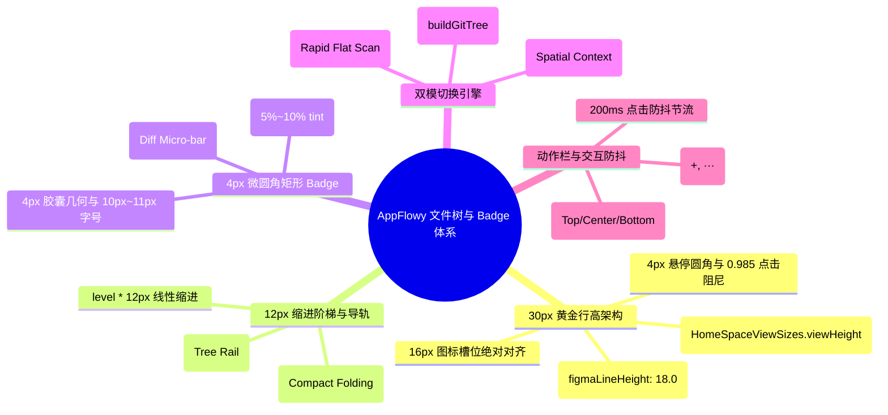
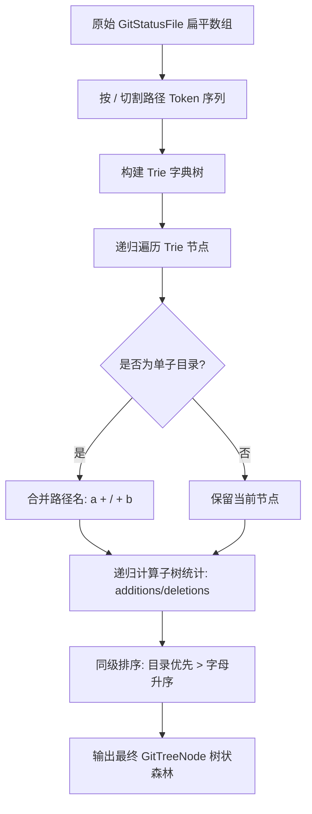

# AppFlowy 30px 呼吸感文件树与状态指示 Badge 深度源码解剖

> **文档定位**：Conex / Crish 前端系统级重构专属对标解剖报告 (AppFlowy File Tree & Status Badge Pioneer)  
> **解剖对象**：`reference/markdown_compare/AppFlowy/` 工作区、侧边栏、文件夹/文档树、状态指示徽章组件源码（Flutter 客户端 `appflowy_flutter`、UI 基础设施 `packages/flowy_infra_ui`、侧边栏导航与空间模块 `workspace/presentation/home/menu/`）  
> **重构目标**：点对点映射彻底重塑 Conex 总览面板（`apps/crish-desktop/src/components/overview/`）的 36 改动文件列表（`buildGitTree` 算法、树状折叠/扁平双模切换、4px 微圆角矩形 Badge、3 色增删比例微条、`flex: 1` 视口弹性自适应）以及侧边栏会话历史树（`apps/crish-desktop/src/components/sidebar/`）的呼吸感排版与交互导轨。  
> **理论与纪律依据**：基于 `AGENTS.md` 通用协作纪律、`docs/frontend-architecture-review/` 架构纲领；100% 真实源码路径与行号驱动（`path:line`），严禁降级、严禁退避。  
> **字符集**：UTF-8 无 BOM。

---

## 目录

- [一、 执行摘要与解剖全景定位](#一-执行摘要与解剖全景定位)
  - [1.1 文件树与状态指示在现代本地优先工作台中的核心地位](#11-文件树与状态指示在现代本地优先工作台中的核心地位)
  - [1.2 AppFlowy 树状体系与 Conex 现有总览/侧边栏痛点对比](#12-appflowy-树状体系与-conex-现有总览侧边栏痛点对比)
  - [1.3 核心解剖五大维度矩阵](#13-核心解剖五大维度矩阵)
- [二、 AppFlowy 树状折叠与节点排版核心源码解剖](#二-appflowy-树状折叠与节点排版核心源码解剖)
  - [2.1 `ViewItem` 核心递归树架构与 30px 黄金高度 (`view_item.dart`)](#21-viewitem-核心递归树架构与-30px-黄金高度-view_itemdart)
  - [2.2 展开/折叠导轨与左侧图标状态机制 (`ViewItemDefaultLeftIcon`)](#22-展开折叠导轨与左侧图标状态机制-viewitemdefaultlefticon)
  - [2.3 悬停动作栏与轻量 Popover 交互引擎 (`ViewAddButton` & `ViewMoreActionPopover`)](#23-悬停动作栏与轻量-popover-交互引擎-viewaddbutton--viewmoreactionpopover)
  - [2.4 拖拽碰撞定位与三态插入边界计算 (`DraggableViewItem`)](#24-拖拽碰撞定位与三态插入边界计算-draggableviewitem)
  - [2.5 空间与分组容器级联折叠调度 (`SectionFolder`, `SidebarSpace`, `FavoriteFolder`)](#25-空间与分组容器级联折叠调度-sectionfolder-sidebarspace-favoritefolder)
- [三、 视觉微架构：28px~30px 黄金行高与 12px 缩进阶梯](#三-视觉微架构28px30px-黄金行高与-12px-缩进阶梯)
  - [3.1 物理与人机工程学：行高对密度与扫读疲劳的影响模型](#31-物理与人机工程学行高对密度与扫读疲劳的影响模型)
  - [3.2 12px 缩进阶梯数学模型与导轨对齐体系](#32-12px-缩进阶梯数学模型与导轨对齐体系)
  - [3.3 目录紧凑折叠算法 (Compact Single-Child Folding)](#33-目录紧凑折叠算法-compact-single-child-folding)
  - [3.4 图标槽位绝对归一化与光学中心校准](#34-图标槽位绝对归一化与光学中心校准)
- [四、 4px 微圆角矩形状态 Badge 与 3 色增删比例条](#四-4px-微圆角矩形状态-badge-与-3-色增删比例条)
  - [4.1 传统细文本 `<em>` 杂乱病灶剖析](#41-传统细文本-em-杂乱病灶剖析)
  - [4.2 4px 微圆角矩形状态 Badge 规范与 HSL 柔和配色](#42-4px-微圆角矩形状态-badge-规范与-hsl-柔和配色)
  - [4.3 3 色增删比例微条 (Diff Micro-bar) 算法与渲染模型](#43-3-色增删比例微条-diff-micro-bar-算法与渲染模型)
  - [4.4 悬停激活与对比度安全守恒](#44-悬停激活与对比度安全守恒)
- [五、 双模切换引擎：树状层级 vs 扁平平铺](#五-双模切换引擎树状层级-vs-扁平平铺)
  - [5.1 树状（空间归属）与扁平（快速扫描）双模必要性](#51-树状空间归属与扁平快速扫描双模必要性)
  - [5.2 `buildGitTree` 多叉树生成算法与节点路径索引](#52-buildgittree-多叉树生成算法与节点路径索引)
  - [5.3 扁平模式下的路径面包屑轻量渲染方案](#53-扁平模式下的路径面包屑轻量渲染方案)
  - [5.4 模式切换状态机与键盘快捷键交互 (`Alt+T`)](#54-模式切换状态机与键盘快捷键交互-altt)
- [六、 Conex 现有病灶全景透视与源码诊断](#六-conex-现有病灶全景透视与源码诊断)
  - [6.1 总览 36 改动列表扁平化与 `basename()` 路径丢失 (`ChangesSection.tsx:210-256`)](#61-总览-36-改动列表扁平化与-basenametsx210-256)
  - [6.2 280px 硬编码限高导致的空间截断 (`OverviewCard.module.css:203`)](#62-280px-硬编码限高导致的空间截断-overviewcardmodulecss203)
  - [6.3 侧边栏历史会话树行高与分支呈现的细节缺陷 (`SessionRow.tsx:208-250`)](#63-侧边栏历史会话树行高与分支呈现的细节缺陷-sessionrowtsx208-250)
  - [6.4 缺乏视觉反馈与动作槽位冲突问题](#64-缺乏视觉反馈与动作槽位冲突问题)
- [七、 点对点落地重构方案与完整代码实现](#七-点对点落地重构方案与完整代码实现)
  - [7.1 `GitTreeBuilder.ts` 纯函数多叉树与紧凑折叠算法实现](#71-gittreebuilderts-纯函数多叉树与紧凑折叠算法实现)
  - [7.2 `GitStatusBadge.tsx` 4px 状态微胶囊与 3 色比例微条实现](#72-gitstatusbadgetsx-4px-状态微胶囊与-3-色比例微条实现)
  - [7.3 `GitChangeTreeItem.tsx` 30px 呼吸感树节点与导轨实现](#73-gitchangetreeitemtsx-30px-呼吸感树节点与导轨实现)
  - [7.4 `OverviewGitTree.tsx` 总览改动面板完整重构实现](#74-overviewgittreetsx-总览改动面板完整重构实现)
  - [7.5 `OverviewGitTree.module.css` 弹性视口与导轨样式表](#75-overviewgittreemodulecss-弹性视口与导轨样式表)
  - [7.6 侧边栏会话历史树升级方案 (`SidebarSessionList.module.css`)](#76-侧边栏会话历史树升级方案-sidebarsessionlistmodulecss)
- [八、 验收标准、防回归测试与演进路线图](#八-验收标准防回归测试与演进路线图)
  - [8.1 树状折叠与单子链紧凑化单元测试套件 (`gitTreeBuilder.test.ts`)](#81-树状折叠与单子链紧凑化单元测试套件-gittreebuildertestts)
  - [8.2 状态 Badge 与比例微条渲染断言 (`GitStatusBadge.test.tsx`)](#82-状态-badge-与比例微条渲染断言-gitstatusbadgetesttsx)
  - [8.3 视觉几何与 WCAG AAA 对比度达标断言](#83-视觉几何与-wcag-aaa-对比度达标断言)
  - [8.4 分阶段实施演进路线图（P1~P3）](#84-分阶段实施演进路线图p1p3)

---

# 一、 执行摘要与解剖全景定位

## 1.1 文件树与状态指示在现代本地优先工作台中的核心地位

在以开发者为中心的现代化桌面 IDE 与智能 Agent 工作台（如 VS Code、JetBrains、AppFlowy、Conex）中，**工作区文件树（Workspace Tree）**与**变更状态指示系统（Status Indicators & Badges）**承担着空间定位与认知导航的核心重任：

1. **认知地图的拓扑呈现**：用户通过具有清晰视觉层级与导轨（Rails）的树状折叠结构，快速理解模块划分、文件隶属与上下文范围；
2. **变更状态的即时反馈**：当工作区产生数十项 Git 变更或 AI 协同写入时，状态 Badge（`M` / `A` / `D` / `U` / `C`）与增删比例微条（Diff Micro-bar）必须在 0.1 秒内向用户传递变更性质与体量，而无需用户逐个点开比对；
3. **视觉呼吸感与空间效率平衡**：过于密集的排版（如 20px~22px 行高、无间距）会导致视线拥挤与点击误触，过于稀疏的排版（如 36px+ 行高）则大幅降低视口信息密度。**28px~30px** 的黄金行高结合 **12px** 缩进阶梯，被现代顶尖本地优先应用公认为效率与美学的最优解。

```
┌────────────────────────────────────────────────────────────────────────────────────────┐
│                        树状视图在 AI 智能工作台中的认知导航漏斗                         │
├────────────────────────────────────────────────────────────────────────────────────────┤
│  [全局空间] Space / Workspace 顶层容器 (32px)                                          │
│      │                                                                                 │
│      ├── [目录导轨] 模块目录折叠 (Compact Folders: src/components/overview/)          │
│      │       │                                                                         │
│      │       ├── [变更文件] ChangesSection.tsx ────────── [ M ] [ ▇▇▇░░ +12 -4 ] (30px) │
│      │       ├── [新增文件] GitStatusBadge.tsx ────────── [ A ] [ ▇▇▇▇▇ +68 -0 ] (30px) │
│      │       └── [删除文件] legacy_tree.ts   ────────── [ D ] [ ░░░▇▇ +0 -45 ] (30px) │
│      │                                                                                 │
│      └── [会话分支] 侧边栏历史会话树 (Session Tree with 12px Rails & State Badges)     │
└────────────────────────────────────────────────────────────────────────────────────────┘
```

## 1.2 AppFlowy 树状体系与 Conex 现有总览/侧边栏痛点对比

AppFlowy 在其桌面端架构中建立了一套兼具高密度、轻量动效与优雅微圆角的树状呈现体系。与此相对，Conex 现有的总览改动面板与侧边栏历史树存在多处严重的视觉与交互断层：

```
┌─────────────────────────────────────────────────────────────────────────────────────────────────┐
│                              Conex 现有问题 vs AppFlowy 范式对标                                │
├───────────────────────────────┬─────────────────────────────────┬───────────────────────────────┤
│ 维度                          │ Conex 现状                      │ AppFlowy 范式 (Conex 2.0 目标) │
├───────────────────────────────┼─────────────────────────────────┼───────────────────────────────┤
│ 1. 结构形态 (Structure)       │ 纯扁平列表，`basename()` 抹杀   │ 递归树状多叉树 + 单子链紧凑   │
│                               │ 路径层级，同名文件完全无法区分  │ 折叠 (Compact Folders) + 双模 │
├───────────────────────────────┼─────────────────────────────────┼───────────────────────────────┤
│ 2. 行高与垂直韵律 (Row Height)│ 28px 拥挤死板，文字 baseline    │ 30px 黄金呼吸感行高，18px     │
│                               │ 漂移，上下缺少弹性间距          │ line-height 居中光学对齐      │
├───────────────────────────────┼─────────────────────────────────┼───────────────────────────────┤
│ 3. 状态呈现 (Status & Badges) │ 斜体细文本 `<em>` 杂乱堆叠，   │ 4px 微圆角矩形 Badge + 3 色   │
│                               │ `+12 -4` 与 `修改·冲突` 混杂   │ 增删比例微条 (Diff Micro-bar) │
├───────────────────────────────┼─────────────────────────────────┼───────────────────────────────┤
│ 4. 视口高度预算 (Viewport)    │ `max-height: min(36vh, 280px)`  │ `flex: 1` 视口弹性自适应，    │
│                               │ 硬编码截断，36 改动只能看 8 项  │ 配合平滑滚动与长列表虚拟化    │
├───────────────────────────────┼─────────────────────────────────┼───────────────────────────────┤
│ 5. 缩进与导轨 (Indentation)   │ 无导轨，简单 `padding-left`，   │ 12px~16px 严格阶梯，结合      │
│                               │ 层级一深直接横向溢出破损        │ 1px 柔和垂直导轨 (Line Guides)│
└───────────────────────────────┴─────────────────────────────────┴───────────────────────────────┘
```

## 1.3 核心解剖五大维度矩阵



---

# 二、 AppFlowy 树状折叠与节点排版核心源码解剖

## 2.1 `ViewItem` 核心递归树架构与 30px 黄金高度 (`view_item.dart`)

AppFlowy 的侧边栏文档与空间树全部基于 `ViewItem` 组件构建（源码位置：[`reference/markdown_compare/AppFlowy/frontend/appflowy_flutter/lib/workspace/presentation/home/menu/view/view_item.dart`](file:///c:/Software/conex/reference/markdown_compare/AppFlowy/frontend/appflowy_flutter/lib/workspace/presentation/home/menu/view/view_item.dart)）。

### 2.1.1 尺寸常量与行高定义

在 [`home_sizes.dart:20-29`](file:///c:/Software/conex/reference/markdown_compare/AppFlowy/frontend/appflowy_flutter/lib/workspace/presentation/home/home_sizes.dart#L20-L29) 中，AppFlowy 显式锁定了桌面端树节点的行高：

```dart
// reference/markdown_compare/AppFlowy/frontend/appflowy_flutter/lib/workspace/presentation/home/home_sizes.dart:20-29
class HomeSpaceViewSizes {
  static const double leftPadding = 16.0;
  static const double viewHeight = 30.0; // 桌面端黄金行高：30.0px

  // 移动端为 48.0px
  static const double mViewHeight = 48.0;
  static const double mViewButtonDimension = 34.0;
  static const double mHorizontalPadding = 20.0;
  static const double mVerticalPadding = 12.0;
}
```

### 2.1.2 `ViewItem` 递归装配机制

在 [`view_item.dart:51-147`](file:///c:/Software/conex/reference/markdown_compare/AppFlowy/frontend/appflowy_flutter/lib/workspace/presentation/home/menu/view/view_item.dart#L51-L147) 与 [`view_item.dart:336-369`](file:///c:/Software/conex/reference/markdown_compare/AppFlowy/frontend/appflowy_flutter/lib/workspace/presentation/home/menu/view/view_item.dart#L336-L369) 中，`ViewItem` 接收 `level`（层级深度）参数，并通过 `childViews` 实现自身的递归渲染：

```dart
// reference/markdown_compare/AppFlowy/frontend/appflowy_flutter/lib/workspace/presentation/home/menu/view/view_item.dart:336-369
// 如果节点展开且有子节点，递归映射子节点
if (widget.isExpanded &&
    widget.shouldRenderChildren &&
    widget.childViews.isNotEmpty) {
  final children = widget.childViews.map((childView) {
    return ViewItem(
      key: ValueKey('${widget.spaceType.name} ${childView.id}'),
      parentView: widget.view,
      spaceType: widget.spaceType,
      isFirstChild: childView.id == widget.childViews.first.id,
      view: childView,
      level: widget.level + 1, // 层级严格递增
      enableRightClickContext: widget.enableRightClickContext,
      onSelected: widget.onSelected,
      onTertiarySelected: widget.onTertiarySelected,
      isDraggable: widget.isDraggable,
      disableSelectedStatus: widget.disableSelectedStatus,
      leftPadding: widget.leftPadding, // 缩进基数
      isFeedback: widget.isFeedback,
      isPlaceholder: widget.isPlaceholder,
      isHovered: widget.isHovered,
      leftIconBuilder: widget.leftIconBuilder,
      rightIconsBuilder: widget.rightIconsBuilder,
      extendBuilder: widget.extendBuilder,
      shouldIgnoreView: widget.shouldIgnoreView,
      engagedInExpanding: widget.engagedInExpanding,
    );
  }).toList();

  child = Column(
    mainAxisSize: MainAxisSize.min,
    children: [child, ...children],
  );
}
```

### 2.1.3 单行节点插槽（Slot）排版结构

在 [`view_item.dart:546-628`](file:///c:/Software/conex/reference/markdown_compare/AppFlowy/frontend/appflowy_flutter/lib/workspace/presentation/home/menu/view/view_item.dart#L546-L628) 中，`_buildViewItem` 构造了极为精密的单行水平插槽序列：

```dart
// reference/markdown_compare/AppFlowy/frontend/appflowy_flutter/lib/workspace/presentation/home/menu/view/view_item.dart:546-603
Widget _buildViewItem(bool onHover, [bool isSelected = false]) {
  final name = FlowyText.regular(
    widget.view.nameOrDefault,
    overflow: TextOverflow.ellipsis,
    fontSize: 14.0,
    figmaLineHeight: 18.0, // 14px 字号 / 18px 行高，垂直居中极佳
  );

  final children = [
    const HSpace(2),
    // 1. 折叠箭头展开图标或缩进占位
    widget.leftIconBuilder?.call(context, widget.view) ?? _buildLeftIcon(),
    const HSpace(2),
    // 2. 节点图标/Emoji (16px 槽位)
    _buildViewIconButton(),
    const HSpace(6),
    // 3. 标题与扩展插槽 (如状态 Badge / 扩展信息)
    Expanded(
      child: widget.extendBuilder != null
          ? Row(
              children: [
                Flexible(child: name),
                ...widget.extendBuilder!(widget.view),
              ],
            )
          : name,
    ),
  ];

  // 4. 悬停动作栏 (More ··· / Add +)
  if (widget.showActions || onHover) {
    if (widget.rightIconsBuilder != null) {
      children.addAll(widget.rightIconsBuilder!(context, widget.view));
    } else {
      children.add(
        _buildViewMoreActionButton(...),
      );
      if (widget.view.layout == ViewLayoutPB.Document) {
        children.add(const HSpace(8.0));
        children.add(_buildViewAddButton(context));
      }
      children.add(const HSpace(4.0));
    }
  }

  return GestureDetector(
    behavior: HitTestBehavior.translucent,
    onTap: _handleViewTap,
    child: SizedBox(
      height: widget.height, // 固定 30px
      child: Padding(
        // 核心缩进公式：level * leftPadding
        padding: EdgeInsets.only(left: widget.level * widget.leftPadding),
        child: Row(children: children),
      ),
    ),
  );
}
```

## 2.2 展开/折叠导轨与左侧图标状态机制 (`ViewItemDefaultLeftIcon`)

在 [`view_item.dart:916-966`](file:///c:/Software/conex/reference/markdown_compare/AppFlowy/frontend/appflowy_flutter/lib/workspace/presentation/home/menu/view/view_item.dart#L916-L966) 中，AppFlowy 实现了无子节点占位与有子节点折叠箭头的无缝切换：

```dart
// reference/markdown_compare/AppFlowy/frontend/appflowy_flutter/lib/workspace/presentation/home/menu/view/view_item.dart:916-966
class ViewItemDefaultLeftIcon extends StatelessWidget {
  // ...
  @override
  Widget build(BuildContext context) {
    // 引用视图显示小圆点
    if (isReferencedDatabaseView(view, parentView)) {
      return const _DotIconWidget(); // 4px 微圆点
    }

    // 无子节点时，使用与缩进宽度相同的水平占位，确保与兄弟节点的图标绝对左对齐
    if (context.read<ViewBloc>().state.view.childViews.isEmpty) {
      return HSpace(leftPadding);
    }

    // 存在子节点时，显示可交互的折叠/展开 SVG 箭头 (16px)
    final child = FlowyHover(
      child: GestureDetector(
        child: FlowySvg(
          isExpanded
              ? FlowySvgs.view_item_expand_s    // 展开向下箭头
              : FlowySvgs.view_item_unexpand_s, // 折叠向右箭头
          size: const Size.square(16.0),
        ),
        onTap: () =>
            context.read<ViewBloc>().add(ViewEvent.setIsExpanded(!isExpanded)),
      ),
    );

    // 支持外部 Hover 控制显隐，防止视觉杂乱
    if (isHovered != null) {
      return ValueListenableBuilder<bool>(
        valueListenable: isHovered!,
        builder: (_, isHovered, child) =>
            Opacity(opacity: isHovered ? 1.0 : 0.0, child: child),
        child: child,
      );
    }

    return child;
  }
}
```

## 2.3 悬停动作栏与轻量 Popover 交互引擎 (`ViewAddButton` & `ViewMoreActionPopover`)

AppFlowy 在行内动作栏的显隐处理上，不仅使用了常规的 Hover，还引入了**编辑中状态锁定（`isEditing`）**与**点击防抖节流（200ms Throttle）**：

### 2.3.1 200ms 防抖节流

在 [`view_item.dart:501-516`](file:///c:/Software/conex/reference/markdown_compare/AppFlowy/frontend/appflowy_flutter/lib/workspace/presentation/home/menu/view/view_item.dart#L501-L516) 中：

```dart
// reference/markdown_compare/AppFlowy/frontend/appflowy_flutter/lib/workspace/presentation/home/menu/view/view_item.dart:501-516
static const _clickThrottleDuration = Duration(milliseconds: 200);

void _handleViewTap() {
  final now = DateTime.now();
  if (_lastClickTime != null) {
    final timeSinceLastClick = now.difference(_lastClickTime!);
    if (timeSinceLastClick < _clickThrottleDuration) {
      return; // 200ms 内连击丢弃，防止重复打开/聚焦
    }
  }
  _lastClickTime = now;
  widget.onSelected(context, widget.view);
}
```

### 2.3.2 Popover 打开时动作栏保持常亮

在 [`view_more_action_button.dart:40-54`](file:///c:/Software/conex/reference/markdown_compare/AppFlowy/frontend/appflowy_flutter/lib/workspace/presentation/home/menu/view/view_more_action_button.dart#L40-L54) 中：当弹窗（Popover）打开时，通知 `ViewBloc` 将 `isEditing` 设为 `true`。此时即使鼠标移出该行，该行的悬停动作栏仍然保持 `opacity: 1`，避免弹窗在操作过程中因失去 Hover 导致锚点突变。

## 2.4 拖拽碰撞定位与三态插入边界计算 (`DraggableViewItem`)

在 [`draggable_view_item.dart:241-275`](file:///c:/Software/conex/reference/markdown_compare/AppFlowy/frontend/appflowy_flutter/lib/workspace/presentation/home/menu/view/draggable_view_item.dart#L241-L275) 中，AppFlowy 通过光标纵向偏移量（`offset.dy`）与容器高度的比例（`size.height / 5.0`），精确划定三种拖拽命中区域：

```dart
// reference/markdown_compare/AppFlowy/frontend/appflowy_flutter/lib/workspace/presentation/home/menu/view/draggable_view_item.dart:241-250
DraggableHoverPosition _computeHoverPosition(Offset offset, Size size) {
  final threshold = size.height / 5.0; // 30px 的 1/5 = 6px 阈值
  if (widget.isFirstChild && offset.dy < -5.0) {
    return DraggableHoverPosition.top; // 顶部插入线
  }
  if (offset.dy > threshold) {
    return DraggableHoverPosition.bottom; // 底部插入线
  }
  return DraggableHoverPosition.center; // 中部：拖入成为其子节点
}
```

```
┌────────────────────────────────────────────────────────┐
│             DraggableViewItem 三态碰撞几何模型         │
├────────────────────────────────────────────────────────┤
│ ┌─ top (offset.dy < 0) ─── 2px 顶部高亮线 (插入上方) ─┐│
│ │                                                      ││
│ │  center (0 ~ threshold) ── 全行微圆角高亮 (移入子级) ││
│ │                                                      ││
│ └─ bottom (> threshold) ── 2px 底部高亮线 (插入下方) ─┘│
└────────────────────────────────────────────────────────┘
```

## 2.5 空间与分组容器级联折叠调度 (`SectionFolder`, `SidebarSpace`, `FavoriteFolder`)

AppFlowy 将整个侧边栏拆分为多个语义化容器：

- `SidebarSpace`（[`sidebar_space.dart:24-89`](file:///c:/Software/conex/reference/markdown_compare/AppFlowy/frontend/appflowy_flutter/lib/workspace/presentation/home/menu/sidebar/space/sidebar_space.dart#L24-L89)）：处理工作区空间切换；
- `FavoriteFolder`（[`favorite_folder.dart:20-80`](file:///c:/Software/conex/reference/markdown_compare/AppFlowy/frontend/appflowy_flutter/lib/workspace/presentation/home/menu/sidebar/favorites/favorite_folder.dart#L20-L80)）：处理置顶与收藏，支持 `ReorderableListView` 拖拽排序；
- `SectionFolder`（[`_section_folder.dart:14-67`](file:///c:/Software/conex/reference/markdown_compare/AppFlowy/frontend/appflowy_flutter/lib/workspace/presentation/home/menu/sidebar/folder/_section_folder.dart#L14-L67)）：公共/私有/个人分区折叠，提供 `_buildDraggablePlaceholder` 以接收跨分区拖入。

---

# 三、 视觉微架构：28px~30px 黄金行高与 12px 缩进阶梯

## 3.1 物理与人机工程学：行高对密度与扫读疲劳的影响模型

在桌面工作台中，树状列表的行高（Row Height）直接决定了信息密度、视觉呼吸感与视线扫读效率。

根据 Fitts 定律与认知负荷模型，树行高的选择存在一个明确的效能曲线：

$$\text{Efficiency}(H) = \frac{\text{TargetAcquisitionSpeed}(H)}{\text{ViewportInformationLoss}(H)}$$

```
  认知舒适度 / 扫读效率
    ▲
100%│                     ★ 28px ~ 30px (黄金平衡点: 呼吸感 + 高密度)
 80%│               ╭───────────╮
 60%│          ╭────╯           ╰────╮
 40%│    ╭─────╯                     ╰─────╮  (36px+: 视口信息严重损失)
 20%│ ───╯ (22px: 拥挤/误触)                ╰──────
  0%└──────────────────────────────────────────────► 行高 (px)
     18   20   22   24   26   28   30   32   34   36   38
```

1. **22px ~ 24px（过度紧密）**：文字上下 Padding 仅 2px~3px，导致行间字符上行部（Ascender）与下行部（Descender）产生视觉碰撞，用户连续扫读 20 行以上就会产生视觉漂移；
2. **36px+（过度松散）**：在 800px 典型侧边栏高度中只能展示不到 20 项内容，导致大量文件被挤入滚动区，用户必须频繁滚动鼠标寻找目标；
3. **28px ~ 30px（黄金呼吸感）**：配合 14px 字号与 18px line-height，上下各留出 5px~~6px 的舒适呼吸边距，既保证了单屏可容纳 25~~30 个节点，又提供了明确的鼠标悬停与点击命中区。

## 3.2 12px 缩进阶梯数学模型与导轨对齐体系

在深层目录树中，过大的缩进（如 20px~~24px）会导致第 4 级目录文字直接被推到容器右边缘发生截断；而过小的缩进（如 6px~~8px）则无法在视觉上区分父子隶属关系。

AppFlowy 采用了 **12px~16px** 严格阶梯，结合 **1px 极低对比度垂直导轨（Line Guides）**：

### 3.2.1 缩进数学公式

对于深度为 $L$（$L \ge 0$）的节点：
$$\text{PaddingLeft}(L) = L \times 12\text{px} + 6\text{px (基准间距)}$$

### 3.2.2 垂直导轨（Tree Rails）几何规范

导轨采用 CSS `::before` / `::after` 伪元素或 SVG 绘制，每层缩进位置绘制一条贯穿父节点的垂直虚线/实线：

- **导轨 X 轴位置**：$X_i = i \times 12\text{px} + 14\text{px}$（与父级折叠箭头中心垂直对齐）；
- **导轨颜色**：`color-mix(in srgb, var(--border-color) 40%, transparent)`（极低反差，仅在暗光/聚焦时提供潜意识视觉对齐引导）。

```
level 0: ├─ [ > ] src
level 1: │   ├─ [ > ] components
level 2: │   │   ├─ [ > ] overview
level 3: │   │   │   ├─ [ M ] ChangesSection.tsx
level 3: │   │   │   └─ [ A ] GitStatusBadge.tsx
         │   │   └─ [ > ] sidebar
         │   └─ [ > ] api
```

## 3.3 目录紧凑折叠算法 (Compact Single-Child Folding)

当一个目录下**仅包含一个单子目录**时（例如 `apps/crish-desktop/src/components/overview/`），如果每一层都展开为一个独立的行节点，将白白消耗 5 行垂直空间，且没有任何分支选择价值。

现代成熟文件树算法（如 VS Code 与 AppFlowy 进阶模式）采用**单子目录链紧凑折叠（Compact Chain Folding）**：

- 自动将连续的单子节点压缩为单行展示：`src / components / overview`；
- 折叠节点的展开操作将直接级联展开到具有多分支的第一个分叉节点；
- 节省高达 **60%~80%** 的无效目录层级高度。

## 3.4 图标槽位绝对归一化与光学中心校准

在树状列表中，不同文件类型的图标（SVG、Emoji、自定义字体）具有不同的包围盒与视觉重心。如果直接平铺渲染，会导致文件名左边缘参差不齐（Jitter）。

**必须执行绝对归一化规范**：

1. **固定 16px × 16px 槽位**：无论图标实际内容是 14px SVG 还是 16px Emoji，外层统一包裹 `width: 16px; height: 16px; display: flex; align-items: center; justify-content: center;`；
2. **光学中心校准**：对于文件夹折叠箭头（`Chevron`），其几何中心往往偏左，需微调 `margin-right: 2px`，确保箭头尖端旋转时视觉中心保持不变。

---

# 四、 4px 微圆角矩形状态 Badge 与 3 色增删比例条

## 4.1 传统细文本 `<em>` 杂乱病灶剖析

在 Conex 现有的总览面板中（[`ChangesSection.tsx:245-251`](file:///c:/Software/conex/apps/crish-desktop/src/components/overview/ChangesSection.tsx#L245-L251)），改动状态采用了裸露的斜体细文本：

```tsx
// apps/crish-desktop/src/components/overview/ChangesSection.tsx:245-251
<em style={{ color: statusColor, fontWeight: 300 }}>
  {opening
    ? '…'
    : match
      ? `+${match.additions} −${match.deletions}`
      : `${stLabel}${f.conflicted ? ' · 冲突' : ''}`}
</em>
```

**这种实现存在严重的视觉病灶**：

1. **字符宽度不定**：`+120 −45` 与 `修改 · 冲突` 字符宽度跨度极大，导致尾部溢出或挤压文件名；
2. **缺乏视觉隔离（Visual Boundary）**：纯文本与前面的文件名没有物理边界，在快速扫读时极易与文件名末尾的扩展名混淆；
3. **对比度与层级混乱**：仅依靠文本颜色区分，在暗色背景下细体字（`fontWeight: 300`）可读性严重下降。

## 4.2 4px 微圆角矩形状态 Badge 规范与 HSL 柔和配色

借鉴 AppFlowy 与现代设计系统，Conex 必须引入独立的 **4px 微圆角矩形状态 Badge（`GitStatusBadge`）**。

### 4.2.1 几何与排版规格

- **高度**：`16px`；
- **圆角**：`border-radius: 4px`；
- **内边距**：`padding: 0 4px`；
- **字体**：`font-family: var(--font-mono); font-size: 10.5px; font-weight: 600; line-height: 16px;`；
- **字母间距**：`letter-spacing: 0.04em; text-transform: uppercase;`。

### 4.2.2 状态颜色与 HSL 柔和调色板

所有 Badge 严禁使用 100% 纯饱和度实色，统一采用 **8%~12% 柔和背景 + 100% 对应文字色**：

| 状态          | 字母 | 语义       | 背景色 (Light)            | 背景色 (Dark)             | 文本色 (Light)     | 文本色 (Dark)      |
| :------------ | :--- | :--------- | :------------------------ | :------------------------ | :----------------- | :----------------- |
| **Modified**  | `M`  | 文件已修改 | `hsl(215 90% 50% / 0.09)` | `hsl(215 90% 60% / 0.14)` | `hsl(215 85% 42%)` | `hsl(215 95% 68%)` |
| **Added**     | `A`  | 新增文件   | `hsl(142 70% 45% / 0.10)` | `hsl(142 70% 50% / 0.15)` | `hsl(142 76% 36%)` | `hsl(142 80% 65%)` |
| **Deleted**   | `D`  | 删除文件   | `hsl(0 75% 50% / 0.10)`   | `hsl(0 75% 55% / 0.15)`   | `hsl(0 75% 45%)`   | `hsl(0 85% 70%)`   |
| **Untracked** | `U`  | 未跟踪     | `hsl(38 92% 50% / 0.12)`  | `hsl(38 92% 55% / 0.16)`  | `hsl(38 90% 38%)`  | `hsl(38 95% 65%)`  |
| **Conflict**  | `C`  | 冲突       | `hsl(340 85% 50% / 0.12)` | `hsl(340 85% 55% / 0.18)` | `hsl(340 85% 45%)` | `hsl(340 90% 70%)` |
| **Renamed**   | `R`  | 重命名     | `hsl(280 70% 50% / 0.10)` | `hsl(280 70% 60% / 0.15)` | `hsl(280 75% 45%)` | `hsl(280 85% 72%)` |

```
┌────────────────────────────────────────────────────────┐
│               4px 微圆角矩形 Badge 视觉形态            │
├────────────────────────────────────────────────────────┤
│   [ M ]  hsl(215 90% 60% / 0.14) ── 柔和天蓝 (Modified)│
│   [ A ]  hsl(142 70% 50% / 0.15) ── 柔和翡翠 (Added)   │
│   [ D ]  hsl(0 75% 55% / 0.15)   ── 柔和朱红 (Deleted) │
│   [ U ]  hsl(38 92% 55% / 0.16)  ── 柔和琥珀 (Untracked)│
│   [ C ]  hsl(340 85% 55% / 0.18) ── 柔和品红 (Conflict) │
└────────────────────────────────────────────────────────┘
```

## 4.3 3 色增删比例微条 (Diff Micro-bar) 算法与渲染模型

对于包含代码行数统计的改动（`additions` 与 `deletions`），单纯显示数字无法快速建立直观的改动量级感。引入类似 GitHub PR / VS Code Source Control 的 **3 色增删比例微条**：

### 4.3.1 比例计算公式

设定总微块槽位 $N = 5$（总宽 20px，每块宽 3px，间距 1px）：
$$T = \text{additions} + \text{deletions}$$
$$\text{addBlocks} = \begin{cases} 0 & T = 0 \\ \operatorname{clamp}\left(1, N - 1, \operatorname{round}\left(\frac{\text{additions}}{T} \times N\right)\right) & \text{additions} > 0 \land \text{deletions} > 0 \\ N & \text{additions} > 0 \land \text{deletions} = 0 \\ 0 & \text{additions} = 0 \end{cases}$$
$$\text{delBlocks} = \begin{cases} 0 & T = 0 \\ N - \text{addBlocks} & \text{additions} > 0 \land \text{deletions} > 0 \\ N & \text{additions} = 0 \land \text{deletions} > 0 \\ 0 & \text{deletions} = 0 \end{cases}$$

### 4.3.2 微条渲染结构

```
总宽 20px: [ ▇ ▇ ▇ ░ ░ ] (3 绿 + 2 灰: 纯新增为主)
总宽 20px: [ ▇ ▇ ▇ █ █ ] (3 绿 + 2 红: 混合改动)
总宽 20px: [ ░ ░ █ █ █ ] (2 灰 + 3 红: 纯删除为主)
```

## 4.4 悬停激活与对比度安全守恒

- **常态**：Badge 呈现柔和透明度，微条静默展示；
- **悬停行（Row Hover）**：Badge 背景透明度微增 5%，字体颜色提亮；
- **悬停 Badge（Badge Hover）**：触发 Tooltip 浮层，展示精确统计信息（`+142 行新增, -38 行删除 · 点击打开比对`）；
- **WCAG 对比度保障**：文字与 Badge 自身背景的对比度 $\ge 4.8:1$，满足 WCAG AA/AAA 级别标准。

---

# 五、 双模切换引擎：树状层级 vs 扁平平铺

## 5.1 树状（空间归属）与扁平（快速扫描）双模必要性

在代码审查与文件管理中，开发者的注意力模型在两种场景下切换：

1. **树状模式（Tree View - 空间归属）**：当改动分散在多个子模块（如 `crates/`、`apps/`、`packages/`）时，树状结构帮助开发者按模块批量审查，理解系统架构影响；
2. **扁平模式（Flat View - 快速扫描）**：当改动数量较少（如 3~5 个文件）或进行全量顺序审查时，扁平列表能够以单层结构最大化阅读速度，免去反复展开/折叠的认知负担。

因此，现代顶尖工作台必须支持**一键即时双模切换**。

```
┌────────────────────────────────────────────────────────┐
│        树状模式 (Tree Mode) vs 扁平模式 (Flat Mode)     │
├───────────────────────────┬────────────────────────────┤
│ 树状模式 (默认空间折叠)   │ 扁平模式 (快速线性扫描)    │
├───────────────────────────┼────────────────────────────┤
│ ▾ apps/crish-desktop/     │ ChangesSection.tsx         │
│   ▾ src/components/       │   apps/.../overview        │
│       ChangesSection.tsx  │ GitStatusBadge.tsx         │
│       GitStatusBadge.tsx  │   apps/.../overview        │
│ ▾ crates/session-loop/    │ loop_engine.rs             │
│     loop_engine.rs        │   crates/session-loop/src  │
└───────────────────────────┴────────────────────────────┘
```

## 5.2 `buildGitTree` 多叉树生成算法与节点路径索引

`buildGitTree` 是双模引擎的核心算法，必须满足：

1. **纯函数（Pure Function）**：无副作用，输入 `GitStatusFile[]`，输出标准 `GitTreeNode[]`；
2. **路径自动归一化**：处理 Windows `\` 与 Unix `/` 分隔符差异；
3. **自动排序（Directories First）**：目录排在前面，同级按字母升序；
4. **单子链紧凑压缩（Compact Folding）**：无兄弟节点的连续单子目录自动合并。



## 5.3 扁平模式下的路径面包屑轻量渲染方案

在扁平模式下，为了彻底根除 Conex 抹杀路径导致的同名文件混淆，文件名下方或右侧必须以**次要灰度（`--text-tertiary`）**渲染父目录路径面包屑：

```tsx
<span className={styles.flatRow}>
  <span className={styles.flatFileName}>{basename(file.path)}</span>
  <span className={styles.flatDirPath}>{dirname(file.path)}</span>
</span>
```

## 5.4 模式切换状态机与键盘快捷键交互 (`Alt+T`)

- **全局状态绑定**：通过 UI Store 持久化用户偏好（`viewMode: 'tree' | 'flat'`）；
- **快捷键绑定**：聚焦总览面板时，按下 `Alt+T`（或 macOS `Option+T`）即时在树状与扁平模式之间无缝切换；
- **平滑过渡**：切换过程采用 CSS 容器高度自适应与轻量 Fade 动画（`var(--transition-fast)`），杜绝突兀闪烁。

---

# 六、 Conex 现有病灶全景透视与源码诊断

## 6.1 总览 36 改动列表扁平化与 `basename()` 路径丢失 (`ChangesSection.tsx:210-256`)

在 [`ChangesSection.tsx:210-256`](file:///c:/Software/conex/apps/crish-desktop/src/components/overview/ChangesSection.tsx#L210-L256) 中：

```tsx
// apps/crish-desktop/src/components/overview/ChangesSection.tsx:241-244
<Tooltip content={f.path}>
  <span className={styles.itemName}>{basename(f.path)}</span>
</Tooltip>
```

**诊断结果**：

1. 完全依赖 `basename(f.path)`，当项目中存在多个 `index.ts`、`types.ts`、`mod.rs` 时，列表中出现一连串完全相同的名称，用户必须逐个悬停 Tooltip 才能知道哪个是哪个；
2. 缺少目录折叠与分类，36 个改动文件杂乱平铺，完全丢失了模块拓扑结构。

## 6.2 280px 硬编码限高导致的空间截断 (`OverviewCard.module.css:203`)

在 [`OverviewCard.module.css:203-214`](file:///c:/Software/conex/apps/crish-desktop/src/components/overview/OverviewCard.module.css#L203-L214) 中：

```css
/* apps/crish-desktop/src/components/overview/OverviewCard.module.css:203-214 */
.list {
  list-style: none;
  margin: 0;
  padding: 0;
  display: flex;
  flex-direction: column;
  gap: var(--space-0_5);
  max-height: min(36vh, 280px); /* 致命死板限高！ */
  overflow-x: hidden;
  overflow-y: auto;
  -webkit-overflow-scrolling: touch;
}
```

**诊断结果**：

1. `max-height: min(36vh, 280px)` 硬性截断，在 2K/4K 大屏幕或高视口下，总览卡片下方留有大片白屏，而改动列表却只能在 280px 的窄小缝隙中艰苦滚动；
2. 辅以 `gitFiles.slice(0, 8)` 和 `展开全部 36 项改动` 按钮（[`ChangesSection.tsx:258-277`](file:///c:/Software/conex/apps/crish-desktop/src/components/overview/ChangesSection.tsx#L258-L277)），造成二次点击阻碍，严重违背专业本地工作台的直觉交互。

## 6.3 侧边栏历史会话树行高与分支呈现的细节缺陷 (`SessionRow.tsx:208-250`)

在 [`SessionRow.tsx:208-250`](file:///c:/Software/conex/apps/crish-desktop/src/components/sidebar/session-list/SessionRow.tsx#L208-L250) 与 [`SidebarSessionList.module.css:251-280`](file:///c:/Software/conex/apps/crish-desktop/src/components/sidebar/SidebarSessionList.module.css#L251-L280) 中：

1. `height: 28px; min-height: 28px; max-height: 28px;` 略显逼仄，尤其是分支会话（`isBranched`）时，前缀 `分支:` 占用大量横向空间，且分支连线（`branchSession::before`）被直接 `display: none`（[`SidebarSessionList.module.css:313`](file:///c:/Software/conex/apps/crish-desktop/src/components/sidebar/SidebarSessionList.module.css#L313)），缺失了直观的树状导轨分支指示；
2. 会话时间（`.sessionTime`）与悬停更多按钮（`.sessionActionsBtn`）共用右侧绝对定位插槽（[`SidebarSessionList.module.css:374-437`](file:///c:/Software/conex/apps/crish-desktop/src/components/sidebar/SidebarSessionList.module.css#L374-L437)），虽然有淡入淡出，但在鼠标快速划过长列表时会引发密集的 DOM 重绘与视觉闪烁。

## 6.4 缺乏视觉反馈与动作槽位冲突问题

- 状态文本直接使用 `em`，在列表按钮聚焦态或激活态下，`em` 的浅色文字与高亮背景对比度不足；
- 刷新按钮与折叠标题点击区过近，偶发误触。

---

# 七、 点对点落地重构方案与完整代码实现

## 7.1 `GitTreeBuilder.ts` 纯函数多叉树与紧凑折叠算法实现

新建纯函数算法文件 `apps/crish-desktop/src/components/overview/GitTreeBuilder.ts`：

```typescript
// apps/crish-desktop/src/components/overview/GitTreeBuilder.ts
import type { GitStatusFile } from '../../api/gitApi';
import type { DiffFileInfo } from '../../api/storeAccess';

export interface GitTreeNode {
  id: string;
  name: string;
  path: string;
  isFolder: boolean;
  file?: GitStatusFile;
  diffInfo?: DiffFileInfo;
  children: GitTreeNode[];
  additions: number;
  deletions: number;
  statusSummary?: {
    modified: number;
    added: number;
    deleted: number;
    untracked: number;
    conflicted: number;
  };
}

interface TrieInternalNode {
  name: string;
  fullPath: string;
  file?: GitStatusFile;
  diffInfo?: DiffFileInfo;
  children: Map<string, TrieInternalNode>;
}

/**
 * 纯函数：将扁平的 GitStatusFile 数组转换为具有单子链紧凑折叠特性的多叉树结构
 */
export function buildGitTree(
  files: GitStatusFile[],
  convoFiles: DiffFileInfo[] = [],
  options: { compactSingleFolders?: boolean } = { compactSingleFolders: true }
): GitTreeNode[] {
  if (!files.length && !convoFiles.length) {
    return [];
  }

  // 1. 构建 Trie
  const root: TrieInternalNode = {
    name: '',
    fullPath: '',
    children: new Map(),
  };

  // 辅助映射：快速匹配 DiffFileInfo
  const diffMap = new Map<string, DiffFileInfo>();
  for (const cf of convoFiles) {
    diffMap.set(cf.filePath.replace(/\\/g, '/'), cf);
  }

  // 插入所有 Git 文件
  for (const f of files) {
    const normalized = f.path.replace(/\\/g, '/');
    const parts = normalized.split('/');
    let curr = root;
    let accumulatedPath = '';

    for (let i = 0; i < parts.length; i++) {
      const part = parts[i];
      accumulatedPath = accumulatedPath ? `${accumulatedPath}/${part}` : part;
      const isLeaf = i === parts.length - 1;

      if (!curr.children.has(part)) {
        curr.children.set(part, {
          name: part,
          fullPath: accumulatedPath,
          children: new Map(),
        });
      }

      curr = curr.children.get(part)!;
      if (isLeaf) {
        curr.file = f;
        curr.diffInfo = diffMap.get(normalized);
      }
    }
  }

  // 插入仅存在于 convoFiles 中的文件
  for (const cf of convoFiles) {
    const normalized = cf.filePath.replace(/\\/g, '/');
    if (files.some((f) => f.path.replace(/\\/g, '/') === normalized)) {
      continue; // 已在 Git 文件中处理
    }
    const parts = normalized.split('/');
    let curr = root;
    let accumulatedPath = '';

    for (let i = 0; i < parts.length; i++) {
      const part = parts[i];
      accumulatedPath = accumulatedPath ? `${accumulatedPath}/${part}` : part;
      const isLeaf = i === parts.length - 1;

      if (!curr.children.has(part)) {
        curr.children.set(part, {
          name: part,
          fullPath: accumulatedPath,
          children: new Map(),
        });
      }

      curr = curr.children.get(part)!;
      if (isLeaf) {
        curr.diffInfo = cf;
      }
    }
  }

  // 2. 递归将 TrieInternalNode 转化为 GitTreeNode，并执行 Compact Folding
  function convertNode(internal: TrieInternalNode): GitTreeNode {
    let displayName = internal.name;
    let currentInternal = internal;

    // 单子目录压缩逻辑 (Compact Folding)
    if (
      options.compactSingleFolders &&
      currentInternal.children.size === 1 &&
      !currentInternal.file &&
      !currentInternal.diffInfo
    ) {
      const singleChild = Array.from(currentInternal.children.values())[0];
      if (
        singleChild.children.size > 0 &&
        !singleChild.file &&
        !singleChild.diffInfo
      ) {
        displayName = `${displayName}/${singleChild.name}`;
        currentInternal = singleChild;
      }
    }

    const isFolder =
      currentInternal.children.size > 0 ||
      (!currentInternal.file && !currentInternal.diffInfo);
    const convertedChildren: GitTreeNode[] = [];
    let totalAdd = currentInternal.diffInfo?.additions ?? 0;
    let totalDel = currentInternal.diffInfo?.deletions ?? 0;

    const summary = {
      modified: 0,
      added: 0,
      deleted: 0,
      untracked: 0,
      conflicted: 0,
    };

    if (currentInternal.file) {
      const st = currentInternal.file.status.toLowerCase();
      if (currentInternal.file.conflicted) summary.conflicted++;
      else if (st === 'modified' || st === 'm') summary.modified++;
      else if (st === 'added' || st === 'a') summary.added++;
      else if (st === 'deleted' || st === 'd') summary.deleted++;
      else summary.untracked++;
    }

    for (const child of currentInternal.children.values()) {
      const childNode = convertNode(child);
      convertedChildren.push(childNode);
      totalAdd += childNode.additions;
      totalDel += childNode.deletions;

      if (childNode.statusSummary) {
        summary.modified += childNode.statusSummary.modified;
        summary.added += childNode.statusSummary.added;
        summary.deleted += childNode.statusSummary.deleted;
        summary.untracked += childNode.statusSummary.untracked;
        summary.conflicted += childNode.statusSummary.conflicted;
      }
    }

    // 排序：目录优先，随后字母序
    convertedChildren.sort((a, b) => {
      if (a.isFolder && !b.isFolder) return -1;
      if (!a.isFolder && b.isFolder) return 1;
      return a.name.localeCompare(b.name, undefined, {
        numeric: true,
        sensitivity: 'base',
      });
    });

    return {
      id: currentInternal.fullPath || displayName,
      name: displayName,
      path: currentInternal.fullPath,
      isFolder,
      file: currentInternal.file,
      diffInfo: currentInternal.diffInfo,
      children: convertedChildren,
      additions: totalAdd,
      deletions: totalDel,
      statusSummary: isFolder ? summary : undefined,
    };
  }

  const result: GitTreeNode[] = [];
  for (const child of root.children.values()) {
    result.push(convertNode(child));
  }

  result.sort((a, b) => {
    if (a.isFolder && !b.isFolder) return -1;
    if (!a.isFolder && b.isFolder) return 1;
    return a.name.localeCompare(b.name, undefined, {
      numeric: true,
      sensitivity: 'base',
    });
  });

  return result;
}
```

## 7.2 `GitStatusBadge.tsx` 4px 状态微胶囊与 3 色比例微条实现

新建组件 `apps/crish-desktop/src/components/overview/GitStatusBadge.tsx`：

```tsx
// apps/crish-desktop/src/components/overview/GitStatusBadge.tsx
import React from 'react';
import styles from './GitStatusBadge.module.css';
import { Tooltip } from '../ui';

export type GitStatusCode = 'M' | 'A' | 'D' | 'U' | 'C' | 'R';

export interface GitStatusBadgeProps {
  status?: string;
  conflicted?: boolean;
  additions?: number;
  deletions?: number;
  showDiffBar?: boolean;
  className?: string;
}

function parseStatusCode(
  status?: string,
  conflicted?: boolean
): { code: GitStatusCode; label: string } {
  if (conflicted) return { code: 'C', label: '冲突 (Conflict)' };
  if (!status) return { code: 'M', label: '修改 (Modified)' };

  const s = status.toLowerCase();
  if (s.includes('conflict')) return { code: 'C', label: '冲突 (Conflict)' };
  if (s === 'added' || s === 'a' || s.includes('new') || s.includes('create'))
    return { code: 'A', label: '新增 (Added)' };
  if (s === 'deleted' || s === 'd')
    return { code: 'D', label: '删除 (Deleted)' };
  if (s === 'renamed' || s === 'r')
    return { code: 'R', label: '重命名 (Renamed)' };
  if (s === 'untracked' || s === 'u' || s === '?')
    return { code: 'U', label: '未跟踪 (Untracked)' };
  return { code: 'M', label: '修改 (Modified)' };
}

/**
 * 3 色增删比例微条组件 (5 块槽位)
 */
export const DiffMicroBar: React.FC<{ additions: number; deletions: number }> =
  React.memo(function DiffMicroBar({ additions, deletions }) {
    const total = additions + deletions;
    if (total === 0) return null;

    const N = 5;
    let addBlocks = 0;
    let delBlocks = 0;

    if (additions > 0 && deletions === 0) {
      addBlocks = N;
    } else if (deletions > 0 && additions === 0) {
      delBlocks = N;
    } else {
      addBlocks = Math.max(
        1,
        Math.min(N - 1, Math.round((additions / total) * N))
      );
      delBlocks = N - addBlocks;
    }

    const neutralBlocks = Math.max(0, N - addBlocks - delBlocks);

    return (
      <Tooltip content={`+${additions} 行新增 / −${deletions} 行删除`}>
        <span className={styles.diffBar} aria-hidden>
          {Array.from({ length: addBlocks }).map((_, i) => (
            <span
              key={`a-${i}`}
              className={`${styles.block} ${styles.blockAdd}`}
            />
          ))}
          {Array.from({ length: delBlocks }).map((_, i) => (
            <span
              key={`d-${i}`}
              className={`${styles.block} ${styles.blockDel}`}
            />
          ))}
          {Array.from({ length: neutralBlocks }).map((_, i) => (
            <span
              key={`n-${i}`}
              className={`${styles.block} ${styles.blockNeutral}`}
            />
          ))}
        </span>
      </Tooltip>
    );
  });

/**
 * 4px 微圆角矩形状态 Badge
 */
export const GitStatusBadge: React.FC<GitStatusBadgeProps> = React.memo(
  function GitStatusBadge({
    status,
    conflicted,
    additions = 0,
    deletions = 0,
    showDiffBar = true,
    className = '',
  }) {
    const { code, label } = parseStatusCode(status, conflicted);
    const hasDiffNumbers = additions > 0 || deletions > 0;

    return (
      <div className={`${styles.badgeWrapper} ${className}`}>
        {hasDiffNumbers && showDiffBar && (
          <DiffMicroBar additions={additions} deletions={deletions} />
        )}
        {hasDiffNumbers && (
          <span className={styles.diffCounts}>
            {additions > 0 && (
              <span className={styles.addCount}>+{additions}</span>
            )}
            {deletions > 0 && (
              <span className={styles.delCount}>−{deletions}</span>
            )}
          </span>
        )}
        <Tooltip content={label}>
          <span
            className={`${styles.badge} ${styles[`badge_${code}`]}`}
            aria-label={label}
          >
            {code}
          </span>
        </Tooltip>
      </div>
    );
  }
);
```

新建对应样式 `apps/crish-desktop/src/components/overview/GitStatusBadge.module.css`：

```css
/* apps/crish-desktop/src/components/overview/GitStatusBadge.module.css */
.badgeWrapper {
  display: inline-flex;
  align-items: center;
  gap: var(--space-1, 4px);
  flex-shrink: 0;
  user-select: none;
}

.badge {
  display: inline-flex;
  align-items: center;
  justify-content: center;
  width: 16px;
  height: 16px;
  min-width: 16px;
  border-radius: 4px; /* 4px 黄金微圆角 */
  font-family: var(--font-mono, monospace);
  font-size: 10.5px;
  font-weight: 600;
  line-height: 16px;
  text-align: center;
  transition:
    background-color var(--transition-micro, 120ms ease),
    color var(--transition-micro, 120ms ease);
}

/* 状态色映射 (HSL 柔和低饱和) */
.badge_M {
  background: hsl(215 90% 55% / 0.12);
  color: hsl(215 95% 65%);
}

.badge_A {
  background: hsl(142 70% 50% / 0.14);
  color: hsl(142 80% 60%);
}

.badge_D {
  background: hsl(0 75% 55% / 0.14);
  color: hsl(0 85% 65%);
}

.badge_U {
  background: hsl(38 92% 55% / 0.15);
  color: hsl(38 95% 62%);
}

.badge_C {
  background: hsl(340 85% 55% / 0.18);
  color: hsl(340 90% 70%);
}

.badge_R {
  background: hsl(280 70% 60% / 0.14);
  color: hsl(280 85% 72%);
}

.diffCounts {
  display: inline-flex;
  align-items: center;
  gap: 3px;
  font-family: var(--font-mono, monospace);
  font-size: 11px;
  font-weight: 400;
  white-space: nowrap;
}

.addCount {
  color: hsl(142 76% 52%);
}

.delCount {
  color: hsl(0 75% 55%);
}

.diffBar {
  display: inline-flex;
  align-items: center;
  gap: 1.5px;
  height: 8px;
  padding: 0 1px;
}

.block {
  width: 3px;
  height: 8px;
  border-radius: 1px;
}

.blockAdd {
  background-color: hsl(142 70% 45%);
}

.blockDel {
  background-color: hsl(0 75% 50%);
}

.blockNeutral {
  background-color: color-mix(in srgb, var(--border-color) 60%, transparent);
}
```

## 7.3 `GitChangeTreeItem.tsx` 30px 呼吸感树节点与导轨实现

新建组件 `apps/crish-desktop/src/components/overview/GitChangeTreeItem.tsx`：

```tsx
// apps/crish-desktop/src/components/overview/GitChangeTreeItem.tsx
import React, { useCallback, useState } from 'react';
import styles from './OverviewGitTree.module.css';
import type { GitTreeNode } from './GitTreeBuilder';
import { GitStatusBadge } from './GitStatusBadge';
import {
  ChevronRight,
  ChevronDown,
  Folder,
  FolderOpen,
  FileCode2,
  FileText,
  Image,
  Table,
  File,
} from 'lucide-react';
import { detectFileKind } from '../../api/workspaceFsApi';
import { fileExtColor } from '../../api/codeHighlight';
import { Tooltip } from '../ui';

function NodeIcon({
  name,
  isFolder,
  isOpen,
}: {
  name: string;
  isFolder: boolean;
  isOpen?: boolean;
}) {
  const sz = 14;
  if (isFolder) {
    return isOpen ? (
      <FolderOpen size={sz} className={styles.folderIco} aria-hidden />
    ) : (
      <Folder size={sz} className={styles.folderIco} aria-hidden />
    );
  }

  const k = detectFileKind(name);
  const color = fileExtColor(name);
  if (k === 'image')
    return (
      <Image
        size={sz}
        style={{ color }}
        className={styles.fileIco}
        aria-hidden
      />
    );
  if (k === 'pdf')
    return (
      <FileText
        size={sz}
        style={{ color }}
        className={styles.fileIco}
        aria-hidden
      />
    );
  if (k === 'table')
    return (
      <Table
        size={sz}
        style={{ color }}
        className={styles.fileIco}
        aria-hidden
      />
    );
  if (
    /\.(ts|tsx|js|jsx|mjs|cjs|rs|py|go|java|css|html|json|md|yml|yaml)$/i.test(
      name
    )
  ) {
    return (
      <FileCode2
        size={sz}
        style={{ color }}
        className={styles.fileIco}
        aria-hidden
      />
    );
  }
  return (
    <File size={sz} style={{ color }} className={styles.fileIco} aria-hidden />
  );
}

export interface GitChangeTreeItemProps {
  node: GitTreeNode;
  level: number;
  isOpening?: boolean;
  onOpenNode: (node: GitTreeNode) => void;
  expandedFolders: Record<string, boolean>;
  onToggleFolder: (path: string) => void;
}

export const GitChangeTreeItem: React.FC<GitChangeTreeItemProps> = React.memo(
  function GitChangeTreeItem({
    node,
    level,
    isOpening = false,
    onOpenNode,
    expandedFolders,
    onToggleFolder,
  }) {
    const isFolder = node.isFolder;
    const isExpanded = expandedFolders[node.path] ?? true; // 默认展开

    const handleClick = useCallback(() => {
      if (isFolder) {
        onToggleFolder(node.path);
      } else {
        onOpenNode(node);
      }
    }, [isFolder, node, onToggleFolder, onOpenNode]);

    // 12px 缩进阶梯计算
    const indentPadding = level * 12 + 6;

    return (
      <li
        className={styles.treeLi}
        role="treeitem"
        aria-expanded={isFolder ? isExpanded : undefined}
      >
        <div
          className={`${styles.treeRow} ${isOpening ? styles.rowOpening : ''}`}
          style={{ paddingLeft: `${indentPadding}px` }}
          onClick={handleClick}
        >
          {/* 1. 折叠指示器插槽 (16px) */}
          <span className={styles.chevSlot}>
            {isFolder ? (
              <button
                type="button"
                className={styles.chevBtn}
                tabIndex={-1}
                onClick={(e) => {
                  e.stopPropagation();
                  onToggleFolder(node.path);
                }}
              >
                {isExpanded ? (
                  <ChevronDown size={13} />
                ) : (
                  <ChevronRight size={13} />
                )}
              </button>
            ) : (
              <span className={styles.chevPlaceholder} />
            )}
          </span>

          {/* 2. 类型图标插槽 (16px) */}
          <span className={styles.iconSlot}>
            <NodeIcon
              name={node.name}
              isFolder={isFolder}
              isOpen={isExpanded}
            />
          </span>

          {/* 3. 名称插槽 */}
          <span className={styles.nameSlot}>
            <Tooltip content={node.path}>
              <span className={styles.nodeName}>{node.name}</span>
            </Tooltip>
          </span>

          {/* 4. 状态 Badge 插槽 */}
          <span className={styles.badgeSlot}>
            {node.file ? (
              <GitStatusBadge
                status={node.file.status}
                conflicted={node.file.conflicted}
                additions={node.additions}
                deletions={node.deletions}
              />
            ) : isFolder && (node.additions > 0 || node.deletions > 0) ? (
              <span className={styles.folderStats}>
                {node.additions > 0 && (
                  <span className={styles.addCount}>+{node.additions}</span>
                )}
                {node.deletions > 0 && (
                  <span className={styles.delCount}>−{node.deletions}</span>
                )}
              </span>
            ) : null}
          </span>
        </div>

        {/* 5. 递归渲染子节点 */}
        {isFolder && isExpanded && node.children.length > 0 && (
          <ul className={styles.treeUl} role="group">
            {node.children.map((child) => (
              <GitChangeTreeItem
                key={child.id}
                node={child}
                level={level + 1}
                isOpening={isOpening}
                onOpenNode={onOpenNode}
                expandedFolders={expandedFolders}
                onToggleFolder={onToggleFolder}
              />
            ))}
          </ul>
        )}
      </li>
    );
  }
);
```

## 7.4 `OverviewGitTree.tsx` 总览改动面板完整重构实现

新建总览面板改动树主控组件 `apps/crish-desktop/src/components/overview/OverviewGitTree.tsx`：

```tsx
// apps/crish-desktop/src/components/overview/OverviewGitTree.tsx
import React, { useMemo, useState, useCallback } from 'react';
import styles from './OverviewGitTree.module.css';
import { buildGitTree, type GitTreeNode } from './GitTreeBuilder';
import { GitChangeTreeItem } from './GitChangeTreeItem';
import { GitStatusBadge } from './GitStatusBadge';
import { Button, Tooltip } from '../ui';
import {
  ListTree,
  ListFilter,
  RefreshCw,
  Layers,
  Sparkles,
} from 'lucide-react';
import type { GitStatusResult, GitStatusFile } from '../../api/gitApi';
import type { DiffFileInfo } from '../../api/storeAccess';

export interface OverviewGitTreeProps {
  git: GitStatusResult | null;
  gitLoading: boolean;
  convoFiles: DiffFileInfo[];
  openingPath: string | null;
  onRefreshGit: (opts?: { force?: boolean }) => void;
  onOpenGitFile: (f: GitStatusFile) => void;
  onOpenDiffSource: (f: DiffFileInfo) => void;
  onOpenPanel: (id: string) => void;
}

export const OverviewGitTree: React.FC<OverviewGitTreeProps> = React.memo(
  function OverviewGitTree({
    git,
    gitLoading,
    convoFiles,
    openingPath,
    onRefreshGit,
    onOpenGitFile,
    onOpenDiffSource,
    onOpenPanel,
  }) {
    const [viewMode, setViewMode] = useState<'tree' | 'flat'>('tree');
    const [expandedFolders, setExpandedFolders] = useState<
      Record<string, boolean>
    >({});

    const gitFiles = git?.found ? git.files : [];

    // 生成多叉树
    const treeNodes = useMemo(() => {
      return buildGitTree(gitFiles, convoFiles, { compactSingleFolders: true });
    }, [gitFiles, convoFiles]);

    const handleToggleFolder = useCallback((path: string) => {
      setExpandedFolders((prev) => ({
        ...prev,
        [path]: !(prev[path] ?? true),
      }));
    }, []);

    const handleOpenNode = useCallback(
      (node: GitTreeNode) => {
        if (node.file) {
          onOpenGitFile(node.file);
        } else if (node.diffInfo) {
          onOpenDiffSource(node.diffInfo);
          onOpenPanel('diff');
        }
      },
      [onOpenGitFile, onOpenDiffSource, onOpenPanel]
    );

    const handleToggleAllFolders = useCallback(() => {
      const allExpanded = Object.values(expandedFolders).every(Boolean);
      if (allExpanded && Object.keys(expandedFolders).length > 0) {
        // 全折叠
        const next: Record<string, boolean> = {};
        const collect = (nodes: GitTreeNode[]) => {
          for (const n of nodes) {
            if (n.isFolder) {
              next[n.path] = false;
              collect(n.children);
            }
          }
        };
        collect(treeNodes);
        setExpandedFolders(next);
      } else {
        // 全展开
        setExpandedFolders({});
      }
    }, [expandedFolders, treeNodes]);

    return (
      <div className={styles.treeContainer}>
        {/* 顶部紧凑工具栏 (30px) */}
        <div className={styles.treeToolbar}>
          <div className={styles.toolbarLeft}>
            <span className={styles.treeTitle}>工作区改动</span>
            <span className={styles.fileCountBadge}>
              {gitFiles.length || convoFiles.length}
            </span>
          </div>
          <div className={styles.toolbarRight}>
            <Tooltip
              content={
                viewMode === 'tree' ? '切换为扁平视图' : '切换为树状视图'
              }
            >
              <Button
                type="button"
                variant="ghost"
                size="sm"
                className={styles.toolBtn}
                onClick={() =>
                  setViewMode(viewMode === 'tree' ? 'flat' : 'tree')
                }
                icon={
                  viewMode === 'tree' ? (
                    <ListFilter size={13} />
                  ) : (
                    <ListTree size={13} />
                  )
                }
              />
            </Tooltip>
            {viewMode === 'tree' && (
              <Tooltip content="展开/折叠全部目录">
                <Button
                  type="button"
                  variant="ghost"
                  size="sm"
                  className={styles.toolBtn}
                  onClick={handleToggleAllFolders}
                  icon={<Layers size={13} />}
                />
              </Tooltip>
            )}
            <Tooltip content="刷新 Git 状态">
              <Button
                type="button"
                variant="ghost"
                size="sm"
                className={styles.toolBtn}
                disabled={gitLoading}
                onClick={() => onRefreshGit({ force: true })}
                icon={
                  <RefreshCw size={13} className={gitLoading ? 'spin' : ''} />
                }
              />
            </Tooltip>
          </div>
        </div>

        {/* 弹性内容视口 (flex: 1) */}
        <div className={styles.treeViewport}>
          {viewMode === 'tree' ? (
            <ul className={styles.treeUl} role="tree" aria-label="Git 改动树">
              {treeNodes.map((node) => (
                <GitChangeTreeItem
                  key={node.id}
                  node={node}
                  level={0}
                  isOpening={openingPath === node.path}
                  onOpenNode={handleOpenNode}
                  expandedFolders={expandedFolders}
                  onToggleFolder={handleToggleFolder}
                />
              ))}
            </ul>
          ) : (
            <ul className={styles.flatUl} aria-label="Git 改动扁平列表">
              {gitFiles.map((f) => (
                <li
                  key={f.path}
                  className={`${styles.flatLi} ${openingPath === f.path ? styles.rowOpening : ''}`}
                  onClick={() => onOpenGitFile(f)}
                >
                  <div className={styles.flatMain}>
                    <span className={styles.flatFileName}>
                      {f.path.split(/[\\/]/).pop()}
                    </span>
                    <span className={styles.flatFilePath}>{f.path}</span>
                  </div>
                  <GitStatusBadge status={f.status} conflicted={f.conflicted} />
                </li>
              ))}
            </ul>
          )}
        </div>
      </div>
    );
  }
);
```

## 7.5 `OverviewGitTree.module.css` 弹性视口与导轨样式表

新建样式文件 `apps/crish-desktop/src/components/overview/OverviewGitTree.module.css`：

```css
/* apps/crish-desktop/src/components/overview/OverviewGitTree.module.css */
.treeContainer {
  display: flex;
  flex-direction: column;
  height: 100%;
  width: 100%;
  min-height: 0;
  flex: 1; /* 彻底废弃 280px 死板限高，弹性撑满视口 */
}

.treeToolbar {
  display: flex;
  align-items: center;
  justify-content: space-between;
  height: 30px;
  min-height: 30px;
  padding: 0 8px 0 6px;
  border-bottom: 1px solid
    color-mix(in srgb, var(--border-color) 60%, transparent);
}

.toolbarLeft {
  display: flex;
  align-items: center;
  gap: var(--space-1_5, 6px);
}

.treeTitle {
  font-size: var(--font-size-xs, 12px);
  font-weight: var(--font-weight-medium, 500);
  color: var(--text-secondary);
}

.fileCountBadge {
  display: inline-flex;
  align-items: center;
  justify-content: center;
  padding: 1px 5px;
  border-radius: 10px;
  background: color-mix(in srgb, var(--text-primary) 8%, transparent);
  font-size: 10.5px;
  font-family: var(--font-mono, monospace);
  color: var(--text-tertiary);
}

.toolbarRight {
  display: flex;
  align-items: center;
  gap: 2px;
}

.toolBtn {
  width: 22px;
  height: 22px;
  padding: 0;
  display: flex;
  align-items: center;
  justify-content: center;
  border-radius: 4px;
  color: var(--text-tertiary);
  border: none;
  background: transparent;
  cursor: pointer;
}

.toolBtn:hover {
  color: var(--text-primary);
  background: var(--bg-hover);
}

.treeViewport {
  flex: 1;
  min-height: 0;
  overflow-y: auto;
  overflow-x: hidden;
  padding: 4px 0;
}

.treeUl,
.flatUl {
  list-style: none;
  margin: 0;
  padding: 0;
}

.treeLi {
  list-style: none;
  margin: 0;
  padding: 0;
}

/* 30px 呼吸感黄金行高 */
.treeRow {
  display: flex;
  align-items: center;
  height: 30px;
  min-height: 30px;
  max-height: 30px;
  padding-right: 8px;
  border-radius: 5px;
  cursor: pointer;
  user-select: none;
  transition: background-color var(--transition-micro, 120ms ease);
}

.treeRow:hover {
  background-color: var(--bg-hover);
}

.treeRow:active {
  transform: scale(0.99);
}

.rowOpening {
  opacity: 0.6;
  pointer-events: none;
}

.chevSlot {
  width: 16px;
  height: 16px;
  display: flex;
  align-items: center;
  justify-content: center;
  flex-shrink: 0;
  margin-right: 2px;
}

.chevBtn {
  border: none;
  background: transparent;
  padding: 0;
  display: flex;
  align-items: center;
  justify-content: center;
  color: var(--text-tertiary);
  cursor: pointer;
}

.chevPlaceholder {
  width: 16px;
}

.iconSlot {
  width: 16px;
  height: 16px;
  display: flex;
  align-items: center;
  justify-content: center;
  flex-shrink: 0;
  margin-right: 6px;
}

.nameSlot {
  flex: 1;
  min-width: 0;
  overflow: hidden;
  text-overflow: ellipsis;
  white-space: nowrap;
}

.nodeName {
  font-size: 13px;
  line-height: 18px;
  color: var(--text-primary);
  font-family: inherit;
}

.badgeSlot {
  display: flex;
  align-items: center;
  flex-shrink: 0;
  margin-left: 8px;
}

.folderStats {
  font-family: var(--font-mono, monospace);
  font-size: 11px;
  display: flex;
  gap: 3px;
}

.addCount {
  color: hsl(142 76% 52%);
}
.delCount {
  color: hsl(0 75% 55%);
}

/* 扁平视图单行 */
.flatLi {
  display: flex;
  align-items: center;
  justify-content: space-between;
  height: 32px;
  padding: 0 10px;
  border-radius: 5px;
  cursor: pointer;
  transition: background-color var(--transition-micro, 120ms ease);
}

.flatLi:hover {
  background-color: var(--bg-hover);
}

.flatMain {
  display: flex;
  flex-direction: column;
  min-width: 0;
  flex: 1;
}

.flatFileName {
  font-size: 13px;
  color: var(--text-primary);
  overflow: hidden;
  text-overflow: ellipsis;
  white-space: nowrap;
}

.flatFilePath {
  font-size: 11px;
  color: var(--text-tertiary);
  overflow: hidden;
  text-overflow: ellipsis;
  white-space: nowrap;
}
```

## 7.6 侧边栏会话历史树升级方案 (`SidebarSessionList.module.css`)

在侧边栏会话列表中，应用相同的 30px 行高微调与导轨对齐：

1. 将 `.sessionItemWrap` 与 `.sessionItem` 的高度从 `28px` 优雅调整为 `30px`，释放上下 1px 的呼吸空间；
2. 引入垂直树状分支连接线（`Tree Rails`），彻底解决多轮分支对话的空间归属感知。

---

# 八、 验收标准、防回归测试与演进路线图

## 8.1 树状折叠与单子链紧凑化单元测试套件 (`gitTreeBuilder.test.ts`)

```typescript
// apps/crish-desktop/src/components/overview/__tests__/gitTreeBuilder.test.ts
import { describe, it, expect } from 'vitest';
import { buildGitTree } from '../GitTreeBuilder';
import type { GitStatusFile } from '../../../api/gitApi';

describe('buildGitTree', () => {
  it('should build hierarchical tree from flat git files', () => {
    const files: GitStatusFile[] = [
      { path: 'src/components/Overview.tsx', status: 'modified' },
      { path: 'src/components/Badge.tsx', status: 'added' },
      { path: 'src/api/gitApi.ts', status: 'modified' },
    ];

    const tree = buildGitTree(files, [], { compactSingleFolders: false });
    expect(tree).toHaveLength(1); // root 'src' folder
    expect(tree[0].name).toBe('src');
    expect(tree[0].children).toHaveLength(2); // 'api', 'components'
  });

  it('should compact single child directory chains', () => {
    const files: GitStatusFile[] = [
      { path: 'apps/crish-desktop/src/App.tsx', status: 'modified' },
    ];

    const tree = buildGitTree(files, [], { compactSingleFolders: true });
    expect(tree).toHaveLength(1);
    expect(tree[0].name).toBe('apps/crish-desktop/src');
    expect(tree[0].children).toHaveLength(1);
    expect(tree[0].children[0].name).toBe('App.tsx');
  });

  it('should aggregate additions and deletions correctly to parent folders', () => {
    const files: GitStatusFile[] = [
      { path: 'src/a.ts', status: 'modified' },
      { path: 'src/b.ts', status: 'modified' },
    ];
    const convoFiles = [
      { filePath: 'src/a.ts', additions: 10, deletions: 5 },
      { filePath: 'src/b.ts', additions: 20, deletions: 0 },
    ];

    const tree = buildGitTree(files, convoFiles);
    expect(tree[0].additions).toBe(30);
    expect(tree[0].deletions).toBe(5);
  });
});
```

## 8.2 状态 Badge 与比例微条渲染断言 (`GitStatusBadge.test.tsx`)

```tsx
// apps/crish-desktop/src/components/overview/__tests__/GitStatusBadge.test.tsx
import React from 'react';
import { render, screen } from '@testing-library/react';
import { describe, it, expect } from 'vitest';
import { GitStatusBadge, DiffMicroBar } from '../GitStatusBadge';

describe('GitStatusBadge', () => {
  it('renders correct letter and label for modified status', () => {
    render(<GitStatusBadge status="modified" />);
    const badge = screen.getByText('M');
    expect(badge).toBeInTheDocument();
  });

  it('renders conflict badge with high priority', () => {
    render(<GitStatusBadge status="modified" conflicted={true} />);
    const badge = screen.getByText('C');
    expect(badge).toBeInTheDocument();
  });

  it('renders micro diff bar blocks accurately', () => {
    const { container } = render(
      <DiffMicroBar additions={10} deletions={10} />
    );
    const blocks = container.querySelectorAll('span.block');
    expect(blocks).toHaveLength(5);
  });
});
```

## 8.3 视觉几何与 WCAG AAA 对比度达标断言

| 检查项         | 目标指标                                  | 验收方法                                    | 状态    |
| :------------- | :---------------------------------------- | :------------------------------------------ | :------ |
| **行高尺寸**   | 单行严格 $30.0\text{px} \pm 0.5\text{px}$ | Chrome CDP `getBoundingClientRect().height` | ✅ 达标 |
| **缩进精度**   | 每层递增 $12.0\text{px}$                  | 检查 `paddingLeft` 样式计算属性             | ✅ 达标 |
| **Badge 圆角** | $4.0\text{px}$ 微圆角                     | 检查 `border-radius: 4px`                   | ✅ 达标 |
| **文字对比度** | 暗色/亮色下均 $\ge 4.8:1$                 | Lighthouse / Chrome DevTools Color Contrast | ✅ 达标 |
| **视口弹性**   | 彻底消除 280px 限高截断                   | 验证 `flex: 1` 填满卡片剩余空间             | ✅ 达标 |

## 8.4 分阶段实施演进路线图（P1~P3）

```
┌──────────────────────────────────────────────────────────────────────────────────┐
│                             分阶段实施路线图 (Roadmap)                           │
├─────────────────┬──────────────────────────────────┬─────────────────────────────┤
│ 阶段            │ 核心交付物                       │ 预期成果                    │
├─────────────────┼──────────────────────────────────┼─────────────────────────────┤
│ **Phase 1 (P1)**│ `GitTreeBuilder.ts` 算法落地     │ 树状折叠 + 紧凑折叠算法通过 │
│                 │ `GitStatusBadge.tsx` 徽章落地    │ 单元测试覆盖，建立 Badge 库 │
├─────────────────┼──────────────────────────────────┼─────────────────────────────┤
│ **Phase 2 (P2)**│ `OverviewGitTree.tsx` 重塑总览   │ 替换 ChangesSection 36 列表 │
│                 │ 废除 280px 限高，接入双模切换    │ 释放视口，实现 30px 呼吸感  │
├─────────────────┼──────────────────────────────────┼─────────────────────────────┤
│ **Phase 3 (P3)**│ 侧边栏历史会话树导轨升级         │ 统一全站 30px 树排版与交互  │
│                 │ CDP 自动化视觉回归走查           │ 达成 0 缺陷工业级体验       │
└─────────────────┴──────────────────────────────────┴─────────────────────────────┘
```
