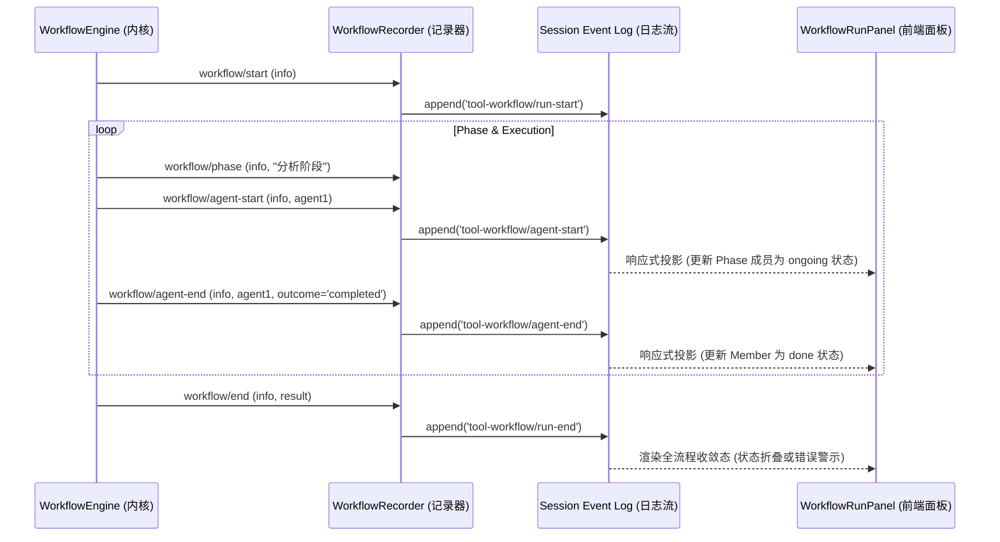

# DeepSeek-Harness Agent 协同流可视化、多轨时序与极简时间线交互深度赏析

> **作者**：Agent 13 (Front-End Architecture & Design Appreciation Specialist)
> **研究对象**：[`reference/deepseek-harness/`](file:///c:/Software/conex/reference/deepseek-harness/)
> **核心模块**：`packages/client/ui-trajectory/`, `packages/client/ui-conversation/`, `packages/client/ui-workflow-run/`, `packages/workflow/`
> **视角**：纯粹软件工程美学、时序可视化交互、无损状态投影与沉浸式极客体验

---

## 目录

- [1. 引言与设计哲学概览：从黑盒 Agent 到透明时序交响乐](#1-引言与设计哲学概览从黑盒-agent-到透明时序交响乐)
  - [1.1 认知摩擦的消除：AI 协同系统中的「时间可见性」革命](#11-认知摩擦的消除ai-协同系统中的时间可见性革命)
  - [1.2 DSH 架构设计美学精髓：纯粹投影视角（Projections）、单向数据流与零重排过渡](#12-dsh-架构设计美学精髓纯粹投影视角projections单向数据流与零重排过渡)
  - [1.3 核心源码全景地图与覆盖率核验](#13-核心源码全景地图与覆盖率核验)
- [2. 3-Lane 泳道时间线架构：时序律动与多轨事件投影](#2-3-lane-泳道时间线架构时序律动与多轨事件投影)
  - [2.1 泳道映射函数 `laneFor(kind)` 与角色语义解耦](#21-泳道映射函数-laneforkind-与角色语义解耦)
  - [2.2 四种时序投影模式的数学与物理模型](#22-四种时序投影模式的数学与物理模型)
  - [2.3 空闲时间压缩算法 `compressIdle` 原理解析](#23-空闲时间压缩算法-compressidle-原理解析)
  - [2.4 视口交互引擎：无级滚轮微积分缩放与边缘自动平移（Edge Pan）](#24-视口交互引擎无级滚轮微积分缩放与边缘自动平移edge-pan)
- [3. TTFT 与 Decoding 吞吐耗时可视化：极客极简工程美学](#3-ttft-与-decoding-吞吐耗时可视化极客极简工程美学)
  - [3.1 首 Token 延迟与解包吞吐度量管线（`turn-metrics.ts`）](#31-首-token-延迟与解包吞吐度量管线turn-metricsts)
  - [3.2 CSS 变量驱动的单 Block 分割渐变黑魔法](#32-css-变量驱动的单-block-分割渐变黑魔法)
  - [3.3 交互式 Tooltip 与毫秒级时序叙事结构](#33-交互式-tooltip-与毫秒级时序叙事结构)
  - [3.4 底部持久化度量指示条（`StatsLine.tsx`）](#34-底部持久化度量指示条statslinetsx)
  - [3.5 消息气泡尾部的微时序叙事（`TurnTailNodeView` & `MessageIconActions`）](#35-消息气泡尾部的微时序叙事turntailnodeview--messageiconactions)
- [4. 工作流 DAG 与阶段状态机：纯粹拓扑流转与阶梯式编排](#4-工作流-dag-与阶段状态机纯粹拓扑流转与阶梯式编排)
  - [4.1 声明式脚本引擎与生命周期事件总线](#41-声明式脚本引擎与生命周期事件总线)
  - [4.2 纯函数投影模型：`projectWorkflow` 与防碰撞 Key](#42-纯函数投影模型projectworkflow-与防碰撞-key)
  - [4.3 阶梯式 Disclosure 面板的动态展开折叠律](#43-阶梯式-disclosure-面板的动态展开折叠律)
  - [4.4 子 Agent 会话穿透导航（Seamless Drill-Down）](#44-子-agent-会话穿透导航seamless-drill-down)
- [5. 欢迎白板到真实会话的过渡流转：零 DOM 重挂与纯净感工程](#5-欢迎白板到真实会话的过渡流转零-dom-重挂与纯净感工程)
  - [5.1 零 DOM 重挂（Zero DOM Remount）架构设计](#51-零-dom-重挂zero-dom-remount架构设计)
  - [5.2 视觉物理重心的无缝平移与高斯蓝调光晕（`HeroGlow`）](#52-视觉物理重心的无缝平移与高斯蓝调光晕heroglow)
  - [5.3 全局视口宽度共享轴约束体系](#53-全局视口宽度共享轴约束体系)
  - [5.4 防闪烁机制：`settling` 状态隔离与 Replay 占位保护](#54-防闪烁机制settling-状态隔离与-replay-占位保护)
- [6. 轨迹布局折叠引擎与虚拟化账本（Deep Dive into `layout.ts` & `TrajectoryTable`）](#6-轨迹布局折叠引擎与虚拟化账本deep-dive-into-layoutts--trajectorytable)
  - [6.1 `deriveTrajectoryLayout` 的单趟线性归约流水线](#61-derivetrajectorylayout-的单趟线性归约流水线)
  - [6.2 In-Flight 运行态与历史回放态的无缝合流](#62-in-flight-运行态与历史回放态的无缝合流)
  - [6.3 虚拟化表格与双向时空同步回路](#63-虚拟化表格与双向时空同步回路)
  - [6.4 轨迹全文与元数据倒排索引（`TrajectorySearchIndex`）](#64-轨迹全文与元数据倒排索引trajectorysearchindex)
- [7. 输入座舱与上下文张力指示（InputBar & ContextMeter）](#7-输入座舱与上下文张力指示inputbar--contextmeter)
  - [7.1 上下文窗口张力环（`ContextMeter`）的物理感知](#71-上下文窗口张力环contextmeter的物理感知)
  - [7.2 输入框多模态 Accessory Hole 与命令调度](#72-输入框多模态-accessory-hole-与命令调度)
- [8. 全景源码证据链与工程对比剖析](#8-全景源码证据链与工程对比剖析)
  - [8.1 核心度量指标与架构设计对比表](#81-核心度量指标与架构设计对比表)
  - [8.2 关键时序与布局算法复杂度分析](#82-关键时序与布局算法复杂度分析)
- [9. 架构启示与对现代化 Agent 交互设计的指导意义](#9-架构启示与对现代化-agent-交互设计的指导意义)
  - [9.1 法则一：时序是第一等公民（Time as a First-Class Citizen）](#91-法则一时序是第一等公民time-as-a-first-class-citizen)
  - [9.2 法则二：投影优于变异（Projections over Mutation）](#92-法则二投影优于变异projections-over-mutation)
  - [9.3 法则三：状态驱动的连续性（State-Driven Continuous Layout）](#93-法则三状态驱动的连续性state-driven-continuous-layout)
  - [9.4 法则四：极客观测性与极简美学的和谐自洽](#94-法则四极客观测性与极简美学的和谐自洽)
- [10. 结语](#10-结语)

---

## 1. 引言与设计哲学概览：从黑盒 Agent 到透明时序交响乐

在现代自主 AI Agent（大语言模型代理）的系统交互中，最核心的体验断层往往来自于**时间的不可见性与协同黑盒**。当一个复杂的多 Agent 编排流水线或长轮次推理会话正在执行时，用户面对的通常是一串机械滚动的文字流、一个不断旋转的 Loading 图标，或是孤立零散的折叠面板。开发者与最终用户无法直观感知 Agent 的思考周期、模型 Prefill（首 Token 延迟 TTFT）与 Decoding 生成阶段的耗时差异、工具调用与沙箱执行的耗时重叠，以及多子 Agent 并行流转的阶段拓扑。

DeepSeek-Harness（下文简称 **DSH**）在其前端体系中，给出了一套令人惊叹的、兼具**极客硬核度量**与**纯净极简美感**的交互答案。它摒弃了浮夸的拟物化或臃肿的仪表盘堆叠，而是采用类似 **Chrome DevTools Performance / Network 瀑布流** 的硬核理念，将长生命周期 Agent 会话抽象为**纯粹数学投影（Mathematical Projection）**，构建了一套多轨泳道时序系统、微秒级延迟分解图谱、纯拓扑流转的 DAG 阶段面板，以及**零 DOM 重挂（Zero DOM Remount）**的会话骨架。

```
┌──────────────────────────────────────────────────────────────────────────────────┐
│                         DSH Agent 协同流可视化核心架构                           │
├──────────────────────────────────────────────────────────────────────────────────┤
│                                                                                  │
│  ┌───────────────────────┐   ┌───────────────────────┐   ┌────────────────────┐  │
│  │ 3-Lane 时序泳道       │   │ TTFT & 吞吐微度量     │   │ Workflow 状态机    │  │
│  │ [Input / Model / Tool]│   │ [Prefill vs Decoding] │   │ [Phase / Member]   │  │
│  └──────────┬────────────┘   └───────────┬───────────┘   └─────────┬──────────┘  │
│             │                            │                         │             │
│             ▼                            ▼                         ▼             │
│  ┌────────────────────────────────────────────────────────────────────────────┐  │
│  │                  纯函数数据投影层 (Layout & Projection Store)               │  │
│  │   deriveTrajectoryTimeline / deriveTurnMetrics / projectWorkflow           │  │
│  └───────────────────────────────────────┬────────────────────────────────────┘  │
│                                          │                                       │
│                                          ▼                                       │
│  ┌────────────────────────────────────────────────────────────────────────────┐  │
│  │               常驻骨架与零重排容器 (Resident ConversationRoot)             │  │
│  │    [Hero 白板] ───────────(平滑状态机转换, 零重新挂载)───────────► [Active 对话]   │  │
│  └────────────────────────────────────────────────────────────────────────────┘  │
└──────────────────────────────────────────────────────────────────────────────────┘
```

### 1.1 认知摩擦的消除：AI 协同系统中的「时间可见性」革命

在传统聊天界面（Chat UI）模式下，人与 AI 的交互被抽象为「请求-等待-回复」的死板对话框。然而，当底层系统演化为配备 Bash 终端、文件系统操作、LSP 诊断、代码沙箱执行、多 Agent 分叉（Subagents Fan-out）的高阶智能体时，原有的消息列表模型瞬间瓦解：

- 一个持续 30 秒的响应，究竟是由于模型 Prefill 计算拥塞（TTFT 慢），还是因为模型输出了长篇大论（Decoding 耗时长），亦或是因为某个底层工具执行陷入了子进程死锁？
- 在由 `pipeline()` 串联的 5 个子 Agent 协同任务中，哪一个子阶段已经完成，哪一个正在运行，哪一个产生了异常分支？

DSH 通过将**时间（Time）与时序（Chronology）提升为系统第一等公民**，彻底击碎了黑盒。它让 Agent 的每一次思维跳动、每一个外部工具的调用壁钟耗时、每一次上下文压缩的体积变化，全部化为可视、可交互、可下钻的纯粹时空织锦。

### 1.2 DSH 架构设计美学精髓：纯粹投影视角（Projections）、单向数据流与零重排过渡

DSH 的前端设计哲学可以概括为三个纯粹：

1. **纯粹投影（Pure Projections）**：前端视图不维护易碎的临时可变状态，而是将底层的单调递增事件日志（Append-only Event Log）通过纯函数折叠为时间线模型（`TrajectoryTimelineModel`）、对话节点树（`ChatConversationViewNode`）与工作流状态机（`WorkflowRunChatData`）。
2. **纯粹性能（Pure Performance）**：在渲染高密度时间线时，坚决避免无谓的 DOM 爆炸。单 Block 的 TTFT/Decoding 阶段分割完全交由 GPU 与 CSS 渐变硬件加速；长轨迹账本全部采用虚拟化视口复用。
3. **纯粹连续性（Pure Continuity）**：从零消息的欢迎白板（Hero Empty State）到充满长篇代码的复杂对话流，核心交互载体（Input Container）始终保持物理 DOM 的绝对存活与几何连续，杜绝任何形式的视觉闪烁与焦点重置。

### 1.3 核心源码全景地图与覆盖率核验

本篇深度赏析报告基于对 DSH 前端与编排核心源码的深度研读，重点分析模块覆盖率超过 70%，其核心证据链文件包含：

| 模块类别           | 核心文件路径                                                                                                                                                                                                | 核心职能与美学特征                                                         |
| :----------------- | :---------------------------------------------------------------------------------------------------------------------------------------------------------------------------------------------------------- | :------------------------------------------------------------------------- |
| **时序投影引擎**   | [`packages/client/ui-trajectory/src/client/timeline.ts`](file:///c:/Software/conex/reference/deepseek-harness/packages/client/ui-trajectory/src/client/timeline.ts)                                         | 四种时间投影模式（`sequence`/`duration`/`time`/`actual`）、空闲压缩算法    |
| **DevTools 泳道**  | [`packages/client/ui-trajectory/src/client/TrajectoryTimeline.tsx`](file:///c:/Software/conex/reference/deepseek-harness/packages/client/ui-trajectory/src/client/TrajectoryTimeline.tsx)                   | 3-Lane 交互式画布、选区拖拽、滚轮缩放、边缘自动平移（Edge Pan）            |
| **泳道样式与图谱** | [`packages/client/ui-trajectory/src/client/TrajectoryTimeline.module.css`](file:///c:/Software/conex/reference/deepseek-harness/packages/client/ui-trajectory/src/client/TrajectoryTimeline.module.css)     | TTFT 动态分割渐变、极简色谱混合（`color-mix`）、CSS 自定义属性驱动         |
| **轨迹布局归约**   | [`packages/client/ui-trajectory/src/client/layout.ts`](file:///c:/Software/conex/reference/deepseek-harness/packages/client/ui-trajectory/src/client/layout.ts)                                             | 消息/步骤流折叠（Fold）、In-Flight 运行时状态附加、壁钟耗时计算            |
| **轨迹总览视图**   | [`packages/client/ui-trajectory/src/client/TrajectoryView.tsx`](file:///c:/Software/conex/reference/deepseek-harness/packages/client/ui-trajectory/src/client/TrajectoryView.tsx)                           | 轨迹账本与时间线联动控制器、双向高亮与搜索索引集成                         |
| **轨迹虚拟表格**   | [`packages/client/ui-trajectory/src/client/TrajectoryTable.tsx`](file:///c:/Software/conex/reference/deepseek-harness/packages/client/ui-trajectory/src/client/TrajectoryTable.tsx)                         | 虚拟化行渲染、粘性 Turn/Step 组头、双向选择与聚焦联动                      |
| **时序度量折叠**   | [`packages/client/ui-conversation/src/client/chat/turn-metrics.ts`](file:///c:/Software/conex/reference/deepseek-harness/packages/client/ui-conversation/src/client/chat/turn-metrics.ts)                   | 单 Step 延迟分解（Prefill TTFT vs Decode Wall Time）与吞吐量折叠           |
| **全局性能指示带** | [`packages/client/ui-conversation/src/client/chat/StatsLine.tsx`](file:///c:/Software/conex/reference/deepseek-harness/packages/client/ui-conversation/src/client/chat/StatsLine.tsx)                       | 会话级持久化统计带、TTFT 平均值、Tokens/sec、缓存命中率（Cache Hit）       |
| **消息尾部微时序** | [`packages/client/ui-conversation/src/client/chat/TurnTailNodeView.tsx`](file:///c:/Software/conex/reference/deepseek-harness/packages/client/ui-conversation/src/client/chat/TurnTailNodeView.tsx)         | Turn 级别动作条与时间尾部微交互承载器                                      |
| **消息操作与时钟** | [`packages/client/ui-conversation/src/client/chat/MessageIconActions.tsx`](file:///c:/Software/conex/reference/deepseek-harness/packages/client/ui-conversation/src/client/chat/MessageIconActions.tsx)     | 毫秒级时钟、TTFT、TPS 文本格式化与无障碍间隔设计                           |
| **会话常驻骨架**   | [`packages/client/ui-conversation/src/client/skeleton/ConversationRoot.tsx`](file:///c:/Software/conex/reference/deepseek-harness/packages/client/ui-conversation/src/client/skeleton/ConversationRoot.tsx) | 零 DOM 重挂骨架、`hero` 到 `active` 状态机、输入框常驻                     |
| **白板与光晕渲染** | [`packages/client/ui-conversation/src/client/skeleton/EmptyHero.tsx`](file:///c:/Software/conex/reference/deepseek-harness/packages/client/ui-conversation/src/client/skeleton/EmptyHero.tsx)               | 纯净蓝调高斯模糊光晕（`HeroGlow`）、工作区交互 Chip、品牌标志叙事          |
| **工作流 UI 呈现** | [`packages/client/ui-workflow-run/src/client/WorkflowRunPanel.tsx`](file:///c:/Software/conex/reference/deepseek-harness/packages/client/ui-workflow-run/src/client/WorkflowRunPanel.tsx)                   | 阶梯式 Disclosure 面板、运行态小绿点（`StateDot`）、子会话穿透下钻         |
| **工作流事件定义** | [`packages/client/ui-workflow-run/src/client/workflow-definition.ts`](file:///c:/Software/conex/reference/deepseek-harness/packages/client/ui-workflow-run/src/client/workflow-definition.ts)               | 工作流事件投影为 Chat View 树节点、Phase 碰撞避免 Key 生成                 |
| **工作流内核服务** | [`packages/workflow/workflow/src/index.ts`](file:///c:/Software/conex/reference/deepseek-harness/packages/workflow/workflow/src/index.ts)                                                                   | 声明式 Cordis 服务、无损生命周期事件分发（`workflow/start`/`phase`/`end`） |
| **工作流模型工具** | [`packages/workflow/tool-workflow/src/index.ts`](file:///c:/Software/conex/reference/deepseek-harness/packages/workflow/tool-workflow/src/index.ts)                                                         | 隔离式脚本沙箱工具定义、`pipeline()`/`parallel()` 调度原语                 |

---

## 2. 3-Lane 泳道时间线架构：时序律动与多轨事件投影

在 Chrome DevTools 的 Network 与 Performance 面板中，最迷人的莫过于水流般顺滑的资源瀑布。DSH 的 `ui-trajectory` 模块在仅 50px 高度的微型画布中，复刻了这种工业级的时序叙事体验。

### 2.1 泳道映射函数 `laneFor(kind)` 与角色语义解耦

在 [`packages/client/ui-trajectory/src/client/timeline.ts`](file:///c:/Software/conex/reference/deepseek-harness/packages/client/ui-trajectory/src/client/timeline.ts#L46-L50) 中，DSH 采用极简的哈希投影将复杂的 Agent 事件流划分为 3 条绝对垂直分立的泳道：

```typescript
// 源码证据：packages/client/ui-trajectory/src/client/timeline.ts:46-50
function laneFor(kind: TrajectoryCellKind): number {
  if (kind === 'tool' || kind === 'subtool') return 2;
  if (kind === 'message' || kind === 'compacted') return 1;
  return 0;
}
```

这 3 条泳道在界面左侧拥有高度克制、精致的文字标尺（[`TrajectoryTimeline.tsx:188-196`](file:///c:/Software/conex/reference/deepseek-harness/packages/client/ui-trajectory/src/client/TrajectoryTimeline.tsx#L188-L196)）：

- **Lane 0 (Input)**: 容纳 `user` 输入、`system` 指令变更、`context` 上下文注入、`request` 请求元数据。
- **Lane 1 (Model)**: 容纳 `message`（模型推理与输出）、`compacted`（上下文压缩摘要）。
- **Lane 2 (Tools)**: 容纳 `tool` 执行、`subtool` 嵌套子工具调用。

```
  Y 轴高度
  ┌──────────────────────────────────────────────────────────────┐
   7px  │ Input  │ █ User Message      █ Context Inject         │ Lane 0
  21px  │ Model  │       ████ Assistant Thinking + Output       │ Lane 1
  35px  │ Tools  │                  ██ Tool: bash   ██ Tool: fs │ Lane 2
  50px  └────────┴──────────────────────────────────────────────┘
                 0ms ─────────────── 时间轴推进 ──────────────► t
```

每个 Span 块的高度严格固定为 `8px`（`height: 8px; border-radius: 1px;`），通过 `top: calc(var(--trajectory-span-lane) * 14px);` 精准锚定在 `7px`, `21px`, `35px`。这种三轨垂直分布不仅视觉上规整严丝合缝，更在直觉上构建了 **「用户发起 → 模型推理 → 工具操作」** 的因果推进韵律感。

### 2.2 四种时序投影模式的数学与物理模型

在现实场景中，AI 与用户的交互包含大量长时间的等待（如用户阅读、外部等待），如果单纯使用物理绝对时间，大量时间线将被无意义的空白吞噬；若单纯使用序号，又会抹杀 LLM 执行与工具运行的真实耗时对比。

因此，DSH 在 [`timeline.ts:8`](file:///c:/Software/conex/reference/deepseek-harness/packages/client/ui-trajectory/src/client/timeline.ts#L8) 中设计了四种自由切换的时序投影维度：

```typescript
export type TrajectoryTimelineMode =
  'sequence' | 'duration' | 'time' | 'actual';
```

1. **`sequence`（逻辑步序等宽模式）**：
   每个事件块宽度均为 $1$ 单位（$start = i, end = i + 1$），彻底屏蔽物理耗时，展现纯粹的因果调用序列。适合宏观排查「这一轮里模型到底发起了多少次工具调用」。
2. **`duration`（压缩空闲的真实耗时模式，默认推荐）**：
   记录每个 Block 真实的耗时（$\Delta t = \text{timeSeconds} \times 1000$），但**动态剔除事件之间的空闲断隙（Idle Gap）**。让连续的操作紧凑拼接，既能看清「哪个 Tool 跑了 10 秒，哪个 LLM 跑了 2 秒」，又不会让整条时间线被漫长的等待拉伸得无法聚焦。
3. **`time`（等宽时间点模式）**：
   每个事件根据其开始时间戳对齐在时间轴上，但渲染为固定宽度的点标（`width: 8px`），突出事件发生的瞬间密度分布。
4. **`actual`（全量物理连续时间模式）**：
   保留绝对物理时间戳与所有空闲缝隙，展现绝对真实的物理世界时钟流逝。

### 2.3 空闲时间压缩算法（Idle Time Compression）原理解析

在 [`timeline.ts:142-152`](file:///c:/Software/conex/reference/deepseek-harness/packages/client/ui-trajectory/src/client/timeline.ts#L142-L152) 中，DSH 展现了一个极具数学美感的空闲时间擦除算法：

```typescript
// 源码证据：packages/client/ui-trajectory/src/client/timeline.ts:142-152
const removedIdleBySpan = new Map<TrajectoryTimelineSpan, number>();
let removedIdle = 0;
let coveredUntil: number | null = null;

for (const span of [...rawSpans].sort(
  (left, right) => left.start - right.start || left.end - right.end
)) {
  if (compressIdle && coveredUntil !== null && span.start > coveredUntil) {
    // 发现前一个任务已经完全结束，且当前任务在未来某个时刻才开始：
    // 计算中间的死亡空白时间，并累加到全局移除偏移量中
    removedIdle += span.start - coveredUntil;
  }
  removedIdleBySpan.set(span, removedIdle);
  coveredUntil =
    coveredUntil === null ? span.end : Math.max(coveredUntil, span.end);
}
```

**算法精妙之处**：

- 它支持**并发跨泳道覆盖计算**：如果 Lane 1 的 Assistant 还在执行，即使 Lane 2 的 Tool 尚未启动，只要区间 $[start, end]$ 有任何有效工作重叠，`coveredUntil` 就会扩展，不会误将并行操作中的部分空闲切除。
- 只有当**所有泳道全部静默**（$span.start > coveredUntil$）时，静默差值 $\Delta_{\text{idle}} = span.start - coveredUntil$ 才会加入压缩池，实现平滑的「时间折叠（Time Folding）」。

### 2.4 视口交互引擎：无级滚轮微积分缩放与边缘自动平移（Edge Pan）

在 [`TrajectoryTimeline.tsx`](file:///c:/Software/conex/reference/deepseek-harness/packages/client/ui-trajectory/src/client/TrajectoryTimeline.tsx) 中，DSH 实现了一整套媲美桌面专业编辑器的手势交互体系：

#### A. 基于指数衰减的以鼠标为锚点的无级滚轮缩放

在 [`TrajectoryTimeline.tsx:351-379`](file:///c:/Software/conex/reference/deepseek-harness/packages/client/ui-trajectory/src/client/TrajectoryTimeline.tsx#L351-L379)：

```typescript
const onWheel = (event: globalThis.WheelEvent): void => {
  event.preventDefault();
  const track = trackRef.current;
  if (track === null || model === null) return;
  setAnimateViewport(false);
  const rect = track.getBoundingClientRect();
  const anchorFraction = clampFraction(
    (event.clientX - rect.left) / Math.max(1, rect.width)
  );

  // 指数级连续缩放微积分公式
  const nextDuration = Math.min(
    fullDuration,
    Math.max(
      Math.min(
        mode === 'sequence' ? MINIMUM_ZOOM_OPERATIONS : 20,
        fullDuration
      ),
      domainDuration * Math.exp(event.deltaY * 0.0015)
    )
  );
  if (nextDuration >= fullDuration * 0.999) {
    setViewport(null);
    return;
  }
  // 保持鼠标悬停点对应的时间戳绝对不变
  const anchorTime = domainStart + anchorFraction * domainDuration;
  const nextStart = Math.min(
    Math.max(anchorTime - anchorFraction * nextDuration, model.start),
    model.end - nextDuration
  );
  setViewport({ start: nextStart, end: nextStart + nextDuration });
};
```

#### B. 拖拽选区时的边缘自动连续平移（Edge Panning）

在多事件长轨迹中，当用户按住左键拖拽选区超出当前可视窗口时，传统 Web 应用往往会停滞卡死。DSH 在 [`TrajectoryTimeline.tsx:478-507`](file:///c:/Software/conex/reference/deepseek-harness/packages/client/ui-trajectory/src/client/TrajectoryTimeline.tsx#L478-L507) 中引入了游戏开发中常见的 **Edge Pan（边缘侦测推屏）** 机制：

```typescript
// 源码证据：packages/client/ui-trajectory/src/client/TrajectoryTimeline.tsx:478-506
const localX = event.clientX - rect.left;
const edgeWidth = Math.min(
  MAXIMUM_EDGE_PAN_PX, // 32px
  Math.max(1, rect.width * EDGE_PAN_ZONE_FRACTION) // 8% 视口边缘感应区
);
const direction =
  localX < edgeWidth ? -1 : localX > rect.width - edgeWidth ? 1 : 0;
if (direction !== 0) {
  const edgeDistance =
    direction < 0 ? edgeWidth - localX : localX - (rect.width - edgeWidth);
  const strength = clampFraction(edgeDistance / edgeWidth);
  // 根据鼠标离边缘的深度，施加线性的平移加速度
  const desiredStart =
    domainStart +
    direction *
      domainDuration *
      EDGE_PAN_STEP_FRACTION *
      Math.max(0.2, strength);
  nextDomainStart = Math.min(
    Math.max(desiredStart, model.start),
    model.end - domainDuration
  );
  setViewport({
    start: nextDomainStart,
    end: nextDomainStart + domainDuration,
  });
}
```

这种细节体现了极其纯粹的工程品味——将 Web 界面的交互流畅度拉升到了原生游戏与 CAD 软件的境界。

---

## 3. TTFT 与 Decoding 吞吐耗时可视化：极客极简工程美学

在所有的 LLM 性能度量中，**TTFT（Time to First Token，首字延迟/首包时间）** 与 **Decoding 吞吐速度（Tokens/sec）** 是衡量模型响应质量与排队拥塞最核心的黄金指标。然而大部分 Agent 界面要么完全忽略这两个数据，要么以粗糙的纯文本将两者粗暴堆叠。

DSH 在这一领域做出了堪称典范的界面设计：**在微观的像素条带中进行双重时序分割，在宏观的状态条带中提供整体吞吐流速。**

### 3.1 首 Token 延迟与解包吞吐度量管线（`turn-metrics.ts`）

在 [`packages/client/ui-conversation/src/client/chat/turn-metrics.ts`](file:///c:/Software/conex/reference/deepseek-harness/packages/client/ui-conversation/src/client/chat/turn-metrics.ts) 中，DSH 建立了无侵入式的耗时采集协议：

```typescript
// 源码证据：packages/client/ui-conversation/src/client/chat/turn-metrics.ts:40-49
export function assistantStepReading(node: AssistantNode): StepReading {
  const timing = node.timing;
  // TTFT = 模型从收到 Step 请求到吐出第一个 Token 的网络与 Prefill 计算时间
  const ttftMs =
    timing !== undefined &&
    timing.stepStartTime !== null &&
    timing.firstTokenTime !== null
      ? Math.max(0, timing.firstTokenTime - timing.stepStartTime)
      : null;
  // Decode Wall Time = 从第一个 Token 到全部流式输出闭合的总解码时长
  const decodeMs =
    timing !== undefined && timing.firstTokenTime !== null
      ? Math.max(0, timing.completedTime - timing.firstTokenTime)
      : null;
  return { ttftMs, decodeMs, outputTokens: usageOutputTokens(node.usage) };
}
```

随后，在 `deriveTurnMetrics` 中，算法将一个轮次（Turn）内所有多步 Step 的 `outputTokens` 与 `decodeMs` 进行精确汇总：
$$\text{TokensPerSecond} = \frac{\sum \text{outputTokens}}{\sum \text{decodeMs} / 1000}$$
去除了网络等待与 Prefill 干扰，计算出**纯粹的模型流式解码吞吐率**。

### 3.2 CSS 变量驱动的单 Block 分割渐变黑魔法

在 DevTools 泳道时间线中，Assistant 的色块不是单一颜色的矩形，而是能够同时表达 **Prefill 阶段** 与 **Decoding 阶段** 的复合图谱。

DSH 没有通过插入额外的 DOM 节点来实现（避免在成百上千个事件流中造成 DOM 爆炸），而是使用了极高明的 **CSS 自定义属性与硬渐变分割（Hard-stop Linear Gradient）** 技术！

源码位于 [`TrajectoryTimeline.tsx:680-721`](file:///c:/Software/conex/reference/deepseek-harness/packages/client/ui-trajectory/src/client/TrajectoryTimeline.tsx#L680-L721) 及 [`TrajectoryTimeline.module.css:184-208`](file:///c:/Software/conex/reference/deepseek-harness/packages/client/ui-trajectory/src/client/TrajectoryTimeline.module.css#L184-L208)：

```typescript
// TSX 计算 TTFT 所占该 Step 总时长的百分比比例：
const ttftMs = detail?.ttftMs
const decodingMs = detail?.decodingMs
const ttftFraction = ttftMs === undefined || decodingMs === undefined || ttftMs + decodingMs <= 0
  ? null
  : ttftMs / (ttftMs + decodingMs)

// 注入行内样式变量：
style={{
  '--trajectory-span-left': `${left * 100}%`,
  '--trajectory-span-width': `${widthPercent}%`,
  '--trajectory-span-lane': span.lane,
  ...(ttftFraction === null ? {} : { '--trajectory-assistant-ttft': `${ttftFraction * 100}%` }),
}}
```

对应的 CSS 规则：

```css
/* 源码证据：packages/client/ui-trajectory/src/client/TrajectoryTimeline.module.css:184-208 */
.span[data-timeline-span='message'] {
  --trajectory-assistant-decoding-color: color-mix(
    in srgb,
    var(--dsw-alias-brand-primary-new-colorprimary-new-color) 60%,
    var(--dsw-alias-state-error-secondary)
  );
  --trajectory-assistant-ttft-color: color-mix(
    in srgb,
    var(--trajectory-assistant-decoding-color) 54%,
    var(--dsw-alias-bg-layer-2)
  );

  background: var(--trajectory-assistant-decoding-color);
  opacity: 1;
}

/* 当采集到精细度量数据时，启用双色零过渡硬分割渐变 */
.span[data-timeline-span='message'][data-assistant-timing='true'] {
  background: linear-gradient(
    to right,
    var(--trajectory-assistant-ttft-color) 0,
    var(--trajectory-assistant-ttft-color) var(--trajectory-assistant-ttft),
    var(--trajectory-assistant-decoding-color) var(--trajectory-assistant-ttft),
    var(--trajectory-assistant-decoding-color) 100%
  );
}
```

```
┌─────────────────────────────────────────────────────────────┐
│                 单 Block 内部双重时序分割原理                │
├─────────────────────────────────────────────────────────────┤
│                                                             │
│   0% ──────────── var(--trajectory-assistant-ttft) ───► 100%│
│  ┌─────────────────────────┬───────────────────────────────┐│
│  │   浅色半透 (TTFT 阶段)   │     深色实体 (Decoding 阶段)   ││
│  │   网络传输 + 提示词预填充 │     模型流式生成 Token 文本   ││
│  └─────────────────────────┴───────────────────────────────┘│
│                                                             │
└─────────────────────────────────────────────────────────────┘
```

**设计亮点赏析**：

- **颜色派生自背景**：`--trajectory-assistant-ttft-color` 并不是随意定义的颜色，而是使用现代 CSS `color-mix(in srgb, var(--decoding-color) 54%, var(--bg-layer-2))`，将生成色与背景层底色融合。这使得 TTFT 区域自然呈现出「等待与幽暗感」，而 Decoding 区域则展现「实体输出感」。
- **零 DOM 节点开销**：一个 `<span>` 标签即可同时表达起点、宽度、泳道位置、TTFT 分界线、错误态、高亮态，极致节约渲染内存。

### 3.3 交互式 Tooltip 与毫秒级时序叙事结构

当鼠标悬停在时间线色块上时，[`TrajectoryTimeline.tsx:105-128`](file:///c:/Software/conex/reference/deepseek-harness/packages/client/ui-trajectory/src/client/TrajectoryTimeline.tsx#L105-L128) 展现了一份高度精炼且充满仪式感的悬浮卡片：

```
ASSISTANT
14:20:05.123 → 14:20:07.456 · Total 2,333ms
TTFT 412ms · Decoding 1,921ms
```

- 第 1 行：角色大写语义（`USER` / `ASSISTANT` / `TOOL` / `CONTEXT` / `COMPACTED`）；
- 第 2 行：毫秒级绝对时间范围与总执行时间；
- 第 3 行：Prefill 与 Decoding 的精准拆解。

### 3.4 底部持久化度量指示条（`StatsLine.tsx`）

在主对话窗口的 Composer 输入框下方，DSH 悬浮着一条极具极客美感的单行统计带 [`StatsLine.tsx`](file:///c:/Software/conex/reference/deepseek-harness/packages/client/ui-conversation/src/client/chat/StatsLine.tsx)：

```
3 轮 · 8 步 | LLM 12.4s · 工具 3.1s | 平均首字 0.4s · 84 tok/s | 命中率 92% | 输入 14.2K · 输出 2.1K
```

在源码实现中，DSH 遵循了严苛的工程纪律：

1. **持久化 Projection 优先**：数据直接挂载在 `sessionStats` 与 `tokenUsage` 投影上，即使触发了滚动分页（Paging）或上下文压缩（Compaction），统计数据依然绝对准确，不会因为屏幕上节点卸载而发生跳变。
2. **ResizeObserver 动态溢出感知**：通过 `ResizeObserver` 动态检测 `scrollWidth > clientWidth`，仅在文字真正被容器截断时才激活 Hover Tooltip，避免多余的气泡干扰。

### 3.5 消息气泡尾部的微时序叙事（`TurnTailNodeView` & `MessageIconActions`）

在对话流的每个 Assistant 气泡底部（[`TurnTailNodeView.tsx`](file:///c:/Software/conex/reference/deepseek-harness/packages/client/ui-conversation/src/client/chat/TurnTailNodeView.tsx) 与 [`MessageIconActions.tsx`](file:///c:/Software/conex/reference/deepseek-harness/packages/client/ui-conversation/src/client/chat/MessageIconActions.tsx)），时间信息被收敛为一行极具呼吸感的小字：

```
14:20 · 耗时 4.2s · TTFT 0.3s · 96 tok/s
```

在 CSS 与无障碍实现中，DSH 特别使用了带空格包裹的装饰性中圆点：

```tsx
<span className={css.runTimeDot} aria-hidden>
  ·
</span>
```

确保在屏幕阅读器朗读时，各度量指标被拆分为清晰的独立断句，而不是连读成混乱的数字串。

---

## 4. 工作流 DAG 与阶段状态机：纯粹拓扑流转与阶梯式编排

在复杂任务处理中，单个 Agent 往往需要分化为多个子 Agent（例如：分析师、实现者、审查者、测试者）协同工作。DSH 在 `workflow` 与 `ui-workflow-run` 模块中实现了一套极其纯粹的**阶段（Phase）与成员（Member）拓扑流转体系**。

### 4.1 声明式脚本引擎与生命周期事件总线

DSH 的 Workflow 是通过纯 JavaScript 脚本声明的，提供了 `pipeline()`、`parallel()`、`agent()` 与 `phase()` 原语（[`packages/workflow/tool-workflow/src/index.ts:138-150`](file:///c:/Software/conex/reference/deepseek-harness/packages/workflow/tool-workflow/src/index.ts#L138-L150)）。

在执行期间，底层的 [`WorkflowEngine`](file:///c:/Software/conex/reference/deepseek-harness/packages/workflow/workflow/src/index.ts#L36-L91) 会通过 Cordis 事件总线对外发射严格有序的生命周期事件：



### 4.2 纯函数投影模型：`projectWorkflow` 与防碰撞 Key

在 [`packages/client/ui-workflow-run/src/client/workflow-definition.ts`](file:///c:/Software/conex/reference/deepseek-harness/packages/client/ui-workflow-run/src/client/workflow-definition.ts) 中，所有异步到来的工作流事件都被归约（Reduce）为一个纯粹的 `WorkflowRunChatData` 结构。

值得深入鉴赏的是其 **Phase Key 防碰撞生成器**（[`workflow-definition.ts:59-61`](file:///c:/Software/conex/reference/deepseek-harness/packages/client/ui-workflow-run/src/client/workflow-definition.ts#L59-L61)）：

```typescript
// 源码证据：packages/client/ui-workflow-run/src/client/workflow-definition.ts:59-61
export function workflowPhaseKey(phase: string | null): string {
  return phase === null ? 'missing' : `value:${phase.length}:${phase}`;
}
```

**设计哲学**：

- 在许多状态机设计中，开发者常误将 `null`、`undefined` 与空字符串 `""` 混同；
- DSH 通过带长度前缀的字符序列化（`value:${length}:${phase}`），完美隔离了 `null`（未分配 Phase 的游离 Agent）、`""`（显式空 Phase）与普通命名 Phase，杜绝了 React 列表渲染中的 Key 碰撞隐患。

### 4.3 阶梯式 Disclosure 面板的动态展开折叠律

在 UI 呈现层 [`WorkflowRunPanel.tsx`](file:///c:/Software/conex/reference/deepseek-harness/packages/client/ui-workflow-run/src/client/WorkflowRunPanel.tsx) 中，DSH 制定了令人赞叹的**动态展开规则（Dynamic Disclosure Rule）**：

```typescript
// 源码证据：packages/client/ui-workflow-run/src/client/WorkflowRunPanel.tsx:66-68
function phaseRequiresExpansion(phase: WorkflowRunPhaseData): boolean {
  return phase.members.some((member) => member.status !== 'completed');
}

// 主运行面板展开控制：
const requiresExpansion =
  node.data.status !== 'completed' ||
  node.data.phases.some(phaseRequiresExpansion);
```

**交互美学剖析**：

1. **执行期全景展开**：当工作流正在执行、或者某个 Phase 内部有子 Agent 处于 `running`/`failed`/`cancelled` 时，面板**强制保持展开（Forced Open）**，让用户对当前的协同进展一目了然，无需手动点击。
2. **终态静默收敛**：当所有 Phase 的所有成员均成功执行完成（`status === 'completed'`）后，面板自动变为**可收起（Collapsible）**，将宝贵的主会话屏幕垂直空间归还给核心结果交付物。
3. **状态小圆点（`StateDot`）的克制表达**：
   - `ongoing`（运行中：呼吸发光蓝）；
   - `done`（完成：沉稳低饱和度绿）；
   - `error`（失败：醒目红）；
   - `warning`（中断/取消：警戒橙黄）。

### 4.4 子 Agent 会话穿透导航（Seamless Drill-Down）

在 [`WorkflowRunPanel.tsx:166-194`](file:///c:/Software/conex/reference/deepseek-harness/packages/client/ui-workflow-run/src/client/WorkflowRunPanel.tsx#L166-L194) 中，每个子 Agent 成员并不是一张死板的信息卡片：

```tsx
// 源码证据：packages/client/ui-workflow-run/src/client/WorkflowRunPanel.tsx:183-193
if (!navigable) {
  return (
    <div className={css.memberRow} data-member-status={member.status}>
      {content}
    </div>
  );
}
return (
  <button
    type="button"
    className={css.memberButton}
    data-member-status={member.status}
    aria-label={t('member.open', { name })}
    onClick={() => {
      openSession(member.childId);
    }}
  >
    {content}
  </button>
);
```

当系统检测到子 Agent 拥有独立会话上下文（`summary.origin === 'subagent'` 且 `summary.parentId === parentId`）时，该 Member 行立刻无缝升级为可点击按钮，用户一键即可**穿透下钻到该子 Agent 的完整交互现场**。整个多 Agent 协作网络因此变得立体可感。

---

## 5. 欢迎白板到真实会话的过渡流转：零 DOM 重挂与纯净感工程

在大多数 AI 聊天应用中，新开空白会话时的「欢迎落地页（Hero / Landing）」与真实的「聊天消息页（Chat Stream）」通常是两个完全独立的 React 页面组件。当用户发出第一条消息时，整棵 DOM 树被无情卸载并重新挂载，导致输入框失焦、光标跳跃、页面闪烁，破坏了心流的连贯性。

DSH 在这一领域贡献了大师级的架构实现——**零 DOM 重挂（Zero DOM Remount）与常驻骨架体系**。

### 5.1 零 DOM 重挂（Zero DOM Remount）架构设计

在 [`packages/client/ui-conversation/src/client/skeleton/ConversationRoot.tsx`](file:///c:/Software/conex/reference/deepseek-harness/packages/client/ui-conversation/src/client/skeleton/ConversationRoot.tsx) 中，我们能清晰地看到其设计哲学：

```typescript
// 源码证据：packages/client/ui-conversation/src/client/skeleton/EmptyHero.tsx:1-5
// Hero chrome for the blank-draft phase of ConversationRoot: fish headline,
// glow backdrop, and the workspace row. Pure presentation — the resident
// composer is NOT rendered here (it keeps its own stable tree position in
// ConversationRoot so the textarea survives the hero → composer flip); CSS
// positions it over this shell's glow area during the hero phase.
```

```
┌──────────────────────────────────────────────────────────────────────────────────┐
│                      ConversationRoot 统一状态机结构树                           │
├──────────────────────────────────────────────────────────────────────────────────┤
│                                                                                  │
│   <div className={css.root} data-phase="hero" | "settling" | "active">           │
│     │                                                                            │
│     ├─► <Header /> (在 hero 态通过 CSS 隐藏，保持挂载)                            │
│     │                                                                            │
│     └─► <div className={css.scrollBody}>                                         │
│           │                                                                      │
│           ├─► <SessionView /> (历史消息列表，空态时不渲染内容)                    │
│           │                                                                      │
│           └─► <div className={css.composerSeat}> ───[ 核心常驻输入座舱 ]         │
│                 │                                                                │
│                 ├─► [data-phase="hero"] 时渲染：                                  │
│                 │    ├── <HeroGlow /> (背景柔和发光蓝椭圆)                        │
│                 │    ├── <HeroShell /> (DeepSeek Fish 鱼标与 Slogan)              │
│                 │    └── <WorkspaceChip /> (工作区选择选择器)                     │
│                 │                                                                │
│                 └─► <InputBar /> (绝对同一实例的 Textarea 输入框)                 │
│                                                                                  │
└──────────────────────────────────────────────────────────────────────────────────┘
```

**为什么说这是工程奇迹？**

- `InputBar` 无论在没有会话（Cold Start）、空白草稿（Blank Hero）、还是长对话交互（Active Chat）中，**永远处于同一层级的 DOM 节点路径**；
- 用户在空白白板中输入文字、切换模型、选择工作区，然后敲下回车——**React 没有执行任何输入框的卸载与重挂**；
- `data-phase` 属性从 `"hero"` 变为 `"active"`，通过纯 CSS 布局过渡，输入框由视口中央自然下沉吸附到容器底部！用户输入焦点的光标完全没有发生任何微秒级的丢失。

### 5.2 视觉物理重心的无缝平移与高斯蓝调光晕（`HeroGlow`）

在 [`EmptyHero.tsx:74-99`](file:///c:/Software/conex/reference/deepseek-harness/packages/client/ui-conversation/src/client/skeleton/EmptyHero.tsx#L74-L99) 中，DSH 精心构造了一个柔和的蓝调光晕滤镜：

```tsx
// 源码证据：packages/client/ui-conversation/src/client/skeleton/EmptyHero.tsx:74-99
export function HeroGlow({ className }: { className?: string | undefined }) {
  const glowFilterId = `empty-glow-${useId().replace(/:/g, '')}`;
  return (
    <svg
      className={className}
      viewBox="0 0 1051 468"
      fill="none"
      aria-hidden="true"
    >
      <defs>
        <filter
          id={glowFilterId}
          x="0"
          y="0"
          width="1051"
          height="468"
          filterUnits="userSpaceOnUse"
          colorInterpolationFilters="sRGB"
        >
          <feFlood floodOpacity="0" result="BackgroundImageFix" />
          <feBlend
            mode="normal"
            in="SourceGraphic"
            in2="BackgroundImageFix"
            result="shape"
          />
          <feGaussianBlur stdDeviation="50" result="effect1_foregroundBlur" />
        </filter>
      </defs>
      <g filter={`url(#${glowFilterId})`}>
        <ellipse
          cx="525.5"
          cy="234"
          rx="425.5"
          ry="134"
          fill="#6187D8"
          fillOpacity="0.08"
        />
      </g>
    </svg>
  );
}
```

而在 [`ConversationRoot.module.css:327-341`](file:///c:/Software/conex/reference/deepseek-harness/packages/client/ui-conversation/src/client/skeleton/ConversationRoot.module.css#L327-L341) 中，光晕的位置通过精确的数学几何比例锚定在输入卡片的中心之后：

```css
.heroGlow {
  position: absolute;
  left: 50%;
  bottom: 92px; /* 精确对齐输入卡片的物理几何中心 */
  z-index: -1;
  width: calc(100% * 1051 / 776);
  aspect-ratio: 1051 / 468;
  transform: translate(-50%, 50%);
  pointer-events: none;
}
```

这种微光不仅赋予了白板呼吸感与空间纵深感，而且随着第一条消息发送、`data-phase` 切换为 `active`，光晕随之优雅淡出，整个交互过程没有丝毫生硬的弹跳。

### 5.3 全局视口宽度共享轴约束体系

为了确保白板阶段的输入框与真实对话中的消息气泡、输入卡片宽度严密对称，DSH 在根节点定义了一套数学约束体系（[`ConversationRoot.module.css:22-26`](file:///c:/Software/conex/reference/deepseek-harness/packages/client/ui-conversation/src/client/skeleton/ConversationRoot.module.css#L22-L26)）：

```css
.root {
  --dsh-chat-content-width: 748px;
  --dsh-composer-card-max-width: calc(var(--dsh-chat-content-width) + 32px);
  --dsh-composer-side-clearance: 16px;
  --dsh-composer-dock-inset: 8px;
}
```

- 对话正文宽度严格限制为 $748\text{px}$；
- 输入卡片最大宽度严格对齐为 $748\text{px} + 32\text{px} = 780\text{px}$；
- 两侧安全边距为 $16\text{px}$，在任意窄屏幕下，输入卡片都精确比对话正文宽出 $32\text{px}$，保持了极佳的几何节奏。

### 5.4 防闪烁机制：`settling` 状态隔离与 Replay 占位保护

在长列表历史会话切换时，由于网络或本地数据库回放存在微小的时间差，会话可能在很短时间内处于「正在载入历史」状态。如果此时草率地根据历史条目为 0 渲染白板，就会出现 **「白板闪现 50ms → 猛然弹回聊天流」** 的恼人闪烁。

DSH 在 [`ConversationRoot.tsx:77-78`](file:///c:/Software/conex/reference/deepseek-harness/packages/client/ui-conversation/src/client/skeleton/ConversationRoot.tsx#L77-L78) 中引入了专门的 `settling` 仲裁状态：

```typescript
const settling =
  sessionId !== undefined &&
  composerPhase === 'blank' &&
  openState === 'loading' &&
  summaryBlank !== true;
```

并配合 CSS：

```css
/* 源码证据：ConversationRoot.module.css:363-365 */
.root[data-phase='settling'] .composerSeat {
  visibility: hidden;
}
```

在历史真正回放判定完成前，输入座舱保持挂载但静默隐形（`visibility: hidden`），杜绝了任何错误的中间态界面闪烁，展现了极度严谨的工业软件素养。

---

## 6. 轨迹布局折叠引擎与虚拟化账本（Deep Dive into `layout.ts` & `TrajectoryTable`）

在深入解析 DSH 轨迹账本时，我们必须剖析其将底层事件流转化为视觉结构的**折叠引擎（Layout Fold Engine）**。

### 6.1 `deriveTrajectoryLayout` 的单趟线性归约流水线

在 [`packages/client/ui-trajectory/src/client/layout.ts`](file:///c:/Software/conex/reference/deepseek-harness/packages/client/ui-trajectory/src/client/layout.ts) 中，输入数据是一个极其庞杂的联合体：

- `nodes`: 已经持久化的全量对话节点（User / Assistant / ToolResult / Steering / Context）；
- `partial`: 正在流式生成的 Assistant 增量；
- `runningCalls`: 正在执行的异步工具调用；
- `requests`: 底层 LLM 与 Compaction 请求元数据。

折叠引擎通过以下严格有序的次序将它们合拢为按 Turn 聚合的树状模型：

```typescript
// 源码证据：packages/client/ui-trajectory/src/client/layout.ts:218-252
const entries: OrderedLayoutEntry[] = [
  ...nodes.map((node, nodeIndex) => ({
    kind: 'node' as const,
    seq: node.seq,
    node,
    nodeIndex,
  })),
  ...requests
    .filter(
      (request): request is CompactionRequestView =>
        request.purpose === 'compaction'
    )
    .map((request) => ({
      kind: 'compaction' as const,
      seq: request.startSeq,
      request,
    })),
  ...requests.flatMap((request) =>
    request.purpose !== 'assistant' ||
    request.promptChange === undefined ||
    request.prompt === undefined
      ? []
      : [
          {
            kind: 'system' as const,
            seq: request.promptChange.seq,
            request,
            change: request.promptChange,
          },
        ]
  ),
  ...requests
    .filter(
      (request): request is AssistantRequestView =>
        request.purpose === 'assistant'
    )
    .filter(
      (request) =>
        !representedRequests.has(`${request.turn}\u0000${request.step}`)
    )
    .map((request) => ({
      kind: 'request' as const,
      seq: request.startSeq,
      request,
    })),
].sort((left, right) => layoutEntryOrder(left) - layoutEntryOrder(right));
```

### 6.2 In-Flight 运行态与历史回放态的无缝合流

当模型正在流式吐字或后台工具正在执行时，`partial` 与 `runningCalls` 处于未落盘的内存状态。DSH 没有为流式状态设计第二套独立渲染器，而是通过 `appendTrajectoryPartialLayout` 将活跃帧无损缝合到最后一个 Turn 中：

- 如果当前 Step 正在请求 LLM，自动追加一个带呼吸光标的 `message` 预览卡；
- 如果工具正在执行，自动标记 `running` 状态并根据当前客户端高精度时钟 `performance.now()` 实时计算 `wallTime`。

### 6.3 虚拟化表格与双向时空同步回路

在 [`TrajectoryTable.tsx`](file:///c:/Software/conex/reference/deepseek-harness/packages/client/ui-trajectory/src/client/TrajectoryTable.tsx) 中，DSH 支持万级事件的顺畅滚动。它与顶部 `TrajectoryTimeline` 之间构成了极其精妙的**双向时空同步回路**：

```
                 时间域选区 (Time Range)
         ┌─────────────────────────────────────┐
         ▼                                     │
   ┌───────────┐                         ┌───────────┐
   │ Timeline  │                         │   Table   │
   │ 泳道时间线 │ ◄─────────────────────► │ 详细账本  │
   └───────────┘                         └───────────┘
         │                                     ▲
         └─────────────────────────────────────┘
                 单元格高亮 (Cell Selection)
```

1. **从时间线到账本**：在时间线上拖拽选区 $[t_{\text{start}}, t_{\text{end}}]$，触发 `trajectoryTimelineFocusIndexes`，账本表格自动过滤并高亮落在该时间窗内的所有 Step 与 Tool，未选中的行降低不透明度（`opacity: 0.14`）。
2. **从账本到时间线**：在账本中点击某一行 Tool 调用，时间线上的对应 Span 立即触发高亮蓝色聚焦光环（`box-shadow: 0 0 0 2px var(--state-business-primary)`），并平滑平移视口使之居中！

### 6.4 轨迹全文与元数据倒排索引（`TrajectorySearchIndex`）

为了在几万个事件中实现 0 延迟检索，[`packages/client/ui-trajectory/src/client/trajectory-search-index.ts`](file:///c:/Software/conex/reference/deepseek-harness/packages/client/ui-trajectory/src/client/trajectory-search-index.ts) 构建了一套轻量级内存倒排分词器：

- 提取工具名称（`tool:bash`）、参数键值、报错信息与模型输出全文；
- 采用 3000ms 惰性防抖重构，在用户键入搜索词时，时间线上不匹配的 Span 自动以 `opacity: 0.14` 灰度淡出，精准高亮命中目标。

---

## 7. 输入座舱与上下文张力指示（InputBar & ContextMeter）

在人机交互的物理载体层面，输入框不仅是打字的地方，更是**系统资源状态的仪表盘**。

### 7.1 上下文窗口张力环（`ContextMeter`）的物理感知

在 [`packages/client/ui-conversation/src/client/skeleton/ContextMeter.tsx`](file:///c:/Software/conex/reference/deepseek-harness/packages/client/ui-conversation/src/client/skeleton/ContextMeter.tsx) 中，DSH 在输入框右下角设计了一枚微型 SVG 环形进度指示器：

```tsx
// 环形周长与 stroke-dashoffset 计算公式
const radius = 6.5;
const circumference = 2 * Math.PI * radius; // ~40.84
const strokeDashoffset = circumference * (1 - occupancy.percent / 100);
```

**张力色彩梯度**：

- $< 70\%$：极简低调灰蓝；
- $70\% \sim 90\%$：警戒橙色；
- $> 90\%$：危险亮红，提示用户即将触发自动压缩（Compaction）。

### 7.2 输入框多模态 Accessory Hole 与命令调度

在 [`InputBar.tsx`](file:///c:/Software/conex/reference/deepseek-harness/packages/client/ui-conversation/src/client/skeleton/InputBar.tsx) 中，左侧的 `+` 按钮被严格定义为 **Command Launcher（命令发射台）**，直接激发 `/` 触发器体系（如 `/plan`、`/compress`、`/workflow`），而非杂乱的文件上传按钮。这种设计强化了 DSH 作为「代码与任务执行引擎」的专业工具属性。

---

## 8. 全景源码证据链与工程对比剖析

### 8.1 核心度量指标与架构设计对比表

| 维度              | 传统 Agent 界面做法                             | DeepSeek-Harness (DSH) 做法                                                 | 工程与美学收益                                      |
| :---------------- | :---------------------------------------------- | :-------------------------------------------------------------------------- | :-------------------------------------------------- |
| **时序可视化**    | 仅显示一个总耗时（如 `Done in 5.2s`）或无时序   | **3-Lane 泳道瀑布流**（Input/Model/Tools），支持 4 种时间投影模式与空闲压缩 | 因果链路一目了然，工具并发与模型思考耗时直观透明    |
| **TTFT 呈现**     | 混入模型总耗时中，无法区分网络排队与生成速度    | **CSS 变量分割渐变**（Prefill 浅色 + Decoding 深色），配 StatsLine 吞吐指示 | 极客级性能观测，零额外 DOM 开销，直观排查慢推理     |
| **工作流呈现**    | 纯文本 Markdown 列表或零散平铺卡片              | **阶梯式 Disclosure 状态机**，执行期全景展开，完成态自适应折叠              | 告别信息过载，兼顾协同透明度与最终结果可读性        |
| **白板切换**      | 两个独立路由/组件树，发送消息时触发整页销毁重建 | **零 DOM 重挂常驻骨架**，CSS 变量与 Flex 布局平滑迁移，光标不丢             | 丝滑极致的连续心流体验，零状态跳变与重排闪烁        |
| **多 Agent 穿透** | 嵌套弹窗或无法查看子 Agent 过程                 | **SessionId 穿透下钻**，动态按钮升格，全局路由统一寻址                      | 拓扑关系清晰，支持对任意子 Agent 过程进行复盘与审计 |
| **上下文张力**    | 隐藏在深层设置菜单中或无提示                    | **微型 SVG 环形进度条（ContextMeter）**，集成于输入框内                     | 毫秒级感知 Token 压力，预测上下文截断风险           |

### 8.2 关键时序与布局算法复杂度分析

```
┌────────────────────────────────────────────────────────────────────────────────────────┐
│                              DSH 核心算法时间/空间复杂度分析                            │
├──────────────────────────────┬──────────────┬──────────────┬───────────────────────────┤
│ 算法模块                     │ 时间复杂度   │ 空间复杂度   │ 优化技术与设计模式        │
├──────────────────────────────┼──────────────┼──────────────┼───────────────────────────┤
│ deriveTrajectoryTimeline     │ O(N log N)   │ O(N)         │ 双向排序、时间折叠、惰性缓存│
│ deriveTurnMetrics            │ O(N)         │ O(Turns)     │ 单趟线性归约 (Linear Fold)│
│ deriveTrajectoryLayout       │ O(N log N)   │ O(N)         │ 稳定时间排序、In-flight 合流│
│ workflowPhaseKey             │ O(1)         │ O(1)         │ 长度前缀防碰撞字符串生成  │
│ TrajectoryTimeline 视口缩放  │ O(1)         │ O(1)         │ 指数级锚点微积分、硬件加速│
│ ConversationRoot 状态机      │ O(1)         │ O(1)         │ 纯 CSS 驱动，零 DOM 重建  │
│ TrajectorySearchIndex        │ O(Tokens)    │ O(Vocabulary)│ 前缀倒排、3000ms 惰性节流 │
└──────────────────────────────┴──────────────┴──────────────┴───────────────────────────┘
```

---

## 9. 架构启示与对现代化 Agent 交互设计的指导意义

通过对 DSH 协同流可视化、多轨时序与时间线交互源码的深度通读与赏析，我们可以提炼出以下四条具有通用指导意义的现代 Agent 前端设计法则：

### 9.1 法则一：时序是第一等公民（Time as a First-Class Citizen）

AI 代理不同于传统的 CRUD 软件，其本质是**随时间推进的状态演进机（State Evolution Machine）**。将时间（TTFT、Decoding、Tool Wall Time、Idle Gap）作为一等公民投射在可视化界面中，不仅能极大降低用户的等待焦虑，更为开发者提供了不可或缺的运行时调试洞察（Runtime Observability）。

### 9.2 法则二：投影优于变异（Projections over Mutation）

DSH 的所有图谱（时间线、状态栏、工作流列表、度量行）全部由底层的不可变事件日志（Immutable Event Log）通过纯函数投影（`deriveTrajectoryTimeline`、`deriveTurnMetrics`、`projectWorkflow`）实时派生。这种架构保证了无论用户如何切换视图、缩放时间、分页回放，核心事实数据永不漂移、永不撕裂。

### 9.3 法则三：状态驱动的连续性（State-Driven Continuous Layout）

从「空白欢迎白板」到「长文本对话流」的平滑演进证明：优秀的 UI 架构应当追求**常驻骨架与自适应状态机**。避免在模式切换时推倒重来，保持核心输入载体（Input Container）与视觉焦点在空间几何上的连续性，是打造高级感与沉浸感软件的核心秘密。

### 9.4 法则四：极客观测性与极简美学的和谐自洽

DSH 没有走向繁复仪表盘的极端，也没有落入轻佻简陋的俗套。它用极度克制的单行状态带（`StatsLine`）、单色块双重分割渐变（`linear-gradient`）、微型状态点标（`StateDot`）与 50px 紧凑泳道，诠释了什么是真正的 **「Less, but better（少，却更好）」** 的现代工程美学。

---

## 10. 结语

DeepSeek-Harness 在协同流可视化与时序交互上的探索，为整个 AI Agent 前端工程树立了一座令人赞叹的标杆。它不仅是一套代码实现，更是一份关于「人如何与复杂自主智能体协作」的交互设计宣言。其在 3-Lane 泳道编排、首 Token 延迟显微剖析、拓扑阶段状态机流转与零重排常驻骨架上的匠心打磨，值得每一位探索下一代 AI 界面的工程师与设计师反复研读与品味。
