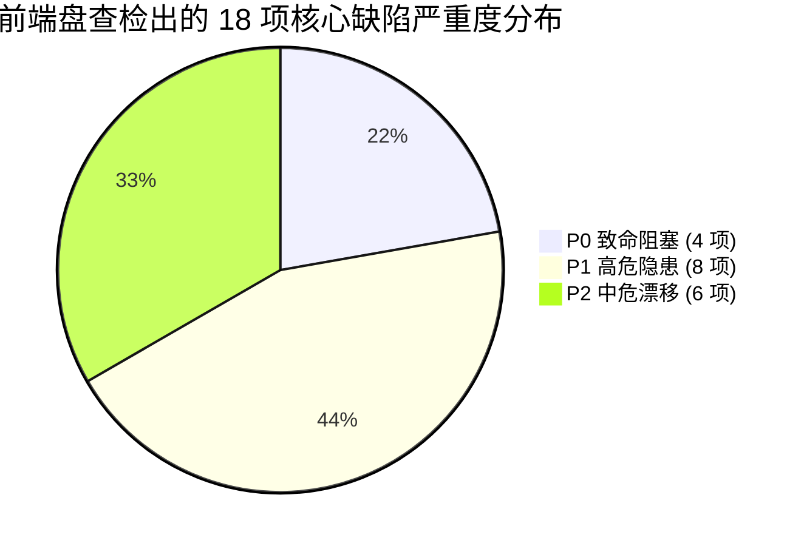
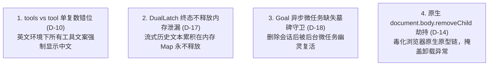
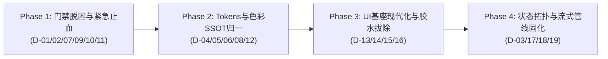

# Conex / Crish 前端全景深度盘查与架构健康度总报告 (Master Audit Report)

> **战役代号**：`frontend-comprehensive-audit`  
> **权威定位**：全仓前端工程（涵盖 `apps/crish-desktop`、`packages/*` 以及跨进程/多窗口通信）深层隐患的终极实证盘查总报告  
> **演进状态**：**第一轮 6 大专项专职审计专家全量闭环，现场数据与代码级证据全部收口！**  
> **遵循纪律**：`AGENTS.md` 规范、反退避原则、五大铁律红线、战役工作区结构规范  
> **专项证据索引**：  
> - A01 依赖拓扑与构建安全：[`audits/01-audit-circular-deps-and-packaging.md`](file:///c:/Software/conex/docs/frontend-comprehensive-audit/audits/01-audit-circular-deps-and-packaging.md)  
> - A02 Design Tokens 与色彩 SSOT：[`audits/02-audit-design-tokens-and-color-ssot.md`](file:///c:/Software/conex/docs/frontend-comprehensive-audit/audits/02-audit-design-tokens-and-color-ssot.md)  
> - A03 视觉层级与字阶排版：[`audits/03-audit-visual-hierarchy-and-typography.md`](file:///c:/Software/conex/docs/frontend-comprehensive-audit/audits/03-audit-visual-hierarchy-and-typography.md)  
> - A04 国际化与文案卫生学：[`audits/04-audit-i18n-and-locale-hygiene.md`](file:///c:/Software/conex/docs/frontend-comprehensive-audit/audits/04-audit-i18n-and-locale-hygiene.md)  
> - A05 UI 原子组件与 Headless 胶水：[`audits/05-audit-ui-primitives-and-headless-glue.md`](file:///c:/Software/conex/docs/frontend-comprehensive-audit/audits/05-audit-ui-primitives-and-headless-glue.md)  
> - A06 状态拓扑、流式与 Composer：[`audits/06-audit-state-topology-stream-and-composer.md`](file:///c:/Software/conex/docs/frontend-comprehensive-audit/audits/06-audit-state-topology-stream-and-composer.md)  

---

## 目录索引

1. [战役总览与全景健康度定性结论](#1-战役总览与全景健康度定性结论)
2. [六大核心领域深度穿透与 18 项实证缺陷剖析](#2-六大核心领域深度穿透与-18-项实证缺陷剖析)
   - 2.1 依赖拓扑、循环引用与包边界隔离（A01 审计）
   - 2.2 Design Tokens 色彩系统与死码穿透（A02 审计）
   - 2.3 视觉层级、字阶排版与字体物理断层（A03 审计）
   - 2.4 国际化双重债务与运行时致命单复数错位（A04 审计）
   - 2.5 UI 原子组件基座与 3,871 行脆弱胶水（A05 审计）
   - 2.6 状态拓扑、流式管线与富文本 Composer（A06 审计）
3. [跨领域高危架构级缺陷汇总（Top 4 致命病灶）](#3-跨领域高危架构级缺陷汇总top-4-致命病灶)
4. [系统性实施路线图（四阶段平滑推进）](#4-系统性实施路线图四阶段平滑推进)
5. [不可退避的量化验收断言矩阵](#5-不可退避的量化验收断言矩阵)

---

## 1. 战役总览与全景健康度定性结论

本次盘查组织了 6 位专职子 Agent，对前端全景架构进行了纯只读、地毯式的白盒代码审计与现场门禁实测。

### 1.1 优秀资产（已确立的防线）
1. **TypeScript 编译 100% 纯净**：全仓 11 个 TSConfig 目标 `tsc -b` 0 报错；
2. **G-01 ~ G-17 收敛军规基座稳固**：零裸交互标签、零浮层 `stopPropagation`、零未注解空 catch、7 级 Z-Index 标尺合规；
3. **Store 写权限与组件直引归零**：1194 个组件零直引 Zustand Store，全部收敛至 `storeAccess.ts` 门面；生产代码零未授权 raw `setState`。

### 1.2 严重隐患（必须立即整改的断层）
尽管底层合规框架较完备，但在**局部增量代码、多语言桥接、UI 底层胶水以及复杂流式状态机**中，累积了大量严重威胁运行时稳定性的架构断层与隐蔽缺陷：

---

## 2. 六大核心领域深度穿透与 18 项实证缺陷剖析

### 2.1 依赖拓扑、循环引用与包边界隔离（A01 审计）

| 缺陷编号 | 缺陷定性 | 涉及代码位置 | 核心根因与危害 |
| :--- | :--- | :--- | :--- |
| **D-01 (P0)** | **Hook 强循环引用破坏单向流** | `useNativeBrowserInstance.ts:29` ⇄ `usePreviewNavigation.ts:27` | 底层 Hook 反向依赖了随手写在高层业务 Hook 中的纯工具函数 `resolveBrowserTabId`，形成强循环依赖，导致 `depcruise` 门禁阻断，极易引发 HMR 状态丢失与未定义引用。 |
| **D-02 (P0)** | **安全网关脚本缺失导致门禁阻断** | `apps/crish-desktop/dev-server/` 缺失 2 核心脚本 | 原文件在 Git HEAD 中存在，因开发者将逻辑内联至 `vite.config.ts` 后未暂存删除工作区文件，破坏了 CSRF/端口扫描防线与 DOM 拾取安全凭据，触发 `check:no-pseudo-dispatch` 刚性拦截。 |
| **D-03 (P1)** | **跨包深层相对路径越权穿透** | 25 处业务组件直接写 `../../../../../../packages/...` | 绕过 Monorepo `@crish/shared-types` 和 `@crish/shared-utils` 统一包名导出，直接侵入包内部 `src/` 私有实现，破坏包封装性。 |

---

### 2.2 Design Tokens 色彩系统与死码穿透（A02 审计）

| 缺陷编号 | 缺陷定性 | 涉及代码位置 | 核心根因与危害 |
| :--- | :--- | :--- | :--- |
| **D-04 (P0)** | **高危未定义核心主题 Token** | `themePresets.ts:97, 151` | `--accent-yellow`（cream 主题核心色）与 `--accent-purple`（sakura 主题核心色）在 `tokens-palette.css` 中**完全未声明**，导致主题切换时运行期 `color-mix` 计算失效。 |
| **D-05 (P0)** | **101 处色彩违规与假 Token 串联** | `ContextMenu.module.css` (32处), `ColorPicker.module.css` (65处) | 大量使用 `var(--border-panel, var(--border-color, rgba(255, 255, 255, 0.08)))` 假兜底；深色原型直接搬运锁死在深色硬编码，浅色模式下对比度面临全盘坍塌。 |
| **D-06 (P1)** | **16 处未定义引用与 70 处死 Token** | `tokens-space.css`, `tokens-palette.css` 等 | `--chat-col-gutter` 等 16 个变量悬空未声明；同时存在 70 个无消费方的死 Token（包括 `--type-*` 与 `--ink-*` 复合层抽象过度设计的死码）。 |

---

### 2.3 视觉层级、字阶排版与字体物理断层（A03 审计）

| 缺陷编号 | 缺陷定性 | 涉及代码位置 | 核心根因与危害 |
| :--- | :--- | :--- | :--- |
| **D-07 (P1)** | **字阶标准漂移突破基线** | `PermissionModeMenu.module.css:259-261`, `ProjectManageModal.module.css:88` | Composer 与 Sidebar 引入了非标旧字阶 `--font-size-sm (13px)`、字面量字重 `font-weight: 500` 与实线描边，导致 `check:hierarchy-ssot` 超标输出 286 处明细。 |
| **D-08 (P1)** | **Windows 微软雅黑 500/600 物理断层** | 全仓样式散落 340 处字面量字重 | Windows 默认微软雅黑仅有 400（常规）和 700（粗体）物理字形，声明 500/600 会被系统物理回退至 400，导致精细排版假设在 Windows 桌面端彻底失效。 |
| **D-09 (P2)** | **Markdown 样式门禁扫描假阳性** | `scripts/check-markdown-style-compliance.mjs:64-71` | 校验脚本未解析 `@import` 依赖链，扫描拆分后的 `tokens.css` 误报 74 处未定义；实测 46 个 `--md-*` 变量在 `tokens-components.css` 中 100% 完备。 |

---

### 2.4 国际化双重债务与运行时致命单复数错位（A04 审计）

| 缺陷编号 | 缺陷定性 | 涉及代码位置 | 核心根因与危害 |
| :--- | :--- | :--- | :--- |
| **D-10 (P0)** | **`tools` vs `tool` 单复数错位致英文环境失效** | `apps/crish-desktop/src/i18n/locales/*/index.ts` | 消费契约为 `tool.action.*`（单数），语言包导出时拼写为 `tools`（复数）。**运行时在英文（en-US）下解析必定失败，所有工具调用与动作名称强制显示中文兜底！** |
| **D-11 (P1)** | **新功能模块硬编码中文泄漏** | `SettingsBrowserTab.tsx` (10处), `useNativeInspectorBridge.ts` (6处) 等 5 文件共 24 处 | 原生浏览器新波次代码绕过 i18n，三元动态拼接中文（`enabled ? '启动' : '停止'`）破坏语序，导致 `check:i18n:hardcoded` 阻断退出。 |
| **D-12 (P1)** | **1045 个孤立死词条与 385 个扫描器幻影** | `check-i18n-unused-keys.mjs` 报告 74% 孤立率 | 门禁将拆分文件名误当命名空间，制造了 385 个虚假孤立词条；其余包含 `chat.slash.*` 31 个不存在指令与 `units.*` 20 个闲置词条的虚胖膨胀。 |

---

### 2.5 UI 原子组件基座与 3,871 行脆弱胶水（A05 审计）

| 缺陷编号 | 缺陷定性 | 涉及代码位置 | 核心根因与危害 |
| :--- | :--- | :--- | :--- |
| **D-13 (P1)** | **单体 Barrel 导出失守 (50.41% 外部穿透)** | `apps/crish-desktop/src/components/ui/index.ts` | 外部引用 248 处绕过 index 直接穿透导入；其中 198 处（79.8%）是因为 `index.ts` 未导出 `icons` 目录，倒逼业务手写深层路径。 |
| **D-14 (P0)** | **原生 DOM Monkey-patching 原型毒化** | `tooltipController.ts:58-76` (`patchContainerSafeRemove`) | 篡改 `document.body.removeChild` 来抑制 React unmount 时的 `NotFoundError`，根因是用 `el.remove()` 绕过 React 虚拟 DOM，造成内存泄漏与宿主污染。 |
| **D-15 (P1)** | **FocusTrap 35+ 滚雪球白名单** | `focusTrap.tsx:isWhitelisted` | 维护了 35+ 个选择器和属性白名单，低效深度遍历 body，每增一个浮层必须给 FocusTrap 打补丁。 |
| **D-16 (P1)** | **Button `bare` 木马与 Dialog AST 探测** | `Button.tsx:86-101`, `Dialog.tsx:529-546` | 为规避 G-01 拦截造出 `Button bare` 破坏几何；Dialog 用 `Children.toArray().some()` 浅层探测，遇 Fragment/HOC 即崩溃。 |

---

### 2.6 状态拓扑、流式管线与富文本 Composer（A06 审计）

| 缺陷编号 | 缺陷定性 | 涉及代码位置 | 核心根因与危害 |
| :--- | :--- | :--- | :--- |
| **D-17 (P0)** | **DualLatch 状态机无界内存泄漏** | `dualLatchProtocol.ts:202, 308` | `records` Map 缓存每轮流式全文，终态仅改状态**从未 delete 键**；`abortSession` 为 0 调用死代码，客户端长久运行文本无界膨胀。 |
| **D-18 (P0)** | **Goal 续写微任务竞争与已删会话幽灵复活** | `sessionStreamManager.ts:186-202` | `scheduleStart` 通过 `queueMicrotask` 异步触发，未校验 `isSessionTombstoned`；若排队期间删除会话，微任务仍向引擎发起任务激活幽灵会话。 |
| **D-19 (P1)** | **虚拟滚动 `el.offsetHeight` 强制同步排版** | `messageVirtualizerMeasure.ts:44-45` | 在 ResizeObserver 回调中直接读取 `el.offsetHeight`，高速推流与滚动时引发剧烈同步回流（Layout Thrashing / Reflow 掉帧）。 |

---

## 3. 跨领域高危架构级缺陷汇总（Top 4 致命病灶）

在上述 18 项缺陷中，以下 **4 个病灶属于绝对致命（P0）级别**，必须第一优先级处置：

---

## 4. 系统性实施路线图（四阶段平滑推进）

根据反退避与负代码产出原则，制定系统性整改实施路线：

### 第一阶段（Phase 1）：门禁脱困与紧急阻断止血（立即解除 CI 拦截）
1. **解耦循环引用**：将 `resolveBrowserTabId` 抽离为 `nativeBrowserTabId.ts`，打通单向依赖；
2. **恢复缺失脚本**：恢复 `previewBridgeScript.ts` 与 `sameOriginRequest.ts`，`vite.config.ts` 规范引用；
3. **消除 Markdown 假阳性**：升级 `check-markdown-style-compliance.mjs` 支持 `@import` 依赖链解析；
4. **修复单复数致命 Bug**：将 `locales/*/index.ts` 的 `tools` 修正为 `tool`，恢复英文环境有效翻译；
5. **抽取 24 处中文文案**：补齐 `SettingsBrowserTab.tsx` 等 5 个文件的多语言词条；
6. **调平两处 Hierarchy 超标**：修正 `PermissionModeMenu`（字阶转 body、字重转 400）与 `ProjectManageModal`（描边转 edge-rim），使 H1/H2 重新回归基线以内。

### 第二阶段（Phase 2）：Design Tokens 与色彩/视觉 SSOT 归一
1. **补齐核心缺失 Token**：在 `tokens-palette.css` 补齐 `--accent-yellow` 与 `--accent-purple`；
2. **根除 101 处色彩违规**：铲除 `ContextMenu` 中的 `var(--border-panel, ...)` 假 Token 兜底，将 `ColorPicker` 的裸色替换为语义变量；
3. **物理清退 70 处死 Token**：删除 `--type-*`、`--ink-*` 及冗余别名，保留动态身份环并补齐测试；
4. **全仓字重两档化（400/700）**：彻底清退裸 500/600，契合 Windows 微软雅黑物理字形；
5. **修复 i18n 扫描器并清退死词条**：消除 385 个幻影词条，清退斜杠指令与闲置单位死码。

### 第三阶段（Phase 3）：UI 基座现代化与 Headless 胶水拔除
1. **重构 Barrel 与 Subpath Exports**：导出 `icons` 命名空间，清退 248 处外部穿透导入；
2. **物理拔除 DOM Monkey-patching**：重构 `tooltipController`，彻底铲除 `document.body.removeChild` 原生劫持；
3. **重构 Dialog 与清退 Button bare**：废除 Dialog AST 探测；引入标准 Compound API 与 `<Button asChild>`；
4. **接入 Base UI 与物理弹簧**：逐步以 Base UI 原语替代 3,500+ 行自研脆弱胶水，接线 37 点高精弹簧。

### 第四阶段（Phase 4）：状态拓扑净化与流式/Composer 健壮性加固
1. **治理 DualLatch 内存泄漏**：在 `markDrained` 终态后彻底 `delete` 键；在级联取消中接入 `abortSession`；
2. **加固 Goal 微任务墓碑锁**：在异步回调前置增加 `isSessionTombstoned` 短路拦截，杜绝幽灵复活；
3. **虚拟滚动零回流重构**：将 `createRowMeasureRef` 切换为纯 `extractEntryBlockSize(entry)`，消除 `offsetHeight` 强制排版；
4. **收敛跨包相对路径**：将 25 处跨包相对路径导入统一收敛为 `@crish/shared-types`。

---

## 5. 不可退避的量化验收断言矩阵

| 验收项 | 现存状态 (Current) | 终态断言 (Target) | 验证命令 / 门禁 |
| :--- | :--- | :--- | :--- |
| **循环依赖数** | 1 个硬性循环 (`depcruise` 报错) | **0 个循环依赖** | `npm run lint:depcruise` |
| **色彩门禁违规** | 101 处违规 | **0 处违规 (PASS)** | `npm run check:color-ssot` |
| **Token 一致性** | 16 未定义 / 3 无兜底 / 70 死码 | **0 未定义 / 0 无兜底 / 0 死码** | `npm run check:token-consistency` |
| **视觉层级基线** | 286 处违规输出 (两域超标) | **全域在基线内 (0 超标)** | `npm run check:hierarchy-ssot` |
| **Markdown 样式** | 74 处报错 (假阳性) | **0 处报错 (PASS)** | `npm run check:markdown-style` |
| **硬编码中文** | 24 处泄漏 (5 文件) | **0 处未登记 (PASS)** | `npm run check:i18n:hardcoded` |
| **英文工具文案** | 强制显示中文 (单复数错位) | **100% 正确显示英文** | 单元测试 + 英文界面现场实测 |
| **DOM 原生劫持** | 存在 1 处 Monkey-patching | **0 处 DOM 劫持** | 源码静态扫描 |
| **DualLatch 泄漏** | 终态永不释放 | **终态 100% 释放 delete** | 内存与周期单元测试 |
| **桌面全量静态门禁** | 6 项门禁阻断退出 | **全量 28+ 门禁 100% PASS** | `npm run check:desktop` |

---
*总报告编制完成，全仓实证已锁定，随时可转入第一阶段原子化收敛执行。*
