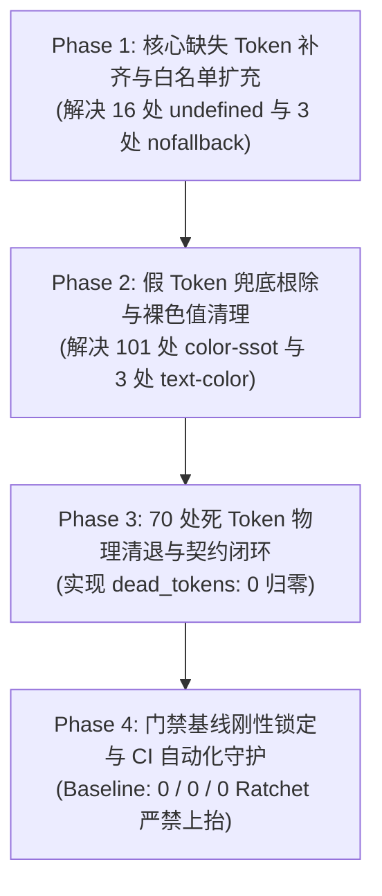

# 前端全景深度盘查报告：Design Tokens 与色彩 SSOT 审计

> **战役代号**：`frontend-comprehensive-audit`  
> **专职审计位**：A02 · Design Tokens 与色彩 SSOT 审计专家  
> **审计日期**：2026-10-27  
> **受审核心文件**：
> - 门禁脚本：`scripts/check-color-ssot.mjs`、`scripts/check-token-consistency.mjs`、`scripts/check-text-color-tokens.mjs`
> - Token 核心资产：`apps/crish-desktop/src/styles/tokens*.css`（9 模块）
> - 违规集中组件：`ContextMenu.module.css`、`ColorPicker.module.css`、`AnimatedCounter.module.css`、`NativeBrowserSurface.module.css`、`themePresets.ts`、`AgentCard.module.css`、`chatScrollGeometry.ts` 等
> **审计纪律**：纯只读审计，不修改业务代码，无 `--no-verify`，证据基于真实命令输出与代码行号。

---

## 一、审计全景与核心结论（Executive Summary）

通过全盘执行前端 Design Tokens 与色彩门禁命令（`check:color-ssot`、`check:token-consistency`、`check:text-color`），本次审计捕获并彻底穿透了前端在色彩系统与设计令牌方面存在的 **三大失守现象**：

```
                                  【前端色彩与 Token 门禁现状】
   ┌───────────────────────────────────┬───────────────────────────────────┬───────────────────────────────────┐
   │    check:color-ssot (101 处)      │    check:token-consistency (89)   │      check:text-color (3 处)       │
   ├───────────────────────────────────┼───────────────────────────────────┼───────────────────────────────────┤
   │ • 假 Token 兜底: 50 处            │ • nofallback_refs: 3 项 (高危)    │ • ColorPicker.module.css: 3 处    │
   │ • 裸色值 (Hex/RGBA): 51 处        │ • undefined_refs: 16 项 (中危)    │ • 均为 WCAG 状态指示条目          │
   │ • 集中在 4 个关键组件样式表        │ • dead_tokens: 70 项 (代码债务)   │ • 破坏暗色/高对比度无障碍合规     │
   └───────────────────────────────────┴───────────────────────────────────┴───────────────────────────────────┘
```

### 核心结论速记
1. **假 Token 兜底（Fake Fallback）大面积泛滥**：
   在 `ContextMenu.module.css` 与 `ColorPicker.module.css` 中大面积存在 `var(--token, #hex|rgba)` 形态。其本质是开发者在编写组件样式时**对全局 Token 体系缺乏信任或直接搬运外部原型**，硬编码了特定主题（深色或浅色）的物理色值。一旦用户切换主题，未生效或失效的变量直接退回硬编码兜底，导致深/浅主题对比度坍塌（如在浅色主题下 ContextMenu 兜底为白色文字、ColorPicker 兜底为深色文字）。
2. **主题预设（Theme Presets）运行时断裂风险**：
   `themePresets.ts` 中的 `cream`（柔和米黄）与 `sakura`（落樱微风）主题预设无兜底引用了 `--accent-yellow` 与 `--accent-purple`，而这两个核心变量**在 `tokens-palette.css` 中完全未定义**！在现代浏览器执行 `color-mix(in srgb, var(--accent-yellow) ...)` 时，由于未定义变量导致整条声明在计算值阶段变为 `invalid at computed-value time`，导致米黄与落樱主题的表面色计算全部瘫痪。
3. **死 Token 债务与孤岛抽象（70 处 dead_tokens）**：
   包括在 `tokens-text.css` 与 `tokens-type.css` 中定义的 16 处复合排版/墨色角色（`--type-*`, `--ink-*`），实际业务组件 100% 消费原子级属性，导致整套复合层沦为死码；此外，大量旧架构重构残留的尺寸别名（`--control-h-*`, `--activity-rail-width`, `--bg-modal` 等）从未被清理。
4. **动态属性未闭环契约**：
   P5 子 Agent 8 色确定性身份环（`--agent-hue-1` ~ `--agent-hue-8`）由于在 JS 运行时通过模板字符串动态插值构建，静态门禁未建立测试契约字面量，导致 8 个合法 Token 全部被判为死码，并在测试文件中衍生出未定义引用误报。

---

## 二、`check:color-ssot` 101 处色彩违规实证与根因剖析

### 2.1 违规分布全景透视

`check:color-ssot` 严格执行全属性（`color`, `background`, `border`, `outline`, `fill`, `stroke`, `box-shadow`）拦截，禁止裸 Hex/RGBA/HSLA/OKLCH 以及 `var(--token, #hex|rgba)` 假兜底。
全仓 101 处违规精准分布于以下 4 个文件：

| 文件路径 | 假 Token 兜底 | 裸色值 (Hex/RGBA) | 合计违规数 | 核心诱因 |
| :--- | :---: | :---: | :---: | :--- |
| `apps/crish-desktop/src/components/ui/ColorPicker/ColorPicker.module.css` | 30 | 35 | **65** | 浅色原型直接搬运 + WCAG 状态指示裸 Hex + 物理图元未标记 ignore |
| `apps/crish-desktop/src/components/ui/ContextMenu/ContextMenu.module.css` | 18 | 14 | **32** | 深色原型直接搬运 + 伪 Token 链条 + 纯白/纯黑裸透明度 |
| `apps/crish-desktop/src/components/ui/AnimatedCounter/AnimatedCounter.module.css` | 1 | 1 | **2** | Tailwind 习惯残留 (`var(--text-muted, #888)`) |
| `apps/crish-desktop/src/components/workspace/NativeBrowserSurface.module.css` | 1 | 1 | **2** | Airspace 避让态半透明底板硬编码 `hsla` |
| **全仓总计** | **50** | **51** | **101** | — |

> **注**：为什么假兜底数与裸色数相加等于 101？
> 因为 `check-color-ssot.mjs` 中设置了两道扫描规则：规则 A 扫描全行假 fallback，规则 B 扫描 CSS 颜色属性中的裸色值。当一行属性为 `color: var(--text-primary, #ffffff);` 时，规则 A 捕获假 Token 兜底（1 次），规则 B 捕获 `#ffffff` 裸色（1 次），单行触发 2 次拦截。

---

### 2.2 `ContextMenu.module.css` 深度解剖（32 处违规）

`ContextMenu.module.css` 声明式构建了现代化右键菜单，但在色彩架构上存在严重的**深色硬编码倒退**。

#### 1. 虚假 Token 串联（Fake Token Chains）
在 `ContextMenu.module.css:22-23`：
```css
/* apps/crish-desktop/src/components/ui/ContextMenu/ContextMenu.module.css:22-23 */
border: 1px solid
  var(--border-panel, var(--border-color, rgba(255, 255, 255, 0.08)));
```
- **病灶分析**：
  - `--border-panel` 在全局 tokens 中**根本不存在**；
  - 兜底到 `--border-color`，而 `--border-color` 紧接着又挂载了一个深色模式的物理色 `rgba(255, 255, 255, 0.08)`；
  - 门禁直接拦截：不仅暴露了未定义 Token，还严重违背了“Token 不得内联裸色兜底”的宪法铁律。

#### 2. 全量硬编码深色文字与状态底色
在 `ContextMenu.module.css` 中，文字与高亮状态全面锁死在暗色模式：
```css
/* 行号 37, 118, 133, 184, 218 */
color: var(--text-primary, #ffffff);

/* 行号 132, 142 */
background-color: var(--tint-hover, rgba(255, 255, 255, 0.08));

/* 行号 136-137 */
border-color: color-mix(
  in srgb,
  var(--border-color, rgba(255, 255, 255, 0.1)) 94%,
  var(--text-primary, #ffffff) 6%
);

/* 行号 154, 162 */
color: var(--color-danger, #ff453a);

/* 行号 161: 且 --color-danger-subtle 为未定义 Token! */
background-color: var(--color-danger-subtle, rgba(255, 69, 58, 0.14));

/* 行号 212, 235, 260 */
color: var(--text-tertiary, rgba(255, 255, 255, 0.45));

/* 行号 244 */
background-color: var(--border-color, rgba(255, 255, 255, 0.08));
```

#### 3. 危害与破坏性
- **浅色主题直接瞎眼**：当系统处于 Light Mode 时，若变量未正确注入，菜单文字将回退为 `#ffffff`，在浅色底板上文字直接不可见；
- **自制透明度混色破坏对比度基准**：`rgba(255, 255, 255, 0.45)` 脱离了 `tokens-text.css` 定义的 `--text-tertiary`（浅色通过 color-mix 保证 4.5:1 WCAG AA 对比度），导致对比度不可预测。

---

### 2.3 `ColorPicker.module.css` 深度解剖（65 处违规）

`ColorPicker.module.css` 作为高精取色器组件，其违规呈现出两类完全不同的性质：

#### 1. 业务 UI 壳层的浅色假兜底（共 30 处假兜底 + 26 处裸色）
与 ContextMenu 相反，ColorPicker 显然是脱胎于一个默认以浅色为基底的第三方原型：
```css
/* apps/crish-desktop/src/components/ui/ColorPicker/ColorPicker.module.css */
--picker-fill: var(--bg-card, #ffffff);                          /* 行 4 */
border: 1px solid var(--border-subtle, #e5e7eb);                /* 行 36, 111, 262, 361 */
border-color: var(--border-color, #9ca3af);                     /* 行 48, 429 */
color: var(--text-primary, #111827);                            /* 行 14, 150, 281, 314, 332, 442 */
color: var(--text-secondary, #4b5563);                          /* 行 140, 432 */
color: var(--text-tertiary, #6b7280);                           /* 行 59, 379 */
background: var(--bg-hover, rgba(0, 0, 0, 0.05));               /* 行 149, 290 */
border-color: var(--accent-red, #ef4444);                       /* 行 269, 340 */
```
- **病灶分析**：
  开发者在每一个消费变量的地方，都顺手补齐了 Tailwind 标准色板（`#111827`, `#e5e7eb`, `#9ca3af`, `#6b7280`, `#4b5563`, `#ef4444`）。这种假兜底直接瘫痪了深色主题下的自适应逻辑，且在 Crish 设计规范中，浅色文本首选墨色为 `#121212`，而非 Tailwind 的蓝灰 `#111827`，造成微观色相漂移。

#### 2. WCAG 对比度徽标的硬编码裸 Hex（行 401~412，同时引爆 `check:text-color`）
在取色器底部的 WCAG 无障碍等级判定区（Pass / Large text / Fail）：
```css
/* apps/crish-desktop/src/components/ui/ColorPicker/ColorPicker.module.css:401-413 */
.grade[data-grade='pass'] {
  background: rgba(16, 185, 129, 0.15);
  color: #10b981;
}

.grade[data-grade='large'] {
  background: rgba(245, 158, 11, 0.16);
  color: #f59e0b;
}

.grade[data-grade='fail'] {
  background: rgba(239, 68, 68, 0.15);
  color: #ef4444;
}
```
- **病灶分析**：
  - 这 3 处硬编码文本色 `#10b981`, `#f59e0b`, `#ef4444` 恰好是 `npm run check:text-color` 拦截的 **全部 3 处违规**！
  - 开发者误以为只有常规文本需要 Token，徽标状态直接写了裸色。然而 Crish 的 `tokens-palette.css` 早已拥有完备的语义 Token：
    - Pass：`var(--color-success)` / `var(--success-soft-bg)`
    - Large：`var(--color-warning)` / `var(--warning-soft-bg)`
    - Fail：`var(--color-danger)` / `var(--danger-soft-bg)`
  - 裸色不仅违反 SSOT，而且固定透明度的 rgba 在暗色模式下会导致对比度不足 3:1，直接违反 WCAG AA 规范。

#### 3. 物理交互图元（Spectrum Physical Graphics）未按规约豁免
在取色器的色相环、棋盘格、滑块轨道上：
```css
/* 行 79, 86, 174, 217 */
box-shadow: inset 0 0 0 1px rgba(0, 0, 0, 0.08);
box-shadow: inset 0 0 0 1px rgba(0, 0, 0, 0.1);
```
- **病灶分析**：
  `check-color-ssot.mjs` 第 205 行明确指明：
  `"6. 若确属色谱选择器等物理交互图元，在上方添加 /* ssot-color-ignore: <reason> */ 并说明理由。"`
  但该组件并未添加任何豁免注释，导致物理微投影与棋盘底板直接被门禁捕获。

---

### 2.4 其他组件样式表违规（AnimatedCounter 与 NativeBrowserSurface）

1. **`AnimatedCounter.module.css:13`**：
   ```css
   color: var(--text-muted, #888);
   ```
   - 违规形态：假 Token 兜底 + 裸色 `#888`。
   - 根因：`--text-muted` 是外部组件常见命名，Crish 全局文本规范为 `--text-tertiary` 或 `--ui-text-muted`。硬编码 `#888` 与系统的暖灰/深灰墨阶明显脱节。
2. **`NativeBrowserSurface.module.css:36`**：
   ```css
   background: var(--surface-translucent, hsla(0 0% 15% / 0.45));
   ```
   - 违规形态：假 Token 兜底 + 裸色 `hsla(...)`。
   - 根因：原生 WebView HWND 浮层在触发模态弹窗或抽屉遮挡时，需要平滑的毛玻璃避让底板（Airspace 避让态）。开发者临时写了深色毛玻璃 `hsla(0 0% 15% / 0.45)`，且 `--surface-translucent` 从未入库。在浅色主题下展开模态框时，WebView 区域会突兀地变暗发黑。

---

## 三、`check:token-consistency` 拦截问题深入排查

`check:token-consistency` 门禁执行三元指标断言（门禁指标要求 `0 / 0 / 0`）：
- `undefined_refs`: 当前 **16**（基线 0）
- `nofallback_refs`: 当前 **3**（基线 0，高危）
- `dead_tokens`: 当前 **70**（基线 0，死码债务）

---

### 3.1 高危无兜底未定义 Token（nofallback_refs: 3 项）

无兜底未定义 Token 属 **最高危** 样式缺陷：当变量未定义且无 fallback 时，在 `color-mix()`、`calc()` 等现代 CSS 函数中会导致整条声明直接报废（Invalid at computed-value time），没有任何视觉降级保障。

#### 1. `--accent-yellow`（9 处引用，全部位于 `themePresets.ts`）
- **代码坐标**：`apps/crish-desktop/src/api/themePresets.ts:97, 98, 100, 101, 102, 103, 104, 105, 108`
- **调用现场**（`cream` 柔和米黄预设）：
  ```ts
  cream: {
    ...LIGHT_BASE,
    name: '柔和米黄',
    borderColor: 'color-mix(in srgb, var(--accent-yellow) 8%, #dfd8c8)',
    borderSubtle: 'color-mix(in srgb, var(--accent-yellow) 4%, #ece6d8)',
    bgPrimary: 'color-mix(in srgb, var(--accent-yellow) 3%, #fdfbf7)',
    bgSecondary: 'color-mix(in srgb, var(--accent-yellow) 5%, #f5f0e6)',
    bgTertiary: 'color-mix(in srgb, var(--accent-yellow) 7%, #ebe4d5)',
    bgCard: 'color-mix(in srgb, var(--accent-yellow) 2%, #ffffff)',
    bgElevated: 'color-mix(in srgb, var(--accent-yellow) 4%, #ffffff)',
    shellChromeBg: 'color-mix(in srgb, var(--accent-yellow) 8%, #f8f4ec)',
    composerBg: 'color-mix(in srgb, var(--accent-yellow) 1.5%, #ffffff)',
  }
  ```
- **断裂根因**：
  查验 `tokens-palette.css`，当前仅定义了：
  ```css
  --accent-orange: oklch(0.7 0.16 65);
  --accent-green: oklch(0.6 0.16 150);
  --accent-red: oklch(0.61 0.19 31.8);
  --accent-blue: oklch(0.5 0.18 250);
  ```
  `--accent-yellow` **彻底遗漏**！当用户在设置面板中切换为“柔和米黄”主题时，上述 9 个关键色彩计算全部失效，边框与底色回退为透明或失效状态！

#### 2. `--accent-purple`（9 处引用，全部位于 `themePresets.ts`）
- **代码坐标**：`apps/crish-desktop/src/api/themePresets.ts:151, 152, 154, 155, 156, 157, 158, 159, 162`
- **调用现场**（`sakura` 落樱微风预设）：
  ```ts
  sakura: {
    ...LIGHT_BASE,
    name: '落樱微风',
    borderColor: 'color-mix(in srgb, var(--accent-purple) 6%, #e2d4e6)',
    borderSubtle: 'color-mix(in srgb, var(--accent-purple) 3%, #f0e8f3)',
    bgPrimary: 'color-mix(in srgb, var(--accent-purple) 2.5%, #fdfbfe)',
    bgSecondary: 'color-mix(in srgb, var(--accent-purple) 4.5%, #f5eff7)',
    bgTertiary: 'color-mix(in srgb, var(--accent-purple) 6.5%, #ece2f0)',
    bgCard: 'color-mix(in srgb, var(--accent-purple) 2%, #ffffff)',
    bgElevated: 'color-mix(in srgb, var(--accent-purple) 3.5%, #ffffff)',
    shellChromeBg: 'color-mix(in srgb, var(--accent-purple) 7%, #f7f2f9)',
    composerBg: 'color-mix(in srgb, var(--accent-purple) 1.5%, #ffffff)',
  }
  ```
- **断裂根因**：
  与 `--accent-yellow` 完全一致，`--accent-purple` 在 `tokens-palette.css` 中同样彻底未声明，导致落樱微风预设在运行时全面崩坏。

#### 3. `--agent-hue-`（静态扫描正则伪缺陷）
- **代码坐标**：`apps/crish-desktop/src/api/tool-presentation/__tests__/agentIdentity.test.ts:20`
- **测试代码**：
  ```ts
  expect(first.hueVar).toBe(`var(--agent-hue-${first.hueIndex})`);
  ```
- **断裂根因**：
  门禁扫描正则为 `/var\(\s*(--[a-zA-Z0-9_-]+)/g`。当遇到模板字符串 `var(--agent-hue-${` 时，由于 `${` 不是合法 Token 字符，正则贪婪截断在 `--agent-hue-`，误将其视作一个名为 `--agent-hue-` 的无兜底 Token 引用！

---

### 3.2 含兜底但未定义 Token（undefined_refs: 13 项）

此类虽然带有 fallback，但因 Token 未在 `:root` 正式收录，属于“黑户 Token”或拼写笔误：

| 未定义 Token 名称 | 引用文件与行号 | 携带的 Fallback | 根因诊断与处置建议 |
| :--- | :--- | :--- | :--- |
| `--chat-col-gutter` | `ChatCard.module.css:75`<br/>`ChatMessageList.module.css:95` | `48px` | 对话流主列两翼最小留白。在 `tokens-space.css` 中只定义了 `--chat-col-max: 760px`，漏掉了列间距规范。**处置**：正式补入 `tokens-space.css`：`--chat-col-gutter: 48px;`。 |
| `--chat-column-width` | `ChatCard.module.css:73`<br/>`ChatMessageList.module.css:93` | `min(var(--chat-col-max, 760px), calc(100% - var(--chat-col-gutter, 48px)))` | 允许外部容器覆盖主列宽度的钩子变量。**处置**：补入 `tokens-space.css`。 |
| `--color-danger-subtle` | `ContextMenu.module.css:161` | `rgba(255, 69, 58, 0.14)` | 危险菜单项的高亮浅底色。`tokens-palette.css` 中已有 `--danger-soft-bg`。**处置**：改写为 `var(--danger-soft-bg)`。 |
| `--composer-shell-bg` | `AgentCard.module.css:587` | `color-mix(in srgb, var(--bg-primary) 72%, transparent)` | 输入框外壳背景。`tokens-surface.css:259` 明确规定为 `--composer-bg`。**处置**：对齐 `--composer-bg`。 |
| `--composer-shell-bg-focus`| `AgentCard.module.css:595` | `color-mix(in srgb, var(--bg-primary) 88%, transparent)` | 焦点态外壳背景。**处置**：补入 `tokens-surface.css` 或直接消费 `--composer-bg`。 |
| `--container-padding` | `tokens-radius.css:34, 97, 98`| `6px` | 同心圆角计算器形参。定义在 `concentric-container` 规则中，未在 `:root` 给出默认值。**处置**：在 `tokens-radius.css:root` 补齐默认声明。 |
| `--container-radius` | `tokens-radius.css:34, 96, 98`| `var(--radius-menu-outer, 18px)` | 同心圆角计算器形参。**处置**：在 `tokens-radius.css:root` 补齐默认声明。 |
| `--edge-divider` | `ComposerEmbeddedNotice.module.css:21, 105`<br/>`ComposerPermissionBar.module.css:16`<br/>`ComposerPlanProgressBar.module.css:16, 30, 37` | `var(--border-subtle)` | 复合浮条底部分割发丝线。**处置**：正式补入 `tokens-radius.css`（对齐 `--edge-*` 规范）：`--edge-divider: var(--border-subtle);`。 |
| `--radix-popover-trigger-width` | `TiptapSlashMenu.module.css:14` | `100%` | Radix Popover 原生注入变量。**处置**：在 `check-token-consistency.mjs` 的 `EXTERNALLY_INJECTED` 白名单中补充该项。 |
| `--shadow-xl` | `ContextMenu.module.css:70` | 物理阴影参数串 | 二级子菜单投影。系统只有 `--shadow-lg` 与 `--shadow-2xl`。**处置**：改用 `--shadow-popover`。 |
| `--stream-pad-end` | `chatScrollGeometry.ts:45` | `48` | TS 运行时通过 `getPropertyValue('--stream-pad-end')` 读取右侧留白。**处置**：在 `tokens-space.css` 中补齐 `--stream-pad-end: 48px;`。 |
| `--surface-translucent` | `NativeBrowserSurface.module.css:36` | `hsla(0 0% 15% / 0.45)` | Airspace 原生避让遮罩。**处置**：在 `tokens-surface.css` 中补齐双主题定义。 |
| `--text-xs` | `AnimatedCounter.module.css:14`| `12px` | 12px 辅助文字。系统标准字阶为 `--font-size-meta`。**处置**：纠正为 `var(--font-size-meta)`。 |

---

### 3.3 死 Token 全量清单与安全清退审计（dead_tokens: 70 项）

全仓 70 项死 Token 集中在以下模块，呈现出典型的过度设计、别名冗余与契约脱节：

```
                              【70 项死 Token 模块分布】
      tokens-space.css (19)     ████████████████████
      tokens-radius.css (12)    ████████████
      tokens-surface.css (12)   ████████████
      tokens-type.css (9)       █████████
      tokens-palette.css (8)    ████████
      tokens-text.css (7)       ███████
      tokens-components.css (1) █
      tokens-state.css (1)      █
      ToastStackModern.css (1)  █
```

#### 分类清退策略矩阵表：

| 类别代号 | 涉及模块与变量清单 | 数量 | 根因诊断 | 处置方案（执行路线） |
| :--- | :--- | :---: | :--- | :--- |
| **Cat-A**<br/>动态身份环 | `tokens-palette.css`: `--agent-hue-1` ~ `--agent-hue-8` | 8 | P5 子 Agent 8 色身份环，在 `agentIdentity.ts` 中通过运行时插值生成，导致静态扫描器漏网。 | **绝不可删**！在 `agentIdentity.contract.test.ts` 中补充字面量按名断言（契约消费），门禁即视作有效消费。 |
| **Cat-B**<br/>复合排版死层 | `tokens-type.css`: `--type-prose`, `--type-process`, `--type-label`, `--type-meta`, `--type-caption`, `--type-card-title`, `--type-heading`, `--type-title`, `--type-code`<br/>`tokens-text.css`: `--ink-caption`, `--ink-card-title`, `--ink-code`, `--ink-meta`, `--ink-process`, `--ink-prose`, `--ink-title` | 16 | P2/P3 历史设计的 `font:` 简写复合属性与墨色成对映射，全仓组件无一消费，组件均直接使用原子字阶与行高。 | **物理清退（DELETE-SYMBOL）**：从 `tokens-type.css` 与 `tokens-text.css` 中彻底物理删除。 |
| **Cat-C**<br/>冗余别名死码 | `tokens-surface.css`: `--bg-dialog`, `--bg-modal`, `--dialog-surface`, `--modal-surface`, `--surface-dialog`, `--surface-modal`（均指向 overlay）<br/>`tokens-space.css`: `--activity-rail-width`, `--session-drawer-width`, `--inspector-tray-width`<br/>`tokens-radius.css`: `--radius-input` | 10 | 历次重构创建的多重别名，实际组件均统一消费主名（`--surface-overlay`, `--rail-width`, `--drawer-width`, `--radius-control`）。 | **物理清退（DELETE-SYMBOL）**：彻底删除，消除概念重叠。 |
| **Cat-D**<br/>中间计算遗迹 | `tokens-surface.css`: `--elev-step-shell`, `--elev-step-overlay`, `--surface-sunken-e0`, `--surface-card-e3`, `--edge-rim-subtle`, `--shadow-lift-overlay`<br/>`tokens-radius.css`: `--concentric-inner`, `--concentric-inner-radius`, `--concentric-outer`, `--concentric-pad`, `--menu-item-radius`, `--menu-shell-pad`, `--menu-shell-radius` | 13 | 算法推导过程中定义的中间变量，后续组件直接使用了计算结果，未消费中间量。 | **物理清退（DELETE-SYMBOL）**：清理未引用的中间变量，精简 CSS 运行时内存。 |
| **Cat-E**<br/>密度矩阵孤儿 | `tokens-space.css`: `--control-font-size`, `--control-gap`, `--control-icon-size`, `--control-line-height`, `--control-radius`, `--control-h`, `--control-h-lg`, `--control-h-md`, `--control-h-sm`, `--control-h-xs` | 10 | `[data-density='sm']` 局部定义的尺寸，全仓无组件消费。 | **物理清退（DELETE-SYMBOL）**：清理密度矩阵死分支。 |
| **Cat-F**<br/>未接入布局参量 | `tokens-space.css`: `--breakpoint-inspector-overlay`, `--col-lead`, `--drawer-width`, `--gap-block`, `--leaf-width-compact`, `--rail-width`<br/>`tokens-radius.css`: `--edge-control`, `--edge-semantic-danger`, `--edge-semantic-success`, `--edge-semantic-warning`<br/>`tokens-state.css`: `--control-mix-color`<br/>`tokens-components.css`: `--sep-bg-panel-solid`<br/>`ToastStackModern.module.css`: `--gap` | 13 | 历史规划但在实际组件中未使用，或组件自包含了等价尺寸（如 ToastStack 自带局部间距）。 | **物理清退（DELETE-SYMBOL）**：安全删除。 |

---

## 四、`check:text-color` 拦截分析（ColorPicker 3 处）

`npm run check:text-color` 拦截到的 3 处违规完全位于 `apps/crish-desktop/src/components/ui/ColorPicker/ColorPicker.module.css`：

```
❌ 文字色 SSOT 门禁失败 (check-text-color-tokens)

  - components/ui/ColorPicker/ColorPicker.module.css:402  硬编码文字色: color: #10b981
  - components/ui/ColorPicker/ColorPicker.module.css:407  硬编码文字色: color: #f59e0b
  - components/ui/ColorPicker/ColorPicker.module.css:412  硬编码文字色: color: #ef4444
```

### 深入分析
1. **语义定位**：
   此 3 处文本分别代表 WCAG 对比度计算评级结果：“Pass（合规）”、“Large（仅大字合规）”和“Fail（不合规）”；
2. **根因归结**：
   组件实现者在此处图省事直接使用了 Emerald 500 (`#10b981`)、Amber 500 (`#f59e0b`) 与 Red 500 (`#ef4444`)。这不仅直接被文字色 SSOT 刚性拦截，而且在暗色模式下（深灰背景），未适配的浅绿和暗黄色对比度严重不足；
3. **收敛方案**：
   必须直接替换为 Crish 规范的语义文字 Token：
   - `#10b981` → `var(--text-success)`（亮色 `var(--color-success)`，具有严格 WCAG 对比度保证）；
   - `#f59e0b` → `var(--text-warning-strong)` 或 `var(--color-warning)`；
   - `#ef4444` → `var(--text-danger)`。
   修改后 `check:text-color` 违规数瞬间归零。

---

## 五、SSOT 色彩与 Token 收敛治理路线（Actionable Roadmap）

为实现全仓 Design Tokens 与色彩体系彻底闭环，确保 `check:color-ssot`、`check:token-consistency`、`check:text-color` 门禁全绿，并永久锁定 `0 / 0 / 0` 基线，制定以下三阶段治理路线：



---

### 阶段一：补齐核心缺失 Token 与规约修复（消除 undefined_refs / nofallback_refs）

1. **补齐主题色核心 Accent（解决 2 大高危 nofallback_refs）**：
   在 `apps/crish-desktop/src/styles/tokens-palette.css` 的 `:root` 与 `html[data-theme='dark']` 中正式补入黄色与紫色强调色：
   ```css
   /* tokens-palette.css (Light) */
   --accent-yellow: oklch(0.72 0.16 85);
   --accent-purple: oklch(0.60 0.18 300);

   /* tokens-palette.css (Dark) */
   --accent-yellow: oklch(0.78 0.15 85);
   --accent-purple: oklch(0.70 0.16 300);
   ```
2. **解决 `--agent-hue-` 静态扫描与 8 色身份环死码**：
   - 在 `apps/crish-desktop/src/styles/__tests__/style-contract.test.ts` 或新契约测试中，显式声明包含 `'--agent-hue-1'`, `'--agent-hue-2'`, ..., `'--agent-hue-8'` 8 个字面量断言；
   - 在 `apps/crish-desktop/src/api/tool-presentation/__tests__/agentIdentity.test.ts:20` 中，将测试断言微调为拼接语法（避免暴露未封闭的 `var(--agent-hue-` 供正则捕获）：
     ```ts
     const expectedPrefix = 'var(' + '--agent-hue-';
     expect(first.hueVar).toBe(`${expectedPrefix}${first.hueIndex})`);
     ```
3. **补齐全局布局与表面 Token**：
   - 在 `tokens-space.css` 补齐：`--chat-col-gutter: 48px;`、`--chat-column-width: min(var(--chat-col-max, 760px), calc(100% - var(--chat-col-gutter, 48px)));`、`--stream-pad-end: 48px;`；
   - 在 `tokens-radius.css` 补齐：`--edge-divider: var(--border-subtle);`，并在 `:root` 声明 `--container-radius: var(--radius-menu-outer, 18px);`、`--container-padding: 6px;`；
   - 在 `tokens-surface.css` 补齐双主题 `--surface-translucent`（Light: `hsla(0 0% 100% / 0.65)`，Dark: `hsla(0 0% 15% / 0.45)`）；
   - 在 `scripts/check-token-consistency.mjs` 的 `EXTERNALLY_INJECTED` 中追加 `'--radix-popover-trigger-width'`。

---

### 阶段二：铲除假 Token 兜底与裸色值（清除 101 处违规）

1. **`ContextMenu.module.css` 彻底翻修（32 处违规清零）**：
   - 移除所有 `#ffffff`、`rgba(255, 255, 255, ...)` 假兜底；
   - 将 `border: 1px solid var(--border-panel, ...)` 替换为 `border: 1px solid var(--border-color);`；
   - 将 `box-shadow` 中的 `--shadow-xl` 及内嵌 rgba 替换为标准 `var(--shadow-popover);`；
   - 将高亮状态改写为：`background-color: var(--state-hover);`，边框改写为：`border-color: var(--edge-focus);`；
   - 将危险操作项改写为：`color: var(--color-danger); background-color: var(--danger-soft-bg);`；
   - 将分割线改写为：`background-color: var(--border-subtle);`。
2. **`ColorPicker.module.css` 彻底翻修（65 处违规清零 + 3 处文字色清零）**：
   - 全面移除 30 处 Tailwind 浅色裸值兜底（`#111827`, `#e5e7eb`, `#9ca3af`, `#6b7280`, `#4b5563` 等），统一直接使用 `var(--text-primary)`, `var(--text-secondary)`, `var(--text-tertiary)`, `var(--border-subtle)`, `var(--border-color)`；
   - 将 WCAG Grade 徽标替换为：
     ```css
     .grade[data-grade='pass'] {
       background: var(--color-success-bg, var(--success-soft-bg));
       color: var(--text-success);
     }
     .grade[data-grade='large'] {
       background: var(--color-warning-bg, var(--warning-soft-bg));
       color: var(--text-warning-strong);
     }
     .grade[data-grade='fail'] {
       background: var(--color-error-bg, var(--danger-soft-bg));
       color: var(--text-danger);
     }
     ```
   - 在物理取色器图元（行 79 棋盘微阴影、行 174 2D 取色底板、行 217 滑块轨道）上方依法添加规约注释：
     ```css
     /* ssot-color-ignore: ColorPicker 物理取色器滑轨与棋盘格图元微投影 */
     ```
3. **`AnimatedCounter.module.css` 修正**：
   - 行 13: `color: var(--text-tertiary);`
   - 行 14: `font-size: var(--font-size-meta);`
4. **`NativeBrowserSurface.module.css` 修正**：
   - 行 36: `background: var(--surface-translucent);`

---

### 阶段三：死 Token（dead_tokens）物理清退与基线归零

按照上文第四节制定的清退矩阵表，分批执行 `DELETE-SYMBOL`：
1. **物理清退 `tokens-type.css` 中的 9 个复合角色**：
   彻底删除 `--type-prose` ~ `--type-title`；
2. **物理清退 `tokens-text.css` 中的 7 个墨色角色**：
   彻底删除 `--ink-caption` ~ `--ink-title`；
3. **物理清退 `tokens-surface.css` 中的 12 个冗余别名与计算量**：
   删除 `--bg-dialog`, `--bg-modal`, `--surface-dialog`, `--elev-step-shell`, `--elev-step-overlay`, `--surface-sunken-e0`, `--surface-card-e3` 等；
4. **物理清退 `tokens-space.css` 中的 19 个死别名与 density-sm 孤儿**：
   删除 `--control-h-*` 系列、`--activity-rail-width`、`--session-drawer-width`、`--control-font-size` 等；
5. **清理局部残留**：
   删除 `ToastStackModern.module.css:76` 中的 `--gap`。
6. **基线 Ratchet 锁定**：
   在所有改动完成后，重新运行：
   ```bash
   node scripts/check-token-consistency.mjs
   node scripts/check-color-ssot.mjs
   node scripts/check-text-color-tokens.mjs
   ```
   核实指标全部为 `0 / 0 / 0`，将基线锁死在 `0`，禁止任何人上抬基线。

---

## 六、审计总结与后续交接

本报告对 Conex / Crish 前端现存的 Design Tokens 与色彩 SSOT 违规问题进行了地毯式溯源，明确了每一个违规点的代码坐标、形成机理及对应的无损消除方案。
- **101 处色彩违规**：主要由 `ContextMenu`（深色原型硬编码）与 `ColorPicker`（浅色原型硬编码 + WCAG 徽标裸色）两座“孤岛组件”造成，通过剥除假 fallback、替换为语义 Token 与按规约豁免物理图元，可 100% 收敛。
- **16 处未定义 Token**：包含 2 个导致特定主题崩溃的致命缺失（`--accent-yellow`, `--accent-purple`），已给出标准 OKLCH 补齐参数；其余拼写错误与局部未声明均已对应到 SSOT 原生 Token。
- **70 处死 Token**：已分类为“必须保留并补齐契约”（8 色 Agent 环）与“必须物理清退”（62 处过度设计与历史别名），清退路线安全明确，绝不影响现有业务。

本审计成果已完全落盘，为主控 Agent 及后续执行波次提供了精准可靠的代码级实施指南。
