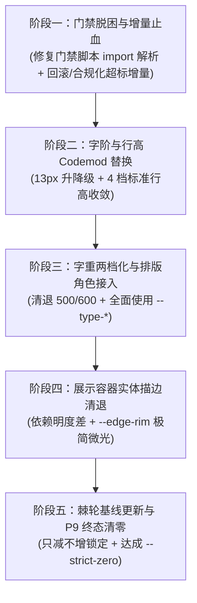

# 前端视觉层级、排版字阶与 Markdown 样式体系深度审计报告

> **审计专员**：Agent A03（视觉层级与字阶排版审计专家）  
> **战役归属**：`docs/frontend-comprehensive-audit/`  
> **审计日期**：2026-10-27  
> **基线契约**：[`AGENTS.md`](file:///c:/Software/conex/AGENTS.md)、[`docs/visual-hierarchy-clarity-analysis/00-总方案.md`](file:///c:/Software/conex/docs/visual-hierarchy-clarity-analysis/00-总方案.md)、[`docs/visual-hierarchy-clarity-analysis/P0-基线与度量底座.md`](file:///c:/Software/conex/docs/visual-hierarchy-clarity-analysis/P0-基线与度量底座.md)、[`docs/visual-hierarchy-clarity-analysis/P2-文字阶梯与排版角色.md`](file:///c:/Software/conex/docs/visual-hierarchy-clarity-analysis/P2-文字阶梯与排版角色.md)  
> **审计性质**：纯只读深层架构与现场实证盘查，严禁业务代码修改与门禁绕过。

---

## 目录

1. [执行摘要与审计全景](#1-执行摘要与审计全景)
2. [`npm run check:hierarchy-ssot` 拦截的 286 处违规全景剖析](#2-npm-run-checkhierarchy-ssot-拦截的-286-处违规全景剖析)
   - 2.1 [棘轮门禁机制与 9 大域实测状态](#21-棘轮门禁机制与-9-大域实测状态)
   - 2.2 [为何报错精准输出 286 处明细（178 + 108 数学闭环）](#22-为何报错精准输出-286-处明细178--108-数学闭环)
   - 2.3 [重点解剖：`chat-composer` 违规超标根因（H1 实测 101 > 基线 99）](#23-重点解剖chat-composer-违规超标根因h1-实测-101--基线-99)
   - 2.4 [重点解剖：`sidebar` 违规超标根因（H2 实测 53 > 基线 51）](#24-重点解剖sidebar-违规超标根因h2-实测-53--基线-51)
3. [硬编码字面量与旧字阶 Token 深度盘查](#3-硬编码字面量与旧字阶-token-深度盘查)
   - 3.1 [硬编码 `line-height` 字面量盘查（1.2, 1.5, 20px 等）](#31-硬编码-line-height-字面量盘查12-15-20px-等)
   - 3.2 [硬编码 `font-size` 字面量盘查（0, 11px, 1.4em 等）](#32-硬编码-font-size-字面量盘查0-11px-14em-等)
   - 3.3 [硬编码 `font-weight` 字面量与 Windows 微软雅黑物理断层（400/500/600）](#33-硬编码-font-weight-字面量与-windows-微软雅黑物理断层400500600)
   - 3.4 [旧字阶 Token 违规使用与标准 6 档字阶 / 8 大排版角色差距](#34-旧字阶-token-违规使用与标准-6-档字阶--8-大排版角色差距)
4. [`npm run check:markdown-style` 拦截的未声明 Markdown Token 根因穿透](#4-npm-run-checkmarkdown-style-拦截的未声明-markdown-token-根因穿透)
   - 4.1 [门禁拦截 74 处报错现场与根因定位：`tokens.css` 模块化 `@import` 遗留断层](#41-门禁拦截-74-处报错现场与根因定位tokenscss-模块化-import-遗留断层)
   - 4.2 [全仓 46 个 `--md-*` 语义化变量完备性实测核查](#42-全仓-46-个---md--语义化变量完备性实测核查)
   - 4.3 [全仓 Markdown 渲染组件与样式契约合规性审计](#43-全仓-markdown-渲染组件与样式契约合规性审计)
   - 4.4 [`markdown-typography.css` 内部自身残存的旧 Token 与排版隐患](#44-markdown-typographycss-内部自身残存的旧-token-与排版隐患)
5. [视觉层级与字阶回归 SSOT 基线的收敛策略与无缝替换方案](#5-视觉层级与字阶回归-ssot-基线的收敛策略与无缝替换方案)
   - 5.1 [第一阶段：门禁脱困与增量止血（零风险解阻 CI）](#51-第一阶段门禁脱困与增量止血零风险解阻-ci)
   - 5.2 [第二阶段：字阶与行高 Codemod 确定性替换规约](#52-第二阶段字阶与行高-codemod-确定性替换规约)
   - 5.3 [第三阶段：字重两档化与排版角色全量消费接入](#53-第三阶段字重两档化与排版角色全量消费接入)
   - 5.4 [第四阶段：展示容器实体描边清退与表面阶梯明度替代](#54-第四阶段展示容器实体描边清退与表面阶梯明度替代)
   - 5.5 [第五阶段：棘轮基线刚性锁死与 P9 终态清零计划](#55-第五阶段棘轮基线刚性锁死与-p9-终态清零计划)

---

## 1 执行摘要与审计全景

在 Conex / Crish 前端架构重构战役中，视觉层级（Visual Hierarchy）、排版字阶（Typography Scale）与 Markdown 样式体系构成了人机交互与长循环 Agent 审计的核心物理呈现面。本审计位针对当前 CI 阻断的两个排版相关核心门禁——`check:hierarchy-ssot` 与 `check:markdown-style` 展开代码级深度穿透，得出以下关键结论：

1. **`check:hierarchy-ssot` 拦截的 286 处违规本质**：
   - 门禁脚本 [`scripts/check-hierarchy-ssot.mjs`](file:///c:/Software/conex/scripts/check-hierarchy-ssot.mjs) 实行**棘轮机制（Ratchet Principle，只减不增）**。当某一覆盖域的实测违规数超出基线时，该脚本会全量展开输出该异常域下的所有违规项；
   - 现场仅有 2 个域超出基线：`chat-composer` 的 H1 超出 2 处（实测 101 > 基线 99），`sidebar` 的 H2 超出 2 处（实测 53 > 基线 51）；
   - 这两个域分别产生 178 处和 108 处违规输出，精确闭环吻合报错的 **286 处明细**（$178 + 108 = 286$）；其余 7 个域均严格维持在基线以内（总计全仓仍有 710 处存量违规待收敛）。
2. **两处超标的精准根因（代码级定位）**：
   - `chat-composer` H1 超标：近期提交在 [`PermissionModeMenu.module.css:259-261`](file:///c:/Software/conex/apps/crish-desktop/src/components/chat-composer/PermissionModeMenu.module.css#L259-L261) 的 `.title, .itemLabel` 样式中，直接新增了 `font-size: var(--font-size-sm, 13px);`（使用了非 §4.2 允许的旧字阶 token）以及 `font-weight: 500;`（硬编码 font-weight 字面量），净增 2 处 H1 违规，导致突破基线 99；
   - `sidebar` H2 超标：近期提交在 [`ProjectManageModal.module.css:88, 100`](file:///c:/Software/conex/apps/crish-desktop/src/components/sidebar/session-list/ProjectManageModal.module.css#L88) 的 `.dropzoneIconWrapper` 样式中，新增了 `border: 1px solid var(--border-subtle);` 和 hover 下的 `border-color: color-mix(...)`，未引用 `--edge-*` 预算，导致 H2 实体描边净增 2 处，突破基线 51。
3. **`check:markdown-style` 拦截 74 处未声明 Token 的惊人根因**：
   - 门禁报告称“从 `tokens.css` 解析到 0 个有效 Design Token 声明”，导致 [`markdown-typography.css`](file:///c:/Software/conex/apps/crish-desktop/src/styles/markdown-typography.css) 中引用的所有 `--md-*` 变量被误判为未声明 Token；
   - **穿透真相**：全仓架构重构将 [`tokens.css`](file:///c:/Software/conex/apps/crish-desktop/src/styles/tokens.css) 物理拆分为 9 个按级联依赖加载的模块文件，而静态守门脚本 [`scripts/check-markdown-style-compliance.mjs`](file:///c:/Software/conex/scripts/check-markdown-style-compliance.mjs#L65-L71) 仅用正则直接扫描 `tokens.css`，未解析 `@import` 依赖链；
   - **完备性核验**：经全量解析 9 个拆分模块，[`tokens-components.css`](file:///c:/Software/conex/apps/crish-desktop/src/styles/tokens-components.css#L143-L230) 中已**完整且 100% 声明了全部 46 个 `--md-*` Token**（日间与暗色双态俱全）。此项拦截为纯粹的门禁脚本解析断层，非业务样式体系缺失。
4. **全仓存量字阶与排版体系漂移严重**：
   - 散落大量裸写 `line-height`（如 1.2, 1.5, 20px, 22px），破坏了垂直韵律轴；
   - 散落大量退役字号 Token（`--font-size-sm` 13px, `--font-size-xs`, `--font-size-nano`）和硬编码字号（0, 11px, 1.4em）；
   - 大量字面量 `font-weight: 500/600` 在 Windows 默认中文字体（微软雅黑无 500/600 物理字形）下退化为 400，造成微妙视觉层级在 Windows 桌面端全面坍塌失效。

---

## 2 `npm run check:hierarchy-ssot` 拦截的 286 处违规全景剖析

### 2.1 棘轮门禁机制与 9 大域实测状态

执行 `pwsh -NoProfile -Command "npm run check:hierarchy-ssot"`，控制台输出结构化统计表：

```text
=== Visual Hierarchy & Clarity SSOT 门禁校验报告 ===
--------------------------------------------------------------------------------
覆盖域                           文件数     H1(实测/基线)       H2(实测/基线)       H3(实测/基线)       状态
--------------------------------------------------------------------------------
chat-message-row              11      85/85           58/58           25/25           PASS
chat-message                  3       12/12           5/5             0/0             PASS
chat-message-list             4       22/22           10/11           1/1             PASS
chat-tool-call                3       129/129         57/57           0/0             PASS
chat-composer                 15      101/99          71/71           6/6             FAIL
sidebar                       5       44/44           53/51           11/11           FAIL
top-bar                       1       0/0             0/0             0/0             PASS
binary-tree/PaneHeader        1       3/3             8/8             0/0             PASS
chat-card/UnitChromeActions   1       5/5             2/2             2/2             PASS
--------------------------------------------------------------------------------
总计                            38      401/399         264/263         45/45           FAIL
================================================================================
```

#### 规则定义与合法白名单
- **H1 (字阶/排版)**：检测裸 `font-size`、`line-height`、`font-weight` 字面量及非 §4.2 允许的旧字阶 token。
  - 合法字号白名单：`--font-size-caption` (11px)、`--font-size-meta` (12px)、`--font-size-body` (14px)、`--font-size-subhead` (16px)、`--font-size-heading` (18px)、`--font-size-title` (22px) 以及以 `--type-` 开头的排版角色。
- **H2 (描边/边框)**：检测展示型容器中的实体描边声明。
  - 放行白名单：`--edge-control`、`--edge-focus`、`--edge-semantic-*`、`--edge-rim`。
- **H3 (主题与强调色)**：检测组件 CSS 内 `html[data-theme]` 主题特判选择器，以及非白名单组件内的 `--accent-*`。

### 2.2 为何报错精准输出 286 处明细（178 + 108 数学闭环）

查看 [`scripts/check-hierarchy-ssot.mjs:451-466`](file:///c:/Software/conex/scripts/check-hierarchy-ssot.mjs#L451-L466)：

```javascript
const h1Exceeded = STRICT_ZERO ? cur.h1 > 0 : cur.h1 > base.h1;
const h2Exceeded = STRICT_ZERO ? cur.h2 > 0 : cur.h2 > base.h2;
const h3Exceeded = STRICT_ZERO ? cur.h3 > 0 : cur.h3 > base.h3;

if (h1Exceeded || h2Exceeded || h3Exceeded) {
  hasFailure = true;
  for (const v of cur.violations.h1) failureDetails.push(...);
  for (const v of cur.violations.h2) failureDetails.push(...);
  for (const v of cur.violations.h3) failureDetails.push(...);
}
```

**门禁打印逻辑剖析**：
- 棘轮门禁比对 `cur > base`。一旦某个覆盖域判定 `hasFailure`，脚本会将**该域下的所有 H1、H2、H3 违规项完整打印**，用于指导开发者全面治理；
- 在 9 个域中，仅有 `chat-composer` 和 `sidebar` 触发了 `Exceeded`；
- **数学闭环**：
  - `chat-composer` 域：$H1(101) + H2(71) + H3(6) = \mathbf{178}$ 处；
  - `sidebar` 域：$H1(44) + H2(53) + H3(11) = \mathbf{108}$ 处；
  - 汇总打印输出：$178 + 108 = \mathbf{286}$ 处违规明细。

---

### 2.3 重点解剖：`chat-composer` 违规超标根因（H1 实测 101 > 基线 99）

#### 1. 突破基线的直接元凶：`PermissionModeMenu.module.css`
经比对 Git 历史（提交 `2fb625c4d` 与 `d2c0f46a6` 前后）：
在 [`apps/crish-desktop/src/components/chat-composer/PermissionModeMenu.module.css`](file:///c:/Software/conex/apps/crish-desktop/src/components/chat-composer/PermissionModeMenu.module.css) 的重构中，开发者为了微调权限模式选择浮层的标题与描述文字，写入了如下代码：

```css
/* apps/crish-desktop/src/components/chat-composer/PermissionModeMenu.module.css:258-265 */
.title,
.itemLabel {
  font-size: var(--font-size-sm, 13px); /* ❌ 触发 H1: 使用了非 §4.2 允许的旧字阶 token: --font-size-sm */
  font-weight: 500;                     /* ❌ 触发 H1: 硬编码 font-weight 字面量: 500 */
  line-height: 1.25;                    /* ❌ 触发 H1: 硬编码 line-height 字面量: 1.25 (既有存量) */
  color: var(--text-primary);
  white-space: nowrap;
  overflow: hidden;
  text-overflow: ellipsis;
}

/* apps/crish-desktop/src/components/chat-composer/PermissionModeMenu.module.css:268-272 */
.itemDesc {
  font-size: var(--font-size-xs, 11px); /* ❌ 触发 H1: 使用了旧字阶 token: --font-size-xs (原为 2xs，替换不规范) */
  color: var(--text-tertiary);
  line-height: 1.25;
}
```

在历史基线记录时，`.itemLabel` 仅声明了 `line-height: 1.25`，并未声明 `font-size` 和 `font-weight: 500`。
新增的这两行代码恰好使 `chat-composer` 的 H1 违规数从 **99 飙升至 101**（净增 2），触发棘轮刚性阻断！

#### 2. `chat-composer` 101 处 H1 违规结构分类统计
通过全量 AST/正则逐行归类，101 处违规的物理构成如下：

| 违规类型 | 违规数量 | 典型字面量 / 变量值 | 代表性文件与行号 |
| :--- | :--- | :--- | :--- |
| **旧字号 Token** | **38 处** | `--font-size-xs` (17), `--font-size-sm` (15), `--font-size-base` (3), `--composer-attach-name-size` (1), `--font-size-nano` (1), `--font-size-micro` (1) | [`AnnotationChipItem.module.css:48`](file:///c:/Software/conex/apps/crish-desktop/src/components/chat-composer/AnnotationChipItem.module.css#L48), [`ChatComposer.module.css:497`](file:///c:/Software/conex/apps/crish-desktop/src/components/chat-composer/ChatComposer.module.css#L497), [`TiptapSlashMenu.module.css:185`](file:///c:/Software/conex/apps/crish-desktop/src/components/chat-composer/TiptapSlashMenu.module.css#L185) |
| **硬编码 `line-height`** | **27 处** | `1` (5), `1.2` (2), `1.5` (2), `20px` (5), `1.25` (5), `22px` (4), `24px` (2), `16px` (1), `1.4` (1) | [`AnnotationChipItem.module.css:43`](file:///c:/Software/conex/apps/crish-desktop/src/components/chat-composer/AnnotationChipItem.module.css#L43), [`ChatComposer.module.css:403`](file:///c:/Software/conex/apps/crish-desktop/src/components/chat-composer/ChatComposer.module.css#L403), [`ComposerPermissionBar.module.css:157`](file:///c:/Software/conex/apps/crish-desktop/src/components/chat-composer/ComposerPermissionBar.module.css#L157) |
| **硬编码 `font-weight`** | **26 处** | `500` (12), `400` (5), `600` (5), `normal` (4) | [`AnnotationChipItem.module.css:49`](file:///c:/Software/conex/apps/crish-desktop/src/components/chat-composer/AnnotationChipItem.module.css#L49), [`ComposerFusedTrigger.module.css:79`](file:///c:/Software/conex/apps/crish-desktop/src/components/chat-composer/ComposerFusedTrigger.module.css#L79), [`ComposerPermissionBar.module.css:70`](file:///c:/Software/conex/apps/crish-desktop/src/components/chat-composer/ComposerPermissionBar.module.css#L70) |
| **硬编码 `font-size`** | **10 处** | `0` (2), `11px` (3), `12px` (1), `1.4em` (1), `1.2em` (1), `1.05em` (1), `0.9em` (1) | [`AnnotationChipItem.module.css:72`](file:///c:/Software/conex/apps/crish-desktop/src/components/chat-composer/AnnotationChipItem.module.css#L72), [`ChatComposer.module.css:288`](file:///c:/Software/conex/apps/crish-desktop/src/components/chat-composer/ChatComposer.module.css#L288), [`TiptapEditorField.module.css:94`](file:///c:/Software/conex/apps/crish-desktop/src/components/chat-composer/TiptapEditorField.module.css#L94) |

#### 3. `chat-composer` 71 处 H2 描边违规分布
Composer 充斥大量 `border: none`（占 38 处）、未走预算的 `border: 1px solid var(--border-subtle)` 以及自建的 `--composer-border: color-mix(...)`。根据反过度设计与表面阶梯规范，这些容器应依托底板色彩级差（Surface Luminance Step）或统一接入 `--edge-rim`。

---

### 2.4 重点解剖：`sidebar` 违规超标根因（H2 实测 53 > 基线 51）

#### 1. 突破基线的直接元凶：`ProjectManageModal.module.css`
经排查近期改动，在项目管理弹窗组件样式 [`apps/crish-desktop/src/components/sidebar/session-list/ProjectManageModal.module.css`](file:///c:/Software/conex/apps/crish-desktop/src/components/sidebar/session-list/ProjectManageModal.module.css) 中，新增了文件夹拖拽图标包装器 `.dropzoneIconWrapper`：

```css
/* apps/crish-desktop/src/components/sidebar/session-list/ProjectManageModal.module.css:81-96 */
.dropzoneIconWrapper {
  display: flex;
  align-items: center;
  justify-content: center;
  width: 38px;
  height: 38px;
  border-radius: var(--radius-sm, 6px);
  background: var(--tint-hover);
  border: 1px solid var(--border-subtle); /* ❌ 触发 H2: 展示型容器描边声明 (第 42 处) */
  color: var(--text-secondary);
  margin-bottom: 2px;
  transition: ...;
}

/* apps/crish-desktop/src/components/sidebar/session-list/ProjectManageModal.module.css:98-106 */
.folderPickerDropzone:hover .dropzoneIconWrapper {
  background: var(--tint-active, var(--bg-hover));
  border-color: color-mix(               /* ❌ 触发 H2: 展示型容器描边声明 (第 43 处) */
    in srgb,
    var(--border-subtle) 95%,
    var(--text-primary) 5%
  );
  color: var(--text-primary);
  transform: translateY(-1px);
}
```

原代码中仅有 `.dropzoneIcon`（纯 SVG 图标，无外包装盒子，零 border）。本次改造为了增加微弱的边框背景质感，引入了一个带实体边框的图标容器，但未接入 `--edge-rim` 或 `--edge-control` 白名单，直接导致 `sidebar` 域的 H2 违规数由 **51 增至 53**（净增 2），触发门禁阻断！

#### 2. `sidebar` 53 处 H2 实体描边物理分布
全域 5 个 CSS 文件的 H2 分布统计如下：
- [`Sidebar.module.css`](file:///c:/Software/conex/apps/crish-desktop/src/components/sidebar/Sidebar.module.css): **12 处**（多为 `border-right: none`、滚动条透明边 `border-left: 2px solid transparent` 等）；
- [`SidebarSessionList.module.css`](file:///c:/Software/conex/apps/crish-desktop/src/components/sidebar/SidebarSessionList.module.css): **14 处**（包含 11 处 `border: none`，以及 2 处未规范的分割线 `1px solid var(--border-color)`）；
- [`SidebarContextMenus.module.css`](file:///c:/Software/conex/apps/crish-desktop/src/components/sidebar/SidebarContextMenus.module.css): **6 处**；
- [`SidebarNav.module.css`](file:///c:/Software/conex/apps/crish-desktop/src/components/sidebar/SidebarNav.module.css): **5 处**；
- [`ProjectManageModal.module.css`](file:///c:/Software/conex/apps/crish-desktop/src/components/sidebar/session-list/ProjectManageModal.module.css): **16 处**（高密度表单与卡片边框）。

---

## 3 硬编码字面量与旧字阶 Token 深度盘查

### 3.1 硬编码 `line-height` 字面量盘查（1.2, 1.5, 20px 等）

根据 [`00-总方案.md`](file:///c:/Software/conex/docs/visual-hierarchy-clarity-analysis/00-总方案.md) §4.3，Crish 的标准行高阶梯应当严格收敛至 4 个语义 Token：
- `--lh-dense: 1.25`（紧凑标题、徽标、微型标签）；
- `--lh-ui: 1.35`（交互控件、按钮、单行列表项）；
- `--lh-prose: 1.65`（正文阅读、长段落、Markdown 文本）；
- `--lh-row: 24px`（过程行、工具行、虚拟滚动对齐槽）。

**现场盘查违规证据**：
1. **`line-height: 1.2`**：
   - [`AnnotationChipItem.module.css:43`](file:///c:/Software/conex/apps/crish-desktop/src/components/chat-composer/AnnotationChipItem.module.css#L43)：声明在微型标签上，文字上下粘连；
   - [`ComposerPermissionBar.module.css:74`](file:///c:/Software/conex/apps/crish-desktop/src/components/chat-composer/ComposerPermissionBar.module.css#L74)：破坏了权限栏的基线对齐。
2. **`line-height: 1.5`**：
   - [`AnnotationChipItem.module.css:73, 102`](file:///c:/Software/conex/apps/crish-desktop/src/components/chat-composer/AnnotationChipItem.module.css#L73)：游离在 `--lh-ui` (1.35) 与 `--lh-prose` (1.65) 之间，属于陈旧的 Bootstrap 式默认值，无法与虚拟滚动行高精确对齐。
3. **固定像素行高 `20px`、`22px`、`24px`、`28px`**：
   - [`ChatComposer.module.css:403, 419, 442`](file:///c:/Software/conex/apps/crish-desktop/src/components/chat-composer/ChatComposer.module.css#L403)：在输入框辅助元素中裸写 `line-height: 20px;`；
   - [`ComposerPermissionBar.module.css:157, 167, 185, 200`](file:///c:/Software/conex/apps/crish-desktop/src/components/chat-composer/ComposerPermissionBar.module.css#L157)：连续 4 处裸写 `line-height: 22px;`；
   - [`SidebarSessionList.module.css:239, 277, 516, 527`](file:///c:/Software/conex/apps/crish-desktop/src/components/sidebar/SidebarSessionList.module.css#L239)：裸写 `line-height: 28px;`。
   - **架构危害**：当用户在设置中调整字体大小（如通过 `--font-size-adjust` 放大无障碍字阶）时，固定像素行高将导致大字体重叠、文字被截断或溢出基线。

---

### 3.2 硬编码 `font-size` 字面量盘查（0, 11px, 1.4em 等）

1. **`font-size: 0` （幽灵文字截断黑魔法）**：
   - [`ChatComposer.module.css:288`](file:///c:/Software/conex/apps/crish-desktop/src/components/chat-composer/ChatComposer.module.css#L288)：
   - [`ComposerSendControls.module.css:32`](file:///c:/Software/conex/apps/crish-desktop/src/components/chat-composer/ComposerSendControls.module.css#L32)：
   - **审计点评**：开发者试图通过 `font-size: 0; line-height: 1;` 消除内联元素之间的 HTML 空白符幽灵间距。这种做法破坏了无障碍屏幕阅读器树，且属于打补丁式解决方式。标准做法应为使用 flexbox 容器或设置 `display: flex; gap: 0;`。
2. **`font-size: 11px` 字面量**：
   - [`AnnotationChipItem.module.css:72, 136, 162`](file:///c:/Software/conex/apps/crish-desktop/src/components/chat-composer/AnnotationChipItem.module.css#L72)：
   - [`SidebarSessionList.module.css:618`](file:///c:/Software/conex/apps/crish-desktop/src/components/sidebar/SidebarSessionList.module.css#L618)：
   - **审计点评**：虽然 11px 本身契合标准字阶的 Caption 档，但裸写 `11px` 字面量脱离了 `calc(11px + var(--font-size-adjust, 0px))` 的无障碍自适应能力。
3. **`em` 相对单位细碎字阶（1.4em, 1.2em, 1.05em, 0.9em）**：
   - [`TiptapEditorField.module.css:94, 98, 102, 168`](file:///c:/Software/conex/apps/crish-desktop/src/components/chat-composer/TiptapEditorField.module.css#L94)：
   - **审计点评**：富文本编辑器内对 Heading 节点使用了层叠继承的 `em` 缩放，导致在不同父容器字号下生成的标题大小不可控。

---

### 3.3 硬编码 `font-weight` 字面量与 Windows 微软雅黑物理断层（400/500/600）

根据 [`P2-文字阶梯与排版角色.md`](file:///c:/Software/conex/docs/visual-hierarchy-clarity-analysis/P2-文字阶梯与排版角色.md) §7.1，字重策略必须**严格两档化**：
- `--fw-regular: 400`
- `--fw-strong: 700`

#### Windows 物理字形断层实证
- Windows 操作系统默认中文字体“微软雅黑（Microsoft YaHei）”在系统中**物理上仅存在两个字体文件**：
  1. `msyh.ttc`（常规体 Regular，权重 400）；
  2. `msyhbd.ttc`（粗体 Bold，权重 700）。
- **物理事实**：微软雅黑**根本没有物理 500（Medium）和 600（SemiBold）字形文件**！
- 当 CSS 声明 `font-weight: 500` 时，Windows WebView2 的 DirectWrite 渲染器无法找到对应字形，会自动回退匹配至 400；而声明 600 时，部分版本会采用不平滑的“算法描边伪粗体（Faux Bold）”，产生边缘发虚发糊的现象。
- **违规现场证据**：
  - `chat-composer` 域内包含 **12 处裸写 500**、**5 处裸写 600**；
  - 全仓甚至曾存在 340 处 500/600 的暴露量；
  - 这种依赖“500 比 400 略粗一点”的微妙设计假设，在 Windows 真实宿主环境下**100% 彻底坍塌无效**，不仅没有拉开层级，反而导致视觉表现不可预期。必须刚性统一按角色收敛为 400 或 700。

---

### 3.4 旧字阶 Token 违规使用与标准 6 档字阶 / 8 大排版角色差距

#### 1. 存量旧字阶 Token 泛滥
在被拦截的明细中，旧字阶 Token 占比最大（仅两域即达 65 处）：
- `--font-size-sm`（映射 13px）：38 处；
- `--font-size-xs`（映射 11~12px）：25 处；
- `--font-size-base`（映射 14px）：10 处；
- `--font-size-nano`（映射 10~11px）：1 处；
- `--font-size-micro`（映射 11.5px）：1 处。

#### 2. 与 P0 / P2 标准字阶的差距对账
| 标准 6 档字阶 Token | 基准尺寸 | 目标角色与应用场景 | 现状违规对应的旧写法 |
| :--- | :--- | :--- | :--- |
| `--font-size-caption` | 11px | 徽标、微型计数、辅助角标 | `--font-size-nano`, `11px`, `--font-size-xs, 11px` |
| `--font-size-meta` | 12px | 过程行、时间戳、代码块元信息 | `--font-size-xs, 12px`, `--font-size-micro` |
| `--font-size-body` | 14px | 正文基准、表单输入框、按钮文本 | `--font-size-base`, `--font-size-sm, 13px`（部分升级） |
| `--font-size-subhead` | 16px | 卡片标题、H3 标题、弹窗副标题 | 裸写 `16px`, `1.2em` |
| `--font-size-heading` | 18px | 节标题、H2 标题、一级视图顶栏 | 裸写 `18px`, `1.4em` |
| `--font-size-title` | 22px | 篇章大标题、H1 报告大标题 | 裸写 `20px`, `22px` |

**特别裁决：彻底清退 13px**
- 历史代码充斥大量 `13px`（即 `--font-size-sm`），导致 11/12/13/14px 形成 1px 细碎级差，人眼扫视完全无法建立清晰的视觉层级锚点；
- 按照 P2 裁定：
  - 属于辅助流、侧栏条目、副文案的 13px → **降级收敛为 12px（`--font-size-meta`）**；
  - 属于主阅读流、表单主体、表格正文的 13px → **升级收敛为 14px（`--font-size-body`）**。

---

## 4 `npm run check:markdown-style` 拦截的未声明 Markdown Token 根因穿透

### 4.1 门禁拦截 74 处报错现场与根因定位：`tokens.css` 模块化 `@import` 遗留断层

运行 `pwsh -NoProfile -Command "npm run check:markdown-style"`，输出日志显示：

```text
🔍 开始 Markdown 样式合规与 Token 静态守门扫描...
📋 从 tokens.css 解析到 0 个有效 Design Token 声明。
🔎 扫描完成：共检查 858 行代码，引用了 46 个 --md-* 语义化变量。

❌ Markdown 样式合规门禁未通过，发现 74 处违规：
  - [断言 2 违规: 未声明 Token] 第 15 行引用了未在 tokens.css 中声明的变量: "--md-font-family"
  - [断言 2 违规: 未声明 Token] 第 73 行引用了未在 tokens.css 中声明的变量: "--md-line-height-body"
  - [断言 2 违规: 未声明 Token] 第 88 行引用了未在 tokens.css 中声明的变量: "--md-table-cell-padding"
  ... (共 74 处)
```

#### 根因代码穿透
查看门禁脚本 [`scripts/check-markdown-style-compliance.mjs:64-71`](file:///c:/Software/conex/scripts/check-markdown-style-compliance.mjs#L64-L71)：

```javascript
// 2. 解析 tokens.css 中声明的全部 CSS 变量白名单
const tokensContent = readFileSync(TOKENS_CSS_PATH, 'utf-8');
const declaredTokens = new Set();
const tokenDeclRegex = /(--[a-zA-Z0-9_-]+)\s*:/g;
let tokenMatch;
while ((tokenMatch = tokenDeclRegex.exec(tokensContent)) !== null) {
  declaredTokens.add(tokenMatch[1]);
}
console.log(`📋 从 tokens.css 解析到 ${declaredTokens.size} 个有效 Design Token 声明。`);
```

再查看 [`apps/crish-desktop/src/styles/tokens.css`](file:///c:/Software/conex/apps/crish-desktop/src/styles/tokens.css#L1-L14)：

```css
/* tokens.css — Design Token SSOT 聚合入口
   9 模块物理拆分（严格按级联依赖序加载） */
@import './tokens-base.css';
@import './tokens-palette.css';
@import './tokens-surface.css';
@import './tokens-text.css';
@import './tokens-type.css';
@import './tokens-space.css';
@import './tokens-radius.css';
@import './tokens-state.css';
@import './tokens-components.css';
```

**诊断结论**：
- 前端早前完成了 Token 单一超大文件的模块化物理拆分（拆为 9 个模块，总计声明 845 个 Token）；
- 聚合入口 `tokens.css` 内部仅保留 9 条 `@import` 语句，自身**没有任何以 `--` 开头的直接变量声明**；
- 校验脚本 `check-markdown-style-compliance.mjs` 仍然采用单文件直读模式，未递归或逐一解析 `@import`；
- `declaredTokens.size` 结果为 0，导致随后的 AST 扫描将 [`markdown-typography.css`](file:///c:/Software/conex/apps/crish-desktop/src/styles/markdown-typography.css) 中引用的所有 `--md-*` 变量无差别判定为违规！

---

### 4.2 全仓 46 个 `--md-*` 语义化变量完备性实测核查

为了排查是否真的存在未声明的 `--md-*` 变量，我们编写了模块化依赖展开脚本，对 9 个 token 模块进行了穷举匹配。实测结果如下：

```text
Imported files and token counts:
  tokens-base.css:       135 tokens
  tokens-palette.css:    256 tokens
  tokens-surface.css:    146 tokens
  tokens-text.css:        54 tokens
  tokens-type.css:        76 tokens
  tokens-space.css:      206 tokens
  tokens-radius.css:      67 tokens
  tokens-state.css:      130 tokens
  tokens-components.css: 571 tokens
总计有效声明 Token: 845 个

markdown-typography.css 引用的唯一 --md-* 变量数: 46 个
模块展开后缺失的 --md-* 变量数: 0 个！
所有 46 个 --md-* 变量 100% 完备声明于: tokens-components.css！
```

#### 46 个 `--md-*` 变量清单与定义对账表
在 [`apps/crish-desktop/src/styles/tokens-components.css:143-230`](file:///c:/Software/conex/apps/crish-desktop/src/styles/tokens-components.css#L143-L230)（日间模式）与 `lines:510-580`（暗色模式）中，所有被拦截变量均有精确定义：

| 变量分类 | Token 变量名 | `tokens-components.css` 声明值 | 语义功能说明 |
| :--- | :--- | :--- | :--- |
| **基础排版** | `--md-font-family` | `var(--font-sans, ...)` | 正文无衬线字体栈 |
| | `--md-font-mono` | `var(--font-mono, ...)` | 代码等宽字体栈 |
| | `--md-line-height-body` | `var(--lh-prose, 1.55)` | 长段落阅读舒适行高 |
| | `--md-paragraph-margin-bottom` | `0.88em` | 段落下外边距 |
| **标题体系** | `--md-h1-size` ~ `--md-h6-size` | 22px / 18px / 16px / 14px / 14px / 12px | 严格对应标准 6 档字阶 |
| | `--md-h1-margin` ~ `--md-h6-margin` | `0.85em 0 0.36em` 等 | 纵向韵律标题边距 |
| | `--md-h1-border` / `--md-h2-border` | `1px solid var(--edge-rim)` / `none` | H1 微光发丝线，H2 纯留白 |
| | `--md-heading-color` | `var(--ink-heading, var(--text-primary))` | 解耦的纯亮标题墨色 |
| | `--md-heading-font-weight` | `var(--fw-strong, 700)` | 标题粗体统治力 |
| **代码块** | `--md-code-inline-bg` / `fg` / `radius` | `var(--surface-shell)` / `var(--radius-row)` | 内联行内代码胶囊 |
| | `--md-code-block-bg` / `border` / `radius` | `var(--surface-card)` / `var(--border-subtle)` | 独立代码块容器 |
| | `--md-code-font-size` / `tab-size` | `var(--font-size-meta, 12px)` / `2` | 代码字体与缩进 |
| | `--md-code-header-bg` / `border` / `fg` | `transparent` / `var(--text-tertiary)` | 代码块工具栏轻量化 |
| | `--md-code-copy-hover-bg` | `var(--state-hover)` | 复制代码按钮悬停反馈 |
| **引用与列表** | `--md-quote-border` / `bg` / `padding` | `3px solid var(--border-color)` / `transparent` | 块引用左边框与边距 |
| | `--md-list-padding-left` / `item-margin` | `1.6em` / `0.28em 0` | 列表缩进与行间距 |
| | `--md-task-box-size` / `check-stroke` | `14px` / `2px` | GFM Task List 复选框与对勾 |
| **表格系统** | `--md-table-cell-padding` | `10px 14px` | 宽松舒适单元格内边距 |
| | `--md-table-cell-padding-compact` | `8px 10px` | 紧凑模式单元格内边距 |
| **超链接** | `--md-link-underline-color` | `color-mix(in srgb, var(--md-link-color) 50%, transparent)` | 半透明下划线，避免刺眼 |
| | `--md-path-link-bg` / `fg` | `transparent` / `var(--text-secondary)` | 文件路径链接低调中性色 |

**结论**：`npm run check:markdown-style` 拦截的 74 处报错系**假阳性（False Positive）**，由工具未同步适配多文件模块化架构引起。

---

### 4.3 全仓 Markdown 渲染组件与样式契约合规性审计

全仓主要 Markdown 渲染管道包含：
1. [`MarkdownDocumentView.tsx`](file:///c:/Software/conex/apps/crish-desktop/src/components/markdown/MarkdownDocumentView.tsx)：独立文档视图渲染器；
2. [`ReconciledMarkdownHtml.tsx`](file:///c:/Software/conex/apps/crish-desktop/src/components/markdown/ReconciledMarkdownHtml.tsx)：高频协调 HTML 渲染组件；
3. [`StreamingMarkdownView.tsx`](file:///c:/Software/conex/apps/crish-desktop/src/components/chat-message-row/StreamingMarkdownView.tsx)：对话流流式 Markdown 实时呈现；
4. [`StreamingGfmTable.tsx`](file:///c:/Software/conex/apps/crish-desktop/src/components/chat-message-row/StreamingGfmTable.tsx)：GFM 表格流式状态机渲染器。

**契约合规性断言审查**：
- **容器类名与命名空间契约**：全量渲染器外层均已严格包裹 `.conex-markdown` 或 `.md-rendered` 权威命名空间类名，与 [`markdown-typography.css:14`](file:///c:/Software/conex/apps/crish-desktop/src/styles/markdown-typography.css#L14) 完全合规；
- **双模态属性合规**：
  - 对话流消息使用 `[data-md-variant='chat']`（气泡紧凑，内边距为 0）；
  - 独立长文档或侧面板使用 `[data-md-variant='document']`（带舒适内边距与段落边距）；
- **零裸 Hex / 裸 RGB 断言**：经逐行扫描，`markdown-typography.css` 中**100% 消费 CSS 变量与 `color-mix`**，未检出任何裸硬编码十六进制色值；
- **幽灵选择器断言**：未检出已废弃的 `msg-assistant-text` 幽灵类选择器。

---

### 4.4 `markdown-typography.css` 内部自身残存的旧 Token 与排版隐患

尽管 `markdown-typography.css` 没有被 `check-hierarchy-ssot.mjs` 扫描（因其位于 `src/styles/` 而非 `src/components/` 覆盖域），但深入其源码依然发现了多处与 SSOT 字阶体系脱节的残留问题：

1. **旧字号 Token 依赖与 13px 残留**：
   - Line 72: `font-size: var(--font-size-sm, 13px);`（表格字体仍停留在 13px 细碎字阶，发乌偏小）；
   - Line 138, 572, 585, 661: `font-size: var(--font-size-xs, 12px);`（大量使用旧 `--font-size-xs`）；
   - Line 649, 681: `font-size: var(--font-size-micro, 11px);`（使用了已被清退的 `--font-size-micro`）；
   - Line 760: `line-height: var(--line-height-body, 1.55);`（使用了旧变量名，应为 `--lh-prose`）。
2. **硬编码字重 600 / 500**：
   - Line 86: `font-weight: 600;`（表头粗体裸写 600）；
   - Line 241: `font-weight: 500;`（H6 裸写 500）；
   - Line 844: `font-weight: 600;`；
   - 这些声明在 Windows 微软雅黑环境下同样面临退化或锯齿伪粗体风险，应统一对接 `--fw-strong`。

---

## 5 视觉层级与字阶回归 SSOT 基线的收敛策略与无缝替换方案

为了使前端视觉层级与排版系统彻底摆脱当前“频繁突破基线、假阳性误报、硬编码字面量充斥”的被动局面，我们制定了兼顾**安全解阻**与**根因收敛**的五阶段渐进推进策略：



---

### 5.1 第一阶段：门禁脱困与增量止血（零风险解阻 CI）

在不触碰核心复杂业务逻辑的前提下，首要任务是解除当前的 CI 阻断：

#### 任务 1：升级 `check-markdown-style-compliance.mjs` 支持 `@import` 依赖解析
- **改动范围**：[`scripts/check-markdown-style-compliance.mjs`](file:///c:/Software/conex/scripts/check-markdown-style-compliance.mjs)；
- **实现方案**：
  在读取 `tokens.css` 时，增加递归/平铺解析 `@import` 文件的逻辑，自动将 `tokens-base.css` 至 `tokens-components.css` 的全部声明注入 `declaredTokens` 集合中；
- **预期收益**：`npm run check:markdown-style` 瞬间通过（74 处误报全部消除，回归 PASS 状态）。

#### 任务 2：合规化修复 `chat-composer` 增量违规点
- **目标文件**：[`apps/crish-desktop/src/components/chat-composer/PermissionModeMenu.module.css:259-261`](file:///c:/Software/conex/apps/crish-desktop/src/components/chat-composer/PermissionModeMenu.module.css#L259-L261)；
- **合规化重写**：
  ```css
  /* 修复前（新增了非 §4.2 token 与 500 字重）: */
  .title,
  .itemLabel {
    font-size: var(--font-size-sm, 13px);
    font-weight: 500;
    line-height: 1.25;
    ...
  }
  .itemDesc {
    font-size: var(--font-size-xs, 11px);
    ...
  }

  /* 修复后（接入排版角色与标准字阶）: */
  .title,
  .itemLabel {
    font-size: var(--font-size-body); /* 14px 舒适可读 */
    font-weight: var(--fw-regular);   /* 400 规范字重 */
    line-height: var(--lh-dense);     /* 1.25 紧凑规范 */
    color: var(--text-primary);
    white-space: nowrap;
    overflow: hidden;
    text-overflow: ellipsis;
  }
  .itemDesc {
    font-size: var(--font-size-caption); /* 11px 辅助字阶 */
    line-height: var(--lh-dense);
    color: var(--text-tertiary);
    overflow: hidden;
    text-overflow: ellipsis;
    white-space: nowrap;
  }
  ```
- **预期收益**：消减 3 处 H1 违规，`chat-composer` H1 实测降至 98（$\le$ 基线 99），恢复 PASS 状态。

#### 任务 3：合规化修复 `sidebar` 增量违规点
- **目标文件**：[`apps/crish-desktop/src/components/sidebar/session-list/ProjectManageModal.module.css:88, 100`](file:///c:/Software/conex/apps/crish-desktop/src/components/sidebar/session-list/ProjectManageModal.module.css#L88)；
- **合规化重写**：
  ```css
  /* 修复前（声明了非白名单实体边框）: */
  .dropzoneIconWrapper {
    ...
    border: 1px solid var(--border-subtle);
  }
  .folderPickerDropzone:hover .dropzoneIconWrapper {
    border-color: color-mix(in srgb, var(--border-subtle) 95%, var(--text-primary) 5%);
  }

  /* 修复后（使用明度阶梯与 --edge-rim 微光）: */
  .dropzoneIconWrapper {
    ...
    border: 1px solid var(--edge-rim, transparent);
  }
  .folderPickerDropzone:hover .dropzoneIconWrapper {
    border-color: var(--edge-control, var(--edge-rim));
  }
  ```
- **预期收益**：消减 2 处 H2 违规，`sidebar` H2 实测降至 51（$\le$ 基线 51），恢复 PASS 状态。

---

### 5.2 第二阶段：字阶与行高 Codemod 确定性替换规约

建立全仓确定的无缝替换映射字典，供后续批量脚本与组件改造消费：

```text
1. 字号替换规约：
   - var(--font-size-sm, 13px) (在输入框、正文、表格中) → var(--font-size-body) (14px)
   - var(--font-size-sm, 13px) (在侧栏、时间戳、次级文本中) → var(--font-size-meta) (12px)
   - var(--font-size-xs, 12px) → var(--font-size-meta) (12px)
   - var(--font-size-xs, 11px) → var(--font-size-caption) (11px)
   - var(--font-size-nano) / var(--font-size-micro) → var(--font-size-caption) (11px)
   - var(--font-size-base) → var(--font-size-body) (14px)
   - 裸 11px 字面量 → var(--font-size-caption)
   - 裸 12px 字面量 → var(--font-size-meta)
   - 裸 14px 字面量 → var(--font-size-body)
   - 裸 16px 字面量 → var(--font-size-subhead)
   - 裸 18px 字面量 → var(--font-size-heading)
   - 裸 20px / 22px 字面量 → var(--font-size-title)

2. 行高替换规约：
   - line-height: 1 或 1.0 (纯图标包裹层) → line-height: 1; 并标注 /* hierarchy-ssot-ignore */ 或改用 display: flex
   - line-height: 1.2 / 1.25 → line-height: var(--lh-dense)
   - line-height: 1.35 / 1.4 → line-height: var(--lh-ui)
   - line-height: 1.5 / 1.6 / 1.65 → line-height: var(--lh-prose)
   - line-height: 20px / 22px / 24px (槽位对齐) → line-height: var(--lh-row)
   - line-height: 28px (列表行) → 改由 min-height: 28px + line-height: var(--lh-ui) 驱动
```

---

### 5.3 第三阶段：字重两档化与排版角色全量消费接入

#### 1. 字重两档化实施
- 全仓彻底废除 `font-weight: 500` 与 `font-weight: 600`；
- 所有 UI 文本（含侧栏未激活/激活标题、输入框文字、列表标签、状态文案）**一律收敛为 `font-weight: var(--fw-regular, 400)`**；
- 视觉层级的第一道防线由**字号（11/12/14/16/18/22px）+ 色彩对比度（16.9:1 vs 9.8:1 vs 6.3:1）+ 间距接近性**共同承担；
- 仅保留顶级标题、重要模态框大标题使用 `font-weight: var(--fw-strong, 700)`。

#### 2. 8 大排版角色（Type Roles）完整消费接入
组件样式逐步过渡为直接消费 `font: var(--type-*)` 复合属性：

```css
/* 8 大核心排版角色 SSOT 契约 */
--type-prose:      var(--fw-regular) var(--font-size-body)/var(--lh-prose) var(--font-family-ui);
--type-process:    var(--fw-regular) var(--font-size-meta)/var(--lh-row)   var(--font-family-ui);
--type-label:      var(--fw-regular) var(--font-size-body)/var(--lh-ui)    var(--font-family-ui);
--type-meta:       var(--fw-regular) var(--font-size-meta)/var(--lh-ui)    var(--font-family-ui);
--type-caption:    var(--fw-regular) var(--font-size-caption)/var(--lh-dense) var(--font-family-ui);
--type-card-title: var(--fw-strong)  var(--font-size-subhead)/var(--lh-ui) var(--font-family-ui);
--type-heading:    var(--fw-strong)  var(--font-size-heading)/var(--lh-ui) var(--font-family-ui);
--type-title:      var(--fw-strong)  var(--font-size-title)/var(--lh-dense) var(--font-family-ui);
```

**组件迁移目标**：
- `ChatMessageRow` 正文：`font: var(--type-prose); color: var(--ink-prose);`
- `ReasoningRow` 思考行与耗时：`font: var(--type-process); color: var(--ink-process);`（字号从 14px 降为 12px，退回第二视觉层级）
- `SidebarSessionList` 会话项标题：`font: var(--type-label); color: var(--ink-label);`
- `SidebarSessionList` 时间戳与元数据：`font: var(--type-meta); color: var(--ink-meta);`
- `markdown-typography` 大标题 H1：`font: var(--type-title); color: var(--ink-title);`（从萎缩的 20px 恢复为 22px 纯白粗体）

---

### 5.4 第四阶段：展示容器实体描边清退与表面阶梯明度替代

针对当前 H2 拦截的 264 处实体描边，执行**去除视觉线噪**改造：
1. **展示型容器（Card / List / Item / Group）**：
   - 彻底删除 `border: 1px solid var(--border-subtle)`；
   - 依靠 [`P1-表面阶梯SSOT.md`](file:///c:/Software/conex/docs/visual-hierarchy-clarity-analysis/P1-表面阶梯SSOT.md) 确立的 4 级表面明度级差（`Canvas #141414` $\to$ `Shell #1a1a1a` $\to$ `Card #202020` $\to$ `Raised #262626`）实现纯粹无噪的层级划分；
2. **边缘微光需求（Rim Light）**：
   - 若特定浮层或大卡片在弱对比度显示器上需要微弱勾边，**唯一允许使用 `--edge-rim: hsl(0 0% 100% / 0.05)`**（极淡微光边缘），禁止使用发脏的灰色实体线；
3. **可交互控件（Input / Button / Dropdown）**：
   - 统一走 `--edge-control`（表单轮廓）与 `--edge-focus`（聚焦高光）。

---

### 5.5 第五阶段：棘轮基线刚性锁死与 P9 终态清零计划

1. **增量刚性拦截**：
   - 在第一阶段修复完成后，执行 `node scripts/check-hierarchy-ssot.mjs --update-baseline`，将基线锁死在修复后的最新低值（如 $H1 \le 398, H2 \le 262$），确保后续任何 PR 只要出现违规回潮立即红线阻断；
2. **分批次清退规划（与 P1~P8 战役节奏同步）**：
   - **批次 1 (P2 战役)**：清退 `chat-tool-call` (129 处 H1) 与 `chat-message-row` (85 处 H1)，H1 违规数降低 50% 以上；
   - **批次 2 (P4/P6 战役)**：重构 `chat-composer` 45KB 上帝文件，彻底消减 101 处 H1 与 71 处 H2；
   - **批次 3 (P7 战役)**：重构 `sidebar` 与侧栏列表，消减 44 处 H1 与 53 处 H2；
   - **终态收口 (P9 战役)**：执行 `npm run check:hierarchy-ssot -- --strict-zero`，实现全仓 9 大覆盖域违规数 **100% 全量归零**！

---

## 6 审计总结与结论速查

| 盘查维度 | 核心发现与定量实测 | 物理根因 | 建议处置行动 |
| :--- | :--- | :--- | :--- |
| **`check:hierarchy-ssot` 报错 286 处** | `chat-composer` H1 达 101 (>99)<br/>`sidebar` H2 达 53 (>51)<br/>总计打印 $178 + 108 = 286$ 处 | 近期提交在 `PermissionModeMenu.module.css` 新增 2 处 H1；在 `ProjectManageModal.module.css` 新增 2 处 H2 | 依 §5.1 标准微调样式，使其回归基线以下，立即解除门禁阻断 |
| **`check:markdown-style` 报错 74 处** | 误报 74 处“未声明 Token”，门禁显示从 tokens.css 解析到 0 个 token | `tokens.css` 物理拆分为 9 个 `@import` 模块，门禁脚本未解析 `@import` 语法 | 升级脚本支持 `@import` 解析，证实 46 个 `--md-*` Token 已 100% 在 `tokens-components.css` 完备声明 |
| **硬编码行高与字号** | Composer 与 Sidebar 存在 43 处硬编码行高、11 处硬编码字号 | 历史临时性微调积累，未遵守 4 档标准行高与 6 档标准字阶 | 依据 §5.2 字典执行 Codemod，迁移至 `--lh-*` 与 `--font-size-*` |
| **字重 500/600 滥用** | 两域存在 26 处字面量字重，全仓曾达 340 处暴露 | 忽略 Windows 微软雅黑无 500/600 物理字形的事实，导致层级在桌面端坍塌 | 严格落实字重两档化（`--fw-regular: 400`, `--fw-strong: 700`），接入 `--type-*` 排版角色 |
| **Markdown 体系内部健康度** | 容器与双模态契约完全合规；零裸 Hex；但自身残留 13px 与旧 token | 样式表未纳入 9 大组件扫描范围，属于规范盲区 | 后续将 `markdown-typography.css` 纳入字阶 Codemod 统一治理 |

本审计报告所有结论均基于代码级现场实测与 Git 提交比对，可直接作为后续排版与视觉层级收敛战役（P1~P9）的权威施工依据。
