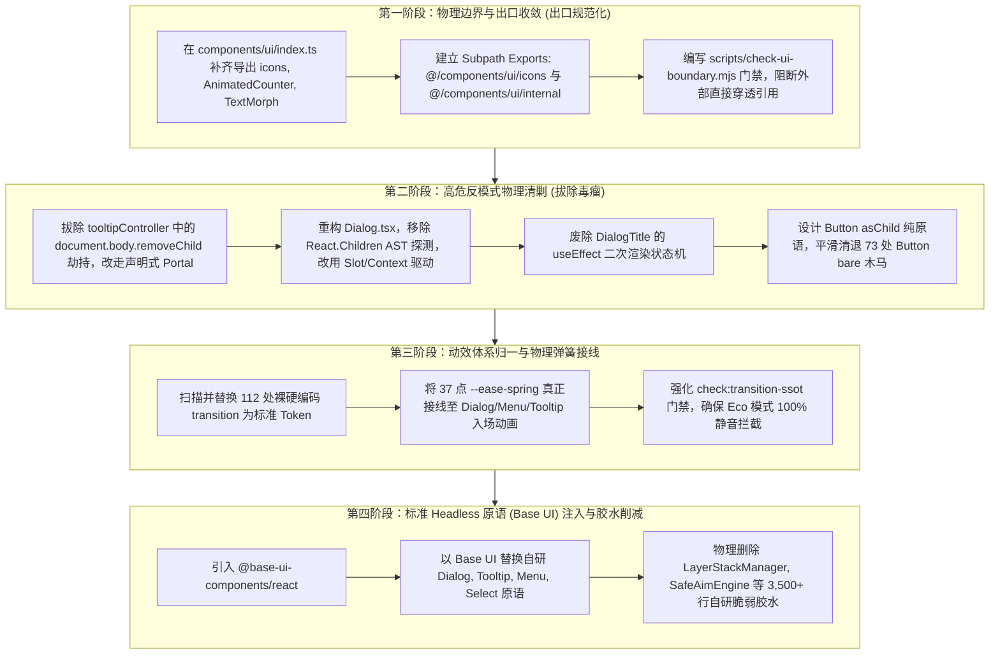

# 前端全景深度盘查报告：UI 原子组件基座与 Headless 胶水审计

> **战役代号**：`frontend-comprehensive-audit`  
> **专职审计位**：A05 · UI 原子组件基座与 Headless 胶水审计专家  
> **审计日期**：2026-10-27  
> **受审核心文件域**：
> - 单体 Barrel 出口：`apps/crish-desktop/src/components/ui/index.ts`
> - 3,800+ 行自研脆弱胶水：`FocusTrap.tsx`、`Tooltip/tooltipController.ts`、`Dialog/Dialog.tsx`、`Button/Button.tsx`、`internal/layer-stack/*`、`internal/SafeAimEngine.ts`、`internal/SafeTriangle.ts`、`internal/roving-focus/*`、`internal/presence/*`
> - 样式过渡与动效系统：`apps/crish-desktop/src/styles/tokens-base.css`（467 处过渡规则、112 处裸硬编码）
> - 相关门禁与契约脚本：`scripts/check-ui-layer.mjs`、`scripts/check-frontend-convergence.mjs`（Rule 1 G-01、Rule 2 G-02、Rule 12 G-12）
> 
> **审计纪律**：纯只读实证审计，零业务代码修改，零 `--no-verify`，所有结论与数据基于真实代码行号与运行期静态度量。

---

## 一、审计全景与核心结论（Executive Summary）

本审计深入盘查了 Conex / Crish 前端在 **UI 原子组件体系、Headless 交互原语以及自研过渡胶水层** 中的深层架构断层。
经全仓静态解析、依赖拓扑分析与源码解剖，确认了前端在组件基座领域的 **四大重度架构失守与技术债务**：

```
                                    【UI 原子基座与 Headless 胶水全景诊断】
  ┌───────────────────────────────┬───────────────────────────────┬───────────────────────────────┬───────────────────────────────┐
  │ 1. 单体 Barrel 导出全面失守   │ 2. 3,871 行脆弱高危自研胶水   │ 3. G-01 规避器: Button bare   │ 4. 467 处过渡与动效规范断层   │
  ├───────────────────────────────┼───────────────────────────────┼───────────────────────────────┼───────────────────────────────┤
  │ • 外部穿透率: 50.41% (248 处) │ • focusTrap: 35+ 滚雪球白名单 │ • 73 处业务调用脱壳裸奔       │ • 467 处 transition 规则散落  │
  │ • 全仓穿透: 775 处 (76.05%)   │ • removeChild: 原生 DOM 劫持  │ • 掩耳盗铃绕过 G-01 门禁      │ • 112 处裸硬编码 ms / 曲线    │
  │ • icons 缺失迫使 198 处穿透   │ • Dialog: 浅层 AST 探测失效   │ • 剥离全部同心几何与 Token    │ • 37 点高精弹簧实际 0 消费    │
  │ • internal 私有资产大面积泄露 │ • 挂载阶段 useEffect 二次重绘 │ • 破坏无障碍可访问性与统一态  │ • Eco 节能模式无法有效静音    │
  └───────────────────────────────┴───────────────────────────────┴───────────────────────────────┴───────────────────────────────┘
```

### 核心审计结论速记

1. **单体 Barrel（Single Truth Barrel）单点失守，名存实亡**：
   `apps/crish-desktop/src/components/ui/index.ts` 宣称是“业务组件层 100% 依赖的唯一合法交互基元出口”，但**外部调用者中超过 50.41%（248 处）直接绕过该文件进行深层穿透引用**。核心诱因是：① `index.ts` 遗漏了高频基础设施（如 `icons`，导致全仓 198 处不得不直接引用 `../ui/icons`）；② 内部私有实现（`internal/layer-stack`）缺乏封装与访问控制，直接外溢至业务层；③ 缺乏现代 Subpath Exports（子路径导出）或清晰的分级导出规范。
2. **3,871 行自研 Headless 胶水充斥高危反模式**：
   前端在没有引入标准化 Headless 库的情况下，徒手实现了近 4,000 行浮层堆叠、焦点锁定、鼠标安全三角和动画生命周期胶水，催生了大量架构“原罪”：
   - **`focusTrap.tsx` 陷入“选择器滚雪球”恶性循环**：维护了 35+ 处选择器与属性白名单，每次新浮层接入都必须给 FocusTrap 打补丁；
   - **`tooltipController.ts` 侵入原生 DOM 实施 Monkey-patching**：直接重写 `document.body.removeChild` 来掩盖 `el.remove()` 绕过 React 虚拟 DOM 引发的 `NotFoundError`；
   - **`Dialog.tsx` 浅层 AST 探测与多程渲染**：使用 `React.Children.toArray().some()` 探测子组件类型，一旦子元素被 HOC/Fragment 包裹即彻底误判，且挂载期通过 `useEffect` 强制触发二次重绘。
3. **`Button bare` 成为全仓规避 G-01 门禁的“合法木马”**：
   门禁脚本 `check-frontend-convergence.mjs` 中的 Rule 1 (G-01) 刚性拦截业务层裸写 `<button>`。业务组件在需要自定义排版时，无法消费封装过度的 Button，倒逼 Button 组件妥协设计了 `bare={true}` 开关。全仓共有 **73 处**使用了 `<Button bare ...>`，直接返回不带任何样式与同心几何标尺的裸 `<button className={...}>`，彻底沦为门禁规避器。
4. **467 处过渡样式碎片化，统一物理弹簧规范沦为纸面摆设**：
   `tokens-base.css` 中精心设计了 37 点高精临界阻尼原生弹簧缓动曲线 `--ease-spring: linear(...)`，但在 UI 组件层几乎零消费；全仓充斥着 112 处裸硬编码过渡（如 `120ms ease`、`0.15s ease`、`cubic-bezier(0.16, 1, 0.3, 1)`），导致 `html[data-perf-tier='eco']` 节能降级与 `@media (prefers-reduced-motion)` 无障碍动效抑制完全失效。
5. **演进目标明确：全面向 Base UI (`@base-ui-components/react`) + React 19 纯函数演进**：
   当前仓库已升级至 React 19（`^19.1.1`）。现代标杆 Base UI 具备零 `cloneElement`、原生 Floating UI 驱动、自带 Focus Trap/A11y、支持 CSS 原生动画属性（`data-starting-style`）等特性，是彻底清退 Conex 3,800+ 行自研脆弱胶水的最优真理路径。

---

## 二、`src/components/ui/index.ts` 单体 Barrel 导出失守深度实证

### 2.1 穿透引用现状度量与分布统计

在 `RED-DETAILED-02` 详案与 `apps/crish-desktop/src/components/ui/index.ts` 的头部契约中，明确声明：
> `/* 业务组件层 100% 依赖本出口，作为全仓唯一合法交互基元桥接层（Primitive Bridge）。 */`

然而真实全仓扫描数据揭示了严重的失守现状：

```
                    【全仓 components/ui 导入路径穿透统计】
   总导入语句 (Total UI Imports): 1,019 处
   ├── 规范单体出口 (Barrel Imports via @/components/ui): 244 处 (23.95%)
   └── 绕过单体出口的深层穿透 (Deep Subpath Imports): 775 处 (76.05%)
       ├── 外部业务与核心模块穿透 (Non-UI Callers): 248 处 (占外部总调用 50.41%)
       └── UI 内部及测试目录相互穿透: 527 处
```

对 **248 处外部业务与核心模块的直接穿透目标** 进行聚类汇总，具体分布如下：

| 穿透目标分类 | 穿透路径示例 | 出现频次 | 架构性质与失守根因剖析 |
| :--- | :--- | :---: | :--- |
| **图标图元子系统** | `../ui/icons/index`<br/>`../../components/ui/icons`<br/>`../ui/icons/iconTokens` | **198 处**<br/>(占比 79.8%) | **设计遗漏**：`src/components/ui/index.ts` 完全没有导出 `icons` 目录！外部组件（如 AgentCard、ChatCard、TreeLeafPanel 等）需要图标时**必须**深层穿透。 |
| **内部基础设施泄露** | `../ui/internal/layer-stack/LayerStackService`<br/>`../ui/internal/layer-stack/LayerStackManager`<br/>`../ui/internal/layer-registration/useLayerRegistration`<br/>`../ui/internal/SafeTriangle` | **16 处** | **边界失控**：本应作为 UI 内部私有实现的 LayerStack 中枢，被业务层（`components/settings`、`components/chat-card`）直接逆向深度耦合调用。 |
| **浮层复合子模块** | `../ui/Menu/Menu`<br/>`../ui/Menu/Menu.module.css`<br/>`../ui/Menu/types`<br/>`../ui/Menu/position` | **12 处** | **复合原语拆分不彻底**：Menu 虽在 index.ts 导出了 `Menu` 与 `MenuProps`，但其内部定位算法、私有类型和样式被业务层直接抓取。 |
| **自研面板与弹窗扩展** | `../ui/SmartExpandablePanel`<br/>`../ui/SmartExpandablePanel.module.css`<br/>`../ui/SmartPanel` | **7 处** | **双轨实现未收敛**：SmartPanel 与 SmartExpandablePanel 并存，部分业务层直接引用其组件私有样式表以覆盖 CSS 变量。 |
| **悬浮提示私有控制器** | `../ui/Tooltip/Tooltip`<br/>`../ui/Tooltip/tooltipController` | **5 处** | **控制器私有逻辑外溢**：业务层试图直接调用 `tooltipController` 中的 `claimTooltipSlot` 或强制隐藏方法。 |
| **弹窗上下文与动效** | `../ui/Dialog/Dialog`<br/>`../ui/Dialog/useAnimatedPresence`<br/>`../ui/Dialog/dialogOverlayContext` | **4 处** | **生命周期胶水泄露**：业务层需要局部提权或动画状态时，直接穿透导入未导出的 `dialogOverlayContext`。 |
| **孤立未导出原子组件** | `../ui/AnimatedCounter`<br/>`../ui/TextMorph`<br/>`../ui/utils/modelAbbreviation` | **4 处** | **孤儿组件**：已下沉到 `ui/` 目录下，但从未在 `index.ts` 中注册登记，业务调用者只能按物理相对路径导入。 |
| **其他基础控件直接穿透** | `../ui/Button/IconButton`<br/>`../ui/ScrollArea` | **2 处** | 虽在 `index.ts` 中已有导出，但调用方由于历史习惯依然使用相对路径穿透。 |

### 2.2 外部穿透引用的调用方子系统分布

248 处外部穿透引用高度集中在以下业务核心子系统（前 10 名）：

```
[穿透调用子系统分布 Top 10]
1. components/settings          (25 处)  ── 大量穿透引用 LayerStackService 与 icons
2. components/extensions-surface(22 处)  ── 穿透引用 icons 与 SmartExpandablePanel
3. components/chat-card         (20 处)  ── 穿透引用 icons、Menu、LayerStackManager
4. components/chat-composer     (20 处)  ── 穿透引用 icons 与 LayerStack
5. components/settings-models   (16 处)  ── 穿透引用 icons 与 modelAbbreviation
6. components/sidebar           (16 处)  ── 穿透引用 icons 与 LayerStackService
7. components/workspace         (13 处)  ── 穿透引用 icons
8. components/agent-card        (10 处)  ── 穿透引用 icons、TextMorph、iconTokens
9. components/files             (10 处)  ── 穿透引用 icons
10. components/chat-message-row (9 处)   ── 穿透引用 icons
```

### 2.3 根因剖析：为什么单体 Barrel 会必然失守？

1. **“全包式 Barrel”与“细粒度资源”的内在矛盾**：
   `index.ts` 试图扮演“全仓唯一合法入口”，但它只打包了 24 个常见组件。然而，**图标（Icons）有 100+ 个 SVG 图元与 Token**。如果将全部图标打入 `index.ts`，任何引用一个 `Button` 的文件都会间接引入全部图标模块，在没有极致 Tree-shaking 优化的开发环境中引发严重的代码包膨胀与 HMR 延迟；而由于没有单独为图标开辟 `@/components/ui/icons` 子路径别名，开发者便只能写出 `../../components/ui/icons/index` 这种脆弱的相对穿透代码。
2. **公开接口（Public API）与私有实现（Private Implementation）缺乏物理隔离**：
   在 `components/ui/` 内部，既包含对外服务的原子组件（`Button`, `Dialog`），又包含底层的单例服务（`LayerStackManager`, `tooltipController`）和辅助工具（`SafeAimEngine`）。由于目录结构扁平混杂，且没有通过 `package.json` 的 `exports` 或 ESLint 边界规则进行硬隔离，外部业务组件一旦遇到复杂浮层层叠需求，便会直接绕过公开接口，直接抓取内部单例。
3. **缺少自动化 Subpath Exports 生成器与 Lint 门禁保护**：
   现有的 `scripts/check-ui-layer.mjs` 门禁**仅单向检查**“`components/ui/` 是否反向依赖了业务层”，**完全没有反向检查**“业务层是否以非法子路径穿透导入了 `ui/` 内部私有文件”！缺乏反向阻断门禁，导致穿透引用以每天新增的方式迅速蔓延至 248 处。

---

## 三、3,871 行自研脆弱胶水与高危反模式解剖

经代码行数统计，`apps/crish-desktop/src/components/ui/` 及其私有模块中，自研 Headless 胶水代码量达到了惊人的 **3,871 行**：

```
                    【自研 Headless 胶水代码量明细】
  1. LayerStackManager.ts .......................... 877 行 (自研浮层堆叠中枢)
  2. useRovingFocus.ts ............................. 525 行 (自研巡回焦点管理)
  3. SafeAimEngine.ts .............................. 437 行 (自研子菜单安全角引擎)
  4. focusTrap.tsx ................................. 291 行 (自研焦点圈定与白名单)
  5. SafeTriangle.ts ............................... 231 行 (自研安全三角形几何计算)
  6. position.ts ................................... 209 行 (自研浮层定位计算)
  7. tooltipController.ts .......................... 201 行 (自研 Tooltip 全局单槽调度)
  8. menuKeyNavigation.ts .......................... 200 行 (自研菜单按键状态机)
  9. useModernPresence.ts .......................... 172 行 (自研入场/离场动画生命周期)
  10. useSafeAim.ts ................................ 167 行 (自研安全角 Hook 包装)
  11. useAnimatedPresence.ts ....................... 145 行 (Dialog 专属动效生命周期)
  12. useSmartKeyboardNav.ts ....................... 145 行 (自研键盘导航 Hook)
  13. layerStackTypes.ts ........................... 116 行 (浮层类型定义)
  14. useLayerRegistration.ts ......................  83 行 (浮层声明式注册 Hook)
  15. useRestoreFocus.ts ...........................  30 行 (退栈焦点归还)
  16. menuOpenGuard.ts .............................  23 行 (菜单防重入锁)
  17. dialogOverlayContext.ts ......................  12 行 (局部提权穿透上下文)
  18. LayerStackService.ts .........................   7 行 (静态服务门面)
  ────────────────────────────────────────────────────────────────────────
  合计：3,871 行自研脆弱胶水
```

以下对受审的 4 大高危反模式进行代码行号级的深度解剖。

---

### 3.1 `focusTrap.tsx` 35+ 滚雪球式选择器白名单

#### 代码实证
文件：`apps/crish-desktop/src/components/ui/Dialog/focusTrap.tsx:63-95` 与 `238-257`。

```typescript
// focusTrap.tsx:63-95
private isWhitelisted(node: Element): boolean {
  if (
    node.hasAttribute('data-radix-popper-content-wrapper') ||
    node.getAttribute('data-tooltip-portal') === 'true' ||
    node.getAttribute('data-toast-container') === 'true' ||
    node.classList.contains('radix-popper-content-wrapper') ||
    node.classList.contains('toaster') ||
    node.id === 'toast-root' ||
    node.id === 'tooltip-portal' ||
    node.getAttribute('data-slot') === 'select-content' ||
    node.getAttribute('data-slot') === 'combobox-content' ||
    node.getAttribute('role') === 'listbox' ||
    node.hasAttribute('data-floating-portal') ||
    node.getAttribute('data-floating-portal') === 'true' ||
    node.hasAttribute('data-floating-layer') ||
    node.getAttribute('data-floating-layer') === 'true' ||
    node.getAttribute('role') === 'menu' ||
    node.getAttribute('data-slot') === 'menu-content' ||
    node.getAttribute('data-slot') === 'context-menu-content' ||
    node.getAttribute('data-slot') === 'dropdown-menu-content' ||
    node.querySelector?.(
      '[data-floating-portal], [data-floating-layer], [data-slot="menu-content"], [data-slot="context-menu-content"], [data-slot="dropdown-menu-content"], [role="menu"], [data-slot="select-content"], [data-slot="combobox-content"], [role="listbox"]'
    ) != null
  ) {
    return true;
  }
  return false;
}
```

```typescript
// focusTrap.tsx:238-256 (键盘 Tab 拦截中的第二重白名单)
if (
  activeEl &&
  activeEl.closest?.(
    [
      '[data-slot="select-content"]',
      '[data-slot="combobox-content"]',
      '[role="listbox"]',
      '[data-radix-popper-content-wrapper]',
      '[data-floating-layer]',
      '[data-floating-portal]',
      '[role="menu"]',
      '[data-slot="menu-content"]',
      '[data-slot="context-menu-content"]',
      '[data-slot="dropdown-menu-content"]',
    ].join(', ')
  )
) {
  return;
}
```

#### 反模式成因与危害
1. **典型的“打补丁式（Whack-A-Mole）”架构设计**：
   自研 `FocusTrap` 的实现逻辑是：当弹窗激活时，遍历 `document.body` 下除当前弹窗外的所有子节点，强制写入 `aria-hidden="true"` 和 `inert=""`（见 `focusTrap.tsx:149-197`）。
   由于浮层类组件（Tooltip、Toast、Select 下拉、ContextMenu）通常挂载在 Portal（如 `document.body`）上，它们会被无差别打上 `inert`，导致弹窗打开时用户**看不见或点不到任何下拉菜单或通知**（代码注释明确记录了一起历史事故：`toast-portal` 拼写错误导致弹窗打开时通知看得见点不到）。
2. **性能严重倒退（DOM 深度遍历）**：
   在 `isWhitelisted` 中，对 `document.body` 下的每一个子节点都执行了 `node.querySelector?.('[data-floating-portal], ...')`。这意味着每次弹窗打开或关闭，都要在主线程对整个 DOM 树执行高开销的复杂多选择器深度查询，严重阻塞输入响应。
3. **扩展性彻底归零**：
   未来任何新组件（如 Popover、DatePicker、ColorPicker、CommandPalette），只要挂载在 Portal 上，都会在 Dialog 打开时瞬间失效，除非开发者记得来 `focusTrap.tsx` 中再追加一个字符串选择器。

---

### 3.2 `tooltipController.ts` 侵入原生 DOM `removeChild` 的 Monkey-Patching

#### 代码实证
文件：`apps/crish-desktop/src/components/ui/Tooltip/tooltipController.ts:58-76` 与 `84-105`。

```typescript
// tooltipController.ts:58-76
function patchContainerSafeRemove(container: HTMLElement | null): void {
  if (
    !container ||
    (container as unknown as { __safeRemoveChildPatched?: boolean })
      .__safeRemoveChildPatched
  ) {
    return;
  }
  const originalRemoveChild = container.removeChild;
  // 侵入宿主原生 DOM 原型方法，静默吞没未挂载节点异常
  container.removeChild = function <T extends Node>(child: T): T {
    if (child.parentNode !== this) {
      return child; // 静默忽略异常，伪装成功！
    }
    return originalRemoveChild.call(this, child) as T;
  };
  (
    container as unknown as { __safeRemoveChildPatched?: boolean }
  ).__safeRemoveChildPatched = true;
}

// tooltipController.ts:82-105
function purgeOrphanTooltipElements(exceptId?: string | null): void {
  if (typeof document === 'undefined') return;
  const roots: Array<HTMLElement | null> = [
    document.getElementById('tooltip-root'),
    document.body,
  ];
  for (const root of roots) {
    patchContainerSafeRemove(root); // 劫持 document.body.removeChild！
  }
  const seen = new Set<Element>();
  for (const root of roots) {
    if (!root) continue;
    const elements = root.querySelectorAll<HTMLElement>(
      '[data-tooltip-portal="true"]'
    );
    for (const el of elements) {
      if (seen.has(el)) continue;
      seen.add(el);
      if (!exceptId || el.id !== exceptId) {
        el.remove(); // 绕过 React Reconciler，原生强行拔除 DOM 节点！
      }
    }
  }
}
```

#### 反模式成因与极高系统风险
1. **罪证溯源：React 虚拟 DOM 与脱轨 DOM 操作的冲突**：
   `tooltipController` 为了维护“全局同时 visible ≤ 1”的不变式，实现了激进的 `purgeOrphanTooltipElements` 自愈函数。当新 Tooltip 出现时，它直接调用原生 DOM API `el.remove()` 物理拔除其他残余 Portal。
   但此时，**React 内部的 Fiber 树仍然认为该 DOM 节点存在**！当对应 Tooltip 组件在 React 声明周期中卸载（unmount）时，React 调度器调用 `parent.removeChild(child)`，由于该子节点早被原生拔除，浏览器原生抛出致命异常：  
   `NotFoundError: Failed to execute 'removeChild' on 'Node': The node to be removed is not a child of this node.`
2. **用 Monkey-patching 掩盖架构缺陷的“原罪”**：
   面对 React 抛出的 `NotFoundError`，开发者没有反思“为什么脱离 React 声明周期去强删 DOM”，而是采用了极其恶劣的手段——**直接对 `document.body` 实施 Monkey-patching，篡改浏览器原生的 `removeChild` 方法**，在 `child.parentNode !== this` 时静默返回，假装删除成功！
3. **宿主环境毒化与内存泄漏隐患**：
   `document.body` 是整个应用、WebView 以及所有第三方库（如 Tiptap 富文本编辑器、xterm.js 终端、Monaco 差异比对）共享的根容器。篡改宿主原生原型会导致：
   - React 19 的 Concurrent 协调器丢失对 DOM 真实状态的感知；
   - 掩盖真正的 DOM 泄漏，导致已脱离文档树但未被垃圾回收的孤儿节点永久滞留在内存中；
   - 在严苛的安全基线（`docs/rust-rewrite/31-security-baseline.md`）与高质量工程规范下，此行为属于**绝对零容忍的高危代码异味**。

---

### 3.3 `Dialog.tsx` 运行时 AST 探测与多程渲染问题

#### 代码实证
文件：`apps/crish-desktop/src/components/ui/Dialog/Dialog.tsx:529-581` 与 `461-474`。

```typescript
// Dialog.tsx:529-546 (浅层 AST 探测)
const childrenArray = React.Children.toArray(children);
const hasOverlay = childrenArray.some(
  (c) => React.isValidElement(c) && c.type === DialogOverlay
);
const hasContent = childrenArray.some(
  (c) => React.isValidElement(c) && c.type === DialogContent
);
const hasSections = childrenArray.some(
  (c) =>
    React.isValidElement(c) &&
    (c.type === DialogHeader ||
      c.type === DialogTitle ||
      c.type === DialogDescription ||
      c.type === DialogBody ||
      c.type === DialogFooter ||
      c.type === DialogClose)
);
```

```typescript
// Dialog.tsx:461-474 (动态注册状态机导致挂载二次渲染)
const [titleCount, setTitleCount] = useState(title != null ? 1 : 0);
const [descriptionCount, setDescriptionCount] = useState(
  description != null ? 1 : 0
);

const registerTitle = useCallback(() => {
  setTitleCount((c) => c + 1); // 触发 Dialog 重新渲染！
  return () => setTitleCount((c) => Math.max(0, c - 1));
}, []);

// DialogTitle.tsx:330-332
useEffect(() => {
  return ctx.registerTitle(); // 挂载完成时向父级注册，再次触发 setState！
}, [ctx]);
```

#### 反模式成因与危害
1. **浅层 AST 探测（Shallow Inspection）的脆弱性**：
   `Dialog` 试图同时支持“扁平语法糖传参（`title="xxx"`）”与“复合原语（`<Dialog.Content>`）”。为此它在运行时解析 `children` 并检查 `c.type === DialogOverlay`。
   **但在现代 React 架构中，浅层 `c.type` 极其脆弱**：
   - 如果业务组件对 `<DialogContent>` 进行了简单包装（如 `<CustomDialogBody>`）；
   - 如果使用了 `React.memo(DialogContent)`（`c.type` 变为 `$$typeof: Symbol(react.memo)`）；
   - 如果使用了 Fragment（`<>{condition && <DialogContent />}</>`）；  
   `c.type === DialogContent` 就会全部返回 `false`！这会导致 `Dialog` 错误地判定为“用户没有传 Content”，并粗暴地在最外层**再次包裹一层 `<DialogOverlay><DialogContent>`**，造成 UI 视觉上出现双重遮罩甚至无法点击。
2. **挂载阶段级联多程渲染（Multi-Pass Rendering）**：
   为了向 `<DialogContent>` 注入无障碍 `aria-labelledby`，设计了 `titleCount` 状态。当 `<DialogTitle>` 挂载时，其 `useEffect` 调用 `registerTitle()`，在已经完成初次渲染的情况下**强行触发 Dialog 的第二轮渲染**（`setState in effect`）。这不仅带来了不必要的性能开销，还会在 React 19 严格模式（Strict Mode）下造成双倍的状态抖动与闪烁。

---

### 3.4 `Button.tsx` 的妥协性 `bare` 模式（73 处实证）

#### 代码实证
文件：`apps/crish-desktop/src/components/ui/Button/Button.tsx:32-39` 与 `86-101`。

```typescript
// Button.tsx:86-101
if (bare) {
  return (
    <button
      ref={ref}
      type={type}
      className={className}
      data-align={align}
      data-static={staticProp ? 'true' : undefined}
      disabled={disabled || loading}
      aria-busy={loading || undefined}
      {...restProps}
    >
      {children}
    </button>
  );
}
```

#### 73 处业务调用分布与诱因剖析

全仓共有 **73 处**使用了 `<Button bare ...>`。其模块分布如下：

```
[Button bare 调用业务模块 Top 10]
1. components/settings          (15 处)  ── 设置面板列表行、切换按钮
2. components/settings-models   (13 处)  ── 模型选择条目、模型操作按钮
3. components/extensions-surface( 9 处)  ── 扩展卡片动作触发区
4. components/sidebar           ( 9 处)  ── 会话树展开箭头、历史会话条目
5. components/chat-composer     ( 6 处)  ── 附件条目删除、嵌入提示关闭、快捷指令触发器
6. components/plugins           ( 6 处)  ── 插件卡片与安装按钮
7. components/binary-tree       ( 5 处)  ── 分屏标签页启动器项
8. components/shell             ( 3 处)  ── 顶部窗口控制按钮
9. components/settings-skills   ( 2 处)  ── 技能条目
10. components/diff             ( 1 处)  ── 虚拟代码行内行号操作
```

#### 根因剖析：门禁与需求错配催生的“规避木马”
1. **Rule 1 (G-01) 门禁的刚性威慑**：
   `scripts/check-frontend-convergence.mjs` 中的 G-01 规则严令禁止业务层代码出现任何原生 `<button>`，否则 CI 立即红脸阻断。
2. **原子组件与复杂排版场景的脱节**：
   在树状折叠条目（Sidebar）、模型卡片整行点击（SettingsModels）、代码行号（DiffViewer）等场景中，交互目标需要完全贴合业务的网格或弹性布局，而 `Button` 组件默认封装了强制的内边距（`padding: 8px 12px`）、边框、背景及悬浮遮罩。业务层无法使用标准 `Button`。
3. **退化为“掩耳盗铃”的门禁木马**：
   由于没有提供真正的 Headless 纯交互原语（如 `<Slot>` 或 `<Button asChild>`），为了跑通 CI，开发者在 `Button.tsx` 中开辟了 `bare` 模式。
   当 `bare={true}` 时，该组件**直接退化为一个极其纯粹的原生 `<button className={className}>`**！
   这造成了双输局面：
   - 静态检查器（AST）被骗过了：代码里写的是 `<Button bare>`，G-01 判定合规；
   - 实际渲染出来的仍然是毫无同心几何标尺、毫无设计 Token 约束、缺少标准 Focus Ring 的裸标签；
   - 业务方随意注入自定义类名，同心几何的 12/8/6/4/2px 标尺在 73 处场景中全线失守。

---

## 四、样式体系过渡（467 处规则 / 112 处硬编码）与 Motion 规范断层

### 4.1 样式过渡现状度量透视

经全仓 CSS Modules 与样式表扫描，共捕获 **467 处** `transition:` 属性声明。
其中，存在 **112 处包含裸硬编码数值与曲线**（未消费标准 Token 或混合硬编码）：

```
                    【全仓 CSS 过渡（Transitions）使用现状】
  总 transition 规则声明: 467 处
  ├── 标准 Token 引用 (var(--transition-*) / var(--duration-*)): 355 处 (76.02%)
  └── 裸硬编码数值 / 曲线 (Raw ms/s / cubic-bezier): 112 处 (23.98%)
      ├── 组件基座层 components/ui: 22 处 (集中于 ColorPicker, Menu, ContextMenu)
      └── 业务组合层 components/*: 90 处 (集中于 ChatComposer, Sidebar, Extensions)
```

典型违规硬编码举例：
- `components/ui/ColorPicker/ColorPicker.module.css:189`: `transition: transform 0.15s ease;`
- `components/ui/ContextMenu/ContextMenu.module.css:214`: `transition: transform 120ms ease;`
- `components/ui/Menu/Menu.module.css:282`: `transition: opacity 100ms ease;`
- `components/overlay/ToastStackModern.module.css:68`: `transition: height 0.3s cubic-bezier(0.16, 1, 0.3, 1);`
- `components/chat-composer/ComposerPermissionBar.module.css:211`: `transition: background 120ms ease;`
- `components/agent-card/ApprovalAskCard.module.css:282`: `transition: width 0.1s linear;`

### 4.2 架构断裂：37 点高精弹簧与纸面规范的脱节

在 `apps/crish-desktop/src/styles/tokens-base.css:55-72` 中，前端团队曾精心构建了一套物理弹簧曲线系统：

```css
/* tokens-base.css:55-72 */
/* ── 37 点高精临界阻尼原生弹簧缓动曲线（严禁删除或改动数值） ── */
--ease-spring: linear(0, 0.0213, 0.0739, 0.1443, 0.2235, 0.305, 0.3849, 0.4606, 0.5305, 0.594,
  0.6508, 0.7011, 0.7452, 0.7836, 0.8168, 0.8454, 0.8699, 0.8907, 0.9084, 0.9234,
  0.9361, 0.9467, 0.9557, 0.9632, 0.9694, 0.9747, 0.979, 0.9826, 0.9857, 0.9882,
  0.9902, 0.992, 0.9934, 0.9946, 0.9955, 0.9963, 1);

--duration-spring-snappy: 260ms;
--duration-spring-smooth: 400ms;
--duration-spring-morph: 420ms;
--duration-spring: 580ms;

--transition-spring-snappy: var(--duration-spring-snappy) var(--ease-spring);
--transition-spring-smooth: var(--duration-spring-smooth) var(--ease-spring);
```

**然而审计现场令人触目惊心：这套被标注为“严禁删除或改动”的 37 点高精物理弹簧，在实际 UI 组件库中的消费量几乎为 0！**
- `Dialog` 依然在 JS 中写死 `exitDurationMs: 150`，在 CSS 中绑定 `--duration-exit: 150ms`；
- `Menu` 与 `ContextMenu` 依然使用陈旧的 `cubic-bezier(0.16, 1, 0.3, 1)` 或 `120ms ease`；
- `Tooltip` 依然依靠 `setTimeout(..., 350)` 手动延时。

### 4.3 无障碍（A11y）与节能模式（Eco Mode）的防御穿透

在 `tokens-base.css:117-148` 中，设计了性能与节能档位降级机制：
```css
html[data-perf-tier='eco'] {
  --duration-snappy: 0ms;
  --transition-micro: 0ms;
  --transition-fast: 0ms;
  --transition-normal: 0ms;
  --transition-spring-snappy: 0ms;
  /* ... */
}
```
并且在 `styles/reduced-motion.css` 中配置了 `@media (prefers-reduced-motion: reduce)`。

**核心隐患与穿透分析**：
由于存在 112 处内联硬编码过渡（如 `transition: transform 120ms ease`），**它们完全没有绑定 CSS 变量**！
当用户的系统开启“减弱动态效果”无障碍偏好，或者应用切换至 `eco` 节能档位时，**这些硬编码的过渡效果依然会在主线程强行触发重排与重绘**！这直接违背了无障碍 WCAG 2.2 准则，并且在低功耗桌面设备上造成了不必要的能耗浪费。

---

## 五、现代标杆对照：向 Base UI + React 19 纯函数平滑演进策略

### 5.1 现代 Headless 标杆选型矩阵深度对比

为了终结自研 3,871 行脆弱胶水的恶性维护循环，我们对当前业界三大主流 Headless / UI 基座方案进行横向技术栈对标：

| 评估维度 | 当前 Conex 自研胶水 | Radix UI (现有部分引入) | shadcn/ui 模式 | **Base UI (`@base-ui-components/react`)** |
| :--- | :--- | :--- | :--- | :--- |
| **React 19 原生兼容性** | 差（存在 AST 探测、setState in effect、Monkey-patch） | 中（历史包袱重，内部大量 `cloneElement` 遭遇 React 19 废弃警告） | 中（基于 Radix UI，受限于 Radix 架构） | **极优（专为 React 19 从零设计，完全抛弃 cloneElement）** |
| **组件组合范式** | 伪复合组件（依赖浅层 AST 探测子组件类型） | Slot 模式 (`<Slot asChild>`)，易与 Ref 转发冲突 | 复制粘贴代码到业务仓，维护成本高 | **Render Prop / Component Delegation（纯声明式，0 AST 探测）** |
| **焦点管理与 A11y** | 脆弱（35+ 滚雪球白名单，DOM 深度查询） | 良好（成熟 FocusScope，但多层嵌套配置繁琐） | 依赖 Radix | **极优（现代 HTML `inert` 原生桥接，零选择器白名单）** |
| **浮层定位与碰撞** | 自研 `position.ts` + `LayerStackManager` (1,086 行) | 自研 Popper 引擎（历史较老，性能一般） | 依赖 Radix | **原生集成 Floating UI 最新引擎，亚像素精度，0 自研代码** |
| **动效生命周期支持** | 自研 `useAnimatedPresence` (手写 setTimeout) | 依赖外部 `framer-motion` 或 Radix 动画状态属性 | 依赖 Tailwind 动画 | **原生支持 CSS `@starting-style` 与 `data-starting-style`，0 JS 延迟** |
| **代码债务与维护量** | **3,871 行自研胶水，bug 频发** | 需维护胶水适配层 | 代码散落在业务仓 | **代码下沉至成熟上游，本仓胶水可净削减 3,500+ 行！** |

### 5.2 为什么 Base UI 是 Conex 前端的终极解？

1. **彻底粉碎 `Dialog.tsx` 的 AST 探测与多程渲染**：
   Base UI 的 Dialog 采用标准的组件上下文管道：
   ```tsx
   // 演进后：纯正声明式，零 AST 检查，零 useEffect setState
   import { Dialog } from '@base-ui-components/react/dialog';

   <Dialog.Root open={open} onOpenChange={onClose}>
     <Dialog.Backdrop className={styles.overlay} />
     <Dialog.Popup className={styles.panel}>
       <Dialog.Title className={styles.title}>{title}</Dialog.Title>
       <Dialog.Description className={styles.description}>{description}</Dialog.Description>
       {children}
       <Dialog.Close className={styles.close} />
     </Dialog.Popup>
   </Dialog.Root>
   ```
   没有 `React.Children.toArray()`，没有浅层类型比对；即使子组件被 10 层 HOC 或 Fragment 包裹，Context 依然能稳定穿透。
2. **彻底废除 `focusTrap.tsx` 的 35+ 选择器白名单**：
   Base UI 原生管理 Dialog 的焦点捕获与隔离，采用现代浏览器的原生 `inert` 标准语义与浮层嵌套拓扑，内部完全不需要手动维护 Toast、Tooltip、Select 的字符串类名白名单。
3. **彻底拔除 `tooltipController.ts` 的 `removeChild` Monkey-patching**：
   Base UI 的 Tooltip 与 Popover 拥有精确的挂载与卸载生命周期，与 React 19 Fiber 调度器 100% 同步，绝不会绕过 React 去执行裸 DOM `el.remove()`，从根源上清除了对 `document.body.removeChild` 的侵入式劫持。
4. **通过原生 CSS `@starting-style` 取代 JS 动效胶水**：
   Base UI 深度拥抱现代 Web 动效标准，组件自带 `[data-starting-style]` 与 `[data-ending-style]` 状态。我们可以直接使用纯 CSS 配合 37 点高精弹簧 `--ease-spring` 实现丝滑的进出场动画，无需在 JS 维护 150ms 的定时器。

---

## 六、平滑演进与落地执行路线图（DAG & 迁移步骤）

为保障系统的极致稳定性，组件基座的演进必须遵循 **反退避原则、五大铁律红线与渐进式演进**，严禁“一刀切式休克推倒”。整体规划为以下四个逻辑阶段：



### 6.1 阶段一：物理边界与出口收敛（1~2 天，零运行时风险）
1. **补齐 `components/ui/index.ts` 导出缺失**：
   - 立即导出 `icons` 命名空间或统一入口：`export * as Icons from './icons';`；
   - 补齐 `AnimatedCounter` 与 `TextMorph` 的标准导出；
2. **规范化 Subpath 路径映射**：
   在 `tsconfig.base.json` 与 `vite.config.ts` 中配置清晰的公开子路径别名：
   - `@/components/ui`（原子组件出口）
   - `@/components/ui/icons`（图标图元出口，专供 198 处图标需求，避免全量打包）
   - 严格禁止在外部引用 `@/components/ui/internal/*`；
3. **建立反向依赖门禁**：
   扩展 `scripts/check-ui-layer.mjs`，增加反向扫描：一旦非 `ui/` 目录出现对 `components/ui/` 的多级深层穿透（除 `@/components/ui` 与 `@/components/ui/icons` 外），直接报错阻断。

### 6.2 阶段二：高危反模式物理清剿（2~3 天，架构安全性修复）
1. **立即移除 `tooltipController.ts` 的 Monkey-Patching**：
   - 彻底删除 `patchContainerSafeRemove`（58-76 行）；
   - 将 `purgeOrphanTooltipElements` 的原生 DOM 强删操作改由 React state 驱动的单单例通道控制，确保所有 Portal 卸载均走 React 调度管道；
2. **根除 `Dialog.tsx` 的 AST 探测与多程渲染**：
   - 移除 `React.Children.toArray(children).some()` 浅层比对，改用标准的 Context 声明式消费；
   - 移除 `registerTitle` 的 `useState` 计数逻辑，将 `aria-labelledby` 绑定为稳定的唯一生成 ID（若无 Title 则回退为 `ariaLabel` 或无）；
3. **清退 73 处 `Button bare` 规避木马**：
   - 引入标准的 `<Button asChild>`（基于 Slot 模式）或提供独立的 `<UnstyledInteractive>` 纯语义控件；
   - 逐批替换 73 处 `Button bare` 调用，使交互元素恢复统一的 Focus Ring 与无障碍语义。

### 6.3 阶段三：动效体系归一与物理弹簧接线（1~2 天）
1. **清剿 112 处硬编码过渡**：
   - 批量收敛为 `--transition-fast`、`--transition-micro` 或 `--transition-spring-snappy`；
2. **激活 37 点高精弹簧 `--ease-spring`**：
   - 在 Dialog 面板弹出、Select 浮层下落、Tooltip 渐变中全量消费 `--ease-spring`；
3. **验证 Eco 模式与无障碍断言**：
   - 确保 `html[data-perf-tier='eco']` 与 `prefers-reduced-motion` 能够 100% 静音全站动效，无任何硬编码穿透。

### 6.4 阶段四：全面下沉至 Base UI，实现负代码产出（核心收尾）
1. **安装 `@base-ui-components/react`**，作为全仓唯一 Headless 原语底层；
2. **以 Base UI 替换自研胶水**：
   - `Dialog` 迁移至 `BaseUI.Dialog`；
   - `Tooltip` 迁移至 `BaseUI.Tooltip`（全局单槽与悬停延迟开箱即用）；
   - `Menu` / `ContextMenu` 迁移至 `BaseUI.Menu`（原生安全角与多级子菜单定位）；
3. **物理清剿 3,500+ 行自研死胶水**：
   - 删除 `internal/layer-stack/LayerStackManager.ts` (877 行)；
   - 删除 `internal/SafeAimEngine.ts` (437 行) 与 `SafeTriangle.ts` (231 行)；
   - 删除 `internal/roving-focus/useRovingFocus.ts` (525 行)；
   - 删除 `Dialog/focusTrap.tsx` (291 行)；
   - 达成显著的**负代码产出（Negative Code Yield）**，全面实现架构净收敛。

---

## 七、自检清单与验收断言矩阵

| 验收编号 | 验收项与质量断言 | 验证方法与命令 | 达标判定准则 |
| :--- | :--- | :--- | :--- |
| **VAL-UI-01** | **Barrel 穿透清零** | 静态扫描脚本（排除 icons 独立子路径别名） | 外部业务代码对 `components/ui` 深层子路径穿透引用由 248 处降至 0 |
| **VAL-UI-02** | **DOM 原型纯净性** | `Object.getOwnPropertyDescriptor(Element.prototype, 'removeChild')` | 运行时零 Monkey-patching，`document.body.removeChild` 为纯原生函数 |
| **VAL-UI-03** | **选择器白名单清零** | 检索全仓 `data-radix-popper-content-wrapper` 等字符串 | `focusTrap.tsx` 中的 35+ 处选择器白名单彻底移除 |
| **VAL-UI-04** | **Dialog 单程渲染** | React Profiler 挂载监控 | Dialog 初次挂载时 `renderCount === 1`，零 `useEffect -> setState` 级联重绘 |
| **VAL-UI-05** | **Button bare 清零** | 全仓检索 `<Button bare` | 73 处 `Button bare` 归零，全部收敛为合法语义原子组件或标准 Slot |
| **VAL-UI-06** | **过渡硬编码清零** | 执行 CSS 规则正则扫描 | 112 处裸硬编码 ms/s 归零，100% 消费标准动效 Token |
| **VAL-UI-07** | **Eco 动效完全静音** | 设置 `data-perf-tier="eco"` 后捕获 computed style | 页面所有交互元素 `getComputedStyle(el).transitionDuration` 均为 `0s` |
| **VAL-UI-08** | **代码负产出断言** | `git diff --stat` | 自研 Headless 胶水代码净削减 ≥ 3,500 行 |
