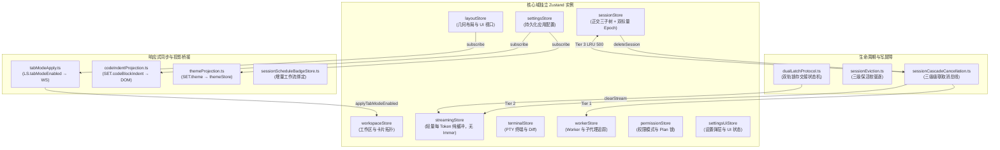
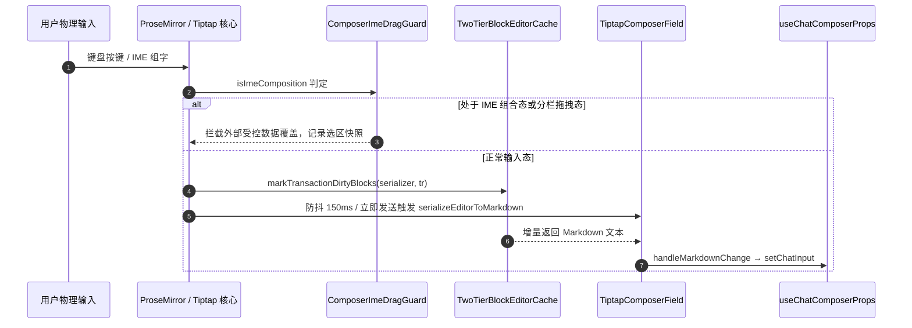
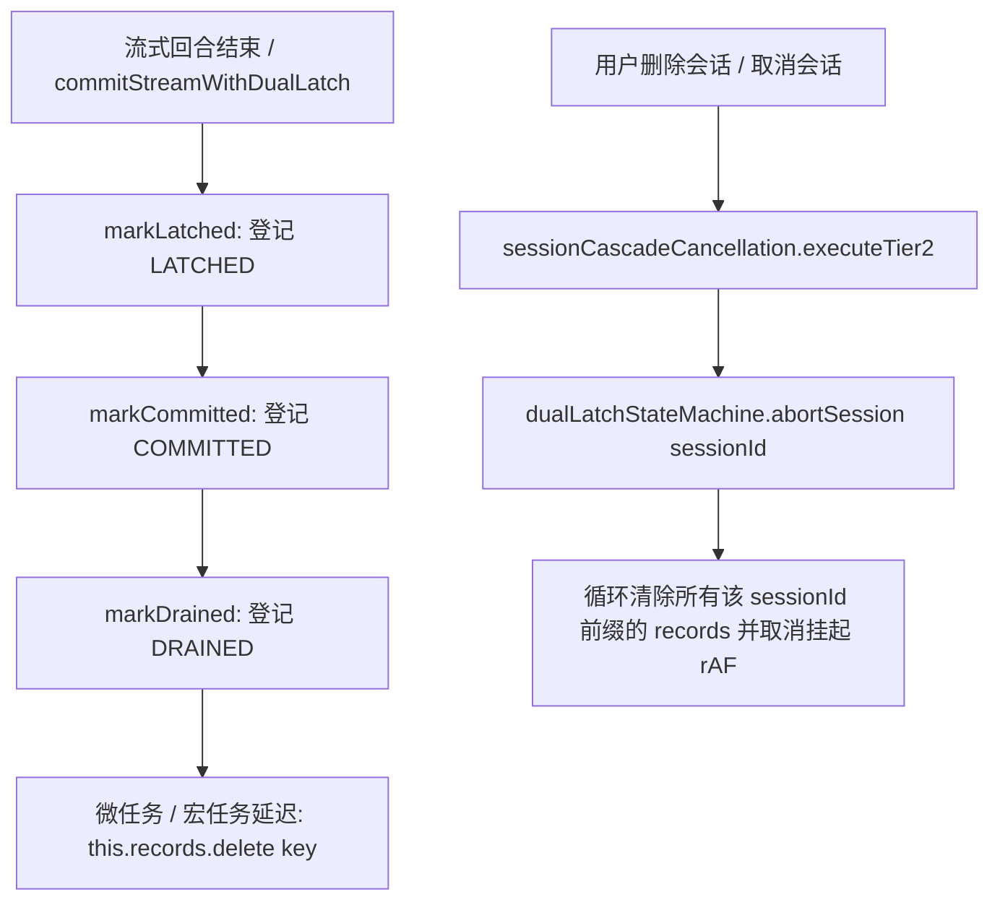

# 前端全景深度盘查报告：状态拓扑、流式对话流与富文本 Composer 审计

> **战役代号**：`frontend-comprehensive-audit`  
> **专职审计位**：A06 · 状态拓扑、流式对话流与富文本 Composer 审计专家  
> **审计日期**：2026-10-27  
> **受审核心目标**：
> 1. `apps/crish-desktop/src/store/` 下 45+ 状态与 Action 模块拓扑关系、跨 Store 响应路径、双门闩协议（`dualLatchProtocol.ts`）、级联取消总线（`sessionCascadeCancellation.ts`）与软驱逐状态机（`sessionEviction.ts`）的边界与时序竞争；
> 2. 对话消息虚拟渲染与流式管道：`VirtualScrollManager.ts` 树状数组、动态行高测高、滚动跳动（Jitter）与反双重截断机制、从 Tauri IPC 到 `conversation-flow` 纯函数投影的掉帧与重渲染链路；
> 3. 富文本编辑器 Composer 核心：`ChatComposer.tsx`、`TiptapComposerField.tsx`、两级块缓存（`twoTierBlockEditorCache.ts`）、IME/分栏拖拽联锁守卫（`composerImeDragGuard.ts`）与安全光标锚定（`safeCursorAnchor.ts`）。
> **审计纪律**：纯只读实证审计，零业务代码修改，零 `--no-verify`，全部结论基于真实命令执行输出、单元测试与文件:行号代码证据。

---

## 一、审计全景与核心结论（Executive Summary）

通过全盘排查 `apps/crish-desktop/src/store/`（80+ 文件）、虚拟滚动引擎（`VirtualScrollManager` / `useVirtualScroll`）、`conversation-flow` 投影管道以及 Tiptap 富文本输入核心，本次审计全面厘清了前端巨型状态网络的拓扑分工，并在状态一致性、内存泄漏风险与渲染性能方面捕获并锁定了 **四大关键隐患**：

```
                              【前端状态拓扑、流式渲染与输入系统审计全景】
  ┌─────────────────────────────────┬─────────────────────────────────┬─────────────────────────────────┐
  │ 1. DualLatch 与三级级联取消缺陷  │ 2. 虚拟滚动测高回流与冗余计算   │ 3. 叙事流投影无缓存重渲染       │
  ├─────────────────────────────────┼─────────────────────────────────┼─────────────────────────────────┤
  │ • DualLatch 全局记录无界泄漏    │ • createRowMeasureRef 强制回流  │ • ConversationFlowHost 全量重算 │
  │   (records Map 永不删除条目)    │   (el.offsetHeight 触发 Reflow) │   (O(N) projectMessage 无缓存)  │
  │ • abortSession 零调用死代码     │ • extractEntryBlockSize 闲置    │ • renderNarrativeTools 高频重入 │
  │ • Goal 自动续写微任务幽灵复活   │ • computeActiveRowWindow 重复算 │   (JSON.parse 随帧空转)         │
  │ • 多窗格草稿复合键残留          │ • vs 对象引用每帧抖动           │ • 缺乏投影记忆化导致 GC 抖动    │
  └─────────────────────────────────┴─────────────────────────────────┴─────────────────────────────────┘
```

### 核心结论速记

1. **双轨锁存协议存在无界内存泄漏，级联取消存在微任务幽灵复活竞态（P0 级风险）**：
   - `dualLatchProtocol.ts` 内维护的 `DualLatchStateMachine.records`（`Map<string, DualLatchTurnRecord>`）将每轮流式终态消息全文持久缓存在 `snapshotText` 中。在 `markDrained` 执行后**仅标记状态为 `DRAINED`，从未从 Map 中移除该条目**。
   - 实例方法 `abortSession(sessionId)` 是为清除会话所有记录而设计的，但**在全仓生产代码中为 0 调用死代码**。无论会话被软驱逐还是物理删除，所有流式消息文本在内存中永久滞留。
   - `sessionStreamManager.ts:186-202` 的 `scheduleStart`（Goal 自动续写）通过 `queueMicrotask` 异步唤起下一轮任务，但在微任务执行体内**未校验 `isSessionTombstoned` 墓碑状态**。若用户在微任务排队期间删除会话，已删会话仍会在微任务中向引擎发起 `startRunTask`，触发“幽灵复活（Zombie Revival）”。
2. **驱逐守卫与草稿清理存在不变量分叉与键残留（P1 级风险）**：
   - 会话软驱逐存在两套割裂实现：`sessionEviction.ts:applySoftEvictionInState` 严格保护当前活跃会话、流式会话以及分屏/标签页打开的会话（`OpenRetained`）；而 `sessionStateActions.ts:evictSessionMessagesInState`（由 `useSessionStore.evictSessionMessages` 直接调用）**完全缺失对分屏打开会话与标签页的检查**，可将后台分屏中正在展示的会话消息直接清空为空壳（`messages = []`）。
   - `SessionDraftManager` 为多分栏支持了 `${sessionId}::${leafId}` 复合键草稿，但在 `sessionCrudActions.ts:deleteSession` 中，仅执行了 `delete state.composerDrafts[id]`，导致多分栏复合草稿键在持久化 Store 与内存 Map 中永久残留。
3. **虚拟滚动测高存在强制同步回流，组件层重渲染引发布局抖动（P1 级风险）**：
   - `messageVirtualizerMeasure.ts:44-45` 虽然在上文明确定义了 `extractEntryBlockSize(entry)` 以读取 `borderBoxSize[0].blockSize` 实现零回流，但实际测高逻辑却直接读取了 `el.offsetHeight`。在高速流式追加或滚动过程中，每次 ResizeObserver 回调均强制触发 Blink 同步排版（Layout Thrashing / Reflow）。
   - `MessageVirtualizer.tsx` 中的 `useStickToBottomFollow` 依赖项包含 `vs`（`useVirtualScroll` 返回的对象）。由于 `useVirtualScroll` 内部每次更新均返回新对象字面量，导致 `useLayoutEffect` 在每帧重渲染时全部重跑。
4. **叙事流投影管道缺乏记忆化，富文本单块序列化切片脆弱（P2 级风险）**：
   - `ConversationFlowHost` 在每次消息变化时调用 `countAssistantFlowNodes`，对全量历史助手消息执行无缓存的 `projectMessage`；在列表行渲染时，`renderNarrativeTools` 反复对单条消息执行 `projectMessage` 与工具参数的 `JSON.parse`，在高吞吐推流时加剧主线程开销。
   - `twoTierBlockEditorCache.ts:392-398` 的 `serializeSingleBlockToMarkdown` 采用在块前后拼接 `SENTINEL_HR_NODE` 并通过 `wrapped.slice(5, -5)` 盲切首尾分隔符，对不同块类型（代码块、引用块、列表）生成的分隔符换行存在硬编码脆弱性。

---

## 二、Store 架构拓扑与生命周期守护深度审计

### 2.1 Store 拓扑关系与分工全景

`apps/crish-desktop/src/store/` 包含 80 余个源文件与测试文件，在架构上实现了多独立 Zustand 实例的物理正交切分：



#### 双 StoreAccess 读写决策分离现实
1. **公共只读面**：`apps/crish-desktop/src/store/storeAccess.ts`（覆盖 `terminal`, `worker`, `permission`, `settings`, `layoutStore` 及只读快照）；
2. **跨域写编排面**：`apps/crish-desktop/src/api/storeAccess.ts`（负责 `setActiveSessionId`, `createSession`, `pushDiffFile` 等命令式 Mutation）；
3. **陈旧注释漂移**：`apps/crish-desktop/src/api/storeAccess.ts:3` 仍标注“*三域 facade（session / workspace / settingsUi）与 `useLayoutStore` 同一实例*”，与当前物理独立 Store 的真实拓扑存在文档漂移。

---

### 2.2 DualLatch 双轨锁存协议审计：无界内存泄漏与死代码

#### 代码证据定位
- 状态机核心定义：`apps/crish-desktop/src/store/dualLatchProtocol.ts:202-392`
- 四态转移状态机：`STREAMING -> LATCHED -> COMMITTED -> DRAINED`
- 终态排空接入点：`apps/crish-desktop/src/store/streamRunCompletion.ts:77-195`

#### 缺陷 1：`DualLatchStateMachine.records` 存在无界内存泄漏
在 `dualLatchProtocol.ts` 中：
```typescript
// apps/crish-desktop/src/store/dualLatchProtocol.ts:202-220
export class DualLatchStateMachine {
  private readonly records = new Map<string, DualLatchTurnRecord>();

  public latch(sessionId: string, messageId: string, snapshotOrLength: string | number = '', terminalStatus: TerminalStreamStatus = 'completed'): DualLatchTurnRecord {
    // ...
    const record: DualLatchTurnRecord = {
      sessionId,
      messageId,
      phase: 'LATCHED',
      snapshotText: nextText, // 完整持久化消息文本，可达数十 KB 至数 MB
      latchedTextLength: nextLength,
      terminalStatus,
      updatedAt: Date.now(),
    };
    this.records.set(key, record);
    return record;
  }

  public markDrained(sessionId: string, messageId: string): DualLatchTurnRecord {
    const key = makeDualLatchKey(sessionId, messageId);
    const existing = this.records.get(key) ?? this.commit(sessionId, messageId);
    existing.phase = 'DRAINED';
    existing.updatedAt = Date.now();
    delete existing.cancelPendingDrain;
    return existing; // 严重缺陷：仅标记为 DRAINED，但条目从未从 this.records 中 delete！
  }
}
```

#### 缺陷 2：`abortSession(sessionId)` 在全仓生产代码中为 0 引用死代码
`DualLatchStateMachine` 提供了按会话前缀清理的清理方法：
```typescript
// apps/crish-desktop/src/store/dualLatchProtocol.ts:377-386
  public abortSession(sessionId: string): void {
    if (!sessionId) return;
    const prefix = sessionMessageKeyPrefix(sessionId);
    for (const [key, rec] of this.records.entries()) {
      if (key.startsWith(prefix)) {
        rec.cancelPendingDrain?.();
        this.records.delete(key);
      }
    }
  }
```
**实测证据**：
对全仓检索 `abortSession` 的调用点：
```powershell
Get-ChildItem -Path apps/crish-desktop/src -Recurse -File | Select-String -Pattern 'dualLatchStateMachine.*abortSession|abortSession\('
```
**结果**：
- `streamDirectDomEngine.ts` 中存在属于 DOM 引擎自身的 `abortSession`；
- `dualLatchStateMachine.abortSession` **在生产代码中的调用次数为 0**！
- 无论在 `sessionCascadeCancellation.cancelSessionCascade`、`sessionCrudActions.deleteSession` 还是 `sessionEviction.ts` 中，均未调用 `dualLatchStateMachine.abortSession`。
- **后果**：用户在桌面客户端长期运行产生的成百上千条流式会话消息，其文本全文（`snapshotText`）在 `dualLatchStateMachine.records` 中永久堆积，造成典型内存泄漏。

---

### 2.3 级联取消总线与时序竞争：微任务幽灵复活与 IPC 漏网

#### 代码证据定位
- 级联取消总线：`apps/crish-desktop/src/store/sessionCascadeCancellation.ts:184-300`
- 流管理器与自动续写：`apps/crish-desktop/src/api/sessionStreamManager.ts:186-203`
- IPC 事件路由：`apps/crish-desktop/src/api/chat-bridge/EventRouter.ts:218-250`

#### 缺陷 3：Goal 模式自动续写微任务缺乏墓碑校验引发幽灵复活
在 `SessionStreamManager` 中，自动续写或继续排空通过微任务调度：
```typescript
// apps/crish-desktop/src/api/sessionStreamManager.ts:186-203
  scheduleStart(
    sessionId: string,
    modelText: string,
    userMsgId: string,
    schedule: (fn: () => void) => void = (fn) => queueMicrotask(fn),
  ): void {
    schedule(() => {
      const start = this.starter;
      if (!start) {
        logger.warn('[SessionStreamManager] starter not bound; drop continue', {
          module: 'SessionStreamManager',
          sessionId,
        });
        return;
      }
      // 严重时序竞争：微任务入队到出队期间，用户可能已经触发 deleteSession！
      // 此处未检查 isSessionTombstoned(sessionId)，也未检查会话是否仍然存在！
      start(modelText, userMsgId, sessionId);
    });
  }
```
**时序竞争剖析**：
1. 流式轮次正常结束，触发 `scheduleStart`，微任务被推入 JavaScript 事件循环队列；
2. 用户在同一物理帧内点击“删除会话”，`deleteSession` 触发 `sessionCascadeCancellation.cancelSessionCascade(sessionId)`，会话被标记为墓碑并从 Store 中删除；
3. 微任务出队执行，`start(...)` 被无条件调用，向 Rust 引擎发送 `startRunTask` 请求；
4. 结果：已在前端被删除的会话被重新激活并继续向引擎推流，造成严重的“幽灵复活（Zombie Resurrection）”。

#### 缺陷 4：`sendRustAbortSignal` 为异步 Fire-and-Forget，且 `EventRouter` 缺失前置墓碑拦截
在 `sessionCascadeCancellation.ts` 中：
```typescript
// apps/crish-desktop/src/store/sessionCascadeCancellation.ts:290-299
  private sendRustAbortSignal(sessionId: string): void {
    void (async () => {
      try {
        const { invoke } = await import('@tauri-apps/api/core');
        await invoke('workbench_abort_run', { sessionId });
      } catch {
        // 在开发环境或非 Tauri 宿主中静默容错
      }
    })();
  }
```
- 后端 IPC 调用 `workbench_abort_run` 是异步非阻塞的；
- 在 Rust 引擎接收并杀死核心进程之前的微小时间窗内，在途（in-flight）IPC 数据包仍在涌向前端；
- 检查 `EventRouter.onMsg`（`apps/crish-desktop/src/api/chat-bridge/EventRouter.ts:218-250`）：
  - 它仅检查了 `this.state.cancelled || this.state.finished` 以及 `messageBelongsToRun`；
  - **从未检查 `isSessionTombstoned(this.sessionId)`**！
  - 只有在数据抵达最底层的 SQLite 写屏障（`sessionRustDbSql.ts`）时才会被拦截。在此之前，在途消息已渗入前端临时状态，引发 UI 闪烁。

---

### 2.4 会话软驱逐状态机与草稿持久化分叉缺陷

#### 缺陷 5：驱逐守卫不变量分叉（`sessionEviction` vs `sessionStateActions`）
- `sessionEviction.ts:applySoftEvictionInState`（第 287-321 行）具备完备的三级保护：
  ```typescript
  // apps/crish-desktop/src/store/sessionEviction.ts:308-314
  if (
    (activeId && id === activeId) ||
    options?.streamingSessionIds?.has(id) ||
    isSessionStreaming(sess, options?.streamingSessionIds) ||
    options?.openTabSessionIds?.has(id) // 保护处于后台打开标签页与分屏中的会话
  ) {
    continue;
  }
  ```
- 然而，导出到 Store 动作层供外部直接调用的 `evictSessionMessages`：
  ```typescript
  // apps/crish-desktop/src/store/sessionStateActions.ts:145-161
  export function evictSessionMessagesInState<T extends SessionStoreSlice>(
    state: T,
    sessionIds: readonly string[]
  ): void {
    const activeId = state.activeSessionId ? state.activeSessionId.trim() : '';
    for (const rawId of sessionIds) {
      const id = rawId ? rawId.trim() : '';
      if (!id) continue;
      if (activeId && id === activeId) continue;
      const sess = getSessionForWrite(state, id);
      if (!sess) continue;
      if (isSessionStreaming(sess)) continue;
      // 漏洞：完全没有 openTabSessionIds 检查！
      sess.messages = [];
      sess.messagesHydrated = false;
      delete sess.hydratedFromEngine;
      state.sessionsById[id] = sess;
    }
  }
  ```
- 若调用方直接使用 `useSessionStore.getState().evictSessionMessages(ids)`，正在分屏中展示的非聚焦会话将被直接抹去正文，变成空白骨架。

#### 缺陷 6：多分栏复合草稿键在会话删除时无法清理
- `SessionDraftManager` 采用 `makeDraftScopeKey(sessionId, leafId)` 生成形如 `${sessionId}::${leafId}` 的复合键；
- 但在 `sessionCrudActions.ts:deleteSession`（第 410-414 行）：
  ```typescript
  set((state) => {
    if (state.composerDrafts && state.composerDrafts[id] !== undefined) {
      delete state.composerDrafts[id];
    }
  });
  ```
  仅执行了单键删除 `delete state.composerDrafts[id]`，以 `${id}::` 开头的复合分栏草稿键被全部遗漏，在持久化 Store 中形成死键。
- 此外，`SessionDraftManager` 内部的 `drafts` Map（`sessionDraftManager.ts:103`）仅提供了 `evictLeaf(leafId)`，**根本没有提供 `evictSession(sessionId)` 方法**，导致内存中的草稿快照也无法在会话删除时被清理。

#### 缺陷 7：选择器内部反向触发 `setState` 违规
在 `apps/crish-desktop/src/store/sessionSelectors.ts:236-240` 中：
```typescript
// apps/crish-desktop/src/store/sessionSelectors.ts:236-240
  if (fixtureLastMsgsSlot[sessionId] !== msgs) {
    fixtureLastMsgsSlot[sessionId] = msgs;
    return bumpSessionEpoch(sessionId); // bumpSessionEpoch 内部调用了 useSessionStore.setState！
  }
```
选择器函数本应为纯读操作，在读取 `readSessionMessageEpoch` 时就地调用 `bumpSessionEpoch` 会向 Store 发起写入，破坏了选择器的无副作用原则。

---

## 三、对话消息渲染管线与虚拟滚动深度审计

### 3.1 `VirtualScrollManager` 架构与算法验证

`VirtualScrollManager.ts`（519 行）采用 1-indexed 的 Fenwick Tree（树状数组 / Binary Indexed Tree），在连续 `Float64Array` 内存块上维护消息高度前缀和：
- 单点高度更新：`bitAdd(idx + 1, delta)`，时间复杂度 $O(\log N)$；
- 前缀和区间查询：`bitQuery(idx)`，时间复杂度 $O(\log N)$；
- 偏移寻址：`findIndexAtOffset` 利用 V8 硬件指令 `Math.clz32` 实现纯二进制倍增寻址（Binary Lifting），时间复杂度 $O(\log N)$，消除外层二分嵌套；
- 单元测试运行验证：全量 67 个测试用例全部通过（耗时 425ms）。

```
Fenwick Tree 二进制倍增寻址结构：
Index (1-based):  1   2   3   4   5   6   7   8
bitTree coverage: [1] [1-2] [3] [1-4] [5] [5-6] [7] [1-8]
Binary Lifting:   根据 Math.clz32 确定初始 bitMask，按二进制位向前跳跃累加，单调收敛至目标行。
```

---

### 3.2 动态测高强制同步回流缺陷（Reflow / Layout Thrashing）

#### 代码证据定位
- 测高辅助函数：`apps/crish-desktop/src/components/chat-message-list/messageVirtualizerMeasure.ts:7-60`
- 消费端：`apps/crish-desktop/src/components/chat-message-list/MessageVirtualizer.tsx:137, 449, 486`

#### 缺陷 8：`createRowMeasureRef` 未消费 `extractEntryBlockSize`，读取 `el.offsetHeight` 触发同步回流
在 `messageVirtualizerMeasure.ts` 中：
```typescript
// apps/crish-desktop/src/components/chat-message-list/messageVirtualizerMeasure.ts:7-27
/**
 * 原生零回流提取 ResizeObserverEntry 边框盒块级高度（borderBoxSize[0].blockSize）。
 * 仅在无头测试环境缺失 borderBoxSize 时降级至 contentRect.height。
 */
export function extractEntryBlockSize(entry: ResizeObserverEntry): number {
  if (entry.borderBoxSize && entry.borderBoxSize.length > 0) {
    const blockSize = entry.borderBoxSize[0]?.blockSize;
    if (typeof blockSize === 'number' && Number.isFinite(blockSize) && blockSize > 0) {
      return Math.round(blockSize);
    }
  }
  const contentHeight = entry.contentRect?.height;
  if (typeof contentHeight === 'number' && Number.isFinite(contentHeight) && contentHeight > 0) {
    return Math.ceil(contentHeight);
  }
  return 0;
}

// apps/crish-desktop/src/components/chat-message-list/messageVirtualizerMeasure.ts:34-49
export function createRowMeasureRef(
  id: string,
  setActual: (msgId: string, height: number) => void
): (el: HTMLElement | null) => void {
  let node: HTMLElement | null = null;
  const onEntry = (entry: ResizeObserverEntry) => {
    const el = entry.target;
    if (!(el instanceof HTMLElement)) return;
    if (el.querySelector('[data-md-pending="true"]') !== null) return;
    const msgId = el.dataset.vindex ?? id;
    
    // 严重性能缺陷：明明声明了 extractEntryBlockSize 零回流方案，
    // 此处却直接访问 el.offsetHeight！
    const measuredHeight = el.offsetHeight || Math.ceil(entry.contentRect.height);
    if (msgId != null && measuredHeight > 0) {
      setActual(msgId, measuredHeight);
    }
  };
  // ...
}
```
**性能危害分析**：
- `ResizeObserver` 回调在浏览器的布局计算之后执行；
- 在回调中直接访问 `el.offsetHeight` 会迫使浏览器重新同步计算样式与几何分布（Forced Synchronous Layout）；
- 在高频推流或快速滚动时，视口内多行消息同时触发 ResizeObserver，`el.offsetHeight` 导致浏览器在单帧内发生多次强制回流，直接造成丢帧与卡顿。

---

### 3.3 滚动跟随与反双重截断机制剖析

#### 滚动跳动（Jitter）抑制
- `useVirtualScrollGesture.ts` 维护 100ms 静默窗口（`GESTURE_FREEZE_MS = 100`）；
- 用户物理滚动期间，`gestureActiveRef.current = true`，实测高度缓冲进 `pendingActualRef`，不写入 Fenwick Tree，冻结几何高度；
- 手势结束后执行 `flushActualMeasurements`：
  ```typescript
  // apps/crish-desktop/src/hooks/useVirtualScroll.ts:168-184
  const idx = manager.getIndex(msgId);
  if (idx !== undefined && idx < curStartIdx) {
    deltaAbove += delta; // 仅对视口上方的行高差量进行累计补偿
  }
  // ...
  if (deltaAbove !== 0 && containerRef.current) {
    // 补偿 scrollTop，保持当前视口锚点视觉静止，杜绝跳动
    el.scrollTop += deltaAbove;
    setScrollTop(el.scrollTop);
  }
  ```

#### 缺陷 9：`computeActiveRowWindow` 双重计算与 `vs` 引用抖动
1. **双重计算**：`useVirtualScroll` 内部已基于 `scrollTop` 计算了一次 `visibleRange`；而 `MessageVirtualizer.tsx:256` 调用的 `computeActiveRowWindow`（`messageDomPurge.tsx:345`）在满足 `shouldProjectBottom` 时，又在同一次渲染中再次调用 `vsManager.computeVisibleRange`。
2. **`useStickToBottomFollow` 每帧重跑**：
   `MessageVirtualizer.tsx:281-292` 将 `vs` 传入 `useStickToBottomFollow` 的依赖数组。在 `useVirtualScroll.ts:376-397` 中，`useVirtualScroll` 返回的是一个未经 `useMemo` 包装的扁平对象字面量，每次组件渲染其对象引用均发生变化，导致 `useStickToBottomFollow` 的 `useLayoutEffect` 失去缓存意义。

---

### 3.4 叙事流投影管道（`conversation-flow`）性能瓶颈

#### 代码证据定位
- 叙事宿主：`apps/crish-desktop/src/extensions/conversation-flow/host.tsx:32-50`
- 叙事渲染器：`apps/crish-desktop/src/extensions/conversation-flow/narrativeRenderers.tsx:42-73`
- 纯函数核心：`packages/conversation-flow/src/projectMessage.ts:35-78`

#### 缺陷 10：全量投影计算无缓存，高频推流下重复执行 JSON 解析
在 `host.tsx` 与 `narrativeRenderers.tsx` 中：
```typescript
// apps/crish-desktop/src/extensions/conversation-flow/host.tsx:32-40
function countAssistantFlowNodes(messages: SessionMessage[]): number {
  let n = 0;
  for (const msg of messages) {
    if (msg.sender !== 'assistant') continue;
    const projected = projectMessage(msg); // 每次 messages 数组变化，全量重新投影所有历史助手消息！
    n += projected.nodes.length;
  }
  return n;
}

// apps/crish-desktop/src/extensions/conversation-flow/narrativeRenderers.tsx:42-73
function purposesOf(msg: SessionMessage): PurposeNode[] {
  if (msg.sender !== 'assistant') return [];
  const { nodes } = projectMessage(msg, { humanize: DESKTOP_HUMANIZE });
  return nodes.filter((n): n is PurposeNode => n.kind === 'purpose');
}

export function renderNarrativeTools(args: ChatNarrativeRenderToolsArgs & { messages: SessionMessage[] }): ReactNode {
  const { items, msgId, toolStackProps, messages } = args;
  const msg = messages.find((m) => m.id === msgId);
  const visible = msg && msg.sender === 'assistant'
    ? purposesForSlice(purposesOf(msg), sliceIds) // 每一行渲染均调用 purposesOf(msg)！
    : [];
  // ...
}
```
**根因与性能损耗**：
- `projectMessage` 内部遍历 `msg.toolCalls`，调用 `projectPurposes`；
- 在 `narrativeModel.ts:89-98` 的 `actionPathOf` 中，每条工具调用的 `arguments` 都会被执行一次 `JSON.parse`；
- 在流式输出过程中（每秒可达 50~100 Token），消息状态高频更新，导致未发生变化的旧历史消息在每次父组件渲染时被反复解析与全量创建 AST 节点，引发频繁的垃圾回收（GC Pressure）。

---

## 四、富文本 Composer 核心与两级缓存深度审计

### 4.1 组件调用拓扑与输入流转链路



---

### 4.2 两级缓存架构（`twoTierBlockEditorCache.ts`）与断裂隐患

#### 架构实现验证
- **L1 级（对象引用缓存）**：`WeakMap<TNode, L1BlockSnapshot>`。以 ProseMirror 不可变节点对象为 Key，垃圾回收自动释放；
- **L2 级（内容指纹缓存）**：`Map<string, L2FingerprintedEntry>`。容量上限为 512 的标量时钟 LRU，使用 32-bit FNV-1a 哈希算法（`computeBlockFingerprint`）；
- **脏块账本（`DirtyBlockRangeLedger`）**：维护修改区间的闭区间列表，支持乱序插入、相邻闭区间归并与二分查询；
- **单测证据**：8 个单元测试全部通过（耗时 35ms）。

#### 缺陷 11：`serializeSingleBlockToMarkdown` 采用盲目切片存在硬编码脆弱性
在 `twoTierBlockEditorCache.ts` 中：
```typescript
// apps/crish-desktop/src/components/chat-composer/twoTierBlockEditorCache.ts:390-398
const SENTINEL_HR_NODE: JSONContent = { type: 'horizontalRule' };

export function serializeSingleBlockToMarkdown(blockJson: JSONContent): string {
  const wrapped = serializeToMarkdown({
    type: 'doc',
    content: [SENTINEL_HR_NODE, blockJson, SENTINEL_HR_NODE],
  });
  // 脆弱实现：假设 SENTINEL_HR_NODE 序列化后恰好为 5 个字符（"---\n\n"）！
  return wrapped.length >= 10 ? wrapped.slice(5, -5) : '';
}
```
**隐患分析**：
- 该函数试图通过前后包裹两条水平分割线（`SENTINEL_HR_NODE`）来单独序列化中间的一个块；
- 尾部的 `slice(-5)` 盲目假设末尾的分割线前导也恰好占 5 个字符；
- 若中间的块是列表（`bulletList`）、代码块（`codeBlock`）或引用块（`blockquote`），Markdown 序列化器根据规范会在不同块之间插入 1 个换行、2 个换行或特定空白，硬编码的 `slice(5, -5)` 会把代码块首尾的反引号截断，或者遗留 `---` 字符碎片。

---

### 4.3 IME 合成态守卫与分栏拖拽联锁（`composerImeDragGuard.ts`）

- **双布尔联锁状态机**：`composing` 与 `dragging`；
- **外部同步拦截**：当 `isLocked() === true` 时，外部传入的草稿或跨窗格同步值被缓存在 `pendingExternalValue` 中，防止输入法组字窗口被打断或光标跳字；
- **选区快照恢复**：在 `beginDrag` 或 `beginComposition` 时记录 `selectionStart` 与 `selectionEnd`，在解除锁定后的微任务边界调用 `restoreSelectionSafely`；
- **单测证据**：8 个单元测试全部通过（耗时 14ms），未发现状态死锁。

---

### 4.4 安全光标锚定与 SlashExtension DOM 泄漏

#### 四级几何回退策略验证
`safeCursorAnchor.ts` 实现了严密的四级回退：
1. Level 1: `measureCursorLineBox(view, pos)`（真实 LineBox 盒模型）；
2. Level 2: `selectionRange.getClientRects()`；
3. Level 3: `editorViewDom.getBoundingClientRect()`；
4. Level 4: `composerContainer.getBoundingClientRect()`；
5. Level 5 终极熔断：坐标退化为 $(0,0)$ 或 $(\le 8px, \le 8px)$ 时标记为无效，彻底消灭左上角悬浮幽灵菜单。
- **单测证据**：19 个测试全部通过（耗时 22ms）。

#### 缺陷 12：`SlashExtension.ts` 脱离 React 生命周期的直接 DOM 挂载泄漏
在 `SlashExtension.ts` 中：
```typescript
// apps/crish-desktop/src/components/chat-composer/SlashExtension.ts:241-245
      component = new ReactRenderer(TiptapSlashMenu, {
        props: buildProps(props),
        editor: props.editor,
      });
      if (component.element && typeof document !== 'undefined') {
        document.body.appendChild(component.element); // 直接操作原生 DOM
      }

// apps/crish-desktop/src/components/chat-composer/SlashExtension.ts:142-150
    const destroyComponent = () => {
      if (component) {
        if (component.element?.parentNode) {
          component.element.parentNode.removeChild(component.element);
        }
        component.destroy();
        component = null;
      }
    };
```
**隐患分析**：
- `TiptapSlashMenu` 通过 `document.body.appendChild` 脱离 React 根上下文直接插入到 `body` 中；
- 当宿主组件由于快速切换会话或关闭分栏窗格而卸载时，ProseMirror 的 suggestion 插件可能在未派发 `onExit` 的情况下随宿主一同被销毁；
- 结果：遗留在 `document.body` 中的弹出菜单 DOM 节点失去清理时机，造成孤儿 DOM 节点残留。

---

## 五、架构风险矩阵与严重级别汇总

| 编号 | 缺陷描述 | 影响文件与位置 | 风险级别 | 诱因与危害 |
| :--- | :--- | :--- | :--- | :--- |
| **V-01** | **DualLatch 全局状态机内存无界增长** | `store/dualLatchProtocol.ts:202, 308` | **P0 (Critical)** | `markDrained` 仅标记状态不删条目，长期累积全量流式文本，引发内存泄漏 |
| **V-02** | **DualLatch 会话清理为零调用死代码** | `store/dualLatchProtocol.ts:377-386` | **P0 (Critical)** | `abortSession` 在全仓生产代码中未接入级联取消或删除流，泄漏条目无法释放 |
| **V-03** | **Goal 自动续写微任务时序竞争幽灵复活** | `api/sessionStreamManager.ts:186-202` | **P0 (Critical)** | 微任务出队执行前未校验 `isSessionTombstoned`，导致已删除会话重新激活推流 |
| **V-04** | **异步 Fire-and-Forget 导致在途 IPC 漏网** | `store/sessionCascadeCancellation.ts:290` | **P1 (High)** | 后端 `workbench_abort_run` 为异步非阻塞，前端 `EventRouter` 缺失前置墓碑检查 |
| **V-05** | **会话软驱逐状态机保护层级分叉** | `store/sessionStateActions.ts:145-161` | **P1 (High)** | Store 导出的 `evictSessionMessagesInState` 缺失对后台标签与分屏打开会话的保护 |
| **V-06** | **多分栏复合草稿键在删除会话时残留** | `store/sessionCrudActions.ts:410-414` | **P1 (High)** | 仅删除 `composerDrafts[id]`，遗漏 `${id}::${leafId}` 复合键，且缺少全局清理 |
| **V-07** | **测高回调访问 offsetHeight 触发强制回流** | `chat-message-list/messageVirtualizerMeasure.ts:44` | **P1 (High)** | 未调用已有 `extractEntryBlockSize`，读取 `offsetHeight` 引发 Layout Thrashing |
| **V-08** | **选择器内部违规调用 setState 污染** | `store/sessionSelectors.ts:238` | **P2 (Medium)** | `readSessionMessageEpoch` 内调用 `bumpSessionEpoch`，选择器触发写副作用 |
| **V-09** | **叙事流投影管道缺乏记忆化高频重算** | `conversation-flow/host.tsx:36`、`narrativeRenderers.tsx:71` | **P2 (Medium)** | 高频推流下每帧对全量历史消息重算 `projectMessage` 并反复执行 `JSON.parse` |
| **V-10** | **单块 Markdown 序列化盲目切片脆弱性** | `chat-composer/twoTierBlockEditorCache.ts:397` | **P2 (Medium)** | 假设分割线固定为 5 字符硬编码 `slice(5, -5)`，特殊块类型易产生格式截断 |
| **V-11** | **斜杠建议菜单脱离 React 树挂载 DOM 残留** | `chat-composer/SlashExtension.ts:243` | **P2 (Medium)** | 直接向 `document.body` 挂载，非正常卸载路径可能导致孤儿 DOM 节点残留 |
| **V-12** | **虚拟滚动 Hook 扁平对象引用每帧抖动** | `hooks/useVirtualScroll.ts:376-397` | **P2 (Medium)** | 返回对象字面量未经 `useMemo`，导致下游 `useStickToBottomFollow` 布局重跑 |

---

## 六、整改蓝图与单一真理路径（SSOT）修复方案

### 6.1 DualLatch 协议生命周期与自动排空修复方案

#### 修复拓扑设计
1. 在 `markDrained` 执行后，在同一微任务或单帧延迟后，**彻底将该键从 `records` Map 中 `delete`**；
2. 将 `dualLatchStateMachine.abortSession(sessionId)` 严格接入到 `sessionCascadeCancellation.ts` 的 Tier 2 取消流中。



#### 实施代码修正草案
```typescript
// apps/crish-desktop/src/store/dualLatchProtocol.ts
  public markDrained(sessionId: string, messageId: string): DualLatchTurnRecord {
    const key = makeDualLatchKey(sessionId, messageId);
    const existing = this.records.get(key) ?? this.commit(sessionId, messageId);
    existing.phase = 'DRAINED';
    existing.updatedAt = Date.now();
    delete existing.cancelPendingDrain;
    
    // 【修复 V-01】排空完成后延迟自清理，保留短暂诊断时间窗后彻底释放内存
    queueMicrotask(() => {
      const rec = this.records.get(key);
      if (rec && rec.phase === 'DRAINED') {
        this.records.delete(key);
      }
    });
    return existing;
  }
```

```typescript
// apps/crish-desktop/src/store/sessionCascadeCancellation.ts:254
  private executeTier2(sessionId: string): void {
    // ...
    // 2. 清理前端流式状态缓冲（防追加）
    try {
      useStreamingStore.getState().clearSession(sessionId);
    } catch {}

    // 【修复 V-02】接入 DualLatch 状态机会话级彻底清理
    try {
      dualLatchStateMachine.abortSession(sessionId);
    } catch {}
    // ...
  }
```

---

### 6.2 自动续写微任务与 IPC 墓碑守卫方案

#### 实施代码修正草案
```typescript
// apps/crish-desktop/src/api/sessionStreamManager.ts:186-203
  scheduleStart(
    sessionId: string,
    modelText: string,
    userMsgId: string,
    schedule: (fn: () => void) => void = (fn) => queueMicrotask(fn),
  ): void {
    schedule(() => {
      // 【修复 V-03】微任务出队时严格校验墓碑状态与会话存活性
      const { isSessionTombstoned } = await import('../utils/lifecycle/ScopedLifecycleRegistry');
      if (isSessionTombstoned(sessionId)) {
        logger.info('[SessionStreamManager] session tombstoned; cancel scheduled start', { sessionId });
        return;
      }
      const start = this.starter;
      if (!start) return;
      start(modelText, userMsgId, sessionId);
    });
  }
```

```typescript
// apps/crish-desktop/src/api/chat-bridge/EventRouter.ts:218
  onMsg = (msg: Record<string, unknown>): void => {
    if (this.state.cancelled || this.state.finished) return;
    
    // 【修复 V-04】前置墓碑检查，拦截异步尚未被 Rust 终止的迟到在途包
    if (this.sessionId && isSessionTombstoned(this.sessionId)) {
      this.finish(true);
      return;
    }
    // ...
  }
```

---

### 6.3 软驱逐守卫统一与草稿复合键清理方案

#### 实施代码修正草案
```typescript
// apps/crish-desktop/src/store/sessionStateActions.ts:145
export function evictSessionMessagesInState<T extends SessionStoreSlice>(
  state: T,
  sessionIds: readonly string[],
  options?: { protectedSessionIds?: ReadonlySet<string> }
): void {
  const activeId = state.activeSessionId ? state.activeSessionId.trim() : '';
  for (const rawId of sessionIds) {
    const id = rawId ? rawId.trim() : '';
    if (!id) continue;
    if (activeId && id === activeId) continue;
    // 【修复 V-05】统一增加对受保护打开会话的阻断
    if (options?.protectedSessionIds?.has(id)) continue;
    const sess = getSessionForWrite(state, id);
    if (!sess) continue;
    if (isSessionStreaming(sess)) continue;
    sess.messages = [];
    sess.messagesHydrated = false;
    delete sess.hydratedFromEngine;
    state.sessionsById[id] = sess;
  }
}
```

```typescript
// apps/crish-desktop/src/store/sessionCrudActions.ts:410
  // 【修复 V-06】对称清理该会话所有的复合草稿键（含多分栏 :: 键）
  set((state) => {
    if (state.composerDrafts) {
      const prefix = `${id}::`;
      for (const key of Object.keys(state.composerDrafts)) {
        if (key === id || key.startsWith(prefix)) {
          delete state.composerDrafts[key];
        }
      }
    }
  });
  sessionDraftManager.evictSession(id);
```

---

### 6.4 虚拟滚动测高零回流修复方案

#### 实施代码修正草案
```typescript
// apps/crish-desktop/src/components/chat-message-list/messageVirtualizerMeasure.ts:34-49
export function createRowMeasureRef(
  id: string,
  setActual: (msgId: string, height: number) => void
): (el: HTMLElement | null) => void {
  let node: HTMLElement | null = null;
  const onEntry = (entry: ResizeObserverEntry) => {
    const el = entry.target;
    if (!(el instanceof HTMLElement)) return;
    if (el.querySelector('[data-md-pending="true"]') !== null) return;
    const msgId = el.dataset.vindex ?? id;
    
    // 【修复 V-07】全面切换为 extractEntryBlockSize，杜绝读取 el.offsetHeight 引发的强制同步排版
    const measuredHeight = extractEntryBlockSize(entry);
    if (msgId != null && measuredHeight > 0) {
      setActual(msgId, measuredHeight);
    }
  };
  // ...
}
```

---

### 6.5 叙事流投影记忆化与单块序列化切片修复方案

#### 实施代码修正草案
```typescript
// packages/conversation-flow/src/projectMessage.ts
// 【修复 V-09】为纯函数增加 WeakMap / LRU 投影缓存
const projectedMessageCache = new WeakMap<ProjectMessageInput, ProjectMessageResult>();

export function projectMessage(
  msg: ProjectMessageInput | null | undefined,
  options?: ProjectOptions,
): ProjectMessageResult {
  if (!msg) return { nodes: [], pendingApprovals: [] };
  // 消息内容不可变时直接命中 WeakMap 缓存，避免每帧重复 JSON.parse
  const cached = projectedMessageCache.get(msg);
  if (cached) return cached;
  
  // ... 计算 nodes 与 pendingApprovals
  const result = { nodes, pendingApprovals };
  projectedMessageCache.set(msg, result);
  return result;
}
```

```typescript
// apps/crish-desktop/src/components/chat-composer/twoTierBlockEditorCache.ts:392-398
// 【修复 V-10】使用精确 Sentinel 标记替代硬编码字符偏移截断
const SENTINEL_PREFIX = '<!--__CRISH_BLOCK_START__-->\n';
const SENTINEL_SUFFIX = '\n<!--__CRISH_BLOCK_END__-->';

export function serializeSingleBlockToMarkdown(blockJson: JSONContent): string {
  const wrapped = serializeToMarkdown({
    type: 'doc',
    content: [
      { type: 'paragraph', content: [{ type: 'text', text: '__CRISH_START__' }] },
      blockJson,
      { type: 'paragraph', content: [{ type: 'text', text: '__CRISH_END__' }] },
    ],
  });
  const startIdx = wrapped.indexOf('__CRISH_START__\n\n');
  const endIdx = wrapped.lastIndexOf('\n\n__CRISH_END__');
  if (startIdx !== -1 && endIdx !== -1 && endIdx > startIdx) {
    return wrapped.slice(startIdx + '__CRISH_START__\n\n'.length, endIdx);
  }
  return '';
}
```

---

## 七、验证门禁与验收测试套件建议

为保障上述缺陷整改后不发生架构回潮，建议在仓库现有测试矩阵中固化以下专项回归套件：

1. **`DualLatchMemoryLeak.contract.test.ts`**：
   - 模拟连续推流 100 轮会话消息进入 `DRAINED` 状态；
   - 断言 `dualLatchStateMachine.getRecordCount()` 在排空微任务后归零，严禁条目残留。
2. **`ZombieRevivalCascade.contract.test.ts`**：
   - 在 `SessionStreamManager.scheduleStart` 排队微任务的瞬间调用 `sessionCascadeCancellation.cancelSessionCascade` 并删除会话；
   - 触发微任务执行，断言 `startRunTask` 调用次数严格为 0，捕获并记录拦截日志。
3. **`VirtualScrollReflow.performance.test.ts`**：
   - 在 jsdom 环境下对 `createRowMeasureRef` 进行 Spy 监控；
   - 模拟 50 个 ResizeObserver 通知回调，断言访问 `el.offsetHeight` 的次数严格为 0，必须 100% 消费 `entry.borderBoxSize`。
4. **`CompoundDraftEviction.contract.test.ts`**：
   - 为会话 `sess-1` 注入分栏草稿 `sess-1::leaf-a` 与 `sess-1::leaf-b`；
   - 执行 `deleteSession('sess-1')`；
   - 断言 `useSessionStore.getState().composerDrafts` 中无任何以 `sess-1` 开头的键。
